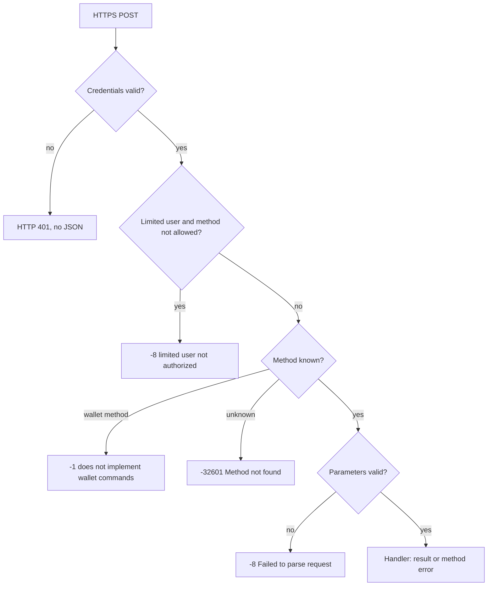
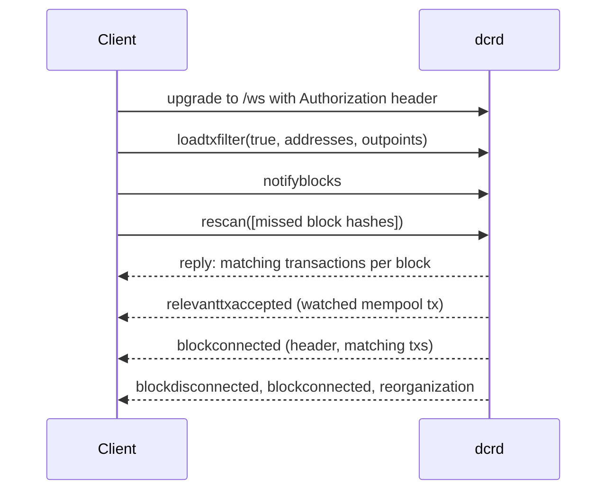

# dcrd JSON-RPC API

`dcrd`, the Decred full node, answers chain, mempool, network, staking, treasury, mixing and mining queries over JSON-RPC, on HTTPS POST and on websockets with push notifications. This reference covers how to connect and authenticate, the request and error format, and every method in `dcrd` 2.1.7 (JSON-RPC API version 8.3.0), grouped by purpose and generated from the handler tables in `internal/rpcserver/rpcserver.go` and `rpcwebsocket.go` at tag `release-v2.1.7`.

`dcrd` holds no keys. Wallet methods (balances, addresses, sending, tickets, voting) belong to `dcrwallet`: see [dcrwallet JSON-RPC API](dcrwallet-json-rpc.md). For a hands-on first call in curl, Python or JavaScript, start with [Your first JSON-RPC call](first-rpc-call.md).

## At a glance

| Item | Value in `dcrd` 2.1.7 |
|---|---|
| HTTP endpoint | `POST https://127.0.0.1:9109/` (any path except `/ws`) |
| Websocket endpoint | `wss://127.0.0.1:9109/ws` |
| Default RPC port | mainnet 9109, testnet 19109, simnet 19556, regnet 18656 |
| Default listeners | the addresses `localhost` resolves to (normally `127.0.0.1` and `::1`) |
| Transport | TLS 1.2 or later, with a self-signed `rpc.cert` that `dcrd` generates |
| Authentication | HTTP Basic (`rpcuser`/`rpcpass`, plus an optional limited account `rpclimituser`/`rpclimitpass`), or TLS client certificates (`authtype=clientcert`) |
| Message format | JSON-RPC request objects with positional `params`; JSON arrays for batches |
| API version | `version` returns it under `dcrdjsonrpcapi` (8.3.0) |
| Upstream parameter detail | [`docs/json_rpc_api.mediawiki`](https://github.com/decred/dcrd/blob/release-v2.1.7/docs/json_rpc_api.mediawiki) and `dcrctl help <METHOD>` |

## Connecting

### Turn the server on

The RPC server runs only when credentials exist: `rpcuser` and `rpcpass`, or `rpclimituser` and `rpclimitpass`, or `authtype=clientcert`. With basic authentication and no complete pair, `dcrd` disables RPC. On its first start without a config file, `dcrd` writes `dcrd.conf` with a random `rpcuser` and `rpcpass`, so the server is on at once ([Set up the command-line wallet](../../user/wallets/command-line.md) walks through this). When `--simnet` or `--regnet` is given on the command line, `dcrd` neither writes nor reads the default `dcrd.conf`: pass `--rpcuser` and `--rpcpass` as flags, or point `--configfile` at a file. `norpc=1` turns the server off.

The server listens only on this machine unless you add `rpclisten` lines. The port follows the network (`testnet=1`, `simnet=1`, `regnet=1`) when you leave it out of `rpclisten`.

These options in `dcrd.conf` (or as `--option` flags) control the server; [dcrd configuration](../reference/dcrd-config.md) lists every option.

| Option | Default | Effect |
|---|---|---|
| `rpcuser`, `rpcpass` | none (random pair in a generated `dcrd.conf`) | Full-access account. |
| `rpclimituser`, `rpclimitpass` | none | Limited account. Must differ from the full-access pair. |
| `authtype` | `basic` | `basic` or `clientcert`. |
| `clientcafile` | `clients.pem` in the `dcrd` home directory | CA certificates that sign accepted client certificates (`clientcert` only). |
| `rpclisten` | localhost on the network's RPC port | Interface and port to listen on; repeat for several. |
| `rpccert`, `rpckey` | `rpc.cert`, `rpc.key` in the home directory | Server certificate and key. |
| `tlscurve` | `P-256` | Curve for a generated certificate: `P-256` or `P-521`. |
| `altdnsnames` | none | Extra DNS names for a generated certificate. |
| `notls` | off | Plain HTTP; allowed only when every listener is `localhost`, `127.0.0.1` or `::1`, and never with `clientcert`. |
| `rpcmaxclients` | 10 | Concurrent HTTP clients; more get `503 Too busy`. |
| `rpcmaxwebsockets` | 25 | Concurrent websocket clients; more are disconnected. |
| `rpcmaxconcurrentreqs` | 20 | Requests one websocket connection may have in progress. |
| `txindex` | off | Full transaction index, needed by `getrawtransaction` for transactions outside the mempool. |
| `noexistsaddrindex` | off (index on) | Disables the index behind `existsaddress` and `existsaddresses`. |
| `miningaddr` | none | Payout addresses; required by `getwork`, `generate` and `setgenerate`, and for `work` notifications. |

The home directory is `~/.dcrd` on Linux and BSD, `~/Library/Application Support/Dcrd` on macOS and `%LOCALAPPDATA%\Dcrd` on Windows.

!!! warning "The RPC port controls the node"
    Anyone who reaches the port with full-access credentials can stop the node, change its peers, invalidate blocks and submit transactions. Keep the default localhost listener. To serve another machine, bind a private interface, keep TLS on, and prefer client certificates; [Run dcrd in production](../operate/production-node.md) covers remote access. Never forward port 9109 from the internet.

### TLS and the certificate

On its first start with TLS enabled, `dcrd` creates `rpc.cert` and `rpc.key` (it logs `Generating TLS certificates...`). The certificate is self-signed, valid for 10 years, and names the host name, `localhost`, `127.0.0.1`, `::1`, every local interface address and any `altdnsnames`. Names added later need a new certificate: delete both files and restart, or install your own pair. `dcrd` reloads changed certificate, key and client CA files without a restart; existing connections keep the files they started with.

Clients must trust `rpc.cert` itself, as the only trust anchor for this connection: `curl --cacert`, a Go `x509.CertPool`, `ssl.create_default_context(cafile=...)` in Python. `dcrctl` reads it from the `dcrd` home directory on its own. Turning certificate checks off (`dcrctl --skipverify`, `curl -k`) exposes the credentials to anyone on the path.

### Basic authentication

Each HTTP request carries an `Authorization: Basic` header with `rpcuser:rpcpass` or `rpclimituser:rpclimitpass`. A missing or wrong header gets `401 Unauthorized` with `WWW-Authenticate: Basic realm="dcrd RPC"` and no JSON body. A client has 10 seconds to send its request. Each HTTP response closes the connection (`Connection: close`), so a client that sends many calls should batch them or use a websocket.

Worked example: ask a local mainnet node for its height with curl. curl prompts for the password, which keeps it out of shell history and the process list.

```bash
curl --cacert ~/.dcrd/rpc.cert --user <RPCUSER> \
  --data '{"jsonrpc":"1.0","id":1,"method":"getblockcount","params":[]}' \
  https://127.0.0.1:9109/
```

`<RPCUSER>` is the `rpcuser` value from `dcrd.conf`; on macOS or Windows, point `--cacert` at `rpc.cert` in the home directory listed above. For testnet use port 19109, for simnet 19556.

```text title="Expected output (the height is an example)"
Enter host password for user '<RPCUSER>':
{"jsonrpc":"1.0","result":1067318,"error":null,"id":1}
```

`dcrctl -j <METHOD>` prints the exact request and response JSON for any call, which helps when porting a client:

```bash
dcrctl -j getbestblock
```

```text title="Expected output: request, raw response, formatted result"
{"jsonrpc":"1.0","method":"getbestblock","params":[],"id":1}
{"jsonrpc":"1.0","result":{"hash":"<BLOCK HASH>","height":<HEIGHT>},"error":null,"id":1}
{
  "hash": "<BLOCK HASH>",
  "height": <HEIGHT>
}
```

`<BLOCK HASH>` and `<HEIGHT>` are the hash and height of the node's current tip.

### The limited user

`rpclimituser` and `rpclimitpass` define a second account for clients that should only read the chain and submit data. A limited user can call 60 of the 93 methods (marked in the tables below):

- the chain, block, transaction, address, ticket, vote and treasury-balance queries, except `gettxoutsetinfo`, `getmempoolinfo`, `getticketpoolvalue` and `gettreasuryspendvotes`;
- `sendrawtransaction`, `submitblock`, `sendrawmixmessage` and `regentemplate`;
- on websockets: `notifyblocks`, `notifynewtransactions`, `notifymixmessages`, `rescan`, `session`, `rebroadcastwinners` and `help`.

It cannot manage peers or read their details, stop the node, change logging, run the profiler, invalidate or reconsider blocks, verify the chain, call `getwork`, `getmininginfo` or the CPU miner methods, load a transaction filter (so its `rescan` calls fail), subscribe to work, TSPEND, winning-ticket or new-ticket notifications, or call any `stopnotify...` method. A refused call returns:

```json
{"jsonrpc":"1.0","result":null,"error":{"code":-8,"message":"limited user not authorized for this method"},"id":1}
```

Over a websocket the same refusal uses code `-32602`. `dcrwallet` needs the full-access account, because it uses `loadtxfilter`, `notifywinningtickets` and `notifytspend`.

!!! note "Not a public-access mode"
    The limited account still submits transactions and blocks and runs costly calls such as `livetickets` and `getblock` with `verbosetx=true`, so it does not by itself make a publicly reachable RPC port safe.

### Client certificate authentication

With `authtype=clientcert`, the TLS handshake authenticates the client: `dcrd` requires a client certificate signed by a CA in `clientcafile` and asks for no password. Every client with a valid certificate has full access, since there is no limited tier in this mode, and `dcrd` refuses to start if any `rpcuser`, `rpcpass`, `rpclimituser` or `rpclimitpass` is set. TLS cannot be disabled.

The `gencerts` tool in the command-line bundle creates the CA and client certificates:

1. Create a CA that can sign certificates:

    ```bash
    gencerts -S -o "dcrd clients" ca.pem ca.key
    ```

2. Create a client certificate signed by it:

    ```bash
    gencerts -C ca.pem -K ca.key client.pem client.key
    ```

3. Copy `ca.pem` to `clients.pem` in the `dcrd` home directory, set `authtype=clientcert` in `dcrd.conf`, remove the `rpcuser` and `rpcpass` lines, and restart `dcrd`. Later changes to `clients.pem` take effect without a restart.
4. Connect with the client pair:

    ```bash
    dcrctl --authtype=clientcert --clientcert=client.pem --clientkey=client.key getblockcount
    ```

Keep `ca.key` offline: anyone holding it can mint certificates with full access. To revoke a client, issue new certificates from a new CA and replace `clients.pem`.

### Websocket connections

Connect to `/ws` with the same TLS settings. Authenticate in one of two ways:

- send the `Authorization: Basic` header with the upgrade request; or
- send `authenticate` as the first message: `{"jsonrpc":"1.0","id":0,"method":"authenticate","params":["<RPCUSER>","<RPCPASS>"]}`.

Until it authenticates, a connection may send messages of at most 4 KiB. Any other first method, wrong credentials, or a second `authenticate` closes the connection. Under `clientcert`, the TLS handshake authenticates the websocket.

Websocket behavior that clients must handle:

- **Out-of-order replies.** Requests on one connection run concurrently (up to `rpcmaxconcurrentreqs`), so replies can arrive in a different order. Match them by `id`.
- **Notifications** are requests with `"id":null`. Tell them apart from replies by the `method` field.
- **Browser origins.** `dcrd` rejects a websocket upgrade whose `Origin` host differs from the requested host, and sends no CORS headers on HTTP. A web app served from another origin needs a backend that holds the credentials.
- **Reconnects.** Subscriptions and filters belong to the connection. After reconnecting, register them again; `session` returns a per-connection random ID that changes when the connection does.
- **Keepalive.** `dcrd` answers websocket pings with pongs.

The websocket-only methods are listed in [Websocket methods](#websocket-methods); every HTTP method also works over a websocket.

## Requests, responses and errors

### Request

```json
{"jsonrpc":"1.0","id":1,"method":"getblockhash","params":[0]}
```

- `method`: the method name, lowercase.
- `params`: a JSON array of positional parameters in the order the tables give. Named parameters (a JSON object) are not supported. Omit trailing optional parameters to get their defaults.
- `id`: a number or string, echoed in the reply. A request with `"id":null` or no `id` counts as a JSON-RPC notification: `dcrd` neither runs it nor replies.
- `jsonrpc`: `"1.0"` or `"2.0"`; the reply echoes it. `dcrctl` and the Go `rpcclient` send `"1.0"`.

The HTTP body may be at most 8 MiB; an authenticated websocket message at most 16 MiB.

### Response

Every reply has the same four fields. On success `error` is `null`; on failure `result` is `null`:

```json
{"jsonrpc":"1.0","result":"298e5cc3d985bfe7f81dc135f360abe089edd4396b86d2de66b0cef42b21d980","error":null,"id":1}
```

That is the mainnet genesis block hash. HTTP replies use status 200 for JSON-RPC errors too, and end with a newline. Amounts are DCR as JSON numbers, except in `getcoinsupply`, `getblocksubsidy`, `gettreasurybalance`, the `stakedifficulty` field of `getmininginfo` and the `stakediff` of `newtickets`, which use atoms (1 DCR = 100,000,000 atoms).

### Batches

Send a JSON array of requests to get a JSON array of replies:

```json
[{"jsonrpc":"2.0","id":1,"method":"getblockcount","params":[]},
 {"jsonrpc":"2.0","id":2,"method":"getbestblockhash","params":[]}]
```

`dcrd` runs the entries one after another, in order, and returns their replies in the same order, leaving out entries without an `id`. Each entry succeeds or fails on its own, including the limited-user check. An empty array returns a single error, code `-32600`, `Invalid request: empty batch`. Batches work on HTTP and websockets. In a websocket batch every entry must include `params` (use `[]` when there are none); an entry without it gets `-32600`, `Invalid request: malformed`.

### How a request is handled

For an HTTP request, `dcrd` checks credentials, then the limited-user list, then whether it knows the method, then the parameters, before the handler runs; each check has its own error. Websockets check the limited-user list after parsing.



### Error codes

| Code | Meaning in `dcrd` | Typical cause |
|---|---|---|
| `-32700` | Parse error | The body is not valid JSON, or `params` is not an array. |
| `-32600` | Invalid request | Empty `method`, empty batch, or a batch entry that is not an object. |
| `-32601` | Method not found | Unknown method, a websocket-only method sent over HTTP, or a wallet method `dcrd` does not recognize. |
| `-32602` | Invalid parameters | Limited user refused on a websocket. |
| `-32603` | Internal error | A missing configuration, such as `txindex` for `getrawtransaction` or `miningaddr` for `getwork`; the message names it. |
| `-1` | Miscellaneous | A wallet method (`This implementation does not implement wallet commands`), the unimplemented `estimatepriority`, a transaction rejected by policy or consensus, `getwork` with no template available. |
| `-5` | Not found | Unknown block, transaction, output, mix message or treasury data; also `generate` on mainnet. |
| `-8` | Invalid parameter | Wrong number or type of parameters, a bad value, a limited user refused over HTTP. |
| `-9` | Not connected | `getwork` while the node has no peers. |
| `-10` | Initial download | `getwork` while the node is still syncing. |
| `-22` | Deserialization | Invalid hex, or a transaction or message that does not decode. |
| `-26` | Invalid state | `startprofiler` when it is running, `stopprofiler` when it is not. |
| `-40` | Duplicate transaction | `sendrawtransaction` of a transaction already in the mempool or recently mined. |
| `-50` | Reconsider failure | `reconsiderblock` could not make the block valid again. |

For `sendrawtransaction`, `-40` means the network already has the transaction, so a client can treat it as success when rebroadcasting. `dcrd` itself rebroadcasts every transaction submitted this way, except votes, until it is mined.

## Methods by family

The tables list all 77 methods available over HTTP (and websockets) in `dcrd` 2.1.7. **Parameters** shows the positional parameters as `dcrctl help` prints them: quoted names are strings, names in parentheses are optional with the default after `=`. **Limited user** says whether the [limited user](#the-limited-user) may call the method. Result fields and full parameter descriptions are in the upstream [`json_rpc_api.mediawiki`](https://github.com/decred/dcrd/blob/release-v2.1.7/docs/json_rpc_api.mediawiki) and in `dcrctl help <METHOD>`; where the two differ, the help text built from the code is authoritative (the mediawiki marks `getblockheader` unavailable to the limited user, but 2.1.7 allows it).

Four conventions recur:

- **Hashes** are hex strings in the usual byte-reversed display order, as block explorers show them. Block hashes remain BLAKE-256; since the `blake3pow` agenda activated, proof of work uses BLAKE3, which is why verbose block results carry both `hash` and `powhash`.
- **Trees.** Decred blocks have a regular and a stake transaction tree, so outpoints carry a `tree` field: 0 regular, 1 stake ([the whitepaper's block structure](../../whitepaper/10-blocks.md#ch:blocks)).
- **Bitsets.** `existsaddresses`, `existslivetickets` and `existsmempooltxs` return a hex string: item *i* is bit *i* mod 8, least significant first, of byte *i* / 8.
- **Wallet methods.** 75 Bitcoin-style and Decred wallet methods (`getbalance`, `sendtoaddress`, `purchaseticket`, `walletpassphrase` and others) return `-1`, and newer ones `-32601`. Send them to `dcrwallet`.

### Chain and blocks

`getblockchaininfo` is the method to poll for sync state: `initialblockdownload` is `false` once the node has caught up, and `deployments` gives each consensus agenda's status. A confirmation in Decred also depends on the next block's votes, which can disapprove a block's regular transactions; [Blocks, confirmations and reorganizations](../protocol/blocks-and-confirmations.md) explains how to count them safely.

| Method | Parameters | Limited user | Description |
|---|---|---|---|
| `getbestblock` | — | yes | Hash and height of the best chain tip. |
| `getbestblockhash` | — | yes | Hash of the best chain tip. |
| `getblock` | `"hash" (verbose=true verbosetx=false)` | yes | A block by hash: hex when `verbose=false`, otherwise JSON; `verbosetx=true` expands every transaction. |
| `getblockchaininfo` | — | yes | Network, tip, header and sync heights, `initialblockdownload`, maximum block size, and the status of each consensus agenda (`deployments`). |
| `getblockcount` | — | yes | Height of the best chain tip. |
| `getblockhash` | `index` | yes | Hash of the main-chain block at height `index`. |
| `getblockheader` | `"hash" (verbose=true)` | yes | A block header by hash, as hex or JSON. Verbose output includes `powhash`. |
| `getblocksubsidy` | `height voters` | yes | PoW (`pow`), vote (`pos`) and treasury (`developer`) subsidy, in atoms, of a block at `height` with `voters` votes. |
| `getcfilterv2` | `"blockhash"` | yes | The version 2 compact filter of a block and the proof that its header commits to it. |
| `getchaintips` | — | yes | Every known chain tip with its branch length and status (`active`, `valid-fork`, `valid-headers`, `headers-only`, `invalid`). |
| `getcoinsupply` | — | yes | Total coins issued so far, in atoms. |
| `getcurrentnet` | — | yes | Network identifier (wire protocol magic) as an integer. |
| `getdifficulty` | — | yes | Proof-of-work difficulty as a multiple of the minimum difficulty. |
| `getheaders` | `["blocklocator",...] "hashstop"` | yes | Serialized headers after the first locator hash the node knows, up to `hashstop` (all zeros: as many as allowed, at most 2000 in 2.1.7). |
| `gettxout` | `"txid" vout tree (includemempool=true)` | yes | One unspent output (value in DCR, script, confirmations); `null` when it is spent or unknown. `tree` is 0 (regular) or 1 (stake). |
| `gettxoutsetinfo` | — | no | Statistics on the unspent output set: height, outputs, transactions, total amount, hash, disk size. |
| `invalidateblock` | `"blockhash"` | no | Marks a block invalid as if it had broken a consensus rule, so the node reorganizes away from it. |
| `reconsiderblock` | `"blockhash"` | no | Clears the invalid status of a block and its ancestors and makes them eligible for best chain selection again. |
| `verifychain` | `(checklevel=3 checkdepth=288)` | no | Re-checks the chain database to `checklevel` over the last `checkdepth` blocks. |

### Transactions, mempool and addresses

`getrawtransaction` finds any mempool transaction, but a mined one only when `dcrd` runs with `txindex=1`. An index enabled later catches up in the background, and calls that need it can fail until it is current. `dcrd` keeps no per-address history: `existsaddress` says only whether an address has been used. For address histories use [dcrdata](dcrdata-api.md) or a wallet. `sendrawtransaction` accepts only transactions that pass the node's relay policy ([the whitepaper's mempool acceptance rules](../../whitepaper/17-policy.md#sec:policy-accept)).

| Method | Parameters | Limited user | Description |
|---|---|---|---|
| `createrawtransaction` | `[{"amount":n.nnn,"txid":"value","vout":n,"tree":n},...] {"address":amount,...} (locktime expiry)` | yes | Builds an unsigned regular transaction from the given inputs and outputs. |
| `decoderawtransaction` | `"hextx"` | yes | Decodes a hex-encoded transaction to JSON. |
| `decodescript` | `"hexscript" (version)` | yes | Decodes a hex-encoded script (script `version` 0 by default). |
| `estimatefee` | `numblocks` | yes | The node's minimum relay fee rate in DCR/kB. `numblocks` is ignored. |
| `estimatesmartfee` | `confirmations (mode="conservative")` | yes | Fee rate in DCR/kB expected to confirm within `confirmations` blocks (1 to 32); only `conservative` mode. |
| `existsaddress` | `"address"` | yes | Whether an address has ever been used on chain or in the mempool (exists-address index). |
| `existsaddresses` | `["address",...]` | yes | `existsaddress` for many addresses at once; returns a hex bitset. |
| `existsmempooltxs` | `["txhash",...]` | yes | Which of the given transaction hashes are in the mempool; returns a hex bitset. |
| `getmempoolinfo` | — | no | Number of transactions and bytes in the mempool. |
| `getrawmempool` | `(verbose=false "txtype")` | yes | Mempool transaction hashes, or details with `verbose=true`. `txtype`: `regular`, `tickets`, `votes`, `revocations`, `tspend`, `tadd` or `all`. |
| `getrawtransaction` | `"txid" (verbose=0)` | yes | A transaction by hash, as hex or as JSON with `verbose=1`. Transactions outside the mempool need `txindex`. |
| `sendrawtransaction` | `"hextx" (allowhighfees=false)` | yes | Validates a signed hex transaction, adds it to the mempool, relays it and returns its hash. With the default `allowhighfees=false`, a transaction paying more than 10,000 times the minimum relay fee for its size is rejected (`-1`); `true` skips that check. |
| `txfeeinfo` | `(blocks rangestart rangeend)` | yes | Regular transaction fee statistics (DCR/kB) for the mempool, recent blocks and a height range. |
| `validateaddress` | `"address"` | yes | Whether an address is valid on this network. |
| `verifymessage` | `"address" "signature" "message"` | yes | Checks a signed message against an address. |

### Network and peers

These methods change or inspect the peer-to-peer side of the node. Only the traffic and network summaries (`getnettotals`, `getnetworkinfo`) are open to the limited user.

| Method | Parameters | Limited user | Description |
|---|---|---|---|
| `addnode` | `"addr"` `"add"`, `"remove"` or `"onetry"` | no | Adds or removes a persistent peer, or tries a single connection (`onetry`). |
| `getaddednodeinfo` | `dns ("node")` | no | Status of the peers added with `addnode`. |
| `getconnectioncount` | — | no | Number of connected peers. |
| `getnettotals` | — | yes | Total bytes received and sent. |
| `getnetworkinfo` | — | yes | Node and protocol versions, peer count, reachable networks, relay fee and local addresses. |
| `getpeerinfo` | — | no | One object per connected peer. |
| `node` | `"connect"`, `"remove"` or `"disconnect"`, `"target"`, optional `"perm"` or `"temp"` | no | Connects to, disconnects or removes a peer, temporarily or persistently. |
| `ping` | — | no | Queues a ping to every peer; times appear in `getpeerinfo` (`pingtime`, `pingwait`). |

### Stake and tickets

The ticket price changes every 144 blocks; `getstakedifficulty` gives the current and next value and `estimatestakediff` estimates the one after. Ticket states, commitments and the lottery are explained in [Staking and the treasury for builders](../protocol/staking-and-treasury.md); the price algorithm is in [the whitepaper's stake difficulty section](../../whitepaper/09-difficulty.md#sec:difficulty-stake). `getvoteinfo` takes the stake version of a consensus rule vote and reports its tally ([the whitepaper's consensus rule change chapter](../../whitepaper/13-voting.md#ch:voting)).

| Method | Parameters | Limited user | Description |
|---|---|---|---|
| `createrawssrtx` | `[{"amount":n.nnn,"txid":"value","vout":n,"tree":n}] (fee)` | yes | Builds an unsigned ticket revocation. |
| `createrawsstx` | `[{"txid":"value","vout":n,"tree":n,"amt":n},...] {"address":amount} [{"addr":"value","commitamt":n,"changeaddr":"value","changeamt":n},...]` | yes | Builds an unsigned ticket purchase. |
| `estimatestakediff` | `(tickets)` | yes | Minimum, maximum and expected ticket price for the next interval, and the price if `tickets` more tickets are bought. |
| `existsliveticket` | `"txhash"` | yes | Whether a ticket is live. |
| `existslivetickets` | `["txhash",...]` | yes | Which of the given tickets are live; returns a hex bitset. |
| `getstakedifficulty` | — | yes | Ticket price (stake difficulty) of the current block (`current`) and the next one (`next`), in DCR. |
| `getstakeversioninfo` | `(count)` | yes | Stake and vote version counts for the last `count` stake version intervals. |
| `getstakeversions` | `"hash" count` | yes | Stake versions of `count` blocks ending at block `hash`. |
| `getticketpoolvalue` | — | no | Total DCR locked in live tickets. |
| `getvoteinfo` | `version` | yes | Consensus rule vote status for stake `version`: window heights, quorum, and choice counts per agenda. |
| `livetickets` | — | yes | Hashes of all live tickets. |
| `ticketfeeinfo` | `(blocks windows)` | yes | Ticket fee statistics (DCR/kB) for the mempool, recent blocks and recent ticket price windows. |
| `ticketsforaddress` | `"address"` | yes | Live tickets whose voting rights are held by `address`. |
| `ticketvwap` | `(start end)` | yes | Volume-weighted average ticket price over a height range. |

### Treasury

A treasury spend (TSPEND) is voted on by tickets during a window derived from its expiry (it ends two blocks before the expiry height); `gettreasuryspendvotes` reports the window as `votestart` and `voteend` with the running yes and no counts. The approval rule is in [the whitepaper's treasury spend voting rules](../../whitepaper/12-treasury.md#sec:treasury-votes), the spending limit in [its expenditure policy](../../whitepaper/12-treasury.md#sec:treasury-policy). Websocket clients learn of new TSPENDs from `notifytspend`.

| Method | Parameters | Limited user | Description |
|---|---|---|---|
| `gettreasurybalance` | `("hash" verbose=false)` | yes | Treasury balance in atoms at a block (default: the tip); `verbose=true` adds the updates that mature later. |
| `gettreasuryspendvotes` | `("block" ["tspend",...])` | no | Yes and no counts, voting window and expiry of TSPENDs (default: all in the mempool), counted up to `block` (default: the tip). |

### Mixing

`dcrd` relays StakeShuffle mix messages through its mixpool; wallets use these methods and `notifymixmessages` to take part in mixes. See [Mixing for builders](../protocol/mixing.md) and [the whitepaper's StakeShuffle chapter](../../whitepaper/18-mixing.md#ch:mixing).

| Method | Parameters | Limited user | Description |
|---|---|---|---|
| `getmixmessage` | `"hash"` | yes | A mix message in the mixpool by hash: its type and hex serialization. |
| `getmixpairrequests` | — | yes | All pair-request messages in the mixpool, hex encoded. Used by dcrwallet; the upstream method list marks it experimental. |
| `sendrawmixmessage` | `"command" "message"` | yes | Adds a serialized mix message (`command` is its wire command name) to the mixpool and relays it. |

### Mining

`dcrd` serves external miners through `getwork` and its websocket form `notifywork`, and accepts whole blocks through `submitblock`. It has **no `getblocktemplate`**: that method was removed in `dcrd` 1.5.0, and Decred's header has enough nonce space (a 4-byte `Nonce` plus 32 bytes of `ExtraData`) that miners never need to rebuild the coinbase.

- **Requirements.** `getwork` fails unless `miningaddr` is set. It also fails while the node has no peers (`-9`) or is not synced (`-10`), unless `allowunsyncedmining` is set (refused on mainnet, always on for simnet and regnet), and while the built-in CPU miner is running. `notifywork` also needs `miningaddr`: without it the subscription succeeds but no `work` notifications are sent.
- **Work.** `getwork` with no parameters returns `data`, the 180-byte serialized block header plus 12 bytes of padding (192 bytes, hex), and `target`, the 256-bit target as 32 little-endian bytes. The proof-of-work hash is BLAKE3 since the `blake3pow` agenda (Decred Change Proposal DCP-0011) activated at block 794,368; the padding differs between BLAKE-256 and BLAKE3. The byte layout, padding and test vectors are in [the whitepaper's getwork data section](../../whitepaper/17-policy.md#sec:policy-getwork).
- **Submitting.** `getwork` with the solved `data` returns `true` if the block was accepted, `false` if it was stale, unknown or invalid. `submitblock` returns `null` on success and a `rejected: <reason>` string, not an error, on failure.
- **Templates wait for votes.** A block needs at least 3 of the 5 votes on its parent, so the template generator builds on a new block once 3 of its votes have arrived, and waits up to 2.5 seconds for the other two. `work` notifications carry a reason: `newparent`, `newvotes`, `newtxns` or `unknown`.
- **CPU mining** (`generate`, `setgenerate`) exists for test networks. `generate` refuses to run on mainnet.

[Mining infrastructure](../operate/mining.md) covers running miners and pools against `dcrd`; [the whitepaper's mining interfaces section](../../whitepaper/17-policy.md#sec:policy-mining) specifies the behavior.

| Method | Parameters | Limited user | Description |
|---|---|---|---|
| `generate` | `numblocks` | no | Test networks only: mines `numblocks` blocks with the CPU miner and returns their hashes; `0` cancels a running call. |
| `getgenerate` | — | no | Whether the CPU miner is running. |
| `gethashespersec` | — | no | Recent CPU miner hash rate. |
| `getmininginfo` | — | no | Height, last block size, difficulty, next ticket price (atoms), mempool size, network hash rate and CPU miner state. |
| `getnetworkhashps` | `(blocks=120 height=-1)` | yes | Estimated network hash rate over `blocks` blocks ending at `height` (-1: the tip). |
| `getwork` | `("data")` | no | Without `data`: work to solve (`data`, `target`). With `data`: submits a solution and returns whether the block was accepted. |
| `regentemplate` | — | yes | Asks the background template generator to build a new template now. |
| `setgenerate` | `generate (genproclimit=-1)` | no | Starts or stops the CPU miner; `genproclimit` sets the number of workers. |
| `submitblock` | `"hexblock" ({"workid":"value"})` | yes | Submits a complete serialized block. Returns `null` when accepted, else the string `rejected: <reason>`. |

### Node control and utility

`version` lets a client check compatibility before anything else: `dcrwallet`, for example, calls it on connect. The profiling server started by `startprofiler` exposes Go's `pprof` endpoints, which reveal internal state; keep it on a loopback address.

| Method | Parameters | Limited user | Description |
|---|---|---|---|
| `debuglevel` | `"levelspec"` | no | Changes log levels at runtime; `show` lists the subsystems. |
| `getinfo` | — | yes | Node and protocol version, height, peers, proxy, difficulty, relay fee, `txindex` state, testnet flag. |
| `help` | `("command")` | yes | Lists all methods, or describes one. |
| `startprofiler` | `"addr" (allownonloopback=false)` | no | Starts the HTTP profiling server on `addr` (loopback only unless `allownonloopback=true`). |
| `stop` | — | no | Shuts `dcrd` down; returns `dcrd stopping.` |
| `stopprofiler` | — | no | Stops the profiling server. |
| `version` | — | yes | Version of `dcrd` and of the JSON-RPC API (`dcrdjsonrpcapi`). |

## Websocket methods

These 16 methods, plus `authenticate`, exist only on the `/ws` endpoint; over HTTP they return `-32601`. Subscriptions last until the matching `stopnotify...` call or the end of the connection. `notifynewtickets` and `notifywinningtickets` have no stop method.

| Method | Parameters | Limited user | Description |
|---|---|---|---|
| `authenticate` | `"username" "passphrase"` | — | Authenticates the connection. Required as the first message when the upgrade request had no `Authorization` header. |
| `loadtxfilter` | `reload ["address",...] [{"hash":"value","tree":n,"index":n},...]` | no | Replaces (`reload=true`) or extends the connection's filter of addresses and outpoints. |
| `notifyblocks` | — | yes | Subscribes to `blockconnected`, `blockdisconnected` and `reorganization`. |
| `notifymixmessages` | — | yes | Subscribes to `mixmessage` for every message accepted to the mixpool. |
| `notifynewtickets` | — | no | Subscribes to `newtickets` when tickets mature. |
| `notifynewtransactions` | `(verbose=false)` | yes | Subscribes to `txaccepted`, or `txacceptedverbose` with `verbose=true`, for every transaction accepted to the mempool. |
| `notifytspend` | — | no | Subscribes to `tspend` when a TSPEND enters the mempool. |
| `notifywinningtickets` | — | no | Subscribes to `winningtickets`. |
| `notifywork` | — | no | Subscribes to `work` for every new block template. |
| `rebroadcastwinners` | — | yes | Sends `winningtickets` again to all subscribers, for every block at the tip height. |
| `rescan` | `["blockhash",...]` | yes | Returns the transactions in the given blocks that match the loaded filter. Each block must be the child of the one before it. |
| `session` | — | yes | Returns `{"sessionid": n}`, a random 64-bit ID for this connection. |
| `stopnotifyblocks` | — | no | Ends `notifyblocks`. |
| `stopnotifymixmessages` | — | no | Ends `notifymixmessages`. |
| `stopnotifynewtransactions` | — | no | Ends `notifynewtransactions`. |
| `stopnotifytspend` | — | no | Ends `notifytspend`. |
| `stopnotifywork` | — | no | Ends `notifywork`. |

The websocket `help` also lists these methods.

### Notifications

Notifications are JSON-RPC requests from `dcrd` with `"jsonrpc":"1.0"`, `"id":null` and positional `params`:

```json
{"jsonrpc":"1.0","method":"blockdisconnected","params":["<HEADER HEX>"],"id":null}
```

`<HEADER HEX>` stands for the 180-byte serialized block header in hex.

| Notification | After | Parameters |
|---|---|---|
| `blockconnected` | `notifyblocks` | Serialized header (hex); array of hex transactions in the block that match the loaded filter, or `null`. |
| `blockdisconnected` | `notifyblocks` | Serialized header (hex) of the block removed from the main chain. |
| `reorganization` | `notifyblocks` | `oldhash`, `oldheight`, `newhash`, `newheight`: sent after a reorganization to a competing branch completes, following the `blockdisconnected` and `blockconnected` notifications for it. Not in the upstream mediawiki. |
| `relevanttxaccepted` | `loadtxfilter` | Hex transaction accepted to the mempool that spends a watched outpoint or pays a watched address. Outputs that pay a watched address join the filter. |
| `txaccepted` | `notifynewtransactions` | Transaction hash; sum of its outputs in DCR. |
| `txacceptedverbose` | `notifynewtransactions` with `verbose=true` | The transaction as a `getrawtransaction` verbose object. |
| `winningtickets` | `notifywinningtickets` | Block hash, block height, and an object mapping `"0"` to `"4"` to the hashes of the tickets chosen to vote on that block. |
| `newtickets` | `notifynewtickets` | Block hash, height, ticket price in atoms, array of tickets that matured in it. |
| `tspend` | `notifytspend` | Hex TSPEND transaction. |
| `work` | `notifywork` | `data`, `target` (as `getwork`) and the reason: `newparent`, `newvotes`, `newtxns` or `unknown`. |
| `mixmessage` | `notifymixmessages` | Wire command name of the message type; hex serialized message. |

### A filtered wallet-style session

A client that tracks its own addresses, as `dcrwallet` does, loads a filter, subscribes to blocks, scans the blocks it missed, and then follows notifications.



Subscribe before rescanning, so that no block falls between the scan and the first notification, and drop duplicates by block hash. On `blockdisconnected`, roll back what you recorded for that block.

## Using rpcclient from Go

Go programs should use the client in `dcrd`'s own repository instead of hand-written JSON: the module `github.com/decred/dcrd/rpcclient/v8` (v8.1.0 is the version `dcrd` 2.1.7 builds with) handles TLS, basic and client-certificate authentication, websockets with automatic reconnection, and notification callbacks; the request and result types are in `github.com/decred/dcrd/rpc/jsonrpc/types/v4`. [Talking to dcrd and dcrwallet from Go](../go/rpc-clients.md) has runnable examples.

## Removed and legacy methods

Old code and posts may use methods `dcrd` 2.1.7 no longer has. They now return `-32601`.

| Method | Removed in | Use instead |
|---|---|---|
| `getblocktemplate` | 1.5.0 | `getwork`, `notifywork`, `submitblock` |
| `createrawssgen` | 1.4.0 | None: votes are created by wallets |
| `getcfilter`, `getcfilterheader` | 1.7.0 | `getcfilterv2` |
| `notifystakedifficulty` and its `stakedifficulty` notification | 1.7.0 | `getstakedifficulty` after each 144-block price interval |
| `searchrawtransactions` | 1.8.0, with the address index (`addrindex`) | [dcrdata API](dcrdata-api.md) |
| `missedtickets`, `rebroadcastmissed`, `existsmissedtickets`, `existsexpiredtickets`, `notifyspentandmissedtickets` | 1.8.0 | None: missed and expired tickets are revoked automatically since the `autorevocations` agenda |

These remain, or are still expected by old clients, but behave as legacy:

| Item | Behavior in 2.1.7 |
|---|---|
| `estimatepriority` | Recognized; returns `-1 Command unimplemented`. |
| `estimatefee` `numblocks` | Ignored; the result is the minimum relay fee rate. |
| `submitblock` `options` (`workid`) | Ignored. |
| `getwork` result fields `hash1`, `midstate` | No longer returned; the result has only `data` and `target`. |
| `getblockchaininfo` field `difficulty` | Deprecated; use `difficultyratio`. |
| `getrawmempool` verbose fields `startingpriority`, `currentpriority` | Deprecated; always 0. |
| `createrawssrtx` | Still builds a revocation, though revocations have been automatic since block 657,280. |

## Next steps

- [Your first JSON-RPC call](first-rpc-call.md): working calls from curl, Python and JavaScript, including websockets.
- [dcrwallet JSON-RPC API](dcrwallet-json-rpc.md): the wallet methods `dcrd` refuses.
- [Talking to dcrd and dcrwallet from Go](../go/rpc-clients.md): the same API through `rpcclient`.
- [Run dcrd in production](../operate/production-node.md): indexes, remote RPC access and monitoring for services that depend on this API.
- [Integrate DCR into an exchange or service](../integrate/exchange.md): which of these calls an integration needs, and the Decred-specific pitfalls.

*[API]: application programming interface
*[CA]: certificate authority
*[CORS]: cross-origin resource sharing
*[DCP]: Decred Change Proposal
*[PoW]: proof of work
*[RPC]: remote procedure call
*[TLS]: Transport Layer Security
*[TSPEND]: treasury spend
