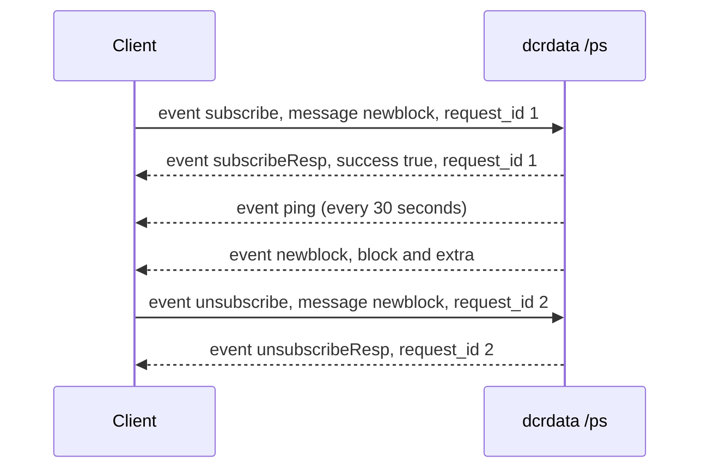
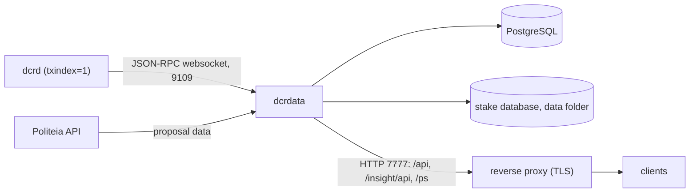

# dcrdata API

dcrdata is the indexer and block explorer behind dcrdata.decred.org. Besides web pages it serves three application programming interfaces (APIs): its own representational state transfer (REST) API under `/api`, an Insight-compatible API under `/insight/api`, and a websocket push channel at `/ps`. This page is the reference for all three, for developers who need history and search that `dcrd` does not keep, and the guide to running your own instance.

Everything here was checked against the dcrdata `master` branch at commit `9c02e71` (November 2025; Go module `github.com/decred/dcrdata/v8`, version string `6.2.0-pre`), mainly `cmd/dcrdata/internal/api/apirouter.go`, `apiroutes.go`, `insight/`, `pubsub/` and `api/types/`. In November 2026 dcrdata.decred.org served exactly the route list that commit defines, and both public instances reported API version 1. dcrdata has no tag for this code: the last tag is `release-v6.1.0` (2022), so do not go by the release pages.

The README's release table, which says not to run `master` in production, is out of date: its "Current" 6.0 series needs `dcrd` JSON-RPC API 6.x (`dcrd` 1.6), the 6.1 tag and branch need 7.x, and `dcrd` 2.1.7 reports 8.3.0, so `master` is the only dcrdata code that works with current `dcrd`.

## What dcrdata adds to dcrd

`dcrd` validates and relays the chain, but it keeps only the indexes consensus and relay need. dcrdata reads every block from `dcrd`, stores it in PostgreSQL and a stake database, and answers questions `dcrd` cannot.

| You need | `dcrd` alone | dcrdata |
|---|---|---|
| All transactions for an address, with balances | Not available: the exists-address index records only whether an address was ever used (`existsaddress`) | `/api/address/<ADDRESS>`, `/totals`, Insight `/addr`, CSV export |
| Which transaction spent an output | Not available | `/api/tx/<TXID>?spends=true` |
| A transaction by hash, anywhere in the chain | Only with `txindex=1` | Always (dcrdata itself requires `txindex`) |
| Ticket status, with the block where it was drawn | `existsliveticket` for live tickets only | `/api/tx/<TXID>/tinfo` |
| Ticket pool size and value at any past height | Current pool only (`getticketpoolvalue`, `livetickets`) | `/api/stake/pool/b/<HEIGHT>`, ranges, charts |
| Agenda vote tallies block by block | Current interval only (`getvoteinfo`) | `/api/agenda/<AGENDA_ID>` |
| Treasury income and spending history | Current balance (`gettreasurybalance`) | `/api/treasury/balance`, `/api/treasury/io/<GROUPING>` |
| Politeia vote progress over time | Not available | `/api/proposal/<TOKEN>` |
| Chart series (ticket price, pool size, fees, missed votes, coin supply and more) | Not available | `/api/chart/<CHART_ID>` |
| Push notifications for an address, including unconfirmed spends | Only for addresses loaded with `loadtxfilter` on your own websocket | `/ps` event `address:<ADDRESS>` |

For current values, such as the ticket price, the treasury balance or the coin supply, your own `dcrd` is the better source when you run one: it is the validating node, and it answers without a third party. See [dcrd JSON-RPC API](dcrd-json-rpc.md). Use dcrdata for history, search and aggregation.

## Public instances and conventions

### Base URLs

Two public mainnet instances run the same software. Neither publishes a service-level agreement.

| Instance | REST | Insight REST | Pubsub websocket |
|---|---|---|---|
| dcrdata.decred.org | `https://dcrdata.decred.org/api` | `https://dcrdata.decred.org/insight/api` | `wss://dcrdata.decred.org/ps` |
| explorer.dcrdata.org | `https://explorer.dcrdata.org/api` | `https://explorer.dcrdata.org/insight/api` | `wss://explorer.dcrdata.org/ps` |

Both instances also serve the Insight socket.io endpoint at `/insight/socket.io/` and CSV downloads under `/download`. The public testnet explorer, testnet.dcrdata.org, returned HTTP 503 in November 2026; for testnet or simnet, run your own instance (see [Self-hosting](#self-hosting)). dcrdata does not support regnet.

Run a first request to see the instance's sync state:

```bash
curl -s 'https://dcrdata.decred.org/api/status?indent=true'
```

```text title="Expected output (example values)"
{
   "ready": true,
   "db_height": 1133602,
   "db_block_time": 1794983657,
   "node_height": 1133602,
   "node_connections": 8,
   "api_version": 1,
   "dcrdata_version": "",
   "network_name": "mainnet"
}
```

`db_height` equal to `node_height` means the database has caught up with its node. The public instances leave `dcrdata_version` empty.

### Request and response conventions

- **Methods.** Everything is `GET` except `POST /api/txs` and `POST /api/txs/trimmed`, and the Insight `POST` methods. Request bodies are limited to 2 MiB.
- **CORS.** The `/api` router allows any origin for `GET`, `POST` and `HEAD`, so browser applications can call it directly.
- **JSON.** Responses are compact JSON. Add `?indent=true` to most JSON endpoints for indented output. `/chart/…`, `/supply/circulating` and `/block/range/…/size` ignore it, and `/list` is always indented.
- **Plain text.** A few endpoints return bare text instead of JSON: `/api/block/best/height`, `/api/block/<HEIGHT>/hash`, `/api/block/hash/<HASH>/height`, `/api/tx/hex/<TXID>` and the root `/api/` (`dcrdata api running`).
- **Path parameters.** Heights are decimal integers. Hashes and transaction IDs are 64 hexadecimal characters. Where a path takes several addresses, separate them with commas.
- **Errors.** Errors come back as plain text, not JSON. Most lookups that fail, including unknown hashes, return HTTP 422. A malformed query value (`?spends=maybe`) returns 400, an unknown path 404, and a database timeout 503. While a new instance is still on its initial sync, every `/api` request returns 503 with a JSON body `{"message":"blockchain sync is in progress.","stage":…,"stages":[…]}`.
- **Versioning.** Paths carry no version. `api_version` in `/api/status` is `1`, and changes only for breaking changes. The code is a moving `master` branch, so pin your client to the fields you use and test against the instance you depend on.

**Units differ between endpoints.** Check each field before doing arithmetic:

| Kind of value | Unit | Examples |
|---|---|---|
| Supply, subsidy and treasury amounts; block fee and sent totals | atoms (integers; 1 DCR = 100,000,000 atoms) | `/supply`, `/block/…/subsidy`, `/treasury/balance`, `fees` and `total_sent` in `/block/…?txtotals=true` |
| Transaction values, ticket price, pool value, address totals | DCR (decimal numbers) | `vout[].value`, `/stake/diff`, `/stake/pool`, `/address/…/totals` |
| Block time in block summaries | Unix seconds | `time` in `/block/<HEIGHT>` |
| Times in agenda and chart data | RFC 3339 strings or Unix seconds, per endpoint | `/agendas`, `/agenda/<AGENDA_ID>` |

### Rate limits

The public instances publish no rate limit. Expect throttling: the reverse-proxy configuration shipped with dcrdata (`cmd/dcrdata/sample-nginx.conf`) limits each IP address to 3 requests per second with a burst of 16 and answers HTTP 429 when exceeded. The Insight API has its own limit inside dcrdata, 20 requests per second per client IP by default (`insight-limit-rps`), also answered with 429. Back off on 429 and 503, cache responses that cannot change (anything about a block buried deep in the chain), and prefer one range request (`/api/block/range/<FROM>/<TO>`) over many single requests.

### Privacy and trust

!!! warning "A public instance sees every query"
    The operator of a public instance sees your IP address and every address, transaction and ticket you ask about. Querying several of your own addresses from one client tells the operator they belong together, and subscribing to address notifications tells it which addresses you watch. Self-host dcrdata, or at least route requests through Tor, when that matters. [Privacy beyond mixing](../../user/privacy/privacy-practices.md) covers the wider trade-offs.

dcrdata is an index, not a validating node: an instance shows whatever its own `dcrd` and database contain. Do not credit a deposit or make any irreversible decision from a third party's dcrdata alone. Check against your own `dcrd`; [Integrate DCR into an exchange or service](../integrate/exchange.md) explains why.

### Discover the routes an instance serves

`GET /api/list` returns every route pattern the instance serves, always indented. The README's endpoint tables are older than the code; where they differ, the router wins:

| README says | The code serves |
|---|---|
| `/agendas/<AGENDA_ID>` | `/agenda/<AGENDA_ID>` (the README form returns 404) |
| `/tx/trimmed/<TXID>` | `/tx/<TXID>/trimmed` |
| Raw block and header endpoints return a hex string | They return `{"height":…,"hash":"…","hex":"…"}` |
| `/stake/pool/full` returns an object with a `tickets` key | It returns a bare JSON array of ticket hashes |

## Worked example: a block's subsidy split

`/api/block/<HEIGHT>/subsidy` computes a block's subsidy from the consensus rules, which makes it a quick check of the current 1/89/10 split. For block 1,133,575:

```bash
curl -s https://dcrdata.decred.org/api/block/1133575/subsidy
```

```text title="Expected output"
{"height":1133575,"hash":"2ff0bc6f47468c873393a0d231a3a6526b347d7b16e8b996bd3d403c38486331","work_reward":4999927,"stake_reward":88998705,"num_votes":5,"stake_reward_total":444993525,"project_subsidy":49999272,"total":499992724}
```

All amounts are in atoms:

| Field | Atoms | DCR | Share of `total` |
|---|---|---|---|
| `work_reward` (miner) | 4,999,927 | 0.04999927 | 1% |
| `stake_reward` (each vote) | 88,998,705 | 0.88998705 | 17.8% |
| `stake_reward_total` (`stake_reward` × `num_votes`) | 444,993,525 | 4.44993525 | 89% |
| `project_subsidy` (treasury) | 49,999,272 | 0.49999272 | 10% |
| `total` | 499,992,724 | 4.99992724 | 100% |

`project_subsidy` is the treasury share under its pre-treasury name. Without a height (`/api/block/best/subsidy`), the endpoint describes the newest block. The whitepaper's [subsidy split rules](../../whitepaper/11-subsidy.md#sec:subsidy-split) define the shares, including how missing votes reduce the miner's share.

## REST endpoints

All paths below are relative to `/api`. Placeholders are uppercase in angle brackets. `<GROUPING>` takes `day`, `week` (`wk`), `month` (`mo`), `year` (`yr`) or `all`.

### Status and supply

| Path | Returns |
|---|---|
| `/status` | Sync state and versions (`types.APIStatus`), as in the example above |
| `/status/happy` | Health check: HTTP 200 with `"happy":true`, or 503. Happy means the newest stored block is under 90 minutes old (30 seconds while the database lags its node) and the node has peers |
| `/supply` | `block_height`, `block_hash`, `supply_mined` and `supply_ultimate`, in atoms |
| `/supply/circulating` | Mined supply as a bare integer in atoms; `?dcr=true` gives DCR with 8 decimals |
| `/list` | Every route pattern |

`supply_ultimate` is 2,099,999,998,394,320 atoms (20,999,999.98394320 DCR). [DCR supply and issuance](../../user/start/supply-and-issuance.md) explains how that figure relates to the whitepaper's upper bound.

### Blocks

A block can be addressed by height (`/block/<HEIGHT>`), by hash (`/block/hash/<HASH>`) or as the newest block (`/block/best`). Each prefix takes the same suffixes:

| Suffix | Returns |
|---|---|
| (none) | Summary (`types.BlockDataBasic`): `height`, `size`, `hash`, `diff`, `sdiff` (ticket price in DCR), `time`, `txlength` and `ticket_pool`. `?txtotals=true` adds `fees` and `total_sent`, in atoms |
| `/header` | Verbose header, as `dcrd` `getblockheader` |
| `/header/raw` | `{height, hash, hex}` with the serialized header |
| `/raw` | `{height, hash, hex}` with the serialized block |
| `/verbose` | Verbose block, as `dcrd` `getblock` |
| `/size` | Size in bytes |
| `/subsidy` | Subsidy split in atoms (see the worked example) |
| `/pos` | Stake details: fee statistics, ticket price, price window and block index in it, ticket pool |
| `/tx` | Transaction IDs, regular tree (`tx`) and stake tree (`stx`) separately |
| `/tx/count` | `{tx, stx}` counts |
| `/hash` (height and `best` only) | Block hash, plain text |
| `/height` (hash and `best` only) | Height, plain text |

Ranges:

| Path | Returns |
|---|---|
| `/block/range/<FROM>/<TO>` | Array of block summaries, at most 1,000 blocks per request |
| `/block/range/<FROM>/<TO>/<STEP>` | Every `<STEP>`th block in the range; at most 1,000 results |
| `/block/range/<FROM>/<TO>/size`, `…/<STEP>/size` | Array of block sizes in bytes |

### Transactions

| Path | Returns |
|---|---|
| `/tx/<TXID>` | Transaction with block data and `confirmations` (`types.Tx`). `?spends=true` adds, to each spent output, the spending transaction and input index (`spend: {hash, vin_index}`) |
| `/tx/<TXID>/trimmed`, `/tx/decoded/<TXID>` | The transaction without block data (`types.TrimmedTx`); also accepts `?spends=true` |
| `/tx/<TXID>/in`, `/tx/<TXID>/in/<INDEX>` | All inputs, or one |
| `/tx/<TXID>/out`, `/tx/<TXID>/out/<INDEX>` | All outputs, or one |
| `/tx/<TXID>/tinfo` | Ticket details (tickets only): `status`, `purchase_block`, `maturity_height`, `expiration_height`, `lottery_block`, `vote`, `revocation`. 404 if no mined ticket has that hash |
| `/tx/<TXID>/vinfo` | Vote details (votes only): `block_validation`, `vote_version`, `vote_bits`, decoded `vote_choices` and any `tspend_votes` |
| `/tx/hex/<TXID>` | Serialized transaction, plain hex text |
| `/tx/swaps/<TXID>` | Atomic swap contracts created or redeemed in the transaction, if any |
| `POST /txs` | Body `{"transactions":["<TXID>", …]}` with `Content-Type: application/json`; returns an array of `types.Tx`. Accepts `?spends=true` |
| `POST /txs/trimmed` | The same body; returns an array of `types.TrimmedTx` |

`status` in `/tinfo` is one of `immature`, `live`, `voted`, `missed`, `expired` or `revoked`. A missed or expired ticket shows `revoked` once its revocation is mined, which since automatic revocations happens in the same block. [Staking and the treasury for builders](../protocol/staking-and-treasury.md) explains the ticket states.

`confirmations` comes from `dcrd`'s `getrawtransaction`: it counts blocks from the one holding the transaction, and does not say whether stakeholders disapproved that block's regular tree. [Blocks, confirmations and reorganizations](../protocol/blocks-and-confirmations.md) explains how to set a confirmation policy that accounts for disapproval.

### Addresses

| Path | Returns |
|---|---|
| `/address/<ADDRESS>` | The 10 most recent transactions involving the address (`types.Address`) |
| `/address/<ADDRESS>/count/<N>` | The `<N>` most recent (at most 8,000) |
| `/address/<ADDRESS>/count/<N>/skip/<M>` | `<N>` transactions after skipping the `<M>` most recent |
| `/address/<ADDRESS>/raw`, `…/count/<N>/raw`, `…/count/<N>/skip/<M>/raw` | Verbose transactions, as `dcrd` `getrawtransaction` (at most 1,000 per request) |
| `/address/<ADDRESS>/totals` | Counts of spent and unspent outputs, and `dcr_spent` and `dcr_unspent` in DCR |
| `/address/<ADDRESS>/exists` | Up to 64 comma-separated addresses; an array of booleans saying whether each was ever used. Answered from `dcrd`'s exists-address index |
| `/address/<ADDRESS>/types/<GROUPING>` | Transaction counts by type per time bin (chart data) |
| `/address/<ADDRESS>/amountflow/<GROUPING>` | Amounts received and sent per time bin (chart data) |

Outside `/api`, `GET /download/address/io/<ADDRESS>` streams every input and output of an address as CSV (`/win` appended gives Windows line endings). Its columns are `tx_hash`, `direction` (`1` funding, `-1` spending), `io_index`, `valid_mainchain` (`1` or `0`), `value` (DCR), `time_stamp` (Unix seconds), `tx_type` and `matching_tx_hash`. `valid_mainchain` is `0` for rows in blocks that are disapproved or off the main chain.

### Ticket price and ticket pool

| Path | Returns |
|---|---|
| `/stake/diff` | Ticket price now and next (`current`, `next`, in DCR), the `estimates` for the next window (`min`, `max`, `expected`), `window_number` and `window_block_index` |
| `/stake/diff/current` | Only `current` and `next` |
| `/stake/diff/estimates` | Only the estimates |
| `/stake/diff/b/<HEIGHT>` | One-element array: the ticket price at that height |
| `/stake/diff/r/<FROM>/<TO>` | Array of ticket prices, one per block |
| `/stake/pool` | Live pool now: `height`, `size` (tickets), `value` and `valavg` (DCR), `winners` (the five tickets selected to vote on that block) |
| `/stake/pool/b/<HEIGHT>` | The same, at a past height |
| `/stake/pool/r/<FROM>/<TO>` | Array of pool summaries; `?arrays=true` returns `{start_height, end_height, value[], size[]}` instead |
| `/stake/pool/full`, `/stake/pool/b/<HEIGHT_OR_HASH>/full` | Array of every live ticket hash. `?sort=true` sorts them; otherwise the order is random and changes between calls |
| `/stake/powerless` | Missed and expired tickets, split into `unspent` and `revoked`, each entry `{h, p}` |
| `/ticketpool`, `/ticketpool/bydate/<GROUPING>` | Live tickets grouped by purchase time (default `day`) |
| `/ticketpool/charts` | Pool grouped by purchase time, by price and by number of outputs, plus mempool tickets |
| `/mempool/sstx` | Summary of ticket purchases waiting in the mempool |
| `/mempool/sstx/fees`, `/mempool/sstx/fees/<N>` | Their fee rates, all or the `<N>` highest |
| `/mempool/sstx/details`, `/mempool/sstx/details/<N>` | Each ticket's `hash`, `abs_fee` (fee in DCR), `fee` (fee rate in DCR/kB), `size` and `height_received` (the block height when the instance's `dcrd` accepted it into its mempool) |

The mempool data reflects the instance's own `dcrd`, which may hold slightly different transactions from other nodes. `/api/mempool` itself returns 404; for general mempool activity use the `mempool` and `newtxs` [pubsub events](#websocket-pubsub).

[Ticket price, rewards and costs](../../user/staking/ticket-price-and-rewards.md) explains how the price is set; the whitepaper's [ticket lottery](../../whitepaper/08-staking.md#sec:staking-lottery) defines how `winners` are drawn.

### Agendas and proposals

| Path | Returns |
|---|---|
| `/stake/vote/info` | `dcrd` `getvoteinfo` for the newest stake version; `?version=<N>` selects an older one |
| `/agendas` | Every consensus agenda: `name`, `description`, `status`, `votingStarted`, `votingdone`, `activated`, `hardforked` (heights), `starttime`, `expiretime`, `voteversion`, `mask` |
| `/agenda/<AGENDA_ID>` | Vote counts for one agenda: `by_height` (`abstain`, `yes`, `no`, `total` and `height`, one entry per block of the voting interval) and `by_time` |
| `/proposal/<TOKEN>` | Politeia vote progress for one proposal: `yes`, `no` and `time` arrays |

For example, `/api/agenda/maxtreasuryspend` begins at block 1,036,288, the first block of that agenda's voting interval, with five votes per block. dcrdata copies proposal data from Politeia (`politeiaurl`, default `https://proposals.decred.org/`) and keeps no proposal list in its API; for proposal records and metadata, query Politeia directly ([Governance data and the Politeia API](politeia-api.md)).

### Treasury

| Path | Returns |
|---|---|
| `/treasury/balance` | In atoms: `balance`, `immature` (treasury income not yet 256 blocks old) and its `immature_count`, totals `added`, `spent` and `tbase` with their counts, `maturity_height` |
| `/treasury/io/<GROUPING>` | Treasury income and spending per time bin |

These figures cover only the decentralized treasury, active since block 552,448. The legacy organization address is an ordinary address: query it with the address endpoints. [The treasury](../../user/governance/treasury.md) explains both.

### Charts and other data

| Path | Returns |
|---|---|
| `/chart/<CHART_ID>` | A chart series. `?bin=day` (default) or `block`, and `?axis=time` (default) or `height`. `ticket-price`, `pow-difficulty` and `missed-votes` are always binned per ticket price window |
| `/exchanges`, `/exchangerate`, `/exchanges/codes`, `/chart/market/…` | Exchange market data; HTTP 503 unless the operator started dcrdata with `--exchange-monitor` |

`<CHART_ID>` is one of `block-size`, `blockchain-size`, `chainwork`, `coin-supply`, `duration-btw-blocks`, `fees`, `hashrate`, `missed-votes`, `pow-difficulty`, `privacy-participation`, `stake-participation`, `ticket-price`, `ticket-pool-size`, `ticket-pool-value` or `tx-count`. These are the series behind the explorer's **Charts** page.

## Websocket pubsub

`/ps` is a plain websocket (not socket.io) that pushes new blocks, mempool activity and address activity. Every frame, in both directions, is a JSON object with an `event` and a `message`.

The exchange below shows a client subscribing to new blocks and what the server sends afterwards.



**Requests.** A request's `message` is an object holding a `request_id` you choose and the request's own `message` string:

```json
{"event":"subscribe","message":{"request_id":1,"message":"newblock"}}
```

The reply's `event` is the request's event with `Resp` appended. Its `message` echoes `request_id` and `request_event`, and carries `success` and a `data` string:

```json
{"event":"subscribeResp","message":{"success":true,"request_event":"newblock","request_id":1,"data":"subscribed to newblock"}}
```

| Request `event` | Request `message` | Reply `data` |
|---|---|---|
| `subscribe` | A subscription name from the next table | `subscribed to …`, or an error |
| `unsubscribe` | The same name | `unsubscribed from …` |
| `version` | `""` | Pubsub protocol version as JSON text, `{"major":3,"minor":2,"patch":0}` |
| `decodetx` | Hex of a serialized transaction | The decoded transaction as JSON text |
| `sendtx` | Hex of a signed transaction | The transaction ID; the instance's `dcrd` broadcasts it |
| `getmempooltxs` | `""` | A mempool summary as JSON text |
| `ping` | `""` | No reply |

**Subscriptions and pushed events.**

| Subscribe to | Pushed `event` | Pushed `message` |
|---|---|---|
| `newblock` | `newblock` | `{"block": {…}, "extra": {…}}`: the new block's details (`height`, `hash`, transactions, votes and more) and network-wide figures such as the ticket pool and subsidy |
| `newtxs` | `newtxs` | Array of new mempool transactions (`txid`, `fees`, `fee_rate`, `size`, `total`, `Type` and more), sent at most every 3 seconds or when 5 have queued. Each new block's coinbase is included |
| `mempool` | `mempool` | A summary of the mempool and its latest transactions |
| `address:<ADDRESS>` | `address` | `{"address":"<ADDRESS>","transaction":"<TXID>"}` |
| (always) | `ping` | The number of connected clients, every 30 seconds |
| (always) | `bye` | Sent when the server shuts down |

Subscribe to `address:<ADDRESS>` once per address; one connection can watch many. The event fires when a transaction paying to or spending from the address enters the mempool, and when a new block's coinbase pays the address. It does not fire again when the transaction is mined: to follow confirmations, subscribe to `newblock` and then query `/api/tx/<TXID>`.

**Keeping the connection.** The server sends `ping` every 30 seconds, so a client that has heard nothing for longer should reconnect. The Go client below times out after about 33 seconds. Subscriptions do not survive a reconnect: send them again. Frames over 1 MiB are rejected.

A minimal browser client:

```javascript
const ws = new WebSocket("wss://dcrdata.decred.org/ps");
ws.onopen = () => {
  ws.send(JSON.stringify({ event: "subscribe", message: { request_id: 1, message: "newblock" } }));
};
ws.onmessage = (e) => {
  const msg = JSON.parse(e.data);
  if (msg.event === "newblock") {
    console.log("block", msg.message.block.height, msg.message.block.hash);
  } else if (msg.event.endsWith("Resp")) {
    console.log("reply", msg.message.request_id, msg.message.data);
  }
};
```

For Go, the `pubsub/psclient` package handles requests, replies and decoding; see [Go types module](#go-types-module).

The explorer pages use a separate websocket at `/ws`. It is not part of the API; do not build on it.

## Insight-compatible API

`/insight/api` implements the [Insight API](https://github.com/bitpay/insight-api) for tools written against it, with Decred data. Its reference is `docs/Insight_API_documentation.md` in the dcrdata repository; the routes below are from `insight/apirouter.go`. Amounts appear both in DCR and, in fields ending `Sat`, in atoms.

| Path | Returns |
|---|---|
| `GET /block/<HASH_OR_HEIGHT>` | Block summary |
| `GET /block-index/<HEIGHT>` | `{"blockHash": …}` |
| `GET /rawblock/<HASH_OR_HEIGHT>` | `{"rawblock": "<HEX>"}` |
| `GET /blocks?limit=<N>&blockDate=<YYYY-MM-DD>` | Block summaries for one day |
| `GET /tx/<TXID>`, `GET /rawtx/<TXID>` | Transaction, decoded or as hex |
| `GET /txs?block=<HASH>` or `?address=<ADDRESS>`, with `&pageNum=<N>` | Transactions, 10 per page |
| `POST /tx/send` | Body `{"rawtx":"<HEX>"}`: broadcasts a signed transaction through the instance's `dcrd`; returns `{"txid": …}` |
| `GET /addr/<ADDRESS>` | Balance summary and transaction IDs; `?noTxList=1` omits the list, `from` and `to` page it |
| `GET /addr/<ADDRESS>/balance`, `/totalReceived`, `/totalSent`, `/unconfirmedBalance` | One number, in atoms |
| `GET /addr/<ADDRESS>/utxo` | Unspent outputs |
| `GET /addrs/<ADDRESSES>/utxo`, `GET /addrs/<ADDRESSES>/txs?from=<N>&to=<M>` | The same for comma-separated addresses |
| `POST /addrs/utxo`, `POST /addrs/txs` | The same, with body `{"addrs":"<ADDRESSES>", "from":…, "to":…}` |
| `GET /status?q=getInfo` | Node summary; `q` also takes `getDifficulty`, `getBestBlockHash` and `getLastBlockHash` |
| `GET /sync`, `GET /peer` | dcrdata's sync state; the node connection |
| `GET /utils/estimatefee?nbBlocks=<N>` | `{"<N>": <FEE>}`. The value is the node's minimum relay fee in DCR/kB (0.0001 by default), not an estimate |

Limits, from the code defaults: at most 25 addresses per request (`max-api-addrs`), at most 250 transactions per `from`/`to` window on the `/addrs` endpoints, and 20 requests per second per client IP (`insight-limit-rps`).

**Insight socket.io.** `/insight/socket.io/` accepts socket.io connections over the websocket transport only. After connecting, emit `subscribe` with the room `inv` to receive `block` events (the block hash) and `tx` events (`txid`, `size`, `valueOut`, `vins`, `vout`). Emit `subscribe` with a Decred address as the room to receive an event named after that address, carrying the transaction hash, whenever a transaction involving it appears. One connection may watch up to 32,768 addresses. The server uses `github.com/googollee/go-socket.io` v1.4.4, which implements an older socket.io protocol; check that your client library can talk to it. For new code, `/ps` is simpler.

## Go types module

The response types live in the root module, `github.com/decred/dcrdata/v8`:

| Package | Contents |
|---|---|
| `github.com/decred/dcrdata/v8/api/types` | REST and Insight response types: `BlockDataBasic`, `Tx`, `TrimmedTx`, `StakeDiff`, `TicketPoolInfo`, `TicketInfo`, `CoinSupply`, `BlockSubsidies`, `APIStatus`, `AgendasInfo` and others |
| `github.com/decred/dcrdata/v8/db/dbtypes` | Types some endpoints return directly, such as `TreasuryBalance` and `AgendaVoteChoices` |
| `github.com/decred/dcrdata/v8/pubsub/psclient` | A client for `/ps` |
| `github.com/decred/dcrdata/v8/pubsub/types` | Pubsub message types (`WebSocketMessage`, `AddressMessage`, `ResponseMessage`) |
| `github.com/decred/dcrdata/v8/explorer/types` | Types inside pubsub pushes (`WebsocketBlock`, `MempoolTx`) |

The `v8` module has no tag, so `go get` resolves a pseudo-version from `master`; pin it in `go.mod` and update deliberately:

```bash
go get github.com/decred/dcrdata/v8@master
```

The module pulls in several dcrd modules, including `github.com/decred/dcrd/rpc/jsonrpc/types/v4`, whose result types some dcrdata types embed. A REST call decoded into those types:

```go
package main

import (
	"encoding/json"
	"fmt"
	"log"
	"net/http"

	apitypes "github.com/decred/dcrdata/v8/api/types"
)

func main() {
	resp, err := http.Get("https://dcrdata.decred.org/api/stake/diff")
	if err != nil {
		log.Fatal(err)
	}
	defer resp.Body.Close()
	if resp.StatusCode != http.StatusOK {
		log.Fatalf("unexpected status: %s", resp.Status)
	}

	var sd apitypes.StakeDiff
	if err := json.NewDecoder(resp.Body).Decode(&sd); err != nil {
		log.Fatal(err)
	}
	fmt.Printf("ticket price %.8f DCR, next %.8f DCR, expected after that %.8f DCR\n",
		sd.CurrentStakeDifficulty, sd.NextStakeDifficulty, sd.Estimates.Expected)
}
```

And a pubsub subscription with `psclient`. `psclient.New` checks the server's pubsub version and refuses an incompatible major version:

```go
package main

import (
	"context"
	"log"

	exptypes "github.com/decred/dcrdata/v8/explorer/types"
	"github.com/decred/dcrdata/v8/pubsub/psclient"
	pstypes "github.com/decred/dcrdata/v8/pubsub/types"
)

func main() {
	ctx := context.Background()
	cl, err := psclient.New("wss://dcrdata.decred.org/ps", ctx, nil)
	if err != nil {
		log.Fatal(err)
	}
	defer cl.Stop()

	if _, err := cl.Subscribe("newblock"); err != nil {
		log.Fatal(err)
	}

	for msg := range cl.Receive() {
		switch m := msg.Message.(type) {
		case *exptypes.WebsocketBlock:
			log.Printf("new block %d %s", m.Block.Height, m.Block.Hash)
		case *pstypes.HangUp:
			log.Print("server shutting down")
			return
		}
	}
}
```

`Receive` returns a channel that closes when the connection drops, including when no `ping` arrives within the read timeout; reconnect and subscribe again. `pubsub/democlient` in the repository is a fuller interactive example.

## Self-hosting

### When to run your own

Run your own instance when:

- your application depends on it, since the public instances promise no uptime or limits;
- your queries reveal your own or your users' addresses;
- you need testnet or simnet, which have no working public instance;
- you need an Insight endpoint or address notifications under your control.

dcrdata is a heavy service: a PostgreSQL database that indexes the whole chain, plus a fully synced `dcrd`. If you only need current chain state, `dcrd` alone is enough; see [Run dcrd in production](../operate/production-node.md).

### How the pieces connect

dcrdata reads blocks and notifications from `dcrd` over a JSON-RPC websocket, writes them to PostgreSQL and to a stake database in its data folder, and serves everything on one HTTP port.



### Requirements

| Component | Requirement | Source |
|---|---|---|
| `dcrd` | Fully synced, with `txindex=1`. Leave the exists-address index on (no `noexistsaddrindex`), which `/api/address/…/exists` uses. dcrdata accepts `dcrd` JSON-RPC API major version 7 or 8; `dcrd` 2.1.7 reports 8.3.0 | README; `rpcutils/rpcclient.go`; dcrd `internal/rpcserver/rpcserver.go` |
| PostgreSQL | 11 or later (dcrdata refuses older servers) | `db/dcrpg/pgblockchain.go` |
| Go | 1.22 or later, to build | `cmd/dcrdata/go.mod` |
| Node.js and npm | To build the web assets only; not used at runtime | README |
| Storage | SSD, preferably NVMe, for the database; the README warns that PostgreSQL is extremely disk-intensive during the initial sync | README |
| CPU and memory | README minimum: 2 cores and 6 GB RAM with PostgreSQL on the same host; recommended 3 or more cores and 12 GB or more | README |
| Networks | mainnet (default), `testnet` or `simnet`; no regnet | `cmd/dcrdata/config.go` |

The README's disk figure (an SSD with 120 GB free) and its initial sync estimate (1.5 to 8 hours) were written for a smaller chain. Measure on your own hardware before you size a production machine.

### 1. Prepare dcrd

Add to `dcrd.conf` (`~/.dcrd/dcrd.conf` on Linux) and restart `dcrd`:

```ini
txindex=1
```

`dcrd` builds the index after the restart. Wait until `dcrd` is fully synced before starting dcrdata. Note the `rpcuser` and `rpcpass` from `dcrd.conf`; dcrdata needs them, and the `rpc.cert` file. [dcrd configuration](../reference/dcrd-config.md) lists the options.

### 2. Create the database

Create a PostgreSQL role and a database it owns, for example with PostgreSQL's own tools:

```bash
sudo -u postgres createuser --pwprompt dcrdata
sudo -u postgres createdb --owner=dcrdata dcrdata
```

Then tune PostgreSQL for the workload by editing your existing `postgresql.conf`, using `db/dcrpg/postgresql-tuning.conf` in the repository as the guide; do not replace your file with it. Its most important setting for the initial import is `synchronous_commit = off`. It also suggests `full_page_writes = off`, which it marks as for the large initial import only: turn it back on afterwards, because it protects the database against corruption after a crash. When you size PostgreSQL's memory settings (for example with PGTune), subtract 1.5 to 2 GB from the machine's RAM first, as the README advises, so dcrdata itself keeps enough memory.

### 3. Build dcrdata

```bash
git clone https://github.com/decred/dcrdata
cd dcrdata/cmd/dcrdata
npm clean-install
npm run build
go build -v
```

This produces the `dcrdata` executable in `cmd/dcrdata`. dcrdata opens its `public` and `views` folders by relative path, so start it from the folder that holds them (here `cmd/dcrdata`), or copy all three together.

### 4. Configure

dcrdata reads `dcrdata.conf` from its application folder: `~/.dcrdata` on Linux, `~/Library/Application Support/Dcrdata` on macOS, `%LOCALAPPDATA%\Dcrdata` on Windows. Start from `cmd/dcrdata/sample-dcrdata.conf`. A minimal mainnet file:

```ini
[Application Options]
dcrduser=<RPCUSER>
dcrdpass=<RPCPASS>
dcrdserv=127.0.0.1:9109
dcrdcert=~/.dcrd/rpc.cert
pguser=dcrdata
pgpass=<PGPASS>
pghost=127.0.0.1:5432
pgdbname=dcrdata
apilisten=127.0.0.1:7777
```

`<RPCUSER>` and `<RPCPASS>` are `dcrd`'s `rpcuser` and `rpcpass`; `<PGPASS>` is the password you gave the `dcrdata` role. The file holds two passwords, so make it readable by its owner only (`chmod 600`). On Linux, `pghost` may instead name the PostgreSQL socket folder, such as `/run/postgresql`.

| Option | Default | Notes |
|---|---|---|
| `apilisten` | `localhost:7777`; `17778` on testnet, `17779` on simnet | Listen address for the explorer and every API |
| `dcrdserv` | `localhost:9109`; `19109` testnet, `19556` simnet | `dcrd` RPC address |
| `dcrdcert` | `rpc.cert` in `dcrd`'s home folder | `nodaemontls` disables TLS, allowed only for localhost |
| `testnet`, `simnet` | off (mainnet) | Choose at most one |
| `pghost`, `pguser`, `pgdbname`, `pgpass` | `127.0.0.1:5432`, `dcrdata`, `dcrdata`, empty | `pgdbname=dcrdata_{netname}` gives one database per network |
| `politeiaurl` | `https://proposals.decred.org/` | Source of proposal data |
| `insight-limit-rps` | `20` | Insight API requests per second per client IP |
| `max-api-addrs` | `25` | Addresses per Insight multi-address request |
| `compress-api` | off | Compress large JSON responses |
| `userealip` | off | Take client IPs from `X-Forwarded-For` or `X-Real-IP`; only behind a trusted proxy |
| `exchange-monitor` | off | Enables the exchange data endpoints |

Almost every option also has an environment variable (`trustproxy` and `allowedhost` do not), such as `DCRDATA_DCRD_URL`, `DCRDATA_DCRD_USER`, `DCRDATA_DCRD_PASS`, `DCRDATA_DCRD_CERT`, `DCRDATA_POSTGRES_HOST_URL`, `DCRDATA_POSTGRES_USER`, `DCRDATA_POSTGRES_PASS`, `DCRDATA_PG_DB_NAME`, `DCRDATA_LISTEN_URL` and `DCRDATA_APPDATA_DIR`. dcrdata reads environment variables first, then `dcrdata.conf`, then command-line flags, each overriding the one before. `dcrdata --help` lists every option with its default.

### 5. Run the initial sync

```bash
./dcrdata
```

On a fresh database dcrdata imports every block, builds the table indexes, catches up to the network and fills its chart caches before it serves the explorer; until then `/api` answers 503 with the sync stage, and the home page shows a sync status page. Later starts process only new blocks.

!!! warning "Do not interrupt the initial sync"
    The README warns that interrupting the first sync can leave dcrdata and its databases in an unrecoverable or degraded state. Give it time and enough disk. If it is interrupted anyway, start over as the README's procedure for rebuilding from scratch does: drop and recreate the database, and delete dcrdata's data folder (`~/.dcrdata/data` on Linux).

### 6. Check that it works

```bash
curl -s 'http://127.0.0.1:7777/api/status?indent=true'
curl -s -o /dev/null -w '%{http_code}\n' http://127.0.0.1:7777/api/status/happy
```

`"ready": true` with `db_height` equal to `node_height`, and `200` from the health check, mean the instance is serving current data. The health check is the one to give a load balancer or monitor.

### Put it behind a reverse proxy

dcrdata can serve HTTPS itself (`apiproto`), but the README recommends a reverse proxy such as nginx, and `cmd/dcrdata/sample-nginx.conf` is a starting point. Forward websocket upgrades for `/ps` and `/insight/socket.io/`. Set `userealip=true` only when the proxy sets `X-Forwarded-For` or `X-Real-IP` itself: without it, the Insight rate limiter trusts those headers from any client, which lets a client choose the IP it is limited by. Exposing the instance publicly also exposes `POST /insight/api/tx/send` and the pubsub `sendtx` request, which broadcast transactions through your `dcrd` like any peer relay would.

### Docker

The repository's `Dockerfile` builds an image with the Go binary and the web assets that listens on port 7777. The README calls the Docker files a convenience that is not supported, no official image is published, and `docs/docker.md` warns the images are not hardened. That document is also older than the current `Dockerfile` (it refers to Docker files that no longer exist). The image contains neither PostgreSQL nor `dcrd`.

```bash
git clone https://github.com/decred/dcrdata
cd dcrdata
docker build -t dcrdata:local .
```

Run it with the configuration in an environment file, so no password appears on the command line:

```ini title="dcrdata.env"
DCRDATA_LISTEN_URL=0.0.0.0:7777
DCRDATA_APPDATA_DIR=/data
DCRDATA_DCRD_URL=<DCRD_HOST>:9109
DCRDATA_DCRD_USER=<RPCUSER>
DCRDATA_DCRD_PASS=<RPCPASS>
DCRDATA_DCRD_CERT=/certs/rpc.cert
DCRDATA_POSTGRES_HOST_URL=<PG_HOST>:5432
DCRDATA_POSTGRES_USER=dcrdata
DCRDATA_POSTGRES_PASS=<PGPASS>
DCRDATA_PG_DB_NAME=dcrdata
```

```bash
chmod 600 dcrdata.env
docker run -d --name dcrdata --env-file dcrdata.env \
  -v ~/.dcrd/rpc.cert:/certs/rpc.cert:ro \
  -v dcrdata-data:/data \
  -p 127.0.0.1:7777:7777 \
  dcrdata:local
```

`<DCRD_HOST>` and `<PG_HOST>` are addresses the container can reach; `localhost` inside the container is the container itself. `DCRDATA_LISTEN_URL` must name `0.0.0.0` because the default listen address, `localhost`, is unreachable through the published port. `dcrd`'s certificate must include `<DCRD_HOST>` among its names, and `dcrd` must listen on that address; [Run dcrd in production](../operate/production-node.md#make-the-certificate-match) explains how to regenerate the certificate for remote access. The named volume keeps the stake database across container restarts.

PostgreSQL must also accept the container's connection. By default it listens only on `localhost`, so set `listen_addresses` in `postgresql.conf` to include an address the container can reach, and add a line such as `host dcrdata dcrdata <CONTAINER_SUBNET> scram-sha-256` to `pg_hba.conf`, then restart PostgreSQL. `<CONTAINER_SUBNET>` is the Docker network's subnet; `docker network inspect bridge` shows it for the default network. If the role's password was stored as MD5, the default before PostgreSQL 14, use `md5` instead of `scram-sha-256`.

### Upgrades

From dcrdata 3.x on, a new build upgrades the database schema automatically on start (README). Because there are no tagged releases for current code, update by pulling `master`, rebuilding both the web assets and the binary, and restarting. Test a new build against a copy of the database first if downtime matters. Keep `dcrd` current as well; [Upgrading and mandatory releases](../../user/run/upgrades.md) covers mandatory node releases.

## Next steps

- [Use the block explorer](../../user/wallets/block-explorer.md): what the same data means, page by page, on dcrdata's web interface.
- [dcrd JSON-RPC API](dcrd-json-rpc.md): current chain state straight from your own validating node.
- [Governance data and the Politeia API](politeia-api.md): proposal records, comments and vote results at their source.
- [Integrate DCR into an exchange or service](../integrate/exchange.md): why deposits should be credited from your own node.
- [Run dcrd in production](../operate/production-node.md): the node dcrdata depends on, configured for services.

*[API]: application programming interface
*[REST]: representational state transfer
*[CORS]: cross-origin resource sharing
*[CSV]: comma-separated values
*[RPC]: remote procedure call
*[JSON]: JavaScript Object Notation
*[TLS]: Transport Layer Security
*[SSD]: solid-state drive
*[HTTP]: Hypertext Transfer Protocol
*[HTTPS]: Hypertext Transfer Protocol Secure
*[IP]: Internet Protocol
*[URLs]: uniform resource locators
*[RAM]: random-access memory
*[CPU]: central processing unit
*[MiB]: mebibyte
*[NVMe]: Non-Volatile Memory Express
*[RFC]: Request for Comments
*[MD5]: Message-Digest Algorithm 5
