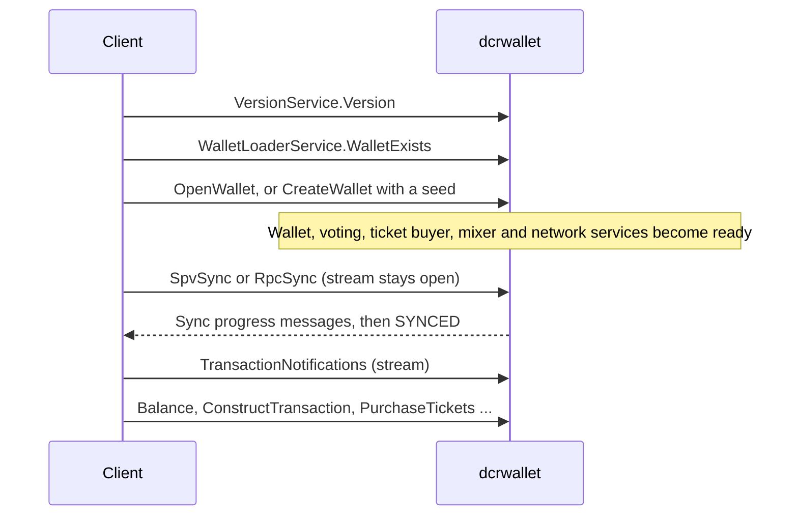

# dcrwallet gRPC API

`dcrwallet` runs a gRPC server next to its JSON-RPC server. It is the typed, streaming API that Decrediton, `politeiavoter` and `dcrlnd` (in remote-wallet mode) use to drive a wallet. This page lists all 11 services and 88 methods defined in [`rpc/api.proto` at release-v2.1.7](https://github.com/decred/dcrwallet/blob/release-v2.1.7/rpc/api.proto), with the server behavior checked against [`internal/rpc/rpcserver/server.go`](https://github.com/decred/dcrwallet/blob/release-v2.1.7/internal/rpc/rpcserver/server.go) at the same tag. It is for developers writing a wallet front end, a voting tool or a service that needs a typed wallet API.

!!! note "The upstream api.md is out of date"
    `rpc/documentation/api.md` in the dcrwallet repository still says "Version: 7.13.x" and leaves out 16 methods (the VSP, treasury-policy, account-passphrase and peer methods among them). The server reports API version 10.0.0. Where the two disagree, this page follows `api.proto` and the server code.

## When to use gRPC instead of JSON-RPC

Both APIs talk to the same wallet. They differ in what they can do and in how a client connects.

| | gRPC | JSON-RPC |
|---|---|---|
| Authentication | TLS client certificate, always | Username and password (`username`/`password`), or a client certificate |
| Typing | Generated, typed stubs from `api.proto` | JSON with positional parameters |
| Create, open and close a wallet over the API | Yes (`WalletLoaderService`) | No: the wallet must exist and is opened at startup |
| Start and stop network sync from the client | Yes (`SpvSync`, `RpcSync` with `--noinitialload`) | No: `dcrwallet` syncs on its own |
| Push notifications | Server streams for transactions, accounts and confirmations | None in 2.1.7 |
| One-call sends (`sendtoaddress`, `sendmany`) | No: construct, sign and publish in separate calls | Yes |
| Treasury adds and spends (`sendtotreasury`, `sendfromtreasury`), `setdisapprovepercent`, output locking | No | Yes |
| Voting service provider (VSP) recovery: re-sync tickets a VSP already manages | `ProcessManagedTickets` | No (only `processunmanagedticket`) |
| Help text in the binary | No | `dcrctl --wallet help <method>` |

Choose gRPC for a long-running front end that creates or restores wallets, controls sync and reacts to events. Choose JSON-RPC for scripts, exchanges and services that only send and receive: it needs no code generation and has the one-call send methods. See [dcrwallet JSON-RPC API](dcrwallet-json-rpc.md) for that interface.

## Connect

### What the server requires

The gRPC server always uses TLS and always asks for a client certificate. It starts only when it has a certificate authority to check client certificates against:

- the file named by `clientcafile` exists (by default `clients.pem` in the wallet's home folder: `~/.dcrwallet`, `~/Library/Application Support/Dcrwallet` or `%LOCALAPPDATA%\Dcrwallet`), or
- `dcrwallet` was started with `--issueclientcert`, which makes a one-time certificate authority and hands a client certificate to the parent process.

Otherwise `dcrwallet` logs the warning below and runs without gRPC. If the JSON-RPC server cannot start either, it exits with `Unable to create RPC servers: no suitable RPC services can be started`.

```text title="Log line when no client certificate authority exists"
[WRN] DCRW: gRPC server is configured with listeners, but no trusted client certificates exist (looked in /home/user/.dcrwallet/clients.pem)
```

`noservertls` turns TLS off for both servers, and with it gRPC: the wallet logs `Server TLS is disabled.  Only JSON-RPC may be used`.

### Ports

By default the server listens on every address that `localhost` resolves to, on the network's gRPC port. `dcrwallet` does not support regnet.

| Network | gRPC port | JSON-RPC port (for comparison) |
|---|---|---|
| mainnet | 9111 | 9110 |
| testnet | 19111 | 19110 |
| simnet | 19558 | 19557 |

Source: `internal/netparams/params.go`. The two servers may not share a listen address, except port 0.

### Set up a client certificate

`gencerts`, in the command-line bundle, makes a self-signed P-256 certificate and key. Listing that certificate in `clients.pem` makes it trusted.

=== "Windows"

    ```powershell
    gencerts client.pem client-key.pem
    Get-Content client.pem | Add-Content $env:LOCALAPPDATA\Dcrwallet\clients.pem
    ```

=== "macOS"

    ```bash
    gencerts client.pem client-key.pem
    cat client.pem >> ~/Library/Application\ Support/Dcrwallet/clients.pem
    ```

=== "Linux"

    ```bash
    gencerts client.pem client-key.pem
    cat client.pem >> ~/.dcrwallet/clients.pem
    ```

Restart `dcrwallet`; it reads `clients.pem` only at startup. Look for this line in its log:

```text title="Expected output"
[INF] DCRW: gRPC server listening on 127.0.0.1:9111
```

Keep `client-key.pem` as private as the wallet itself: whoever holds it can call every method, and spend from the wallet while it is unlocked. `politeiavoter` users set this up the same way; see [Vote with your tickets](../../user/governance/vote.md). The TLS model shared with `dcrd` and the JSON-RPC server is described in [Choosing an API](index.md).

### Server options

These `dcrwallet` options control the gRPC server. Each works as a command-line flag or as a key in `dcrwallet.conf`. See [dcrwallet configuration](../reference/dcrwallet-config.md) for every option.

| Option | Default | Effect |
|---|---|---|
| `grpclisten` | localhost addresses on the network's port | Listen address; may be repeated. Port 0 lets the OS pick a free port |
| `nogrpc` | off | Disable the gRPC server |
| `clientcafile` | `clients.pem` in the home folder | PEM file of certificates that client certificates must chain to |
| `rpccert`, `rpckey` | `rpc.cert`, `rpc.key` in the home folder | Server certificate and key, shared with JSON-RPC; generated on first start if the key is missing |
| `tlscurve` | `Ed25519` | Key type for generated certificates: `P-256`, `P-384`, `P-521` or `Ed25519` |
| `onetimetlskey` | off | Generate a new server key pair at each start and write only the certificate |
| `noservertls` | off | Disable TLS for both servers; gRPC then does not run. Allowed only on localhost |
| `noinitialload` | off | Do not open a wallet at startup; the client opens or creates it with `WalletLoaderService` |
| `issueclientcert` | off | Create a temporary client certificate authority and send a client key and certificate over the `pipetx` pipe |
| `rpclistenerevents` | off | Send each JSON-RPC and gRPC listen address over the `pipetx` pipe |
| `pipetx`, `piperx` | none | File descriptors (handles on Windows) of pipes to a parent process |

The generated server certificate is valid for 10 years and names the host name, `localhost`, the loopback addresses and the machine's interface addresses at the time it was made. Go clients accept the default Ed25519 certificate. If the TLS library behind your gRPC implementation rejects it, set `tlscurve=P-256` (the value Decrediton writes into its `dcrwallet.conf`), delete `rpc.cert` and `rpc.key`, and restart; every client then needs the new `rpc.cert`.

!!! warning "Keep port 9111 private"
    Never expose the gRPC port to the internet. To reach a wallet on another machine, prefer an SSH tunnel or a VPN to binding `grpclisten` to a public address.

### Let dcrwallet issue the client certificate

A program that launches `dcrwallet` as a child process can skip `clients.pem`. This is what Decrediton does: it writes `noinitialload=1`, `onetimetlskey=1`, `grpclisten=127.0.0.1:0`, `tlscurve=P-256` and `nolegacyrpc=1` into the wallet's config file and adds `--issueclientcert --rpclistenerevents --pipetx=<FD>` to the command line, where `<FD>` is the descriptor of a pipe's write end inherited by the child. The parent then reads messages from the pipe:

| Message type | Payload |
|---|---|
| `grpclistener` | The gRPC listen address as UTF-8, for example `127.0.0.1:33519` |
| `jsonrpclistener` | A JSON-RPC listen address as UTF-8 |
| `issuedclientcertificate` | Three PEM blocks: the client's private key, the client certificate, then the certificate of the one-time authority that signed it |

Each message is encoded as a protocol version byte (currently 1), one byte giving the length of the type string, the type string, a 4-byte little-endian payload length, then the payload (`ipc.go`). `dcrwallet` writes neither the authority nor the issued key to disk, and both change at every start. When the parent closes the write end of the `piperx` pipe (or exits), `dcrwallet` shuts down cleanly.

### Connect from Go

Go clients import the generated package from the dcrwallet module instead of compiling `api.proto`. Module version `v5.1.2` is the code tagged `release-v2.1.7`. It needs Go 1.26 or later (`decred.org/dcrwallet/v5` declares `go 1.26.0`).

```bash
go mod init walletclient
go get decred.org/dcrwallet/v5@v5.1.2
go mod tidy
```

This program trusts the wallet's server certificate, presents the client certificate made above, and calls `Version` and `Balance` on a mainnet wallet:

```go
package main

import (
	"context"
	"crypto/tls"
	"crypto/x509"
	"fmt"
	"log"
	"os"
	"path/filepath"

	pb "decred.org/dcrwallet/v5/rpc/walletrpc"
	"github.com/decred/dcrd/dcrutil/v4"
	"google.golang.org/grpc"
	"google.golang.org/grpc/credentials"
)

func main() {
	walletDir := dcrutil.AppDataDir("dcrwallet", false)

	// Trust the wallet's self-signed server certificate.
	serverCert, err := os.ReadFile(filepath.Join(walletDir, "rpc.cert"))
	if err != nil {
		log.Fatal(err)
	}
	roots := x509.NewCertPool()
	if !roots.AppendCertsFromPEM(serverCert) {
		log.Fatal("no certificate in rpc.cert")
	}

	// Present a client certificate listed in the wallet's clients.pem.
	clientCert, err := tls.LoadX509KeyPair("client.pem", "client-key.pem")
	if err != nil {
		log.Fatal(err)
	}

	creds := credentials.NewTLS(&tls.Config{
		RootCAs:      roots,
		Certificates: []tls.Certificate{clientCert},
	})
	conn, err := grpc.NewClient("localhost:9111", grpc.WithTransportCredentials(creds))
	if err != nil {
		log.Fatal(err)
	}
	defer conn.Close()
	ctx := context.Background()

	v, err := pb.NewVersionServiceClient(conn).Version(ctx, &pb.VersionRequest{})
	if err != nil {
		log.Fatal(err)
	}
	fmt.Println("API version:", v.VersionString)

	bal, err := pb.NewWalletServiceClient(conn).Balance(ctx, &pb.BalanceRequest{
		AccountNumber:         0,
		RequiredConfirmations: 1,
	})
	if err != nil {
		log.Fatal(err)
	}
	fmt.Println("Spendable:", dcrutil.Amount(bal.Spendable))
}
```

```text title="Expected output (example balance)"
API version: 10.0.0
Spendable: 12.5 DCR
```

For testnet use port 19111, for simnet 19558. A `FailedPrecondition` error with `service walletrpc.WalletService is not ready` means no wallet is loaded yet (see the next section). For a full tutorial with simnet, see [Talking to dcrd and dcrwallet from Go](../go/rpc-clients.md).

### Data conventions

- **Amounts** are `int64` atoms (1 DCR = 100,000,000 atoms), except `SweepAccountRequest.fee_per_kb`, which is a `double` in DCR.
- **Hashes** (`bytes` fields such as `transaction_hash` and `block_hash`) are the 32 raw bytes in the order Go's `chainhash.Hash` stores them, which is the reverse of the hex shown by block explorers and `dcrctl`. Reverse the bytes before hex-encoding them for display.
- **Transactions and blocks** are their wire serialization in `bytes` fields.
- **Passphrases** are `bytes`. The server zeroes its copy after use.
- **Addresses** are strings and must belong to the wallet's network; a wrong-network address returns `InvalidArgument`.
- **Accounts** are numbers. The imported-key account is 2147483647.

## Service availability and call order

Some services work as soon as the server starts. The others need a loaded wallet:

| Service | Methods | Ready |
|---|---|---|
| `VersionService` | 1 | Always |
| `WalletLoaderService` | 8 | Always |
| `SeedService` | 2 | Always |
| `AgendaService` | 1 | Always |
| `MessageVerificationService` | 1 | Always |
| `DecodeMessageService` | 1 | Always |
| `WalletService` | 65 | After a wallet is opened or created |
| `VotingService` | 6 | After a wallet is opened or created |
| `TicketBuyerService` | 1 | After a wallet is opened or created |
| `AccountMixerService` | 1 | After a wallet is opened or created |
| `NetworkService` | 1 | After a wallet is opened or created |

A call to a service that is not ready fails with `FailedPrecondition` and `service <name> is not ready`. Without `--noinitialload`, `dcrwallet` opens the wallet and syncs it itself, so all services are ready once it has started. With `--noinitialload`, the client does the work, in this order:



Methods that need the network fail until sync has started: publishing, rescans, `PurchaseTickets`, `DiscoverUsage` and the imports. `ImportPrivateKey`, `ImportExtendedPublicKey` and `ImportScript` need it even without a rescan; `ImportVotingAccountFromSeed` needs it only with `rescan` or `discover_usage`. Cancelling the `SpvSync` or `RpcSync` stream stops synchronization.

## Passphrases and unlocking

Many requests carry a `passphrase` (the wallet's private passphrase). The server's behavior, confirmed against a 2.1.7 wallet on simnet:

- If the wallet is locked, a request with the correct passphrase unlocks it for that call only and locks it again afterwards.
- If the wallet was already unlocked with `UnlockWallet` (no time limit), it stays unlocked after the call.
- **A wrong passphrase locks the wallet**, even if it was unlocked. A voting wallet that a client relocks this way stops voting until it is unlocked again; a running ticket buyer that was given the passphrase unlocks it again at its next purchase attempt.
- An empty passphrase skips unlocking; the call then fails with `FailedPrecondition` if it needs private keys and the wallet is locked.
- `RunTicketBuyer` and `RunAccountMixer` given a passphrase unlock the wallet with no time limit, and **the wallet stays unlocked after their streams end**. Call `LockWallet` when you no longer need it unlocked.
- Accounts with their own passphrase (set with `SetAccountPassphrase`) are unlocked with `UnlockAccount`, not with the wallet passphrase. See [Manage accounts and passphrases](../../user/wallets/accounts-and-passphrases.md).

## Errors

Errors are standard gRPC status codes. The server maps dcrwallet's internal error kinds as follows (`translateError`); a handler may also return its own code, as noted in the method tables.

| Wallet error kind | gRPC code |
|---|---|
| `Invalid`, `Passphrase`, `Seed`, invalid seed length | `InvalidArgument` |
| `Permission` | `PermissionDenied` |
| `Exist` | `AlreadyExists` |
| `NotExist` | `NotFound` |
| `Crypto` | `DataLoss` |
| `Locked` | `FailedPrecondition` |
| `WatchingOnly` | `Unimplemented` |
| `InsufficientBalance` | `ResourceExhausted` |
| `NoPeers` | `Unavailable` |
| Context canceled | `Canceled` |
| Anything else | `Unknown` |

A missing network connection usually shows as `FailedPrecondition` with `wallet is not associated with a consensus server RPC client`, or as `Unavailable`/`Unknown` with `Decred network is unreachable`, depending on the method.

## VersionService and API versioning

| Method | Kind | Request → response | Notes |
|---|---|---|---|
| `Version` | unary | (none) → `version_string`, `major`, `minor`, `patch`, `prerelease`, `build_metadata` | 2.1.7 returns `10.0.0`. Has no dependencies and never changes incompatibly; call it first |

The API follows Semantic Versioning, separately from the `dcrwallet` release number. A change to the major version breaks existing clients; new fields and methods raise the minor version. Decrediton 2.1.7 requires `10.0.0` and refuses a wallet whose major version differs, or whose minor version is lower. API 10.0.0 arrived with dcrwallet 2.1.0, replacing 7.17.0; the methods it removed are listed in [Removed methods and fields](#removed-methods-and-fields).

## WalletLoaderService

Creates, opens and closes the wallet and starts synchronization. Always available. The sync methods are for `--noinitialload`: when `dcrwallet` opened the wallet itself, it is already syncing, and `RpcSync` returns `FailedPrecondition`.

| Method | Kind | Request → response | Notes |
|---|---|---|---|
| `WalletExists` | unary | (none) → `exists` | Whether a wallet database exists for this network |
| `CreateWallet` | unary | `public_passphrase`, `private_passphrase`, `seed`, `set_birth_time`, `birth_time`, `set_birth_height`, `birth_height` → (none) | `seed` is required (raw bytes; get them from `SeedService`). An empty public passphrase uses the built-in default `public`. Opens the new wallet. See [Known issues](#known-issues) for the birthday fields |
| `CreateWatchingOnlyWallet` | unary | `extended_pub_key`, `public_passphrase` → (none) | A wallet that can watch but never sign |
| `OpenWallet` | unary | `public_passphrase` → `watching_only` | `AlreadyExists` if a wallet is already open |
| `CloseWallet` | unary | (none) → (none) | `FailedPrecondition` if no wallet is loaded |
| `SpvSync` | server stream | `discover_accounts`, `private_passphrase`, `spv_connect` → stream of sync messages | Light (SPV) sync over the peer-to-peer network. `spv_connect` lists peers to use exclusively; the default port is added when missing. `discover_accounts` needs the private passphrase; the wallet is locked again after address discovery. Runs until cancelled |
| `RpcSync` | server stream | `network_address`, `username`, `password`, `certificate`, `discover_accounts`, `private_passphrase` → stream of sync messages | Sync through a `dcrd` RPC server. `certificate` is the PEM content of `dcrd`'s `rpc.cert`; the default port is `dcrd`'s RPC port. A loopback address with no certificate connects without TLS, which works only if `dcrd` runs with `notls`. `FailedPrecondition` if the wallet is already syncing |
| `RescanPoint` | unary | (none) → `rescan_point_hash` | The first block that still needs a rescan, or empty when transactions are synced to the tip |

### Sync messages

`SpvSync` and `RpcSync` stream messages with `synced`, a `notification_type` and, depending on the type, a detail message.

| `SyncNotificationType` | Value | Detail field |
|---|---|---|
| `SYNCED` | 0 | `synced` is true |
| `UNSYNCED` | 1 | `synced` is false |
| `PEER_CONNECTED` | 2 | `peer_information`: `peer_count`, `address` (SPV only) |
| `PEER_DISCONNECTED` | 3 | `peer_information` (SPV only) |
| `FETCHED_MISSING_CFILTERS_STARTED` | 4 | none |
| `FETCHED_MISSING_CFILTERS_PROGRESS` | 5 | `fetch_missing_cfilters`: start and end height |
| `FETCHED_MISSING_CFILTERS_FINISHED` | 6 | none |
| `FETCHED_HEADERS_STARTED` | 7 | none |
| `FETCHED_HEADERS_PROGRESS` | 8 | `fetch_headers`: `fetched_headers_count`, `last_header_time` |
| `FETCHED_HEADERS_FINISHED` | 9 | none |
| `DISCOVER_ADDRESSES_STARTED` | 10 | none |
| `DISCOVER_ADDRESSES_FINISHED` | 11 | none |
| `RESCAN_STARTED` | 12 | none |
| `RESCAN_PROGRESS` | 13 | `rescan_progress`: `rescanned_through` (height) |
| `RESCAN_FINISHED` | 14 | none |

## SeedService

Always available; needs no wallet.

| Method | Kind | Request → response | Notes |
|---|---|---|---|
| `GenerateRandomSeed` | unary | `seed_length` → `seed_bytes`, `seed_hex`, `seed_mnemonic` | Length in bytes, 16 to 64; 0 means 32. A 32-byte seed gives the 33-word PGP word list mnemonic |
| `DecodeSeed` | unary | `user_input` → `decoded_seed` | Accepts the word list or hex; `InvalidArgument` on a bad checksum or word |

!!! danger "These methods carry the seed"
    `GenerateRandomSeed`, `CreateWallet` and `ImportVotingAccountFromSeed` carry the seed itself. Anyone holding the seed controls the funds, and it cannot be changed. Call these methods only over a local connection, never log the requests or responses, and show the seed to the user once, with backup instructions.

## WalletService

The wallet itself: 65 methods, available once a wallet is loaded. They are grouped here by purpose.

### Wallet and chain state

| Method | Kind | Request → response | Notes |
|---|---|---|---|
| `Ping` | unary | (none) → (none) | Succeeds once a wallet is loaded |
| `Network` | unary | (none) → `active_network` | Wire network magic: mainnet `0xd9b400f9`, testnet `0xb194aa75`, simnet `0x12141c16` |
| `CoinType` | unary | (none) → `coin_type` | HD coin type in use: 42 (SLIP-0044) or the legacy 20 on mainnet |
| `BestBlock` | unary | (none) → `height`, `hash` | The wallet's main-chain tip |
| `BlockInfo` | unary | `block_hash` or `block_height` (not both) → `block_hash`, `block_height`, `confirmations`, `timestamp`, `block_header`, `stake_invalidated`, `approves_parent` | `stake_invalidated` means the next block's votes disapproved this block's regular transactions |
| `BirthBlock` | unary | (none) → `hash`, `height` | `NotFound` while the birthday is unset or still being resolved from a time or height |
| `TicketPrice` | unary | (none) → `ticket_price`, `height` | Ticket price (stake difficulty) for the next block, in atoms |
| `StakeInfo` | unary | (none) → `pool_size`, `all_mempool_tix`, `own_mempool_tix`, `immature`, `live`, `voted`, `missed`, `revoked`, `expired`, `total_subsidy`, `unspent` | Ticket counts. When syncing through `dcrd`, the wallet also asks `dcrd`, which gives more precise counts than light mode |
| `GetPeerInfo` | unary | (none) → `peer_info` list | SPV peers, or the result of `dcrd`'s `getpeerinfo` when syncing through `dcrd` |
| `GetCFilters` | server stream | block range → `key`, `filter`, `block_hash` per block | Version 2 committed filters stored by the wallet |

Ranges (`GetCFilters`, `GetTransactions`, `GetTickets`) take `starting_block_hash` or `starting_block_height`, and `ending_block_hash` or `ending_block_height`; setting both forms of one end is `InvalidArgument`. With neither end set, the range covers the whole main chain and, for transactions and tickets, unmined ones too.

### Accounts and addresses

| Method | Kind | Request → response | Notes |
|---|---|---|---|
| `Accounts` | unary | (none) → `accounts`, `current_block_hash`, `current_block_height` | Per account: number, name, `total_balance`, external, internal and imported key counts, `account_encrypted`, `account_unlocked` |
| `AccountNumber` | unary | `account_name` → `account_number` | `NotFound` for an unknown name |
| `Balance` | unary | `account_number`, `required_confirmations` → `total`, `spendable`, `immature_reward`, `immature_stake_generation`, `locked_by_tickets`, `voting_authority`, `unconfirmed` | Atoms. `spendable` can include multisig outputs that need other keys |
| `NextAccount` | unary | `passphrase`, `account_name` → `account_number` | Creating an account needs the private keys |
| `RenameAccount` | unary | `account_number`, `new_name` → (none) | |
| `NextAddress` | unary | `account`, `kind`, `gap_policy` → `address`, `public_key` | `kind`: `BIP0044_EXTERNAL` (receiving) or `BIP0044_INTERNAL` (change). `gap_policy`: `GAP_POLICY_UNSPECIFIED` (behaves as error), `GAP_POLICY_ERROR`, `GAP_POLICY_IGNORE`, `GAP_POLICY_WRAP`. Going past the wallet's gap limit (`gaplimit`, default 20) with `GAP_POLICY_IGNORE` can hide funds from a later seed restore |
| `Address` | unary | `account`, `kind`, `index` → `address`, `public_key` | The address at a given index, without advancing the account |
| `ValidateAddress` | unary | `address` → `is_valid`, `is_mine`, `account_number`, `pub_key_addr`, `pub_key`, `is_script`, `pk_script_addrs`, `script_type`, `pay_to_addr_script`, `sigs_required`, `is_internal`, `index` | An invalid or wrong-network address returns `is_valid` false, not an error |
| `DiscoverUsage` | unary | `discover_accounts`, `gap_limit`, `starting_block_hash` → (none) | Scans for used addresses (and accounts) from the given block, by default the genesis block, with the wallet's gap limit unless one is given. Discovering accounts needs the wallet unlocked |
| `GetCoinjoinOutputspByAcct` | unary | (none) → `data`: `account_number`, `coinjoin_txs_sum` | Count of mixed outputs per account; used to find the mixed account after a restore. The misspelling is part of the API |

### Keys and imports

| Method | Kind | Request → response | Notes |
|---|---|---|---|
| `GetAccountExtendedPubKey` | unary | `account_number` → `acc_extended_pub_key` | The account's `dpub` on mainnet |
| `GetAccountExtendedPrivKey` | unary | `account_number`, `passphrase` → `acc_extended_priv_key` | Returns the account's private key. Anyone holding it can spend the account's funds |
| `DumpPrivateKey` | unary | `address` → `private_key_wif` | Needs the wallet (or the account) unlocked |
| `ImportPrivateKey` | unary | `passphrase`, `account`, `private_key_wif`, `rescan`, `scan_from` → (none) | `account` must be the imported account, 2147483647. The rescan runs in the background |
| `ImportExtendedPublicKey` | unary | `xpub`, `account_name`, `rescan`, `scan_from` → (none) | Adds a watching-only account |
| `ImportScript` | unary | `passphrase`, `script`, `rescan`, `scan_from`, `require_redeemable` → `p2sh_address`, `redeemable` | `redeemable` is true for a multisig script the wallet holds enough keys for. Importing a known script is not an error. `passphrase` is not used |
| `ImportVotingAccountFromSeed` | unary | `seed`, `name`, `passphrase`, `rescan`, `scan_from`, `discover_usage`, `discover_from`, `discover_gap_limit` → `account` | Imports the first SLIP-0044 account of another seed as a voting account protected by its own passphrase. `AlreadyExists` if already imported |

### Transactions

| Method | Kind | Request → response | Notes |
|---|---|---|---|
| `GetTransaction` | unary | `transaction_hash` → `transaction`, `confirmations`, `block_hash` | `transaction` is a `TransactionDetails` (below) |
| `GetTransactions` | server stream | block range, `target_transaction_count` → `mined_transactions` (one block per message) or `unmined_transactions` | A start above the end returns blocks newest first; a negative `starting_block_height` starts with the unmined transactions and the tip, so -1 to 1 pages from newest to oldest. Stops after the block in which the target count is reached |
| `UnspentOutputs` | server stream | `account`, `target_amount`, `required_confirmations`, `include_immature_coinbases` → one output per message, with running `amount_sum` | Selects outputs toward the target; an insufficient balance is not an error |
| `FundTransaction` | unary | `account`, `target_amount`, `required_confirmations`, `include_immature_coinbases`, `include_change_script` → `selected_outputs`, `total_amount`, `change_pk_script` | `change_pk_script` is set only if requested and the selection exceeds the target |
| `ConstructTransaction` | unary | `source_account`, `required_confirmations`, `fee_per_kb`, `output_selection_algorithm`, `non_change_outputs`, `change_destination` → `unsigned_transaction`, `total_previous_output_amount`, `total_output_amount`, `estimated_signed_size`, `change_index` | Fee in atoms per kB; 0 means 10,000 (0.0001 DCR/kB). Each output pays an `address`, or a `script` with `script_version`. `ALL` spends every eligible output. The change output's position is randomized; `change_index` is -1 when there is none |
| `SweepAccount` | unary | `source_account` (a name), `destination_address`, `required_confirmations`, `fee_per_kb` → unsigned transaction and totals | Spends all eligible outputs of the account to one address. Fee in DCR per kB; 0 uses the wallet's `txfee` |
| `SignTransaction` | unary | `passphrase`, `serialized_transaction`, `additional_scripts` → `transaction`, `unsigned_input_indexes` | Signs every input it can with `SIGHASH_ALL`. `additional_scripts` supplies previous output scripts the wallet does not know |
| `SignTransactions` | unary | `passphrase`, `transactions`, `additional_scripts` → `transactions` | Batch form of `SignTransaction` |
| `CreateSignature` | unary | `passphrase`, `address`, `serialized_transaction`, `input_index`, `hash_type`, `previous_pk_script` → `signature`, `public_key` | One signature for one input, with any `SigHashType` |
| `PublishTransaction` | unary | `signed_transaction` → `transaction_hash` | Refuses fee rates above 1,000 times the default relay fee (code `Unknown`, message `policy violation: high fees`) unless `dcrwallet` runs with `allowhighfees`; that check needs every input's `ValueIn` set |
| `PublishUnminedTransactions` | unary | (none) → (none) | Rebroadcasts every unmined wallet transaction |
| `AbandonTransaction` | unary | `transaction_hash` → (none) | Removes an unmined transaction and everything spending from it. It may already be on the network and can still be mined |
| `Spender` | unary | `transaction_hash`, `index` → `spender_transaction`, `input_index` | `NotFound` if the output is unspent; `InvalidArgument` if it is not the wallet's |
| `Rescan` | server stream | `begin_height` or `begin_hash` → `rescanned_through` | Progress heights until finished |
| `LoadActiveDataFilters` | unary | (none) → (none) | Reloads the address and outpoint filters used during sync |

Sent transactions cannot be reversed. On mainnet, test the whole construct, sign and publish path with small amounts first, or on [simnet](../environment/simnet.md). For transaction rules, see [Transactions for builders](../protocol/transactions.md).

`TransactionDetails` describes a wallet transaction: `hash`, raw `transaction`, `debits` (wallet inputs: `index`, `previous_account`, `previous_amount`), `credits` (wallet outputs: `index`, `account`, `internal`, `amount`, `address`, `output_script`), `fee`, `timestamp` and `transaction_type` (`REGULAR` 0, `TICKET_PURCHASE` 1, `VOTE` 2, `REVOCATION` 3, `COINBASE` 4). `BlockDetails` adds the block's `hash`, `height`, `timestamp`, `approves_parent`, `prev_block` and its wallet `transactions`.

### Tickets

| Method | Kind | Request → response | Notes |
|---|---|---|---|
| `PurchaseTickets` | unary | see below → `ticket_hashes`, `tickets`, `split_tx` | Buys tickets, through a VSP when `vsp_host` and `vsp_pubkey` are set |
| `GetTicket` | unary | `ticket_hash` → `ticket`, `block`, `vsp_host` | Same message as one `GetTickets` entry |
| `GetTickets` | server stream | block range, `target_ticket_count` → one ticket per message: `ticket` (ticket and spender details, `ticket_status`), `block`, `vsp_host` | Status: `UNKNOWN`, `UNMINED`, `IMMATURE`, `LIVE`, `VOTED`, `MISSED`, `EXPIRED`, `REVOKED` |
| `CommittedTickets` | unary | `tickets` → `ticketAddresses`: `ticket`, `address` | The subset of the given tickets this wallet controls, with each one's commitment address. `politeiavoter` uses it to find tickets that may vote |

`PurchaseTicketsRequest` fields:

| Field | Meaning |
|---|---|
| `passphrase` | Unlocks the wallet for the purchase unless `dont_sign_tx` is set |
| `account` | Account that pays for the tickets |
| `required_confirmations` | Minimum confirmations of the coins spent |
| `num_tickets` | Number of tickets; must be at least 1 |
| `expiry` | Expiry height for the unmined transactions; 0 for none, otherwise above the next block's height |
| `tx_fee`, `ticket_fee` | Not used in 2.1.7 (a negative `tx_fee` is still rejected) |
| `dont_sign_tx` | Return unsigned tickets instead of publishing them |
| `enable_mixing`, `mixed_account`, `mixed_account_branch`, `mixed_split_account`, `change_account` | Buy with mixed funds. The branch must be 0 or 1; all three accounts must exist |
| `vsp_host`, `vsp_pubkey` | The VSP's URL and public key; the VSP fee is limited by the wallet's `vsp.maxfee` (default 0.2 DCR) |
| `use_voting_account`, `voting_account` | Derive voting addresses from `voting_account`. Without `use_voting_account`, the wallet uses the mixed account when mixing, otherwise `account` |

A ticket cannot be cancelled once published: its price stays locked until it votes, or until it is revoked after missing or expiring. Without a VSP, the wallet that holds the voting keys must stay online and unlocked to vote. See [How staking works](../../user/staking/index.md) and, for the transaction formats, [Staking and the treasury for builders](../protocol/staking-and-treasury.md).

### VSP tickets

These methods drive dcrwallet's built-in VSP client. All but `GetTrackedVSPTickets` and `GetVSPTicketsByFeeStatus` take the VSP's `vsp_host` (URL) and `vsp_pubkey`, plus the accounts that pay VSP fees and receive change. The wallet keeps one client per host: the fee and change accounts of the first call that created it stay in use until `dcrwallet` restarts. The VSP protocol itself is described in [vspd API](vspd-api.md).

| Method | Kind | Request → response | Notes |
|---|---|---|---|
| `GetTrackedVSPTickets` | unary | (none) → `vsps`: `host`, `tickets` (`ticket_hash`, `voting_address`, `commitment_address`, `state`, `fee`, `fee_hash`) | Tickets each VSP client is currently tracking |
| `GetVSPTicketsByFeeStatus` | unary | `fee_status` → `tickets_hashes` | `VSP_FEE_PROCESS_STARTED` 0, `_PAID` 1, `_ERRORED` 2, `_CONFIRMED` 3 |
| `ProcessManagedTickets` | unary | `vsp_host`, `vsp_pubkey`, `fee_account`, `change_account` → (none) | For each unspent, unexpired ticket the wallet has VSP records for and whose fee is not yet confirmed, asks the VSP for the ticket's status, skips tickets it does not know, and resumes tracking the rest. Pays the fee if that VSP has not received one. Needs the wallet unlocked. JSON-RPC has no equivalent |
| `ProcessUnmanagedTickets` | unary | same fields → (none) | Registers with this VSP, and pays fees for, unspent unexpired tickets that have no fee transaction. Per-ticket errors are only logged |
| `SyncVSPFailedTickets` | unary | `vsp_host`, `vsp_pubkey`, `account`, `change_account` → (none) | Retries tickets whose fee status is `ERRORED`. Per-ticket failures are ignored |
| `SetVspdVoteChoices` | unary | `vsp_host`, `vsp_pubkey`, `fee_account`, `change_account` → (none) | Sends the wallet's current agenda, treasury-key and treasury spend choices to the VSP for every unspent, unexpired ticket assigned to that host. If the wallet also holds unspent tickets with no VSP record (for example solo tickets), the call returns `Unknown` after updating the VSP's tickets |

!!! warning "These calls can spend"
    `ProcessManagedTickets`, `ProcessUnmanagedTickets` and `SyncVSPFailedTickets` can pay VSP fees (each up to `vsp.maxfee`) from `fee_account`. Pass the VSP's real public key: it is how the wallet checks that responses come from that VSP. For recovery with the command-line wallet, see [Stake with dcrwallet](../../user/staking/stake-with-dcrwallet.md).

### Messages and signatures

| Method | Kind | Request → response | Notes |
|---|---|---|---|
| `SignMessage` | unary | `address`, `message`, `passphrase` → `signature` | Address must be secp256k1 P2PK or P2PKH; for a P2PKH address the 65-byte signature verifies with `VerifyMessage`, which rejects P2PK addresses |
| `SignMessages` | unary | `passphrase`, `messages` (`address`, `message`) → `replies` (`signature`, `error`) | Per-message errors are returned as strings |
| `SignHashes` | unary | `passphrase`, `address`, `hashes` → `public_key`, `signatures` | Signs arbitrary 32-byte hashes with the address's key. Never sign a hash whose content you have not checked: it may be a transaction |

### Locking and passphrases

| Method | Kind | Request → response | Notes |
|---|---|---|---|
| `UnlockWallet` | unary | `passphrase` → (none) | Unlocks with no time limit |
| `LockWallet` | unary | (none) → (none) | |
| `ChangePassphrase` | unary | `key` (`PRIVATE` or `PUBLIC`), `old_passphrase`, `new_passphrase` → (none) | For `PUBLIC`, an empty value means the default `public` |
| `SetAccountPassphrase` | unary | `account_passphrase`, `new_account_passphrase`, `account_number`, `wallet_passphrase` → (none) | Gives an account its own passphrase. Use `wallet_passphrase` the first time, `account_passphrase` afterwards |
| `UnlockAccount` | unary | `passphrase`, `account_number` → (none) | For individually encrypted accounts |
| `LockAccount` | unary | `account_number` → (none) | |
| `AccountUnlocked` | unary | `account_number` → `unlocked` | `InvalidArgument` if the account has no passphrase of its own |

### Notifications

| Method | Kind | Request → response | Notes |
|---|---|---|---|
| `TransactionNotifications` | server stream | (none) → `attached_blocks`, `detached_blocks`, `unmined_transactions`, `unmined_transaction_hashes`, `detached_block_headers` | One message per chain change. After a reorganization, `detached_blocks` lists the removed blocks' hashes; `unmined_transaction_hashes` is the full current set of unmined wallet transactions |
| `AccountNotifications` | server stream | (none) → `account_number`, `account_name`, external, internal and imported key counts | Sent when an account is created or renamed, or when a key is imported into the imported account |
| `ConfirmationNotifications` | bidirectional stream | stream of `tx_hashes`, `stop_after` → stream of `confirmations` (`tx_hash`, `confirmations`, `block_hash`, `block_height`) | Send hashes at any time. The first reply gives their current state; updates follow until `stop_after` confirmations. `confirmations` is -1, and the hash is no longer watched, for a transaction the wallet does not know, that was removed (for example double spent), or whose block's regular transactions were disapproved by the next block; `block_height` is -1 while unmined |

Streams end when the client cancels them. Keep `TransactionNotifications` open and reconcile with `GetTransactions` after a reconnect, since nothing is replayed. Confirmation depth in Decred has a twist: a block's regular transactions can be disapproved by the next block's votes, so see [Blocks, confirmations and reorganizations](../protocol/blocks-and-confirmations.md) before choosing `stop_after`.

## TicketBuyerService and AccountMixerService

Both run as long as their server stream stays open, and stop when it is cancelled (the stream then ends with `Canceled`).

| Method | Kind | Request → response | Notes |
|---|---|---|---|
| `TicketBuyerService.RunTicketBuyer` | server stream | `passphrase`, `account`, `voting_account`, `balance_to_maintain`, `vsp_host`, `vsp_pubkey`, `limit`, `enable_mixing`, `mixed_account`, `mixed_account_branch`, `mixed_split_account`, `change_account` → no messages | Buys tickets on each new block once transactions are synced |
| `AccountMixerService.RunAccountMixer` | server stream | `passphrase`, `mixed_account`, `mixed_account_branch`, `change_account` → no messages | Mixes unmixed change from `change_account` into `mixed_account` with StakeShuffle |

How `RunTicketBuyer` sizes purchases, from the `ticketbuyer` package:

- With `balance_to_maintain` set, it buys as many tickets as the account's spendable balance above that amount pays for. With 0, it tries to buy up to 20 per block (the consensus maximum of new tickets per block) for as long as funds last.
- `limit` caps tickets per block. With mixing, the buyer instead starts `limit` separate one-ticket purchases per block, so **with mixing and `limit` 0 it buys no tickets** (it still mixes change). Set `limit` to at least 1 when `enable_mixing` is set; Decrediton always sends 1.
- Mixed purchases spend coins with at least 2 confirmations, others at least 1.
- With mixing, the account checks match `PurchaseTickets`; VSP fees and change go to `account`.

!!! warning "The ticket buyer spends without asking"
    With `balance_to_maintain` at 0, `RunTicketBuyer` can lock the whole spendable balance of `account` in tickets. Tickets cannot be cancelled. Set a balance to maintain, and lock the wallet when the stream ends: it stays unlocked (see [Passphrases and unlocking](#passphrases-and-unlocking)).

For what mixing does and what it protects, see [Mixing for builders](../protocol/mixing.md).

## AgendaService and VotingService

`AgendaService` lists the consensus rule votes (agendas) this `dcrwallet` knows. `VotingService` reads and sets how the wallet's tickets vote on agendas, on treasury spends (TSPENDs), and on all spends signed by a given Politeia key. Choices apply to the whole wallet unless a `ticket_hash` is given, which sets a per-ticket choice.

| Method | Kind | Request → response | Notes |
|---|---|---|---|
| `AgendaService.Agendas` | unary | (none) → `version`, `agendas` (`id`, `description`, `mask`, `choices`, `start_time`, `expire_time`) | Each choice has `id`, `description`, `bits`, `is_abstain`, `is_no`. Agendas of the current vote version only |
| `VotingService.VoteChoices` | unary | `ticket_hash` → `version`, `choices` (agenda and choice ids and descriptions), `votebits` | Without a ticket hash, the wallet-wide choices |
| `VotingService.SetVoteChoices` | unary | `choices` (`agenda_id`, `choice_id`), `ticket_hash` → `votebits` | The vote bits that future votes will carry |
| `VotingService.TSpendPolicies` | unary | `hash`, `ticket_hash` → `policies` (`hash`, `policy`, `ticket_hash`) | One TSPEND if `hash` is set, otherwise every TSPEND the wallet knows. `policy` is `yes`, `no`, or `abstain` (the list form leaves abstain empty) |
| `VotingService.SetTSpendPolicy` | unary | `hash`, `policy`, `ticket_hash` → (none) | `policy`: `yes`, `no`, or `abstain` (also `invalid` or empty) |
| `VotingService.TreasuryPolicies` | unary | (none) → `policies` (`key`, `policy`, `ticket_hash`) | Policies per Politeia key; abstain is returned as an empty string |
| `VotingService.SetTreasuryPolicy` | unary | `key` (33-byte compressed public key), `policy`, `ticket_hash` → (none) | Applies to every TSPEND signed by that key |

These choices only affect votes this wallet signs, and the gRPC setters do not contact any VSP. Tickets voted by a VSP use the choices the VSP holds, so call `SetVspdVoteChoices` after changing them. A TSPEND policy overrides the key policy for that spend. The vote rules themselves are in the whitepaper's sections on [vote bits](../../whitepaper/08-staking.md#sec:staking-vote-outputs) and [treasury votes](../../whitepaper/08-staking.md#sec:staking-tvote); the user-level steps are in [Vote with your tickets](../../user/governance/vote.md).

## MessageVerificationService, NetworkService and DecodeMessageService

| Method | Kind | Request → response | Notes |
|---|---|---|---|
| `MessageVerificationService.VerifyMessage` | unary | `address`, `message`, `signature` → `valid` | Always available. The address must be secp256k1 P2PKH |
| `NetworkService.GetRawBlock` | unary | `block_hash` or `block_height` → `block` | Fetches a serialized block from the wallet's network backend (a peer or `dcrd`); needs a loaded, syncing wallet |
| `DecodeMessageService.DecodeRawTransaction` | unary | `serialized_transaction` → `transaction` (`DecodedTransaction`) | Always available. Decodes any transaction: inputs with disassembled scripts, outputs with script class, addresses and required signatures |

`DecodedTransaction` script classes: `NON_STANDARD` 0, `PUB_KEY` 1, `PUB_KEY_HASH` 2, `SCRIPT_HASH` 3, `MULTI_SIG` 4, `NULL_DATA` 5, `STAKE_SUBMISSION` 6, `STAKE_GEN` 7, `STAKE_REVOCATION` 8, `STAKE_SUB_CHANGE` 9, `PUB_KEY_ALT` 10, `PUB_KEY_HASH_ALT` 11, `TGEN` 12, `TADD` 13. A ticket's commitment outputs are reported as `STAKE_SUBMISSION`, with the commitment address; in a standard script classification they are null-data outputs.

## Known issues

Behavior in the 2.1.7 server code that differs from what the field names suggest:

- **`CreateWallet` birthday fields.** The handler checks `set_birth_time` twice and reads `set_birth_height` only to reject a request that sets both. Setting only `set_birth_height` leaves the birthday at the genesis block, which costs rescan time but loses nothing. Setting `set_birth_time` uses height `birth_height` instead of the time, which is the genesis block when `birth_height` is 0. Leave `birth_height` at 0 when you use `set_birth_time`: a value above the real birthday would make the wallet skip earlier transactions.
- **`scan_from` with `rescan`.** `ImportPrivateKey`, `ImportScript` and `ImportVotingAccountFromSeed` reject `rescan` together with a non-zero `scan_from` (`InvalidArgument`, "Passed a rescan height without rescan set"), so an import with a rescan scans from the genesis block. The same inverted check applies to `discover_from` with `discover_usage`. Alternatively, import without a rescan and call `Rescan` with `begin_height`.
- **Ignored fields.** `PurchaseTicketsRequest.tx_fee` and `ticket_fee`, `GetTransactionsRequest.minimum_recent_transactions`, the `include_immature_coinbases` fields of `UnspentOutputs` and `FundTransaction`, and `ImportScriptRequest.passphrase` have no effect.
- **Negative starting heights.** The comment in `api.proto` says a negative `starting_block_height` in `GetTransactionsRequest` selects the last N blocks. The code instead starts at the unmined transactions and walks back from the tip, as described under [Transactions](#transactions).
- **`DecodeRawTransaction` commitment amounts.** `commitment_amount` stays 0 for a ticket's commitment outputs: the handler keeps the amount only when decoding it fails. Read the committed amount from the ticket with your own decoder.
- **Unused messages.** `StartConsensusRpcRequest`, `DiscoverAddressesRequest`, `FetchMissingCFiltersRequest`, `SubscribeToBlockNotificationsRequest`, `FetchHeadersRequest` and their responses are defined in `api.proto` but used by no method.

## Removed methods and fields

dcrwallet 2.1.0 moved the API from 7.17.0 to 10.0.0. A client generated from an older `api.proto` fails against 2.1.x.

| Removed | Was in | Replacement |
|---|---|---|
| `RevokeTicket`, `RevokeTickets` | `WalletService` | None: revocations are automatic under consensus rules |
| `StartAutoBuyer`, `StopAutoBuyer`, `TicketBuyerConfig`, `SetAccount`, `SetBalanceToMaintain`, `SetMaxFee`, `SetMaxPriceRelative`, `SetMaxPriceAbsolute`, `SetVotingAddress`, `SetPoolAddress`, `SetPoolFees`, `SetMaxPerBlock` | the old `TicketBuyerService` | `TicketBuyerService.RunTicketBuyer` (previously in `TicketBuyerV2Service`) |
| `voting_address`, `pool_address`, `pool_fees`, `cspp_server` fields of `RunTicketBuyerRequest` | `TicketBuyerV2Service` | `vsp_host`/`vsp_pubkey`; mixing is peer-to-peer, enabled with `enable_mixing` |
| `spend_limit`, `ticket_address`, `pool_address`, `pool_fees`, `cspp_server` fields of `PurchaseTicketsRequest` | `WalletService` | `vsp_host`/`vsp_pubkey`; mixing is enabled with the new `enable_mixing`. The remaining fields were renumbered |
| `cspp_server` field of `RunAccountMixerRequest` | `AccountMixerService` | None; mixing is peer-to-peer |

Retired features across Decred are collected in [What changed](../../user/reference/whats-changed.md).

## Generated clients in other languages

Any language with gRPC support can use the API: compile `api.proto` with `protoc` and your language's gRPC plugin, or load it at runtime where the library allows it. Take `api.proto` from the release tag that matches the wallet. Every client must present a client certificate; the C++, C#, Node.js and Python examples in the upstream `clientusage.md` predate that requirement and use retired libraries.

The examples below are minimal and were not run for this page; adapt the paths, and use port 19111 on testnet.

=== "Python"

    Generate the stubs with the `grpcio-tools` package, then call the wallet with `grpcio`:

    ```bash
    python -m grpc_tools.protoc -I . --python_out=. --grpc_python_out=. api.proto
    ```

    ```python
    import os
    import grpc
    import api_pb2
    import api_pb2_grpc

    def read(path):
        with open(os.path.expanduser(path), "rb") as f:
            return f.read()

    creds = grpc.ssl_channel_credentials(
        root_certificates=read("~/.dcrwallet/rpc.cert"),
        private_key=read("client-key.pem"),
        certificate_chain=read("client.pem"),
    )
    channel = grpc.secure_channel("localhost:9111", creds)

    version = api_pb2_grpc.VersionServiceStub(channel).Version(api_pb2.VersionRequest())
    print("API version:", version.version_string)

    wallet = api_pb2_grpc.WalletServiceStub(channel)
    balance = wallet.Balance(api_pb2.BalanceRequest(account_number=0, required_confirmations=1))
    print("Spendable atoms:", balance.spendable)
    ```

=== "Node.js"

    With `@grpc/grpc-js` and `@grpc/proto-loader`, no code generation is needed:

    ```javascript
    const fs = require("fs");
    const os = require("os");
    const path = require("path");
    const grpc = require("@grpc/grpc-js");
    const protoLoader = require("@grpc/proto-loader");

    const def = protoLoader.loadSync("api.proto", { keepCase: true, longs: String });
    const walletrpc = grpc.loadPackageDefinition(def).walletrpc;

    const creds = grpc.credentials.createSsl(
      fs.readFileSync(path.join(os.homedir(), ".dcrwallet", "rpc.cert")),
      fs.readFileSync("client-key.pem"),
      fs.readFileSync("client.pem")
    );
    const wallet = new walletrpc.WalletService("localhost:9111", creds);

    wallet.Balance({ account_number: 0, required_confirmations: 1 }, (err, res) => {
      if (err) throw err;
      console.log("Spendable atoms:", res.spendable);
    });
    ```

    `longs: String` returns `int64` amounts as strings, so large values keep their precision.

Two complete clients are worth reading:

- **[`rpc/grpc_example/main.go`](https://github.com/decred/dcrwallet/blob/release-v2.1.7/rpc/grpc_example/main.go)** in dcrwallet exercises `Balance`, `DecodeRawTransaction`, `ImportScript`, `ImportVotingAccountFromSeed`, `NextAddress`, `ValidateAddress`, `Address`, `UnlockAccount` and `DumpPrivateKey` against a testnet wallet on port 19111. Run it only against a throwaway test wallet: its comments warn that the scripts it imports stay in the wallet for good, and it adds an account protected by a hard-coded passphrase.
- **Decrediton** keeps its own copy of `api.proto` in `app/middleware/` (identical to dcrwallet 2.1.7's) with JavaScript stubs generated into `app/middleware/walletrpc/` by `app/middleware/regen.sh`, and wraps the calls in `app/wallet/`.

## Making API changes

For contributors changing the API in dcrwallet itself. The upstream [`serverchanges.md`](https://github.com/decred/dcrwallet/blob/release-v2.1.7/rpc/documentation/serverchanges.md) gives the rules but has stale paths and commands; the current process is:

1. **Edit `rpc/api.proto`.** Append new fields with new numbers; never remove, renumber or retype a field without a major version bump. Never use `required`: leave fields optional and have the server return `InvalidArgument` for bad values.
2. **Regenerate the Go code** from the `rpc` directory. `regen.sh` runs `protoc` with `protoc-gen-go` and `protoc-gen-go-grpc`, both pinned as `tool` dependencies in `go.mod` and run through `go tool` by the wrappers in `rpc/tools/bin`. It needs `protoc` installed. `regen-docker.sh` runs the same script in a Docker image with protoc 33.0. The old command `protoc --go_out=plugins=grpc:walletrpc` no longer works. Commit the regenerated `rpc/walletrpc/api.pb.go` and `api_grpc.pb.go`.
3. **Implement the handler** in `internal/rpc/rpcserver/server.go` (not the `rpcserver/` path the old document names), returning gRPC status errors, or `translateError(err)` for wallet errors.
4. **Bump the API version** in the `semverString`, `semverMajor`, `semverMinor` and `semverPatch` constants at the top of `server.go`: minor for additions, major for breaking changes. Update `rpc/documentation/api.md` as well.
5. **Coordinate with Decrediton,** which pins the API version it requires (`requiredVersion` in `app/index.js`) and keeps its own copy of `api.proto`. A major bump breaks Decrediton until it is updated too.

Test against a wallet on simnet; see [Contributing to Decred software](../contributing/index.md) for the review and testing process.

## Next steps

- [Talking to dcrd and dcrwallet from Go](../go/rpc-clients.md): a runnable simnet client for gRPC and JSON-RPC.
- [Set up a private simnet](../environment/simnet.md): a local network to develop against without real funds.
- [dcrwallet JSON-RPC API](dcrwallet-json-rpc.md): the scripting interface, with one-call sends and help text.
- [vspd API](vspd-api.md): what the VSP methods do on the VSP's side.
- [dcrwallet configuration](../reference/dcrwallet-config.md): every option, including `vsp.maxfee` and the mixing options.

*[API]: application programming interface
*[gRPC]: a remote procedure call framework over HTTP/2
*[RPC]: remote procedure call
*[TLS]: Transport Layer Security
*[SPV]: simplified payment verification
*[VSP]: voting service provider
*[TSPEND]: treasury spend transaction
*[TADD]: treasury add transaction
*[HD]: hierarchical deterministic
*[WIF]: wallet import format
*[PEM]: Privacy-Enhanced Mail, a text encoding for keys and certificates
*[P2PKH]: pay to public key hash
*[P2PK]: pay to public key
*[OS]: operating system
