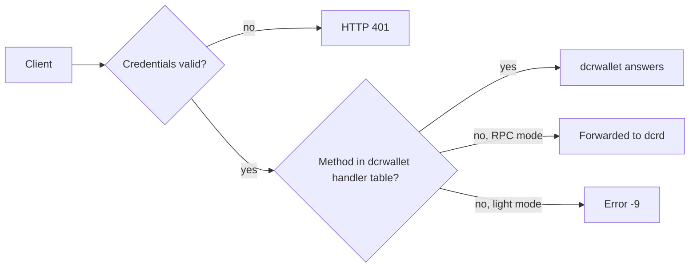

# dcrwallet JSON-RPC API

`dcrwallet` serves an application programming interface (API) over JSON-RPC, a remote procedure call (RPC) protocol, for scripts, services and `dcrctl --wallet`. This page lists all 111 entries in the handler table of dcrwallet 2.1.7 (103 working methods and 8 stubs kept for Bitcoin compatibility), grouped by purpose, and explains how to connect, authenticate and unlock. It is built from `internal/rpc/jsonrpc/methods.go`, `internal/rpc/jsonrpc/server.go` and the help text in `internal/rpchelp/helpdescs_en_US.go` at tag `release-v2.1.7`.

A running wallet prints the full help for any method, including every result field: `dcrctl --wallet help <METHOD>`. This page adds what the help text leaves out: which calls need an unlocked wallet, which behave differently in light mode, and where the help text and the code disagree.

## JSON-RPC or gRPC?

`dcrwallet` has two APIs. Pick by job:

| Need | Use |
|---|---|
| Scripts, `dcrctl`, exchange and service backends, any language with HTTP and JSON | JSON-RPC (this page) |
| Create, restore or open a wallet over the API | gRPC `WalletLoaderService`; JSON-RPC has no such methods |
| Push notifications of new transactions, blocks or tickets | gRPC streams; the JSON-RPC websocket carries requests and responses only |
| What Decrediton uses | gRPC |

See [dcrwallet gRPC API](dcrwallet-grpc.md) and [Choosing an API](index.md). With JSON-RPC, detect new deposits by polling `listsinceblock`.

## Connect

### Endpoints and defaults

| Network | Default address | Port |
|---|---|---|
| mainnet | localhost | 9110 |
| testnet | localhost | 19110 |
| simnet | localhost | 19557 |

Source: `internal/netparams/params.go`. By default `dcrwallet` listens on every address that `localhost` resolves to. Two paths are served on the same port:

- `/`: HTTP POST, one JSON-RPC request per HTTP request.
- `/ws`: websocket, many requests over one connection.

The server uses Transport Layer Security (TLS) with a self-signed certificate that `dcrwallet` writes on first start, valid for 10 years and for `localhost`, the host name and the machine's interface addresses:

| OS | Certificate |
|---|---|
| Linux, BSD | `~/.dcrwallet/rpc.cert` |
| macOS | `~/Library/Application Support/Dcrwallet/rpc.cert` |
| Windows | `%LOCALAPPDATA%\Dcrwallet\rpc.cert` |

!!! warning "The JSON-RPC server does not start without credentials"
    With the default `jsonrpcauthtype=basic`, the server starts only when both `username` and `password` are set. Otherwise `dcrwallet` logs `JSON-RPC server disabled (basic auth requires username and password, and client cert authentication is not enabled)` and nothing listens on the port.

### Server options

These `dcrwallet.conf` keys control the JSON-RPC server (`config.go`, `rpcserver.go` at `release-v2.1.7`). [dcrwallet configuration](../reference/dcrwallet-config.md) lists every option.

| Option | Default | Effect |
|---|---|---|
| `rpclisten` | localhost addresses, network port | Listen address; repeat for several. May not equal a `grpclisten` address. |
| `nolegacyrpc` | off | Disables the JSON-RPC server. |
| `username`, `password` | none | Basic-auth credentials. Also used to log in to `dcrd` unless `dcrdusername` and `dcrdpassword` are set. |
| `jsonrpcauthtype` | `basic` | `basic` or `clientcert`. |
| `clientcafile` | `clients.pem` in the app data folder | PEM file of certificate authorities trusted to sign client certificates. The gRPC server trusts the same file. |
| `rpccert`, `rpckey` | `rpc.cert`, `rpc.key` in the app data folder | Server TLS certificate and key. |
| `tlscurve` | `Ed25519` | Key type for a generated certificate: `P-256`, `P-384`, `P-521` or `Ed25519`. |
| `onetimetlskey` | off | Generate a new key pair at each start and write only the certificate. |
| `noservertls` | off | Serve plain HTTP. Refused unless every listener is a localhost address. |
| `rpcmaxclients` | 10 | Concurrent HTTP POST clients; more get HTTP 429. |
| `rpcmaxwebsockets` | 25 | Concurrent websocket clients; more get HTTP 429. |

!!! tip "If your TLS library rejects the certificate"
    The generated certificate uses an Ed25519 key, which some TLS libraries do not accept. Stop `dcrwallet`, set `tlscurve=P-256`, delete `rpc.cert` and `rpc.key`, and start it again to get a P-256 certificate. Clients that pinned the old certificate need the new file.

### Basic authentication

Every HTTP POST must carry an `Authorization: Basic` header made from `username` and `password`. A wrong or missing header gets HTTP 401. This call reads the balance of the `default` account:

```bash
curl --cacert ~/.dcrwallet/rpc.cert --user <RPCUSER> \
  --data-binary '{"jsonrpc":"1.0","id":1,"method":"getbalance","params":["default"]}' \
  https://localhost:9110/
```

`<RPCUSER>` is the `username` from `dcrwallet.conf`. With `--user` and no password, `curl` asks for the password, so it does not end up in your shell history or process list.

```json title="Expected output (example values)"
{"jsonrpc":"1.0","result":{"balances":[{"accountname":"default","immaturecoinbaserewards":0,"immaturestakegeneration":0,"lockedbytickets":0,"spendable":1.5,"total":1.5,"unconfirmed":0,"votingauthority":0}],"blockhash":"<BLOCK_HASH>"},"error":null,"id":1}
```

On testnet use port 19110, on simnet 19557. `dcrctl --wallet getbalance default` makes the same call with the credentials in `dcrctl.conf`; [Set up the command-line wallet](../../user/wallets/command-line.md) sets that up. [Your first JSON-RPC call](first-rpc-call.md) shows `dcrwallet` calls in Python and JavaScript too.

### Client certificate authentication

With `jsonrpcauthtype=clientcert`, the TLS handshake requires a client certificate signed by an authority in `clientcafile`, and no basic-auth header is checked. `gencerts` from the command-line bundle makes both certificates:

1. Create a certificate authority. `-S` lets it sign other certificates:

    ```bash
    gencerts -S -o "dcrwallet clients" ca.pem ca-key.pem
    ```

2. Issue a client certificate signed by it:

    ```bash
    gencerts -C ca.pem -K ca-key.pem client.pem client-key.pem
    ```

3. Append `ca.pem` to `clients.pem` in the `dcrwallet` app data folder (create the file if it does not exist), set `jsonrpcauthtype=clientcert` in `dcrwallet.conf`, and restart `dcrwallet`. Once `clients.pem` exists, the gRPC server also starts and trusts the same authority. Keep `ca-key.pem` offline: anyone holding it can issue new client certificates.

4. Point the client at its key pair. For `dcrctl`, set `authtype=clientcert`; it looks for `client.pem` and `client-key.pem` in its own app data folder (`~/.dcrctl` on Linux) unless `clientcert` and `clientkey` say otherwise.

!!! danger "Do not combine `clientcert` with `noservertls`"
    Client certificates need TLS. `dcrwallet` 2.1.7 accepts `jsonrpcauthtype=clientcert` together with `noservertls` and then starts the JSON-RPC server on localhost with no authentication at all, so any local process can spend from an unlocked wallet.

These steps follow the code (`rpcserver.go`, `cmd/gencerts`) and have not been run end to end for this page.

### Websocket connections

Connect to `wss://localhost:9110/ws`. Authenticate either with the same `Authorization` header on the upgrade request, or by sending this as the first message:

```json
{"jsonrpc":"1.0","id":0,"method":"authenticate","params":["<RPCUSER>","<RPCPASS>"]}
```

`<RPCUSER>` and `<RPCPASS>` are the `username` and `password` from `dcrwallet.conf`.

A wrong header, a wrong `authenticate`, a second `authenticate`, or any other first message from an unauthenticated client closes the connection. After that, every request message gets one response message. Requests run concurrently, so responses can arrive out of order: match them by `id`. `dcrwallet` 2.1.7 sends no notifications over this connection.

## Requests and responses

How the server parses requests (`server.go`, `methods.go`):

- **Format**: a JSON object with `method`, `params` and `id`. `jsonrpc` may be `"1.0"` or `"2.0"` and is echoed back; any other value is answered as `"1.0"`. Responses always carry `result`, `error` and `id`, with `null` for the unused one.
- **Parameters** are positional, in a JSON array, in the order this page lists them. Named parameters are not supported. A wrong count or type returns error `-32600`.
- **No batching**: a JSON array of requests in one POST returns error `-32600`. Each HTTP response closes its connection (`Connection: close`), so send many calls over a websocket instead of many POSTs.
- **Size**: request bodies over 4 MB get HTTP 413.
- **Amounts** are decimal DCR, not atoms (1 DCR = 100,000,000 atoms), and are rounded to the nearest atom. Fee rates are DCR per kB.
- **Unknown methods** are forwarded to `dcrd` when the wallet syncs through `dcrd`, as the next section explains.

## Full-node mode and light mode

A wallet syncs either through its own `dcrd` (RPC mode) or from peers as a light wallet (SPV, `--spv`). The mode changes what some calls return. The diagram shows how one request is routed:



| Behavior | RPC mode | Light mode |
|---|---|---|
| Methods not in the handler table, such as `getblockchaininfo` or `decoderawtransaction` | Forwarded to `dcrd` with the wallet's `dcrd` login | Error `-9`: `RPC passthrough requires dcrd RPC synchronization` |
| `getblock`, `getblockheader`, `gettxout`, `getpeerinfo` | Forwarded to `dcrd` | Answered from the wallet's own data and peers (details in the tables) |
| `getinfo`, `version`, `help` | Wallet data merged with `dcrd`'s | Wallet data only |
| `getstakeinfo`, `gettickets` | Can tell live, missed and expired tickets apart | Mature unspent tickets show as `unspent` |
| `ticketinfo` | Reports `unspent` for every mature unspent ticket; use `getstakeinfo` for live and missed counts | Same |
| Automatic voting (`enablevoting`) | Possible | Refused at startup: `SPV voting is not possible` |

!!! warning "Wallet credentials reach dcrd too"
    In RPC mode anyone with the wallet's JSON-RPC credentials can call any `dcrd` method that the wallet's `dcrd` login allows, through the wallet. Protect the wallet credentials at least as well as the node's. The one exception is `stop`, which the wallet handles itself and which stops `dcrwallet`, not `dcrd`.

## Locking model

The private passphrase encrypts the wallet's private keys. Reading balances, addresses and history works while the wallet is locked. Anything that signs needs it unlocked, and the tables below mark those calls **Unlock**. Without it they fail with error `-13`. The message is often `wallet or account locked; use walletpassphrase or unlockaccount first` but varies by method, so match on the error code, not the message.

There are two layers of locks:

- **Wallet lock.** `walletpassphrase "passphrase" timeout` unlocks every account that uses the wallet passphrase, for `timeout` seconds; `0` means until `walletlock` or shutdown. A new timeout replaces a running one, but once the wallet is unlocked with `0`, a later timeout is ignored. A `walletpassphrase` call with a wrong passphrase locks the wallet, stopping the ticket buyer, voting, mixing and VSP fee payment until it is unlocked again. Starting `dcrwallet` with `--promptpass` unlocks it at startup.
- **Account locks.** An account given its own passphrase with `setaccountpassphrase` is not unlocked by `walletpassphrase`. Unlock it with `unlockaccount` (no timeout) and lock it with `lockaccount`. [Manage accounts and passphrases](../../user/wallets/accounts-and-passphrases.md) has the full behavior table.

Keep passphrases off command lines. `promptsecret` from the command-line bundle reads one without echoing it and passes it to `dcrctl` wherever a `-` stands for a parameter:

```bash
promptsecret | dcrctl --wallet walletpassphrase - 300
```

Over HTTP the passphrase travels in the request body, so call `walletpassphrase` only over TLS or on localhost.

!!! warning "An unlocked wallet spends for anyone with RPC access"
    While the wallet is unlocked, every client holding the JSON-RPC credentials can send its funds. The ticket buyer, automatic voting, mixing and voting service provider (VSP) fee payment need the wallet unlocked continuously, so a staking or mixing wallet is exposed for as long as it runs: keep the RPC port on localhost and the credentials private.

### Lock and passphrase methods

| Method | Parameters | Result | Notes |
|---|---|---|---|
| `walletpassphrase` | `"passphrase" timeout` | none | Unlocks for `timeout` seconds; `0` until locked. Error `-14` for a wrong passphrase. A wrong passphrase also locks a wallet that was unlocked. |
| `walletlock` | none | none | Locks the wallet. |
| `walletislocked` | none | boolean | |
| `walletpassphrasechange` | `"oldpassphrase" "newpassphrase"` | none | Changes the private passphrase. |
| `walletpubpassphrasechange` | `"oldpassphrase" "newpassphrase"` | none | Changes the public passphrase, which encrypts the wallet's public data and is needed to open it (`walletpass`). |
| `setaccountpassphrase` | `"account" "passphrase"` | none | Gives an account its own passphrase, or with `""` puts it back on the wallet passphrase. Needs the wallet, or that account, unlocked. |
| `unlockaccount` | `"account" "passphrase"` | none | Unlocks an individually encrypted account, with no timeout. |
| `lockaccount` | `"account"` | none | Locks it; `*` locks every individually encrypted account. |
| `accountunlocked` | `"account"` | object | `encrypted`, and `unlocked` for individually encrypted accounts. |

## Method reference

How to read the tables:

- **Parameters** repeat the usage line from the help text. Names in quotes are strings, other names are numbers, booleans, arrays or objects. Parameters in parentheses are optional, and `name=value` shows the default.
- **Unlock**: needs the wallet unlocked, and any individually encrypted account it uses unlocked too.
- **Deprecated**: marked deprecated in the help text; kept for compatibility.
- Results named "txid" are transaction hashes as hex strings.

### Accounts and addresses

| Method | Parameters | Result | Notes |
|---|---|---|---|
| `createnewaccount` | `"account"` | none | Creates the next hierarchical deterministic (HD) account. **Unlock.** The name `*` is reserved. |
| `renameaccount` | `"oldaccount" "newaccount"` | none | |
| `listaccounts` | `(minconf=1)` | object: account name to spendable DCR | **Deprecated**; use `getbalance`. |
| `getaccount` | `"address"` | string | Account that owns a wallet address. Error `-4` `address not found in wallet` otherwise. |
| `getnewaddress` | `("account" "gappolicy")` | string | Next receiving (external, branch 0) address; the default account is `default`. `gappolicy`: `error`, `ignore` or `wrap`; unset behaves as `error`. See the gap limit warning below. |
| `getrawchangeaddress` | `("account")` | string | Next change (internal, branch 1) address. Wraps around at the gap limit instead of failing. |
| `getaccountaddress` | `"account"` | string | **Deprecated.** The address the next `getnewaddress` call on this account would return, without marking it as handed out. |
| `getaddressesbyaccount` | `"account"` | array of strings | **Deprecated.** |
| `accountaddressindex` | `"account" branch` | number | Next child index of `branch` 0 (external) or 1 (internal). |
| `accountsyncaddressindex` | `"account" branch index` | none | Marks the addresses up to `index` as handed out and watches them. When `index` is past the last used address on that branch, the next address becomes `index`+1. An `index` below the current position (but past the last used address) moves it back, so the wallet hands out addresses again. On a branch with no used address yet, the position does not change. |
| `validateaddress` | `"address"` | object | Works for any address. `isvalid`, `ismine`, `isscript`, and for wallet addresses `account`, `pubkey`, and HD `accountn`, `branch` and `index`. |
| `auditreuse` | `(since)` | object: address to outpoints | Wallet addresses paid more than once, optionally only reuse since block height `since`. Votes and revocations are skipped: they must pay addresses the ticket committed to. |

!!! warning "getnewaddress stops at the gap limit"
    By default `getnewaddress` fails with `generating next address violates the unused address gap limit policy` once it has handed out `gaplimit` (default 20, a wallet default, not a rule) consecutive addresses that have not received anything. The limit exists because a wallet restored from its seed stops looking after that many unused addresses. `wrap` hands out earlier unused addresses again, so two payers can get the same address. `ignore` keeps deriving and watching new addresses, but a restore then finds funds beyond the gap only if it is run with a larger `gaplimit`. A service that issues many deposit addresses should raise `gaplimit` and record the value next to its seed backup. The [account structure in the whitepaper](../../whitepaper/05-addresses.md#sec:addresses-bip44) explains the derivation.

### Balances and transactions

| Method | Parameters | Result | Notes |
|---|---|---|---|
| `getbalance` | `("account" minconf=1)` | object | Per account: `spendable`, `unconfirmed`, `lockedbytickets`, `votingauthority`, `immaturecoinbaserewards`, `immaturestakegeneration`, `total`. With account `*` (the default), also `total*` sums and `cumulativetotal`. |
| `getunconfirmedbalance` | `("account")` | number | `total` minus `spendable` for the account (default `default`), so it also counts coins locked in tickets and immature coins, not only unmined outputs. |
| `getreceivedbyaccount` | `"account" (minconf=1)` | number | Total ever received, including outputs since spent. |
| `getreceivedbyaddress` | `"address" (minconf=1)` | number | Same, for one address. |
| `listreceivedbyaccount` | `(minconf=1 includeempty=false includewatchonly=false)` | array | The last two parameters are ignored. |
| `listreceivedbyaddress` | `(minconf=1 includeempty=false includewatchonly=false)` | array | The last two parameters are ignored. |
| `listtransactions` | `("account" count=10 from=0 includewatchonly=false)` | array | Entries for the latest `count` transactions after skipping the newest `from` transactions, returned oldest first. One transaction can give several entries, and one output can appear under more than one category. `account` must be unset or `*`. |
| `listalltransactions` | `("account")` | array | Like `listtransactions`, with no limit. |
| `listaddresstransactions` | `["address",...] ("account")` | array | Wallet transactions involving these addresses. |
| `listsinceblock` | `("blockhash" targetconfirmations=1 includewatchonly=false)` | object | `transactions` in the given block, every later main-chain block and the mempool (all transactions if `blockhash` is unset), and `lastblock`, the block `targetconfirmations`−1 below the tip, to pass to the next call. Consecutive calls overlap, so deduplicate by `txid` and output. The polling pattern for deposits. |
| `gettransaction` | `"txid" (includewatchonly=false)` | object | `amount` (credits minus debits), `fee` (negative for a send, omitted when it cannot be computed), `confirmations`, `blockhash`, `details` and `hex`. In 2.1.7 `type` is always empty and `ticketstatus` is never set, despite the help text; use `ticketinfo` for tickets. |
| `listunspent` | `(minconf=1 maxconf=9999999 ["address",...] "account")` | array | Unspent outputs not locked with `lockunspent`, with `tree`, `txtype`, `account` and `spendable` (false for watch-only or partly controlled multisig outputs). |
| `lockunspent` | `unlock [{"amount":n.nnn,"txid":"value","vout":n,"tree":n},...]` | `true` | `false` locks the outputs so the wallet will not spend them; `true` with an empty array unlocks all. Locks are lost when `dcrwallet` restarts. |
| `listlockunspent` | `("account")` | array | Outputs locked with `lockunspent`. |
| `abandontransaction` | `"hash"` | none | Removes an unconfirmed transaction and the ones that depend on it from the wallet. If it was already broadcast it can still be mined. |
| `addtransaction` | `"blockhash" "transaction"` | none | Records a transaction mined in a main-chain block by hand. |

Confirmation counts are only one input to a deposit policy on Decred: a regular-tree transaction can be undone when stakeholders disapprove its block. [Blocks, confirmations and reorganizations](../protocol/blocks-and-confirmations.md) explains how to set one.

### Sending

| Method | Parameters | Result | Notes |
|---|---|---|---|
| `sendtoaddress` | `"address" amount ("comment" "commentto")` | txid | Always spends from the `default` account with at least 1 confirmation. **Unlock.** |
| `sendfrom` | `"fromaccount" "toaddress" amount (minconf=1 "comment" "commentto")` | txid | **Unlock.** |
| `sendmany` | `"fromaccount" {"address":amount,...} (minconf=1 "comment")` | txid | One transaction paying several addresses. **Unlock.** |
| `spendoutputs` | `"account" ["previousoutpoint",...] [{"address":"value","amount":n.nnn},...]` | txid | Coin control: spends exactly the listed outputs (`"txhash:index"`), which must be pay-to-pubkey-hash outputs of `account`. Change goes to a new change address of the same account; inputs and outputs are shuffled. **Unlock.** |
| `consolidate` | `inputs ("account" "address")` | txid | Merges up to `inputs` outputs with at least 1 confirmation from `account` (default `default`) into one output, paid to `address` or a new address of the account. **Unlock.** |
| `sweepaccount` | `"sourceaccount" "destinationaddress" (requiredconfirmations feeperkb)` | object | Builds, but does not sign or send, a transaction spending every eligible output of the account to one address. Returns `unsignedtransaction`, `totalpreviousoutputamount`, `totaloutputamount` and `estimatedsignedsize`. |
| `getwalletfee` | none | number | Fee rate in DCR per kB. |
| `settxfee` | `amount` | `true` | Sets the fee rate in DCR per kB until `dcrwallet` restarts; the `txfee` option (default 0.0001 DCR/kB, a wallet default) applies after that. |

- A sent transaction cannot be reversed. Check the address network prefix (`Ds` on mainnet) before sending; `validateaddress` returns `"isvalid": false` for an address of another network.
- The `comment` parameters are for Bitcoin compatibility: a non-empty value returns error `-1` `transaction comments are unsupported`.
- With mixing enabled, a send from the mixed account (`sendtoaddress`, `sendfrom`, `sendmany`, `sendtotreasury`) returns change to `changeaccount` so that unmixed change never lands in the mixed account.

### Raw transactions

| Method | Parameters | Result | Notes |
|---|---|---|---|
| `createrawtransaction` | `[{"amount":n.nnn,"txid":"value","vout":n,"tree":n},...] {"address":amount,...} (locktime expiry)` | hex string | Unsigned transaction. Each input needs its `amount` and `tree` (0 regular, 1 stake). Outputs must be pay-to-pubkey-hash (secp256k1) or pay-to-script-hash addresses. A non-zero `locktime` also sets the inputs' sequence so the lock time applies; `expiry` is the block height from which the transaction can no longer be mined. |
| `fundrawtransaction` | `"hexstring" "fundaccount" ({"changeaddress":changeaddress,"feerate":feerate,"conf_target":conftarget})` | object: `hex`, `fee` | Adds inputs from `fundaccount` and a change output to a transaction that has outputs and no inputs. Does not sign. `feerate` is DCR per kB (default: the wallet fee); `conf_target` is the minimum confirmations of the selected outputs (default 1). |
| `signrawtransaction` | `"rawtx" ([{"txid":"value","vout":n,"tree":n,"scriptpubkey":"value","redeemscript":"value"},...] ["privkey",...] flags="ALL")` | object: `hex`, `complete`, `errors` | Without `privkey`, signs every input the wallet's keys can sign. With `privkey`, signs only with those keys (wallet import format, WIF) and only with the `redeemscript` values given in `inputs`; wallet keys are not used. `inputs` describes outputs the wallet does not track; in RPC mode the wallet asks `dcrd` for the rest. For a pay-to-script-hash multisig input whose output script came from `inputs` or `dcrd`, `complete` is `true` even when signatures are missing; check the signature script with `decoderawtransaction`. **Unlock** when signing with wallet keys. |
| `signrawtransactions` | `["rawtx",...] (send=true)` | object: `results` | Signs each transaction with `ALL` and, by default, publishes every one that is complete. Pass `false` to only sign. **Unlock.** |
| `createsignature` | `"address" inputindex hashtype "previouspkscript" "serializedtransaction"` | object: `signature`, `publickey` | One signature for one input with the key of `address`. `hashtype` is the numeric signature hash type. **Unlock.** |
| `sendrawtransaction` | `"hextx" (allowhighfees=false)` | txid | Publishes a signed transaction through the wallet's node or peers, in both modes. Refuses one whose fee exceeds 0.1 DCR/kB (1000 times the default relay fee) with error `-4` `policy violation: high fees`, unless `allowhighfees` is `true`. |

`signrawtransaction` accepts the `flags` values `ALL`, `NONE`, `SINGLE`, and each of them combined with `ANYONECANPAY` (written `ALL|ANYONECANPAY`). The [signature hash rules](../../whitepaper/06-script.md#sec:script-sighash) define them. [Cold storage with an offline wallet](../../user/security/cold-storage.md) walks through `createrawtransaction`, `fundrawtransaction`, `signrawtransaction` and `sendrawtransaction` between an online and an offline wallet.

### Keys, import and export

| Method | Parameters | Result | Notes |
|---|---|---|---|
| `getmasterpubkey` | `("account")` | string | The account's extended public key (`dpub...` on mainnet); default account `default`. |
| `importxpub` | `"name" "xpub"` | none | Adds a watching-only account from an extended public key. If it already received funds, run `rescanwallet`. |
| `importprivkey` | `"privkey" ("label" rescan=true scanfrom)` | none | Imports a WIF private key into the `imported` account. `label` must be unset or `imported`. The rescan runs in the background after the call returns. **Unlock.** |
| `importpubkey` | `"pubkey" ("label" rescan=true scanfrom)` | none | Watches the pay-to-pubkey-hash address of a 33-byte compressed public key (hex). Rescan as above. |
| `importscript` | `"hex" (rescan=true scanfrom)` | none | Imports a redeem script, such as a multisig script, so the wallet tracks its pay-to-script-hash address. Rescan as above. |
| `dumpprivkey` | `"address"` | string | WIF private key of a wallet address. **Unlock.** |
| `signmessage` | `"address" "message"` | string | Base64 signature. **Unlock.** |
| `verifymessage` | `"address" "signature" "message"` | boolean | |

A rescan requested by an import needs a network connection: without one the call fails with `-9` `disconnected from network`.

!!! danger "Exported keys give away funds"
    A WIF key from `dumpprivkey` spends everything paid to that address, for anyone who sees it. An extended public key is not harmless either: together with any one private key of the same account it reveals every private key of that account. `dcrwallet` logs a warning to that effect on every `getmasterpubkey` call. Never give both to a third party such as a VSP. [Keys, addresses and seeds](../protocol/keys-and-addresses.md) explains WIF and HD derivation.

### Staking and VSPs

| Method | Parameters | Result | Notes |
|---|---|---|---|
| `purchaseticket` | `"fromaccount" (minconf=1 numtickets=1 expiry "comment" dontsigntx)` | array of ticket hashes | Buys tickets at the current ticket price; there is no price-limit parameter. With `vsp.url` and `vsp.pubkey` set, it also pays each ticket's VSP fee, up to `vsp.maxfee`. With `mixing` on, it buys mixed tickets: voting rights go to the mixed account, change to `changeaccount`. `expiry` is the height from which the unmined ticket transactions can no longer be mined. With `dontsigntx` set to `true` it returns `{"unsignedtickets":[...],"splittx":"..."}` unsigned instead. **Unlock.** |
| `gettickets` | `includeimmature` | object: `hashes` | Hashes of the wallet's live tickets, plus immature ones if `true`. |
| `ticketinfo` | `(startheight=0)` | array | One entry per ticket from block height `startheight`: `hash`, `cost`, `votingaddress`, `status`, `blockheight`, the `vote` or `revocation` that spent it, `choices` and `vsphost`. |
| `getstakeinfo` | none | object | Ticket counts (`ownmempooltix`, `immature`, `unspent`, `live`, `voted`, `missed`, `expired`, `revoked`), `poolsize`, `difficulty` (the current ticket price, also called stake difficulty) and `totalsubsidy` earned by votes. Light mode leaves `live`, `missed` and `expired` at 0, counts mature unspent tickets as `unspent` and revoked ones as `revoked`, and estimates `poolsize`. |
| `processunmanagedticket` | `"tickethash"` | none | Registers a ticket with the VSP in `vsp.url` and pays its fee if unpaid. Error `-8` `vsphost must be set in options` without `vsp.url`. **Unlock.** |

`ticketinfo` reports these `status` values:

| Status | Meaning |
|---|---|
| `immature` | Not yet mined, or mined less than 256 blocks ago (about 21 hours). |
| `unspent` | Mature and unspent: live, or missed or expired but not yet revoked. Used in both modes; `ticketinfo` in 2.1.7 never returns `live`. |
| `voted` | Voted; `vote` holds the vote transaction. |
| `missed`, `expired` | Revoked after a miss or after expiry; `revocation` holds the revocation, which returns the ticket price. |
| `revoked` | Deprecated: since automatic revocations, a ticket shows as `missed` or `expired` instead. |
| `unknown` | The wallet could not determine the status. |

A ticket cannot be cancelled once bought. With a VSP, the wallet must stay unlocked and running until the VSP has confirmed the fee payment. [Stake with dcrwallet](../../user/staking/stake-with-dcrwallet.md) covers the configuration, the ticket buyer and fee problems; [Staking and the treasury for builders](../protocol/staking-and-treasury.md) explains the transactions.

### Voting preferences

| Method | Parameters | Result | Notes |
|---|---|---|---|
| `getvotechoices` | `("tickethash")` | object | `version` (the latest stake version this wallet supports) and the choice for each agenda of that version. With a ticket hash: that ticket's choices, or the defaults if it has none. |
| `setvotechoice` | `"agendaid" "choiceid" ("tickethash")` | none | Sets the choice for all tickets, or for one. Also sent to the VSP of every affected ticket. **Unlock** when tickets use a VSP. |
| `treasurypolicy` | `("key" "ticket")` | object, or array without `key` | Policy for treasury spends signed by a Politeia key. In the array, an empty `policy` means abstain. |
| `settreasurypolicy` | `"key" "policy" ("ticket")` | none | `key`: 33-byte compressed Politeia public key in hex. `policy`: `yes`, `no` or `abstain` (`invalid` and an empty string also mean abstain). Sent to VSPs. **Unlock** when tickets use a VSP. |
| `tspendpolicy` | `("hash" "ticket")` | object, or array without `hash` | Policy for each treasury spend (TSPEND) the wallet has seen, including one inherited from its key. |
| `settspendpolicy` | `"hash" "policy" ("ticket")` | none | Policy for one treasury spend. `abstain` deletes the per-spend setting so the key policy applies again. Sent to VSPs. **Unlock** when tickets use a VSP. |
| `disapprovepercent` | none | number | Percentage of votes that randomly disapprove the block they vote on. For testing. |
| `setdisapprovepercent` | `percent` | none | Sets it, from 0 to 100. Refused on mainnet. |

When a ticket votes on a treasury spend, the wallet uses the first policy it finds in this order: the per-ticket policy for that spend, the wallet's policy for that spend, the per-ticket policy for its Politeia key, the wallet's policy for that key. With none it abstains. [Vote with your tickets](../../user/governance/vote.md) lists the two mainnet Politeia keys and the steps; the whitepaper covers [vote bits](../../whitepaper/08-staking.md#sec:staking-votebits) and [treasury spend voting](../../whitepaper/12-treasury.md#sec:treasury-votes).

### Mixing

| Method | Parameters | Result | Notes |
|---|---|---|---|
| `mixaccount` | none | none | Mixes eligible outputs (at least 2 confirmations) of `changeaccount` into `mixedaccount`. Blocks until the mixes finish and may leave some outputs for a later call. **Unlock.** |
| `mixoutput` | `"outpoint"` | none | Mixes one output, given as `"txhash:index"`. Blocks until done. **Unlock.** |
| `getcoinjoinsbyacct` | none | object: account name to number | How many mixed outputs (outputs of mined mix transactions at the mix denomination) each account has ever received, spent or not. Helps identify the mixed account after a restore. |

Both mixing calls need `dcrwallet` started with `mixing`, `mixedaccount` and `changeaccount`; otherwise they return `Mixing is not configured`. A mix waits for the next epoch (10 minutes on mainnet), so expect these calls to take longer than common HTTP client timeouts. Most wallets set `mixchange` and let the wallet mix on its own instead. [Mix your DCR](../../user/privacy/mix-your-dcr.md) has the setup, and [Mixing for builders](../protocol/mixing.md) the protocol.

### Treasury sends

| Method | Parameters | Result | Notes |
|---|---|---|---|
| `sendtotreasury` | `amount` | txid | Sends `amount` DCR from the `default` account to the treasury as a treasury add (TADD). **Unlock.** |
| `sendfromtreasury` | `"key" amounts` | txid | Builds, signs and publishes a treasury spend paying `{"address":amount,...}`. `key` is a Politeia public key in hex whose private key is imported in this wallet; the expiry is set automatically. **Unlock.** |

- A treasury add cannot be undone. The DCR becomes part of the treasury balance and leaves only through treasury spends approved by ticket holders.
- On mainnet only the holders of the two Politeia keys in `chaincfg` can sign a treasury spend, so `sendfromtreasury` matters only on test networks. [Set up a private simnet](../environment/simnet.md) uses it.
- The whitepaper specifies [treasury adds](../../whitepaper/12-treasury.md#sec:treasury-tadd) and [treasury spends](../../whitepaper/12-treasury.md#sec:treasury-tspend).

### Multisig

| Method | Parameters | Result | Notes |
|---|---|---|---|
| `createmultisig` | `nrequired ["key",...]` | object: `address`, `redeemScript` | Builds an m-of-n pay-to-script-hash address without importing it. Each key is a hex public key or a wallet address whose public key the wallet knows. |
| `addmultisigaddress` | `nrequired ["key",...] ("account")` | string | Same, and imports the script into the `imported` account. `account` must be unset or `imported`. |
| `sendtomultisig` | `"fromaccount" amount ["pubkey",...] (nrequired=1 minconf=1 "comment")` | object: `txhash`, `address`, `redeemscript` | Pays `amount` to a new multisig address. Always spends from the `default` account; `fromaccount` is ignored. **Unlock.** |
| `getmultisigoutinfo` | `"hash" index` | object | Address, script, m and n, public keys, amount and spending status of a multisig output the wallet tracks. |
| `redeemmultisigout` | `"hash" index tree ("address")` | object: `hex`, `complete`, `errors` | Builds a transaction spending one multisig output to `address`, or to a new change address of the `default` account, and adds this wallet's signature. In 2.1.7 the fee is sized for a 110-byte single-key signature script at the wallet fee rate, so at the default 0.0001 DCR/kB a spend from an address with two or more keys pays less than `dcrd`'s minimum relay fee and is rejected ([dcrwallet issue 2273](https://github.com/decred/dcrwallet/issues/2273)); `complete` can also be `true` while signatures are missing. Build the spend with `createrawtransaction` instead ([Scripts for builders](../protocol/scripts.md#with-dcrwallet)). **Unlock.** |
| `redeemmultisigouts` | `"fromscraddress" ("toaddress" number)` | object: `results` | Runs `redeemmultisigout` for every unspent output of a pay-to-script-hash address, with the same fee and `complete` problems. In 2.1.7 the `number` limit is off by one (it processes `number`+1 outputs), and `results` keeps an empty entry for each output it skipped. **Unlock.** |

[Scripts for builders](../protocol/scripts.md) explains P2SH multisig on Decred.

### Wallet state and sync

| Method | Parameters | Result | Notes |
|---|---|---|---|
| `walletinfo` | none | object | `daemonconnected`, `spv`, `unlocked`, `cointype`, `txfee`, `votebits`, `votebitsextended`, `voteversion`, `voting`, `vsp`, `manualtickets`, `birthhash`, `birthheight`. |
| `syncstatus` | none | object | `synced`; `initialblockdownload`, true while the wallet's best block is more than 24 hours old; `headersfetchprogress` from 0 to 1. |
| `getinfo` | none | object | `balance` is the spendable total of all accounts at 1 confirmation. In RPC mode, node fields such as `connections` and `relayfee` come from `dcrd`; several fields are always 0. |
| `version` | none | object | Semantic versions keyed by name: `dcrwallet` (2.1.7) and `dcrwalletjsonrpcapi` (11.0.0), plus `dcrd`'s entries in RPC mode. Check `dcrwalletjsonrpcapi` before relying on a method. |
| `getcurrentnet` | none | number | Network magic: 3652452601 (`0xd9b400f9`) mainnet, 2979310197 (`0xb194aa75`) testnet, 303307798 (`0x12141c16`) simnet. |
| `getpeerinfo` | none | array | Light mode: the wallet's peers. RPC mode: `dcrd`'s peers. |
| `rescanwallet` | `(beginheight=0)` | none | Rescans the chain for wallet transactions from `beginheight`; returns when the rescan ends. |
| `discoverusage` | `("startblock" discoveraccounts gaplimit)` | none | Address discovery from block `startblock` (default genesis), and account discovery too if `discoveraccounts` is `true` (**Unlock**). `gaplimit` overrides the wallet's. |
| `debuglevel` | `"levelspec"` | string | Sets log levels: one level for all, or `SUBSYSTEM=level,...`. Levels: `trace`, `debug`, `info`, `warn`, `error`, `critical`. Subsystems: `CMGR`, `DCRW`, `GRPC`, `LODR`, `MIXC`, `MIXP`, `PEER`, `RPCS`, `SYNC`, `TKBY`, `VSPC`, `WLLT`. `show` lists them. |
| `help` | `("command")` | string | Usage of every method, or the full help for one. In RPC mode it adds `dcrd`'s methods and answers for `dcrd` methods too. |

These chain queries answer from the wallet's view of the chain unless noted:

| Method | Parameters | Result | Notes |
|---|---|---|---|
| `getbestblock` | none | object: `hash`, `height` | Newest block the wallet has finished syncing. |
| `getbestblockhash` | none | string | |
| `getblockcount` | none | number | |
| `getblockhash` | `index` | string | Main-chain block hash at height `index`. |
| `getblockheader` | `"hash" (verbose=true)` | object or hex | RPC mode: forwarded to `dcrd`. Light mode: from stored headers, without `chainwork`. |
| `getblock` | `"hash" (verbose=true verbosetx=false)` | object or hex | RPC mode: forwarded to `dcrd`. Light mode: fetched from peers. |
| `gettxout` | `"txid" vout tree (includemempool=true)` | object | RPC mode: forwarded to `dcrd`, any unspent output. Light mode: only the wallet's own unspent outputs. |
| `getcfilterv2` | `"blockhash"` | object: `blockhash`, `filter`, `key` | Version 2 committed filter of a block, from the wallet's store. |
| `importcfiltersv2` | `startheight ["filter",...]` | none | Stores hex filters from `startheight` without validating them. |
| `validatepredcp0005cf` | none | boolean | Checks the stored filters from before DCP-0005 activation against a hard-coded hash. |

### Outside the handler table

Two methods are handled by the server itself and do not appear in `help`:

| Method | Parameters | Result | Notes |
|---|---|---|---|
| `stop` | none | string | Shuts down `dcrwallet` after replying. Works over HTTP POST and websocket. |
| `authenticate` | `"username" "passphrase"` | `null` | Websocket only, as the first message, when the upgrade request had no `Authorization` header. Over HTTP POST it is dropped without a reply. |

### Unimplemented Bitcoin methods

These names stay in the handler table so that Bitcoin-style clients get a clear error instead of a forward to `dcrd`. All return error code `-1`.

| Method | Message | Do this instead |
|---|---|---|
| `backupwallet` | `Method unimplemented` | Back up the seed; see [Back up and restore your wallet](../../user/wallets/back-up-and-restore.md). |
| `getwalletinfo` | `Method unimplemented` | `walletinfo` and `getbalance`. |
| `importwallet` | `Method unimplemented` | Restore from the seed with `dcrwallet --create`; import single keys with `importprivkey`. |
| `listaddressgroupings` | `Method unimplemented` | No equivalent; `listunspent` and `auditreuse` cover part of it. |
| `dumpwallet` | `Request unsupported by dcrwallet` | The seed recovers every HD key; `dumpprivkey` exports one. |
| `encryptwallet` | `Request unsupported by dcrwallet` | The private passphrase is set when the wallet is created; change it with `walletpassphrasechange`. |
| `move` | `Request unsupported by dcrwallet` | Accounts hold coins, not ledger entries: send to an address of the other account. |
| `setaccount` | `Request unsupported by dcrwallet` | An address belongs to the account it was derived from and cannot be moved. |

## Error codes

Errors come back in the `error` member as `{"code":n,"message":"..."}` (`internal/rpc/jsonrpc/errors.go`; codes from `dcrjson`):

| Code | Meaning | Typical messages |
|---|---|---|
| `-32600` | Invalid request: malformed JSON, a batch array, or parameters of the wrong number or type | `Invalid request` |
| `-32603` | Internal error | |
| `-1` | Miscellaneous; stubs; unsupported options | `Method unimplemented`, `Request unsupported by dcrwallet`, `transaction comments are unsupported` |
| `-4` | Wallet error: the default for failures without a more specific code, including the gap limit | `request requires a wallet but wallet has not loaded yet`, `address not found in wallet` |
| `-5` | Invalid address or key | `invalid address ...: decode failed` |
| `-6` | Insufficient funds | |
| `-8` | Invalid parameter | `account name is reserved by RPC server`, `amount must be positive` |
| `-9` | No connection to the network or to `dcrd` | `disconnected from network`, `disconnected from consensus RPC`, `RPC passthrough requires dcrd RPC synchronization` |
| `-11` | Unknown account | `account not found` |
| `-13` | Wallet or account locked | `wallet or account locked; use walletpassphrase or unlockaccount first` |
| `-14` | Wrong passphrase | `incorrect passphrase` |
| `-22` | Hex or transaction decoding failed | |

At the HTTP level: 401 for bad credentials, 413 for a body over 4 MB, 429 when `rpcmaxclients` or `rpcmaxwebsockets` is reached. With `--noinitialload` the wallet is not open until a gRPC client loads it, and wallet methods return `-4` until then.

## Where the help text and the code differ

The help text is hand-written and has drifted in places. The code at `release-v2.1.7` is authoritative:

| Method | Help text says | The code does |
|---|---|---|
| `purchaseticket` | Returns the hash of the ticket | Returns an array of ticket hashes, or the `unsignedtickets`/`splittx` object with `dontsigntx` |
| `sendtomultisig` | Returns a transaction hash | Returns an object with `txhash`, `address` and `redeemscript` |
| `listunspent` | Returns one object | Returns an array of objects |
| `redeemmultisigouts` | Returns one signing result | Returns `{"results":[...]}` |
| `fundrawtransaction` | Usage line shows `conftarget` | The option key is `conf_target` |
| `getcoinjoinsbyacct` | Sum of mixed outputs | Number of mixed outputs per account |
| `getunconfirmedbalance` | Value of unmined outputs | `total` minus `spendable`, which includes coins in tickets |
| `ticketinfo` | Statuses include `unmined` and `mature` | Unmined tickets show as `immature`; there is no `mature` status, and `live` is never returned |
| `gettransaction` | Returns `type` and `ticketstatus`; `fee` is input minus output | `type` is always `""`, `ticketstatus` is never set, `fee` is negative |
| `listsinceblock` | Transactions after the given block | Includes the given block's transactions and the mempool |
| `getaccountaddress` | Most recent unused address | The next address, not yet handed out |
| `sendtoaddress`, `sendfrom`, `sendmany` | `comment` parameters unused | A non-empty comment is an error |

## Keeping this page in sync with the code

For maintainers of these docs. The method set and help text change only between releases. To check this page against a new tag, clone `dcrwallet` and diff the sources this page is built from:

```bash
git clone https://github.com/decred/dcrwallet
git -C dcrwallet diff release-v2.1.7 <NEW_TAG> -- \
  internal/rpc/jsonrpc/methods.go \
  internal/rpc/jsonrpc/server.go \
  internal/rpchelp/helpdescs_en_US.go \
  rpcserver.go \
  rpc/jsonrpc/types/
```

`<NEW_TAG>` is the new release tag, such as `release-v2.2.0`. Then list the handler-table methods that this page does not mention, run from the root of the docs repository:

```bash
awk '/^var handlers = map/,/^}/' dcrwallet/internal/rpc/jsonrpc/methods.go \
  | grep -oE '^[[:space:]]*"[a-z0-9]+"' | tr -d ' \t"' | sort > code-methods.txt
grep -oE '^\| `[a-z0-9]+`' docs/dev/api/dcrwallet-json-rpc.md | tr -d '|` ' | sort -u > page-methods.txt
comm -23 code-methods.txt page-methods.txt
```

At `release-v2.1.7`, `code-methods.txt` has 111 lines and `comm` prints nothing. Also re-check the `jsonrpcSemverString` constant in `methods.go` (11.0.0 here). The "help text and the code differ" table needs a manual pass over the handlers, because the help text is written by hand and nothing checks it against what the handlers return.

## Next steps

- [Your first JSON-RPC call](first-rpc-call.md): working `dcrd` and `dcrwallet` calls in curl, Python and JavaScript on simnet or testnet.
- [Talking to dcrd and dcrwallet from Go](../go/rpc-clients.md): typed clients with TLS and authentication set up.
- [Integrate DCR into an exchange or service](../integrate/exchange.md): deposits, withdrawals and the Decred-specific gotchas built on these methods.
- [dcrwallet gRPC API](dcrwallet-grpc.md): wallet loading and notification streams that JSON-RPC lacks.
- [dcrwallet configuration](../reference/dcrwallet-config.md): every option referred to on this page.

*[API]: application programming interface
*[DCP]: Decred Change Proposal
*[HD]: hierarchical deterministic
*[JSON]: JavaScript Object Notation
*[P2SH]: pay-to-script-hash
*[RPC]: remote procedure call
*[SPV]: simplified payment verification
*[TADD]: treasury add
*[TLS]: Transport Layer Security
*[TSPEND]: treasury spend
*[VSP]: voting service provider
*[WIF]: wallet import format
