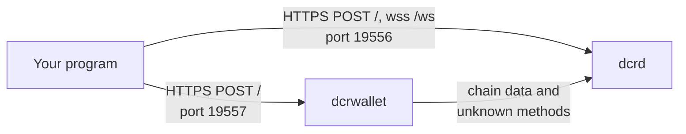
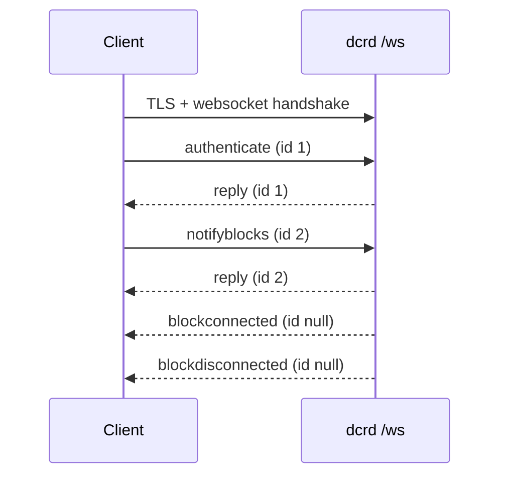

# Your first JSON-RPC call (any language)

This tutorial takes you from nothing running to working `dcrd` and `dcrwallet` calls from curl, Python and JavaScript on a private simulation network (simnet), including the parts that trip people up: the self-signed Transport Layer Security (TLS) certificate, basic authentication, wallet unlocking, batching and websocket notifications. Go developers can use the clients in [Talking to dcrd and dcrwallet from Go](../go/rpc-clients.md) instead.

!!! info "Applies to"
    dcrd, dcrwallet and dcrctl 2.1.7. Examples tested with curl 8, Python 3 with `requests`, and Node.js 26. Checked November 2026.

## What you will need

- About 30 minutes.
- The Decred 2.1.7 command-line suite (`dcrd`, `dcrwallet`, `dcrctl`), downloaded and verified as in [Set up the command-line wallet](../../user/wallets/command-line.md), with the programs on your `PATH`.
- `curl` and `openssl`; Python 3 with the `requests` package; Node.js 22 or later (for the built-in `fetch` and `WebSocket`).
- A bash or zsh shell on Linux, macOS or Windows Subsystem for Linux (WSL). The Python and JavaScript code runs anywhere; only the shell commands assume a Unix-like shell.

No real funds are involved: simnet is a private network on your computer.

## How the pieces fit

Both daemons speak JSON-RPC, a remote procedure call (RPC) protocol with JavaScript Object Notation (JSON) messages, over HTTPS. A call is an HTTP `POST` to the server's root path with a JSON body and a basic-auth header; websocket clients connect to `/ws` on the same port. Each daemon has its own port, credentials and certificate, and `dcrwallet` forwards methods it does not know to `dcrd` when it is connected to one.



The default RPC ports for each network (from `dcrd`'s `params.go` and `dcrwallet`'s `internal/netparams`):

| Network | `dcrd` RPC | `dcrwallet` JSON-RPC |
|---|---|---|
| mainnet | 9109 | 9110 |
| testnet | 19109 | 19110 |
| simnet | 19556 | 19557 |
| regnet | 18656 | none (`dcrwallet` has no regnet) |

Both listen only on localhost unless you configure `rpclisten`. Every other port and path is in [Ports, paths and prefixes](../reference/index.md).

## Step 1: Start a simnet node

`dcrd` writes random RPC credentials into a new `dcrd.conf` on mainnet and testnet, but not on simnet, and its RPC server stays off without credentials. So create a separate home folder for the simnet node with its own config file and a random password:

```bash
mkdir -p "$HOME/dcr-simnet/dcrd"
cat > "$HOME/dcr-simnet/dcrd/dcrd.conf" <<EOF
[Application Options]
simnet=1
rpcuser=simuser
rpcpass=$(openssl rand -hex 16)
EOF
dcrd --appdata="$HOME/dcr-simnet/dcrd"
```

On its first start `dcrd` creates `rpc.cert` and `rpc.key` in that folder. Leave it running in this terminal.

```text title="Expected output (excerpt)"
[INF] RPCS: Generating TLS certificates...
[INF] RPCS: Done generating TLS certificates
[INF] RPCS: RPC server listening on [::1]:19556
[INF] RPCS: RPC server listening on 127.0.0.1:19556
```

!!! warning "Put `simnet=1` in the file, not on the command line"
    When `--simnet` is passed on the command line and no `--configfile` is given, `dcrd` does not read its config file at all, including `dcrd.conf` in a custom `--appdata` folder. The RPC server then has no credentials and does not start, and nothing in the log says why.

This node is alone and has no blocks beyond the genesis block, which is enough for every call until Step 7. [Set up a private simnet](../environment/simnet.md) builds a full network with mining, tickets and votes.

!!! note "Using testnet instead"
    Start `dcrd --testnet` with its normal home folder (`~/.dcrd` on Linux, `~/Library/Application Support/Dcrd` on macOS, `%LOCALAPPDATA%\Dcrd` on Windows). On first start it writes `dcrd.conf` with random `rpcuser` and `rpcpass` values. In the examples below, use port 19109 for `dcrd` and 19110 for `dcrwallet`, the certificates in those home folders, and your own testnet wallet instead of the temporary one from Step 6. Skip the `miningaddr` and `generate` part of Step 7 and wait for new blocks instead (about one every 2 minutes on testnet). Heights and hashes in the expected outputs will differ.

## Step 2: Load the credentials and certificate

Every client needs three things from the server: a username, a password and the server's certificate.

| | `dcrd` | `dcrwallet` |
|---|---|---|
| Credentials in its config file | `rpcuser`, `rpcpass` | `username`, `password` (also used to log in to `dcrd`) |
| Certificate | `rpc.cert` in its home folder | `rpc.cert` in its home folder |
| Default key type (`tlscurve`) | Elliptic Curve Digital Signature Algorithm (ECDSA) on P-256 | Ed25519 |

The certificate is self-signed and marked as a certificate authority (CA), so a client trusts it by loading it as the CA bundle. Do not switch verification off instead: `curl -k`, `verify=False` and `--skipverify` let anyone between you and the server read the password, and with an unlocked wallet that is enough to spend.

Open a second terminal and load the values into environment variables, so they never appear in your shell history or in the code:

```bash
export DCR_RPCUSER=$(sed -n 's/^rpcuser=//p' "$HOME/dcr-simnet/dcrd/dcrd.conf")
export DCR_RPCPASS=$(sed -n 's/^rpcpass=//p' "$HOME/dcr-simnet/dcrd/dcrd.conf")
export DCR_RPCCERT="$HOME/dcr-simnet/dcrd/rpc.cert"
```

Use this terminal, or one where you have run these lines again, for the rest of the tutorial.

### Connecting from another machine

The certificate `dcrd` generates covers only `localhost`, the computer's host name and the IP addresses it had at that moment, and RPC listens only on localhost. To call the node from elsewhere you need `rpclisten`, a certificate that names the host clients use (`altdnsnames` or a pair made with `gencerts`) and a firewall or virtual private network (VPN) in front of the port; [Run dcrd in production](../operate/production-node.md) covers all three.

!!! danger "Keep RPC off the public internet"
    The `dcrd` credentials control the node, including `stop`, and the `dcrwallet` credentials can spend whatever an unlocked wallet holds. Open the RPC port only to machines you control.

## Step 3: Make the first call with curl

```bash
curl -sS -K - --cacert "$DCR_RPCCERT" \
  -H "Content-Type: application/json" \
  -d '{"jsonrpc":"1.0","id":1,"method":"getblockcount","params":[]}' \
  https://127.0.0.1:19556 <<< "user = \"$DCR_RPCUSER:$DCR_RPCPASS\""
```

```json title="Expected output"
{"jsonrpc":"1.0","result":0,"error":null,"id":1}
```

`-K -` makes curl read extra settings from standard input, and the here-string (`<<<`) after the URL supplies the `user` setting. The password therefore never appears in the process list, where other users of a shared computer could see it if it were passed with `--user`.

The request body has four fields:

`jsonrpc`
:   `"1.0"`, which is what `dcrctl` sends. `"2.0"` is accepted too; the reply echoes whichever version you sent.

`id`
:   Any number or string. The reply carries the same `id`. `dcrd` treats a request without an `id` as a notification and sends no reply (an empty HTTP 200 body); `dcrwallet` runs it and replies with `"id":null`.

`method`
:   The RPC name, in lowercase.

`params`
:   An array of positional parameters; send `[]` when there are none.

Every reply has both `result` and `error`, even with `"2.0"`. A failed call still returns HTTP 200 with `result` set to `null` and the details in `error`; a method with nothing to return answers with both `null`. Bad credentials (HTTP 401, with a plain-text body) and server limits fail at the HTTP level instead. Try a call with a parameter:

```bash
curl -sS -K - --cacert "$DCR_RPCCERT" \
  -d '{"jsonrpc":"1.0","id":"tip","method":"getblockhash","params":[0]}' \
  https://127.0.0.1:19556 <<< "user = \"$DCR_RPCUSER:$DCR_RPCPASS\""
```

```json title="Expected output"
{"jsonrpc":"1.0","result":"6bef82c645999585f7255cb02672921ac2f5492820090cd635fe3a59d16b4f87","error":null,"id":"tip"}
```

That is the simnet genesis block hash. Neither daemon checks the `Content-Type` header, so the remaining examples leave it out.

## Step 4: Call dcrd from Python

Save this as `dcrd_call.py` and run `python3 dcrd_call.py` in the terminal with the variables from Step 2:

```python title="dcrd_call.py"
import os
import requests

URL = "https://127.0.0.1:19556"            # dcrd on simnet
CERT = os.environ["DCR_RPCCERT"]           # dcrd's rpc.cert
AUTH = (os.environ["DCR_RPCUSER"], os.environ["DCR_RPCPASS"])

def call(method, *params):
    body = {"jsonrpc": "1.0", "id": 1, "method": method, "params": list(params)}
    resp = requests.post(URL, json=body, auth=AUTH, verify=CERT, timeout=30)
    resp.raise_for_status()                # 401, 503: an HTTP error, not JSON
    reply = resp.json()
    if reply["error"] is not None:         # RPC errors arrive with HTTP 200
        err = reply["error"]
        raise RuntimeError(f"{err['code']}: {err['message']}")
    return reply["result"]

height = call("getblockcount")
print("height:", height)
print("hash:", call("getblockhash", height))
print("chain:", call("getblockchaininfo")["chain"])
```

```text title="Expected output"
height: 0
hash: 6bef82c645999585f7255cb02672921ac2f5492820090cd635fe3a59d16b4f87
chain: simnet
```

`verify=CERT` makes `requests` trust exactly that certificate for this call. The standard library works the same way with `ssl.create_default_context(cafile=CERT)`.

## Step 5: Call dcrd from JavaScript

Node's `https` module takes the certificate in its `ca` option, with no extra packages. Save this as `dcrd_call.mjs` and run `node dcrd_call.mjs`:

```javascript title="dcrd_call.mjs"
import { readFileSync } from "node:fs";
import https from "node:https";

const ca = readFileSync(process.env.DCR_RPCCERT);     // dcrd's rpc.cert
const auth = `${process.env.DCR_RPCUSER}:${process.env.DCR_RPCPASS}`;

function call(method, ...params) {
  const body = JSON.stringify({ jsonrpc: "1.0", id: 1, method, params });
  const options = {
    host: "127.0.0.1", port: 19556, method: "POST", ca, auth,
    headers: { "Content-Type": "application/json" },
  };
  return new Promise((resolve, reject) => {
    const req = https.request(options, (res) => {
      let data = "";
      res.on("data", (chunk) => (data += chunk));
      res.on("end", () => {
        if (res.statusCode !== 200) {
          return reject(new Error(`HTTP ${res.statusCode}: ${data.trim()}`));
        }
        const reply = JSON.parse(data);
        if (reply.error) {
          return reject(new Error(`${reply.error.code}: ${reply.error.message}`));
        }
        resolve(reply.result);
      });
    });
    req.on("error", reject);
    req.end(body);
  });
}

const height = await call("getblockcount");
console.log("height:", height);
console.log("hash:", await call("getblockhash", height));
console.log("chain:", (await call("getblockchaininfo")).chain);
```

The output matches Step 4. The built-in `fetch` has no `ca` option. The simplest way to make it trust an extra certificate is the `NODE_EXTRA_CA_CERTS` environment variable, which Node reads at startup (newer Node versions also offer `tls.setDefaultCACertificates()`). Save this as `fetch_call.mjs`:

```javascript title="fetch_call.mjs"
const auth = Buffer.from(`${process.env.DCR_RPCUSER}:${process.env.DCR_RPCPASS}`).toString("base64");
const res = await fetch("https://127.0.0.1:19556", {
  method: "POST",
  headers: { Authorization: `Basic ${auth}` },
  body: JSON.stringify({ jsonrpc: "1.0", id: 1, method: "getblockcount", params: [] }),
});
console.log(await res.json());
```

```bash
NODE_EXTRA_CA_CERTS="$DCR_RPCCERT" node fetch_call.mjs
```

Without the variable, `fetch` fails with `DEPTH_ZERO_SELF_SIGNED_CERT`.

Code in a web browser cannot call these application programming interfaces (APIs) directly: the browser will not trust `rpc.cert` unless it is installed, neither daemon sends the cross-origin resource sharing (CORS) headers a cross-origin `fetch` needs, and `dcrd` refuses websocket handshakes from a page served by a different host. Put a small server-side proxy in between.

## Step 6: Call dcrwallet

### Start a temporary wallet

`dcrwallet --createtemp` creates a throwaway simnet wallet with a random seed and the private passphrase `password`. It refuses to run on any network other than simnet or without an explicit `--appdata`. In the terminal with the variables, write its config file:

```bash
mkdir -p "$HOME/dcr-simnet/dcrwallet"
cat > "$HOME/dcr-simnet/dcrwallet/dcrwallet.conf" <<EOF
[Application Options]
simnet=1
username=$DCR_RPCUSER
password=$DCR_RPCPASS
cafile=$HOME/dcr-simnet/dcrd/rpc.cert
EOF
export DCR_WALLETCERT="$HOME/dcr-simnet/dcrwallet/rpc.cert"
```

`username` and `password` protect the wallet's own JSON-RPC server and also log it in to `dcrd`; `cafile` tells it which certificate to trust for `dcrd`. Then start the wallet in a third terminal and leave it running:

```bash
dcrwallet --appdata="$HOME/dcr-simnet/dcrwallet" --createtemp
```

```text title="Expected output (excerpt)"
The wallet has been created successfully.
[INF] DCRW: Generating TLS certificates...
[INF] RPCS: Listening on 127.0.0.1:19557
[INF] SYNC: Blockchain sync completed, wallet ready for general usage.
```

A warning about the gRPC server and missing client certificates is expected; this tutorial uses only JSON-RPC.

### Make a wallet call

The wallet has its own port and its own certificate, but here the same credentials:

```bash
curl -sS -K - --cacert "$DCR_WALLETCERT" \
  -d '{"jsonrpc":"1.0","id":1,"method":"getnewaddress","params":[]}' \
  https://127.0.0.1:19557 <<< "user = \"$DCR_RPCUSER:$DCR_RPCPASS\""
```

```json title="Expected output (your address differs)"
{"jsonrpc":"1.0","result":"SsjgFJTEH2X5MuZi6StjqibUax78sjTHZTb","error":null,"id":1}
```

Simnet addresses start with `Ss`. Sending a wallet method such as `getbalance` to `dcrd` instead fails with `-1: This implementation does not implement wallet commands`. In the other direction, methods the wallet does not implement itself, such as `getblockchaininfo`, are forwarded to `dcrd`. A light wallet (SPV, simplified payment verification) has no `dcrd` to forward to, and answers those with error `-9`.

### Unlock for calls that use private keys

Reading balances and making addresses work on a locked wallet. Methods that sign, such as `sendtoaddress`, `purchaseticket` and `signmessage`, need it unlocked with `walletpassphrase <PASSPHRASE> <SECONDS>`, where `0` seconds means until `walletlock` or a restart. This script shows the locked error, unlocks for 60 seconds, signs a message (which needs no funds) and locks again. Save it as `wallet_call.py`:

```python title="wallet_call.py"
import getpass
import os
import requests

URL = "https://127.0.0.1:19557"            # dcrwallet on simnet
CERT = os.environ["DCR_WALLETCERT"]        # dcrwallet's rpc.cert
AUTH = (os.environ["DCR_RPCUSER"], os.environ["DCR_RPCPASS"])

def wallet(method, *params):
    body = {"jsonrpc": "1.0", "id": 1, "method": method, "params": list(params)}
    resp = requests.post(URL, json=body, auth=AUTH, verify=CERT, timeout=60)
    resp.raise_for_status()
    reply = resp.json()
    if reply["error"] is not None:
        err = reply["error"]
        raise RuntimeError(f"{err['code']}: {err['message']}")
    return reply["result"]

address = wallet("getnewaddress")
print("address:", address)

wallet("walletlock")                        # start from a locked wallet
try:
    wallet("signmessage", address, "hello")
except RuntimeError as e:
    print("locked:", e)                     # -13: wallet or account locked

passphrase = getpass.getpass("Private passphrase: ")
wallet("walletpassphrase", passphrase, 60)  # unlock for at most 60 seconds
try:
    print("signature:", wallet("signmessage", address, "hello"))
finally:
    wallet("walletlock")                    # lock again as soon as possible
```

Run it and type `password` at the prompt:

```text title="Expected output (your values differ)"
address: Ssm3cHjutg8wzDzgwZyB3UUeWLFpsqKAw4Y
locked: -13: wallet or account locked; use walletpassphrase or unlockaccount first
Private passphrase:
signature: H4G5sk5NdMi477foxP+WNK14uC7zorKwUjZgXVjgzzNpAQjLlYpjZIAykkNFPEpnhSYS8QgIobwOcWfHRLHABFk=
```

A wrong passphrase returns `-14`. With a real wallet, read the passphrase from a prompt or a secret store as here, never from source code or a command-line argument, and keep unlock windows short: while the wallet is unlocked, anyone with the RPC credentials can spend from it. Accounts that have their own passphrase are unlocked with `unlockaccount` instead.

## Step 7: Receive block notifications over a websocket

Polling `getblockcount` works, but a websocket connection to `dcrd` lets it push events to you. The sequence: open `wss://…/ws`, authenticate, subscribe with `notifyblocks`, then handle `blockconnected` and `blockdisconnected` messages, which carry no `id`.



Authentication works in one of two ways. Libraries that can set headers on the handshake can send the same basic-auth `Authorization` header as in Step 3. Otherwise, the first message must be `authenticate` with the username and password; `dcrd` closes the connection if anything else comes first, if the credentials are wrong, or if a second `authenticate` arrives. Before authentication a message may be at most 4 KiB.

The browser-standard `WebSocket` API cannot set handshake headers (Node's built-in `WebSocket` accepts a non-standard `headers` option, but browsers do not), so this script uses `authenticate`, which works in every client. It also matches replies by `id`, because `dcrd` serves websocket requests concurrently and replies can arrive out of order. Save it as `notify_blocks.mjs`:

```javascript title="notify_blocks.mjs"
// Run with: NODE_EXTRA_CA_CERTS="$DCR_RPCCERT" node notify_blocks.mjs
const ws = new WebSocket("wss://127.0.0.1:19556/ws");
const pending = new Map();
let nextId = 1;

function call(method, ...params) {
  const id = nextId++;
  ws.send(JSON.stringify({ jsonrpc: "1.0", id, method, params }));
  return new Promise((resolve, reject) => pending.set(id, { resolve, reject }));
}

ws.onmessage = (event) => {
  const msg = JSON.parse(event.data);
  if (pending.has(msg.id)) {                  // a reply to an earlier call
    const { resolve, reject } = pending.get(msg.id);
    pending.delete(msg.id);
    if (msg.error) reject(new Error(`${msg.error.code}: ${msg.error.message}`));
    else resolve(msg.result);
  } else if (msg.method === "blockconnected") {
    // params[0] is the serialized block header in hex; the height is the
    // little-endian uint32 at byte offset 128.
    const header = Buffer.from(msg.params[0], "hex");
    console.log("block connected, height", header.readUInt32LE(128));
  } else if (msg.method === "blockdisconnected") {
    console.log("block disconnected (reorganization)");
  }
};

ws.onclose = (event) => console.log("connection closed", event.code);

ws.onopen = async () => {
  await call("authenticate", process.env.DCR_RPCUSER, process.env.DCR_RPCPASS);
  await call("notifyblocks");
  console.log("subscribed at height", await call("getblockcount"));
};
```

`blockconnected` sends the raw 180-byte block header; its layout is in [the whitepaper's block header encoding](../../whitepaper/04-encoding.md#sec:encoding-header). Its second parameter carries transactions that match a filter loaded with `loadtxfilter`; there are none here.

To see notifications, the node must produce blocks, and simnet's `generate` method needs an address to pay. Add the wallet address from Step 6 to `dcrd.conf`:

```bash
echo "miningaddr=<ADDRESS>" >> "$HOME/dcr-simnet/dcrd/dcrd.conf"
```

`<ADDRESS>` is the `Ss…` address that `getnewaddress` returned. Then stop `dcrd` with ++ctrl+c++ in the first terminal and start it again with only the last line of Step 1 (running the whole block again would overwrite `dcrd.conf` with a new password):

```bash
dcrd --appdata="$HOME/dcr-simnet/dcrd"
```

The wallet reconnects by itself. Now start the listener, and in another terminal with the variables, mine two blocks:

```bash
NODE_EXTRA_CA_CERTS="$DCR_RPCCERT" node notify_blocks.mjs
```

```bash
curl -sS -K - --cacert "$DCR_RPCCERT" \
  -d '{"jsonrpc":"1.0","id":1,"method":"generate","params":[2]}' \
  https://127.0.0.1:19556 <<< "user = \"$DCR_RPCUSER:$DCR_RPCPASS\""
```

```text title="Expected output from the listener"
subscribed at height 0
block connected, height 1
block connected, height 2
```

Subscriptions belong to the connection: after a reconnect, for example when `dcrd` restarts, authenticate and subscribe again, then catch up on missed blocks with `getbestblock`. Other subscriptions follow the same pattern, such as `notifynewtransactions`, `notifywinningtickets` and `notifytspend`; [dcrd JSON-RPC API](dcrd-json-rpc.md) lists them all. The `dcrwallet` JSON-RPC server accepts websocket connections on `/ws` for requests but sends no notifications; wallet event streams are part of its [gRPC API](dcrwallet-grpc.md).

## Errors and batching

### Error codes you will meet

RPC errors arrive as `{"code": …, "message": …}` in the `error` field. Program against the code and show the message to people. The ones a first client meets most often (from `dcrjson`):

| Code | Meaning | Example |
|---|---|---|
| -32601 | Method not found | A typo in `method` |
| -32600 | Invalid request | An empty batch; on `dcrwallet`, also wrong parameters or a batch |
| -32603 | Internal error | `generate` without `miningaddr` |
| -8 | Invalid parameter | `getblockhash` with a string or no parameter |
| -1 | Miscellaneous | `getblockhash` above the tip; a wallet method sent to `dcrd` |
| -9 | Wallet not connected to `dcrd` | Chain calls to a light wallet |
| -13 | Wallet locked | A signing call before `walletpassphrase` |
| -14 | Wrong passphrase | `walletpassphrase` with a typo |

A body that is not valid JSON gets `-32700` from `dcrd` and `-32600` from `dcrwallet`. For the other codes and the server limits, see [dcrd JSON-RPC API](dcrd-json-rpc.md) and [dcrwallet JSON-RPC API](dcrwallet-json-rpc.md). At the HTTP level, wrong credentials give `401 Unauthorized`, and more concurrent HTTP clients than `rpcmaxclients` (default 10 for both daemons) give `503` from `dcrd` and `429` from `dcrwallet`.

### Batching

`dcrd` accepts a JSON array of requests in one `POST` and returns an array of replies in the same order, skipping entries without an `id`:

```bash
curl -sS -K - --cacert "$DCR_RPCCERT" \
  -d '[{"jsonrpc":"2.0","id":1,"method":"getblockcount","params":[]},
       {"jsonrpc":"2.0","id":2,"method":"getblockhash","params":[1]},
       {"jsonrpc":"2.0","id":3,"method":"getblockhash","params":[99]}]' \
  https://127.0.0.1:19556 <<< "user = \"$DCR_RPCUSER:$DCR_RPCPASS\""
```

```json title="Expected output (formatted, your hash differs)"
[{"jsonrpc":"2.0","result":2,"error":null,"id":1},
 {"jsonrpc":"2.0","result":"e563009945231137152a80bedd3026ab968c2e52a562bd88dac613a35f7d73eb","error":null,"id":2},
 {"jsonrpc":"2.0","result":null,"error":{"code":-1,"message":"Block number out of range: 99"},"id":3}]
```

Each entry succeeds or fails on its own, so check every `error`. `dcrwallet` does not support batches: it answers an array with a single `-32600 Invalid request`.

## Find methods and requests with dcrctl

`dcrctl` knows every method and its parameter types, so it is the quickest way to find out what to send. Give it a config file for the simnet node:

```bash
cat > "$HOME/dcr-simnet/dcrctl.conf" <<EOF
[Application Options]
simnet=1
rpcuser=$DCR_RPCUSER
rpcpass=$DCR_RPCPASS
rpccert=$HOME/dcr-simnet/dcrd/rpc.cert
EOF
```

- `dcrctl -l` lists every method it can send, with parameters, under **Chain Server Commands** and **Wallet Server Commands (--wallet)**. It works offline and leaves out websocket-only methods such as `authenticate` and `notifyblocks`.
- `dcrctl -C "$HOME/dcr-simnet/dcrctl.conf" help getblockhash` asks `dcrd` for the method's help text. For `dcrwallet`, add `--wallet` and its certificate: `dcrctl -C "$HOME/dcr-simnet/dcrctl.conf" --wallet -c "$DCR_WALLETCERT" help walletpassphrase`. The `-c` is needed here because `dcrctl` switches to the wallet's certificate automatically only when `rpccert` is left at its default.
- `-j` prints the exact JSON request and the raw reply before the formatted result. Copy the request into your own code:

```bash
dcrctl -C "$HOME/dcr-simnet/dcrctl.conf" -j getblockhash 1
```

```text title="Expected output (your hash differs)"
{"jsonrpc":"1.0","method":"getblockhash","params":[1],"id":1}
{"jsonrpc":"1.0","result":"e563009945231137152a80bedd3026ab968c2e52a562bd88dac613a35f7d73eb","error":null,"id":1}

e563009945231137152a80bedd3026ab968c2e52a562bd88dac613a35f7d73eb
```

## Troubleshooting

### curl exits with code 60, or Python reports `CERTIFICATE_VERIFY_FAILED`

The client does not trust the certificate. Check that you passed the right daemon's `rpc.cert` (the wallet and node certificates differ) and that the host name you connect to is in it: `openssl x509 -in "$DCR_RPCCERT" -noout -text` shows the names under **X509v3 Subject Alternative Name**. After deleting and regenerating a certificate, copy it to clients again.

### `connection refused`

Nothing listens on that address and port. Check the port for the network, that `dcrd` logged `RPC server listening` (if not, it found no credentials; see the warning in Step 1), and that `dcrwallet` did not log `JSON-RPC server disabled`, which means its `username` or `password` is missing.

### A TLS handshake error only with dcrwallet

`dcrwallet` uses an Ed25519 certificate by default, which some older TLS libraries cannot handle. Stop the wallet, delete its `rpc.cert` and `rpc.key`, add `tlscurve=P-256` to `dcrwallet.conf` and start it again, then copy the new certificate to your clients.

### The websocket closes right after connecting

`dcrd` closes the connection (Node reports code 1006) when the first message is not `authenticate`, when the credentials are wrong, or when the client does not trust the certificate. Check `NODE_EXTRA_CA_CERTS` points to `dcrd`'s certificate.

## What you learned

- A Decred RPC call is an HTTPS `POST` with a JSON-RPC body and basic auth, verified against the daemon's own `rpc.cert`, never with verification switched off.
- `dcrd` and `dcrwallet` each have their own port, credentials and certificate; the wallet forwards chain methods to `dcrd`.
- Errors come back with HTTP 200 in the `error` field, with stable numeric codes.
- Signing wallet calls need `walletpassphrase` first, for as short a time as possible.
- Websocket clients authenticate first, subscribe with `notify…` methods, and match replies by `id`.

## Next steps

- [dcrd JSON-RPC API](dcrd-json-rpc.md): every node method and notification, limited users and websocket details.
- [dcrwallet JSON-RPC API](dcrwallet-json-rpc.md): every wallet method in 2.1.7, grouped by purpose.
- [Set up a private simnet](../environment/simnet.md): a full simnet with mining, tickets and votes to test against.
- [dcrwallet gRPC API](dcrwallet-grpc.md): the wallet's streaming API; its [client examples](https://github.com/decred/dcrwallet/blob/release-v2.1.7/rpc/documentation/clientusage.md) cover C++, C#, Node.js and Python.
- [Talking to dcrd and dcrwallet from Go](../go/rpc-clients.md): typed Go clients that handle all of this for you.

*[API]: application programming interface
*[APIs]: application programming interfaces
*[CA]: certificate authority
*[CORS]: cross-origin resource sharing
*[ECDSA]: Elliptic Curve Digital Signature Algorithm
*[HTTP]: Hypertext Transfer Protocol
*[HTTPS]: HTTP over TLS
*[JSON]: JavaScript Object Notation
*[RPC]: remote procedure call
*[SPV]: simplified payment verification
*[TLS]: Transport Layer Security
*[VPN]: virtual private network
*[WSL]: Windows Subsystem for Linux
