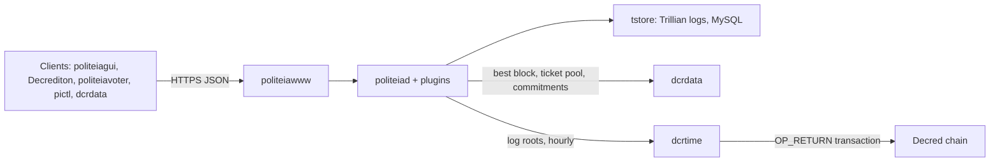
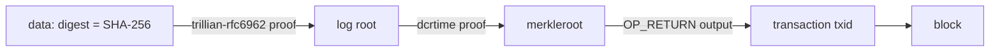

# Politeia API

Politeia, Decred's proposal system, serves every proposal, comment and ticket vote through a public JSON API at proposals.decred.org. This reference is for developers who read governance data, build voting clients or audit results: the server architecture, every route, the vote rules as the code applies them, the command-line clients, and how to verify the data without trusting the server.

The routes and types come from the `politeiawww/api/` packages of [decred/politeia](https://github.com/decred/politeia) at tag `v1.5.0`, the version the Decred 2.1.7 command-line bundle builds `politeiavoter` and `politeiaverify` from. Tag `v1.5.0` has no GitHub release page; the newest release page is v1.4.0. The production server reports build `1.4.0-pre+7372a48a9`; the bundled tools and Decrediton 2.1.7 use the routes below against it. For what proposals are and how stakeholders use them, read [Politeia proposals](../../user/governance/politeia.md) first.

!!! note "On-chain governance is not here"
    Politeia votes are off chain and bind nothing in consensus. Consensus rule votes (`getvoteinfo`, `getstakeversioninfo`) and treasury spend votes (`gettreasurybalance`, `gettreasuryspendvotes`) are `dcrd` remote procedure calls (RPCs), covered in [dcrd JSON-RPC API](dcrd-json-rpc.md) and [Staking and the treasury for builders](../protocol/staking-and-treasury.md).

## At a glance

| Item | Value |
|---|---|
| Base URL, mainnet | `https://proposals.decred.org/api` (the default in `politeiavoter` and Decrediton; dcrdata's `politeiaurl` takes the site root, `https://proposals.decred.org/`) |
| Base URL, testnet | `https://test-proposals.decred.org/api` in the clients' defaults; it refused connections on 2026-11-18, so develop against your own instance |
| Data APIs | `/records/v1`, `/ticketvote/v1`, `/comments/v1`, `/pi/v1`: POST with a JSON body, also for reads |
| Server and user API | `/v1` (www): version, policy, users, sessions; the old proposal routes, now deprecated |
| Authentication | None for reads and for casting ticket votes; session cookie plus cross-site request forgery (CSRF) token for everything an account does |
| Encoding | JSON; file payloads base64; hashes, keys and signatures hex |
| Record token | 16 hex characters (8 bytes); read routes also accept the first 7 characters |
| Signatures | Ed25519 for users and the server; a Decred signed message (secp256k1) for ticket votes |
| Stability | The upstream README calls the politeiawww APIs and the `politeiawww/client` Go package stable; everything else in the repository may change |

## How Politeia is built

Two servers split the work. `politeiawww` is the internet-facing backend: it serves the API, manages users and sessions, and checks permissions. `politeiad` is the data layer: it stores records in **tstore**, an append-only store built on Google's Trillian Merkle-tree logs over MySQL, and runs the plugins. `politeiad` gets chain data from dcrdata (the dcrdata plugin's default host is `https://dcrdata.decred.org`): the best block, the ticket-pool snapshot for each vote, and each ticket's commitment address when a vote is cast. It anchors its logs in the Decred chain through dcrtime.

The diagram shows who talks to whom when a client reads a proposal or casts a vote.



Each feature is a plugin, and each API on this page fronts one:

`records`
:   The core record store: versioned files plus metadata streams, the censorship record, and status changes. It is built into the backend rather than being a plugin.

`ticketvote`
:   Vote authorization, start, ballots, results, and runoff votes.

`comments`
:   Signed comments, edits, deletions, and up and down votes on comments.

`pi`
:   The application plugin for the proposal system. It adds proposal-specific rules (proposal metadata, the combined proposal status, billing status, comment locking after a vote) on top of the general-purpose plugins.

`usermd`, `dcrdata`
:   Internal plugins: user metadata and status-change streams on records, and the chain data source.

!!! note "Routes called legacy upstream are the live API"
    The repository also contains a newer generic plugin API under `/v3` (`politeiawww/api/http/v3`), and `docs/plugin_architecture.md` calls all other APIs deprecated. In `politeiawww` 1.5.0 the `/v3` routes are only served with the `disablelegacy` option, and their database and session layers are marked "Not implemented yet". Production runs the default: the records, ticketvote, comments and pi APIs below, whose handlers live under `politeiawww/legacy/`. Build against those.

## Requests, errors and sessions

Every data route is a POST with a JSON body, even when it only reads; an empty request is `{}`. Read routes and `castballot` need no cookie and no CSRF token. `politeiavoter` and Decrediton call them exactly that way.

```bash
curl -s https://proposals.decred.org/api/ticketvote/v1/policy -d '{}'
```

### The version route

`GET /api/` (also `GET /api/v1/version`) identifies the server and gives you its signing key:

```text title="Expected output (2026-11-18)"
{"version":1,"route":"/v1","buildversion":"1.4.0-pre+7372a48a9","pubkey":"a3a3b37951a1dd5de6ab2a35e19e266b6df2daad39aad4c2da04034ca95672f5","testnet":false,"mode":"piwww","activeusersession":false}
```

`pubkey` is the server's Ed25519 public key. Every censorship record and receipt is signed with it, so record the key you saw and when; [verification](#verifying-records-votes-and-timestamps) depends on it.

### Errors

| HTTP status | Body | Meaning |
|---|---|---|
| 200 | the reply type | Success. `castballot` also returns 200 when individual votes fail; check each receipt. |
| 400 | `{"errorcode": N, "errorcontext": "..."}` | User error: the request is invalid. Codes are per API (`ErrorCodes` in each `v1.go`). |
| 400 | `{"pluginid": "...", "errorcode": N, "errorcontext": "..."}` | A plugin rejected the request; the codes are in that plugin's package under `politeiad/plugins/`. |
| 401 | user error `29` ("user not logged in") | A route that needs a session (user or admin) was called without a valid session. |
| 403 | — or `{"ErrorCode":0,"ErrorContext":null}` | A CSRF-protected route was called without both CSRF tokens, or a session without administrator rights called an admin route (the second body). |
| 500 | `{"errorcode": <UNIX TIME>}` | Server error. The number is a timestamp that the operator can find in the server log. |

Retry only 5xx and network errors. A 400 repeats on every retry.

### Sessions and CSRF, for routes that act as a user

Submitting proposals and comments, voting on comments and authorizing votes need an account, and administrator routes need an administrator account. The server uses the double-submit-cookie method:

1. `GET /api/v1/version`. The reply carries an `X-CSRF-Token` header and sets a CSRF cookie.
2. `POST /api/v1/login` with `{"email": "...", "password": "<HEX SHA3-256 OF THE PASSWORD>"}`, sending the header and the cookie. An account that uses a time-based one-time password (TOTP) also sends `code`. The server sets a `session` cookie, valid for one day (86,400 seconds), as is the CSRF cookie. politeiagui and `pictl` hash the password with SHA3-256 before sending it (politeiagui also lowercases the email), so a client must do the same to log in to accounts created through them.
3. Send both cookies and the `X-CSRF-Token` header on every authenticated request.

Each user-submitted payload also carries an Ed25519 `publickey` and `signature` from the user's identity key, the key politeiagui generates in the browser at registration. The server checks the key against the account's active identity, so a session alone cannot sign for a user. The account flows (registration, the paywall, identity updates) live in the www v1 API (`politeiawww/api/www/v1/api.md`); `pictl` implements all of them.

## Route reference

Access: **public** needs nothing; **user** needs a session; **admin** needs an administrator session. Default page sizes come from the code; the server can override them, so read the API's `policy` route before paging.

### Records: `/api/records/v1`

| Route | Access | Request → reply | Notes |
|---|---|---|---|
| `/policy` | public | `{}` → `recordspagesize`, `inventorypagesize` | Defaults 5 and 20 |
| `/new` | user | `files`, `publickey`, `signature` → `record` | Signature over the Merkle root of the files |
| `/edit` | user | `token`, `files`, `publickey`, `signature` → `record` | Creates a new version |
| `/setstatus` | admin | `token`, `version`, `status`, `reason`, `publickey`, `signature` → `record` | Signature over `token+version+status+reason` |
| `/details` | public | `token`, optional `version` → `record` | The full record with all files; latest version by default |
| `/records` | public | `requests`: up to 5 `{token, filenames}` → map of token to record | Files stripped unless named in `filenames`; a partial record's Merkle root cannot be checked |
| `/timestamps` | public | `token`, optional `version` → `recordmetadata`, `metadata`, `files` | One timestamp per item; see [timestamps](#timestamps-and-dcrtime-anchors) |
| `/inventory` | public | optional `state`, `status`, `page` → `unvetted`, `vetted` (status name → tokens) | Newest status change first; without `status`, one page of every status. Unvetted tokens only for admins |
| `/inventoryordered` | public | `state`, `page` → `tokens` | All statuses, newest first |
| `/userrecords` | public | `userid` → `unvetted`, `vetted` | Unvetted only for admins and the author |

### Ticket votes: `/api/ticketvote/v1`

| Route | Access | Request → reply | Notes |
|---|---|---|---|
| `/policy` | public | `{}` → `linkbyperiodmin`/`max` (seconds), `votedurationmin`/`max` (blocks), page sizes | |
| `/authorize` | user | `token`, `version`, `action` (`authorize` or `revoke`), `publickey`, `signature` → `timestamp`, `receipt` | Author only. Signature over `token+version+action` |
| `/start` | admin | `starts`: one `{params, publickey, signature}` per vote → `receipt`, `startblockhash`, `startblockheight`, `endblockheight`, `eligibletickets` | Signature over the hex SHA-256 of the JSON `params` |
| `/castballot` | public | `votes`: `{token, ticket, votebit, signature}` → `receipts` | All votes for one record; see [Casting votes](#casting-votes-from-your-own-software) |
| `/details` | public | `token` → `auths`, `vote` | `vote` holds the parameters, heights and the full eligible ticket list (about 40,000 hashes); `null` before the start |
| `/results` | public | `token` → `votes` | Every cast vote with address, signature and receipt; large |
| `/summaries` | public | `tokens` (up to 5) → map of token to summary | Status, heights, parameters, counts per option, `bestblock` |
| `/submissions` | public | `token` of a request for proposals (RFP) → `submissions` | Public proposals that link to the RFP |
| `/inventory` | public | optional `status`, `page` → `vetted` (vote status name → tokens), `bestblock` | 20 per page; without `status`, one page of every status |
| `/timestamps` | public | `token`, optional `votespage` → `auths`, `details`, `votes` | Without `votespage`: authorization and details timestamps. With it: up to 100 vote timestamps |

### Comments: `/api/comments/v1`

| Route | Access | Request → reply | Notes |
|---|---|---|---|
| `/policy` | public | `{}` → `lengthmax`, `votechangesmax`, `allowedits`, `editperiod`, page sizes | |
| `/new` | user | `state`, `token`, `parentid`, `comment`, `publickey`, `signature`, optional `extradata`, `extradatahint` → `comment` | Signature over `state+token+parentid+comment+extradata+extradatahint`. `parentid` 0 starts a thread |
| `/edit` | user | as `new` plus `userid`, `commentid` → `comment` | Only if `allowedits` is true (default false), within `editperiod` seconds of posting (default 300) |
| `/vote` | user | `state`, `token`, `commentid`, `vote` (`1` up, `-1` down), `publickey`, `signature` → counts, `receipt` | Signature over `state+token+commentid+vote` |
| `/del` | admin | `state`, `token`, `commentid`, `reason`, `publickey`, `signature` → `comment` | Content deleted for good; the comment stays as `deleted` with the reason |
| `/count` | public | `tokens` (up to 10) → `counts` | |
| `/comments` | public | `token` → `comments` | Every comment on the record, each with signature and receipt |
| `/votes` | public | `token`, optional `userid`, `page` → `votes` | Comment votes |
| `/timestamps` | public | `token`, `commentids` → `comments` (id → `adds`, `del`) | Up to 100 comments per request |

Proposal updates on active proposals are comments with `extradatahint` set to `proposalupdate` and a JSON `extradata` holding a `title`.

### Proposals: `/api/pi/v1`

| Route | Access | Request → reply | Notes |
|---|---|---|---|
| `/policy` | public | `{}` → file limits, name rules, `amountmin`/`amountmax` (US cents), `startdatemin`, `enddatemax`, `domains`, page sizes | The rules a submission must pass |
| `/summaries` | public | `tokens` (up to 5) → map of token to `{status}` | The combined proposal status (below) |
| `/setbillingstatus` | admin | `token`, `status`, `reason`, `publickey`, `signature` → `receipt`, `timestamp` | Marks an active proposal completed or closed |
| `/billingstatuschanges` | public | `tokens` (up to 5) → map of token to changes | |

### Deprecated www routes

The old proposal routes are still served on `/api/v1` and still answer, but upstream marks them deprecated and their replies use older status codes. Use the APIs above in new code.

| Route | Method | Replaced by |
|---|---|---|
| `/proposals/tokeninventory` | GET | `ticketvote/v1/inventory`, `records/v1/inventory` |
| `/proposals/vetted`, `/proposals/batch`, `/proposals/{token}` | GET, POST, GET | `records/v1/records`, `records/v1/details` |
| `/proposals/votestatus`, `/proposals/{token}/votestatus`, `/proposals/batchvotesummary` | GET, GET, POST | `ticketvote/v1/summaries` |
| `/proposals/activevote` | GET | `ticketvote/v1/inventory` with status 3 |
| `/proposals/{token}/votes` | GET | `ticketvote/v1/results` |
| `/proposals/castvotes` | POST | `ticketvote/v1/castballot` |

## Records and proposals

A record is a set of files plus metadata streams, under a token, with a version that increases on each edit. A proposal record holds:

| File | Content |
|---|---|
| `index.md` | The proposal text in Markdown |
| `proposalmetadata.json` | `name`, `amount` (US cents), `startdate` and `enddate` (Unix seconds), `domain`; `legacytoken` on proposals imported from the old git backend |
| `votemetadata.json` | Only for RFPs and their submissions: `linkby` (the RFP's deadline, Unix seconds) or `linkto` (the RFP's token) |
| images | Optional attachments, within the limits in `pi/v1/policy` |

Each file carries `name`, `mime`, `digest` (hex SHA-256 of the decoded content) and `payload` (base64). Metadata streams carry a `pluginid`, a `streamid` and a JSON `payload`: `usermd` stream 1 holds the author's `userid`, `publickey` and `signature` over the files' Merkle root, and `usermd` stream 2 holds the signed status changes, as consecutive JSON objects.

The `censorshiprecord` holds the `token`, the `merkle` root of the files' digests (in file order, with dcrtime's Merkle tree), and the server's `signature` over the string `merkle + token`.

### Record states and statuses

| Field | Code | Name | Meaning |
|---|---|---|---|
| `state` | 1 | unvetted | Not yet public |
| `state` | 2 | vetted | Public |
| `status` | 1 | unreviewed | Submitted, not reviewed; always unvetted |
| `status` | 2 | public | Made public; always vetted |
| `status` | 3 | censored | Files deleted for good, record locked |
| `status` | 4 | archived | Locked; the pi plugin reports it as abandoned. Set by an administrator (`records/v1/setstatus`), only from public |

### Proposal status

`pi/v1/summaries` combines the record status, the vote status and the billing status into one string. Use it for proposal lists.

| Status | Meaning |
|---|---|
| `unvetted` | Submitted, not yet public |
| `unvetted-abandoned`, `unvetted-censored` | Abandoned or censored before going public. `politeiad` 1.5.0 allows an unreviewed record to become only public or censored, so `unvetted-abandoned` does not occur in practice |
| `under-review` | Public, vote not yet started |
| `abandoned`, `censored` | Abandoned or censored after going public |
| `vote-authorized` | The author authorized the vote; no more edits |
| `vote-started` | Voting is open |
| `approved` | Passed and requests no funding, such as an RFP |
| `rejected` | Failed quorum or the pass percentage |
| `active` | Passed funding proposal, open for billing |
| `completed`, `closed` | Billing ended: work delivered, or the author did not deliver |

## Ticket votes

### Vote status

| Code | Name | Meaning |
|---|---|---|
| 1 | `unauthorized` | Waiting for the author to authorize |
| 2 | `authorized` | Waiting for an administrator to start |
| 3 | `started` | Open |
| 4 | `finished` | Ended, for vote types without a pass or fail outcome |
| 5 | `approved` | Ended; quorum and pass percentage met |
| 6 | `rejected` | Ended; one of them not met, or the submission lost its runoff |
| 7 | `ineligible` | Censored or abandoned; cannot be voted on |

The inventory reply keys are these names. `unauthorized` and `authorized` are sorted newest first, `started` by start height and the ended statuses by end height, all descending.

### Vote parameters

An administrator chooses the parameters when starting a vote. The server enforces only some of them:

| Parameter | Server rule (mainnet) | Convention | Source |
|---|---|---|---|
| `duration` | 2,016 to 4,032 blocks (about 7 to 14 days); testnet 1 to 4,032 | 2,016 | `SettingMainNetVoteDuration{Min,Max}` in the ticketvote plugin |
| `quorumpercentage` | 0 to 100 | 20: minimum and default in politeiagui on mainnet | `ModalStartVote/validation.js` in politeiagui |
| `passpercentage` | 0 to 100 | 60: minimum and default in politeiagui on mainnet | same |
| `type` | 1 standard, 2 runoff | | `VoteT` |
| `mask`, `options` | Standard and runoff votes must have exactly two options, ids `yes` and `no`; each option's `bit` must be non-zero and lie inside `mask` | politeiagui: `no` = 1, `yes` = 2, mask 3 | `voteParamsVerify` in the ticketvote plugin |
| RFP `linkby` | 2 weeks to 90 days ahead | | `SettingMainNetLinkByPeriod{Min,Max}` |

Read each vote's real parameters from `summaries` or `details`; never assume the conventions.

!!! warning "Option bits are not fixed"
    Votes on proposals.decred.org use `no` = bit `1` and `yes` = bit `2` (mask `3`), the options politeiagui sends. `pictl votestart` uses the opposite, `yes` = `0x01` and `no` = `0x02`. A client that hard-codes a bit can vote the wrong way. Always map the option `id` to its `bit` from that vote's `details` or `summaries`.

### Snapshot and heights

When a vote starts, `politeiad` asks dcrdata for the best block height `h` and takes the live ticket pool at `h − 256` (the ticket maturity), deep enough not to be reorganized. That block's height and hash become `startblockheight` and `startblockhash`, the pool becomes `eligibletickets`, and

`endblockheight = startblockheight + duration + 256`

so a vote whose `duration` is 2,016 shows start and end heights 2,272 apart. A ticket can vote until the chain reaches the end height, even if it votes on chain or expires in the meantime. Each ticket votes once; a second vote is rejected.

### Approval rule

`voteIsApproved` in `politeiad/backendv2/tstorebe/plugins/ticketvote/cmds.go` computes two thresholds and truncates both to whole votes:

- `quorum = floor(quorumpercentage / 100 × eligible tickets)`; the vote fails if the total of all votes cast is below it.
- `pass = floor(passpercentage / 100 × votes cast)`; the vote fails if the `yes` votes are below it.

For a runoff vote (type 2), each submission must meet both thresholds, and of those that do, only the one with the most net yes votes (`yes` − `no`) is approved; the rest are rejected.

Worked example: the proposal "Bug Bounty Program 2026 H2" (token `8b1a640753852e17`) ran a 2,016-block vote with quorum 20 and pass 60:

| Quantity | Value |
|---|---|
| Snapshot (`startblockheight`) / `endblockheight` | 1,092,781 / 1,095,053 (2,016 + 256 apart) |
| Eligible tickets | 40,865 |
| Quorum: floor(0.20 × 40,865) | 8,173 |
| Votes cast | 15,498 (14,632 yes, 866 no) |
| Pass: floor(0.60 × 15,498) | 9,298 |
| Result | 15,498 ≥ 8,173 and 14,632 ≥ 9,298: approved |

Figures from the server's vote status and dcrdata, checked 2026-11-18. No node checks this rule: it is Politeia's, and nothing on chain enforces the result.

### Read a vote result

1. List the votes that are open, or the first page of every status:

    ```bash
    curl -s https://proposals.decred.org/api/ticketvote/v1/inventory -d '{"status":3}'
    ```

    The reply maps `"started"` to a list of tokens, with the `bestblock` the server used.

2. Fetch the summaries, up to five tokens per request:

    ```bash
    curl -s https://proposals.decred.org/api/ticketvote/v1/summaries \
      -d '{"tokens":["8b1a640753852e17"]}'
    ```

    ```text title="Expected output (abridged)"
    {"summaries":{"8b1a640753852e17":{"type":1,"status":5,"duration":2016,
      "startblockheight":1092781,"startblockhash":"…","endblockheight":1095053,
      "eligibletickets":40865,"quorumpercentage":20,"passpercentage":60,
      "results":[{"id":"no","description":"Don't approve proposal","votebit":1,"votes":866},
                 {"id":"yes","description":"Approve proposal","votebit":2,"votes":14632}],
      "bestblock":…}}}
    ```

3. For names and amounts, fetch only the metadata file:

    ```bash
    curl -s https://proposals.decred.org/api/records/v1/records \
      -d '{"requests":[{"token":"8b1a640753852e17","filenames":["proposalmetadata.json"]}]}'
    ```

    Decode the file's `payload` from base64 to get the JSON.

4. To audit rather than display, fetch `ticketvote/v1/details` (eligible list) and `ticketvote/v1/results` (every signed vote), then follow [Recount a vote](#recount-a-vote).

## Casting votes from your own software

A vote is a `CastVote`: `token`, `ticket` (the ticket hash as hex, in the usual byte-reversed display order), `votebit` (the option's bit as lowercase hex without `0x`, for example `"2"`), and `signature`. The signature is a Decred signed message over the string `token + ticket + votebit`, made with the key of the ticket's **largest commitment address**: the commitment output with the largest committed amount (`politeiad` looks this up through dcrdata and does not skip pay-to-script-hash outputs). A Decred signed message is made with a secp256k1 key, so in practice that address must be a pay-to-pubkey-hash (P2PKH) address, `Ds…` on mainnet. Send the signature hex-encoded. The whitepaper's [Politeia section](../../whitepaper/19-ecosystem.md#sec:ecosystem-politeia) defines the message format.

That key belongs to whoever funded the ticket, not to the voting service provider (VSP) or the voting wallet, so the vote must come from the wallet that holds the commitment keys. With `dcrwallet` this takes two gRPC calls on `WalletService`, the ones `politeiavoter` makes:

1. `CommittedTickets` with the eligible tickets from `details`. It returns the tickets whose largest P2PKH commitment address this wallet controls, with that address. It skips other address types, so for a ticket whose largest commitment is not P2PKH it can return a smaller P2PKH address, and the server rejects that vote as signature invalid.
2. `SignMessages` with the private passphrase and one message per ticket.

Then subtract the tickets already in `results`, and POST the votes for one record in one or more ballots to `castballot`. Each receipt holds the `ticket` and the server's `receipt`, an Ed25519 signature over your vote signature. A failed vote has `errorcode` and `errorcontext` instead:

| `errorcode` | Name |
|---|---|
| 1 | internal error (retry later) |
| 2 | token invalid |
| 3 | record not found |
| 4 | multiple record votes in one ballot |
| 5 | vote status invalid (the vote is not open) |
| 6 | vote bit invalid |
| 7 | signature invalid |
| 8 | ticket not eligible |
| 9 | ticket already voted |

Check each receipt against the server key and keep it: it is your proof that the server accepted the vote. A vote cannot be changed once accepted.

!!! warning "Votes link tickets to an IP address"
    Each vote is public with its ticket and choice, and one ballot from one Internet Protocol (IP) address tells the server operator that those tickets share an owner. `politeiavoter --trickle` sends votes one by one at random times through a SOCKS proxy such as Tor; reuse it rather than writing your own. [Vote with your tickets](../../user/governance/vote.md) shows the commands.

## Command-line clients

| Tool | Ships in the 2.1.7 command-line bundle | Use it to |
|---|---|---|
| `politeiavoter` | yes | Vote with a `dcrwallet` over gRPC: `inventory`, `vote`, `tally`, `verify`; trickling over Tor |
| `politeiaverify` | yes | Verify downloaded bundles, censorship records, receipts and timestamps offline |
| `pictl` | no; build from source | Script any API route, including account and admin routes; print raw JSON |

`pictl` is installed with Go:

```bash
go install github.com/decred/politeia/politeiawww/cmd/pictl@v1.5.0
```

Its default host is a local development server (`https://127.0.0.1:4443`), and its `httpscert` option defaults to a local `politeiawww` certificate file, which `pictl` fails to open on a machine without one. Point it at production with `--host` and an empty `--httpscert=` on each command, or with `host=https://proposals.decred.org/api` and `httpscert=` in `pictl.conf`, so `pictl` uses the system certificate store:

```bash
pictl --host=https://proposals.decred.org/api --httpscert= votesummaries 8b1a640
```

Read commands accept 7-character token prefixes; `-j` prints the raw JSON reply and `-v` the requests too. `pictl help <COMMAND>` explains each command, where `<COMMAND>` is a name from `pictl -h` such as `proposaldetails`, `proposaltimestamps`, `voteresults` (`--save` writes a comma-separated values (CSV) file) or `votetimestamps`. `pictl` keeps its identity key, cookies and CSRF tokens per host in its home folder (`~/.pictl`, `~/Library/Application Support/Pictl` or `%LOCALAPPDATA%\Pictl`); protect that folder like a password store.

!!! warning "pictl defaults are for test servers"
    `pictl votestart` defaults to a 6-block vote with quorum 0 and pass 60, and its `--verify` and `--paywall` registration helpers assume testnet. Administrators of a real instance must pass every vote parameter explicitly.

### The Go client

`github.com/decred/politeia/politeiawww/client` wraps every route of the records, ticketvote, comments and pi APIs above (`RecordDetails`, `Records`, `TicketVoteSummaries`, `TicketVoteResults`, `TicketVoteCastBallot`, `Comments`, `PiSummaries` and the rest). It has no www v1 routes such as `version` or `login`, so for authenticated calls pass cookies and the CSRF header, obtained elsewhere, in `client.Opts`. It also provides the verification functions `politeiaverify` uses: `RecordVerify`, `RecordTimestampsVerify`, `AuthDetailsVerify`, `VoteDetailsVerify`, `CastVoteDetailsVerify`, `CommentVerify`, `TicketVoteTimestampVerify`. Create a client with `client.New("https://proposals.decred.org/api", client.Opts{})`; reads need no cookies or CSRF token.

## Verifying records, votes and timestamps

Politeia is built so that you need not trust its operators: every submission is signed by its author, every acceptance by the server, and every piece of data is anchored in the Decred chain. Each check proves something different:

| Check | Proves | Does not prove |
|---|---|---|
| Censorship record | The server accepted exactly these files under this token | That the server published them |
| Author signature (`usermd` stream 1) | The holder of that identity key submitted these files | Who the person is |
| Status-change and authorization signatures | An administrator or the author made each change | That the reason given is fair |
| Vote details and receipts | The administrator signed these parameters; the server accepted each vote | That the eligible list matches the chain (check it, below) |
| Cast vote signatures | Each vote was signed by the address in the vote | That the address is the ticket's commitment address (check it, below) |
| Timestamps | The data existed in this form no later than the anchoring block | When it was really submitted; the server's own times are claims |

### politeiaverify

Download the files from a proposal's page on proposals.decred.org, under **Available Downloads**: **Proposal Bundle** (`<TOKEN>-v<VERSION>.json`), **Proposal Timestamps**, **Comments Bundle**, **Comments Timestamps**, **Votes Bundle** (`<TOKEN>-votes.json`) and **Votes Timestamps**. Then run `politeiaverify` once per file:

```bash
politeiaverify <FILE>
```

`<FILE>` is one downloaded file, under the name it was downloaded with: the tool picks the check from the file name (a 7- to 16-character hex token, then `-v<VERSION>`, `-comments`, `-votes`, and optionally `-timestamps`, then `.json`). A `.json` file with any other name fails with `ERR COULD NOT VERIFY: file not recognized`, and a non-JSON name with `'<FILE>' is not a json file`. The tool reads only the first file argument.

```text title="Expected output for a votes bundle (abridged, example counts)"
Token            : 8b1a640753852e17
Server public key: …

Authorization signatures and receipts verified!

Vote details signature and receipt verified!

Cast votes: 15498/40865
Checking votes for eligibility, duplicates, and valid signatures...
Cast votes verified!
```

A record bundle ends with `Censorship record verified!`, `Author signature verified!` and, if the status ever changed, `Status change signatures verified!`. A comments or votes timestamps file ends with `All timestamps verified!` or `Cast vote timestamps verified!` and lists the comments or tickets not anchored yet. A proposal timestamps file prints `Record timestamps verified!` followed by a line pointing to the anchoring transaction, or fails with `data not anchored yet` until the record is anchored.

For a censored proposal, whose files the server deleted, the author verifies their own copies against the censorship record:

```bash
politeiaverify -k <SERVER_KEY> -t <TOKEN> -s <SIGNATURE> index.md proposalmetadata.json
```

`<SERVER_KEY>` is the server's public key, and `<TOKEN>` and `<SIGNATURE>` come from the censorship record returned at submission. List every file of that version, in the same order as the record's `files` array at submission: the tool computes the Merkle root over the files in command-line order, so a different order gives a different root and the check fails.

!!! warning "politeiaverify trusts the key inside the bundle"
    A bundle carries its own `serverpublickey`, and `politeiaverify` checks the signatures against that key. Anyone can forge a bundle that verifies against a key they made up. Compare the key with the `pubkey` from `GET /api/` and with bundles that others downloaded earlier before you treat a result as evidence.

### Timestamps and dcrtime anchors

At minute 56 of every hour, `politeiad` sends the root of every changed Trillian log to dcrtime. dcrtime combines all digests it collected into one SHA-256 Merkle root and publishes it in a Decred transaction with an output `OP_RETURN <root>`. A `Timestamp` gains its `txid`, `merkleroot` and `proofs` only after that transaction has 6 confirmations, so new data shows as not anchored for up to about two hours.

The chain of evidence from a piece of data to a block has three links:



`politeiaverify` and `RecordTimestampsVerify` check the first two links: the data hashes to `digest`, the Trillian inclusion proof leads to the log root, and the dcrtime Merkle path leads to `merkleroot`. They do not look at the chain. Check the last link yourself with a `dcrd` that has `txindex=1`:

```bash
dcrctl getrawtransaction <TXID> 1
```

`<TXID>` is the timestamp's `txid`. One output must have `"type": "nulldata"` and a `hex` of `6a20` followed by the timestamp's `merkleroot`: `OP_RETURN`, a 32-byte push, and the root. The data existed in that form no later than the block that mined the transaction. dcrdata's transaction page shows the same output. The whitepaper's [dcrtime section](../../whitepaper/19-ecosystem.md#sec:ecosystem-dcrtime) explains the aggregation and what a timestamp does and does not prove.

### Recount a vote

Rebuild the result from the chain and the public votes without trusting either Politeia or dcrdata:

1. Fetch `ticketvote/v1/details` and `results` for the token, and verify the details signature and receipt.
2. Check the eligible list against the chain: it must equal the live ticket pool at `startblockhash`. `politeiad` took it from dcrdata's `/api/stake/pool/b/<BLOCKHASH>/full`; query your own dcrdata instance, or reconstruct the pool from your own node.
3. For each vote, check that the ticket is eligible and appears once, then find the commitment output with the largest `commitamt` (any address type; the first one wins on a tie): in `getrawtransaction <TICKET> 1` output the commitment outputs carry `scriptPubKey.addresses` and `scriptPubKey.commitamt`. That output's address must equal the vote's `address`.
4. Verify each signature with `dcrctl verifymessage <ADDRESS> <SIGNATURE> <MESSAGE>`, where `<MESSAGE>` is `token + ticket + votebit` and `<SIGNATURE>` is the vote's hex signature converted to base64 on one line (`echo <HEX> | xxd -r -p | base64 | tr -d '\n'`; GNU `base64` otherwise wraps the 88 characters).
5. Count the votes per option bit and apply the [approval rule](#approval-rule) (for a runoff, compare net yes votes across all submissions of the RFP).

`politeiaverify` already performs the eligibility, duplicate and signature checks against the lists in the bundle; steps 2 and 3 are what it cannot do offline. What no recount can show is a vote the server never published. A voter who holds a receipt for a missing vote can prove that the server accepted it.

## Proposal data from dcrdata

dcrdata copies proposal data from Politeia (its `politeiaurl` option) for its [proposals pages](https://dcrdata.decred.org/proposals). Its API exposes only `GET /api/proposal/<TOKEN>`: three parallel arrays, `yes`, `no` and `time`, one entry per cast vote sorted by vote timestamp (a `1` in `yes` or `no`, Unix seconds in `time`). It suits vote-progress charts. For anything else, and for any audit, query Politeia directly: dcrdata's copy is not an independent source. See [dcrdata API](dcrdata-api.md).

## Running your own instance

A private instance is the only way to test proposal submission, vote starts and voting end to end now that the public testnet server is down. You need MySQL or MariaDB, Trillian 1.4.1 (the version `politeiad`'s README names), `politeiad` and `politeiawww` (default ports: `politeiad` 49374 on mainnet and 59374 on testnet, `politeiawww` 4443 on both), a dcrdata instance for chain data, and a dcrtime server for anchoring. Follow the READMEs in [politeiad](https://github.com/decred/politeia/tree/v1.5.0/politeiad) and [politeiawww](https://github.com/decred/politeia/tree/v1.5.0/politeiawww); they still name Go 1.19 or 1.20. The [dcrtime repository](https://github.com/decred/dcrtime) documents the timestamping server and its `dcrtime_checker` tool. The Contractor Management System code (`cmswww`, the CMS routes) is still in the repository, but cms.decred.org no longer operates.

## Next steps

- [Vote with your tickets](../../user/governance/vote.md): the `politeiavoter` commands, certificates and trickling options, step by step.
- [Staking and the treasury for builders](../protocol/staking-and-treasury.md): what happens on chain after an approved proposal, from treasury spend (TSPEND) to spend vote.
- [dcrwallet gRPC API](dcrwallet-grpc.md): `CommittedTickets`, `SignMessages` and the Transport Layer Security (TLS) client certificate a voting client needs.
- [dcrdata API](dcrdata-api.md): ticket pools, transactions and agenda data for an independent recount.
- [Write a Politeia proposal](../../user/governance/write-a-proposal.md): what authors go through, before you script submissions.

*[API]: application programming interface
*[CMS]: Contractor Management System
*[CSRF]: cross-site request forgery
*[CSV]: comma-separated values
*[HTTP]: Hypertext Transfer Protocol
*[HTTPS]: Hypertext Transfer Protocol Secure
*[IP]: Internet Protocol
*[JSON]: JavaScript Object Notation
*[P2PKH]: pay-to-pubkey-hash
*[RFP]: request for proposals
*[RPC]: remote procedure call
*[RPCs]: remote procedure calls
*[SOCKS]: Socket Secure, a proxy protocol
*[TLS]: Transport Layer Security
*[TOTP]: time-based one-time password
*[TSPEND]: treasury spend
*[VSP]: voting service provider
