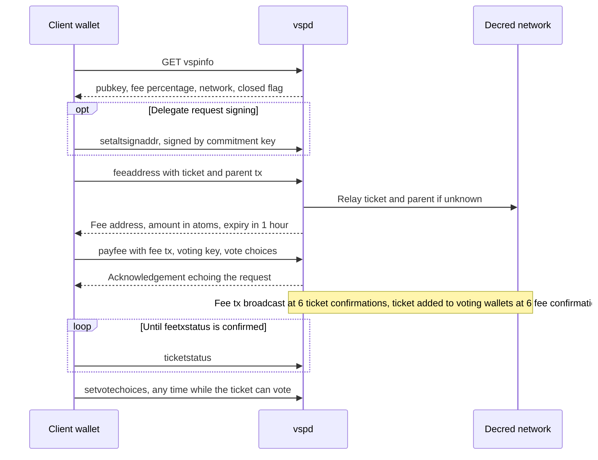
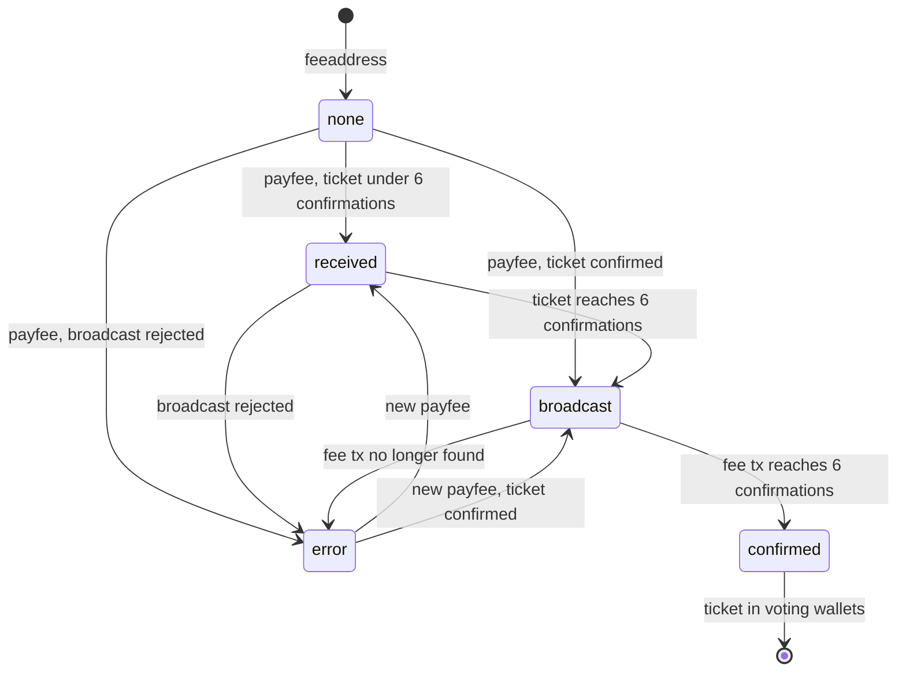

# vspd API

A voting service provider (VSP) runs `vspd`, which votes other people's tickets in exchange for a per-ticket fee. This page is the reference for its HTTP API, version 3, for developers adding VSP staking to a wallet or tool. `dcrwallet`, Decrediton and Bison Wallet already implement this flow, so you need it only if you build your own client or debug one.

Everything here was checked against `vspd` at tag `release-v1.5.0` (request and response types in `types/`, handlers in `internal/webapi/`) and against the Go modules `github.com/decred/vspd/client/v4` v4.0.2 and `github.com/decred/vspd/types/v3` v3.0.0, which `dcrwallet` 2.1.7 uses. For what a VSP can and cannot do with a ticket, read [Voting service providers](../../user/staking/vsps.md) first.

## At a glance

| Item | Value |
|---|---|
| Base path | `/api/v3` on the VSP's HTTPS address. `vspd` itself serves plain HTTP on `:8800`; operators put a Transport Layer Security (TLS) proxy in front of it. |
| Endpoints | One `GET` (`vspinfo`), five `POST`s that each name one ticket |
| Request body | JSON, at most 1 MiB. The `Content-Type` header is ignored. |
| Client authentication | No accounts. Every `POST` carries `VSP-Client-Signature`: a Decred signed message over the exact body, made with the key of the ticket's commitment address |
| Server authentication | Every JSON response carries `VSP-Server-Signature`: an Ed25519 signature over the exact body, by a key that never changes |
| Amounts | Integer atoms (1 DCR = 100,000,000 atoms) |
| Times | Unix seconds |
| Byte fields | `pubkey` and `request` are standard Base64 (Go's encoding of `[]byte`) |
| Browser use | Not supported: `vspd` sends no cross-origin resource sharing (CORS) headers and rejects cross-origin browser `POST`s with HTTP 400 `CSRF failure`. Call it from native code or a backend. |
| Finding VSPs | `https://api.decred.org/?c=vsp`, the JSON list behind decred.org/vsp that Decrediton and Bison Wallet read. Keys are host names without a scheme; prefix `https://`. |

Version 3 is the first `vspd` API. Versions 1 and 2 belonged to the retired `dcrstakepool` software.

## Expected client flow

A ticket is registered with a VSP in two signed calls, `feeaddress` then `payfee`; the VSP votes it only once both have succeeded and the fee has confirmed. The sequence shows the whole exchange, including the optional and follow-up calls:



1. **Fetch `vspinfo`** and check `network`, `vspclosed` and that `apiversions` contains 3. Pin `pubkey`: every later response must verify against it.
2. **Optionally call `setaltsignaddr`** to let a second key sign this ticket's later requests (described below).
3. **Call `feeaddress`** with the ticket and its parent transaction. The ticket must be in the mempool, immature or live. The VSP relays the ticket and parent if its own `dcrd` has not seen them, then quotes a fee valid for one hour.
4. **Build and sign a fee transaction** that pays at least `feeamount` to `feeaddress`. Do not broadcast it: the VSP broadcasts it only once the ticket has 6 confirmations, so a ticket that is never mined is never charged. Lock its inputs so nothing else spends them.
5. **Call `payfee`** with the fee transaction, the wallet import format (WIF) private key of the ticket's voting address and the vote preferences.
6. **Poll `ticketstatus`** until `feetxstatus` is `confirmed`. At that point the VSP has added the ticket to its reachable voting wallets; any wallet that was offline receives it at `vspd`'s next consistency check (every 30 minutes).
7. **Call `setvotechoices`** whenever the owner changes a preference.

## Endpoints

| Method and path | Signed | Needs VSP open | Purpose |
|---|---|---|---|
| `GET /api/v3/vspinfo` | No | No | VSP public key, fee percentage, network and statistics |
| `POST /api/v3/setaltsignaddr` | Yes, commitment key | Yes | Register one alternate signing address for a ticket |
| `POST /api/v3/feeaddress` | Yes | Yes | Get the fee address and a fee quote for a ticket |
| `POST /api/v3/payfee` | Yes | Yes | Hand over the fee transaction, voting key and preferences |
| `POST /api/v3/ticketstatus` | Yes | No | Read the VSP's record of a ticket |
| `POST /api/v3/setvotechoices` | Yes | No | Change a registered ticket's preferences |

A closed VSP (`vspclosed` true) still answers `ticketstatus` and `setvotechoices` and keeps voting tickets whose fees it has, but refuses new registrations with error 2.

### GET /api/v3/vspinfo

No request body. The VSP caches its statistics and refreshes them once a minute.

| Field | Type | Meaning |
|---|---|---|
| `apiversions` | array of integers | API versions served; `[3]` in vspd 1.5.0 |
| `timestamp` | integer | Server time, Unix seconds |
| `pubkey` | string | Base64 of the VSP's 32-byte Ed25519 public key. Also shown in its website footer after **VSP public key:** |
| `feepercentage` | number | Fee as a percentage of the expected vote reward; `3.0` means 3% (vspd's default if the operator sets none) |
| `vspclosed` | boolean | True when the VSP accepts no new tickets |
| `vspclosedmsg` | string | Operator's explanation when closed |
| `network` | string | `mainnet`, `testnet3` or `simnet` |
| `vspdversion` | string | Software version, for example `1.5.0`, possibly with `+` build metadata |
| `voting` | integer | Tickets with a confirmed fee that have not yet voted, been missed or expired |
| `voted` | integer | Tickets it has voted |
| `totalvotingwallets` | integer | Voting wallets configured |
| `votingwalletsonline` | integer | Voting wallets reachable at the last refresh |
| `expired` | integer | Registered tickets that expired |
| `missed` | integer | Registered tickets that were missed |
| `blockheight` | integer | Height of its `dcrd`'s best block |
| `estimatednetworkproportion` | number | `voting` divided by the network's live ticket pool size |

```json title="Example response (testnet, example values, formatted)"
{
  "apiversions": [3],
  "timestamp": 1794996000,
  "pubkey": "SjAmrAqH7LScCUwM1qo5O6Cu7aKhrM1ORszgZwD7HmU=",
  "feepercentage": 2,
  "vspclosed": false,
  "vspclosedmsg": "",
  "network": "testnet3",
  "vspdversion": "1.5.0",
  "voting": 120,
  "voted": 950,
  "totalvotingwallets": 3,
  "votingwalletsonline": 3,
  "expired": 4,
  "missed": 7,
  "blockheight": 1290000,
  "estimatednetworkproportion": 0.021
}
```

If the VSP cannot reach its `dcrd` when the cache is empty, this endpoint returns HTTP 500 with the plain-text body `Cache is not initialized` instead of JSON.

### POST /api/v3/setaltsignaddr

Registers a second address whose key may sign this ticket's later requests. After it is set, `vspd` checks each signature against the commitment address first and then against the alternate address. The request itself must be signed by the commitment key, so the alternate address can only be chosen by the ticket's owner. One possible use is a commitment key held offline: it signs once, and a hot key signs everything after.

| Field | Type | Required | Meaning |
|---|---|---|---|
| `timestamp` | integer | Yes | Client time, Unix seconds; must be non-zero |
| `tickethash` | string | Yes | Ticket hash, 64 hex characters in the usual display order |
| `tickethex` | string | Yes | The serialized ticket, hex |
| `parenthex` | string | Yes | The serialized transaction that funds the ticket's input (usually the split transaction), hex |
| `altsignaddress` | string | Yes | A pay-to-pubkey-hash (P2PKH) secp256k1 address on the VSP's network |

- It can be set once per ticket; a second request fails with error 0 and the message `alternate sign address data already exists`.
- It may be called before `feeaddress`. The ticket must still be able to vote.
- The response has `timestamp` and `request` only.
- `client/v4` has no method for this endpoint, and none of the official wallets call it. Build the request yourself with `types.SetAltSignAddrRequest`.

### POST /api/v3/feeaddress

Starts registration and returns a fee quote. Request fields: `timestamp`, `tickethash`, `tickethex`, `parenthex`, all required, with the same meanings as in `setaltsignaddr`.

Before the handler runs, `vspd` checks that `tickethex` decodes to a ticket with exactly three outputs (voting rights, one commitment, change) and that it hashes to `tickethash`. If its `dcrd` does not know the parent or the ticket, it broadcasts them. A parent that spends outputs its `dcrd` cannot see yet is retried for about seven seconds before the call fails.

| Response field | Type | Meaning |
|---|---|---|
| `timestamp` | integer | Server time |
| `feeaddress` | string | Address that must receive the fee. Derived from the operator's fee wallet extended public key, unique to this ticket |
| `feeamount` | integer | Minimum fee in **atoms** |
| `expiration` | integer | Unix time after which the quote is void, one hour after it was issued |
| `request` | string | Base64 of your exact request body |

!!! note "Atoms, not DCR"
    The upstream `docs/api.md` shows `"feeamount":0.001`. The code returns an integer number of atoms (`FeeAmount int64` in `types/types.go`), and `dcrwallet` reads it as `dcrutil.Amount`. Parse it as an integer.

Repeated calls are safe. For a ticket it already knows, `vspd` returns the same fee address. It keeps the same amount and expiry while the quote is valid, and issues a new amount and a new one-hour expiry once it has expired. After the VSP has received a fee transaction (status `received`, `broadcast` or `confirmed`) the call fails with error 3.

### POST /api/v3/payfee

Hands over everything the VSP needs to vote the ticket.

| Field | Type | Required | Meaning |
|---|---|---|---|
| `timestamp` | integer | Yes | Client time, Unix seconds |
| `tickethash` | string | Yes | Ticket hash |
| `feetx` | string | Yes | Signed fee transaction, hex |
| `votingkey` | string | Yes | WIF private key of the ticket's voting address (the P2PKH address in output 0) |
| `votechoices` | object | Yes | Agenda choices; `{}` when there are none, never `null` or absent |
| `tspendpolicy` | object | No | Up to 3 treasury spend (TSPEND) policies |
| `treasurypolicy` | object | No | Up to 3 treasury key policies |

`vspd` checks, in this order: the ticket is known (else error 6), no fee was received yet (3), the ticket can still vote (7), the quote has not expired (8), `votingkey` is a WIF key for its network (11), the fee transaction decodes and passes transaction sanity checks (4), it has an output paying the fee address (4), that output is at least `feeamount` (5), and the key matches the ticket's voting rights script (11).

- **Preferences are not checked strictly here.** If `votechoices`, `tspendpolicy` or `treasurypolicy` fail validation, `vspd` logs a warning, registers the ticket anyway and does not store that map. Read `ticketstatus` afterwards to confirm what was stored. The one exception is the size limit: more than three entries in `tspendpolicy` or `treasurypolicy` fails request binding, so the whole call returns error 0 and nothing is registered.
- **Broadcast timing.** If the ticket already has 6 confirmations, `vspd` broadcasts the fee transaction during the call and can return error 15 or 16. Otherwise it stores the transaction as `received` and broadcasts it once the ticket reaches 6 confirmations.
- The response has `timestamp` and `request`. `vspd` also stores the signed request and response as a vote-change record for the ticket.

!!! warning "The voting key leaves your wallet"
    `votingkey` is a private key. Use a voting address that controls no funds and serves only this ticket. Anyone who holds a copy, including anyone who reads a stored `payfee` request, can vote the ticket, though no one can redirect its funds: those are fixed by the commitment, as [Staking and the treasury for builders](../protocol/staking-and-treasury.md) explains.

### POST /api/v3/ticketstatus

Returns the VSP's record of a ticket. The request has one field, `tickethash`, and no timestamp.

| Response field | Type | Meaning |
|---|---|---|
| `timestamp` | integer | Server time |
| `ticketconfirmed` | boolean | True once the ticket has 6 confirmations |
| `feetxstatus` | string | `none`, `received`, `broadcast`, `confirmed` or `error` (below) |
| `feetxhash` | string | Hash of the fee transaction received, empty before `payfee` |
| `altsignaddress` | string | The alternate signing address, empty if none |
| `votechoices` | object | Stored agenda choices |
| `tspendpolicy` | object | Stored treasury spend policies |
| `treasurypolicy` | object | Stored treasury key policies |
| `request` | string | Base64 of your exact request body |

The fee status moves through these states; only at `confirmed` does the VSP add the ticket to its voting wallets:



`error` usually means an input of the fee transaction was spent elsewhere. Send a new fee transaction with `payfee`; if the quote has expired by then, call `feeaddress` first. If a ticket is never mined and drops out of the VSP's mempool, `vspd` deletes its record, and later calls return error 6.

### POST /api/v3/setvotechoices

Changes the preferences of a registered ticket. Request fields: `timestamp`, `tickethash` and `votechoices` (all required), plus the optional `tspendpolicy` and `treasurypolicy`.

- **Merge, not replace.** Each entry overwrites the stored entry with the same key; keys you leave out keep their stored value. An entry cannot be deleted, only changed (for example to `abstain`).
- **Strict validation.** Any invalid entry fails the whole request with error 9 and a message naming the problem, for example `agenda "foo" not found for vote version 11` (more than three treasury entries fails earlier, with error 0).
- **Replay protection.** `timestamp` must be greater than the timestamp of every earlier vote-change record for the ticket, including the `payfee` request. Two calls within the same second fail with error 17; wait at least one second. `vspd` does not compare the timestamp with its own clock, so a client clock running ahead blocks later updates from a correct clock until real time catches up.
- It fails with error 12 before `payfee`, error 7 once the ticket has voted, been missed or expired, and error 1 when no voting wallet is reachable. When the fee is already confirmed, `vspd` pushes the new choices to its voting wallets immediately.
- The response has `timestamp` and `request`.

### Vote preference fields

`payfee` and `setvotechoices` carry the same three maps. Treasury voting itself is described in the whitepaper's [treasury votes](../../whitepaper/08-staking.md#sec:staking-tvote) section.

| Field | Key | Allowed values | Limit |
|---|---|---|---|
| `votechoices` | Agenda id, such as `maxtreasuryspend` | A choice id of that agenda, normally `abstain`, `no` or `yes` | None |
| `tspendpolicy` | TSPEND transaction hash, 64 hex characters | `yes`, `no`, `abstain`, `invalid` or empty | 3 entries per request |
| `treasurypolicy` | Politeia key, 33-byte compressed public key in hex | `yes`, `no`, `abstain`, `invalid` or empty | 3 entries per request |

Agenda ids are checked against the deployments of the newest vote version in the `chaincfg` package that `vspd` was built with. With vspd 1.5.0 on mainnet that is vote version 11, whose only agenda is `maxtreasuryspend`; an id from an older version is rejected. Send more than three treasury entries as several `setvotechoices` calls with increasing timestamps; because entries merge, the stored policy accumulates.

## Two-way accountability: signatures

Both sides sign everything, so each can later prove what the other said: the owner can show that the VSP acknowledged a paid fee and specific preferences, and the VSP can show which preferences the owner actually sent. `vspd` stores the signed `setaltsignaddr`, `payfee` and `setvotechoices` requests and responses as that evidence. Store your side too if you want to be able to use it.

### Signing a request

1. Serialize the body once and keep the exact bytes. The signature covers bytes, not JSON meaning: reordering keys or changing whitespace after signing breaks it.
2. Sign those bytes as a Decred signed message with the private key of the ticket's commitment address (or the registered alternate address). The digest is BLAKE-256 of `varstr("Decred Signed Message:\n") || varstr(body)`, and the signature is a 65-byte compact recoverable secp256k1 signature. The whitepaper's [signed messages](../../whitepaper/05-addresses.md#sec:addresses-messages) section specifies the format; `dcrwallet`'s `signmessage` remote procedure call (RPC) produces it.
3. Send it Base64-encoded in the `VSP-Client-Signature` header, with the same bytes as the body.

`vspd` takes the commitment address from the ticket's output 1. It must be a P2PKH secp256k1 address, because signed messages support no other type. A missing header gives error 0 (`no VSP-Client-Signature header`); a signature that fails gives error 10.

### Checking a response

1. Read the raw response body before parsing it.
2. Base64-decode the `VSP-Server-Signature` header and verify it as an Ed25519 signature over those bytes with the pinned `pubkey`. Reject the response if the header is missing or the check fails.
3. Base64-decode `request` and compare it byte for byte with the body you sent. A match proves the VSP accepted exactly that request.

`vspd` generates its key pair once, when its database is created, and never changes it, so a key change is a reason to stop. Fetching `pubkey` from `vspinfo` on first contact is trust on first use; `dcrwallet` instead requires it in its `vsp.pubkey` option. JSON error bodies are signed too, but the plain-text errors from middleware or a proxy are not.

### Worked example: check a ticket by hand

This reads the status of one of your tickets with `dcrctl` and `curl`, then checks the VSP's signature. `ticketstatus` changes nothing, so it is a safe call to try. You need `dcrctl` configured for both your wallet and a `dcrd` RPC server (`decoderawtransaction` is a `dcrd` method; `dcrwallet` does not provide it).

1. Find the commitment address: get the ticket's `hex` from `dcrctl --wallet gettransaction <TICKET_HASH>`, run `dcrctl decoderawtransaction <HEX>` on it, and take the address of output 1, whose type is `sstxcommitment`.
2. Unlock the wallet for 60 seconds; `promptsecret` asks for the private passphrase without putting it on the command line:

    ```bash
    promptsecret | dcrctl --wallet walletpassphrase - 60
    ```

3. Sign the body and send it:

    ```bash
    BODY='{"tickethash":"<TICKET_HASH>"}'
    SIG=$(dcrctl --wallet signmessage <COMMITMENT_ADDRESS> "$BODY")
    curl -sS -D headers.txt -o body.json \
      -H "VSP-Client-Signature: $SIG" \
      --data-binary "$BODY" \
      https://<VSP_HOST>/api/v3/ticketstatus
    ```

    `<TICKET_HASH>` is the ticket's hash, `<COMMITMENT_ADDRESS>` the address from step 1 and `<VSP_HOST>` the VSP's host name. `curl` sends no `Origin` header, so the cross-origin check does not apply.

    ```json title="body.json (example values)"
    {"timestamp":1794996123,"ticketconfirmed":true,"feetxstatus":"confirmed","feetxhash":"e1c02b04b5bbdae66cf8e3c88366c4918d458a2d27a26144df37f54a2bc956ac","altsignaddress":"","votechoices":{"maxtreasuryspend":"yes"},"tspendpolicy":{},"treasurypolicy":{},"request":"eyJ0aWNrZXRoYXNoIjoiMWI5ZjVkYzNiNDg3MmM0N2Y2NmIxNDhiMDYzMzY0NzQ1ODEyM2Q3MmEwZjA2MjNhOTA4OTBjYzUxYTY2ODczNyJ9"}
    ```

4. Check the signature with this Python script, which needs the `cryptography` package:

    ```python title="verify_vsp.py"
    import base64, json, sys
    from cryptography.hazmat.primitives.asymmetric.ed25519 import Ed25519PublicKey

    pubkey = base64.b64decode(sys.argv[1])  # pubkey from vspinfo
    body = open("body.json", "rb").read()   # raw bytes, not re-serialized
    sig = next(line.split(":", 1)[1].strip() for line in open("headers.txt")
               if line.lower().startswith("vsp-server-signature:"))
    Ed25519PublicKey.from_public_bytes(pubkey).verify(base64.b64decode(sig), body)
    print("signature OK, request was:", base64.b64decode(json.loads(body)["request"]).decode())
    ```

    ```bash
    python3 verify_vsp.py <VSP_PUBKEY>
    ```

    `<VSP_PUBKEY>` is the `pubkey` value from `vspinfo`. `verify` raises `InvalidSignature` if the body or signature was altered.

!!! note "Testnet"
    Add `--testnet` to every `dcrctl` command and use a VSP whose `network` is `testnet3`.

## Fees and fee quotes

The VSP fee is a share of the reward a ticket is expected to earn, not of the ticket price. `vspd` computes it at the current best block with `txrules.StakePoolTicketFee` from `dcrwallet`'s module, the function the whitepaper's [VSP section](../../whitepaper/19-ecosystem.md#sec:ecosystem-vsp) specifies:

> fee = floor(p × s′ × (v + z) / (10,000 × (s′ + v))) atoms

| Symbol | Meaning |
|---|---|
| p | `feepercentage` in hundredths of a percent, truncated: `floor(feepercentage × 100)`, so 2.0% gives 200 |
| s′ | The subsidy for one vote at the current height, multiplied by 100/101 once per subsidy reduction a ticket waits through on average, rounding down each time: ceil(8,192 / 6,144) = 2 reductions on mainnet |
| v | The current ticket price (the best block header's `SBits`) |
| z | A fixed 10,000 atoms; it is never used to build a transaction |

**Worked example (example figures, not live values).** With p = 200 (2%), a current vote subsidy of 0.5 DCR (s′ = 49,014,801 atoms after two reductions) and a ticket price of 250 DCR, the fee is 978,378 atoms, about 0.0098 DCR: slightly under 2% of s′, because (v + z) / (s′ + v) is a little below 1. Read live values with `dcrctl getstakedifficulty` and `dcrctl getblocksubsidy <HEIGHT> 5`, whose `pos` field is the total for five votes.

Rules for a correct payment:

- **Always pay the quoted `feeamount`**, not your own estimate: the operator can change the percentage at any time, and the quote is fixed only for its hour.
- **Cap it.** Compare `feeamount` with a maximum before paying. `dcrwallet` refuses fees above `vsp.maxfee`, default 0.2 DCR; that is a wallet default, not a consensus rule.
- **Pay to one output.** `vspd` counts only the first output whose script and script version match `feeaddress`; that value must be at least `feeamount`.
- **Pay the network's transaction fee.** `vspd` does not check it, but its `dcrd` broadcasts the transaction later and rejects one below its minimum relay fee (0.0001 DCR/kB by default).
- **Keep the inputs unspent.** The VSP may hold the transaction for an hour or more. If the inputs are spent elsewhere the status becomes `error` and you must pay again.
- **No refunds.** A paid fee is not returned if the ticket is missed or expires, and `vspd` has no refund call.

To build the fee transaction through `dcrwallet` JSON-RPC, `v3tool` uses `createrawtransaction` (one output to the fee address), `fundrawtransaction`, `lockunspent` (false, to lock the chosen inputs) and `signrawtransaction`. `dcrwallet` itself uses `Wallet.CreateVspPayment`, which also keeps the transaction unpublished in the wallet until the VSP has it.

## Errors and retries

Errors use HTTP 4xx or 5xx with a JSON body such as `{"code":9,"message":"invalid vote choices"}`. `message` is either the default for the code or a more specific text. Codes are defined in `types/errors.go`:

| Code | Constant | HTTP | Default message | Typical cause | Client action |
|---|---|---|---|---|---|
| 0 | `ErrBadRequest` | 400 | bad request | Malformed JSON, missing or zero required field, bad hash, missing signature header, ticket hex not matching its hash, alternate address already set, more than three `tspendpolicy` or `treasurypolicy` entries | Fix the request; do not resend it unchanged |
| 1 | `ErrInternalError` | 500 | internal error | VSP's `dcrd` or database unavailable, no voting wallet reachable, or a ticket its `dcrd` has never seen | Retry later with a delay |
| 2 | `ErrVspClosed` | 400 | vsp is closed | `setaltsignaddr`, `feeaddress` or `payfee` while closed | Use another VSP |
| 3 | `ErrFeeAlreadyReceived` | 400 | fee tx already received for ticket | `feeaddress` or `payfee` after a fee was accepted | Treat as paid; poll `ticketstatus` |
| 4 | `ErrInvalidFeeTx` | 400 | invalid fee tx | Undecodable, fails sanity checks, or no output to the fee address | Build a new fee transaction |
| 5 | `ErrFeeTooSmall` | 400 | fee too small | Fee output below `feeamount` | Rebuild with at least `feeamount` |
| 6 | `ErrUnknownTicket` | 400 | unknown ticket | No record: `feeaddress` never succeeded, or an unmined ticket was dropped | Start with `feeaddress`, or the ticket is not at this VSP |
| 7 | `ErrTicketCannotVote` | 400 | ticket not eligible to vote | Ticket voted, missed, expired or too old | Stop processing the ticket |
| 8 | `ErrFeeExpired` | 400 | fee has expired | `payfee` after `expiration` | Abandon the fee transaction, call `feeaddress`, pay again |
| 9 | `ErrInvalidVoteChoices` | 400 | invalid vote choices | Unknown agenda or choice, bad hash, key or policy value (`setvotechoices`) | Fix the preferences |
| 10 | `ErrBadSignature` | 400 | bad request signature | Signature not valid for the commitment or alternate address | Sign the exact body bytes with the right key |
| 11 | `ErrInvalidPrivKey` | 400 | invalid private key | `votingkey` not a WIF key for this network, or not the ticket's voting key | Send the key of output 0's address |
| 12 | `ErrFeeNotReceived` | 400 | no fee tx received for ticket | `setvotechoices` before `payfee` | Complete `payfee` first |
| 13 | `ErrInvalidTicket` | 400 | not a valid ticket tx | Not a ticket, or not exactly three outputs | Only single-commitment tickets can be registered |
| 14 | `ErrCannotBroadcastTicket` | 500 | ticket transaction could not be broadcast | VSP's `dcrd` rejected the ticket or parent, or too many broadcasts were pending | Make sure the parent's inputs are on the network, then retry |
| 15 | `ErrCannotBroadcastFee` | 500 | fee transaction could not be broadcast | `payfee` on a confirmed ticket; `dcrd` rejected the fee transaction | Status is now `error`: send a new fee transaction |
| 16 | `ErrCannotBroadcastFeeUnknownOutputs` | 428 | fee transaction could not be broadcast due to unknown outputs | Fee transaction spends outputs the VSP's `dcrd` has not seen | Broadcast the transaction that created those outputs, then call `payfee` again |
| 17 | `ErrInvalidTimestamp` | 400 | old or reused timestamp | `setvotechoices` timestamp not greater than an earlier record's | Resend with a later timestamp |

Some failures carry no JSON: HTTP 400 `CSRF failure` for cross-origin browser requests, HTTP 500 `Cache is not initialized` from `vspinfo`, and anything a reverse proxy returns. The Go client returns `types.ErrorResponse` only for a JSON error body and a generic error with the status and body otherwise.

**Retries.** `dcrwallet`'s client is a working model. It schedules each background step after a random delay: up to 2 minutes while the ticket is unmined, up to an hour (or until it goes live, if sooner) while it is immature, and up to 5 minutes once it is live, because a live ticket can be drawn at any moment. On error 3 it marks the fee paid; on 4 or 15 it builds a new fee transaction; on 8 it abandons the expired fee transaction and retries; on 7 it stops. It keeps polling `ticketstatus` while the status is `received` or `broadcast`, starts over on `error`, and stops tracking the ticket at `confirmed`. The code is in [`wallet/feepayment.go`](https://github.com/decred/dcrwallet/blob/release-v2.1.7/wallet/feepayment.go) at `release-v2.1.7`.

## Go packages

Two small modules hold everything a Go client needs:

| Module | Version used by dcrwallet 2.1.7 | Contents |
|---|---|---|
| [`github.com/decred/vspd/types/v3`](https://github.com/decred/vspd/tree/release-v1.5.0/types) | v3.0.0 | Request and response structs, `ErrorResponse`, the `ErrorCode` constants |
| [`github.com/decred/vspd/client/v4`](https://github.com/decred/vspd/tree/release-v1.5.0/client) | v4.0.2 | `Client` with `VspInfo`, `FeeAddress`, `PayFee`, `TicketStatus`, `SetVoteChoices`, and `ValidateServerSignature` |

```bash
go get github.com/decred/vspd/client/v4@v4.0.2 github.com/decred/vspd/types/v3@v3.0.0
go mod tidy
```

Without `go mod tidy` the example below does not build: it also imports `dcrd` modules (`chaincfg/v3`, `chaincfg/chainhash`, `wire`, `dcrec/secp256k1/v4`) and `slog`, and `go mod tidy` records them all in `go.mod`.

`client.Client` signs each `POST` body through your `Sign` callback, sends it, verifies the server signature against `PubKey` (also for `vspinfo`, so set `PubKey` first), checks that `request` echoes your body, and replaces nil preference maps with `{}`. Things to know:

- `Log` must be set; use `slog.Disabled` for no logging. At trace level the client logs full requests, including voting keys.
- It embeds `http.Client`, which has no timeout by default; set one.
- It has no `setaltsignaddr` method.

The example below signs with a key looked up per address and reads a ticket's status:

```go
package main

import (
	"bytes"
	"context"
	"encoding/base64"
	"errors"
	"fmt"
	"log"
	"net/http"
	"time"

	"github.com/decred/dcrd/chaincfg/chainhash"
	"github.com/decred/dcrd/chaincfg/v3"
	"github.com/decred/dcrd/dcrec/secp256k1/v4"
	"github.com/decred/dcrd/dcrec/secp256k1/v4/ecdsa"
	"github.com/decred/dcrd/txscript/v4/stdaddr"
	"github.com/decred/dcrd/wire"
	"github.com/decred/slog"
	"github.com/decred/vspd/client/v4"
	"github.com/decred/vspd/types/v3"
)

// signer makes a Sign callback that produces Decred signed messages with the
// private key your wallet holds for the requested address.
func signer(keyFor func(stdaddr.Address) (*secp256k1.PrivateKey, error)) func(context.Context, string, stdaddr.Address) ([]byte, error) {
	return func(_ context.Context, msg string, addr stdaddr.Address) ([]byte, error) {
		key, err := keyFor(addr)
		if err != nil {
			return nil, err
		}
		var buf bytes.Buffer
		wire.WriteVarString(&buf, 0, "Decred Signed Message:\n")
		wire.WriteVarString(&buf, 0, msg)
		return ecdsa.SignCompact(key, chainhash.HashB(buf.Bytes()), true), nil
	}
}

func main() {
	ctx := context.Background()
	params := chaincfg.MainNetParams()

	pubKey, err := base64.StdEncoding.DecodeString("<VSP_PUBKEY>")
	if err != nil {
		log.Fatal(err)
	}
	var keyFor func(stdaddr.Address) (*secp256k1.PrivateKey, error) // your key store

	vsp := &client.Client{
		Client: http.Client{Timeout: 30 * time.Second},
		URL:    "https://<VSP_HOST>",
		PubKey: pubKey,
		Sign:   signer(keyFor),
		Log:    slog.Disabled,
	}

	info, err := vsp.VspInfo(ctx)
	if err != nil {
		log.Fatal(err)
	}
	if info.Network != params.Name || info.VspClosed {
		log.Fatalf("VSP on %s, closed=%v", info.Network, info.VspClosed)
	}

	commitment, err := stdaddr.DecodeAddress("<COMMITMENT_ADDRESS>", params)
	if err != nil {
		log.Fatal(err)
	}
	status, err := vsp.TicketStatus(ctx,
		types.TicketStatusRequest{TicketHash: "<TICKET_HASH>"}, commitment)
	var apiErr types.ErrorResponse
	switch {
	case errors.As(err, &apiErr) && apiErr.Code == types.ErrUnknownTicket:
		fmt.Println("ticket is not registered with this VSP")
	case err != nil:
		log.Fatal(err)
	default:
		fmt.Println(status.FeeTxStatus, status.VoteChoices)
	}
}
```

Replace `keyFor` with a lookup into your own key store; as written it is nil and the program panics at the first signed request. For the complete flow with retries, fee transaction building and recovery after a seed restore, read `dcrwallet`'s `wallet.VSPClient` in [`wallet/vsp.go`](https://github.com/decred/dcrwallet/blob/release-v2.1.7/wallet/vsp.go) (`Process`, `ProcessManagedTickets`, `SetVoteChoice`).

### v3tool

[`cmd/v3tool`](https://github.com/decred/vspd/tree/release-v1.5.0/cmd/v3tool) in the `vspd` repository is a developer tool for manual testing, not for end users. For every mempool, immature or live ticket in a `dcrwallet`, it fetches the VSP key, requests a fee, builds and pays the fee transaction, reads the status, changes a vote choice and reads the status again. Its settings are constants: `vspd` at `http://localhost:8800` and `dcrwallet` at `wss://localhost:19110/ws` with user `user` and password `pass` in `main.go`, and testnet parameters in `main.go` and `dcrwallet.go`. It sends the ticket itself as `parenthex`, which works only when the VSP's `dcrd` already knows the ticket. It prints each ticket's voting private key, so use it with test wallets only. Edit the constants, then run `go run ./cmd/v3tool` from the repository root.

## Testing against simnet or testnet

`vspd` supports `mainnet`, `testnet` and `simnet`. A local test VSP needs:

- **`dcrd` with `txindex=1`.** `vspd` refuses to use a node without the transaction index.
- **At least one voting `dcrwallet`** (three on mainnet) connected to a full node, with `enablevoting=1` and `manualtickets=1`, unlocked. vspd 1.5.0 refuses voting wallets in light (SPV) mode, and both programs must be at least version 2.1.6.
- **A fee extended public key** from an account of a separate wallet, exported with `dcrctl --wallet getmasterpubkey <ACCOUNT>`.
- **A database and config**, created with `vspadmin --network simnet createdatabase <XPUB>` and `vspadmin --network simnet writeconfig`. Pass the network every time: `vspadmin` defaults to `mainnet`, while `vspd` defaults to `testnet`. Then set `network`, `dcrduser`, `dcrdpass`, `dcrdcert`, `wallethost`, `walletuser`, `walletpass`, `walletcert`, `adminpass` and `supportemail` in `vspd.conf` in `vspd`'s home directory (`~/.vspd` on Linux).

Point your client at `http://127.0.0.1:8800`. To test against the reference client, set `vsp.url` to that address and `vsp.pubkey` to the `pubkey` from `vspinfo` in a second `dcrwallet` and buy a ticket. In vspd 1.5.0 the 6-confirmation waits apply on every network, so on simnet mine about a dozen blocks after the purchase before expecting `confirmed`. [Set up a private simnet](../environment/simnet.md) shows how to run the nodes, wallets and miner, and [Run a voting service provider](../operate/vsp.md) covers `vspd` deployment in full. The `vspd` repository also has `harness.sh`, a tmux script that sets up a testnet `vspd` with three voting wallets against an already synced testnet node.

For testnet, `https://api.decred.org/?c=vsp` also lists public testnet VSPs in its `network` field; check one with `vspinfo` before relying on it. [Networks](../environment/index.md) lists current testnet resources.

## Next steps

- [Run a voting service provider](../operate/vsp.md): deploy and operate the server side of this API.
- [Stake with dcrwallet](../../user/staking/stake-with-dcrwallet.md): watch the reference client run this flow from `vsp.url`, `vsp.pubkey` and `vsp.maxfee`.
- [Staking and the treasury for builders](../protocol/staking-and-treasury.md): ticket outputs, commitments, ticket states and treasury policies behind these fields.
- [dcrwallet JSON-RPC API](dcrwallet-json-rpc.md): `signmessage`, `walletpassphrase`, `gettransaction` and the raw-transaction calls used above.
- [Add Decred to a wallet](../integrate/wallet-support.md): where VSP staking fits in a full wallet implementation.

*[VSP]: voting service provider
*[VSPs]: voting service providers
*[API]: application programming interface
*[HTTP]: Hypertext Transfer Protocol
*[HTTPS]: HTTP over TLS
*[TLS]: Transport Layer Security
*[JSON]: JavaScript Object Notation
*[CORS]: cross-origin resource sharing
*[WIF]: wallet import format
*[P2PKH]: pay-to-pubkey-hash
*[SPV]: simplified payment verification
*[TSPEND]: treasury spend
*[RPC]: remote procedure call
