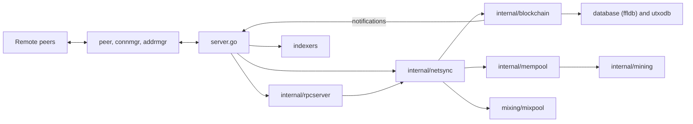
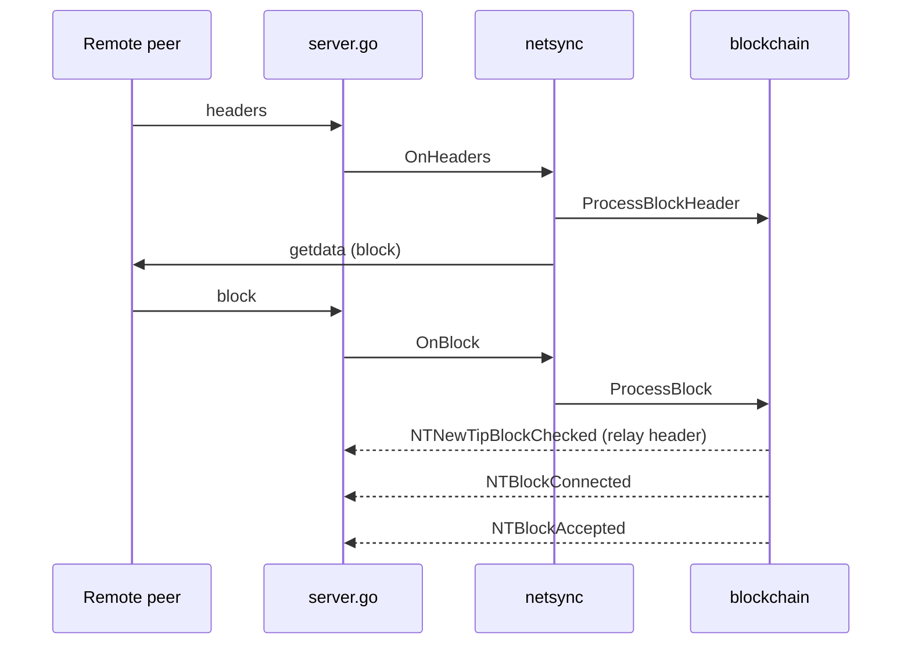
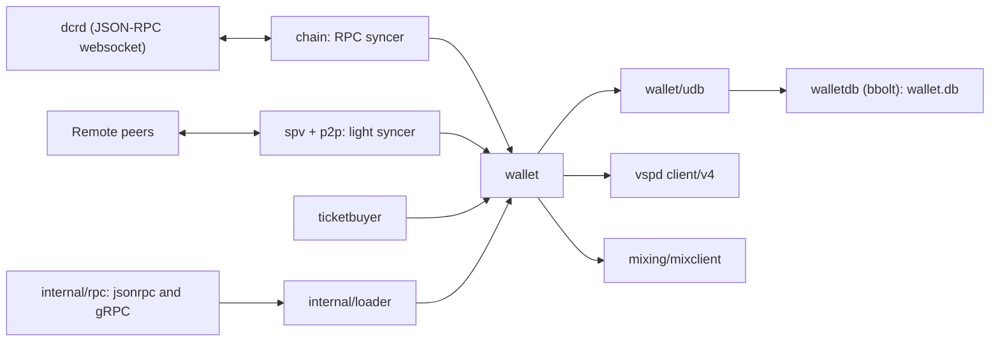

# A tour of the dcrd and dcrwallet code

This page maps the `dcrd` and `dcrwallet` source for a first-time contributor: the packages that matter, the path of a block, a transaction and a vote by function name, the line between consensus and relay policy, and the tests that guard each part.

!!! info "Applies to"
    `dcrd` and `dcrwallet` at tag `release-v2.1.7`. Checked November 2026. The default branches (2.2.0-pre) have moved a few packages; see [Release tag and master](#release-tag-and-master).

## Public modules and internal packages

The `dcrd` repository holds a root module, `github.com/decred/dcrd`, which builds the `dcrd` program, and 29 library modules that wallets, explorers and `dcrd` itself import, mapped in [dcrd Go modules](../go/index.md). This page covers the root module's `package main` files and its `internal/` packages, which no other module can import.

The split decides where a change goes:

- **Node behavior** (validation, chain selection, mempool, sync, mining, remote procedure call (RPC) handlers) lives under `internal/`. Changing it needs no module release.
- **Shared building blocks** (`wire`, `txscript/v4`, `chaincfg/v3`, `blockchain/stake/v5`, `blockchain/standalone/v2`, `peer/v3`, `database/v3`, `mixing` and others) are separate modules. A breaking API change needs a new major version that every dependent release has to adopt.

At `release-v2.1.7` the root `go.mod` requires the libraries by tagged version, with no `replace` directives, so editing `wire/` there does not change the `dcrd` you build. To test a library change against a release branch, use a Go workspace, as [Build from source](../environment/build-from-source.md) shows.

## How dcrd is put together

`dcrdMain` in `dcrd.go` loads the configuration, opens the databases and calls `newServer` in `server.go`, which creates every subsystem and wires them together with callbacks. The sync manager drives the chain and the mempool; the chain reports back through notifications, which the server fans out.



| Package or file | Role |
|---|---|
| `dcrd.go`, `config.go`, `params.go` | Entry point, options, per-network RPC ports |
| `server.go` | Owns every subsystem: the per-message callbacks on `serverPeer` (`OnTx`, `OnBlock`, `OnHeaders`, `OnInv`, `OnMix*`) and `handleBlockchainNotification` |
| `peer`, `connmgr`, `addrmgr` (modules) | Connections, seeders, ban scores, known addresses (`peers.json`) |
| `internal/netsync` | `SyncManager`: headers-first sync and data requests |
| `internal/blockchain` | Validation, chain selection, the unspent transaction output (UTXO) cache, ticket and treasury state, agendas |
| `database/ffldb`, `blockdb.go` | Block storage (`blocks_ffldb`); the UTXO set is a separate LevelDB, `utxodb` |
| `internal/blockchain/indexers` | Optional `txindex` and exists-address index |
| `internal/mempool` | `TxPool`: acceptance, orphans, vote tracking, stake pruning |
| `internal/mining` | `BlkTmplGenerator` and the background `BgBlkTmplGenerator`; `cpuminer` for test networks |
| `mixing/mixpool` (module) | StakeShuffle messages held for relay; see [Mixing for builders](../protocol/mixing.md) |
| `internal/rpcserver` | JSON-RPC and websocket handlers |
| `internal/fees`, `internal/staging` | Fee estimation; code being prepared to become modules (`primitives` for consensus primitives, `banmanager`) |

## Following a block

Peers announce blocks by sending their headers, so a block arrives as a header, then its data. Both pass through `internal/netsync`, the only caller of `BlockChain.ProcessBlock` in the running node; `submitblock`, `getwork` and the CPU miner enter through `SyncManager.ProcessBlock`, which runs the same path.



1. **Header.** `SyncManager.OnHeaders` calls `ProcessBlockHeader`, which checks each header (`maybeAcceptBlockHeader`) and adds it to the block index; a failing header disconnects the peer. Once the chain is current, the sync manager requests the blocks with `getdata`; during the initial sync, `fetchNextBlocks` fetches them from the sync peer.
2. **Block data.** `SyncManager.OnBlock` disconnects a peer that sends an unrequested block, and otherwise calls `ProcessBlock` while the peer's goroutine waits, so a peer cannot queue up bad blocks.
3. **Validation.** `ProcessBlock` (`internal/blockchain/process.go`) runs the stages in the table below. A block whose ancestors lack data waits, then is checked together with any descendants that become complete (`maybeAcceptBlocks`).
4. **Early relay.** A block that extends the tip and passes the contextual checks triggers `NTNewTipBlockChecked`, and the server relays its header before the expensive connection checks.
5. **Connection.** `FindBestChainCandidate` picks the valid branch with the most work, and `reorganizeChain` calls `checkConnectBlock` and `connectBlock` for each block. `connectBlock` stores the chain, ticket and treasury state, commits UTXO changes to the cache, and sends `NTBlockConnected` and `NTNewTickets`.
6. **Fan-out.** In `handleBlockchainNotification`, `NTBlockConnected` removes confirmed transactions and double spends from the mempool, returns a disapproved parent's regular transactions to it, and updates websocket clients, the indexes and the template generator. `NTBlockAccepted`, acted on only when the node is current, relays the block to the remaining peers and sends `winningtickets` to wallets.
7. **Clean-up.** For a block that extended the main chain, `SyncManager.OnBlock` calls `PruneStakeTx` and `PruneExpiredTx` and clears the rejected-transaction filter.

A rejected block is logged under `SYNC` as `Rejected block <hash> from <peer>: <reason>`. Rule violations come back as `blockchain.RuleError` values, possibly inside a `MultiError`; `errors.Is` with an `ErrorKind` such as `ErrNotEnoughVotes` identifies the rule.

### Validation stages and their functions

The whitepaper divides [block validation into stages](../../whitepaper/10-blocks.md#sec:blocks-stages) by how much context each needs. Each stage has one function in `internal/blockchain/validate.go`:

| Stage | Function | Needs |
|---|---|---|
| Header sanity | `checkBlockHeaderSanity` | Nothing but the header |
| Header positional | `checkBlockHeaderPositional` | Ancestor headers |
| Data preconditions | `checkBlockDataPreconditions` | Ancestor headers; proves the header commits to this data |
| Block sanity | `checkBlockDataSanity` (with `standalone.CheckTransactionSanity` per transaction; the agenda-dependent `checkTransactionContext` runs in `checkBlockContext`) | Nothing but the block |
| Block positional | `checkBlockDataPositional` | Ancestor headers |
| Header and block contextual | `checkBlockHeaderContext`, `checkBlockContext` | Full data of every ancestor |
| Connection | `checkConnectBlock`, which calls `CheckTransactionInputs`, `checkTransactionsAndConnect`, `tspendChecks` and the script checks in `scriptval.go` | The UTXO set as of the parent |

A block that fails a rule after its data commitment is proven is marked invalid with `MarkBlockFailedValidation`, along with its descendants. The whitepaper's [Processing headers and blocks](../../whitepaper/10-blocks.md#sec:blocks-processing) specifies the procedure normatively.

## Following a transaction

Transactions enter like blocks, then go to the mempool instead of the chain.

1. **Announcement.** `SyncManager.OnInv` requests a transaction only when the chain is current and `needTx` says it is not already known, recently confirmed or recently rejected.
2. **Acceptance.** `SyncManager.OnTx` calls `TxPool.ProcessTransaction`. Peer transactions may be orphans (kept unless `maxorphantx` is 0) and skip the high-fee limit; the `sendrawtransaction` handler refuses orphans and applies the limit unless `allowhighfees` is set.
3. **Relay.** `serverPeer.OnTx` calls `server.AnnounceNewTransactions`, which sends an `inv` to peers and notifies websocket clients. The `sendrawtransaction` handler does the same itself and keeps the transaction for rebroadcast until a block confirms it, unless it is a vote.
4. **Mining.** `BlkTmplGenerator.NewBlockTemplate` reads candidates from the mempool's `MiningView`. The `OnVoteReceived` callback calls `BgBlkTmplGenerator.VoteReceived`, so templates are rebuilt as votes for the new tip arrive ([Background template generation](../../whitepaper/17-policy.md#sec:policy-bg)).

### Policy versus consensus inside the mempool

`maybeAcceptTransaction` in `internal/mempool/mempool.go` interleaves two kinds of check. Most consensus checks are the `blockchain.Check*` calls; the rest is local policy. The boundary is not exact: scripts are validated with the stricter standard verify flags (`BaseStandardVerifyFlags` in `policy.go`), and some policy checks use `internal/blockchain` helpers (`IsExpired`, `CountTotalSigOps`).

| Kind | Checks in `maybeAcceptTransaction` | If you change it |
|---|---|---|
| Consensus | `blockchain.CheckTransaction`, `blockchain.CheckTransactionInputs`, sequence locks, and `blockchain.ValidateTransactionScripts` (run with the standard flags) | The pool disagrees with block validation; a real change goes through a consensus vote |
| Policy | `checkTransactionStandard` and `checkInputsStandard` (`policy.go`), dust, the minimum relay fee (`calcMinRequiredTxRelayFee`), the high-fee limit, `MaxSigOpsPerTx`, expiry in the next block, vote and ticket rules, mixing-related rejections | Affects only what this node relays and mines; nodes may differ |

A `mempool.RuleError` wraps either a mempool `ErrorKind` or a `blockchain.RuleError`, so `errors.As` shows which package rejected it, though a script failure under the standard flags is reported as a `blockchain.RuleError` even when only a policy flag failed. Standardness is relaxed on testnet, simnet and regnet (`AcceptNonStdTxs` in `chaincfg`) and can be forced with `--rejectnonstd` or `--acceptnonstd`. The whitepaper's [Mempool acceptance](../../whitepaper/17-policy.md#sec:policy-accept) gives the full procedure in `dcrd`'s order.

## Where the consensus rules live

`validate.go` holds the stage functions, but many rules sit elsewhere:

| Area | Where |
|---|---|
| Required difficulty and ticket price | `internal/blockchain/difficulty.go` (the absolutely scheduled exponentially rising targets (ASERT) algorithm, through `standalone.CalcASERTDiff`) |
| Subsidy amounts and split variants | `blockchain/standalone/subsidy.go`; coinbase and treasurybase checks in `internal/blockchain/subsidy.go` |
| Treasury spend (TSPEND) votes and expenditure limits | `internal/blockchain/treasury.go` |
| Stake transactions, the ticket lottery, ticket state | `blockchain/stake` (`staketx.go`, `lottery.go`, `tickets.go`) |
| Agenda voting and activation | `thresholdstate.go`, `stakeversion.go`, `agendas.go` in `internal/blockchain` |
| Scripts and signature hashes; network parameters and agenda definitions | `txscript/v4`; `chaincfg/v3` |
| Relative lock times, header commitments, chain selection | `sequencelock.go`, `headercmt.go`, `blockindex.go`, `chain.go` in `internal/blockchain` |

Each numbered rule box in the whitepaper names the `dcrd` file and function that enforces it, and the [index of consensus rules](../../whitepaper/B-rule-index.md#ch:rule-index) lists every box. [Where `dcrd` and the whitepaper disagree, `dcrd` is correct](../../whitepaper/02-conventions.md#conv:reference).

### Worked example: From a rule box to its tests

Take the rule "Minimum number of votes" in the whitepaper's [context-free header rules](../../whitepaper/08-staking.md#sec:staking-header-sanity): at or above stake validation height, a header's `Voters` must be at least 3. Its source line reads `internal/blockchain/validate.go · checkBlockHeaderSanity`.

1. In `checkBlockHeaderSanity`, the check computes `majority := (chainParams.TicketsPerBlock / 2) + 1` and returns `ruleError(ErrNotEnoughVotes, ...)` when `header.Voters` is lower.
2. `ErrNotEnoughVotes` is declared in `internal/blockchain/error.go`.
3. Two tests check it: `blockchain/fullblocktests/generate.go` (run by `TestFullBlocks`) rejects block `bv4`, and `TestProcessLogic` in `internal/blockchain/process_test.go` rejects the header of `b1badhdr`, a block with one vote built by `genSharedProcessTestBlocks`, with `g.RejectHeader("b1badhdr", ErrNotEnoughVotes)`.

Run them from the repository root:

```bash
go test ./internal/blockchain/ -run 'TestFullBlocks|TestProcessLogic'
```

```text title="Expected output"
ok  	github.com/decred/dcrd/internal/blockchain	<SECONDS>s
```

`<SECONDS>` is the run time. A failure you did not intend means the change is wrong; an intended consensus change needs a Decred Change Proposal (DCP) and an agenda: see [Consensus changes](consensus-changes.md).

## Configuration and logging

**Options.** Each option is a field with a `long:` tag in the `config` struct in `config.go`, defaulted and validated by `loadConfig`. A new option also needs a commented entry in `sampleconfig/sample-dcrd.conf`, which is copied to `dcrd.conf` on first run. [dcrd configuration](../reference/dcrd-config.md) lists every option.

**Logging.** `log.go` gives each package a four-letter tag, such as `CHAN` (`internal/blockchain`), `SYNC` (`internal/netsync`), `TXMP` (`internal/mempool`) and `SRVR` (`server.go`); `--debuglevel=show` lists them all. Set one level for everything (`--debuglevel=debug`) or comma-separated pairs, which leave the rest at `info`:

```bash
dcrd --debuglevel=CHAN=debug,TXMP=trace
```

`dcrctl debuglevel CHAN=debug` changes it on a running node. The log is `dcrd.log` in the network's log subdirectory, for example `~/.dcrd/logs/mainnet/dcrd.log`.

## How dcrwallet is put together

`dcrwallet` is one module, `decred.org/dcrwallet/v5`. The `wallet` package holds the logic; around it sit two interchangeable sync backends, the storage layer and the RPC servers.



| Package | Role |
|---|---|
| `dcrwallet.go`, `config.go`, `rpcserver.go` | Entry point, options, RPC listeners; `spvLoop` or `rpcSyncLoop` starts the syncer |
| `wallet` | Accounts, transaction creation (`createtx.go`), tickets and voting (`tickets.go`, `chainntfns.go`), voting service provider (VSP) fee payment (`vsp.go`, `feepayment.go`), mixing (`mixing.go`) |
| `wallet.NetworkBackend` | The interface both syncers implement (`Blocks`, `CFiltersV2`, `PublishTransactions` and others) |
| `chain` | RPC-mode `Syncer`, driven by `dcrd` websocket notifications |
| `spv`, `p2p` | Light-mode (simplified payment verification) `Syncer` for `--spv`: headers and compact filters from peers |
| `wallet/udb`, `wallet/walletdb` | Database schema and upgrades; the key-value layer over bbolt |
| `ticketbuyer` | The automatic ticket buyer |
| `internal/rpc/jsonrpc`, `internal/rpc/rpcserver` | The JSON-RPC server and the gRPC services |
| `internal/loader` | Opens and closes the wallet for both RPC servers |

Logging works as in `dcrd`, with tags such as `WLLT`, `SYNC`, `TKBY` and `VSPC`.

### Worked example: A vote crosses both repositories

With `--enablevoting` in RPC mode:

1. On `NTBlockAccepted`, `dcrd` computes the winners with `LotteryDataForBlock` and calls `rpcServer.NotifyWinningTickets`. Among other conditions, it skips this while the node is not current and for a side-chain block that would need a reorganization of 6 or more blocks (`maxReorgDepthNotify`).
2. The `winningtickets` notification reaches `dcrwallet`'s `chain/sync.go`, which calls `wallet.VoteOnOwnedTickets`.
3. `VoteOnOwnedTickets` builds a vote for each winning ticket the wallet owns and publishes it with `NetworkBackend.PublishTransactions`, which sends `sendrawtransaction` to `dcrd`.
4. `dcrd`'s mempool accepts the vote, `OnVoteReceived` tells the background template generator, and the next template includes it.

Light mode has no source of these notifications, so `dcrwallet` refuses `--spv` together with `--enablevoting` with the error `SPV voting is not possible: disable --spv or --enablevoting`.

### Where dcrwallet changes usually go

- **A new JSON-RPC method:** a handler in `internal/rpc/jsonrpc/methods.go`, types in `rpc/jsonrpc/types`, help in `internal/rpchelp`, then `go generate ./internal/rpc/jsonrpc`, or `TestRPCMethodHelpGeneration` fails with `Generated help texts are out of date: run 'go generate'`.
- **A gRPC change:** edit `rpc/api.proto`, regenerate with `rpc/regen.sh`, and implement it in `internal/rpc/rpcserver/server.go`.
- **A database change:** a new version and upgrade function in `wallet/udb/upgrades.go`.

## Tests: What covers what

[Contributing to Decred software](index.md) explains how to run tests and what continuous integration (CI) checks. For `dcrd`:

| Code | Tests |
|---|---|
| Block validation and chain selection | `TestFullBlocks`, `TestProcessOrder`, `TestProcessLogic`, `TestInvalidateReconsider`, `TestAssumeValid`; `chaingenHarness` (`common_test.go`) builds custom chains |
| Agendas, treasury, stake versions | `agendas_test.go`, `thresholdstate_test.go`, `treasury_test.go` in `internal/blockchain` |
| Scripts, signature hashes, ASERT | JSON vector files in `txscript/testdata` and `blockchain/standalone/testdata` |
| Mempool policy, templates | `internal/mempool` (`mempool_test.go`, `policy_test.go`); `internal/mining/mining_harness_test.go` |
| RPC handlers | `internal/rpcserver/rpcserverhandlers_test.go` |
| The compiled `dcrd` over RPC | `internal/integration/rpctests` (`rpctest` build tag) |

- **Each `dcrd` module tests separately.** `go test ./...` at the root covers only the root module, including `internal/`; test a `txscript` change from its directory. `./run_tests.sh` runs `go test -short` in every module, then `./lint.sh` unless `GITHUB_ACTIONS` is set.
- **Neither repository has Go fuzz targets at `release-v2.1.7`.** The vector files and full-block tests cover consensus code.

## What can go wrong

- **Editing consensus by accident.** Any change under `internal/blockchain`, `blockchain/stake`, `blockchain/standalone`, `txscript` or `wire` serialization can split a node from the network. Run the full-block and vector tests and read the matching whitepaper chapter first.
- **Holding the chain lock.** Several notifications (`NTNewTipBlockChecked`, `NTNewTickets`, the reorganization notifications) are sent with the chain lock held, as comments in `handleBlockchainNotification` warn. A handler that calls chain methods from them will deadlock.

### Release tag and master

New work targets `master` (2.2.0-pre). There `connmgr` is no longer a module but `internal/connmgr`, `internal/ratelimit` is new, `internal/staging/banmanager` is gone, and `addrmgr`, `peer`, `rpcclient` and `rpc/jsonrpc/types` have new major versions in source only. The flows are the same; check package paths against your branch.

## Go deeper

- [Blocks and chain selection](../../whitepaper/10-blocks.md#ch:blocks): every block rule by validation stage.
- [Relay policy and mining](../../whitepaper/17-policy.md#ch:policy): mempool acceptance, standardness and templates.
- [Index of consensus rules](../../whitepaper/B-rule-index.md#ch:rule-index): every rule box, with the code that enforces it.
- [Synchronization and relay](../../whitepaper/15-p2p.md#sec:p2p-sync): headers-first sync and propagation.

## Next steps

- [Consensus changes: DCPs and agenda deployments](consensus-changes.md): the next step on the `dcrd` contributor path.
- [Contributing to Decred software](index.md): conventions, commit messages, review and CI.
- [Set up a private simnet](../environment/simnet.md): watch these flows on a local network with `--debuglevel` turned up.
- [dcrd JSON-RPC API](../api/dcrd-json-rpc.md) and [dcrwallet JSON-RPC API](../api/dcrwallet-json-rpc.md): the interfaces the RPC packages implement.

*[API]: application programming interface
*[ASERT]: absolutely scheduled exponentially rising targets
*[CI]: continuous integration
*[DCP]: Decred Change Proposal
*[gRPC]: gRPC remote procedure call framework
*[RPC]: remote procedure call
*[SPV]: simplified payment verification
*[TSPEND]: treasury spend
*[UTXO]: unspent transaction output
*[VSP]: voting service provider
