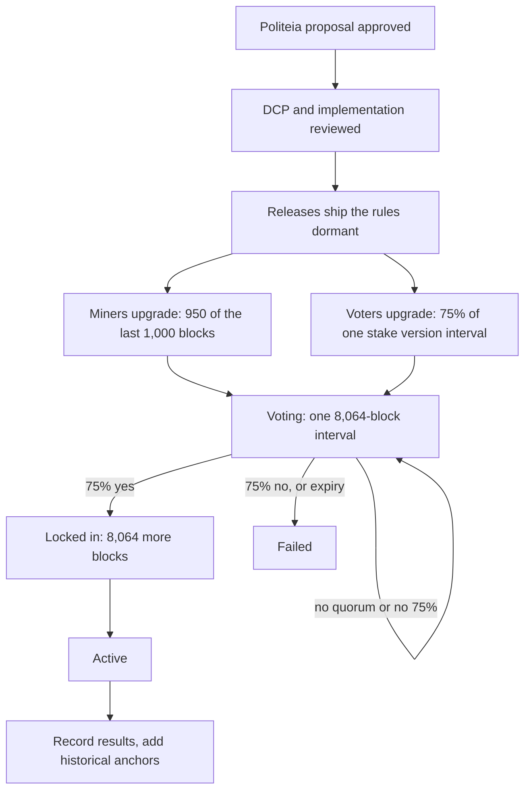

# Consensus changes: DCPs and agenda deployments

This guide takes a change to a Decred consensus rule from the first proposal to an active agenda: deciding whether a Decred Change Proposal (DCP) is needed, writing it, defining and gating the deployment in `dcrd`, bumping versions, testing the vote and coordinating the release. It ends with an index of every DCP.

!!! info "Applies to"
    `dcrd` and `dcrwallet` 2.1.7 (tags `release-v2.1.7`; the code named here is unchanged on `master` as of November 2026), `vspd` 1.5.0, and the [decred/dcps](https://github.com/decred/dcps) repository on `master`. Checked November 2026.

## Before you start

- Read [the whitepaper's consensus rule changes chapter](../../whitepaper/13-voting.md#ch:voting). It is the normative description of what this page puts into practice.
- Have Go and checkouts of `dcrd` and `dcrwallet` on `master`, set up as in [Build from source](../environment/build-from-source.md), including its section on Go workspaces, and be able to run [a private simnet](../environment/simnet.md).
- Expect months. On mainnet a successful vote takes at least 16,128 blocks (about 8 weeks) from the start of voting to activation, and voting cannot start until nearly everyone has upgraded.
- If you have found a bug in consensus code rather than an idea for a new rule, report it privately as described in [Contributing to Decred software](index.md), never in a public issue or DCP.

## How a change reaches the chain

The path starts off chain with people and ends on chain with code that every node evaluates the same way.



[Consensus rule votes](../../user/governance/consensus-upgrades.md) explains this cycle for stakeholders, with every past result.

## Step 1: Decide whether the change needs a DCP

A change needs a DCP and an agenda when it changes which blocks or transactions are valid, so that a node running the old rules after activation would reject blocks the network accepts, or accept blocks it rejects.

| Kind of change | DCP and agenda? |
|---|---|
| Block, transaction, script or stake validity; subsidy amounts or split; proof-of-work hash or difficulty; ticket price; treasury rules | Yes |
| A new transaction version or script version | Yes, by rule since DCP-0008 (Step 6) |
| Relay and mining policy: standardness, fees, mempool limits, template construction ([the whitepaper's policy chapter](../../whitepaper/17-policy.md#ch:policy)) | No |
| Peer-to-peer messages, remote procedure call (RPC) methods, wallet behavior, mix message relay | No |
| Release maintenance of chain parameters such as `AssumeValid` and `MinKnownChainWork` | No |
| A fix that makes `dcrd` enforce the rules as already specified | No vote. `dcrd` 2.1.6 carried a "critical consensus-related security fix" with no agenda |

Historical exceptions, a non-binding poll and a few rules keyed to block versions or a testnet height instead of a vote, are not patterns to follow ([the whitepaper's notes on rule activation](../../whitepaper/02-conventions.md#conv:agendas)).

[DCP-0000](https://github.com/decred/dcps/blob/master/dcp-0000/dcp-0000.mediawiki) places a consensus change at the end of an off-chain process: the idea starts as a [Politeia proposal](../../user/governance/politeia.md) ([Write a Politeia proposal](../../user/governance/write-a-proposal.md)), and that vote decides whether the implementation, the DCP and the on-chain vote happen at all. Discuss the design with the `dcrd` maintainers before writing code.

## Step 2: Write the DCP

DCPs are MediaWiki files at `dcp-NNNN/dcp-NNNN.mediawiki` in [decred/dcps](https://github.com/decred/dcps), added by pull request. DCP-0000 is the formatting specification; the points most often missed:

- **Preamble**: `DCP`, `Title` (at most 44 characters), `Author`, `Status`, `Created`, `License: CC0-1.0`, then optionally `License-Code` (ISC recommended), `Requires`, `Replaces` and `Superseded-By`. Use `?` for the number until one is assigned.
- **Status** follows the vote, not the writing: `Defined`, then `Voting`, `Locked In`, and `Active` or `Failed`. There is no draft status; drafting happens in the Politeia stage. DCP-0000 also defines `Replaced` and `Obsolete` for superseded DCPs, but in practice a superseded DCP has kept `Active` and only gained a `Superseded-By` header (DCP-0007, DCP-0010), while its replacement carries `Replaces`.
- **Reference Implementation** is required: the code must exist, tested and dormant, before the vote. The Specification must be precise enough for an independent implementation, preferring integer arithmetic and explicit integer widths.
- **Deployment section**: the agenda parameters (deployment version, agenda ID, description, start and expire times, mask, and each choice with its bits), matching `chaincfg` exactly. [DCP-0008](https://github.com/decred/dcps/blob/master/dcp-0008/dcp-0008.mediawiki) and [DCP-0013](https://github.com/decred/dcps/blob/master/dcp-0013/dcp-0013.mediawiki) are good models.

Add the new DCP to the table in `README.mediawiki` in the same pull request.

## Step 3: Define the deployment in chaincfg

The deployment lives in `dcrd`'s `chaincfg` module (`github.com/decred/dcrd/chaincfg/v3`). Every other program learns about the agenda from it.

### Choose the version, ID, mask and choices

- **Deployment version**: the map key in `Params.Deployments`. Use the next unused one: 12 on mainnet, 13 on testnet3, simnet and regnet, whose versions run one higher. Agendas that share a version are voted on together.
- **Agenda ID**: a short lowercase word, added as a `VoteID...` constant in `chaincfg/params.go`. It must be unique across every deployment of every version.
- **Mask**: consecutive bits, never bit 0 (which approves the parent block's regular tree), disjoint from every other mask in the same version. A new version can reuse `0x0006`, because a vote's version selects which deployments its bits address ([the vote bits layout](../../whitepaper/13-voting.md#sec:voting-bits-layout)).
- **Choices**: exactly one abstain choice with bits `0x0000`, exactly one with `IsNo`, listed in bit order, because the tally decodes the masked bits to an index into the choice list ([choices](../../whitepaper/13-voting.md#sec:voting-choices)). Bits `0x0000` are what a wallet votes when its owner sets nothing, so they must mean abstain.

### Choose start and expire times

Both are compared with the median time of the last block of a rule change interval, not with the wall clock.

- **Start time** is only the earliest moment voting can begin; the upgrade thresholds usually decide the real start. `maxtreasuryspend` used 13 November 2025, two weeks before `dcrd` 2.1.0 shipped.
- **Expire time** ends the attempt; versions 9, 10 and 11 each allowed two years. An agenda that has not locked in by then is `Failed`. Trying again needs a new agenda ID (vote IDs must be unique across every deployment version), a new deployment version and a new release. Expiry is checked before the tally, so an agenda fails at expiry even if that interval's votes passed.

### Add an entry for every network

| Network | Version | Times | Forced choice |
|---|---|---|---|
| `mainnet` (`mainnetparams.go`) | 12 | Real start and expire times | None. Forbidden: `dcrd` refuses to start ("has a forced choice for the main network") |
| `testnet3` (`testnetparams.go`) | 13 | The same times as mainnet | None, so testnet3 holds a real vote |
| `simnet` (`simnetparams.go`) | 13 | `0` and `math.MaxInt64` | `"yes"`, as every simnet agenda has |
| `regnet` (`regnetparams.go`) | 13 | `0` and `math.MaxInt64` | None; `dcrd`'s tests vote on regnet |

The mainnet entry for a hypothetical agenda `examplerule` (with `<NNNN>` the DCP number) starts like this; the [`maxtreasuryspend` entry](https://github.com/decred/dcrd/blob/release-v2.1.7/chaincfg/mainnetparams.go#L486-L513) shows a complete one:

```go title="chaincfg/mainnetparams.go"
12: {{
	Vote: Vote{
		Id:          VoteIDExampleRule,
		Description: "Change the example rule as defined in DCP<NNNN>",
		Mask:        0x0006, // Bits 1 and 2
		Choices: []Choice{{
			Id:          "abstain",
			Description: "abstain voting for change",
			Bits:        0x0000,
			IsAbstain:   true,
			IsNo:        false,
		}, {
			// ... "no" (0x0002) and "yes" (0x0004), as in maxtreasuryspend
		}},
	},
	StartTime:  1798761600, // Jan 1st, 2027
	ExpireTime: 1861920000, // Jan 1st, 2029
}},
```

Also add the deployment to `blockchain/fullblocktests/params.go`, which keeps its own copy of the deployments and vote ID constants. `chaincfg` validates the deployments of all four networks when it loads and panics with "invalid agenda on" the network name if one is malformed.

## Step 4: Gate the new rule on the agenda

New rules must lie dormant until the agenda is active. In `internal/blockchain`:

1. Add the ID to `requiredAgendaIDs` in `agendas.go`. On a network without a deployment for it, a listed agenda is never active on mainnet and always active elsewhere.
2. Add a query function next to the others in `agendas.go`:

    ```go title="internal/blockchain/agendas.go"
    func (b *BlockChain) isExampleRuleAgendaActive(prevNode *blockNode) (bool, error) {
    	const agendaID = chaincfg.VoteIDExampleRule
    	return b.isAgendaActive(prevNode, agendaID)
    }

    func (b *BlockChain) IsExampleRuleAgendaActive(prevHash *chainhash.Hash) (bool, error) {
    	return b.isAgendaActiveByHash(prevHash, b.isExampleRuleAgendaActive)
    }
    ```

3. Call it with the **parent** of the block being validated: its answer is for the block after the node passed ([which block's state each rule consults](../../whitepaper/13-voting.md#sec:voting-consumers)).
4. For transaction-level rules, follow the `AgendaFlags` pattern in `validate.go`: add an `AF...Enabled` flag, set it in `determineCheckTxFlags`, and test it in the check.
5. Give the mempool and the block template generator the same answer for the block that would extend the tip. They receive agenda checks as callbacks in their configs (`internal/mempool`, `internal/mining`), wired up in `server.go`.

`isAgendaActive` assumes a single passing choice; none with several has been deployed.

## Step 5: Bump block and vote versions

The vote cannot start until miners prove they run the new software with the block version, and voters with the vote version; the threshold state machine compares both with the deployment version ([block versions](../../whitepaper/13-voting.md#sec:voting-block-version), [stake version](../../whitepaper/13-voting.md#sec:voting-stake-version)). A deployment shipped without these bumps can never leave `Defined`.

| What | Where | For `maxtreasuryspend` | Next deployment |
|---|---|---|---|
| Block version the miner produces | `dcrd` `internal/mining/mining.go`: `generatedBlockVersion` (mainnet), `generatedBlockVersionTest` (others) | 11, 12 | 12, 13 |
| Newest enforced block version | `dcrd` `internal/blockchain/validate.go`: `latestBlockVersion` in `isOldBlockVersionByMajority` (one higher off mainnet) | 11 | 12 |
| Vote version | `dcrwallet` `wallet/wallet.go`: `voteVersion` | 11 mainnet; 12 testnet3 and simnet | 12; 13 |

The header stake version needs no constant: `dcrd` computes it from the votes in the chain.

## Step 6: Use explicit version upgrades (DCP-0008)

Since `explicitverupgrades` became active at block 657,280, transactions with a version above 3 and regular-transaction output scripts with a version above 0 are invalid ([explicit version upgrades](../../whitepaper/13-voting.md#sec:voting-dcp8)). If your change alters what a transaction or script means, give it the next transaction version (4) or script version (1), and raise `maxAllowedTxVer` or `maxAllowedScriptVer` in `checkTransactionContext` (`internal/blockchain/validate.go`) only when your agenda flag is set. The mempool always enforces these limits as policy (`AFExplicitVerUpgrades`), so also set your flag in its own `determineCheckTxFlags`.

The new version then tells wallets and signers which rules apply without tracking votes. Light wallets (SPV) do not download the votes needed to tally: `dcrwallet` in SPV mode assumes DCP-0010 and DCP-0012 are active when computing a voting service provider (VSP) fee. Design the change so that pre-activation software rejects what it cannot check.

## Step 7: Test the deployment and the rules

### Unit tests in dcrd

- **Activation test.** Copy `TestMaxTreasurySpendDeployment` in `internal/blockchain/agendas_test.go`, which drives a fake chain through each state and asserts activation exactly at the boundary, on `chaincfg.MainNetParams()` and `chaincfg.RegNetParams()`.
- **Rule tests.** Use the `chaingen` harness with `quickVoteActivationParams()`. `forceDeploymentResult(t, params, voteID, "yes")` tests the rule with the agenda active from the start; `AdvanceFromSVHToActiveAgendas` runs a real vote first. Test blocks on both sides of activation and a reorganization across it. `TestTSpendExpendituresPolicyDCP0013` in `treasury_policy_test.go` is a complete example.
- **Everything.** `./run_tests.sh` runs the tests of every module and the linters.

### Rehearse the vote on simnet

Simnet's forced "yes" settles every shipped agenda at height 1, so a real vote needs throwaway local changes:

1. In `dcrd`, give your agenda a version 13 deployment in `chaincfg/simnetparams.go` **without** `ForcedChoiceID`, and set `generatedBlockVersionTest = 13`. On `master`, `dcrd`'s root `go.mod` replaces its library modules with the local directories, so `go install .` builds a node with your `chaincfg`.
2. In `dcrwallet`, set the simnet case of `voteVersion` to 13 and build against your `chaincfg` with a workspace, from a `dcrwallet` checkout next to your `dcrd` checkout:

    ```bash
    go work init . ../dcrd/chaincfg
    go install .
    ```

3. Start a new simnet with these binaries and follow [Set up a private simnet](../environment/simnet.md) through step 5, so the ticket buyer runs and the wallet votes.
4. Before height 464, set the choice: `walletctl setvotechoice examplerule yes`.
5. Mine past height 1,104 with the paced loop from the simnet tutorial, pausing a second after each block so the wallet keeps buying tickets and voting (about 20 to 40 minutes):

    ```bash
    for i in $(seq 960); do nodectl generate 1 > /dev/null; sleep 1; done
    ```

    In a second terminal, watch `nodectl getvoteinfo 13`.

The states follow [the threshold state machine](../../whitepaper/13-voting.md#sec:voting-threshold) with simnet's numbers (stake validation height 144, 112-block stake version interval, 320-block rule change interval, quorum 160):

| Heights | State |
|---|---|
| 1 to 463 | `defined` (stake version 13 required from height 256) |
| 464 to 783 | `started` |
| 784 to 1,103 | `lockedin` |
| 1,104 onward | `active` |

`getvoteinfo` reports the state for the block after the tip, so its status changes one block before each boundary. Repeat with `no` to see `failed`. Keep the forced choice in the simnet entry you commit.

### Testnet

Testnet3 runs a real vote under mainnet's start and expire times, with 5,040-block intervals and a quorum of 2,520 votes: the first public check that releases, VSPs and wallets carry the vote. [Networks](../environment/index.md) lists the testnet services that currently work.

## Step 8: Coordinate the release and the vote

Voting starts only once nearly every miner and voter has upgraded, so a vote is a release of the whole ecosystem:

- **`chaincfg` module tag.** Other repositories depend on `chaincfg` by published version; for `maxtreasuryspend` that was `chaincfg/v3.3.0`.
- **`dcrd`.** A major release, with notes drafted from `docs/release_notes_template_major.md`: the vote in the highlights, links to the Politeia proposal and the DCP, and an "Upgrade Required" section naming the cutoff height.
- **The old-version vote cutoff.** In `server.go`, `isOldMainnetBlock` stops winning-ticket notifications for mainnet blocks of the old version from a hard-coded height, so voting wallets do not vote on them. A block needs at least 3 votes to be built on, so un-upgraded miners lose their rewards and the block version threshold is reached quickly. For `maxtreasuryspend` the cutoff applied to blocks below version 11 from height 1,035,288, about two weeks after the release; the next deployment needs a new height and blocks below version 12.
- **Wallets.** `dcrwallet` needs the new `chaincfg` and the higher vote version; it logs "Old vote version detected" when the chain has moved past its own. Decrediton (**Governance** > **Consensus Changes**) and Bison Wallet use `dcrwallet`, so each needs a release built on the updated modules.
- **VSPs.** `vspd` checks customers' choices against its own `chaincfg` and rejects an unknown one as "not found for vote version", and votes with the operator's `dcrwallet` instances, so operators must upgrade both ([Run a voting service provider](../operate/vsp.md)).
- **Explorers.** Let the dcrdata and voting dashboard maintainers know the agenda ID and version.

Users upgrade by following [Upgrading and mandatory releases](../../user/run/upgrades.md); [Releases and reproducible builds](releases.md) covers building and signing the binaries.

## Step 9: After the vote

1. **Update the DCP.** Add the "Voting Results" table with the hash and height of the blocks where voting started, where it locked in, and where it became active or failed; set `Status`; update `README.mediawiki` ([dcps #39](https://github.com/decred/dcps/pull/39) did this for DCP-0013).
2. **Hard-code the historical anchors** for mainnet and testnet3 in `makeHistoricalAgendas` (`internal/blockchain/agendas.go`). The anchor is the **parent** of the activation block, the DCP's "Active" height minus one, with its hash; `TestHistoricalAgendaInvariants` checks the placement. With an anchor, a node decides activation from headers alone.
3. **Leave the deployment in place.** Nodes validate the whole chain, so old deployments and rules stay in the code.
4. **Update the record.** The whitepaper's tables and [Consensus rule votes](../../user/governance/consensus-upgrades.md) list every agenda; [Contribute to these docs](docs.md) explains how to change them.

After an upgrade, `dcrd` reconsiders blocks it marked invalid from the start time of the new deployments ([deriving agenda status](../../whitepaper/13-voting.md#sec:voting-deriving)).

### Worked example: `maxtreasuryspend`

DCP-0013 shows how the pieces line up. Dates are pull request merges into `master`.

| Step | Where | When |
|---|---|---|
| Work approved | Politeia proposal [Treasury Expenditure Policy Consensus Change](https://proposals.decred.org/record/16a93c7751722954) | Before implementation |
| Agenda on all networks | [dcrd #3548](https://github.com/decred/dcrd/pull/3548) | 24 November 2025 |
| Rules, gating, tests, block versions | [dcrd #3549](https://github.com/decred/dcrd/pull/3549) | 24 November 2025 |
| DCP text | [dcps #38](https://github.com/decred/dcps/pull/38) | 24 November 2025 |
| Old-version vote cutoff | [dcrd #3570](https://github.com/decred/dcrd/pull/3570) | 25 November 2025 |
| Vote version 10 to 11 | [dcrwallet #2580](https://github.com/decred/dcrwallet/pull/2580) | 25 November 2025 |
| `dcrd` 2.1.0 released | Release notes list the vote | 26 November 2025 |
| Voting, lock-in, activation | Blocks 1,036,288, 1,044,352 and 1,052,416 | December 2025 to February 2026 |
| Results recorded | [dcps #39](https://github.com/decred/dcps/pull/39) | 9 February 2026 |
| Historical anchor at 1,052,415 | `agendas.go` | In `dcrd` 2.1.7 |

## Check that it worked

- `go test ./internal/blockchain/ -run 'Deployment|Agenda'` passes in `dcrd`, and so does `./run_tests.sh`.
- On your simnet rehearsal, `nodectl getvoteinfo 13` reports `active` for your agenda once the tip reaches 1,103. From tip 1,104, `nodectl getblockchaininfo` also lists it under `deployments` with `"status": "active"` and `"since": 1104`; that RPC reports the tip block's own state, one block behind `getvoteinfo`.
- On mainnet after the release, `dcrctl getstakeversioninfo` shows the vote version share rising, and `dcrctl getvoteinfo 12` shows the tally once voting starts.

## Troubleshooting

### A test or program panics with "invalid agenda on"

`chaincfg` rejected a deployment. The message names the network, version, agenda and reason, such as "invalid mask", "choices not consecutive", "invalid abstain bits" or "duplicate vote id". Fix the entry against Step 3.

### The agenda stays `defined` on the rehearsal chain

`generatedBlockVersionTest` is below the deployment version, or the wallet still votes with the old version; `nodectl getstakeversioninfo` shows which vote versions the blocks carried. An agenda that reads `active` from the first block still has `ForcedChoiceID` set.

### `setvotechoice` fails with "no agenda with ID"

The wallet was built against the old `chaincfg` (check that `go.work` lists your `dcrd/chaincfg`), or `voteVersion` was not raised. "no agendas to set for this network" means the vote version has no deployments in that `chaincfg`.

### `getvoteinfo` answers "unrecognized vote version"

The node has no deployment at that version: mainnet is one lower than the test networks, or the node is not your development build.

### The rule applies one block or one interval off

The query was given the block itself or the tip instead of the parent of the block being validated.

## All DCPs

Every DCP in [decred/dcps](https://github.com/decred/dcps), with the agenda that activated it on mainnet and the whitepaper section that specifies the rule today. Heights come from the DCPs' voting results and the historical anchors in `dcrd` 2.1.7.

| DCP | Title | Agenda | Active from block | Whitepaper |
|---|---|---|---|---|
| [DCP-0000](https://github.com/decred/dcps/blob/master/dcp-0000/dcp-0000.mediawiki) | DCP Process | — | — | [The upgrade cycle](../../whitepaper/13-voting.md#sec:voting-cycle) |
| [DCP-0001](https://github.com/decred/dcps/blob/master/dcp-0001/dcp-0001.mediawiki) | New Stake Difficulty Algorithm | `sdiffalgorithm` | 149,248 | [Stake difficulty version 2](../../whitepaper/09-difficulty.md#sec:difficulty-sdiff-v2) |
| [DCP-0002](https://github.com/decred/dcps/blob/master/dcp-0002/dcp-0002.mediawiki) | SHA256 Opcode | `lnfeatures` | 189,568 | [Hash opcodes](../../whitepaper/06-script.md#sec:script-op-hash) |
| [DCP-0003](https://github.com/decred/dcps/blob/master/dcp-0003/dcp-0003.mediawiki) | Relative Lock Time Support | `lnfeatures` | 189,568 | [Sequence locks](../../whitepaper/07-transactions.md#sec:transactions-seqlocks) |
| [DCP-0004](https://github.com/decred/dcps/blob/master/dcp-0004/dcp-0004.mediawiki) | Fix LN Sequence Locks View | `fixlnseqlocks` | 342,784 | [Sequence locks](../../whitepaper/07-transactions.md#sec:transactions-seqlocks) |
| [DCP-0005](https://github.com/decred/dcps/blob/master/dcp-0005/dcp-0005.mediawiki) | Block Header Commitments | `headercommitments` | 431,488 | [Header commitments](../../whitepaper/10-blocks.md#sec:blocks-commitments) |
| [DCP-0006](https://github.com/decred/dcps/blob/master/dcp-0006/dcp-0006.mediawiki) | Decentralized Treasury | `treasury` | 552,448 | [The decentralized treasury](../../whitepaper/12-treasury.md#ch:treasury) |
| [DCP-0007](https://github.com/decred/dcps/blob/master/dcp-0007/dcp-0007.mediawiki) | Revert Treasury Expenditure Policy | `reverttreasurypolicy` | 657,280 | [The reverted policy](../../whitepaper/12-treasury.md#sec:treasury-policy-dcp7) |
| [DCP-0008](https://github.com/decred/dcps/blob/master/dcp-0008/dcp-0008.mediawiki) | Explicit Version Upgrades | `explicitverupgrades` | 657,280 | [Explicit version upgrades](../../whitepaper/13-voting.md#sec:voting-dcp8) |
| [DCP-0009](https://github.com/decred/dcps/blob/master/dcp-0009/dcp-0009.mediawiki) | Automatic Ticket Revocations | `autorevocations` | 657,280 | [Revocation transactions](../../whitepaper/08-staking.md#sec:staking-revocation) |
| [DCP-0010](https://github.com/decred/dcps/blob/master/dcp-0010/dcp-0010.mediawiki) | Change PoW/PoS Subsidy Split To 10/80 | `changesubsidysplit` | 657,280 | [Split variants](../../whitepaper/11-subsidy.md#sec:subsidy-variants) |
| [DCP-0011](https://github.com/decred/dcps/blob/master/dcp-0011/dcp-0011.mediawiki) | Change PoW to BLAKE3 and ASERT | `blake3pow` | 794,368 | [Proof-of-work hash](../../whitepaper/09-difficulty.md#sec:difficulty-powhash), [ASERT](../../whitepaper/09-difficulty.md#sec:difficulty-asert) |
| [DCP-0012](https://github.com/decred/dcps/blob/master/dcp-0012/dcp-0012.mediawiki) | Change PoW/PoS Subsidy Split To 1/89 | `changesubsidysplitr2` | 794,368 | [Split variants](../../whitepaper/11-subsidy.md#sec:subsidy-variants) |
| [DCP-0013](https://github.com/decred/dcps/blob/master/dcp-0013/dcp-0013.mediawiki) | New Max Treasury Expenditure Policy | `maxtreasuryspend` | 1,052,416 | [The balance-based policy](../../whitepaper/12-treasury.md#sec:treasury-policy-dcp13) |

Two DCPs no longer describe the rules in force: DCP-0010's split gave way to DCP-0012's at block 794,368, and DCP-0007's spending limit to DCP-0013's at block 1,052,416. Two agendas have no DCP: `lnsupport`, a non-binding poll voted with `sdiffalgorithm`, and `maxblocksize`, which exists only on simnet and regnet.

## Next steps

- [Set up a private simnet](../environment/simnet.md): the network the vote rehearsal in Step 7 runs on.
- [A tour of the dcrd and dcrwallet code](codebase-tour.md): where validation, the mempool and the miner live before you gate a rule in them.
- [Contributing to Decred software](index.md): review, testing conventions and private security disclosure.
- [Releases and reproducible builds](releases.md): how the release that carries your agenda is built and signed.
- [Consensus rule votes](../../user/governance/consensus-upgrades.md): what stakeholders see, and the record of every past vote.

*[DCP]: Decred Change Proposal
*[DCPs]: Decred Change Proposals
*[VSP]: voting service provider
*[VSPs]: voting service providers
*[SPV]: simplified payment verification
*[RPC]: remote procedure call
*[ASERT]: Absolutely Scheduled Exponentially Rising Targets
*[PoW]: proof of work
*[PoS]: proof of stake
