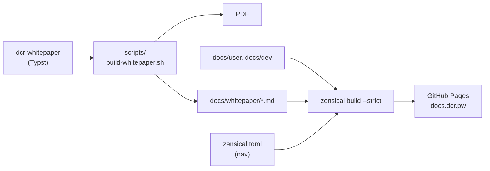

# Contribute to these docs

This guide shows how to change a page on this site, preview it, rebuild the whitepaper pages from their Typst source, and check facts the way every page here is checked. It is for anyone fixing a typo or writing a new page.

!!! info "Applies to"
    Zensical 0.1.2 (pinned in `uv.lock`), Typst 0.15.1 (pinned in `.typst-version`) and the `master` branches of jzbz/dcr-docs and jzbz/dcr-whitepaper. Checked November 2026.

## Before you start

- **For a small fix:** a GitHub account. Nothing to install.
- **For a local preview:** Git and [uv](https://docs.astral.sh/uv/), which installs the pinned Zensical into the repository's `.venv`.
- **For a full build:** the whitepaper pages, which user and developer pages link into. Building them needs Bash 4 or later (macOS ships 3.2, so install a newer bash; on Windows use WSL), [Typst](https://typst.app/) at exactly the version in `.typst-version`, GNU `patch`, and a clone of the whitepaper repository.

## Report a problem

If you find an error but cannot fix it, open an issue at [jzbz/dcr-docs](https://github.com/jzbz/dcr-docs/issues), or at [jzbz/dcr-whitepaper](https://github.com/jzbz/dcr-whitepaper/issues) for the whitepaper. Name the page, quote the wrong text, and link the code or source that shows the right value.

## Fix a page from your browser

Every page has an **Edit this page** button at the top, a document-and-pen icon. It opens the page's Markdown file from the `master` branch of [jzbz/dcr-docs](https://github.com/jzbz/dcr-docs) in GitHub's editor, which saves your change to a branch of your own fork and lets you open a pull request from it.

Continuous integration (CI) builds every pull request with the strict build that deploys the site and keeps the result for 7 days as an artifact named `site-pr-<NUMBER>`, so reviewers can see the change as it will look.

!!! note "Not for whitepaper pages"
    Whitepaper pages are generated, so their **Edit this page** link leads to a file that does not exist. Change the Typst source instead, as described in [Change the whitepaper](#5-change-the-whitepaper).

## How the site is built

Everything except the whitepaper is Markdown in this repository. The whitepaper is Typst in its own repository, which a script turns into web pages and a Portable Document Format (PDF) file. One strict build makes both into the site:



| Path | Contents | Edit it? |
| --- | --- | --- |
| `docs/user/`, `docs/dev/`, `docs/index.md` | User and developer docs, one folder per sidebar group; the home page | Yes |
| `docs/whitepaper/` | Whitepaper pages and PDF | No: generated, ignored by Git |
| `zensical.toml` | Site settings, Markdown extensions and navigation | When you add or move a page |
| `scripts/` | The whitepaper build: `build-whitepaper.sh`, `html2zensical.py`, `whitepaper-web.patch` | When the whitepaper's template changes |

The other files pin tool versions, style pages and run CI, and rarely change.

## 1. Build and preview locally

Clone both repositories side by side, install Zensical, build the whitepaper pages and start the preview server:

```bash
git clone https://github.com/jzbz/dcr-docs.git
git clone https://github.com/jzbz/dcr-whitepaper.git
cd dcr-docs
uv sync --locked
scripts/build-whitepaper.sh
uv run zensical serve
```

The whitepaper script looks for its source in `$WHITEPAPER_SRC`, then `whitepaper/` inside this repository, then `../dcr-whitepaper`. It prints the commit it built and Typst warnings that HyperText Markup Language (HTML) export is incomplete and that `h` and `align` "was ignored during HTML export". Those are expected: web pages need no page-layout calls. A new kind of warning may mean content is missing. The last line is `html2zensical: wrote 24 pages to` and the path of `docs/whitepaper`.

Open <http://localhost:8000/>. The server rebuilds when you save a file and prints broken links, but keeps serving. Before you open a pull request, run the build CI runs, which fails on any problem:

```bash
uv run zensical build --strict
```

```text title="Expected output"
Build started
No issues found
```

A last line gives the build time. The build fails on a link to a missing page or heading anchor, and on front matter that does not parse. It writes the site to `site/`, which Git ignores.

## 2. Add or change a page

1. **Find the page that owns the topic.** Each concept has one canonical page. Extend it, or summarize in at most two sentences and link to it.
2. **Create the file** in its group's folder, with a lowercase, hyphenated name.
3. **Start it with front matter and an H1:**

    ```markdown
    ---
    description: "One plain sentence, at most 160 characters: what the reader gets from this page."
    ---

    # Page title
    ```

    The description becomes the page's meta description. Quote it if it contains a colon.

4. **Add the page to `nav` in `zensical.toml`**, under its group. Entries are bare paths, so the sidebar label is the page's H1:

    ```toml
    { "Contributing" = [
      "dev/contributing/index.md",
      "dev/contributing/docs.md",
    ] },
    ```

    A page missing from `nav` builds without a warning, but no sidebar link leads to it.

5. **Run `uv run zensical build --strict`** and open a pull request. Without write access to jzbz/dcr-docs, fork it on GitHub, push your branch to the fork and open the pull request from there:

    ```bash
    git remote add fork https://github.com/<YOUR-USER>/dcr-docs.git
    git push fork <BRANCH>
    ```

    `<YOUR-USER>` is your GitHub user name and `<BRANCH>` the branch holding your change. The same applies to jzbz/dcr-whitepaper.

## 3. Follow the writing rules

### Voice

- **User pages** are for holders, stakers, voters and traders, many of them not programmers. Commands go only in **Command line** tabs and command-line pages; explain every term or link the [glossary](../../user/reference/glossary.md).
- **Developer pages** assume programming, not Decred, experience. Name parameters, remote procedure calls (RPCs), packages and files exactly, and link the whitepaper for consensus rules.
- **Both:** plain, calm, precise American English. "You" and the imperative; never "we", "our" or "I"; no hype, price talk or investment advice. Say plainly what is risky or cannot be undone.

### Page kinds

- **How-to:** an **Applies to** box, **Before you start**, one action per step, **Check that it worked** and **Troubleshooting**.
- **Explainer:** what it is, why it exists, how it works (a diagram or worked example), costs and risks, and **Go deeper** with whitepaper links.
- **Tutorials, references, FAQs and landing pages:** copy the structure of an existing page of the same kind.

Every page ends with `## Next steps` (two to five links, the natural next task first), then one line per abbreviation it uses: `*[VSP]: voting service provider`. Spell each one out at first use in the text as well.

### Markdown

| Feature | Rule |
| --- | --- |
| Content tabs | Exactly `=== "Decrediton"`, `=== "Bison Wallet"`, `=== "Command line"`, in that order, or `Windows`, `macOS`, `Linux`. Tabs are linked across pages, so other labels break the reader's saved choice |
| User interface (UI) labels | Bold, exactly as in the app's source strings, `>` between levels: **Governance** > **Treasury Spending** |
| Admonitions | `note`, `tip`, `warning` (time, money or privacy at risk), `danger` (irreversible loss); `info` only for **Applies to**. About one per screen; never collapse safety information |
| Code blocks | Name the language; no `$` prompts; output in a separate `text` block titled "Expected output"; explain placeholders such as `<ADDRESS>` right after; mainnet by default; never a passphrase on a command line |
| Inline code | Commands, flags, RPCs, file names, config keys, agenda ids. Not UI labels |
| Mermaid | About 12 nodes at most, no colors, after a sentence that states its point |
| Images | None. Describe the UI path in text |
| Live figures | Never hard-code ticket price, rewards, pool size, fees or chain size; say where to read them (dcrdata, the wallet, `dcrctl`) and label examples as examples |

### Terminology

| Write | Not |
| --- | --- |
| DCR, uppercase, with a space: "2.5 DCR" | dcr, DCRs |
| buy a ticket | purchase stake |
| ticket price (introduced once as "also called stake difficulty") | |
| voting service provider (VSP) | stakepool, stake pool |
| StakeShuffle; mixing; mixed account | CSPP or CoinShuffle++, except in history and developer contexts |
| treasury spend (TSPEND) at first use | tspend, outside RPC names and code |
| Bison Wallet (the app); DCRDEX (protocol and servers) | DEX before first use |
| light wallet, with "SPV" (simplified payment verification) in parentheses at first use | |
| private passphrase, public passphrase | password, for `dcrwallet` secrets |
| disapprove (the stakeholder block vote) | reject, invalidate |
| mainnet, testnet, simnet, regnet; Decred Change Proposals (DCPs) as DCP-0013 | Mainnet, DCP 13 |

Retired features (stakepools, the CSPP mixing server, manual revocation, ticket fees, `getblocktemplate`, the 60/30/10 split) appear only on [What changed](../../user/reference/whats-changed.md), the glossary's retired terms and one-line "formerly" notes.

## 4. Link pages and the whitepaper

**Between pages,** use the relative path to the `.md` file, optionally with a heading anchor: `[Voting service providers](../../user/staking/vsps.md)`. Never use absolute `docs.dcr.pw` URLs for internal pages, and never link docs.decred.org or devdocs.decred.org, which this site replaces. Code-level claims link GitHub at the release tag (`.../tree/release-v2.1.7/...`).

**To the whitepaper,** link the chapter page plus a stable id. Ids come from the Typst labels, so they survive renumbering; section numbers do not. Name the topic in the link text, not the number:

```markdown
The five tickets that vote on each block are chosen by the [ticket lottery](../../whitepaper/08-staking.md#sec:staking-lottery).
```

| Your page | Path to the whitepaper |
| --- | --- |
| `docs/index.md` | `whitepaper/` |
| `docs/user/index.md`, `docs/dev/index.md` | `../whitepaper/` |
| Any page in a group folder, such as `docs/dev/contributing/` | `../../whitepaper/` |

Use chapter (`ch:`), section (`sec:`) and convention (`conv:`) ids. To find one, search the generated headings:

```bash
grep -n -i '^#.*lottery' docs/whitepaper/*.md
```

```text title="Example output"
docs/whitepaper/08-staking.md:356:## 8&#46;7 The Lottery { #sec:staking-lottery }
```

Page names come from chapter labels, not Typst file names: `chapters/01-introduction.typ` (label `ch:intro`) becomes `01-intro.md`.

## 5. Change the whitepaper

The whitepaper is never edited in this repository or converted to Markdown by hand.

1. **Edit the Typst source** in [jzbz/dcr-whitepaper](https://github.com/jzbz/dcr-whitepaper) and open a pull request there. Its README explains the helpers (`#rule`, `#param`, `#dcp` and others). Rules are taken from the `dcrd` source, not from comments or other documentation.
2. **Rebuild the pages** with `scripts/build-whitepaper.sh` in this repository, then run the strict build. If you renamed a label, find the links that used the old one: `grep -rn '#<OLD-LABEL>' docs/user docs/dev`, where `<OLD-LABEL>` is the whole old label, such as `sec:staking-lottery`.
3. **Publish.** CI always builds the tip of the whitepaper's default branch, so a merged whitepaper change reaches the site at the next deployment: the next push to `master` here, or a manual run of the `docs` workflow.

!!! warning
    CI builds every pull request and deployment here against the whitepaper's tip. A whitepaper merge that renames or removes a label this site links to, or that stops `scripts/whitepaper-web.patch` from applying, fails every build of this site until it is fixed here. Prepare the matching pull request in this repository (updated links or a refreshed patch) before the whitepaper change is merged. Its checks can fail until the whitepaper change is in; then re-run them and merge it straight away.

The script stops rather than publish a damaged whitepaper:

| Message | Cause and fix |
| --- | --- |
| `typst X found, but .typst-version says 0.15.1` | Install that Typst version. Typst's HTML export is experimental, so `.typst-version` changes only after the pages are checked with the new release |
| `scripts/whitepaper-web.patch does not apply to ...` | The whitepaper changed a file the patch edits: `template.typ`, `chapters/14-parameters.typ` or `chapters/A2-rule-index.typ`. Refresh the patch (below) |
| `the web build and the PDF build disagree (PDF, web): ...` | The web pages have a different number of rules, algorithms, tables, figures, numbered equations or chapters than the PDF, usually from a new construct the patch's HTML branch does not handle |
| `N links have no target, e.g. ...` | A cross-reference points at a label that does not exist |
| `the whitepaper pages in .../zensical.toml are not the pages just written.` | A chapter was added, removed or relabeled. Paste the `"Whitepaper"` nav entry the message prints into `zensical.toml` |

### Refresh the web patch

The patch gives the whitepaper's template an HTML branch. To carry it over to a changed template, apply it with conflict markers in a clean whitepaper checkout, resolve them, and write the new diff back. First check the checkout:

```bash
cd ../dcr-whitepaper
git status --short
```

This must print nothing. Commit or set aside any changes before you go on, and update the checkout to the tip of the default branch with `git pull`, since CI builds that tip. Then apply the patch:

```bash
patch -p1 --merge < ../dcr-docs/scripts/whitepaper-web.patch
```

In each file `patch` reports as `NOT MERGED`, edit the block between `<<<<<<<` and `>>>>>>>` so it keeps both the whitepaper's change and the patch's lines. Then:

```bash
git diff > ../dcr-docs/scripts/whitepaper-web.patch
git restore .
find . -name '*.orig' -not -path './.git/*' -delete
cd ../dcr-docs && scripts/build-whitepaper.sh
```

!!! warning
    `git restore .` discards every uncommitted change in the whitepaper checkout. That is why it must be clean before you start.

## 6. Verify every fact

Check every number, flag, config key, RPC name, UI label, default, port, path and date against the code at the release tag the page describes, or against the whitepaper. Where the two disagree, [`dcrd` is the reference](../../whitepaper/02-conventions.md#conv:reference). Old guides, forum posts and the legacy docs are leads, not sources; many of their claims are wrong today.

Use **release tags, not `master`**: `dcrd` and `dcrwallet` `master` report 2.2.0-pre, and `dcrdex` `master` holds unreleased Bison Wallet 1.1 features. The [Developer docs](../index.md) page lists the versions this site covers.

| To check | Look in |
| --- | --- |
| Network parameters | `dcrd` `chaincfg/mainnetparams.go` at `release-v2.1.7`; consensus rules in the whitepaper |
| `dcrd` options and RPCs | `config.go`, `internal/rpcserver/rpcserver.go`, `docs/json_rpc_api.mediawiki` |
| `dcrwallet` options and RPCs | `config.go`, `internal/rpc/jsonrpc/methods.go`, `internal/rpchelp/helpdescs_en_US.go`, `rpc/api.proto` at `release-v2.1.7` |
| Decrediton labels | `app/i18n/translations/original.json` at `release-v2.1.7` |
| Bison Wallet labels | `client/webserver/locales/en-us.go` in `dcrdex` at `v1.0.6` |
| `vspd` | `internal/vspd/config.go`, `docs/api.md` at `release-v1.5.0` |

**Example:** check that `vsp.maxfee` defaults to 0.2 DCR. Clone the tag in a directory outside the docs repository and search the option:

```bash
git clone --quiet --depth 1 --branch release-v2.1.7 https://github.com/decred/dcrwallet.git dcrwallet-2.1.7
grep -n 'namespace:"vsp"\|long:"maxfee"\|defaultVSPMaxFee' dcrwallet-2.1.7/config.go
```

```text title="Expected output"
63:	defaultVSPMaxFee               = dcrutil.Amount(0.2e8)
183:	VSPOpts vspOptions `group:"VSP Options" namespace:"vsp"`
196:	MaxFee *cfgutil.AmountFlag `long:"maxfee" description:"Maximum VSP fee"`
387:			MaxFee: cfgutil.NewAmountFlag(defaultVSPMaxFee),
```

0.2e8 atoms is 0.2 DCR, and the `vsp` namespace gives the option its `vsp.` prefix. Say what kind of number it is, too: a wallet default the user can change, not a consensus rule. Consensus rules link to their whitepaper section.

**Date what you checked:**

- Every how-to and tutorial has the **Applies to** box right after its introduction, naming the versions and the month: "Checked November 2026". Update both when you re-check a page against a new release, and never move the date without re-checking.
- Name versions or years, never "new" or "recently". Cite third-party software from the vendor's current documentation, with a last-checked date.
- If you cannot verify a fact, leave it out, or keep it with an `<!-- UNVERIFIED: what and why -->` comment and say so in the pull request.

## Check that it worked

- `uv run zensical build --strict` prints `No issues found`.
- In the preview, the page sits under its group in the sidebar, content tabs switch together across pages, diagrams render, and whitepaper links land on the right heading.
- Every CI check on the pull request is green.

## Troubleshooting

### Warning: page does not exist

The relative path is wrong (one `../` per folder level up from your page), or the whitepaper pages have not been built. Run `scripts/build-whitepaper.sh` and build again.

### Warning: anchor does not exist

The heading or whitepaper id is misspelled, or a whitepaper label was renamed. Search the generated pages for the right id, as in [Link pages and the whitepaper](#4-link-pages-and-the-whitepaper).

### error reading page metadata

The front matter does not parse, usually because of an unquoted colon in `description`. Put the value in double quotes.

### The new page builds but is not in the sidebar

Add its path to `nav` in `zensical.toml`.

### A merged whitepaper change is not on the site

The site rebuilds only on a push to `master` here or a manual workflow run. Ask a maintainer to run the `docs` workflow.

## Next steps

- [Contributing to Decred software](index.md): conventions, review and testing for code changes.
- [What changed: Coming back to Decred](../../user/reference/whats-changed.md): retired features and numbers that must not come back.
- [Glossary](../../user/reference/glossary.md): the terms pages should use, and the retired ones.
- [Decred whitepaper](../../whitepaper/index.md): the specification developer pages link to.

*[CI]: continuous integration
*[DCP]: Decred Change Proposal
*[DCPs]: Decred Change Proposals
*[HTML]: HyperText Markup Language
*[PDF]: Portable Document Format
*[RPC]: remote procedure call
*[RPCs]: remote procedure calls
*[SPV]: simplified payment verification
*[TSPEND]: treasury spend
*[UI]: user interface
*[VSP]: voting service provider
