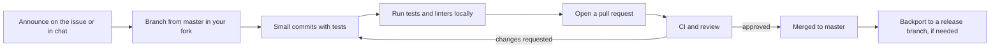

# Contributing to Decred software

This guide takes a new contributor from a first look to a merged pull request in a Decred repository, and covers vulnerability reports and paid work.

!!! info "Applies to"
    The `master` branches of `dcrd`, `dcrwallet`, Decrediton, `dcrdex` (Bison Wallet), `vspd` and `dcrlnd`, where new work lands. Checked November 2026.

## Before you start

- **A GitHub account and Git.** All Decred code lives under [github.com/decred](https://github.com/decred).
- **A working build of the repository you want to change.** [Build from source](../environment/build-from-source.md) lists the toolchains each repository needs.
- **`golangci-lint`** for Go repositories, at the version the repository's continuous integration (CI) workflow pins.
- **A private network to test on:** [Set up a private simnet](../environment/simnet.md). Never test unreleased code against mainnet funds.
- For Go, [Effective Go](https://go.dev/doc/effective_go): `dcrd`'s guidelines make following it a condition of acceptance.

## How the project is organized

No company owns Decred or directs its development, and there is no central issue queue. Each program has its own repository and maintainers, who review and merge changes. Regular contributors work as contractors under treasury budgets that ticket holders approve (see [Get paid](#get-paid)). Conventions are shared but not identical, so read the guide of the repository you work in:

| Repository | What it is | Language | Conventions to read |
| --- | --- | --- | --- |
| [dcrd](https://github.com/decred/dcrd) | Full node and the Go library modules | Go | [`docs/code_contribution_guidelines.md`](https://github.com/decred/dcrd/blob/master/docs/code_contribution_guidelines.md), the pull request template |
| [dcrwallet](https://github.com/decred/dcrwallet) | Wallet daemon | Go | No separate guide; code and commits largely follow `dcrd`'s conventions |
| [decrediton](https://github.com/decred/decrediton) | Desktop wallet | JavaScript (React, Electron), yarn | README "Development Setup", [`app/i18n/README.md`](https://github.com/decred/decrediton/blob/master/app/i18n/README.md) |
| [dcrdex](https://github.com/decred/dcrdex) | Bison Wallet and the DCRDEX server | Go and TypeScript | [`docs/wiki/Contribution-Guide.md`](https://github.com/decred/dcrdex/blob/master/docs/wiki/Contribution-Guide.md) |
| [vspd](https://github.com/decred/vspd) | Voting service provider (VSP) server | Go | README; no separate guide |
| [dcrlnd](https://github.com/decred/dcrlnd) | Lightning node, a fork of `lnd` | Go | [`docs/code_contribution_guidelines.md`](https://github.com/decred/dcrlnd/blob/master/docs/code_contribution_guidelines.md) |

[The Decred software stack](../start/software-stack.md) describes the other repositories. If you will work on `dcrd` or `dcrwallet`, read [A tour of the dcrd and dcrwallet code](codebase-tour.md) next.

## The path of a contribution



## 1. Find a task and say so first

Good first contributions:

- **Reproduce a reported bug,** then fix it with a test that fails before your change.
- **Add tests** for error paths that lack them. Coverage is a stated goal for every core `dcrd` package.
- **Review open pull requests.** Anyone can comment, and reading reviews teaches the conventions fastest.
- **Translate** Decrediton or Bison Wallet (see [Translations and front-end work](#translations-and-front-end-work)), or **improve these docs** ([Contribute to these docs](docs.md)).

Labels help little: in November 2026 only two open issues across the six repositories carried `good first issue` or `help wanted` (one in Decrediton, one in `dcrdex`).

**Announce your plan before you write code.** `dcrd`'s guidelines call this "share early, share often": it avoids duplicate work and catches designs that will not fit the architecture. Comment on the issue, or ask in `#dev` on Decred's Matrix server, [chat.decred.org](https://chat.decred.org/); `dcrdex` work is coordinated in the DEX Development room linked from its guide. [Get help and join the community](../../user/reference/index.md) lists the official channels.

A change to consensus rules needs a Decred Change Proposal (DCP) and a stakeholder vote before any code can activate: see [Consensus changes](consensus-changes.md).

## 2. Fork and branch

Fork the repository on GitHub, then:

```bash
git clone https://github.com/<YOUR-USER>/dcrd
cd dcrd
git remote add upstream https://github.com/decred/dcrd
git fetch upstream
git switch -c <BRANCH> --no-track upstream/master
```

`<YOUR-USER>` is your GitHub user name and `<BRANCH>` a short name for the work. `--no-track` stops the branch from tracking `upstream/master`, so it can track your fork once pushed. Base new work on `master`: release branches such as `release-v2.1` take only backports.

## 3. Write code reviewers will accept

**Go, as in `dcrd` and the repositories that follow it:**

- Format with `gofmt` (CI also checks `goimports`), and wrap at about 80 columns, counting a tab as 4.
- Comment every function with its purpose and assumptions, in complete sentences starting with its name. Comments in the body explain intent, not what the line visibly does.
- Give new log statements a fitting subsystem and level, and keep the code building with the latest Go release and the one before it.
- **Breaking a module's application programming interface (API)** means, in the same pull request: bump the major version in that module's `go.mod`, add a `replace` in the main module's `go.mod`, and update every import in the repository. [dcrd Go modules](../go/index.md) explains the versioning.

`dcrdex`'s Contribution Guide adds its own rules on comment and line widths, zero-value declarations and error strings.

**JavaScript and TypeScript:** Decrediton enforces ESLint, stylelint and Prettier (`yarn lint`, `yarn prettify:diff`). Never hard-code user interface (UI) text: use react-intl's `FormattedMessage` (imported as `T`) with a unique `id` and an English default, as in `<T id="send.title" m="Send Funds" />`. Bison Wallet's web UI in `client/webserver/site` is checked with `npm run lint` and `npm run build`.

## 4. Test it

The rule in `dcrd`'s guidelines applies everywhere: new code comes with tests for valid and invalid input, and a bug fix comes with a test that triggers the bug. A non-trivial change without them will probably be rejected.

### Unit tests and test vectors

Unit tests sit next to the code (`*_test.go`). Several `dcrd` packages also check fixed vectors that encode consensus behavior:

| Vectors | Location in `dcrd` |
| --- | --- |
| Script execution, transaction validity, signature hashes | `txscript/testdata/`: `script_tests.json`, `tx_valid.json`, `tx_invalid.json`, `sighash.json` |
| ASERT proof-of-work difficulty | `blockchain/standalone/testdata/asert_test_vectors.json` |
| Full blocks that exercise the consensus validation rules | `blockchain/fullblocktests` |

The [whitepaper's test vectors](../../whitepaper/02-conventions.md#conv:vectors) were all produced by running `dcrd`. If your change alters a result that a vector for a consensus rule checks, you have changed consensus, and the change belongs in [Consensus changes](consensus-changes.md). The vectors in the [peer-to-peer](../../whitepaper/15-p2p.md#ch:p2p), [relay policy](../../whitepaper/17-policy.md#ch:policy) and [mixing](../../whitepaper/18-mixing.md#ch:mixing) chapters describe node behavior, not consensus rules.

For a coverage report, run `go test -coverprofile=cov.out` in the package directory, then `go tool cover -html=cov.out`.

### Integration tests in dcrd

`internal/integration/rpctests` starts real `dcrd` processes, compiled from your working tree by the `dcrdtest` harness: `TestRpcServer` on regnet, and `TestTreasury` on simnet with a voting wallet, exercising treasury spends and their votes. The files carry the `rpctest` build tag, so neither `go test ./...` nor `run_tests.sh` runs them; run them after touching remote procedure call (RPC), mining or treasury code, from inside your `dcrd` checkout with Go on `PATH`:

```bash
go test -tags rpctest ./internal/integration/rpctests/
```

`dcrlnd` has its own suites, `make unit` and `make itest`, which first install the `dcrd` and `dcrwallet` commits pinned in its `Makefile`.

### Simnet harnesses and Decrediton tests

For end-to-end checks with nodes, wallets, tickets and votes, `dcrd`, `dcrdex`, `vspd` and `dcrpool` ship tmux harnesses. [Set up a private simnet](../environment/simnet.md) covers them; [Building on DCRDEX](../integrate/dcrdex.md) covers the multi-asset DEX harness, whose tests carry the `harness` build tag.

In Decrediton, `yarn test` runs the Jest suites in `test/unit`.

### Fuzzing

`dcrdex` uses Go's native fuzzing, with targets such as `FuzzDecrypt` in `dex/encrypt`. `go test -fuzz` takes one target in one package:

```bash
go test ./dex/encrypt -run '^$' -fuzz '^FuzzDecrypt$' -fuzztime 60s
```

A failing input is saved under `testdata/fuzz/FuzzDecrypt/` in the package directory and replayed by every later `go test`; commit it with the fix. The [fuzzing guide](https://github.com/decred/dcrdex/blob/master/docs/wiki/Getting-Started-With-Fuzzing.md) shows how to write a target. `dcrlnd` keeps the `go-fuzz` harnesses inherited from `lnd` (`make fuzz-build pkg=lnwire`, then `make fuzz-run pkg=lnwire run_time=300`). A crash that could affect funds is a security report, not a public issue.

### Run what CI runs

CI runs each repository's test script and linters on every pull request; [Build from source](../environment/build-from-source.md) lists the commands, so run them before you push. CI adds a few checks of its own, among them `yarn build` and `yarn i18n-check-dupes` (duplicate message ids) in Decrediton and a Markdown lint in `dcrdex`.

## 5. Write commit messages

Commit messages are the permanent record: `dcrd` "deliberately avoids relying on GitHub to store information permanently". The model:

```text
mempool: Reject votes too far in the future

Explain what changed and why, wrapped at about 72 columns.
Describe the problem the commit solves and any non-obvious
consequences, so the message makes sense without the pull request.

- Bullet points are fine, with a hanging indent.
```

- **Subject:** `prefix: Summary`, at most 50 characters, in the imperative ("Fix", not "Fixed"), followed by a blank line.
- **Prefix:** the package name (`blockchain:`, `rpcserver:`, `stake:`); the component name for the main package; `multi:` when a commit must touch several packages to build.
- **No links to issues or pull requests** in commit messages; they go in the pull request description.
- **Small, self-contained commits** that each build and pass tests: a refactor in one commit, the behavior change in the next.
- **Backports** prefix the title and every commit with the release branch and name the original pull request: `[release-v2.1] mempool: Reject votes too far in the future`.

`dcrdex` uses the same prefixes and adds the pull request number at merge, as in `ui: Fix wallet disable/enable targeting wrong wallet. (#3586)`.

## 6. Open the pull request

1. Rebase on the latest `master` and push the branch to your fork:

    ```bash
    git fetch upstream && git rebase upstream/master
    git push -u origin <BRANCH>
    ```

    After rebasing a branch you have already pushed, use `git push --force-with-lease origin <BRANCH>`.

2. Open the pull request against `master`, as a **draft** if it is not ready for review.
3. In the description, say what the change does and why, and link the issues and discussions it relates to. In `dcrd` and `dcrlnd`, complete the template's checklist.
4. Keep one logical change per pull request.

Make revisions visible on their own. In `dcrdex`, add commits, which are squashed at merge, or force-push a squashed branch without moving its merge base. `dcrd` rebases accepted work and fast-forwards `master`, so rebase rather than merge `master` into your branch.

## 7. Review

Maintainers review every change, joined by contributors who know the area. They check that the code follows the guidelines, raises no stability or security concerns, uses existing APIs properly, fits the architecture, and is not something community consensus considers inappropriate.

Small changes are usually reviewed within days; large ones can take weeks, and one monolithic commit across subsystems waits longest. If a pull request sits unreviewed with CI green, ask in chat.

## Report security vulnerabilities privately

Never put an exploitable flaw in a public issue, commit or pull request, including a "fix" whose diff reveals the bug.

- The `SECURITY.md` of `dcrd`, `dcrwallet`, Decrediton and `dcrlnd` sends reports to the treasury-funded [Decred bug bounty](https://bounty.decred.org/), which takes submissions through bug-report.decred.org. `vspd` has no `SECURITY.md` but is also in the bounty's scope; report its flaws the same way.
- The bug must reproduce on the latest production release or on `master`. Public disclosure without the program's approval forfeits the reward.
- Scope, deposit and rewards change: [Get help and join the community](../../user/reference/index.md) summarizes the scope, and the bounty site has the deposit, the rewards and the full rules. `dcrdex` left the scope in August 2026 and has no `SECURITY.md`; for it and other out-of-scope software, open an issue asking a maintainer for a private channel, without details.

Release 2.1.6 shows how such fixes ship: its notes described the vulnerability only as a "Critical consensus-related security fix", listed the changes as `[release-v2.1]` commits, and made the upgrade mandatory.

## Licensing

Contributions take the license of the repository; `dcrd`'s guidelines state that all contributions must be ISC-licensed. `dcrd`, `dcrwallet`, `dcrctl`, Decrediton, `vspd`, `dcrdata`, `politeia` and `dcrpool` use ISC; `dcrdex` uses the Blue Oak Model License 1.0.0; `dcrlnd` keeps the MIT license of `lnd`; `gominer` uses the GNU GPL version 3.

## Translations and front-end work

- **Decrediton** accepts translations only from well-known community members; translation work is announced in the `#translations:decred.org` room on chat.decred.org. The [community translators guide](https://github.com/decred/decrediton/blob/master/app/i18n/community_translators.md) walks through editing the files in `app/i18n/translations` and checking them with **View** > **Load Custom Translation**.
- **Bison Wallet** keeps HTML strings in `client/webserver/locales`, notifications in `client/core/locale_ntfn.go` and JavaScript strings in `client/webserver/site/src/js/locales.ts`; rebuild the web assets to test. The [localization guide](https://github.com/decred/dcrdex/blob/master/docs/wiki/Localization-and-Translation.md) has the details.

## Get paid

Paid work comes from the [treasury](../../user/governance/treasury.md). Ticket holders approve budgets in [Politeia proposals](../../user/governance/politeia.md), contractors bill against them, and each payment is a treasury spend that ticket holders also vote on.

- **Join existing work.** Teams with approved budgets take on contributors who have shown they can deliver; `dcrdex`'s guide expects newcomers to take smaller jobs first.
- **Propose your own:** [Write a Politeia proposal](../../user/governance/write-a-proposal.md) covers budgets, the vote and payment.
- **Report vulnerabilities.** The bug bounty pays accepted reports on in-scope software in DCR.

The contractor management system older guides describe (cms.decred.org) no longer operates; ask in the community channels how invoicing works before you start billable work.

## Check that it worked

- Every CI check on the pull request is green, and the template's checklist is complete.
- A maintainer has approved the change, and your commits appear on `master`. In `dcrd`, they keep the messages you wrote.

## Troubleshooting

### golangci-lint passes locally but fails in CI

Your linter version differs from CI's. Install the version pinned in the repository's `.github/workflows` file (for `dcrd` `master`, `go install github.com/golangci/golangci-lint/v2/cmd/golangci-lint@v2.13.1`) and run it from each module directory.

### dcrdex: go.mod and/or go.sum modified

With Go 1.25, `run_tests.sh` runs `go mod tidy` and fails if that changes `go.mod` or `go.sum`. Run `go mod tidy` in the module it names and commit the result.

## Next steps

- [A tour of the dcrd and dcrwallet code](codebase-tour.md): find your way around the node and wallet before a first change.
- [Set up a private simnet](../environment/simnet.md): test the change on a network you control.
- [Consensus changes](consensus-changes.md): the DCP and agenda process for rule changes.
- [Releases and reproducible builds](releases.md): how merged work becomes a signed release.
- [Contribute to these docs](docs.md): fix or extend this site.

*[CI]: continuous integration
*[DCP]: Decred Change Proposal
*[DEX]: decentralized exchange
*[VSP]: voting service provider
*[RPC]: remote procedure call
*[UI]: user interface
*[API]: application programming interface
