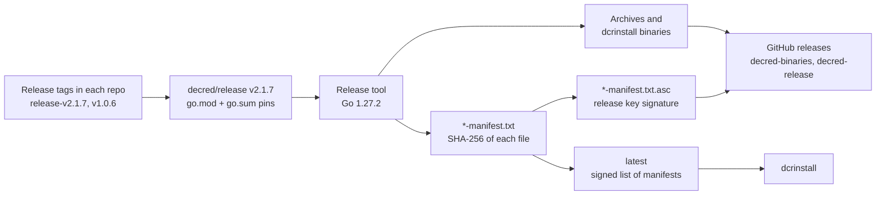

# Releases and reproducible builds

This page explains how a Decred release goes from tagged source to signed downloads, and shows how to rebuild the official command-line and Bison Wallet archives yourself and check that they match the signed manifest byte for byte. It is for contributors, packagers, auditors and anyone who wants evidence that the published files were built from the published source.

!!! info "Applies to"
    The `decred/release` tool at tag `v2.1.7`, which builds the Decred v2.1.7 command-line suite, Bison Wallet 1.0.6 and dcrinstall v2.1.7, with Go 1.27.2. Checked November 2026.

To rebuild a release now, skip to [Reproduce a release](#reproduce-a-release).

## Why reproducible builds matter

Reading the source says nothing about a binary someone else compiled unless the binary provably came from that source. A build is reproducible when anyone who builds the same source with the same toolchain gets exactly the same bytes, so the SHA-256 hashes match. That gives two independent checks:

- **The signature** on a manifest proves that the Decred release key vouches for the listed hashes ([Verify your download](../../user/security/verify-downloads.md) covers it for end users).
- **A rebuild** proves that those hashes belong to files built from the tagged source, without trusting whoever holds the release key.

A matching rebuild does not prove the source is free of bugs or backdoors. It proves the binaries contain nothing the source does not.

## How a release is built

The pipeline has one source of truth for what goes into a release: the `go.mod` and `go.sum` files in the [decred/release](https://github.com/decred/release/tree/v2.1.7) repository. Everything after that is mechanical, so anyone can repeat it.



### Branches and tags

Each program is released from a branch named after its minor version and tagged with the full version. On the release branch, the version variable loses its pre-release part and gets the build metadata `release.local` (for example `2.1.7+release.local` in dcrd's `internal/version/version.go`), while `master` moves on to the next version with the pre-release `pre`. A source build therefore never claims to be an official build: only the release tool sets the metadata to `release`.

| Repository | Release branch | Release tag | Go module version at the same commit |
|---|---|---|---|
| dcrd | `release-v2.1` | `release-v2.1.7` | `github.com/decred/dcrd` `v1.10.9` |
| dcrwallet | `release-v2.1` | `release-v2.1.7` | `decred.org/dcrwallet/v5` `v5.1.2` |
| dcrctl | `release-v2.1` | `release-v2.1.7` | none; built as pseudo-version `v0.0.0-20261013195250-d653f9b2f5c9` |
| Decrediton | none for 2.1 (tagged on `master`) | `release-v2.1.7` | — |
| dcrdex (Bison Wallet) | `release-v1.0` | `v1.0.6` | `decred.org/dcrdex` `v1.0.6` (the release tool pins `v1.0.5`; see below) |
| vspd | `release-v1.5` | `release-v1.5.0` | — |
| decred/release | `master` | `v2.1.7` | — |

The release tool builds Go modules, not git checkouts. The last column is the module version at the release tag; the version the tool fetches is pinned in decred/release and is the same except for dcrdex. For dcrd and dcrwallet the release tag and the module tag point at the same commit. The per-repository GitHub release pages (dcrd, dcrwallet, Decrediton, vspd) carry release notes only. The dcrd, dcrwallet, dcrctl, Decrediton and Bison Wallet binaries are published as listed under [Manifests, signatures and where files are published](#manifests-signatures-and-where-files-are-published). vspd has no official binaries: like dcrdata and dcrpool, operators [build it from source](../environment/build-from-source.md).

### Release notes

dcrd writes its notes from two templates, [`docs/release_notes_template_major.md`](https://github.com/decred/dcrd/blob/release-v2.1.7/docs/release_notes_template_major.md) for X.Y.0 releases (with consensus votes and any "Upgrade Required" warning) and [`docs/release_notes_template_patch.md`](https://github.com/decred/dcrd/blob/release-v2.1.7/docs/release_notes_template_patch.md) for patch releases, and the combined dcrd and dcrwallet notes form the body of the decred-binaries release. dcrdex keeps its notes in `docs/release-notes/` and a [release checklist](https://github.com/decred/dcrdex/blob/master/docs/RELEASE-CHECKLIST.md) on `master`; whether a release is mandatory is stated in its notes ([Upgrading and mandatory releases](../../user/run/upgrades.md)).

### The release tool

[`main.go`](https://github.com/decred/release/blob/v2.1.7/main.go) in decred/release is a single Go program. Each program it builds has its own subdirectory with a `go.mod` that names the program under a `tool` directive and pins every dependency, and a `go.sum` that pins each module's content hash. Preparing a release is a commit to this repository ("Prepare v2.1.7") that bumps the version constants in `main.go` and the module versions in those `go.mod` files, followed by the tag.

The tool builds four distributions ("dists"):

| Dist | Version | Contents | Output |
|---|---|---|---|
| `decred` | v2.1.7 | `dcrctl`, `dcrwallet`, `dcrd`, `gencerts`, `promptsecret`, `dcrlnd`, `dcrlncli`, `politeiaverify`, `politeiavoter`, plus `sample-dcrwallet.conf`, `sample-dcrd.conf`, `sample-dcrctl.conf`, `sample-dcrlnd.conf`, `sample-politeiavoter.conf` | `decred-<os>-<arch>-v2.1.7.tar.gz` (`.zip` on Windows) |
| `bisonwallet` | v1.0.6 | `bisonw`, `bwctl` | `bisonwallet-<os>-<arch>-v1.0.6.tar.gz` (`.zip` on Windows) |
| `dcrinstall` | v2.1.7 | `dcrinstall`, as plain executables | `dcrinstall-<os>-<arch>-v2.1.7` (`.exe` on Windows) |
| `dcrinstall-manifests` | v2.1.7 | no build: a list of the three manifests above with their hashes | `dist/dcrinstall-v2.1.7-manifests.txt` |

Each dist except the last is built for 13 targets: `darwin/amd64`, `darwin/arm64`, `freebsd/amd64`, `linux/386`, `linux/amd64`, `linux/arm`, `linux/arm64`, `linux/riscv64`, `openbsd/amd64`, `openbsd/arm64`, `windows/386`, `windows/amd64` and `windows/arm64`.

Two module pins are worth knowing when you compare versions. The `decred` dist builds dcrlnd v0.8.1 and politeia v1.5.0. The `bisonwallet` dist requires `decred.org/dcrdex v1.0.5` with the dependency versions the v1.0.6 tag selects; the v1.0.6 tag differs from v1.0.5 only in version strings, packaging metadata and those dependency bumps, and the tool sets the version string at link time anyway. `go version -m` on an official `bisonw` therefore reports module `decred.org/dcrdex v1.0.5`. Decrediton's installers are packaged separately with electron-builder; this page's procedure does not reproduce them, although their manifest is signed with the same key.

These settings make the output depend only on the source and the Go version:

| Setting | Effect |
|---|---|
| `go build -trimpath` | Removes local file system paths from the binaries. |
| `CGO_ENABLED=0`, build tags `safe,netgo` (`safe` only on darwin, openbsd and windows) | No C toolchain is involved, so every target cross-compiles to the same bytes on any host. |
| `GOFLAGS` set to empty | The builder's own `GOFLAGS` cannot leak in. |
| `GOARM=7` for `linux/arm` | Pins the ARM variant. |
| Linker flags `-s -w` | Strip the symbol table and DWARF debug information. |
| Linker flags `-X ...` | Set the official version strings (next table). |
| Archives written with Go's `archive/tar`, `compress/gzip` and `archive/zip` | Entries carry fixed modes, zero timestamps and no owner names, so archives do not depend on the host's `tar` or `zip` or on when the build ran. |

On Windows, `bisonw.exe` is built with the extra `systray` tag and the `-H=windowsgui` linker flag, which links it as a GUI program without a console window.

The `-X` flags give official builds a version that a source build cannot produce by accident:

| Program | Variable set at link time | Official build reports |
|---|---|---|
| `dcrd` | `github.com/decred/dcrd/internal/version.Version` | `2.1.7+release` |
| `dcrwallet` | `decred.org/dcrwallet/v5/version.BuildMetadata=release`, `PreRelease` empty | `2.1.7+release` |
| `dcrctl` | `main.Version` | `2.1.7+release` |
| `dcrlnd`, `dcrlncli` | `github.com/decred/dcrlnd/build.BuildMetadata=release`, `PreRelease` empty | build metadata `release` |
| `politeiavoter`, `politeiaverify` | `github.com/decred/politeia/util/version.Version` | `1.5.0+release` |
| `bisonw`, `bwctl` | `main.Version` and `decred.org/dcrdex/client/app.Version` | `1.0.6+release` |
| `dcrinstall` | `main.appBuild=release`, `main.dcrinstallManifestVersion=v2.1.7` | — |

The flags this page uses:

`-dist <name>`
:   Build only one dist: `decred`, `bisonwallet`, `dcrinstall` or `dcrinstall-manifests`.

`-target <os>/<arch>`
:   Build only one target. No manifest is written in this mode.

`-go <path>`
:   The `go` binary to use. Defaults to the first `go` on `PATH`.

### Manifests, signatures and where files are published

After building every target of a dist, the tool writes `dist/<dist>-<version>/<dist>-<version>-manifest.txt`: one line per archive (per executable for dcrinstall), in target order, in the format `sha256sum` reads (`<64 hex digits>  <file name>`). It then logs the SHA-256 of each manifest. For a build that matches v2.1.7, the `decred` line reads:

```text
dist "decred" manifest hash: SHA256:0161ba39d802ab8f140d20d88ad6cad01463a23c74cbcabae4dc307e0fc38249 (go version go1.27.2 linux/amd64)
```

The line follows the log's date and time, and the operating system and architecture in parentheses are those of your host.

The tool contains no signing code. Each manifest is signed separately with the Decred release key, `Decred Release <release@decred.org>`, primary key fingerprint `FD13 B683 5E24 8FAF 4BD1 838D 6DF6 34AA 7608 AF04`. The v2.1.7 signatures were made on 14 October 2026 by the signing subkey `F516 ADB7 A069 852C 7C28 A02D 6D89 7EDF 518A 031D`.

| Files | Published at | Signature |
|---|---|---|
| `decred-*-v2.1.7.*`, `decred-v2.1.7-manifest.txt` | [decred-binaries release v2.1.7](https://github.com/decred/decred-binaries/releases/tag/v2.1.7) | detached, `decred-v2.1.7-manifest.txt.asc` |
| `bisonwallet-*-v1.0.6.*`, `bisonwallet-v1.0.6-manifest.txt` | decred-binaries release v2.1.7 | detached, `bisonwallet-v1.0.6-manifest.txt.asc` |
| `decrediton-*-v2.1.7.*`, `decrediton-v2.1.7-manifest.txt` (not built by the release tool; its manifest lines use the binary-mode format `<hash> *<file name>`, which `sha256sum -c` also accepts) | decred-binaries release v2.1.7 | detached, `decrediton-v2.1.7-manifest.txt.asc` |
| `dcrinstall-*-v2.1.7[.exe]`, `dcrinstall-v2.1.7-manifest.txt` | [decred-release release v2.1.7](https://github.com/decred/decred-release/releases/tag/v2.1.7) | detached, `dcrinstall-v2.1.7-manifest.txt.asc` |
| The dcrinstall manifests list | decred-release repository: `latest` on `master`, and `manifests/dcrinstall-v2.1.7-manifests.txt.asc` | clearsigned (signature inside the file) |

### dcrinstall manifests

dcrinstall does not hard-code download hashes. The `dcrinstall-manifests` dist writes a list with one line per manifest, giving the manifest's SHA-256 and its download URL, for the `decred`, `bisonwallet` and `dcrinstall` manifests. That list is clearsigned and committed to decred-release as `latest`. When dcrinstall runs it:

1. Downloads `https://raw.githubusercontent.com/decred/decred-release/master/latest` (override with `-manifest`) and checks its signature against the release key embedded in its source.
2. Compares the dcrinstall manifest named in `latest` with the version linked into itself (`dcrinstallManifestVersion`). If they differ it stops with "Please update dcrinstall before continuing". Because that version is set per release, every Decred release needs a new dcrinstall, even though the v2.1.7 dcrinstall is built from a 2024 commit of decred-release (pseudo-version `v1.8.2-0.20240830144532-abac5176e504`).
3. Downloads the `decred` and `bisonwallet` manifests, checks each against its hash in `latest` and against its `.asc`, then checks the archive it downloads against the manifest.

For testing a release before it is signed, the repository's `dcrinstall.sh` runs a local dcrinstall with `-skippgp` against `fake-latest`, an unsigned list of `file://` paths that the tool writes. Never use `-skippgp` for a real installation.

## Reproduce a release

This procedure rebuilds the `linux/amd64` command-line archive and compares it with the signed manifest. The same steps work for any dist and target; [Reproduce everything](#reproduce-everything) builds all of them.

### Before you start

- Go 1.21 or later on `PATH`. Any host operating system and architecture works, because every target is cross-compiled without cgo.
- Network access to `proxy.golang.org` (the Go toolchain and modules), `sum.golang.org` (the checksum database that verifies the toolchain) and `github.com`.
- `git`, GnuPG with the Decred release key imported and its fingerprint checked (step 1 of [Verify your download](../../user/security/verify-downloads.md)), and `curl`.
- Free disk space: plan for several gigabytes even for one target, for the Go 1.27.2 toolchain, the module cache (about 300 modules for the `decred` dist) and Go's build cache, besides the output. A full run also writes over 1 GB of archives, plus the uncompressed binaries in `bin/`.

The commands are for Linux. On macOS, use `shasum -a 256` where they use `sha256sum`. On Windows, in PowerShell, call `curl.exe` rather than `curl`, set `$env:GOTOOLCHAIN='go1.27.2'`, clear the two variables from step 4 with `Remove-Item Env:GOAMD64, Env:GOEXPERIMENT -ErrorAction SilentlyContinue`, run the `go run .` commands without the `env ...` prefix, and hash files with `Get-FileHash -Algorithm SHA256`, which prints the hash in uppercase.

### Step 1: Get and verify the official manifest

```bash
mkdir -p ~/decred-repro && cd ~/decred-repro
curl -LO https://github.com/decred/decred-binaries/releases/download/v2.1.7/decred-v2.1.7-manifest.txt
curl -LO https://github.com/decred/decred-binaries/releases/download/v2.1.7/decred-v2.1.7-manifest.txt.asc
gpg --verify decred-v2.1.7-manifest.txt.asc
```

```text title="Expected output (abridged)"
gpg: Good signature from "Decred Release <release@decred.org>" [unknown]
Primary key fingerprint: FD13 B683 5E24 8FAF 4BD1  838D 6DF6 34AA 7608 AF04
     Subkey fingerprint: F516 ADB7 A069 852C 7C28  A02D 6D89 7EDF 518A 031D
```

Do not continue unless the output says `Good signature from "Decred Release <release@decred.org>"` and the primary key fingerprint is `FD13 B683 5E24 8FAF 4BD1 838D 6DF6 34AA 7608 AF04`. If you have certified the key, gpg omits the fingerprint lines; check the fingerprint with `gpg --fingerprint release@decred.org` instead.

### Step 2: Find the Go version the release used

The output depends on the exact Go release, and the release notes do not state it. Every Go binary records the toolchain that built it, and `go version` reads that record without running the binary. Download one official archive, check it against the manifest, and read the record:

```bash
curl -LO https://github.com/decred/decred-binaries/releases/download/v2.1.7/decred-linux-amd64-v2.1.7.tar.gz
sha256sum --ignore-missing -c decred-v2.1.7-manifest.txt
tar -xzf decred-linux-amd64-v2.1.7.tar.gz
go version decred-linux-amd64-v2.1.7/dcrd
```

```text title="Expected output"
decred-linux-amd64-v2.1.7.tar.gz: OK
decred-linux-amd64-v2.1.7/dcrd: go1.27.2
```

`go version -m` on the same file also prints the module versions and build settings (`-tags=safe,netgo`, `-trimpath=true`, `CGO_ENABLED=0`), which should match the tables above. This works for the binaries of any target, including `.exe` files.

### Step 3: Check out the release tool at the tag

```bash
git clone --branch v2.1.7 https://github.com/decred/release
cd release
git log -1 --format='%H %s'
```

```text title="Expected output"
e2f601f843dc7d5d2fcc158f660973da132ad048 Prepare v2.1.7
```

Git reports a detached HEAD, which is expected for a tag checkout. The tag is signed; GitHub shows it as **Verified**. You do not need to clone dcrd, dcrwallet or the other programs: the `go.sum` files fix the content of every module, and the Go command checks each module download against them.

### Step 4: Build one target with the same Go

```bash
env -u GOAMD64 -u GOEXPERIMENT GOTOOLCHAIN=go1.27.2 go run . -dist decred -target linux/amd64
```

`GOTOOLCHAIN=go1.27.2` makes the `go` command download the official Go 1.27.2 toolchain from the Go module proxy, verify it against the checksum database, and use it. `go run` puts that toolchain's `bin` directory first on `PATH`, so the release tool's own `go` commands (its default `-go` is the first `go` on `PATH`) use Go 1.27.2 too. Unsetting `GOAMD64` and `GOEXPERIMENT` removes local settings that change generated code; check `go env` for other target variables such as `GO386` or `GOARM64`, including values saved with `go env -w`. If you have Go 1.27.2 installed separately, pass it with `-go <GO1.27.2_BINARY>`, where `<GO1.27.2_BINARY>` is the full path to that installation's `bin/go`, instead of setting `GOTOOLCHAIN`.

The first run downloads every dependency module, which takes a while. Each log line starts with a date and time. The path to `go` varies: with `GOTOOLCHAIN` it is the downloaded toolchain in your module cache, as in this example:

```text title="Expected output (abridged)"
releasing dist "decred-v2.1.7" with /home/user/go/pkg/mod/golang.org/toolchain@v0.0.1-go1.27.2.linux-amd64/bin/go go version go1.27.2 linux/amd64
build: bin/linux-amd64/dcrctl
build: bin/linux-amd64/dcrwallet
build: bin/linux-amd64/dcrd
...
build: bin/linux-amd64/politeiavoter
archive: dist/decred-v2.1.7/decred-linux-amd64-v2.1.7.tar.gz
```

The `releasing dist` line must say `go1.27.2`.

### Step 5: Compare the hashes

```bash
sha256sum dist/decred-v2.1.7/decred-linux-amd64-v2.1.7.tar.gz
grep linux-amd64 ../decred-v2.1.7-manifest.txt
```

```text title="Expected output"
751c11e81f9482b7a6427860a8b7c87f283a2918e08817c5a69b4161ede1441f  dist/decred-v2.1.7/decred-linux-amd64-v2.1.7.tar.gz
751c11e81f9482b7a6427860a8b7c87f283a2918e08817c5a69b4161ede1441f  decred-linux-amd64-v2.1.7.tar.gz
```

The two hashes must be identical. For a Bison Wallet archive, use `-dist bisonwallet` and `bisonwallet-v1.0.6-manifest.txt`; for dcrinstall, use `-dist dcrinstall` and compare `dist/dcrinstall-v2.1.7/dcrinstall-linux-amd64-v2.1.7` with `dcrinstall-v2.1.7-manifest.txt` from the decred-release page.

### Reproduce everything

Without `-dist` and `-target`, the tool builds all four dists for all 13 targets, writes the three manifests and `dist/dcrinstall-v2.1.7-manifests.txt`, and logs four `manifest hash` lines, one per dist:

```bash
env -u GOAMD64 -u GOEXPERIMENT GOTOOLCHAIN=go1.27.2 go run .
diff dist/decred-v2.1.7/decred-v2.1.7-manifest.txt ../decred-v2.1.7-manifest.txt && echo identical
```

The official manifests have these SHA-256 hashes. The first three are the hashes listed in the clearsigned `manifests/dcrinstall-v2.1.7-manifests.txt.asc` in decred-release (and in `latest` until the next release); the fourth is the hash of that file's signed text.

| Manifest (logged as) | SHA-256 |
|---|---|
| `decred-v2.1.7-manifest.txt` (`dist "decred"`) | `0161ba39d802ab8f140d20d88ad6cad01463a23c74cbcabae4dc307e0fc38249` |
| `bisonwallet-v1.0.6-manifest.txt` (`dist "bisonwallet"`) | `38d7149cb6ddbb77a0a096b5ea3b29d563ce3762fa3fd2fdd748cc9792268dc5` |
| `dcrinstall-v2.1.7-manifest.txt` (`dist "dcrinstall"`) | `e0962387cad31e785918dfb26ca6305bca23c72bdf0b88969b4d43ec4f4cc7dc` |
| `dcrinstall-v2.1.7-manifests.txt` (`dist "dcrinstall-manifests"`) | `3e2280f115eed3141836ee70944e21582a600d7114cb13392fe173116cb13ebe` |

If the `manifest hash` lines your run logs match this table, every archive and dcrinstall binary you built is identical to the published one, because each manifest lists the hash of every file in it.

## Check that it worked

- The archive hash from step 5, or the manifest hashes from a full run, equal the values in the signed manifest.
- `go version bin/linux-amd64/dcrd` prints `go1.27.2`.

A match shows that the published archive was built from the module versions pinned in decred/release `v2.1.7`. If you publish your result, state the dists and targets you rebuilt and the Go version, so others can repeat it.

## Troubleshooting

### The hash differs from the manifest

1. Run `go version bin/linux-amd64/dcrd`. Anything other than `go1.27.2` means the toolchain switch did not happen; check that `GOTOOLCHAIN` is set in the same command, or use `-go`.
2. Run `go env GOAMD64 GOEXPERIMENT` with the same `GOTOOLCHAIN`. Neither should show a custom value (`GOAMD64` is `v1` by default, `GOEXPERIMENT` empty). Remove values saved with `go env -w` (`go env -u GOAMD64`). A Go toolchain built by a distribution can carry its own defaults, which is another reason to use `GOTOOLCHAIN` or an official download.
3. Run `git status` and `git log -1` in the checkout: it must be unmodified and at `e2f601f8`.
4. Find the file that differs: extract the official archive and yours into separate folders and compare each file with `cmp`. A difference in the sample configuration files points at the module content; a difference in every binary points at the toolchain or environment.

If all of this checks out and the hashes still differ, report it to the maintainers through the channels in [Contributing to Decred software](index.md), with your Go version, host system and the differing file.

### `go: downloading go1.27.2 (linux/amd64)` fails

Your network or proxy blocks `proxy.golang.org` or `sum.golang.org`, or `GOPROXY` or `GOSUMDB` is set to `off` (check with `go env GOPROXY GOSUMDB`). Download Go 1.27.2 from [go.dev/dl](https://go.dev/dl/), check its SHA-256 against that page, and pass it with `-go`.

### No manifest appears in `dist/`

The tool writes manifests only when it builds every target. With `-target`, compare the archive hash as in step 5.

### `dependency dist/decred-v2.1.7/decred-v2.1.7-manifest.txt not satisified`

You ran `-dist dcrinstall-manifests` before the three manifests existed. Run the tool without `-dist` and `-target`, or build `decred`, `bisonwallet` and `dcrinstall` fully first.

### The go command reports `SECURITY ERROR`

A module download did not match the hash recorded in `go.sum` or in Go's checksum database. Stop: the content is not what the release used. Do not work around it by editing `go.sum` or disabling checksum verification; try again from a different network and report it if it persists.

## Next steps

- [Contributing to Decred software](index.md): where development happens, review, testing and security disclosure.
- [Consensus changes: DCPs and agenda deployments](consensus-changes.md): how consensus changes are coordinated with releases.
- [Build from source](../environment/build-from-source.md): build any program from its tag for development, with `+release.local` versions.
- [Verify your download](../../user/security/verify-downloads.md): the signature and hash checks for end users, including Decrediton.
- [Operating Decred infrastructure](../operate/index.md): release channels and mandatory upgrades for operators.

*[SHA-256]: Secure Hash Algorithm with a 256-bit output
*[GnuPG]: GNU Privacy Guard
*[DWARF]: a standard format for debugging information in binaries
*[DCPs]: Decred Change Proposals
