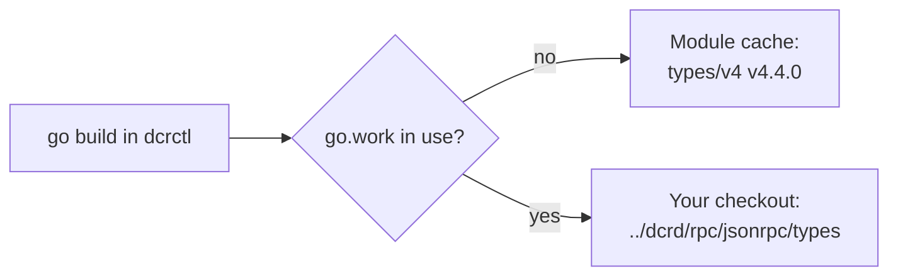

# Build from source

This guide builds each maintained Decred program from source with the toolchain its code requires, and shows how to test a change that spans repositories. It is for contributors, for operators who must build their own binaries (`vspd` ships none), and for anyone who wants to audit what they run.

!!! info "Applies to"
    `dcrd`, `dcrwallet`, `dcrctl` and Decrediton 2.1.7, `vspd` 1.5.0 and Bison Wallet 1.0.6. Checked November 2026 with Go 1.27.

## Before you start

- **Git** and **Go**, new enough for the repository (see [Toolchains](#toolchains)). `go version` shows yours.
- **Node.js** with **yarn** for Decrediton, or with **npm** for Bison Wallet built from `master`.
- **A C/C++ compiler** for Decrediton and for tests run with `-race`.
- **`golangci-lint`** for the linters; **Docker** for container images.
- At least 2 GB of free memory for the Bison Wallet build.

To run Decred software rather than develop it, download the official release instead and check it as described in [Verify your download](../../user/security/verify-downloads.md).

## Release tags or master

Each repository's default branch is ahead of the release. On `dcrd`, `dcrwallet` and `dcrctl`, `master` reports version 2.2.0-pre, and its options, remote procedure calls (RPCs) and module major versions may not exist in 2.1.7. Build `master` to develop for the next release. Build a **release tag** for anything that holds funds, votes tickets or serves users.

!!! warning "Keep master builds away from mainnet funds"
    The `vspd` 1.5.0 release notes say neither `vspd` nor its `dcrd` and `dcrwallet` should be built from `master` when handling mainnet tickets. Run `master` builds on [simnet or testnet](index.md), or at least in their own data directory: `dcrd` and `dcrwallet` both accept `--appdata`.

### Toolchains

The minimum Go version is the `go` line of each `go.mod` at the release tag; the CI column shows what each project's continuous integration (CI) tests. Decred generally supports the current and previous major Go releases; Go 1.27 builds `dcrd`, `dcrwallet`, `dcrctl`, `vspd`, `bisonw` and `dcrlnd` at the listed tags.

| Program | Build this tag | Go in `go.mod` | Go in CI | Other tools and notes |
|---|---|---|---|---|
| `dcrd` | `release-v2.1.7` | 1.24 | 1.24, 1.25 | `master`: `go.mod` 1.25, README and CI 1.26 and 1.27 |
| `dcrwallet` | `release-v2.1.7` | 1.26 | 1.26, 1.27 | `protoc` only to regenerate gRPC code |
| `dcrctl` | `release-v2.1.7` | 1.24 | 1.24, 1.25 | |
| `vspd` | `release-v1.5.0` | 1.25 | 1.26, 1.27 | Release notes: build with Go 1.26 or later |
| Bison Wallet (`dcrdex`) | `v1.0.6` | 1.24 | 1.24, 1.25 | Node.js 20 or later for web assets (`master` CI tests 20 and 22), needed only on `master` |
| Decrediton | `release-v2.1.7` | 1.25 (DEX library) | 1.23, below `go.mod` (relies on toolchain download) | Node.js 18.20 or later and yarn 1.22 (`package.json` `engines`); `master` needs Node.js 22.23 or later |

If your Go is older than a `go` line, the `go` command downloads the required toolchain (the default, `GOTOOLCHAIN=auto`). With `GOTOOLCHAIN=local` it stops with `go: go.mod requires go >= 1.26.0 (running go 1.25.x; GOTOOLCHAIN=local)`. This also applies to the dev shell of `dcrwallet`'s `flake.nix` (`nix develop`), which provides Go 1.25 and `protoc`: the packaged Go defaults to `GOTOOLCHAIN=local`, so it cannot build `dcrwallet` 2.1.7 until you allow the download (see [Troubleshooting](#troubleshooting)).

### Release tags and commits

Use this table to confirm you built what you meant to. `git rev-parse HEAD` prints a checkout's commit. Signed tags are annotated tags that GitHub shows as verified; `git verify-tag <TAG>` checks one locally once you have the signer's public key.

| Repository | Tag | Commit | Go module version | Signed tag |
|---|---|---|---|---|
| `dcrd` | `release-v2.1.7` | `e07b56553d6d` | `github.com/decred/dcrd` v1.10.9 | yes |
| `dcrwallet` | `release-v2.1.7` | `599b5850252c` | `decred.org/dcrwallet/v5` v5.1.2 | yes |
| `dcrctl` | `release-v2.1.7` | `d653f9b2f5c9` | none (pseudo-version) | yes |
| `vspd` | `release-v1.5.0` | `bb64e457bd97` | none (pseudo-version) | no |
| `dcrdex` | `v1.0.6` | `9521e9af8344` | `decred.org/dcrdex` v1.0.6 | no |
| `decrediton` | `release-v2.1.7` | `f586463aada7` | — | no |

## Build dcrd, dcrwallet and dcrctl

Go installs binaries in `$(go env GOPATH)/bin` (by default `~/go/bin`, or `%USERPROFILE%\go\bin` on Windows) unless `GOBIN` is set. Put that directory on your `PATH`. The `go` commands below also work in PowerShell, but enter them one per line: Windows PowerShell 5.1 does not accept `&&`, and environment variables are set with `$env:NAME = "value"` rather than a `NAME=value` prefix.

### Install a release without cloning

If you do not need to change the code, `go install` fetches and builds a tag directly:

```bash
go install github.com/decred/dcrd@release-v2.1.7 github.com/decred/dcrd/cmd/...@release-v2.1.7
go install decred.org/dcrwallet/v5@release-v2.1.7
go install decred.org/dcrctl@release-v2.1.7
```

The first line builds `dcrd` plus `gencerts`, `promptsecret` and `addblock`. The module path must match the `module` line at that version, including its major-version suffix. The `dcrwallet` README at the tag still says `decred.org/dcrwallet/v4@latest`, which builds an older major version: use `/v5`. This method fails for `dcrd` `master`, whose `go.mod` contains `replace` directives; clone it instead.

### Clone and build

To read or change the code, clone each repository at the tag and build inside it:

```bash
git clone --branch release-v2.1.7 https://github.com/decred/dcrd $HOME/src/dcrd
git clone --branch release-v2.1.7 https://github.com/decred/dcrwallet $HOME/src/dcrwallet
git clone --branch release-v2.1.7 https://github.com/decred/dcrctl $HOME/src/dcrctl
cd $HOME/src/dcrd && go install . ./cmd/...
cd $HOME/src/dcrwallet && go install .
cd $HOME/src/dcrctl && go install .
```

Git's note about a "detached HEAD" is normal after checking out a tag. Prefer `./cmd/...` to the `./...` in the `dcrd` README, which also installs internal helpers such as the Docker entrypoint. Then check the versions:

```bash
dcrd --version
dcrwallet --version
dcrctl --version
```

```text title="Expected output (example: Linux, Go 1.27.4)"
dcrd version 2.1.7+release.local (Go version go1.27.4 linux/amd64)
dcrwallet version 2.1.7+release.local (Go version go1.27.4 linux/amd64)
dcrctl version 2.1.7+release.local (Go version go1.27.4 linux/amd64)
```

`+release.local` marks a local build of release code; official binaries say `+release`, because the release tool sets the version at link time. A `master` build reports `2.2.0-pre` and the commit. Your binaries will not match the hashes in the signed manifest; [Releases and reproducible builds](../contributing/releases.md) shows how to reproduce those. To configure and run what you built, continue with [Set up the command-line wallet](../../user/wallets/command-line.md) at its "Start dcrd" step.

### Master and the dcrd library modules

```bash
cd $HOME/src/dcrd && git checkout master && go install . ./cmd/...
```

On `master`, `dcrd`'s root `go.mod` replaces its library modules (`wire`, `txscript`, `blockchain` and the rest) with the directories in the checkout, so editing them changes the `dcrd` you build. At `release-v2.1.7` it has no `replace` directives: `dcrd` compiles the published module versions from the module cache, and an edit to `./wire` changes nothing until you add a workspace (next section).

`dcrd`, `dcrwallet`, `dcrctl`, `vspd` and `bisonw` build without cgo, so you can cross-compile as the release tool does, for example `CGO_ENABLED=0 GOOS=windows GOARCH=amd64 go build -o dcrd.exe .` in the `dcrd` checkout.

## Work across repositories with a Go workspace

Every Decred repository depends on `dcrd`'s library modules by published version. When a change spans repositories, for example a new `dcrd` RPC that `dcrctl` must call, editing your `dcrd` checkout does not affect the other repository's build. A Go workspace (`go.work`) tells the `go` command to use your local directories instead, without temporary `replace` lines in any `go.mod`. Editors that use `gopls` follow it too.

The diagram shows where `dcrctl` gets its RPC type definitions with and without a workspace.



### Example: a dcrctl that knows your new RPC

`dcrctl` learns RPC methods from the types registered by `dcrd` and `dcrwallet`, so a development build only needs those modules swapped in:

```bash
cd $HOME/src/dcrctl
go work init .
go work use ../dcrd/rpc/jsonrpc/types ../dcrwallet
go build
go list -m -f '{{.Path}} {{.Dir}}' github.com/decred/dcrd/rpc/jsonrpc/types/v4 decred.org/dcrwallet/v5
```

The last command should print directories in your checkouts. A path inside the module cache (`.../pkg/mod/...`) means the local copy is not in use.

### All dcrd modules at once

`contrib/devtools/dcr_setup_go_workspace.sh` creates `go.work` in the `dcrd` root (unless one exists) and adds the root module and every library module. It is a bash script; on Windows, run it from Git Bash or WSL.

```bash
cd $HOME/src/dcrd
./contrib/devtools/dcr_setup_go_workspace.sh
go work use ../dcrwallet
cd $HOME/src/dcrwallet
GOWORK=$HOME/src/dcrd/go.work go build -o $HOME/src/dcrwallet-dev .
```

A `go.work` applies to commands run in its directory and below, or wherever `GOWORK` points, which is why the `dcrwallet` build sets it (in PowerShell: `$env:GOWORK = "$env:USERPROFILE\src\dcrd\go.work"`, which stays set for the session; remove it afterwards with `Remove-Item Env:GOWORK`). `go work use` raises the workspace's `go` line to the highest among its modules, so this workspace needs Go 1.26 or later once `dcrwallet` is in it.

### Workspace pitfalls

- **Module paths must match exactly, including `/vN`.** On `dcrd` `master`, `rpc/jsonrpc/types` is `.../types/v5`, while `dcrctl` imports `.../types/v4`. No workspace connects the two; update the imports and `go.mod` first. The `go list -m` check reveals this.
- **Workspaces are local.** Before a pull request, the dependent repository's `go.mod` must require a published version of the changed module, which normally means the `dcrd` module is tagged first. See [Contributing to Decred software](../contributing/index.md).
- **Do not commit `go.work`.** The `.gitignore` files of `dcrd`, `dcrctl`, `vspd` and `dcrdex` exclude `go.work` and `go.work.sum`; `dcrwallet`'s does not.
- **Turn it off for builds you ship.** `GOWORK=off` builds exactly what `go.mod` says, as the Bison Wallet release script does.

## Build vspd

`vspd` has no binary releases. Build 1.5.0 from its tag, and run it with `dcrd` and `dcrwallet` 2.1.6 or later (2.1.7 passes its version check), also built from release tags:

```bash
git clone --branch release-v1.5.0 https://github.com/decred/vspd $HOME/src/vspd
cd $HOME/src/vspd && go install ./cmd/vspd ./cmd/vspadmin
vspd --version
```

```text title="Expected output (example)"
vspd version 1.5.0+bb64e457b (Go version go1.27.4 linux/amd64)
```

The suffix is the commit it was built from. Deployment and configuration are in [Run a voting service provider](../operate/vsp.md).

## Build Bison Wallet

`bisonw` embeds its compiled browser interface with `go:embed`, so `client/webserver/site/dist` must exist before Go runs. At the release tag those assets are committed, and Go alone is enough:

```bash
git clone --branch v1.0.6 https://github.com/decred/dcrdex $HOME/src/dcrdex
cd $HOME/src/dcrdex/client/cmd/bisonw && go build
cd $HOME/src/dcrdex/client/cmd/bwctl && go build
$HOME/src/dcrdex/client/cmd/bisonw/bisonw --version
```

```text title="Expected output (example)"
bisonw version 1.0.6+release.local (Go version go1.27.4 linux/amd64)
```

`go install decred.org/dcrdex/client/cmd/bisonw@v1.0.6` also works. Run `bisonw` and open the address it prints (`http://127.0.0.1:5758` on mainnet); [Install and set up Bison Wallet](../../user/wallets/bison-wallet.md) covers first use.

On `master` the assets are not committed. Build them with Node.js and npm, then build `bisonw` as above:

```bash
cd $HOME/src/dcrdex/client/webserver/site
npm clean-install
npm run build
```

`master` is the unreleased 1.1 line, which cannot trade with 1.0.x. Keep it on simnet or testnet; [Building on DCRDEX](../integrate/dcrdex.md) covers the simnet harness.

## Build a Decrediton development version

Decrediton is an Electron app that starts the `dcrd`, `dcrwallet` and, for **Lightning**, `dcrlnd` binaries in its `bin/` directory. Build them from the matching release first; the 2.1.7 bundle uses `dcrlnd` v0.8.1 (`go install github.com/decred/dcrlnd/cmd/dcrlnd@v0.8.1`). A `master` Decrediton usually needs `master` builds of all three.

Installing the packages compiles native modules and runs `go build -buildmode=c-shared` for the decentralized exchange (DEX) library in `modules/dex`, so you need Node.js and yarn (the README suggests nvm), Go and a C/C++ toolchain.

```bash
git clone --branch release-v2.1.7 https://github.com/decred/decrediton $HOME/src/decrediton
cd $HOME/src/decrediton
mkdir bin
cp "$(go env GOPATH)/bin/dcrd" "$(go env GOPATH)/bin/dcrwallet" "$(go env GOPATH)/bin/dcrlnd" bin/
yarn
yarn build-trezor
yarn dev
```

`yarn dev` starts a webpack server and opens Decrediton in development mode. The README also installs `prebuild` and `cmake-js` globally (`npm install -g prebuild cmake-js`) before `yarn build-trezor`. Symlinks in `bin/` are fine for development; production builds (`yarn build` then `yarn start`, or `yarn package` for installers) need real copies. Windows needs extra setup for native modules, described in the [Decrediton README](https://github.com/decred/decrediton/blob/release-v2.1.7/README.md).

!!! warning "A development build uses your real Decrediton data"
    It reads and writes the same data directory as an installed Decrediton (`~/.config/decrediton` on Linux) and lists your existing wallets. `yarn dev` does not support command-line options, so switch networks in the app with **Settings** > **Connectivity** > **Network** > **Testnet**, and back up wallet data before testing `master`.

## Build a dcrd container image

There are no official container images, but [`contrib/docker`](https://github.com/decred/dcrd/tree/release-v2.1.7/contrib/docker) in `dcrd` builds one: a `scratch`-based image with `dcrd`, `dcrctl`, `gencerts`, `promptsecret` and an entrypoint helper (no `dcrwallet`), running as UID:GID 10000:10000.

The Dockerfile **clones the source from GitHub** at `DCRD_BUILD_TAG`, which defaults to `master`; it does not build your working tree. Name the tag, and run the build from the `dcrd` root:

```bash
cd $HOME/src/dcrd
docker build --progress=plain --build-arg DCRD_BUILD_TAG=release-v2.1.7 -t local/dcrd:2.1.7 -f contrib/docker/Dockerfile .
```

`DCRCTL_BUILD_TAG` defaults to the same tag. The final build steps print `dcrd version 2.1.7+release.local` and the `dcrctl` equivalent. The builder image is pinned by digest to a linux/amd64 Go image. The upstream README covers running the container: volume ownership, `--altdnsnames` for the RPC certificate, and `dcrctl` access.

Bison Wallet's `client/Dockerfile` at `v1.0.6` pins a Go 1.21 builder, older than the Go 1.24 its `go.mod` requires; build `bisonw` directly instead.

## Run the tests and linters

| Repository | Command | What it runs |
|---|---|---|
| `dcrd` | `./run_tests.sh` | `go test -short -tags rpcserver ./...` in every module, then `./lint.sh` (`golangci-lint run` per module) unless `GITHUB_ACTIONS` is set |
| `dcrwallet` | `./run_tests.sh` | `go test -short -vet=all ./...` |
| `vspd` | `./run_tests.sh` | `go test -race` in the main, `client` and `types` modules, then `golangci-lint` |
| `dcrdex` | `./run_tests.sh` | Template checks, `go test -race -short` in its modules, compile checks for harness builds, then `golangci-lint` |
| Decrediton | `yarn test`, `yarn lint` | Jest; ESLint and stylelint (CI also runs `yarn prettify:diff`) |

`dcrd` CI pins `golangci-lint` v2.6.1 at `release-v2.1.7` (v2.13.1 on `master`):

```bash
go install github.com/golangci/golangci-lint/v2/cmd/golangci-lint@v2.6.1
```

Other repositories pin their own version in CI: `dcrctl` v2.6.1 at `release-v2.1.7`, `dcrdex` v2.6.2 at `v1.0.6`, `vspd` v2.13.1 at `release-v1.5.0`.

A passing `dcrd` run ends with `Tests completed successfully!`. `-race` needs cgo and a C compiler. Harnesses that start real nodes (`vspd`'s `harness.sh`, the `dcrdex` simnet harness, the `dcrd` simnet script) are covered in [Set up a private simnet](simnet.md).

## Check that it worked

- Each binary's `--version` shows the expected release, and `git rev-parse HEAD` matches the commit table.
- `go version -m $(go env GOPATH)/bin/dcrd` lists the module versions compiled in; modules taken from a workspace show `(devel)`.
- The test scripts finish without `FAIL`.

## Troubleshooting

### go.mod requires go >= 1.26.0 (running go 1.25.x; GOTOOLCHAIN=local)

Your Go is older than the `go` line and toolchain download is disabled. Install a newer Go from the [Go download page](https://go.dev/dl/), or allow the download: run `export GOTOOLCHAIN=auto` for the current shell, or `go env -u GOTOOLCHAIN` if it was set with `go env -w`. Inside `dcrwallet`'s `nix develop` shell the packaged Go defaults to `GOTOOLCHAIN=local`, so set `GOTOOLCHAIN=auto` there or use a Go 1.26 toolchain.

### The go.mod file for the module providing named packages contains one or more replace directives

`go install github.com/decred/dcrd@master` refuses a module that uses `replace`. Clone the repository and run `go install . ./cmd/...` inside it.

### pattern site/dist: no matching files found

The `bisonw` source has no compiled web assets (any `master` commit). Run `npm clean-install` and `npm run build` in `client/webserver/site`, then build again.

### A change to a dcrd module is ignored

Run `go list -m -f '{{.Path}} {{.Dir}}' <MODULE>` with the full module path. If it points into the module cache, check that a `go.work` exists in the current directory or a parent (or `GOWORK` names one), that it lists the module's directory, and that the module path, including `/vN`, matches the import.

### Example_newOutboundPeer fails with "bind: address already in use"

This `dcrd` `peer` test listens on `127.0.0.1:18555`, the simnet peer port, and fails while a simnet `dcrd` runs on the same machine. Stop that node and run the tests again.

### Decrediton logs "The dcrd executable does not exist"

`bin/` in the Decrediton checkout lacks the binary. Copy or symlink `dcrd`, `dcrwallet` and, for Lightning, `dcrlnd` into it.

## Next steps

- [Set up a private simnet](simnet.md): run your builds on a local network you control.
- [Contributing to Decred software](../contributing/index.md): conventions, review and testing for a first pull request.
- [Releases and reproducible builds](../contributing/releases.md): rebuild an official release byte for byte and compare it with the signed manifest.
- [dcrd Go modules](../go/index.md): which module and major version to depend on.
- [Run a voting service provider](../operate/vsp.md): deploy the `vspd` you built.

*[CI]: continuous integration
*[DEX]: decentralized exchange
*[RPC]: remote procedure call
*[WSL]: Windows Subsystem for Linux
