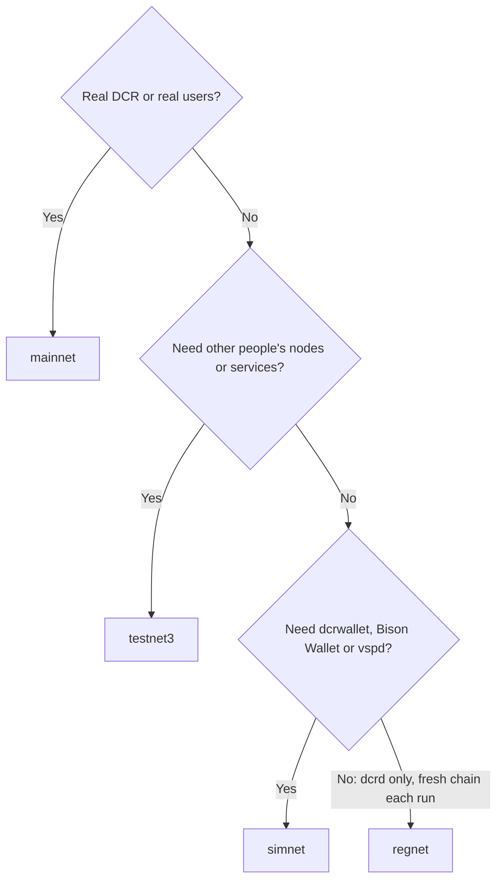

# Networks

Decred software runs on four separate networks: mainnet, the public test network testnet3, and two private development networks, simnet and regnet. This page helps developers pick the right one, select it in each program, and look up the ports, prefixes and rules that differ between them. Values come from dcrd, dcrwallet, dcrctl and Decrediton 2.1.7, vspd 1.5.0 and Bison Wallet 1.0.6 at their release tags, and were checked in November 2026.

<div class="grid cards" markdown>

-   **[Build from source](build-from-source.md)**

    ---

    Build dcrd, dcrwallet, dcrctl, Decrediton, vspd and Bison Wallet with the right toolchains, including multi-module workspaces.

-   **[Set up a private simnet](simnet.md)**

    ---

    Run your own nodes and wallets, mine past stake validation height, buy tickets, and watch votes and treasury spends.

</div>

## Which network for what

The networks are isolated from one another at three levels. Every peer-to-peer message starts with a network magic number, each network has its own genesis block, and addresses and keys carry network-specific prefixes. A testnet address therefore fails to decode in a mainnet wallet. Choose by what your test needs:

| Network | Name in code | Use it for | Coins | Who runs nodes |
|---|---|---|---|---|
| mainnet | `mainnet` | Production. Real DCR, real users. | Real value | The public |
| testnet3 | `testnet3` | Testing against a live public chain, other people's nodes and services, and realistic timing | No value | The public; few services in 2026 (see [Testnet resources](#testnet-resources)) |
| simnet | `simnet` | Full integration tests of wallets, voting service providers (VSPs), pools, explorers and DCRDEX exchange setups on a chain you control completely | No value; you mine them | You only: no seeders, no peer discovery |
| regnet | `regnet` | dcrd unit, remote procedure call (RPC) server and consensus tests that start from the genesis block on every run | No value | You only, dcrd only |

The decision tree below summarizes the table: use mainnet only for real value, testnet3 when you need other people's infrastructure, and a private network for everything else.



Most application development belongs on simnet. You control every ticket and every vote, blocks arrive on demand, and nothing depends on a public service being online.

## Comparison

### Ports and identity

Sources: `chaincfg/*params.go` and `params.go` in dcrd, `internal/netparams/params.go` in dcrwallet, `client/app/config.go` in Bison Wallet. Every port is a default and can be changed. The canonical lookup for all programs is [Ports, paths and prefixes](../reference/index.md).

| | mainnet | testnet3 | simnet | regnet |
|---|---|---|---|---|
| Network magic (`Net`) | `0xd9b400f9` | `0xb194aa75` | `0x12141c16` | `0xdab500fa` |
| dcrd peer-to-peer port | 9108 | 19108 | 18555 | 18655 |
| dcrd JSON-RPC port | 9109 | 19109 | 19556 | 18656 |
| dcrwallet JSON-RPC port | 9110 | 19110 | 19557 | not supported |
| dcrwallet gRPC port | 9111 | 19111 | 19558 | not supported |
| Bison Wallet web UI | `127.0.0.1:5758` | `127.0.0.2:5758` | `127.0.0.3:5758` | not supported |
| dcrd chain and log folders | `data/mainnet`, `logs/mainnet` | `data/testnet3`, `logs/testnet3` | `data/simnet`, `logs/simnet` | `data/regnet`, `logs/regnet` |
| dcrwallet wallet folder | `mainnet` | `testnet3` | `simnet` | not supported |
| Bison Wallet folder | `mainnet` | `testnet` | `simnet` | not supported |
| Peer discovery | Seeders and address relay | Seeders and address relay | None: connect peers explicitly | None: connect peers explicitly |
| Genesis timestamp (UTC) | 2016-02-08 | 2018-08-06 | 2014-05-28 | 2018-10-03 |

The folders are inside each program's application directory (`~/.dcrd`, `~/.dcrwallet` and `~/.dexc` on Linux; `%LOCALAPPDATA%\Dcrd`, `%LOCALAPPDATA%\Dcrwallet` and `%LOCALAPPDATA%\Dexc` on Windows). Data for different networks never mixes.

### Address and key prefixes

Source: the `*AddrID`, `PrivateKeyID`, `HDPublicKeyID`, `HDPrivateKeyID`, `SLIP0044CoinType` and `LegacyCoinType` fields in `chaincfg`. The whitepaper's [network prefixes section](../../whitepaper/05-addresses.md#sec:addresses-prefixes) specifies the encodings.

| Encoding | mainnet | testnet3 | simnet | regnet |
|---|---|---|---|---|
| Pay-to-pubkey-hash, secp256k1 (the usual address) | `Ds` | `Ts` | `Ss` | `Rs` |
| Pay-to-script-hash | `Dc` | `Tc` | `Sc` | `Rc` |
| Pay-to-pubkey-hash, Schnorr | `DS` | `TS` | `SS` | `RS` |
| Pay-to-pubkey-hash, Ed25519 | `De` | `Te` | `Se` | `Re` |
| Pay-to-pubkey | `Dk` | `Tk` | `Sk` | `Rk` |
| Wallet import format (WIF) private key | `Pm` | `Pt` | `Ps` | `Pr` |
| Extended public / private key | `dpub` / `dprv` | `tpub` / `tprv` | `spub` / `sprv` | `rpub` / `rprv` |
| SLIP-0044 coin type | 42 | 1 | 1 | 1 |
| Legacy coin type | 20 | 11 | 115 | 1 |

### Parameter differences

The test networks run the same consensus code with shorter timings and smaller numbers. Source: `chaincfg/*params.go` at `release-v2.1.7`, plus `mixing/mixpool/mixpool.go` for the mixing epoch and `internal/blockchain/agendas.go` for agenda handling.

| Parameter | mainnet | testnet3 | simnet | regnet |
|---|---|---|---|---|
| Target block time | 5 minutes | 2 minutes | 1 second | 1 second |
| Proof-of-work (PoW) hash | BLAKE3 since block 794,368; BLAKE-256 before | BLAKE3 since block 1,170,048 | BLAKE3 from genesis | BLAKE-256 until `blake3pow` is voted in |
| ASERT (absolutely scheduled exponentially rising targets) difficulty half-life | 43,200 s | 720 s | 6 s | 6 s |
| CPU mining (`generate`) | Not supported | Supported | Supported | Supported |
| Maximum block size | 393,216 bytes | 1,310,720 bytes | 1,310,720 bytes | 1,000,000 bytes until `maxblocksize` activates, then 1,310,720 |
| Maximum transaction size | 393,216 bytes | 1,000,000 bytes | 1,000,000 bytes | 1,000,000 bytes |
| Initial block subsidy (`BaseSubsidy`) | 31.19582664 DCR | 25 DCR | 500 DCR | 500 DCR |
| Subsidy reduction interval | 6,144 blocks | 2,048 blocks | 128 blocks | 128 blocks |
| Coinbase and ticket maturity | 256 blocks | 16 blocks | 16 blocks | 16 blocks |
| Minimum ticket price | 2 DCR | 0.2 DCR | 0.0002 DCR | 0.0002 DCR |
| `TicketPoolSize` (target pool = × 5) | 8,192 (40,960 tickets) | 1,024 (5,120 tickets) | 64 (320 tickets) | 64 (320 tickets) |
| Ticket expiry | 40,960 blocks | 6,144 blocks | 384 blocks | 384 blocks |
| Stake validation height | 4,096 | 768 | 144 | 144 |
| Rule change interval / quorum | 8,064 blocks / 4,032 votes | 5,040 / 2,520 | 320 / 160 | 320 / 160 |
| Treasury vote interval / window | 288 / 3,456 blocks | 60 / 240 | 48 / 144 | 4 / 12 |
| Mixing epoch | 10 minutes | 3 minutes | 10 minutes | 10 minutes |
| Non-standard transactions relayed by default | No | Yes | Yes | Yes |
| Consensus agendas at genesis | None active; every change voted | `sdiffalgorithm` and `lnfeatures` forced active; later ones voted | All 13 deployments forced active | None active; all 13 open for voting from genesis |

Two rows matter more than they look:

- **Agendas.** On simnet every agenda defined in `simnetparams.go` has `ForcedChoiceID: "yes"`, so the chain follows current mainnet rules from block 1 and no vote is needed. A new deployment you add to `simnetparams.go` without a forced choice is voted on normally, which is how a new agenda is exercised on simnet. dcrd refuses a forced choice on mainnet (`ErrForcedMainNetChoice`).
- **Standardness.** Testnet, simnet and regnet accept non-standard transactions by default, so a transaction that relays on a test network can still be rejected on mainnet. Start dcrd with `--rejectnonstd` to test against mainnet relay policy. The whitepaper describes [standard transactions](../../whitepaper/17-policy.md#sec:policy-standard).

## Select a network in each tool

Every program in a stack must use the same network. dcrd and dcrwallet refuse to start with more than one network flag. Each command-line flag also works as a config-file line (`testnet=1`, `simnet=1`, `regnet=1`).

| Program | mainnet | testnet3 | simnet | regnet |
|---|---|---|---|---|
| `dcrd` | default | `--testnet` | `--simnet` | `--regnet` |
| `dcrwallet` | default | `--testnet` | `--simnet` | no option |
| `dcrctl` | default | `--testnet` | `--simnet` | no option; use `-s 127.0.0.1:18656` |
| Decrediton | **Settings** > **Connectivity** > **Network**: **Mainnet**, or start with `--mainnet` | **Network**: **Testnet**, or start with `--testnet` | no option | no option |
| Bison Wallet (`bisonw`, desktop app) | default | `--testnet`, or `testnet=1` in `dexc.conf` | `--simnet` | no option |
| `vspd` | `--network=mainnet` | `--network=testnet` (**the default**) | `--network=simnet` | no option |
| `vspadmin` | `--network=mainnet` (**the default**) | `--network=testnet` | `--network=simnet` | no option |

A testnet stack on the command line needs one line in each of the three config files:

```ini title="dcrd.conf, dcrwallet.conf and dcrctl.conf"
testnet=1
```

Then create a separate wallet for testnet with `dcrwallet --create`. [Set up the command-line wallet](../../user/wallets/command-line.md) covers the full procedure, and [Install and use Decrediton](../../user/wallets/decrediton.md) covers switching Decrediton, which restarts after you change **Network**.

Watch for these traps:

- **A shared config file can pin the wrong network.** dcrwallet and dcrctl read their default config file whatever the network. If `dcrwallet.conf` contains `testnet=1` and you start `dcrwallet --simnet`, dcrwallet exits because two networks are selected. dcrd behaves differently: when `--simnet` or `--regnet` is on the command line and `--configfile` is not, it neither reads nor creates its default `dcrd.conf`, so settings such as `rpcuser` in that file are silently ignored. For private networks, keep a separate home directory or config file per network (`--appdata` for dcrd and dcrwallet, `--configfile` for each program), and pass `--configfile` to dcrd explicitly.
- **vspd and vspadmin have different defaults.** vspd starts on testnet unless told otherwise; vspadmin works on mainnet unless told otherwise. Set `network` explicitly for both. `vspadmin createdatabase` checks that the fee xpub belongs to the chosen network.
- **regnet starts over every time.** On each start with `--regnet`, dcrd deletes its existing block and unspent transaction output (UTXO) databases and begins again from the genesis block. It also ignores `addpeer` lines from the config file; peers given on the command line still apply. Many of dcrd's unit and RPC server tests use `chaincfg.RegNetParams()`, and its consensus test suite `blockchain/fullblocktests` generates its chains on its own fixed copy of the regnet parameters.
- **dcrctl has no regnet flag.** Point it at the regnet RPC port. It still uses dcrd's `rpc.cert` and the credentials in `dcrctl.conf` by default:

    ```bash
    dcrctl -s 127.0.0.1:18656 getblockcount
    ```

- **`--createtemp` is simnet only.** dcrwallet's temporary-wallet option refuses any other network, needs an explicit `--appdata` directory and cannot be combined with `--create`. For example, `dcrwallet --simnet --createtemp --appdata=<DIR>` creates a throwaway wallet whose private passphrase is `password`.

## Testnet3 specifics

Testnet3 has run since 2018 (its genesis block is dated 2018-08-06). Apart from the shorter timings in the table above, these rules and behaviors differ from mainnet:

- **Capped difficulty, not "minimum difficulty".** Before block 962,928, testnet had a minimum-difficulty rule: a block found more than 10 minutes after its parent could be mined at the lowest difficulty. That rule no longer applies, so older instructions to run `generate` after a 10-minute gap are out of date. From block 962,928, the rule works the other way: the proof-of-work target can never fall below `PowLimit` shifted right by 6 bits, a maximum difficulty of 64 relative to the limit. Blocks at that maximum must be at least 60 seconds apart. dcrd's source gives the reason: high-powered hardware should not be needed to keep testnet running. The whitepaper's [test network rules](../../whitepaper/09-difficulty.md#sec:difficulty-testnet) give the exact algorithm and the checkpoint hash at height 962,928.
- **Mining yields almost nothing.** dcrd accepts `generate` on testnet (with `--miningaddr` set), but the subsidy is nearly exhausted. It started at 25 DCR and is multiplied by 100/101 every 2,048 blocks. Worked example: at height 2,048,000, after 1,000 reductions, a whole block creates about 0.0012 DCR, and the miner's 1% share is about 0.00001 DCR. Mining is not a practical way to obtain test coins.
- **Faster mixing.** dcrd's mix pool uses a 3-minute epoch on testnet and 10 minutes on every other network. The mixing client in dcrwallet 2.1.7 (dcrd's `mixing` module v0.7.5) also uses a shorter 10-second stage timeout on testnet. The whitepaper explains [mixing epochs](../../whitepaper/18-mixing.md#sec:mixing-epochs).
- **Run dcrd 2.1.7.** dcrd 2.1.6 introduced a bug in initial synchronization of the test network; the 2.1.7 release notes list the fix. A new testnet node should start from 2.1.7.
- **Shorter service timers.** Software built on Decred often shortens its own timers on testnet. DCRDEX fidelity bonds, for example, have a 3-hour expiry on testnet instead of 30 days on mainnet. Do not assume a testnet timing carries over to mainnet.

!!! danger "Keep test and real funds apart"
    Use a separate seed for each network, and never send mainnet DCR to an address that starts with `T`, `S` or `R`. Mainnet wallets reject such addresses, but scripts that build transactions from raw keys can still lose real funds to a key on the wrong network.

## Testnet resources

Public testnet services have thinned out. The table records what answered when this page was checked on 2026-11-18. Check again before you depend on any of them.

| Service | Address | Status on 2026-11-18 |
|---|---|---|
| Testnet faucet | `faucet.decred.org` | Not working (HTTP 502) |
| Testnet block explorer (dcrdata) | `testnet.dcrdata.org` | Not working (HTTP 503) |
| VSP listing | [api.decred.org/?c=vsp](https://api.decred.org/?c=vsp), entries with `"network": "testnet"` | Lists two testnet VSPs |
| Testnet VSP | `testnet-vsp.jholdstock.uk` | Answering `GET /api/v3/vspinfo` (reports `"network": "testnet3"`) |
| Testnet VSP | `teststakepool.decred.org` | Not working (HTTP 502); listed with no version and `lastupdated` 0 |
| DCRDEX testnet server | `bison.exchange:17232` (Bison Wallet's built-in testnet server) | Not working: the domain does not resolve (NXDOMAIN) |

Without a faucet or explorer, use these instead:

- **Test coins**: ask in the official channels listed on [decred.org/community](https://decred.org/community/). For anything you can test privately, use [simnet](simnet.md), where you mine your own coins.
- **Explorer**: query your own node with `dcrctl --testnet` (for example `getbestblock`, or `getrawtransaction <TXID> 1`, which needs dcrd's `--txindex` for transactions outside the mempool), or run your own dcrdata against it; see the [dcrdata API](../api/dcrdata-api.md).
- **DEX**: test against a local DCRDEX server with the simnet harness described in [Building on DCRDEX](../integrate/dcrdex.md).

Mainnet services are separate from the testnet ones and answered on 2026-11-18: the block explorer at [dcrdata.decred.org](https://dcrdata.decred.org), the VSP list at [decred.org/vsp](https://decred.org/vsp/), and the DCRDEX server `dex.decred.org:7232`.

## Full parameters

This page lists the values that most often trip people up. For every parameter of every network, with its meaning and derived quantities, see the whitepaper:

- [The four networks](../../whitepaper/14-parameters.md#sec:parameters-networks): purpose, magic numbers, ports and how networks are kept apart.
- [Parameter tables](../../whitepaper/14-parameters.md#sec:parameters-tables): every `chaincfg` field on all four networks.
- [Network-specific rules outside the parameters](../../whitepaper/14-parameters.md#sec:parameters-exceptions): the rules dcrd selects by network identity, such as the testnet difficulty cap and historical agenda anchors.

In Go, the same values come from the `github.com/decred/dcrd/chaincfg/v3` module through `chaincfg.MainNetParams()`, `TestNet3Params()`, `SimNetParams()` and `RegNetParams()`. The RPC ports are not part of `chaincfg`; each application defines its own.

## Next steps

- [Set up a private simnet](simnet.md): the network to use for most development and integration tests.
- [Build from source](build-from-source.md): get development builds of every program on this page.
- [Your first JSON-RPC call](../api/first-rpc-call.md): talk to a simnet or testnet node from curl, Python or JavaScript.
- [Ports, paths and prefixes](../reference/index.md): the full lookup for every program and network.
- [Integrating Decred](../integrate/index.md): the checklist to work through before you move from testnet to mainnet.

*[DEX]: decentralized exchange
*[PoW]: proof of work
*[RPC]: remote procedure call
*[gRPC]: a remote procedure call framework over HTTP/2
*[VSP]: voting service provider
*[VSPs]: voting service providers
*[WIF]: wallet import format
*[ASERT]: absolutely scheduled exponentially rising targets
*[UTC]: Coordinated Universal Time
*[UTXO]: unspent transaction output
