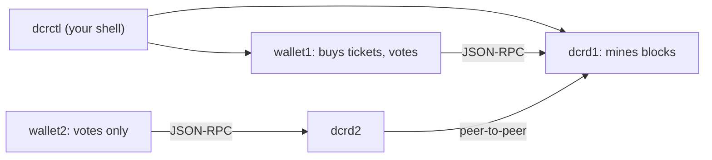
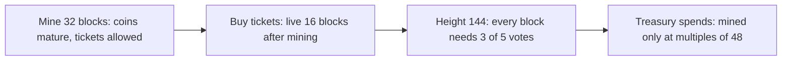

# Set up a private simnet

Simnet is a private Decred network on your own machine: blocks arrive when you ask for them, you own every ticket, and every interval is short. This tutorial builds one and uses it for tickets, votes, an agenda, a treasury spend and mixing, then tours the harness scripts other Decred repositories use.

!!! info "Applies to"
    dcrd, dcrwallet and dcrctl 2.1.7, the vspd 1.5.0 and Bison Wallet 1.0.6 (dcrdex `v1.0.6`) harnesses, and the dcrpool harness on its default branch. Checked November 2026.

## What you will need

- `dcrd`, `dcrwallet` and `dcrctl` 2.1.7 on your `PATH`, from the release archive ([Set up the command-line wallet](../../user/wallets/command-line.md)) or [built from source](build-from-source.md). To test your own changes, `go install` them so the commands below run the new binaries.
- A bash shell (Linux, macOS, or WSL on Windows). The programs and options also work in PowerShell; only the shell syntax differs.
- `tmux`, for the quick start in step 1.
- About 30 minutes. Mining to stake validation height takes about three minutes, and the treasury spend about three more.

!!! danger "Every key on this page is public"
    The seeds, private keys and passphrases used here are published in Decred's source code or on this page. Anyone can spend coins sent to them on mainnet or testnet. Use them on simnet only.

## Why simnet

Simnet keeps Decred's consensus rules but shrinks every number that makes testing slow:

- **Blocks on demand.** Difficulty starts at the lowest possible value, so `dcrctl generate` mines each block on the CPU in a fraction of a second.
- **Private.** No seeders and no peer discovery: nodes connect only to peers you name. Its own genesis block, network magic and address prefixes (`Ss` addresses) keep it apart from mainnet.
- **Current rules from the start.** Every agenda in `chaincfg/simnetparams.go` has a forced "yes" choice, so today's mainnet rules (BLAKE3, the 1/89/10 subsidy split, automatic revocations, the treasury limit of Decred Change Proposal DCP-0013) apply from the first block. So does `maxblocksize`, which mainnet never adopted: simnet blocks may be up to 1,310,720 bytes.
- **You hold every ticket,** so you decide every vote.

These are the simnet values the steps below depend on. The chain values come from [`chaincfg/simnetparams.go`](https://github.com/decred/dcrd/blob/release-v2.1.7/chaincfg/simnetparams.go), the mixing epoch from dcrd's `mixing/mixpool/mixpool.go`, and the RPC ports from dcrd's `params.go` and dcrwallet's `internal/netparams/params.go`. [Networks](index.md) compares all four networks.

| Parameter | Simnet value |
|---|---|
| Target block time | 1 second |
| Block subsidy | 500 DCR, reduced every 128 blocks |
| Coinbase and ticket maturity | 16 blocks |
| Stake enabled height (tickets can be mined) | 32 |
| Stake validation height (votes required) | 144 |
| Ticket pool size parameter; votes per block | 64; 5 |
| Ticket expiry | 384 blocks |
| Minimum ticket price | 0.0002 DCR |
| Rule change interval; quorum | 320 blocks; 160 votes |
| Treasury vote interval (TVI); voting window | 48 blocks; 3 TVIs (144 blocks) |
| Mixing epoch | 10 minutes |
| Default ports: `dcrd` peer, `dcrd` remote procedure call (RPC), `dcrwallet` JSON-RPC, gRPC | 18555, 19556, 19557, 19558 |

## What you will build

The quick start in step 1 builds two connected nodes and two wallets that share one seed: one wallet buys tickets and votes, the other only votes, so you can test reorganizations and redundant voting.



Steps 2 to 4 build the left half by hand (one node, one wallet), which is enough for everything after it. The path to a working voting chain follows the heights in the table above:



## Step 1: Start the preconfigured environment

dcrd ships a tmux script, [`contrib/devtools/dcr_tmux_simnet_setup.sh`](https://github.com/decred/dcrd/blob/release-v2.1.7/contrib/devtools/dcr_tmux_simnet_setup.sh), that builds the whole environment in a few seconds.

!!! warning "The script deletes its folder on every start"
    It removes `~/dcrdsimnetnodes`, or the folder named by `DCR_SIMNET_ROOT`, before building a new environment. Never point `DCR_SIMNET_ROOT` at a folder holding anything you want to keep.

Run it from a checkout of the release tag rather than a downloaded copy:

```bash
git clone --depth 1 --branch release-v2.1.7 https://github.com/decred/dcrd.git
cd dcrd
bash contrib/devtools/dcr_tmux_simnet_setup.sh
```

You land in the lower pane of window 0. Each window has the process in the upper pane and a shell in its folder below. Switch windows with ++ctrl+b++ followed by the window number, and panes with ++ctrl+b++ then ++down++ or ++up++.

| Window | Process | Role | Listens on (127.0.0.1) |
|---|---|---|---|
| 0 `dcrd1` | `dcrd` | Mining node; mines 32 blocks at start | peer 19555, RPC 19556 |
| 1 `wallet1` | `dcrwallet` | Connected to `dcrd1`; ticket buyer (`ticketbuyer.limit=10`) and voter | JSON-RPC 19557, gRPC 19558 |
| 2 `dcrd2` | `dcrd` | Permanently connected to `dcrd1` | peer 19565, RPC 19566 |
| 3 `wallet2` | `dcrwallet` | Connected to `dcrd2`; voter only | JSON-RPC 19567 |

Both wallets are restored from one fixed seed, so both receive the mining rewards (address `SsXciQNTo3HuV5tX3yy4hXndRWgLMRVC7Ah`), stay unlocked with the private passphrase `123` from their config, and hold the two simnet treasury keys used in step 7. RPC credentials are `USER` and `PASS`. The nodes use the Transport Layer Security (TLS) certificate in your default dcrd folder (`~/.dcrd/rpc.cert` on Linux, `~/Library/Application Support/Dcrd/rpc.cert` on macOS), creating it if missing.

The main helper scripts in each window's folder:

| Script | Windows | What it does |
|---|---|---|
| `ctl` | all | Runs `dcrctl` against that window's process: `./ctl getbestblock` |
| `mine [N]` | `dcrd1`, `dcrd2` | Mines N blocks (default 1), one second apart |
| `stopall` | all | Stops all four processes and closes the session |

In the `dcrd1` lower pane, `./ctl getbestblock` should report `"height": 32`. Also present are `reorg` in `dcrd2`, which forces `dcrd2` through a one-block reorganization, and `xfer` in the wallets, which sends 0.1 DCR to one of the wallet's own addresses. The `tickets` helper is broken with dcrwallet 2.1.7: it passes the arguments of an older `purchaseticket` and fails with `parameter #4 'expiry' must parse to a int`. Buy tickets directly instead: `./ctl purchaseticket default 1 3` buys three.

This environment replaces steps 2 to 4. To follow steps 5 to 8 in it, run `nodectl` commands as `./ctl` in the `dcrd1` lower pane and `walletctl` commands as `./ctl` in the `wallet1` lower pane; skip the ticket buyer restart and key import, which are already done, and expect different heights. To see how each piece fits, continue with step 2 instead.

## Step 2: Write the configuration files

Stop any other simnet first: this setup uses the same default ports as the quick start. Make a folder and three config files in it:

```bash
mkdir -p ~/dcrsimnet
```

```ini title="~/dcrsimnet/dcrd.conf"
simnet=1
rpcuser=simnet
rpcpass=simnet
txindex=1
```

```ini title="~/dcrsimnet/dcrwallet.conf"
simnet=1
appdata=~/dcrsimnet/wallet
username=simnet
password=simnet
cafile=~/dcrsimnet/dcrd/rpc.cert
pass=password
enablevoting=1
```

```ini title="~/dcrsimnet/dcrctl.conf"
simnet=1
rpcuser=simnet
rpcpass=simnet
rpccert=~/dcrsimnet/dcrd/rpc.cert
```

- `username` and `password` in `dcrwallet.conf` log in to `dcrd` and protect the wallet's own RPC server; they match `rpcuser` and `rpcpass`.
- `cafile` points the wallet at the certificate `dcrd` will create in its folder.
- `pass` unlocks the wallet at start so it can vote and buy tickets; `password` is the private passphrase step 3 creates. Keeping a passphrase in a file is acceptable only for a throwaway simnet wallet.
- `txindex` lets `getrawtransaction` find any transaction. The default simnet ports apply, so no listen addresses are needed.

In the terminal you will type commands in, define two shell functions for `dcrctl`:

```bash
nodectl() { dcrctl -C ~/dcrsimnet/dcrctl.conf "$@"; }
walletctl() { dcrctl -C ~/dcrsimnet/dcrctl.conf --wallet -c ~/dcrsimnet/wallet/rpc.cert "$@"; }
```

## Step 3: Start dcrd and create a throwaway wallet

In a first terminal, start the node:

```bash
dcrd -C ~/dcrsimnet/dcrd.conf -A ~/dcrsimnet/dcrd
```

`-A` keeps the chain, logs and `rpc.cert` in `~/dcrsimnet/dcrd`. Look for `RPC server listening on 127.0.0.1:19556` in the log.

!!! warning "Always pass `-C` to dcrd on simnet"
    When `--simnet` is given on the command line and no `-C`, dcrd reads no config file at all, not even one in the `-A` folder. Without `rpcuser` it then starts no RPC server, and every `dcrctl` call fails to connect.

In a second terminal, create and start a wallet in one go:

```bash
dcrwallet -C ~/dcrsimnet/dcrwallet.conf --createtemp
```

`--createtemp` creates a wallet from a random seed with the private passphrase `password`, leaves its public data unencrypted, writes the seed in plain text to `~/dcrsimnet/wallet/simnet/seed`, and keeps running. It works only on simnet and with an explicit `appdata`. If the wallet already exists, it loads it, so later starts can drop the flag.

```text title="Expected output (abridged)"
Creating the wallet...
The wallet has been created successfully.
[INF] WLLT: The wallet has been unlocked without a time limit
[INF] RPCS: Listening on 127.0.0.1:19557
[INF] SYNC: Wallet voting enabled: vote bits = 0x0001, extended vote bits = 0c000000
[INF] SYNC: Blockchain sync completed, wallet ready for general usage.
```

## Step 4: Mine your first coins

`dcrd` needs an address to pay mined blocks to. Ask the wallet for one:

```bash
walletctl getnewaddress
```

Add the address (it starts with `Ss`) to `~/dcrsimnet/dcrd.conf` as `miningaddr=<ADDRESS>`, stop `dcrd` with ++ctrl+c++ and start it again with the same command. The wallet logs `RPC synchronization stopped` and reconnects within a few seconds.

Mine 32 blocks and check the balance:

```bash
nodectl generate 32
walletctl getbalance
```

`generate` prints the 32 new block hashes. The end of the balance shows:

```text title="Expected output (end)"
  "totalimmaturecoinbaserewards": 80,
  "totalspendable": 75,
  "cumulativetotal": 155
```

Block 1 pays the block-one ledger, and every later block pays the miner 5 DCR: 1% of simnet's 500 DCR subsidy, because the 1/89/10 split is already active. Coinbase outputs mature after 16 blocks, so the rewards of blocks 2 to 16 are spendable (75 DCR) and those of blocks 17 to 32 are not yet (80 DCR). Height 32 is also the stake enabled height, so tickets can now be mined.

!!! tip "Need a large balance?"
    The simnet block-one ledger (300,000 DCR) belongs to the wallet with the all-zero seed, as a comment in `simnetparams.go` notes. To restore it as a second wallet, copy `dcrwallet.conf` to `~/dcrsimnet/zero.conf` with `appdata=~/dcrsimnet/zero`, `rpclisten=127.0.0.1:19567` and `nogrpc=1`. Run `dcrwallet -C ~/dcrsimnet/zero.conf --create`. Answer yes to using the configured private passphrase, no to extra encryption for public data and yes to having an existing seed, enter 64 zeros as the hex seed, and press ++enter++ at the birthday and account-import questions. Then start it without `--create`. After its rescan, `getbalance` on port 19567 (`-s 127.0.0.1:19567 -c ~/dcrsimnet/zero/rpc.cert`) shows 300,000 DCR spendable.

## Step 5: Buy tickets and pass stake validation height

Buy ten tickets. The arguments are the account, the minimum confirmations of the coins to spend, and the number of tickets:

```bash
walletctl purchaseticket default 1 10
```

The command returns ten ticket hashes at once, but only a split transaction, which creates one output sized for each ticket, enters the mempool; the tickets follow once it is mined. Mine a block, see the tickets reach the mempool, then mine another:

```bash
nodectl generate 1
nodectl getrawmempool false tickets
nodectl generate 1
walletctl getstakeinfo
```

`getstakeinfo` now shows `"immature": 10`.

From height 144, every block must carry at least three of the five votes, and each block uses up the five tickets drawn for it. `dcrd`'s miner refuses to build a block that would leave too few live tickets to keep the chain going (ticket exhaustion), so tickets must keep coming. Restart the wallet with the ticket buyer: press ++ctrl+c++ in the wallet terminal, then run

```bash
dcrwallet -C ~/dcrsimnet/dcrwallet.conf --enableticketbuyer --ticketbuyer.limit=10
```

A limit of ten tickets per block is more than the five each block consumes, so the pool grows. Now mine to height 146, pausing a second after each block so the wallet has time to buy tickets and vote:

```bash
for i in $(seq 112); do nodectl generate 1 > /dev/null; sleep 1; done
walletctl getstakeinfo
```

```text title="Example output (part)"
  "blockheight": 146,
  "voted": 15,
  "live": 675,
```

Blocks 144, 145 and 146 each carried five of your votes. Compare the blocks either side of stake validation height:

```bash
nodectl getblockheader $(nodectl getblockhash 143) | grep voters
nodectl getblockheader $(nodectl getblockhash 144) | grep voters
```

Block 143 has `"voters": 0` and block 144 has `"voters": 5`. Each vote in block 144 approves or disapproves block 143: tickets vote on the parent of the block that includes them ([the whitepaper's block vote rules](../../whitepaper/08-staking.md#sec:staking-block-votes)).

Expect the ticket price (`nodectl getstakedifficulty`) to climb quickly while the pool is far above its target, and to fall again as the pool shrinks: that is the DCP-0001 algorithm working on simnet's small pool.

## Step 6: Practice an agenda vote

Ask the node about the agendas of the current vote version:

```bash
nodectl getvoteinfo 12
```

The only version 12 agenda, `maxtreasuryspend`, shows `"status": "active"` and no vote counts, because the forced choice settled it before any vote. The same holds for every older agenda. Your wallet's choice still decides the vote bits its tickets cast, which is what wallet and voting service provider (VSP) code needs to be tested against:

```bash
walletctl getvotechoices
walletctl setvotechoice maxtreasuryspend no
```

A real vote needs development builds with a new agenda that has no forced choice. At least three things change: a deployment at stake version 13 in dcrd's `chaincfg/simnetparams.go`, the test-network block version of dcrd's miner (`generatedBlockVersionTest` in `internal/mining/mining.go`), and dcrwallet's simnet vote version (`voteVersion` in `wallet/wallet.go`), built against the changed `chaincfg`. [Consensus changes: DCPs and agenda deployments](../contributing/consensus-changes.md) covers the procedure. The agenda then moves through [the threshold state machine](../../whitepaper/13-voting.md#sec:voting-threshold) with simnet's 320-block rule change interval and 160-vote quorum.

Regnet puts every agenda to a real vote, but dcrwallet does not support regnet; dcrd's own tests use it.

## Step 7: Pass a treasury spend

Only a transaction signed by one of the two Politeia keys in `chaincfg` (`PiKeys`) can spend from the treasury. On simnet their private keys are published as comments in `simnetparams.go`, so you can create a treasury spend (TSPEND) yourself. Import the first key, which is the one whose public key starts `02a36b`, and tell the wallet to vote yes on spends it signs:

```bash
walletctl importprivkey PsUUktzTqNKDRudiz3F4Chh5CKqqmp5W3ckRDhwECbwrSuWZ9m5fk imported false
walletctl settreasurypolicy 02a36b785d584555696b69d1b2bbeff4010332b301e3edd316d79438554cacb3e7 yes
nodectl gettreasurybalance
```

`gettreasurybalance` reports the balance in atoms. Get an address to pay, then send 10 DCR to it from the treasury:

```bash
walletctl getnewaddress
walletctl sendfromtreasury 02a36b785d584555696b69d1b2bbeff4010332b301e3edd316d79438554cacb3e7 '{"<ADDRESS>": 10}'
```

Replace `<ADDRESS>` with the address. The command returns the TSPEND's hash, and the spend waits in the mempool. Check its voting window:

```bash
nodectl gettreasuryspendvotes
```

```text title="Example output (part), for a spend created at height 150"
      "expiry": 338,
      "votestart": 192,
      "voteend": 336,
      "yesvotes": 0,
      "novotes": 0
```

Voting starts at the first multiple of 48 above the next block's height and lasts 144 blocks. A TSPEND can only be mined in a block whose height is a multiple of 48, and only once its yes votes reach 60% of all votes cast plus all votes still possible in the window, with a quorum of 20% of the window's maximum votes (144 here) ([the voting window](../../whitepaper/12-treasury.md#sec:treasury-window)). With all five votes yes in every block, that takes 87 voting blocks, so the example spend is mined at height 288, the second boundary after 192. Mine until it leaves the mempool, about 140 blocks:

```bash
while [ "$(nodectl getrawmempool false tspend)" != "[]" ]; do nodectl generate 1 > /dev/null; sleep 1; done
walletctl gettransaction <TSPEND_HASH>
nodectl gettreasurybalance
```

Replace `<TSPEND_HASH>` with the hash `sendfromtreasury` returned. `gettransaction` shows `"amount": 10` and its confirmations. A spend that expires unapproved also leaves the mempool but never confirms.

Variations to try:

- **Rejection:** set `walletctl settspendpolicy <TSPEND_HASH> no` before voting starts and watch `novotes` grow.
- **Treasury add (TADD):** `walletctl sendtotreasury 1` pays 1 DCR into the treasury.
- **Your own keys:** `go run ./cmd/treasurykey -simnet`, from a dcrwallet checkout ([`cmd/treasurykey`](https://github.com/decred/dcrwallet/tree/release-v2.1.7/cmd/treasurykey)), prints a new private key, public key and wallet import format (WIF) key. A key only works after you add its public key to `PiKeys` in a development build of dcrd.

## Step 8: Test mixing

StakeShuffle mixing on simnet uses the same peer-to-peer protocol as mainnet, with two requirements that matter more on a network where every participant is yours ([minimum participation](../../whitepaper/18-mixing.md#sec:mixing-minpeers)):

- **Four pair requests.** A mix needs at least four pair requests (`MinPeers`) in one session. The minimum counts requests, not wallets: the mixing client can run several of its own requests in one session. Run several mixing wallets, or several outputs mixing at once, and connect wallets to both nodes to test relay between them.
- **A solver.** At least one participant must be able to solve roots, which needs `csppsolver` ([decred/cspp](https://github.com/decred/cspp/tree/master/cmd/csppsolver), built with the FLINT C libraries). No Decred release ships it, and on simnet no outside peer supplies one.

Mix epochs on simnet are 10 minutes, as on mainnet, so allow time. In each mixing wallet, create the accounts, then add the mixing options to its config:

```bash
walletctl createnewaccount mixed
walletctl createnewaccount unmixed
```

```ini
mixing=1
mixedaccount=mixed/1
changeaccount=unmixed
mixchange=1
```

Restart the wallet without `--enableticketbuyer`; in the manual setup that is `dcrwallet -C ~/dcrsimnet/dcrwallet.conf`. With `mixing=1`, the ticket buyer flags of step 5 make the wallet exit at startup with `cannot run mixed ticketbuyer without --votingaccount`. The tickets already live keep blocks voted while you test; `walletctl getstakeinfo` shows how many remain.

Send coins to the unmixed account. `mixchange` mixes them at each new block once they have two confirmations. Alternatively, `walletctl mixaccount`, with no arguments, mixes the eligible outputs of `changeaccount` into `mixedaccount` without waiting for a block; it returns only when those mixes finish, after at least one epoch. The wallet logs `Mixing output` when it starts a mix and `Completed CoinShuffle++ mix of output` when one succeeds. [Mix your DCR](../../user/privacy/mix-your-dcr.md) explains the options, and [Mixing for builders](../protocol/mixing.md) the protocol.

## Step 9: Try the other harnesses

Several repositories ship tmux harnesses built on the same pieces. Each expects its programs on your `PATH` and is run from the repository root.

| Harness | Network | What it starts | Notes |
|---|---|---|---|
| dcrd [`contrib/devtools/dcr_tmux_simnet_setup.sh`](https://github.com/decred/dcrd/blob/release-v2.1.7/contrib/devtools/dcr_tmux_simnet_setup.sh) | simnet | Two nodes and two wallets (step 1) | Folder `~/dcrdsimnetnodes`, deleted at each start |
| vspd [`harness.sh`](https://github.com/decred/vspd/blob/release-v1.5.0/harness.sh) | **testnet** | `dcrd`, three voting wallets and `vspd` | Needs a synced testnet chain with its transaction index built, `rpc.cert` and `rpc.key` in `~/.dcrd` and `~/.dcrwallet`, and Go (it runs `vspadmin` with `go run`). Folder `/tmp/vspd-harness` (change with `-r`); asks before wiping it |
| dcrpool [`harness.sh`](https://github.com/decred/dcrpool/blob/master/harness.sh) | simnet | A mining node and wallet, a voting node and wallet, `dcrpool`, and CPU mining clients | Needs `dcrpool` and its `miner` (from `cmd/miner`). Folder `/tmp/dcrpool-harness`, deleted at each start |
| dcrdex [`dex/testing/dcr/harness.sh`](https://github.com/decred/dcrdex/blob/v1.0.6/dex/testing/dcr/harness.sh) | simnet | Nodes and wallets `alpha` and `beta`, trading wallets and a `vspd` | Needs `vspd`, `curl`, `jq`, and git and Go with network access (its `create-vspd.sh` clones vspd `release-v1.4.0` and builds it). Folder `~/dextest/dcr`, deleted at each start; stop with `./quit` in `harness-ctl` |

[Run a voting service provider](../operate/vsp.md) covers `vspd` itself. The upstream [Simnet Testing](https://github.com/decred/dcrdex/blob/v1.0.6/docs/wiki/Simnet-Testing.md) guide and [Building on DCRDEX](../integrate/dcrdex.md) describe the DCRDEX harnesses, including the server harness in `dex/testing/dcrdex`.

## Reset and start again

A simnet chain is disposable. To start over with the manual setup, which deletes the throwaway wallet too:

1. Stop the wallet and the node: `walletctl stop`, then `nodectl stop`.
2. Delete their data, which keeps your config files: `rm -rf ~/dcrsimnet/dcrd ~/dcrsimnet/wallet`.
3. Repeat steps 3 and 4. The new wallet has a new seed, so replace `miningaddr` with a new address before mining.

For the quick start, run `./stopall` and then the script again: it deletes and rebuilds `~/dcrdsimnetnodes` itself.

## Troubleshooting

### `no payment addresses specified via --miningaddr`

`generate` needs a mining address. Add `miningaddr` to `dcrd.conf` and restart `dcrd` (step 4).

### dcrctl cannot connect

Check that `dcrd` was started with `-C` (step 3). If the log shows an address already in use, another simnet holds the default ports: stop it, or give every program different `listen`, `rpclisten` and matching client addresses.

### `generate` never returns

After height 144, the miner waits for votes for the current tip. No votes come when no wallet is running, unlocked and started with `enablevoting`. Press ++ctrl+c++, start the voting wallet, and mine again.

### Ticket exhaustion or expired ticket purchases

Purchases rejected as expired, or a ticket buyer that buys nothing, mean blocks came too fast: mine one block at a time with a pause, as in step 5. If that went on too long, mining stops with an error ending `would result in an unrecoverable chain due to ticket exhaustion`: too few tickets are live or maturing. New tickets reach the mempool only after their split transaction is mined, which that same error blocks, so the quickest way out is to [reset the chain](#reset-and-start-again).

## What you learned

- How to run `dcrd`, a throwaway `dcrwallet --createtemp` wallet and `dcrctl` from config files, and mine with `generate`.
- That from stake validation height every block needs votes, so tickets must keep flowing.
- Why simnet agendas are already active, and what rehearsing a real agenda vote takes.
- How to create, vote on and confirm a treasury spend with the published simnet keys.

## Next steps

- [Your first JSON-RPC call](../api/first-rpc-call.md): call your simnet node and wallet from curl, Python or JavaScript.
- [Talking to dcrd and dcrwallet from Go](../go/rpc-clients.md): runnable Go clients against this setup.
- [Staking and the treasury for builders](../protocol/staking-and-treasury.md): the ticket, vote and TSPEND formats behind steps 5 and 7.
- [Consensus changes: DCPs and agenda deployments](../contributing/consensus-changes.md): turn step 6's rehearsal into a real agenda.
- [Networks](index.md): ports, prefixes and parameters of all four networks.

*[DCP]: Decred Change Proposal
*[JSON-RPC]: JSON remote procedure call
*[RPC]: remote procedure call
*[TADD]: treasury add
*[TLS]: Transport Layer Security
*[TSPEND]: treasury spend
*[TVI]: treasury vote interval
*[TVIs]: treasury vote intervals
*[VSP]: voting service provider
*[WIF]: wallet import format
*[DCRDEX]: Decred's decentralized exchange
