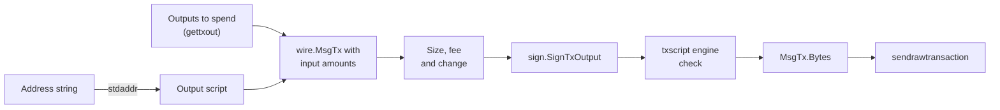

# Build and sign transactions in Go

This tutorial takes you from an address string to a signed transaction that `dcrd` accepts, using the `dcrd` Go modules: `stdaddr` to decode the address, `wire` to build the transaction, `txscript/sign` to sign it, the script engine to check it, and `rpcclient` to broadcast it. It then derives receiving addresses from an extended public key and shows how to hand funding and signing to `dcrwallet` instead. Everything runs on simnet, so no real funds are at risk.

!!! info "Applies to"
    `dcrd` 2.1.7 and `dcrwallet` 2.1.7, with the module versions `dcrd` 2.1.7 requires: `txscript/v4` v4.1.2, `wire` v1.8.0, `chaincfg/v3` v3.3.0, `dcrutil/v4` v4.0.3, `hdkeychain/v3` v3.1.3, `rpcclient/v8` v8.1.0 and `dcrec/secp256k1/v4` v4.4.1. Every program on this page was run against a simnet built from the 2.1.7 releases. Checked November 2026.

## What you will need

- A current Go release. The library modules used here declare Go 1.17 (`rpcclient` 1.18) as their minimum; `dcrd` 2.1.7 itself requires Go 1.24.
- A running simnet with a funded wallet from the `dcrd` harness script `contrib/devtools/dcr_tmux_simnet_setup.sh` ([Set up a private simnet](../environment/simnet.md)). It puts its nodes in `~/dcrdsimnetnodes`, serves `dcrd` remote procedure calls (RPC) on `127.0.0.1:19556` with user `USER` and password `PASS`, enables `txindex`, and gives `dcrd1` and `wallet1` each a `./ctl` wrapper around `dcrctl`. `dcrd` uses the certificate in its default home folder (`~/.dcrd/rpc.cert` on Linux, `~/Library/Application Support/Dcrd/rpc.cert` on macOS, `%LOCALAPPDATA%\Dcrd\rpc.cert` on Windows), creating it if missing.
- Familiarity with [Transactions for builders](../protocol/transactions.md), which this page applies without repeating.
- About 30 minutes.

## How the pieces fit

Each stage below is one package call. Signing comes last because the signature covers everything before it.



Steps 1 to 6 explain each stage with the lines that do it. Step 7 assembles them into one program and runs it.

## Step 1: Create the module

Make a directory for the program:

```bash
mkdir spend && cd spend
go mod init example.com/spend
```

Save the program from [Step 7](#step-7-run-the-complete-example-on-simnet) as `main.go`, then fetch its dependencies at the versions `dcrd` 2.1.7 uses:

```bash
go get github.com/decred/dcrd/chaincfg/chainhash@v1.0.5 \
  github.com/decred/dcrd/chaincfg/v3@v3.3.0 \
  github.com/decred/dcrd/dcrec@v1.0.1 \
  github.com/decred/dcrd/dcrec/secp256k1/v4@v4.4.1 \
  github.com/decred/dcrd/dcrutil/v4@v4.0.3 \
  github.com/decred/dcrd/rpcclient/v8@v8.1.0 \
  github.com/decred/dcrd/txscript/v4@v4.1.2 \
  github.com/decred/dcrd/wire@v1.8.0
go mod tidy
```

`stdaddr` and `sign` are subpackages of `txscript/v4` and need no separate `go get`. [dcrd Go modules](index.md) explains the module layout and versioning.

## Step 2: Decode the address and build its output script

Never build an output script from an address string by hand. `stdaddr.DecodeAddress` checks the Base58 checksum and the network prefix, and returns a typed address that knows its own script:

```go
params := chaincfg.SimNetParams()

dest, err := stdaddr.DecodeAddress(to, params)
if err != nil {
	return fmt.Errorf("destination: %w", err) // typo, wrong network or unknown type
}
switch dest.(type) {
case *stdaddr.AddressPubKeyHashEcdsaSecp256k1V0, *stdaddr.AddressScriptHashV0:
default:
	return fmt.Errorf("refusing to pay address type %T", dest)
}
destVer, destScript := dest.PaymentScript()
```

The type switch accepts only the two types wallets hand out: pay-to-pubkey-hash (P2PKH, `Ss…` on simnet, `Ds…` on mainnet) and pay-to-script-hash (P2SH, `Sc…`, `Dc…`). An address of another network fails to decode. `PaymentScript` returns the script version (0 today) with the script, because every Decred output carries both ([Scripts for builders](../protocol/scripts.md)). To tell a typo from a wrong-network address, test the error with `errors.Is` against `stdaddr.ErrBadAddressChecksum` and `stdaddr.ErrUnsupportedAddress` ([Keys, addresses and seeds](../protocol/keys-and-addresses.md)).

## Step 3: Construct the transaction with input amounts

An input names the output it spends by hash, index and tree, and repeats that output's amount in its witness as `ValueIn`. For every output you spend you need its amount and its script. `dcrd`'s `gettxout` returns both, and nothing for an output that a mined transaction has spent:

```go
utxo, err := client.GetTxOut(ctx, fundHash, index, wire.TxTreeRegular, true)
if err != nil {
	return err
}
if utxo == nil {
	// spent in a block, or never existed
}
```

The last argument, `true`, also finds outputs of mempool transactions, but not spends still in the mempool: an output you spent a moment ago looks unspent until that spend is mined, so keep your own record. Ordinary transactions create outputs in the regular tree, `wire.TxTreeRegular`. The Step 7 program first reads the funding transaction with `GetRawTransaction` to find which outputs pay the key.

Then add the inputs, the payment and a change output whose value is set once the fee is known:

```go
tx := wire.NewMsgTx() // version 1, LockTime 0, Expiry 0
op := wire.NewOutPoint(fundHash, index, wire.TxTreeRegular)
tx.AddTxIn(wire.NewTxIn(op, amountIn, nil)) // ValueIn = amountIn atoms, no signature yet

tx.AddTxOut(&wire.TxOut{Value: int64(amount), Version: destVer, PkScript: destScript})
change := &wire.TxOut{Version: ownVer, PkScript: ownScript}
tx.AddTxOut(change)
```

Set `ValueIn` to the real amount: the signature does not cover it, but your fee check depends on it, and `dcrwallet`'s `sendrawtransaction` rejects `wire.NullValueIn` (-1) unless high fees are allowed. Leave `BlockHeight` and `BlockIndex` at their null values; `dcrd` fills in all three witness fields from its own chain view. Leave `Expiry` at 0 for payments, because a non-zero expiry locks every output, change included, until it is `CoinbaseMaturity` blocks old: 256 blocks on mainnet, 16 on testnet and simnet ([expiry](../protocol/transactions.md)).

!!! warning "The change output is yours to add"
    Whatever the inputs hold beyond the outputs goes to the miner. Forget the change output, or compute it wrongly, and the difference is paid as a fee that cannot be reversed. `dcrd`'s `sendrawtransaction` refuses fees above 1 DCR/kB unless you pass `allowHighFees = true`, but accepts any fee below that rate.

## Step 4: Estimate the size and the fee

Fees are charged per 1,000 bytes of the full serialized size, signatures included. By default `dcrd` relays transactions paying at least 10,000 atoms (0.0001 DCR) per 1,000 bytes, a relay policy rather than a consensus rule. Since the signed size is unknown until you sign, estimate the worst case: a P2PKH signature script is at most 108 bytes (`txsizes.RedeemP2PKHSigScriptSize` in `dcrwallet`), a push of a signature of up to 73 bytes (Distinguished Encoding Rules (DER) encoding plus the hash type byte) and a push of a 33-byte compressed public key. The unsigned size already counts each empty script's length byte, so add 108 bytes per input:

```go
const (
	feeRate            = 10000           // atoms per 1000 bytes: dcrd's default minimum
	p2pkhSigScriptSize = 1 + 73 + 1 + 33 // txsizes.RedeemP2PKHSigScriptSize
)

estSize := tx.SerializeSize() + len(tx.TxIn)*p2pkhSigScriptSize
fee := int64(estSize) * feeRate / 1000
change.Value = totalIn - int64(amount) - fee
```

For one input and two P2PKH outputs this gives 253 bytes and 2,530 atoms, the same as `txsizes.EstimateSerializeSize` (import `decred.org/dcrwallet/v5/wallet/txsizes`, which needs Go 1.26, when you mix input types). Real signatures are usually a byte or two shorter, so the transaction comes out at 251 or 252 bytes and pays slightly more than the minimum, never less.

Negative change means the inputs do not cover the payment plus the fee: add inputs and estimate again. Change worth less than three times the fee to create and later spend it is dust, which `dcrd` refuses to relay; at the default rate the smallest acceptable P2PKH output is 6,030 atoms ([dust](../protocol/transactions.md)). Drop such a change output and let the remainder go to the fee. This check is the formula of `dcrd`'s mempool and `dcrwallet`'s `txrules.IsDustAmount`:

```go
func isDust(out *wire.TxOut) bool {
	size := int64(out.SerializeSize()) + 165 // 165: a typical P2PKH input
	return out.Value*1000/(3*size) < feeRate
}
```

For a higher rate, `client.EstimateSmartFee(ctx, 2, chainjson.EstimateSmartFeeConservative)` (`chainjson` is `github.com/decred/dcrd/rpc/jsonrpc/types/v4`) returns a rate in DCR per kB, never below the minimum relay rate.

## Step 5: Sign the inputs and verify them

Each input is signed separately over its [signature hash](../../whitepaper/06-script.md#sec:script-sighash): a BLAKE-256 hash of the hash type, the transaction prefix (every outpoint and sequence number, every output, the lock time and the expiry) and the script being satisfied. With `SigHashAll` any later change to the transaction invalidates the signature; the witness fields are not covered. `sign.SignTxOutput` reads the script you are spending, asks a key lookup for the key of its address, and returns a complete signature script:

```go
keys := sign.KeyClosure(func(a stdaddr.Address) ([]byte, dcrec.SignatureType, bool, error) {
	if a.String() != ownAddr.String() {
		return nil, 0, false, fmt.Errorf("no key for %v", a)
	}
	return wif.PrivKey(), dcrec.STEcdsaSecp256k1, true, nil // true: compressed key
})
for i := range tx.TxIn {
	sigScript, err := sign.SignTxOutput(params, tx, i, ownScript,
		txscript.SigHashAll, keys, nil, nil, true)
	if err != nil {
		return err
	}
	tx.TxIn[i].SignatureScript = sigScript
}
```

The fourth argument is the output script the input spends. After the key lookup come a script lookup for P2SH inputs, an earlier signature script to merge with for multisig ([Scripts for builders](../protocol/scripts.md)), and whether the `treasury` agenda is active, as it has been on mainnet since block 552,448. Elliptic Curve Digital Signature Algorithm (ECDSA) signing here is deterministic (RFC 6979), so a dry run prints exactly the bytes the real run broadcasts.

Before broadcasting, check each input with the script engine and the flags `dcrd` uses for relay. A failure here costs nothing:

```go
const verifyFlags = txscript.ScriptDiscourageUpgradableNops |
	txscript.ScriptVerifyCleanStack |
	txscript.ScriptVerifyCheckLockTimeVerify |
	txscript.ScriptVerifyCheckSequenceVerify |
	txscript.ScriptVerifySHA256 |
	txscript.ScriptVerifyTreasury

for i := range tx.TxIn {
	vm, err := txscript.NewEngine(ownScript, tx, i, verifyFlags, ownVer, nil)
	if err == nil {
		err = vm.Execute()
	}
	if err != nil {
		return fmt.Errorf("input %d does not verify: %w", i, err)
	}
}
```

The first four flags are `BaseStandardVerifyFlags` in `dcrd`'s `internal/mempool/policy.go`; `dcrd` adds the last two while the `lnfeatures` and `treasury` agendas are active, as they are on mainnet. The whitepaper's [verification flags](../../whitepaper/06-script.md#sec:script-flags) section defines each one.

??? note "Check an independent signer against the whitepaper's test vector"
    If you compute signature hashes yourself, for example in another language or on a hardware device, compare them with `txscript.CalcSignatureHash` on the sample transaction in the whitepaper's [script test vectors](../../whitepaper/06-script.md#sec:script-vectors):

    ```go
    raw, _ := hex.DecodeString("0100000002000102030405060708090a0b0c0d0e0f101112131415161718191a1b1c1d1e1f0100000000ffffffff202122232425262728292a2b2c2d2e2f303132333435363738393a3b3c3d3e3f0000000001feffffff02e80300000000000000001976a9140102030405060708090a0b0c0d0e0f101112131488acd0070000000000000000016a04030201080706050200f2052a010000006400000002000000015100e1f50500000000c8000000030000000152")
    sub, _ := hex.DecodeString("76a9140102030405060708090a0b0c0d0e0f101112131488ac")
    var tx wire.MsgTx
    if err := tx.FromBytes(raw); err != nil {
    	panic(err)
    }
    h, _ := txscript.CalcSignatureHash(sub, txscript.SigHashAll, &tx, 0, nil)
    fmt.Printf("%x\n", h)
    ```

    ```text title="Expected output"
    f4ce6e37ab599bcd9c770d086c79749a77f99e4a50e774caf5ff50a123feff91
    ```

## Step 6: Serialize and broadcast

`MsgTx.Bytes` gives the full serialization, prefix and witness, which `sendrawtransaction` expects. `MsgTx.TxHash` gives the transaction ID, the BLAKE-256 hash of the prefix only ([transaction identifiers](../../whitepaper/04-encoding.md#sec:encoding-txid)), so the ID is fixed before you sign.

```go
raw, err := tx.Bytes()
if err != nil {
	return err
}
fmt.Printf("txid %v\n%x\n", tx.TxHash(), raw)

txid, err := client.SendRawTransaction(ctx, tx, false) // false: keep the high-fee guard
```

`SendRawTransaction` returns the same ID, and `dcrd` relays the transaction and rebroadcasts it until it is mined. The mempool has no replace-by-fee, so choose the fee before you send.

!!! danger "Broadcasting is final"
    Once a node accepts the transaction, nobody can recall it. On mainnet, print it with a dry run and decode it with `dcrctl decoderawtransaction <HEX>` before the first real send: check every output's address and amount, and the fee.

## Step 7: Run the complete example on simnet

The program below puts Steps 2 to 6 together. `spend newkey` saves a new key in wallet import format (WIF) as `key.wif`. `spend send` spends the outputs of a funding transaction that pay that key, returns the change to the key's address and broadcasts the result.

```go title="main.go"
// Command spend builds, signs, verifies and broadcasts a simnet transaction
// that spends outputs paid to a key it holds.
//
//	spend newkey                                  create key.wif and print its address
//	spend send -fundtx TXID -to ADDR -amount DCR  pay ADDR from key.wif's outputs in TXID
package main

import (
	"bytes"
	"context"
	"encoding/hex"
	"errors"
	"flag"
	"fmt"
	"os"
	"path/filepath"
	"strings"

	"github.com/decred/dcrd/chaincfg/chainhash"
	"github.com/decred/dcrd/chaincfg/v3"
	"github.com/decred/dcrd/dcrec"
	"github.com/decred/dcrd/dcrec/secp256k1/v4"
	"github.com/decred/dcrd/dcrutil/v4"
	"github.com/decred/dcrd/rpcclient/v8"
	"github.com/decred/dcrd/txscript/v4"
	"github.com/decred/dcrd/txscript/v4/sign"
	"github.com/decred/dcrd/txscript/v4/stdaddr"
	"github.com/decred/dcrd/wire"
)

const (
	keyFile = "key.wif"

	// feeRate is dcrd's default minimum relay fee: 0.0001 DCR per 1000 bytes.
	feeRate = 10000 // atoms per kB

	// p2pkhSigScriptSize is the largest P2PKH signature script: a 73-byte
	// signature (with hash type) and a 33-byte compressed public key, each
	// with a one-byte push opcode. Same as txsizes.RedeemP2PKHSigScriptSize.
	p2pkhSigScriptSize = 1 + 73 + 1 + 33

	// verifyFlags are the script flags dcrd uses for relay once the
	// lnfeatures and treasury agendas are active, as they are on mainnet.
	verifyFlags = txscript.ScriptDiscourageUpgradableNops |
		txscript.ScriptVerifyCleanStack |
		txscript.ScriptVerifyCheckLockTimeVerify |
		txscript.ScriptVerifyCheckSequenceVerify |
		txscript.ScriptVerifySHA256 |
		txscript.ScriptVerifyTreasury
)

var params = chaincfg.SimNetParams()

func main() {
	var err error
	switch {
	case len(os.Args) > 1 && os.Args[1] == "newkey":
		err = newKey()
	case len(os.Args) > 1 && os.Args[1] == "send":
		err = send(os.Args[2:])
	default:
		err = errors.New("usage: spend newkey | spend send -fundtx TXID -to ADDR -amount DCR")
	}
	if err != nil {
		fmt.Fprintln(os.Stderr, err)
		os.Exit(1)
	}
}

// newKey creates a random secp256k1 key, saves it as WIF and prints the
// P2PKH address that pays to it.
func newKey() error {
	priv, err := secp256k1.GeneratePrivateKey()
	if err != nil {
		return err
	}
	wif, err := dcrutil.NewWIF(priv.Serialize(), params.PrivateKeyID,
		dcrec.STEcdsaSecp256k1)
	if err != nil {
		return err
	}
	f, err := os.OpenFile(keyFile, os.O_WRONLY|os.O_CREATE|os.O_EXCL, 0o600)
	if err != nil {
		return err // refuses to overwrite an existing key
	}
	defer f.Close()
	if _, err := fmt.Fprintln(f, wif.String()); err != nil {
		return err
	}
	addr, err := p2pkhAddress(priv.PubKey().SerializeCompressed())
	if err != nil {
		return err
	}
	fmt.Println(addr)
	return nil
}

// p2pkhAddress returns the pay-to-pubkey-hash address of a compressed key.
func p2pkhAddress(pubKey []byte) (*stdaddr.AddressPubKeyHashEcdsaSecp256k1V0, error) {
	return stdaddr.NewAddressPubKeyHashEcdsaSecp256k1V0(stdaddr.Hash160(pubKey), params)
}

func send(args []string) error {
	fs := flag.NewFlagSet("send", flag.ExitOnError)
	fundTx := fs.String("fundtx", "", "transaction that paid key.wif's address")
	to := fs.String("to", "", "destination address")
	amountDCR := fs.Float64("amount", 0, "amount to send in DCR")
	server := fs.String("rpcserver", "127.0.0.1:19556", "dcrd RPC host:port")
	certFile := fs.String("rpccert", filepath.Join(dcrutil.AppDataDir("dcrd", false), "rpc.cert"),
		"dcrd RPC certificate")
	dryRun := fs.Bool("dryrun", false, "print the signed transaction without broadcasting it")
	fs.Parse(args)

	// Step 2: decode and validate the destination; build its output script.
	dest, err := stdaddr.DecodeAddress(*to, params)
	if err != nil {
		return fmt.Errorf("destination: %w", err)
	}
	switch dest.(type) {
	case *stdaddr.AddressPubKeyHashEcdsaSecp256k1V0, *stdaddr.AddressScriptHashV0:
	default:
		return fmt.Errorf("refusing to pay address type %T", dest)
	}
	destVer, destScript := dest.PaymentScript()
	amount, err := dcrutil.NewAmount(*amountDCR)
	if err != nil || amount <= 0 {
		return fmt.Errorf("invalid amount %v", *amountDCR)
	}

	// The key, and the address and script it controls.
	wifStr, err := os.ReadFile(keyFile)
	if err != nil {
		return err
	}
	wif, err := dcrutil.DecodeWIF(strings.TrimSpace(string(wifStr)), params.PrivateKeyID)
	if err != nil {
		return err
	}
	ownAddr, err := p2pkhAddress(wif.PubKey())
	if err != nil {
		return err
	}
	ownVer, ownScript := ownAddr.PaymentScript()

	// Connect to dcrd. Credentials come from the environment.
	cert, err := os.ReadFile(*certFile)
	if err != nil {
		return err
	}
	client, err := rpcclient.New(&rpcclient.ConnConfig{
		Host:         *server,
		User:         os.Getenv("DCRD_RPC_USER"),
		Pass:         os.Getenv("DCRD_RPC_PASS"),
		Certificates: cert,
		HTTPPostMode: true,
	}, nil)
	if err != nil {
		return err
	}
	defer client.Shutdown()
	ctx := context.Background()

	// Step 3: find the unspent outputs of fundtx that pay the key and
	// spend them, recording each amount in ValueIn.
	fundHash, err := chainhash.NewHashFromStr(*fundTx)
	if err != nil {
		return err
	}
	prev, err := client.GetRawTransaction(ctx, fundHash)
	if err != nil {
		return err
	}
	tx := wire.NewMsgTx()
	var totalIn int64
	for i, out := range prev.MsgTx().TxOut {
		if out.Version != ownVer || !bytes.Equal(out.PkScript, ownScript) {
			continue
		}
		utxo, err := client.GetTxOut(ctx, fundHash, uint32(i), wire.TxTreeRegular, true)
		if err != nil {
			return err
		}
		if utxo == nil {
			continue // spent in a block
		}
		op := wire.NewOutPoint(fundHash, uint32(i), wire.TxTreeRegular)
		tx.AddTxIn(wire.NewTxIn(op, out.Value, nil))
		totalIn += out.Value
	}
	if len(tx.TxIn) == 0 {
		return fmt.Errorf("no unspent outputs to %v in %v", ownAddr, fundHash)
	}

	// Payment output, then a change output back to the key's address.
	tx.AddTxOut(&wire.TxOut{Value: int64(amount), Version: destVer, PkScript: destScript})
	change := &wire.TxOut{Version: ownVer, PkScript: ownScript}
	tx.AddTxOut(change)

	// Step 4: estimate the signed size and the fee, then set the change.
	estSize := tx.SerializeSize() + len(tx.TxIn)*p2pkhSigScriptSize
	fee := int64(estSize) * feeRate / 1000
	change.Value = totalIn - int64(amount) - fee
	if change.Value < 0 {
		return fmt.Errorf("insufficient funds: have %v, need %v plus fee %v",
			dcrutil.Amount(totalIn), amount, dcrutil.Amount(fee))
	}
	if isDust(change) {
		tx.TxOut = tx.TxOut[:1] // the leftover goes to the fee
		fee = totalIn - int64(amount)
		estSize = tx.SerializeSize() + len(tx.TxIn)*p2pkhSigScriptSize
	}

	// Step 5: sign every input, then run each through the script engine.
	keys := sign.KeyClosure(func(a stdaddr.Address) ([]byte, dcrec.SignatureType, bool, error) {
		if a.String() != ownAddr.String() {
			return nil, 0, false, fmt.Errorf("no key for %v", a)
		}
		return wif.PrivKey(), dcrec.STEcdsaSecp256k1, true, nil
	})
	for i := range tx.TxIn {
		sigScript, err := sign.SignTxOutput(params, tx, i, ownScript,
			txscript.SigHashAll, keys, nil, nil, true)
		if err != nil {
			return err
		}
		tx.TxIn[i].SignatureScript = sigScript
	}
	for i := range tx.TxIn {
		vm, err := txscript.NewEngine(ownScript, tx, i, verifyFlags, ownVer, nil)
		if err == nil {
			err = vm.Execute()
		}
		if err != nil {
			return fmt.Errorf("input %d does not verify: %w", i, err)
		}
	}

	// Step 6: serialize and broadcast.
	raw, err := tx.Bytes()
	if err != nil {
		return err
	}
	fmt.Printf("inputs %d, outputs %d, size %d bytes (estimated %d), fee %v\n",
		len(tx.TxIn), len(tx.TxOut), len(raw), estSize, dcrutil.Amount(fee))
	fmt.Printf("txid %v\n", tx.TxHash())
	if *dryRun {
		fmt.Println(hex.EncodeToString(raw))
		return nil
	}
	txid, err := client.SendRawTransaction(ctx, tx, false)
	if err != nil {
		return err
	}
	fmt.Printf("sent %v\n", txid)
	return nil
}

// isDust reports whether dcrd's default policy would reject out as dust: an
// output worth less than three times the fee to create and later spend it.
func isDust(out *wire.TxOut) bool {
	size := int64(out.SerializeSize()) + 165 // 165: a typical P2PKH input
	return out.Value*1000/(3*size) < feeRate
}
```

Run it against the harness:

1. Build the program and create a key. It prints the key's address:

    ```bash
    go build -o spend .
    ./spend newkey
    ```

    ```text title="Expected output (your address differs)"
    Ssk8JijNNQMDpJAXQLDMFcpb2xSYqXNByY7
    ```

2. Fund that address from the harness wallet. In `~/dcrdsimnetnodes/wallet1`:

    ```bash
    ./ctl sendtoaddress <ADDRESS> 2
    ```

    `<ADDRESS>` is the address from step 1. The command prints the funding transaction's ID; its output can be spent before it is mined.

3. In the `spend` directory, set the harness credentials and send 1.5 DCR to `SsWKp7wtdTZYabYFYSc9cnxhwFEjA5g4pFc`, an address of the harness wallet:

    ```bash
    export DCRD_RPC_USER=USER DCRD_RPC_PASS=PASS
    ./spend send -fundtx <TXID> -to SsWKp7wtdTZYabYFYSc9cnxhwFEjA5g4pFc -amount 1.5
    ```

    `<TXID>` is the ID from step 2. Add `-dryrun` to see the signed hex without broadcasting.

    ```text title="Expected output (your IDs differ; the size is 251 or 252 bytes)"
    inputs 1, outputs 2, size 252 bytes (estimated 253), fee 0.0000253 DCR
    txid 31cbdc6f68a04637e217c427564905bf0c63339542f36cc5bbd5455f5b882729
    sent 31cbdc6f68a04637e217c427564905bf0c63339542f36cc5bbd5455f5b882729
    ```

4. Check the result. In `~/dcrdsimnetnodes/dcrd1`, `./ctl getrawtransaction <TXID> 1` decodes it: one input with `amountin` 2, an output of 1.5 to the wallet and 0.4999747 DCR of change. Mine with `./mine`. `dcrd` adds new transactions to its block template only every 30 seconds, so if `./ctl getrawmempool` still lists the transaction, wait half a minute and run `./mine` again. In `wallet1`, `./ctl gettransaction <TXID>` then shows the 1.5 DCR received.

The program uses HTTP POST (`HTTPPostMode: true`) because it needs no notifications; [Talking to dcrd and dcrwallet from Go](rpc-clients.md) covers websockets. For testnet, change `params` to `chaincfg.TestNet3Params()` and `-rpcserver` to `127.0.0.1:19109`.

!!! warning "This is a teaching program"
    It keeps the private key unencrypted in `key.wif` and reuses its own address for change, which links the payments for anyone watching the chain. Production code needs encrypted key storage, a fresh change address per transaction and its own record of which outputs it owns.

## Derive addresses from an extended public key

A service that accepts payments usually holds only an account's extended public key (`dpub…` on mainnet, `spub…` on simnet) and derives a fresh receiving address per payment, keeping the private keys elsewhere. `dcrwallet`'s hierarchical deterministic (HD) accounts follow Bitcoin Improvement Proposal 44 (BIP44): below the account key, branch 0 holds receiving addresses and branch 1 change addresses.

```go
import (
	"errors"
	"fmt"

	"github.com/decred/dcrd/chaincfg/v3"
	"github.com/decred/dcrd/hdkeychain/v3"
	"github.com/decred/dcrd/txscript/v4/stdaddr"
)

// deriveAddresses returns the P2PKH addresses at indexes [from, from+n) of one
// branch (0 external, 1 internal) below an account extended public key.
func deriveAddresses(xpub string, branch, from, n uint32, params *chaincfg.Params) ([]stdaddr.Address, error) {
	acct, err := hdkeychain.NewKeyFromString(xpub, params)
	if err != nil {
		return nil, err
	}
	if acct.IsPrivate() {
		return nil, fmt.Errorf("expected an extended public key")
	}
	branchKey, err := acct.Child(branch)
	if err != nil {
		return nil, err
	}
	addrs := make([]stdaddr.Address, 0, n)
	for i := from; i < from+n; i++ {
		child, err := branchKey.Child(i)
		if errors.Is(err, hdkeychain.ErrInvalidChild) {
			continue // less than 1 in 2^127: no key at this index, skip it
		}
		if err != nil {
			return nil, err
		}
		pkHash := stdaddr.Hash160(child.SerializedPubKey())
		addr, err := stdaddr.NewAddressPubKeyHashEcdsaSecp256k1V0(pkHash, params)
		if err != nil {
			return nil, err
		}
		addrs = append(addrs, addr)
	}
	return addrs, nil
}
```

Add `github.com/decred/dcrd/hdkeychain/v3@v3.1.3` to the module to use it. `NewKeyFromString` refuses a key for another network. To check the function, run `./ctl getmasterpubkey default` in `wallet1`. The harness creates its wallet from the published test seed, so the key is the same on every machine:

```text title="Account 0 extended public key of the harness wallet (simnet only)"
spubVWKGn9TGzyo7HPaCRDhLU6yvBgoCu2nJVW8qv5aB7Xyqt46s5XRCN8cmgW2RApGdFyJgaL2iiGFRZLuL2KgXN3zpTG9CYE4dWpVmKnjdSwJ
```

| Branch/index | Address from `deriveAddresses` |
|---|---|
| `0/0` | `SsXciQNTo3HuV5tX3yy4hXndRWgLMRVC7Ah` (the harness's mining address) |
| `0/1` | `SsWKp7wtdTZYabYFYSc9cnxhwFEjA5g4pFc` (the address Step 7 paid) |
| `1/0` | `SspTF41VLkqQb6MgQ5HizgV9Eb1sinWP2Bt` |
| `1/1` | `Ssp8rWz9bGAJUGsM7gLJtD8WMzHokN626jr` |

Two things to get right:

- **Record the highest index you hand out.** A restored `dcrwallet` stops scanning a branch after 20 unused addresses in a row (its `gaplimit` default, a wallet setting, not a consensus rule), so it must be told to watch further if more issued addresses might go unpaid ([Keys, addresses and seeds](../protocol/keys-and-addresses.md)).
- **Derive private keys the same way, and keep them away from the account key.** To sign for a derived address, use `Child(branch)` then `Child(index)` on the account's extended private key, not `ChildBIP32Std`, which can give different keys below a private key, and pass `SerializedPrivKey()` to the key lookup; it can be shorter than 32 bytes, which the signing code accepts. Anyone holding the extended public key and one private key of the same account can compute every private key in it.

## Alternative: let dcrwallet fund and sign

If `dcrwallet` already holds the funds, let it choose the outputs to spend, derive a change address, sign and record the spend. You still build the outputs, so your code controls what is paid. The JSON-RPC sequence is:

`createrawtransaction`
:   Builds a transaction from inputs and outputs. Pass an empty input list to get outputs only.

`fundrawtransaction <HEX> <ACCOUNT> [<OPTIONS>]`
:   Adds inputs from `<ACCOUNT>` and a change output to a transaction that has no inputs yet, and returns the funded hex and the fee in DCR. The options object takes `changeaddress`, `feerate` in DCR/kB (default: the wallet's `txfee`, 0.0001 DCR/kB) and `conf_target`, which despite its name is the minimum number of confirmations of the outputs it selects (default 1).

`signrawtransaction <HEX>`
:   Signs every input the wallet has keys for. It needs the wallet unlocked.

`sendrawtransaction <HEX>`
:   On the wallet, publishes the transaction and records the spend at once (through `dcrd`, the wallet learns of it only when `dcrd` notifies it). It refuses fees above 0.1 DCR/kB unless `allowhighfees` is `true`.

The harness wallet starts unlocked. Unlock a real wallet first with `promptsecret | dcrctl --wallet walletpassphrase - 60`. In `~/dcrdsimnetnodes/wallet1`:

```bash
./ctl createrawtransaction '[]' '{"SsWKp7wtdTZYabYFYSc9cnxhwFEjA5g4pFc":0.25}'
./ctl fundrawtransaction <HEX> default
./ctl signrawtransaction <FUNDED_HEX>
./ctl sendrawtransaction <SIGNED_HEX>
```

Each command takes the `hex` value printed by the one before it. For one input, the payment and change, `fundrawtransaction` reports a fee of 0.0000253 DCR, the same 253-byte estimate as Step 4. From Go, use the typed client in `decred.org/dcrwallet/v5/rpc/client/dcrwallet` as [Talking to dcrd and dcrwallet from Go](rpc-clients.md) shows; it has `FundRawTransaction` and `SignRawTransaction` but no `SendRawTransaction`, so publish with its generic `Call`.

!!! warning "fundrawtransaction does not reserve its inputs"
    Until a transaction is published, two `fundrawtransaction` calls can choose the same outputs, and the second transaction to reach `dcrd` is rejected as a double spend. Publish each funded transaction promptly, or lock its inputs with `lockunspent false <OUTPOINTS>`; locks are lost when the wallet restarts.

## If something goes wrong

`destination: address "…" is not a supported type`, or `… checksum error`
:   The first means an address of another network, such as a `Ds` mainnet address. The second means a typo: ask the recipient again rather than repairing the address by hand.

`no unspent outputs to Ss… in …`
:   Nothing in that transaction pays the key in `key.wif`, or its outputs were spent in a block. Check the transaction ID and that you are in the directory holding the right `key.wif`.

`rejected transaction …: transaction … in the pool already spends the same coins`
:   An earlier transaction spending the same output, for example from a previous run, is still in the mempool. Wait for it to be mined.

`the transaction index must be enabled to query the blockchain (specify --txindex)`
:   The funding transaction is mined and `dcrd` runs without `txindex`. Enable `txindex` (the harness does), or run the program before the funding transaction is mined. To spend mined outputs without the index, change the program to take the output index and read the amount and script with `GetTxOut` alone, as in Step 3.

`rejected transaction …: regular transaction … pays a fee of … atoms which is under the required fee of … atoms for a …-byte transaction`
:   The fee was computed from too small a size. Estimate the signed size, not the unsigned one.

`… index 0 is invalid for stack size 0 …`, or `signrawtransaction` returns `complete: false` with `wallet locked`
:   An input has no signature. Unlock the wallet and sign again; never send an incompletely signed transaction.

## What you learned

- `stdaddr.DecodeAddress` validates an address for one network and gives the script to pay it.
- Every input carries the spent amount in `ValueIn`, which the signature does not cover.
- The fee follows from the signed size, estimated with 108 bytes per P2PKH input; dust change is dropped.
- `sign.SignTxOutput` signs each input with `SigHashAll`, and `txscript.NewEngine` checks it before broadcast.
- `hdkeychain` derives `dcrwallet`'s addresses from an extended public key, and `fundrawtransaction` and `signrawtransaction` hand funding and signing to the wallet.

## Next steps

- [Integrate DCR into an exchange or service](../integrate/exchange.md): apply this to deposits and withdrawals, with confirmations and mandatory upgrades in mind.
- [Scripts for builders](../protocol/scripts.md): sign P2SH multisig and time-locked scripts with the same `sign` and `txscript` packages.
- [Talking to dcrd and dcrwallet from Go](rpc-clients.md): websocket connections, notifications and gRPC.
- [Add Decred to a wallet](../integrate/wallet-support.md): derivation, serialization and signing for an independent wallet implementation.
- [Cold storage with an offline wallet](../../user/security/cold-storage.md): the same build, sign and broadcast split, with the signing key kept off the network.

*[BIP44]: Bitcoin Improvement Proposal 44
*[DER]: Distinguished Encoding Rules
*[ECDSA]: Elliptic Curve Digital Signature Algorithm
*[HD]: hierarchical deterministic
*[P2PKH]: pay-to-pubkey-hash
*[P2SH]: pay-to-script-hash
*[RFC]: Request for Comments
*[RPC]: remote procedure call
*[WIF]: wallet import format
