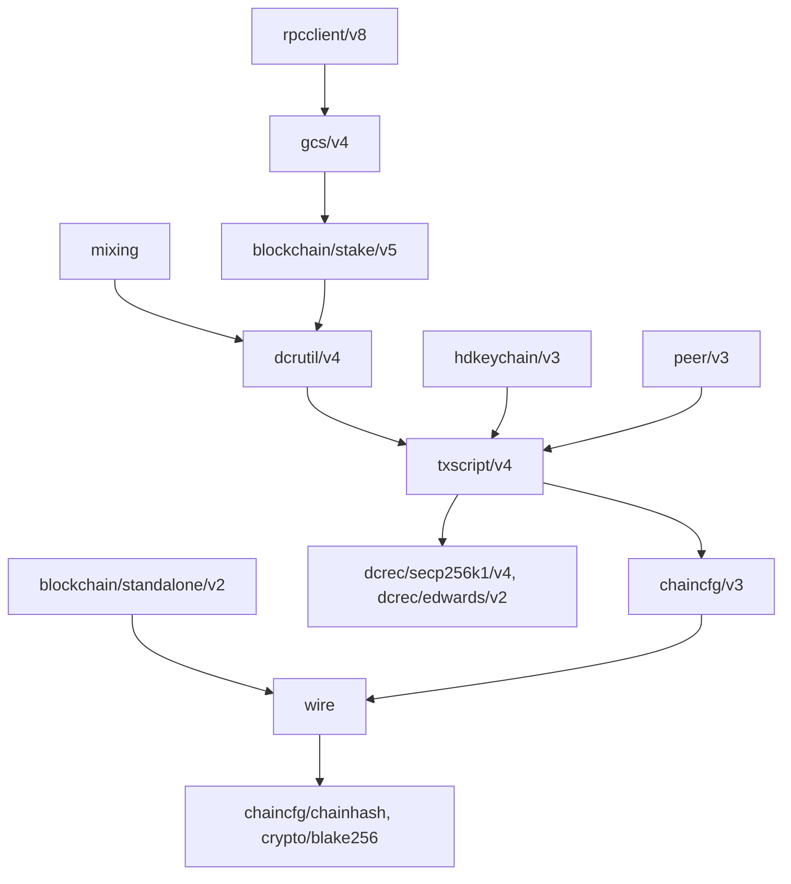

# dcrd Go modules

The `dcrd` repository publishes its building blocks as 29 separately versioned Go library modules, from transaction serialization to a websocket RPC client. This page maps them by job, gives the version each one has in Decred 2.1.7, and adds the `dcrwallet` and `vspd` modules that Go integrations usually need alongside them.

!!! info "Applies to"
    Module versions required by `dcrd` 2.1.7 (tag `release-v2.1.7`), `dcrwallet` 2.1.7 (module `decred.org/dcrwallet/v5` v5.1.2) and `vspd` 1.5.0. Checked November 2026.

## In this section

<div class="grid cards" markdown>

-   **[Talking to dcrd and dcrwallet from Go](rpc-clients.md)**

    ---

    Connect with `rpcclient/v8`, the `dcrwallet` JSON-RPC client and gRPC, with TLS and authentication, on simnet.

-   **[Build and sign transactions in Go](build-and-sign-transactions.md)**

    ---

    Decode addresses, build, size, sign and broadcast a transaction with `wire`, `stdaddr` and `txscript/sign`.

</div>

## Modules by job

Each table lists the module path, the version `dcrd` 2.1.7 requires in its `go.mod`, and where to start in the API. Every version shown is also the newest tag of that module as of November 2026, except `connmgr/v3`, which has v3.1.4. All `dcrd` paths begin with `github.com/decred/dcrd/`; API documentation for each is on pkg.go.dev under the full path.

### Talk to a node or wallet

| Module | Version | What it gives you | Start with |
|---|---|---|---|
| `rpcclient/v8` | v8.1.0 | A JSON-RPC client for `dcrd`, over websocket (default, with reconnects and notifications) or HTTP POST | `rpcclient.New`, `ConnConfig`, `NotificationHandlers` |
| `rpc/jsonrpc/types/v4` | v4.4.0 | Go types for every `dcrd` command, result and notification, shared by `dcrd`'s own RPC server and its clients | `*Cmd` and `*Result` types, such as `GetBlockChainInfoResult` |
| `dcrjson/v4` | v4.2.0 | The command registry and JSON-RPC request and response encoding that `rpc/jsonrpc/types/v4` and `dcrwallet`'s `rpc/jsonrpc/types` build on | `dcrjson.MarshalCmd` |

`rpcclient/v8` covers `dcrd` methods only. For `dcrwallet`, use the packages in [dcrwallet and vspd modules](#dcrwallet-and-vspd-modules). Both projects name their type package `types`; `rpcclient` imports `dcrd`'s as `chainjson` and `dcrwallet` imports it as `dcrdtypes`.

### Transactions, scripts and addresses

| Module | Version | What it gives you | Start with |
|---|---|---|---|
| `wire` | v1.8.0 | Serialization of transactions, blocks, headers and every peer-to-peer message, including the StakeShuffle mixing messages | `wire.NewMsgTx`, `MsgTx.TxHash`, `MsgTx.Bytes`, `BlockHeader.BlockHash` |
| `txscript/v4` | v4.1.2 | The script engine, script builder and signature hashing | `txscript.NewEngine`, `NewScriptBuilder`, `CalcSignatureHash` |
| `txscript/v4/stdaddr` | (in `txscript/v4`) | Address decoding and encoding for every address type, and the scripts they pay to | `stdaddr.DecodeAddress`, `Address.PaymentScript` |
| `txscript/v4/stdscript` | (in `txscript/v4`) | Recognizing standard script forms and extracting their addresses | `stdscript.DetermineScriptType`, `ExtractAddrs` |
| `txscript/v4/sign` | (in `txscript/v4`) | Signing inputs that spend standard scripts, including treasury spends | `sign.SignTxOutput`, `RawTxInSignature`, `TSpendSignatureScript` |
| `blockchain/stake/v5` | v5.0.3 | Recognizing and checking ticket, vote, revocation and treasury transactions; reading ticket commitments | `stake.DetermineTxType`, `IsSStx`, `IsSSGen`, `IsTSpend`, `AddrFromSStxPkScrCommitment` |
| `dcrutil/v4` | v4.0.3 | Amounts in atoms, wallet import format (WIF) private keys, signed-message verification, hash-caching `Tx` and `Block` wrappers, default data directories | `dcrutil.Amount`, `NewAmount`, `DecodeWIF`, `VerifyMessage`, `AppDataDir` |
| `chaincfg/v3` | v3.3.0 | The parameters of mainnet, testnet, simnet and regnet: prefixes, ports, intervals, agendas | `chaincfg.MainNetParams()`, `TestNet3Params()`, `SimNetParams()`, `RegNetParams()` |
| `chaincfg/chainhash` | v1.0.5 | The 32-byte `Hash` type used everywhere. `String` prints the bytes reversed, the way RPCs and explorers show hashes | `chainhash.Hash`, `NewHashFromStr` |

`wire`'s `TxHash` covers only the transaction prefix, not the signatures, so a transaction ID does not change when it is signed. Addresses live in `stdaddr`, not in `dcrutil`. [Transactions for builders](../protocol/transactions.md) and [Scripts for builders](../protocol/scripts.md) explain the formats these packages handle.

### Keys and signatures

| Module | Version | What it gives you | Start with |
|---|---|---|---|
| `hdkeychain/v3` | v3.1.3 | Hierarchical deterministic (HD) extended keys (`dpub`/`dprv` on mainnet) | `hdkeychain.NewMaster`, `NewKeyFromString`, `ExtendedKey.Child`, `Neuter` |
| `dcrec/secp256k1/v4` | v4.4.1 | secp256k1 keys, with the Elliptic Curve Digital Signature Algorithm (ECDSA) in `ecdsa` and Decred's EC-Schnorr-DCRv0 in `schnorr` | `secp256k1.GeneratePrivateKey`, `PrivKeyFromBytes` |
| `dcrec/edwards/v2` | v2.0.4 | Ed25519 keys and signatures as Decred scripts use them | `edwards.GeneratePrivateKey` |
| `dcrec` | v1.0.1 | The signature-type constants scripts and signers share | `dcrec.STEcdsaSecp256k1`, `STEd25519`, `STSchnorrSecp256k1` |
| `crypto/blake256` | v1.1.0 | BLAKE-256, the hash behind transaction IDs, block hashes and `chainhash` | `blake256.Sum256`, `New` |

To derive the same addresses as `dcrwallet`, use `ExtendedKey.Child`. `ChildBIP32Std` follows BIP32 strictly and gives different hardened child keys below a private key that starts with a zero byte; [Keys, addresses and seeds](../protocol/keys-and-addresses.md) explains why. The block proof-of-work hash is BLAKE3, not BLAKE-256: `wire`'s `BlockHeader.PowHashV2` computes it.

### Consensus helpers and light clients

| Module | Version | What it gives you | Start with |
|---|---|---|---|
| `blockchain/standalone/v2` | v2.3.0 | Consensus calculations with few dependencies: proof-of-work checks, absolutely scheduled exponentially rising targets (ASERT) difficulty, merkle roots, block subsidy, treasury vote windows, transaction sanity | `standalone.CheckProofOfWork`, `CalcASERTDiff`, `CalcTxTreeMerkleRoot`, `NewSubsidyCache`, `IsTreasuryVoteInterval` |
| `gcs/v4` | v4.1.1 | Golomb-coded set filters; `gcs/blockcf2` builds the version 2 block filters that headers commit to, used by light (SPV) wallets | `blockcf2.Regular`, `blockcf2.Key`, `gcs.FilterV2` |
| `blockchain/v5` | v5.1.1 | Test tools only: `chaingen` generates chains of blocks and `fullblocktests` exercises the consensus rules. The block validator is not in this module | `chaingen`, `fullblocktests` |

### Peer-to-peer and mixing

| Module | Version | What it gives you | Start with |
|---|---|---|---|
| `peer/v3` | v3.2.0 | A Decred network peer: handshake, message reading and writing, per-message callbacks | `peer.NewOutboundPeer`, `NewInboundPeer`, `Config.Listeners` |
| `addrmgr/v3` | v3.0.0 | A concurrency-safe store of known peer addresses for peer discovery | `addrmgr.New` |
| `connmgr/v3` | v3.1.3 | Connection handling: keeping a set number of outbound connections, sourcing peers, connection limits, Tor lookups | `connmgr.New` |
| `mixing` | v0.7.5 | StakeShuffle: `mixclient` runs mixes for a wallet, `mixpool` validates and holds mix messages for relays and wallets, `utxoproof` proves input ownership | `mixclient.NewClient`, `mixpool.NewPool` |

[Mixing for builders](../protocol/mixing.md) covers the `mixing` module in depth.

### Supporting modules

Four of these come in as dependencies of the modules above: `database/v3`, `container/lru`, `crypto/rand` and `crypto/ripemd160`. No other library module requires `bech32`, `certgen`, `container/apbf` or `math/uint256`; only the `dcrd` program uses them, so import them directly if you need them (`dcrwallet` requires `certgen` this way).

| Module | Version | Purpose |
|---|---|---|
| `database/v3` | v3.0.3 | Block and metadata storage interface used by `dcrd` and `blockchain/stake/v5` |
| `bech32` | v1.1.4 | Bech32 encoding (BIP 173) |
| `certgen` | v1.2.0 | Self-signed TLS certificate generation for RPC servers |
| `container/apbf` | v1.0.1 | Age-partitioned Bloom filter |
| `container/lru` | v1.0.0 | Concurrency-safe generic LRU caches with optional expiry |
| `crypto/rand` | v1.0.1 | Fast userspace random number generator, reseeded from the operating system |
| `crypto/ripemd160` | v1.0.2 | RIPEMD-160, used in address hashes |
| `math/uint256` | v1.0.2 | Fixed-precision unsigned 256-bit arithmetic |

## How the modules depend on each other

Everything rests on `wire` and the hashing and curve modules; the higher a module sits, the more it pulls in. Arrows point from a module to a module it imports. The diagram is simplified from `dcrd`'s [module hierarchy graph](https://github.com/decred/dcrd/blob/release-v2.1.7/docs/assets/module_hierarchy.gv) and was checked against each `go.mod` at `release-v2.1.7`.



Two consequences for your dependency tree:

- `blockchain/standalone/v2` needs only `wire` and `chainhash`, so a light client or explorer can check proof of work and subsidy without the script engine.
- `rpcclient/v8` adds `gcs/v4`, `blockchain/stake/v5` and `database/v3` (which requires goleveldb) to your module graph, because it decodes compact filters. Also not shown: `rpcclient/v8` imports `rpc/jsonrpc/types/v4` and `dcrjson/v4`, and `peer/v3` and `mixing` use `container/lru`.

## dcrwallet and vspd modules

### dcrwallet: `decred.org/dcrwallet/v5`

`dcrwallet` is a single module with the import path `decred.org/dcrwallet/v5` (a `decred.org` path, not `github.com`). Its tags `release-v2.1.7` and `v5.1.2` name the same commit. The packages an integration uses are:

| Package | What it gives you | Start with |
|---|---|---|
| `decred.org/dcrwallet/v5/rpc/client/dcrwallet` | A typed client for the `dcrwallet` JSON-RPC API, on top of any transport that implements its `Caller` interface | `dcrwallet.NewClient(caller, params)`; `RawRequestCaller` adapts any type with a `RawRequest` method, such as an `rpcclient/v8` client |
| `decred.org/dcrwallet/v5/rpc/jsonrpc/types` | Go types for `dcrwallet`'s JSON-RPC commands and results, registered with `dcrjson/v4` | `*Cmd` and `*Result` types |
| `decred.org/dcrwallet/v5/rpc/walletrpc` | Generated gRPC client and server code for `rpc/api.proto` (`WalletService`, `TicketBuyerService`, `VotingService` and the others) | `walletrpc.NewWalletServiceClient`, `NewVersionServiceClient` |

Importing any of these makes `decred.org/dcrwallet/v5` a dependency of your build, with its full requirement list, including gRPC. Its `go.mod` declares `go 1.26.0`, so you need Go 1.26 or later. `dcrwallet` 2.1.7 requires the same versions of the `dcrd` modules it shares with `dcrd` 2.1.7, except `connmgr/v3` v3.1.4.

The APIs these packages call are described in [dcrwallet JSON-RPC API](../api/dcrwallet-json-rpc.md) and [dcrwallet gRPC API](../api/dcrwallet-grpc.md).

### vspd: `client/v4` and `types/v3`

`vspd` publishes two small modules for wallets that buy tickets through a voting service provider (VSP). `dcrwallet` 2.1.7 uses both, at the newest tags.

| Module | Version | What it gives you |
|---|---|---|
| `github.com/decred/vspd/client/v4` | v4.0.2 | `client.Client` with methods `VspInfo`, `FeeAddress`, `PayFee`, `TicketStatus` and `SetVoteChoices`. You supply the VSP's `URL`, its public key in `PubKey`, a `Sign` function that signs each request body with the private key of the address the client names (normally the ticket's commitment address), and a `Log` (a `slog.Logger` from `github.com/decred/slog`; use `slog.Disabled` for no logging). A nil `Log` panics on the first request |
| `github.com/decred/vspd/types/v3` | v3.0.0 | The request and response structs of API v3 and the `ErrorCode` values a VSP returns |

The client checks the `VSP-Server-Signature` header (Ed25519, against `PubKey`) on every successful response and returns an error if it fails. It has no method for the `setaltsignaddr` endpoint. Both modules declare `go 1.19`. The full request flow is in [vspd API](../api/vspd-api.md).

## Versions and import paths

Decred modules follow Go's semantic import versioning:

- **The major version is part of the import path** from v2 on: `github.com/decred/dcrd/chaincfg/v3`. Modules at v0 or v1 (`wire`, `chaincfg/chainhash`, `mixing`) have no suffix.
- **The package name drops the suffix.** `github.com/decred/dcrd/rpcclient/v8` is package `rpcclient`, and `txscript/v4/stdaddr` is package `stdaddr`.
- **Each module has its own version line.** Module versions are unrelated to program releases: `dcrd` 2.1.7 uses `rpcclient/v8` v8.1.0 and `chaincfg/v3` v3.3.0. The repository's root module, which builds the `dcrd` program, keeps its node packages (block validation, mempool, mining, RPC server) under `internal/`, so they cannot be imported.
- **A breaking API change bumps the major version.** `dcrd`'s [contribution guidelines](https://github.com/decred/dcrd/blob/release-v2.1.7/docs/code_contribution_guidelines.md) require a new major version for any breaking change to a module, including a v1 module that has not yet been released. Different majors are different modules: types from `rpcclient/v7` and `rpcclient/v8` do not mix.
- **v0 promises nothing.** `mixing` is at v0, so its API can change in any release. Pin the exact version the current release uses.

!!! warning "Default branches are ahead of the release"
    On `dcrd`'s `master` (2.2.0-pre), `addrmgr/v4`, `peer/v4`, `rpcclient/v9` and `rpc/jsonrpc/types/v5` exist only as source: they have no release tag, and the root module reaches them through `replace` directives. Code written against them will not build from tagged versions. Build against the versions on this page unless you are contributing to `dcrd` itself.

### Example: decode a testnet address

This program imports two modules and shows the path-versus-package-name rule. Save it as `main.go` in an empty directory:

```go
package main

import (
	"fmt"
	"log"

	"github.com/decred/dcrd/chaincfg/v3"
	"github.com/decred/dcrd/txscript/v4/stdaddr"
	"github.com/decred/dcrd/txscript/v4/stdscript"
)

func main() {
	params := chaincfg.TestNet3Params()
	addr, err := stdaddr.DecodeAddress("TsmfmUitQApgnNxQypdGd2x36djCCpDpERU", params)
	if err != nil {
		log.Fatal(err)
	}
	version, script := addr.PaymentScript()
	fmt.Println(stdscript.DetermineScriptType(version, script))
	fmt.Printf("version %d, script %x\n", version, script)

	_, err = stdaddr.DecodeAddress(addr.String(), chaincfg.MainNetParams())
	fmt.Println(err)
}
```

In the same directory, create a module, add the versions `dcrd` 2.1.7 uses, and run the program. `go mod tidy` adds the dependencies of the `stdaddr` and `stdscript` packages, such as `github.com/decred/base58`; without it, `go run` stops with a missing `go.sum` entry.

```bash
go mod init example.com/decodeaddr
go get github.com/decred/dcrd/chaincfg/v3@v3.3.0 github.com/decred/dcrd/txscript/v4@v4.1.2
go mod tidy
go run .
```

```text title="Expected output"
pubkeyhash
version 0, script 76a914e280cb6e66b96679aec288b1fbdbd4db08077a1b88ac
address "TsmfmUitQApgnNxQypdGd2x36djCCpDpERU" is not a supported type
```

The last line shows that a testnet address does not decode with mainnet parameters, and that the error does not mention the network. Always pass the parameters of the network you expect.

Check `go.mod` afterwards. Go's minimal version selection picks the lowest version that satisfies every requirement, so indirect modules can be older than the ones the release uses: here `wire` arrives as v1.7.1, while `dcrd` 2.1.7 uses v1.8.0. To match a release exactly, require the versions from its `go.mod`.

## Consensus-sensitive packages

`dcrd` is the reference implementation: [where it and the whitepaper disagree, `dcrd` is correct](../../whitepaper/02-conventions.md#conv:reference). Its block and transaction validator lives in the root module's `internal/blockchain` and cannot be imported. No published module answers "is this block valid?". Ask a synced `dcrd` node that question; use the modules for the parts you need to compute yourself.

These packages encode consensus rules, so their output must match the network exactly. Use them as published and do not patch them:

| Package | Consensus role |
|---|---|
| `wire` | Serialization, transaction IDs, block hashes, and the BLAKE3 proof-of-work hash |
| `txscript/v4` | Script execution and signature hashes |
| `dcrec/secp256k1/v4`, `dcrec/edwards/v2` | Signature verification for the three signature types; changing EC-Schnorr-DCRv0 would need a new scheme and a consensus change |
| `crypto/blake256`, `chaincfg/chainhash` | The hash behind IDs, merkle roots and signature hashes |
| `blockchain/standalone/v2` | Proof of work, ASERT difficulty, merkle roots, subsidy, treasury windows |
| `blockchain/stake/v5` | The forms of tickets, votes, revocations and treasury transactions |
| `gcs/v4/blockcf2` | The filters that block headers commit to ([header commitments](../../whitepaper/16-filters.md#sec:filters-commitments)) |
| `chaincfg/v3` | Network parameters and agenda definitions |

Three rules keep code built on them correct:

- **Standard is not valid.** `stdaddr` and `stdscript` describe *standard* scripts, which is relay policy. Consensus accepts non-standard scripts too, and what counts as standard can change. Do not use them to decide whether a transaction is valid; see [standard transactions](../../whitepaper/17-policy.md#sec:policy-standard) in the whitepaper.
- **You choose the rule set.** The packages do not track which agendas are active. `txscript.NewEngine` takes `ScriptFlags` (for example `ScriptVerifyTreasury`), and `SubsidyCache.CalcWorkSubsidyV3` takes a split variant such as `standalone.SSVDCP0012`. Pass the rules in force at that height; `getblockchaininfo` returns each agenda's status in `deployments`.
- **Upgrade with the network.** A consensus change ships in new module versions. For example, `chaincfg/v3` v3.3.0 added the `maxtreasuryspend` agenda, which v3.2.1 does not have. When a release that changes consensus comes out, update your modules to the versions in its `go.mod` along with your nodes; see [Upgrading and mandatory releases](../../user/run/upgrades.md).

## Next steps

- [Talking to dcrd and dcrwallet from Go](rpc-clients.md): connect to a simnet node and wallet with the clients above.
- [Build and sign transactions in Go](build-and-sign-transactions.md): put `wire`, `stdaddr` and `txscript/sign` to work.
- [Build from source](../environment/build-from-source.md): Go workspaces for changes that span several modules or repositories.
- [A tour of the dcrd and dcrwallet code](../contributing/codebase-tour.md): the `internal/` packages behind these modules.

*[API]: application programming interface
*[ASERT]: absolutely scheduled exponentially rising targets
*[ECDSA]: Elliptic Curve Digital Signature Algorithm
*[HD]: hierarchical deterministic
*[LRU]: least recently used
*[RPC]: remote procedure call
*[SPV]: simplified payment verification
*[TLS]: Transport Layer Security
*[VSP]: voting service provider
*[WIF]: wallet import format
