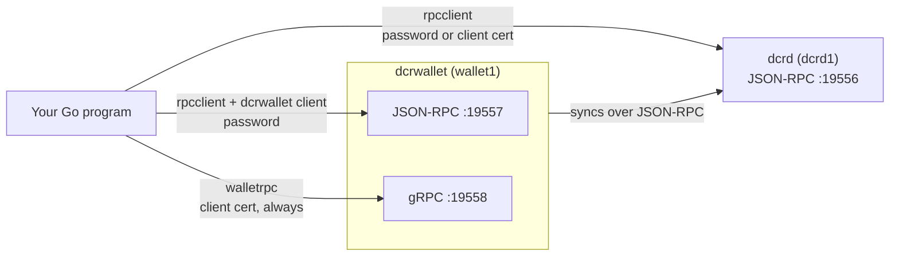
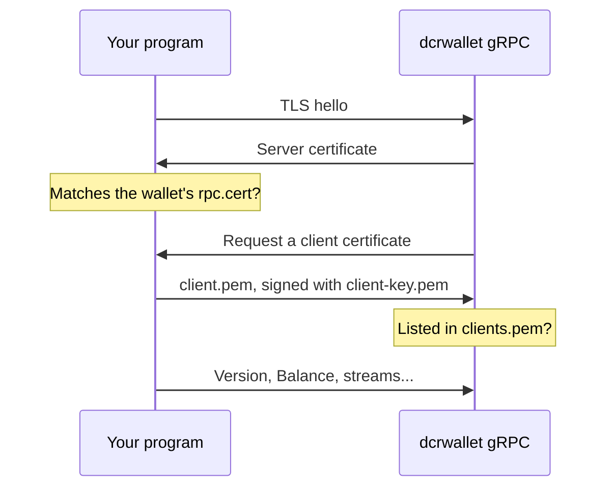

# Talking to dcrd and dcrwallet from Go

This tutorial takes a Go developer from an empty module to four working programs on a private simnet: one that queries `dcrd`, one that follows blocks, votes and treasury spends as they happen, and two that drive `dcrwallet` over JSON-RPC and gRPC. Each step sets up TLS and authentication the way the servers expect.

!!! info "Applies to"
    dcrd and dcrwallet 2.1.7, with the Go modules `github.com/decred/dcrd/rpcclient/v8` v8.1.0 and `decred.org/dcrwallet/v5` v5.1.2 (the wallet module built into the 2.1.7 release). Checked November 2026.

## Three clients, two servers

`dcrd` and `dcrwallet` each run a JSON-RPC server over HTTPS with a websocket endpoint at `/ws`, and `dcrwallet` also runs a gRPC server. The diagram shows which Go package reaches which server, and how each one logs in.



| Package | Talks to | Transport | Authentication | Push events |
|---|---|---|---|---|
| `github.com/decred/dcrd/rpcclient/v8` | `dcrd` | Websocket (default) or HTTP POST, TLS | Basic auth, or a TLS client certificate | Yes, websocket only |
| `decred.org/dcrwallet/v5/rpc/client/dcrwallet` on top of `rpcclient` | `dcrwallet` JSON-RPC | Same as above | Basic auth, or a client certificate with `jsonrpcauthtype=clientcert` | None |
| `decred.org/dcrwallet/v5/rpc/walletrpc` with `google.golang.org/grpc` | `dcrwallet` gRPC | HTTP/2, TLS | Client certificate, always | Yes, as gRPC streams |

The ports are simnet's; mainnet uses 9109, 9110 and 9111. [Choosing an API](../api/index.md) compares these APIs with Decred's others.

## What you will need

- **Go 1.26 or later**, which `decred.org/dcrwallet/v5` v5.1.2 requires.
- **A running simnet** from [Set up a private simnet](../environment/simnet.md), started with its quick-start harness `dcr_tmux_simnet_setup.sh` ([source at release-v2.1.7](https://github.com/decred/dcrd/blob/release-v2.1.7/contrib/devtools/dcr_tmux_simnet_setup.sh)), which runs in tmux and needs `dcrd`, `dcrwallet` and `dcrctl` on your `PATH`.
- **`gencerts`**, which ships in the command-line bundle (or `go install github.com/decred/dcrd/cmd/gencerts@release-v2.1.7`).
- **About 45 minutes.**

The examples use the values the harness creates; on a hand-built simnet, substitute your own.

| Value | Harness setting |
|---|---|
| `dcrd` RPC address (node `dcrd1`) | `127.0.0.1:19556` |
| `dcrd` RPC username and password | `USER` and `PASS` (in `~/dcrdsimnetnodes/dcrd.conf`) |
| `dcrd` certificate | `rpc.cert` in dcrd's default home folder: `~/.dcrd` (Linux) or `~/Library/Application Support/Dcrd` (macOS) |
| Wallet JSON-RPC and gRPC addresses (`wallet1`) | `127.0.0.1:19557` and `127.0.0.1:19558` |
| Wallet username and password | `USER` and `PASS` (in `~/dcrdsimnetnodes/wallet.conf`) |
| Wallet certificate and trusted client certificates | `rpc.cert` and `clients.pem` (not created by the harness) in `~/dcrdsimnetnodes/wallet1/data` |
| Wallet private passphrase | `123`, set with `pass=123` so `wallet1` starts unlocked |

The harness deletes and recreates `~/dcrdsimnetnodes` (or `$DCR_SIMNET_ROOT`) at every start. The RPC username and password are not wallet passphrases; they only let a client in.

!!! warning "Simnet values only"
    These programs hard-code harness credentials and send coins without asking. On a real network, read credentials from a protected config file or the environment, and keep both RPC servers on localhost: anyone who can log in to an unlocked `dcrwallet` can spend from it.

## Step 1: Create the module

Make a module with one directory per program:

```bash
mkdir dcrclients && cd dcrclients
go mod init example.com/dcrclients
go get github.com/decred/dcrd/rpcclient/v8@v8.1.0
mkdir dcrdinfo dcrdnotify walletjson walletgrpc
```

Decred modules carry their major version in the import path (`rpcclient/v8` goes with `dcrutil/v4` and `chaincfg/v3`); [dcrd Go modules](index.md) explains the policy. Run `go mod tidy` after adding each program. It drops modules that nothing imports yet, so step 4 pins the wallet module when a program first needs it.

## Step 2: Connect to dcrd and call methods

`rpcclient.New` dials the server, checks the TLS certificate and logs in. Three settings matter:

- **`Certificates`**: the PEM bytes of `dcrd`'s self-signed `rpc.cert`, the one certificate the client trusts.
- **`User` and `Pass`**: the `rpcuser` and `rpcpass` from `dcrd.conf`.
- **`Endpoint: "ws"`**: the websocket path. Websocket mode, the default, keeps one connection open, carries notifications and reconnects by itself.

Save this as `dcrdinfo/main.go`:

```go title="dcrdinfo/main.go"
package main

import (
	"context"
	"errors"
	"fmt"
	"log"
	"os"
	"path/filepath"
	"time"

	"github.com/decred/dcrd/dcrjson/v4"
	"github.com/decred/dcrd/dcrutil/v4"
	"github.com/decred/dcrd/rpcclient/v8"
)

// Values created by the simnet harness. Read them from your own
// configuration in real code.
const (
	dcrdHost = "127.0.0.1:19556"
	dcrdUser = "USER"
	dcrdPass = "PASS"
)

var dcrdCert = filepath.Join(dcrutil.AppDataDir("dcrd", false), "rpc.cert")

func main() {
	ctx, cancel := context.WithTimeout(context.Background(), 30*time.Second)
	defer cancel()

	cert, err := os.ReadFile(dcrdCert)
	if err != nil {
		log.Fatal(err)
	}

	client, err := rpcclient.New(&rpcclient.ConnConfig{
		Host:         dcrdHost,
		Endpoint:     "ws",
		User:         dcrdUser,
		Pass:         dcrdPass,
		Certificates: cert,
	}, nil)
	if err != nil {
		log.Fatal(err)
	}
	defer func() {
		client.Shutdown()
		client.WaitForShutdown()
	}()

	info, err := client.GetBlockChainInfo(ctx)
	if err != nil {
		log.Fatal(err)
	}
	fmt.Printf("chain %s, height %d\nbest block %s\n",
		info.Chain, info.Blocks, info.BestBlockHash)

	sdiff, err := client.GetStakeDifficulty(ctx)
	if err != nil {
		log.Fatal(err)
	}
	fmt.Printf("ticket price %.8f DCR, next %.8f DCR\n",
		sdiff.CurrentStakeDifficulty, sdiff.NextStakeDifficulty)

	// Ask for a block that does not exist yet, to see an error from dcrd.
	_, err = client.GetBlockHash(ctx, info.Blocks+1000)
	var rpcErr *dcrjson.RPCError
	switch {
	case errors.As(err, &rpcErr):
		fmt.Printf("dcrd error %d: %s\n", rpcErr.Code, rpcErr.Message)
	case err != nil:
		log.Fatal(err)
	}
}
```

Run it:

```bash
go mod tidy
go run ./dcrdinfo
```

```text title="Expected output (example values, right after the harness starts)"
chain simnet, height 32
best block fc6bf6b9c8e623487a056ff920870326f7cdb3e88a9a5bf61b80e65e30f771c1
ticket price 0.00020000 DCR, next 0.00020000 DCR
dcrd error -1: Block number out of range: 1032
```

The ticket price (stake difficulty) sits at simnet's minimum of 0.0002 DCR. Amounts the JSON carries in DCR, like this one, arrive as `float64`; methods that return a `dcrutil.Amount` give atoms.

### Handle errors

| Group | How it shows up | Typical cause |
|---|---|---|
| Connection | `rpcclient.New` fails with `rpcclient.ErrInvalidAuth` ("authentication failure"), `rpcclient.ErrInvalidEndpoint`, or a TLS error such as `x509: certificate signed by unknown authority` | Wrong password, `Endpoint` or certificate file |
| Server | A `*dcrjson.RPCError` with `Code` and `Message` | Bad parameters, unknown block or transaction, unknown method |
| Client side | `rpcclient.ErrRequestCanceled` when your context ends; marshaling errors | Deadline reached, programming errors |

Use `errors.As` to reach the `*dcrjson.RPCError`. One code can carry several meanings (`-1` is both "out of range" and "unimplemented"), so log the message too.

In websocket mode the client reconnects after a dropped connection and resends calls in flight, so a call can wait as long as the server is down. Give every call a context that ends, through a deadline or cancellation at shutdown, or set `DisableAutoReconnect: true` to get `rpcclient.ErrClientDisconnect` instead. With `HTTPPostMode: true`, each call is a separate HTTPS POST: nothing reconnects, notification calls fail with `rpcclient.ErrWebsocketsRequired`, and a wrong password shows up only at the first call, as `status code: 401`.

### Asynchronous calls and unwrapped methods

Every method has an `Async` form that returns a future, so several calls can be in flight at once:

```go
countF := client.GetBlockCountAsync(ctx)
sdiffF := client.GetStakeDifficultyAsync(ctx)
height, err := countF.Receive()
// ...
sdiff, err := sdiffF.Receive()
```

`RawRequest` calls any `dcrd` method by name, including those without a typed wrapper, and returns the raw JSON result:

```go
raw, err := client.RawRequest(ctx, "getmixpairrequests", nil)
var pairRequests []string // hex-encoded mix pair request messages
err = json.Unmarshal(raw, &pairRequests)
```

The [dcrd JSON-RPC API](../api/dcrd-json-rpc.md) reference lists every method and its result.

### Log in with a client certificate instead of a password

`dcrd` can authenticate clients by TLS certificate: any client whose certificate chains to one in the server's `clients.pem` gets full access, and the limited user (`rpclimituser`) does not exist in this mode.

!!! note
    The harness wallet and `ctl` scripts log in to `dcrd1` with `USER` and `PASS`, so switching that node to client certificates breaks them. Try it on a separate `dcrd`, or skip to step 3.

1. Make a key pair for your program (by default, `gencerts` writes a self-signed P-256 certificate valid for 10 years):

    ```bash
    gencerts client.pem client-key.pem
    ```

2. Add the certificate to the file `dcrd` trusts, `clients.pem` in its home folder (or the file named by `clientcafile`), and configure `dcrd`:

    ```ini title="dcrd.conf"
    authtype=clientcert
    ; remove rpcuser, rpcpass, rpclimituser and rpclimitpass:
    ; dcrd refuses to start with them under authtype=clientcert
    ```

3. Restart `dcrd`, and connect with `AuthType` set and no `User` or `Pass`:

    ```go
    client, err := rpcclient.New(&rpcclient.ConnConfig{
    	Host:         dcrdHost,
    	Endpoint:     "ws",
    	Certificates: cert,
    	AuthType:     rpcclient.AuthTypeClientCert,
    	ClientCert:   "client.pem",
    	ClientKey:    "client-key.pem",
    }, nil)
    ```

`ClientCert` and `ClientKey` are file paths, and `rpcclient.New` refuses a config that also sets `User` or `Pass`. Keep `client-key.pem` private: it is now the password.

## Step 3: Subscribe to notifications

Over a websocket, `dcrd` pushes only the events you register for. Each registration call feeds handlers in `rpcclient.NotificationHandlers`:

| Register with | Handler | Fires when |
|---|---|---|
| `NotifyBlocks` | `OnBlockConnected`, `OnBlockDisconnected`, `OnReorganization` | A block joins or leaves the best chain |
| `NotifyWinningTickets` | `OnWinningTickets` | A block is connected; carries the tickets the [lottery](../../whitepaper/08-staking.md#sec:staking-lottery) chose to vote on it |
| `NotifyNewTickets` | `OnNewTickets` | Tickets mature and become live |
| `NotifyTSpend` | `OnTSpend` | A [treasury spend (TSPEND)](../../whitepaper/12-treasury.md#sec:treasury-tspend) enters the mempool |
| `NotifyNewTransactions` | `OnTxAccepted` or `OnTxAcceptedVerbose` | Any transaction enters the mempool |
| `NotifyWork` | `OnWork` | A new block template is ready for miners |
| `LoadTxFilter` | `OnRelevantTxAccepted`, plus the `transactions` argument of `OnBlockConnected` | A transaction pays to your addresses or spends your outpoints |

`OnBlockConnected` receives the serialized header, plus only the block's transactions that match a `LoadTxFilter` filter; without one, that slice is empty.

Handlers run on the client's read loop, and nothing else is read while one runs, so a handler that makes an RPC call deadlocks waiting for a reply that is never read. Keep handlers short and send work to another goroutine; only `OnClientConnected` runs separately and may make blocking calls.

Save this as `dcrdnotify/main.go`:

```go title="dcrdnotify/main.go"
package main

import (
	"context"
	"fmt"
	"log"
	"os"
	"os/signal"
	"path/filepath"

	"github.com/decred/dcrd/chaincfg/chainhash"
	"github.com/decred/dcrd/dcrutil/v4"
	"github.com/decred/dcrd/rpcclient/v8"
	"github.com/decred/dcrd/wire"
)

const (
	dcrdHost = "127.0.0.1:19556"
	dcrdUser = "USER"
	dcrdPass = "PASS"
)

var dcrdCert = filepath.Join(dcrutil.AppDataDir("dcrd", false), "rpc.cert")

func main() {
	ctx, stop := signal.NotifyContext(context.Background(), os.Interrupt)
	defer stop()

	cert, err := os.ReadFile(dcrdCert)
	if err != nil {
		log.Fatal(err)
	}

	// Handlers run on the client's read loop: keep them short and never
	// make an RPC call from inside one. Hand work to another goroutine.
	newBlocks := make(chan chainhash.Hash, 100)
	handlers := &rpcclient.NotificationHandlers{
		OnClientConnected: func() {
			log.Println("connected to dcrd")
		},
		OnBlockConnected: func(header []byte, _ [][]byte) {
			var h wire.BlockHeader
			if err := h.FromBytes(header); err != nil {
				log.Print(err)
				return
			}
			fmt.Printf("block %d connected: %s, %d votes\n",
				h.Height, h.BlockHash(), h.Voters)
			newBlocks <- h.BlockHash()
		},
		OnBlockDisconnected: func(header []byte) {
			var h wire.BlockHeader
			if err := h.FromBytes(header); err == nil {
				fmt.Printf("block %d disconnected: %s\n", h.Height, h.BlockHash())
			}
		},
		OnWinningTickets: func(block *chainhash.Hash, height int64, tickets []*chainhash.Hash) {
			fmt.Printf("block %d: %d tickets chosen to vote on it\n",
				height, len(tickets))
		},
		OnTSpend: func(tspend []byte) {
			var tx wire.MsgTx
			if err := tx.FromBytes(tspend); err == nil {
				fmt.Printf("treasury spend in mempool: %s\n", tx.TxHash())
			}
		},
	}

	client, err := rpcclient.New(&rpcclient.ConnConfig{
		Host:         dcrdHost,
		Endpoint:     "ws",
		User:         dcrdUser,
		Pass:         dcrdPass,
		Certificates: cert,
	}, handlers)
	if err != nil {
		log.Fatal(err)
	}
	defer func() {
		client.Shutdown()
		client.WaitForShutdown()
	}()

	// Nothing arrives until you register. rpcclient repeats Notify*
	// registrations automatically after a reconnect.
	if err := client.NotifyBlocks(ctx); err != nil {
		log.Fatal(err)
	}
	if err := client.NotifyWinningTickets(ctx); err != nil {
		log.Fatal(err)
	}
	if err := client.NotifyTSpend(ctx); err != nil {
		log.Fatal(err)
	}
	log.Println("waiting for notifications; press Ctrl+C to stop")

	// Follow-up calls happen here, outside the handlers.
	for {
		select {
		case <-ctx.Done():
			return
		case hash := <-newBlocks:
			sdiff, err := client.GetStakeDifficulty(ctx)
			if err != nil {
				log.Print(err)
				continue
			}
			fmt.Printf("  after %.8s...: ticket price %.8f DCR\n",
				hash, sdiff.CurrentStakeDifficulty)
		}
	}
}
```

Start it with `go run ./dcrdnotify`. Then, in the harness's `dcrd1` window, run `./mine 120` (about two minutes) to pass block 144, simnet's stake validation height, where votes begin; the ticket buyer in `wallet1` buys tickets on the way:

```text title="Expected output (example, around stake validation height)"
block 143 connected: 46480ac42cbe552c6ab3d84bb5404430f29deb05f26c414bd1664d7516fe5fed, 0 votes
block 143: 5 tickets chosen to vote on it
  after 46480ac4...: ticket price 0.00020000 DCR
block 144 connected: 05d62b430b3718239ac6b2006b95da4b601469ea2a514508839e7c4baed507a9, 5 votes
block 144: 5 tickets chosen to vote on it
  after 05d62b43...: ticket price 0.00020000 DCR
```

The tickets chosen for block 143 cast the five votes in block 144. To see `OnTSpend` fire, create a treasury spend in `wallet1` with `sendfromtreasury`, as [Set up a private simnet](../environment/simnet.md) shows.

`dcrd` does not replay events missed while your client was disconnected, and `rpcclient` re-registers only the `Notify*` calls, not a `LoadTxFilter` filter. When `OnClientConnected` runs again after a reconnect, load your filter again if you use one, compare your last processed block with `GetBestBlock`, and fetch what you missed.

## Step 4: Use the dcrwallet JSON-RPC API

`rpcclient` has only `dcrd` methods (its wallet methods were removed in major version 6), so wrap an `rpcclient` connection in the typed client from `decred.org/dcrwallet/v5/rpc/client/dcrwallet`. Two things differ from step 2:

- Trust the **wallet's** `rpc.cert`, not `dcrd`'s; the wrong one fails with `x509: certificate signed by unknown authority`.
- Pass the **network parameters** to `dcrwallet.NewClient`, which decodes addresses and keys with them; with the wrong network, `GetNewAddress` fails with an error such as `address "Ss..." is not a supported type`.

Save this as `walletjson/main.go`:

```go title="walletjson/main.go"
package main

import (
	"context"
	"fmt"
	"log"
	"os"
	"path/filepath"
	"time"

	"decred.org/dcrwallet/v5/rpc/client/dcrwallet"
	"decred.org/dcrwallet/v5/rpc/jsonrpc/types"
	"github.com/decred/dcrd/chaincfg/v3"
	"github.com/decred/dcrd/dcrutil/v4"
	"github.com/decred/dcrd/rpcclient/v8"
)

// wallet1 in the simnet harness: JSON-RPC port, username and password.
const (
	walletHost = "127.0.0.1:19557"
	walletUser = "USER"
	walletPass = "PASS"
)

// The harness runs wallet1 with appdata=./data, so its certificate is
// in ~/dcrdsimnetnodes/wallet1/data. A default install uses
// dcrutil.AppDataDir("dcrwallet", false) instead.
var walletCert = filepath.Join(os.Getenv("HOME"), "dcrdsimnetnodes", "wallet1", "data", "rpc.cert")

func main() {
	ctx, cancel := context.WithTimeout(context.Background(), 30*time.Second)
	defer cancel()

	cert, err := os.ReadFile(walletCert)
	if err != nil {
		log.Fatal(err)
	}
	conn, err := rpcclient.New(&rpcclient.ConnConfig{
		Host:         walletHost,
		Endpoint:     "ws",
		User:         walletUser,
		Pass:         walletPass,
		Certificates: cert,
	}, nil)
	if err != nil {
		log.Fatal(err)
	}
	defer func() {
		conn.Shutdown()
		conn.WaitForShutdown()
	}()

	// The wallet client needs the network to decode addresses and keys.
	wallet := dcrwallet.NewClient(dcrwallet.RawRequestCaller(conn),
		chaincfg.SimNetParams())

	bal, err := wallet.GetBalance(ctx, "default")
	if err != nil {
		log.Fatal(err)
	}
	for _, a := range bal.Balances {
		fmt.Printf("account %q: spendable %.8f DCR, locked by tickets %.8f DCR\n",
			a.AccountName, a.Spendable, a.LockedByTickets)
	}

	stake, err := wallet.GetStakeInfo(ctx)
	if err != nil {
		log.Fatal(err)
	}
	fmt.Printf("tickets: %d immature, %d live, %d voted\n",
		stake.Immature, stake.Live, stake.Voted)

	// Methods without a typed wrapper go through Call.
	var policies []types.TreasuryPolicyResult
	if err := wallet.Call(ctx, "treasurypolicy", &policies); err != nil {
		log.Fatal(err)
	}
	fmt.Printf("treasury key policies set: %d\n", len(policies))

	// Spending needs an unlocked wallet. The harness unlocks wallet1 at
	// startup with the pass= line in its config.
	addr, err := wallet.GetNewAddress(ctx, "default")
	if err != nil {
		log.Fatal(err)
	}
	txHash, err := wallet.SendToAddress(ctx, addr, dcrutil.Amount(1e8))
	if err != nil {
		log.Fatal(err)
	}
	fmt.Printf("sent 1 DCR to %s in transaction %s\n", addr, txHash)

	// Methods dcrwallet does not know are passed through to its dcrd.
	sdiff, err := conn.GetStakeDifficulty(ctx)
	if err != nil {
		log.Fatal(err)
	}
	fmt.Printf("ticket price reported through the wallet: %.8f DCR\n",
		sdiff.CurrentStakeDifficulty)
}
```

Pin the wallet module at the release version, then tidy and run the program:

```bash
go get decred.org/dcrwallet/v5@v5.1.2
go mod tidy
go run ./walletjson
```

```text title="Expected output (example values)"
account "default": spendable 1952.65109858 DCR, locked by tickets 0.06388440 DCR
tickets: 40 immature, 206 live, 95 voted
treasury key policies set: 0
sent 1 DCR to SsWKp7wtdTZYabYFYSc9cnxhwFEjA5g4pFc in transaction 28b3e4496f6adc6880be903a70be66a8aa390a0853e26e7449302770fbf44661
ticket price reported through the wallet: 0.00020000 DCR
```

The send cannot be undone; on mainnet the same call moves real funds. Three things to know about the wallet API:

- **Locking.** Spending fails with `-13: wallet or account locked; use walletpassphrase or unlockaccount first` until you call `WalletPassphrase(ctx, passphrase, timeoutSecs)`; a timeout of 0 keeps the wallet unlocked until it is locked again, and a wrong passphrase returns `-14`. Prompt for the passphrase rather than storing it.
- **Passthrough.** Methods the wallet has no handler for go to its `dcrd` with the wallet's own credentials, as `GetStakeDifficulty` did above, so anyone with the wallet's RPC password can reach that `dcrd` too. The wallet answers some chain methods, such as `getblockcount` and `getbestblockhash`, from its own view of the chain. A light wallet (SPV) has no `dcrd` and answers passed-through calls with `-9`.
- **No notifications.** Use `dcrd` notifications (step 3) or the gRPC streams (step 5).

To call both method sets through one value, embed both clients (the alias avoids a clash between two types named `Client`):

```go
type WalletClient = dcrwallet.Client

type Client struct {
	*rpcclient.Client
	*WalletClient
}
```

`dcrctl --wallet help` followed by a method name prints the server's own description of that method; [dcrwallet JSON-RPC API](../api/dcrwallet-json-rpc.md) lists them all.

## Step 5: Use the dcrwallet gRPC API with a client certificate

The gRPC API, which Decrediton uses, offers typed requests and streams of wallet events. It always demands a client certificate: without a trusted one at startup, the gRPC server stays off and the log says so:

```text title="wallet1 log, as the harness starts it"
[WRN] DCRW: gRPC server is configured with listeners, but no trusted client certificates exist (looked in data/clients.pem)
```

The path is relative to the `wallet1` folder, where the harness starts the wallet. The sequence below shows the two-way check that replaces a password: the client checks the wallet against `rpc.cert`, and the wallet checks the client against `clients.pem`.



1. In your module directory, make the client key pair and add the certificate to the wallet's trusted list:

    ```bash
    gencerts client.pem client-key.pem
    cat client.pem >> ~/dcrdsimnetnodes/wallet1/data/clients.pem
    ```

    If you already made `client.pem` in step 2, `gencerts` refuses to overwrite it: skip that line and append the existing certificate.

2. Restart `wallet1`, which reads `clients.pem` only at startup: in the harness's `wallet1` window, stop the wallet with ++ctrl+c++ and start it again with the same command:

    ```bash
    dcrwallet -C ../wallet.conf --enableticketbuyer --ticketbuyer.limit=10
    ```

    The log should now include `gRPC server listening on 127.0.0.1:19558`.

3. Save this as `walletgrpc/main.go`. It reads `client.pem` and `client-key.pem` from the directory you run it in:

    ```go title="walletgrpc/main.go"
    package main

    import (
    	"context"
    	"crypto/tls"
    	"crypto/x509"
    	"fmt"
    	"log"
    	"os"
    	"os/signal"
    	"path/filepath"

    	pb "decred.org/dcrwallet/v5/rpc/walletrpc"
    	"github.com/decred/dcrd/chaincfg/chainhash"
    	"github.com/decred/dcrd/dcrutil/v4"
    	"google.golang.org/grpc"
    	"google.golang.org/grpc/codes"
    	"google.golang.org/grpc/credentials"
    	"google.golang.org/grpc/status"
    )

    const walletGRPCHost = "127.0.0.1:19558" // wallet1 in the simnet harness

    var (
    	walletDir  = filepath.Join(os.Getenv("HOME"), "dcrdsimnetnodes", "wallet1", "data")
    	walletCert = filepath.Join(walletDir, "rpc.cert")
    	clientCert = "client.pem"     // also appended to the wallet's clients.pem
    	clientKey  = "client-key.pem" // stays with the client only
    )

    func main() {
    	ctx, stop := signal.NotifyContext(context.Background(), os.Interrupt)
    	defer stop()

    	// Trust exactly the wallet's self-signed certificate...
    	serverCert, err := os.ReadFile(walletCert)
    	if err != nil {
    		log.Fatal(err)
    	}
    	roots := x509.NewCertPool()
    	if !roots.AppendCertsFromPEM(serverCert) {
    		log.Fatalf("no certificate found in %s", walletCert)
    	}
    	// ...and prove who you are with the client certificate.
    	keyPair, err := tls.LoadX509KeyPair(clientCert, clientKey)
    	if err != nil {
    		log.Fatal(err)
    	}
    	creds := credentials.NewTLS(&tls.Config{
    		Certificates: []tls.Certificate{keyPair},
    		RootCAs:      roots,
    		MinVersion:   tls.VersionTLS12,
    	})

    	conn, err := grpc.NewClient(walletGRPCHost, grpc.WithTransportCredentials(creds))
    	if err != nil {
    		log.Fatal(err)
    	}
    	defer conn.Close()

    	ver, err := pb.NewVersionServiceClient(conn).Version(ctx, &pb.VersionRequest{})
    	if err != nil {
    		log.Fatalf("Version: %v (code %s)", err, status.Code(err))
    	}
    	fmt.Printf("wallet gRPC API version %s\n", ver.VersionString)

    	wallet := pb.NewWalletServiceClient(conn)
    	bal, err := wallet.Balance(ctx, &pb.BalanceRequest{
    		AccountNumber:         0,
    		RequiredConfirmations: 1,
    	})
    	if err != nil {
    		log.Fatal(err)
    	}
    	fmt.Printf("account 0: spendable %v, total %v\n",
    		dcrutil.Amount(bal.Spendable), dcrutil.Amount(bal.Total))

    	best, err := wallet.BestBlock(ctx, &pb.BestBlockRequest{})
    	if err != nil {
    		log.Fatal(err)
    	}
    	fmt.Printf("wallet synced to height %d\n", best.Height)

    	// A server-streaming call: one message per block or unmined
    	// transaction that affects the wallet.
    	stream, err := wallet.TransactionNotifications(ctx, &pb.TransactionNotificationsRequest{})
    	if err != nil {
    		log.Fatal(err)
    	}
    	log.Println("waiting for wallet transactions; press Ctrl+C to stop")
    	for {
    		n, err := stream.Recv()
    		if status.Code(err) == codes.Canceled {
    			return
    		}
    		if err != nil {
    			log.Fatal(err)
    		}
    		for _, b := range n.AttachedBlocks {
    			fmt.Printf("block %d attached with %d wallet transactions\n",
    				b.Height, len(b.Transactions))
    		}
    		for _, tx := range n.UnminedTransactions {
    			h, _ := chainhash.NewHash(tx.Hash)
    			fmt.Printf("unmined wallet transaction %s\n", h)
    		}
    	}
    }
    ```

4. Run `go mod tidy`, then `go run ./walletgrpc`, and mine a block in the `dcrd1` window with `./mine 1`:

    ```text title="Expected output (example values, shortened)"
    wallet gRPC API version 10.0.0
    account 0: spendable 1864.5309377 DCR, total 9615.1554559 DCR
    wallet synced to height 162
    2026/11/18 01:49:48 waiting for wallet transactions; press Ctrl+C to stop
    block 163 attached with 19 wallet transactions
    unmined wallet transaction d69ce6d53017899709376e4d958772d949a960af3d45623d62f2a1a6e72c1c37
    ...
    ```

    The harness wallet buys tickets and, past block 144, votes in every block, so expect a busy stream.

gRPC amounts are `int64` atoms (`dcrutil.Amount` prints them in DCR), and errors are gRPC status errors, read with `status.Code(err)`. `grpc.NewClient` does not connect, so a TLS or connection problem first appears as `codes.Unavailable` on the first call. [dcrwallet gRPC API](../api/dcrwallet-grpc.md) lists every service and method.

`clients.pem` can hold one certificate per client, and each grants full access to the wallet API. Give each program its own pair; to revoke one, delete it from the file and restart the wallet. (Decrediton instead starts `dcrwallet` with `--issueclientcert`, which makes a fresh client certificate at every start.)

## Other languages

Only Go can import dcrwallet's gRPC bindings directly. In any other gRPC language:

1. Generate client code from `rpc/api.proto` ([api.proto at release-v2.1.7](https://github.com/decred/dcrwallet/blob/release-v2.1.7/rpc/api.proto)) with `protoc` and your language's gRPC plugin.
2. Open a TLS channel that trusts the wallet's `rpc.cert` as its root and presents your `client.pem` and `client-key.pem`.
3. Call the services as the Go program above does.

The wallet's certificate has an Ed25519 key by default. If your TLS library rejects it, set `tlscurve=P-256` in `dcrwallet.conf`, delete the wallet's `rpc.cert` and `rpc.key`, and restart the wallet to make a new pair. The C++, C#, Node.js and Python examples in dcrwallet's [client usage guide](https://github.com/decred/dcrwallet/blob/release-v2.1.7/rpc/documentation/clientusage.md) are outlines only: none loads the client certificate that the 2.1.7 gRPC server requires.

For JSON-RPC from curl, Python or JavaScript, see [Your first JSON-RPC call](../api/first-rpc-call.md).

## Troubleshooting

| Message | Cause | Fix |
|---|---|---|
| `x509: certificate signed by unknown authority` | Wrong or outdated `rpc.cert` for the server you dial | Load that server's current `rpc.cert` |
| `remote error: tls: certificate required` | The server wants a client certificate and none was sent | Load the key pair (`AuthType: rpcclient.AuthTypeClientCert`, or the gRPC TLS config) |
| `remote error: tls: unknown certificate authority` | The client certificate is not in `clients.pem`, or `dcrwallet` has not restarted since you added it | Append it and restart the wallet |
| gRPC `connect: connection refused` on 19558 | No trusted client certificate at startup, or `--nogrpc` (as on the harness's `wallet2`) | Check the wallet log for the step 5 warning |
| `-32602: limited user not authorized for this method` (`-8` in HTTP POST mode) | Logged in to `dcrd` as `rpclimituser` | Use the full `rpcuser` |

## What you learned

- `rpcclient` talks to `dcrd` over a websocket by default, trusting the server's own `rpc.cert` and logging in with a password or a client certificate.
- Server errors arrive as `*dcrjson.RPCError`, and every call needs a context that ends, because the client reconnects and retries on its own.
- Notifications need a registration call, and handlers must never make RPC calls themselves.
- For `dcrwallet` JSON-RPC, wrap `rpcclient` in the `dcrwallet` client with the right network parameters; methods the wallet has no handler for pass through to `dcrd`.
- The wallet's gRPC server runs only with a trusted client certificate, and it streams wallet events that JSON-RPC cannot.

## Next steps

- [Build and sign transactions in Go](build-and-sign-transactions.md): construct and sign transactions yourself, or hand funding and signing to `dcrwallet` over these clients.
- [dcrd JSON-RPC API](../api/dcrd-json-rpc.md): every node method and notification, with authentication details.
- [dcrwallet gRPC API](../api/dcrwallet-grpc.md): every wallet service and stream.
- [Integrate DCR into an exchange or service](../integrate/exchange.md): put these clients to work for deposits and withdrawals.
- [Staking and the treasury for builders](../protocol/staking-and-treasury.md): what the ticket and TSPEND data in these notifications mean.

*[RPC]: remote procedure call
*[TLS]: Transport Layer Security
*[PEM]: Privacy-Enhanced Mail, the Base64 text format for certificates and keys
*[TSPEND]: treasury spend transaction
*[SPV]: simplified payment verification
*[API]: application programming interface
