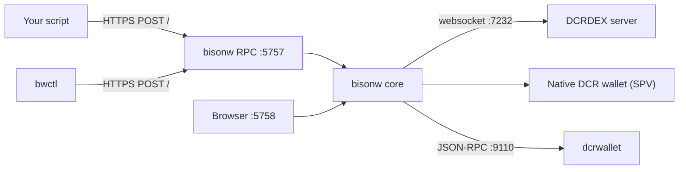

# Building on DCRDEX

This guide shows how to script Bison Wallet, the DCRDEX client, and how to extend DCRDEX with new assets, test on simnet and read its specification. It assumes you know what an atomic swap, an epoch and a fidelity bond are; [DCRDEX: Trading without custody](../../user/dex/index.md) explains them.

!!! info "Applies to"
    Bison Wallet 1.0.6 (`bisonw`, `bwctl`), the DCRDEX server at tag v1.0.6 and dcrwallet 2.1.7. Checked November 2026.

## Before you start

- `bisonw` and `bwctl` 1.0.6, from the `bisonwallet-<os>-<arch>-v1.0.6` archives ([verify them](../../user/security/verify-downloads.md)) or built from tag `v1.0.6` ([Build from source](../environment/build-from-source.md)). Bison Wallet already set up with an app password.
- For the simnet sections: a Unix-like system (the harnesses are bash scripts that run in tmux), Go 1.24 or later, a source checkout at `v1.0.6` in `$HOME/src/dcrdex` as in [Build from source](../environment/build-from-source.md) (adjust the paths below if yours is elsewhere), `dcrd`, `dcrwallet`, `dcrctl` and `vspd` in `PATH`, `bitcoind` and `bitcoin-cli` (v26.0.0 or later recommended), `tmux`, `jq`, `curl`, and a local PostgreSQL server with a `dcrdex` role.
- Read code at the tag, not `master`: `master` is the 1.1 line, whose protocol and RPC API differ (see [Version compatibility](#version-compatibility-10x-and-11)).

## Where things live

Bison Wallet is one process, `bisonw`. Its core logs in to DCRDEX servers over websocket (port 7232 on mainnet), drives a wallet for each asset, and serves two front ends: the browser interface on port 5758 and, when enabled, an RPC server on port 5757. `bwctl` and your own scripts talk to the RPC server:



## Control Bison Wallet over RPC

The RPC server is off by default. When on, it listens on 127.0.0.1:5757 on mainnet (127.0.0.2 on testnet, 127.0.0.3 on simnet), over TLS with HTTP basic authentication.

### 1. Turn on the RPC server

Add these lines to `dexc.conf` in the Bison Wallet data folder (`~/.dexc` on Linux and BSD, `~/Library/Application Support/Dexc` on macOS, `%LOCALAPPDATA%\Dexc` on Windows), then restart `bisonw`:

```ini title="dexc.conf"
rpc=1
rpcuser=bwrpc
rpcpass=<RPC_PASSWORD>
```

`<RPC_PASSWORD>` is a long random string you choose. `bisonw` refuses to start the server without one ("missing RPC password"). Restrict the file to your user account, since the password is stored in plain text. Add `noweb=1` to run without the browser interface; it is accepted only together with `rpc=1`.

On first start `bisonw` writes a self-signed certificate and key to `rpc.cert` and `rpc.key` in the data folder (one pair for all networks), valid for `localhost`, 127.0.0.1 to 127.0.0.3 and the machine's addresses at that moment. The log shows:

```text title="Expected log line"
RPC server listening on 127.0.0.1:5757
```

!!! warning "RPC credentials control the wallet"
    Commands that move funds or reveal the seed also require the app password, but many do not: anyone with the RPC user and password can cancel orders, stop bots, change bond options, lock wallets, set a VSP and delete archived records. Keep `rpcaddr` on a loopback address.

### 2. Configure bwctl

`bwctl` reads `dexcctl.conf` from its own folder (`~/.dexcctl`, `~/Library/Application Support/Dexcctl` or `%LOCALAPPDATA%\Dexcctl`). Give it the same credentials:

```ini title="dexcctl.conf"
rpcuser=bwrpc
rpcpass=<RPC_PASSWORD>
```

It looks for `rpc.cert` in its own folder, then in the Bison Wallet data folder, so no certificate setting is needed on the same machine. Put `--testnet` or `--simnet` before the command name (`bwctl --simnet wallets`) to reach that network's address. Written after the command, it is sent to the server as an argument.

### 3. Check the connection

```bash
bwctl version
```

```text title="Expected output (example)"
{
  "rpcServerVersion": {
    "Major": 0,
    "Minor": 4,
    "Patch": 0
  },
  "dexcVersion": {
    "versionString": "1.0.6+release",
    "major": 1,
    "minor": 0,
    "patch": 6,
    "buildMetadata": "release.go1-24-4"
  }
}
```

`bwctl` then checks that the RPC API is compatible with the 0.3.0 it requires, and prints an error if not.

### 4. Learn the commands

`bwctl -l` lists every command and `bwctl help <COMMAND>` prints its arguments. When a command needs the app password, `bwctl` prompts for it without echoing. The 43 routes of version 1.0.6, from `client/rpcserver/handlers.go`:

| Group | Commands (app password required in bold) |
|---|---|
| App | `help`, `version`, **`init`**, **`login`**, `logout`, **`appseed`**, `notifications` |
| Wallets | **`newwallet`**, **`openwallet`**, `closewallet`, `togglewalletstatus`, `wallets`, `rescanwallet`, `walletpeers`, `addwalletpeer`, `removewalletpeer`, `txhistory`, `wallettx`, **`send`**, **`withdraw`**, **`withdrawbchspv`** |
| Servers and bonds | `getdexconfig`, `bondassets`, `exchanges`, **`discoveracct`**, **`postbond`**, `bondopts` |
| Trading | `orderbook`, `myorders`, **`trade`**, **`multitrade`**, `cancel`, `deletearchivedrecords` |
| Market making | **`startmmbot`**, `stopmmbot`, `mmstatus`, `mmavailablebalances`, `updaterunningbotcfg`, `updaterunningbotinv` |
| Decred staking | `stakestatus`, `setvsp`, **`purchasetickets`**, `setvotingprefs` |

Rules that save time:

- **Amounts you pass are in atoms** (the asset's smallest unit), and assets are SLIP-0044 coin types: 42 for DCR, 0 for BTC on every network.
- **Rates use the message-rate format**: atoms of the quote asset per unit of the base asset, which for DCR-BTC is the BTC price of 1 DCR × 10^8. Quantities must be whole lots and rates whole multiples of the market's rate step (`bwctl exchanges` shows both).
- **`trade` takes nine arguments**: host, isLimit, sell, base, quote, qty, rate, immediate and an options JSON object. Pass `'{}'` for no options; the help summary omits it, but the command fails without it.
- **`send` versus `withdraw`**: `send` delivers the exact amount; `withdraw` subtracts the fee from it.
- **Certificate arguments**: `bwctl` replaces the certificate path given to `getdexconfig`, `bondassets`, `discoveracct` and `postbond`, and the configuration file path given to `newwallet`, with the file's contents. Raw RPC callers must send the contents themselves.
- **`postbond`** takes the host, the amount, the bond asset ID, then optionally whether to maintain the tier (default true) and the certificate. The amount must be a whole multiple of the server's bond amount. `bondopts <HOST> <TARGET_TIER>` changes the tier later.

The [Client control API](https://github.com/decred/dcrdex/blob/v1.0.6/docs/wiki/Client-control-API.mediawiki) wiki page predates bonds: it documents `getfee` and `register`, which 1.0.6 no longer has, and older argument lists. Trust `bwctl help` and `handlers.go`.

### Call the RPC server without bwctl

Every request is a DCRDEX message (type 1) posted to `/`. The `payload` has two arrays of strings: `PWArgs` for passwords and `args` for everything else, in the order `bwctl help` lists them:

```bash
curl --cacert ~/.dexc/rpc.cert --user bwrpc \
  --data '{"type":1,"id":1,"route":"wallets","payload":{"PWArgs":[],"args":[]}}' \
  https://127.0.0.1:5757/
```

curl asks for the RPC password. The reply is a type 2 message whose `payload` holds `result` or `error` (`code` and `message`). The server closes connections that take more than 10 seconds to send a request or receive a response.

A websocket endpoint at `wss://127.0.0.1:5757/ws`, with the same authentication, accepts `loadmarket`, `loadcandles`, `unmarket` and `acknotes` requests and streams order book updates for a loaded market. The [rpcclient example](https://github.com/decred/dcrdex/tree/v1.0.6/docs/examples/rpcclient) uses both endpoints from Go.

## Automate market making

Bots run inside `bisonw` (package `client/mm`) and trade from your account, under its tier and reputation. The browser interface (**Market Making**) is the usual way in, described in the [trading guide](../../user/dex/trading-guide.md). For headless use, write a JSON file modeled on [`client/mm/sample-basic.json`](https://github.com/decred/dcrdex/blob/v1.0.6/client/mm/sample-basic.json) (also `sample-arb.json` and `sample-arb-mm.json`):

- `botConfigs[]`: one entry per market, keyed by `host`, `baseID` and `quoteID`, with exactly one of `basicMarketMakingConfig`, `simpleArbConfig` or `arbMarketMakingConfig`. A basic bot sets `gapStrategy` (`multiplier`, `absolute`, `absolute-plus`, `percent` or `percent-plus`) and lists of `buyPlacements` and `sellPlacements` (`lots`, `gapFactor`).
- `botConfigs[].rpcConfig.alloc`: inside each bot entry, what that bot may use, in atoms per asset ID, under `dex` and `cex`. Bots started over RPC take their allocation from here.
- `cexConfigs[]`: for arbitrage, the exchange `name` (`Binance` or `BinanceUS` in 1.0.6), `apiKey` and `apiSecret`, referenced from a bot entry by its `cexName`. These are stored in plain text.

Then:

```bash
bwctl startmmbot <CONFIG_PATH> <HOST> 42 0 '[]' '[]'
bwctl mmstatus
bwctl stopmmbot <HOST> 42 0
```

`<HOST>` is the server address as `bwctl exchanges` lists it, for example `dex.decred.org:7232`. `<CONFIG_PATH>` is read by `bisonw`, not `bwctl`, so give a path on the machine running `bisonw`. `startmmbot` requires six arguments but 1.0.6 uses only the first four, hence the two placeholders. Starting a bot **cancels your booked orders on that market** first. Matches it made must still settle after it stops, so keep `bisonw` running.

## How DCRDEX uses Decred

### The swap contract

On Decred each side of a swap is a 97-byte hash time-locked contract paid to by pay-to-script-hash (P2SH), built by `MakeContract` in [`dex/networks/dcr/script.go`](https://github.com/decred/dcrdex/blob/v1.0.6/dex/networks/dcr/script.go). [Scripts for builders](../protocol/scripts.md) shows the script with its redeem and refund signature scripts; the whitepaper's [atomic swaps and DCRDEX section](../../whitepaper/19-ecosystem.md#sec:ecosystem-dex) gives the opcodes. Points that matter when you integrate:

- Both addresses in the contract must be ECDSA secp256k1 pay-to-pubkey-hash (`Ds…` on mainnet); `MakeContract` rejects other address types.
- The secret is exactly 32 bytes and the hash lock is SHA-256, so the same hash works on Bitcoin-family chains.
- Lock times are Unix timestamps: 20 hours after the match for the maker, 8 hours for the taker on mainnet (`dex/asset.go`). Test networks use the same values unless the binaries are built with test lock times (see [Test on simnet](#test-on-simnet)).
- The client counts its own DCR redemption confirmed after 2 confirmations, so that the next block's votes have approved the block holding it. A redemption in a disapproved block returns to the mempool; see the whitepaper's [consequences of disapproval](../../whitepaper/10-blocks.md#sec:blocks-approval-consequences).

### The bond transaction

A DCR fidelity bond is a regular transaction that the server's DCR backend (`ParseBondTx` in `server/asset/dcr/dcr.go`) accepts only in this form:

| Part | Requirement |
|---|---|
| Output 0 | P2SH paying to `<lock time> OP_CHECKLOCKTIMEVERIFY OP_DROP OP_DUP OP_HASH160 <pubkey hash> OP_EQUALVERIFY OP_CHECKSIG` |
| Output 1 | `OP_RETURN` with a 58-byte push: version (2 bytes), account ID (32), lock time (4), pubkey hash (20) |
| Further outputs | Optional change |
| Transaction | Lock time 0, no expiry, every input sequence at the maximum |

The server rebuilds the bond script from the output 1 commitment and checks that output 0 pays to its hash. The account ID is BLAKE-256 applied twice to the account public key. Bison Wallet sets a new bond's lock time about 60 days out on mainnet; the server counts the bond toward the tier until the bond expiry before that lock time (30 days on mainnet, 3 hours on testnet, 4 minutes on simnet).

### Native and external Decred wallets

| | **Native** (type `SPV`) | **External** (type `dcrwalletRPC`) |
|---|---|---|
| What it is | dcrwallet's `wallet`, `spv` and `p2p` packages (`decred.org/dcrwallet/v5` v5.0.3) compiled into `bisonw` | Your running `dcrwallet`, reached over JSON-RPC |
| Keys | Derived from the Bison Wallet app seed | In `dcrwallet` |
| Requirements | None | `dcrwallet` JSON-RPC API 11.x (2.1.7 reports 11.0); with a full node behind it, `dcrd` API 7.x or 8.x (2.1.7 reports 8.3) |

The external wallet's `newwallet` keys are `account`, `unmixedaccount`, `tradingaccount`, `username`, `password`, `rpclisten` (default `127.0.0.1:9110`) and `rpccert` (default `rpc.cert` in dcrwallet's data folder). Passing `dcrwallet.conf` as the configuration file fills whichever of the last four it sets. If `dcrwallet` mixes, set `account` to the mixed account, `unmixedaccount` to the account that receives change and deposits, and `tradingaccount` to an account for temporary split outputs. Bison Wallet stores the private passphrase encrypted with the app password, and locks the wallet when it logs out or shuts down unless `bisonw` runs with `--no-wallet-lock`.

On the server side the DCR backend needs `dcrd` with `txindex=1` and RPC API 7.x or 8.x; [Run a DCRDEX server](../operate/dex-server.md) covers the rest.

## Add an asset

An asset is Go code compiled into both programs. Nothing is loaded at run time: the specification and the wiki describe loading server backends as Go plugins, but 1.0.6 has no plugin loader.

1. **Shared package** `dex/networks/<asset>`: chain parameters, unit information and contract helpers used by client and server. Give the asset its SLIP-0044 coin type, mapped to a symbol in `dex/bip-id.go`. Tokens have their own IDs in the same map (USDC on Ethereum is 60001).
2. **Client** `client/asset/<asset>`: a `Driver` (`Open`, `DecodeCoinID`, `Info`) and a type implementing `asset.Wallet` in `client/asset/interface.go`: funding, swaps, redemptions, contract audits, refunds, confirmations and fee estimates. Optional interfaces add features, including `Bonder` for posting bonds, `Withdrawer`, `Rescanner`, `FundsMixer` and `TicketBuyer`. Seeded native wallets also implement `Creator`. Call `asset.Register(BipID, &Driver{})` in `init` and add the import to `client/asset/importall`.
3. **Server** `server/asset/<asset>`: a `Driver` whose `Setup` returns a `Backend` (`server/asset/common.go`), plus `OutputTracker` for UTXO chains or `AccountBalancer` for account chains. To accept the asset for bonds, the backend must also implement `Bonder` (`ParseBondTx`) from `server/dex/dex.go`. Register it and add it to `server/asset/importall`.
4. **Bitcoin forks** mostly configure the `btc` packages instead of reimplementing them: see `BTCCloneCFG` in `client/asset/btc` and `NewBTCClone` in `server/asset/btc`, as LTC, BCH, DOGE, DASH, DGB and FIRO do.
5. **Testing and UI**: a harness in `dex/testing/<asset>`, a case in `client/cmd/simnet-trade-tests/run`, a market in `dex/testing/dcrdex/genmarkets.sh`, and an icon in `client/webserver/site/src/img/coins/`.

Shipping in a release is the maintainers' decision, and listing a market is each server operator's. Open an issue on [decred/dcrdex](https://github.com/decred/dcrdex) before investing in a large asset.

## Test on simnet

The repository's harnesses build a private network for each chain under `~/dextest`, run a DCRDEX server against them, and give you funded wallets. Run each harness in its own terminal from the repository root, and wait for each to reach its tmux prompt before starting the next.

### 1. Start the chains and the server

```bash
cd $HOME/src/dcrdex && ./dex/testing/dcr/harness.sh
```

```bash
cd $HOME/src/dcrdex && ./dex/testing/btc/harness.sh
```

```bash
cd $HOME/src/dcrdex && ./dex/testing/dcrdex/harness.sh
```

The DCR harness creates nodes alpha and beta and wallets alpha, beta, trading1 and trading2, with control scripts in `~/dextest/dcr/harness-ctl` (`./alpha getbalance`, `./mine-alpha 1`, `./reorg`, `./quit`). The `dcrdex` harness drops and recreates the `dcrdex_simnet_test` database (it runs `sudo -u postgres psql` to do so), writes `markets.json` with a DCR-BTC market (lot size 20 DCR, rate step 100, 15-second epochs; set `EPOCH` in milliseconds to change it) and serves at `127.0.0.1:17273` with its certificate in `~/dextest/dcrdex/rpc.cert`. `~/dextest/dcrdex/dexadm` calls the admin API. If the `dcrdex` role has a password, start the server harness with `PG_PASS=<PASSWORD> ./dex/testing/dcrdex/harness.sh`, where `<PASSWORD>` is that role's password.

### 2. Build the client with matching lock times

The `dcrdex` harness builds its server with a 1-minute taker and 2-minute maker lock time, so that refunds can be tested. Build `bisonw` the same way:

```bash
cd $HOME/src/dcrdex/client/cmd/bisonw && go build -ldflags "-X 'decred.org/dcrdex/dex.testLockTimeTaker=1m' -X 'decred.org/dcrdex/dex.testLockTimeMaker=2m'"
cd $HOME/src/dcrdex/client/cmd/bwctl && go build
```

A client left at the 20 and 8 hour defaults locks simnet coins that long when a swap fails.

### 3. Set up wallets and a bond

With the RPC settings from [steps 1 and 2 of the RPC section](#control-bison-wallet-over-rpc) in place (`rpc=1`, `rpcuser` and `rpcpass` in `dexc.conf`, and the same credentials in `dexcctl.conf`), start the client, then run the setup script from the `bwctl` folder in another terminal:

```bash
$HOME/src/dcrdex/client/cmd/bisonw/bisonw --simnet --log=trace
```

```bash
cd $HOME/src/dcrdex/client/cmd/bwctl && ./simnet-setup.sh
```

The script initializes the app with a fixed test seed and the app password `abc`, adds the alpha DCR wallet (`newwallet 42 dcrwalletRPC ~/dextest/dcr/alpha/alpha.conf '{"account":"default"}'`) and a BTC wallet, adds wallets for any other running harnesses, posts a 10 DCR bond with `postbond`, and mines two DCR blocks to confirm it. Among its output:

```text title="Expected output (excerpt)"
app initialized
dcr wallet created and unlocked
btc wallet created and unlocked
successfully logged in
```

The script passes the test passwords with `-p`. Never do that with real passwords: command lines are visible to other local users and saved in shell history.

### 4. Place and cancel an order

Check that `./bwctl --simnet exchanges` shows `"effectiveTier"` of 1 or more under `127.0.0.1:17273` > `auth`, then, still in the `bwctl` folder, sell one lot (20 DCR) at an arbitrary simnet rate of 0.05 BTC per DCR, entering `abc` at the prompt:

```bash
./bwctl --simnet trade 127.0.0.1:17273 true true 42 0 2000000000 5000000 false '{}'
./bwctl --simnet myorders 127.0.0.1:17273 42 0
./bwctl --simnet cancel <ORDER_ID>
```

`<ORDER_ID>` is the `orderID` that `trade` returns. `myorders` should show the order with `"status": "epoch"` and, after the epoch closes, `"booked"`. `bwctl` prints `canceled order <ORDER_ID>` when the cancel request is accepted. Once the server processes it at the end of the epoch, the order reads `"canceled"` for a few seconds and then drops out of `myorders`, which lists only active orders. To start the simnet client over, stop `bisonw` and delete `~/.dexc/simnet`.

### Run full swaps automatically

`client/cmd/simnet-trade-tests` runs two clients against the harnesses and exercises matches, swaps, missed steps and refunds. From that folder, `./run dcrbtc` builds it with the same test lock times and runs the DCR-BTC tests; `./run dcrbtc --list` lists them, and variants such as `dcrspvbtc` use the native wallet. For load, `dex/testing/loadbot` runs trading programs: `./run pingpong` in that folder builds it and starts a program (`pingpong`, `sidestacker`, `compound`, `whale` or `sniper`).

### Test the interface without a backend

The test app server runs the browser interface against a simulated core, with no harness, server or wallets. After changing interface code, run `npm clean-install` and `npm run build` in `client/webserver/site`. Then, in `client/webserver`:

```bash
go test -tags live -timeout 60m
```

Open `http://127.0.0.3:54321`. The wiki gives `localhost:54321`, but the server binds to 127.0.0.3.

## Read the protocol specification

The specification is in [`spec/`](https://github.com/decred/dcrdex/tree/v1.0.6/spec) of the repository, starting at `README.mediawiki`. It is the best explanation of the design. Read `comm.mediawiki` (websocket transport, message format, message-rate encoding), then `fundamentals.mediawiki` (exchange and market variables, epoch matching), `orders.mediawiki` (order types, preimages, match negotiation) and `atomic.mediawiki` (worked settlement examples), then `dex/msgjson/types.go` for the exact routes and payloads.

Parts predate bonds and the reputation system. Where the specification disagrees with the code at the tag, the code is what servers and clients run:

| File | Out of date at v1.0.6 |
|---|---|
| `fundamentals.mediawiki` | The bonds section is a stub |
| `accounts.mediawiki` | Describes `register` and `notifyfee`, which are gone. Bonds use `prevalidatebond`, `postbond` and `bondexpired`, defined in `dex/msgjson/types.go` |
| `community.mediawiki` | The penalty section describes bans and forfeited fees, not scores and tiers |
| `admin.mediawiki` | Defaults differ from the code (broadcast timeout 12 minutes and cancellation threshold 0.95 in `server/cmd/dcrdex/config.go`) |
| `api.mediawiki` | A one-line placeholder |

## Version compatibility: 1.0.x and 1.1

Bison Wallet 1.1 is tagged as release candidates (v1.1.0-rc2) but was not released when this page was checked. Decrediton 2.1.7 embeds the 1.0.6 client.

| | 1.0.6 | 1.1.0-rc2 |
|---|---|---|
| Trade protocol | Original | Per-match swap addresses: 1.0.x clients cannot trade on 1.1 servers, nor 1.1 clients on 1.0.x servers |
| Client RPC API | 0.4.0 | 1.0.0 (refactored); `bwctl version` from 1.0.6 reports it as incompatible |
| EVM swap contract | Version 0 | Version 1 by default |
| New in 1.1 | | Monero, Politeia voting, private swaps for BTC and DCR, more exchanges for bots |

A server that upgrades revokes active 1.0.x swaps without penalty; their coins return only after the lock time. Pin scripts to the RPC version you test against, and re-check every command against 1.1's `bwctl help` before upgrading.

## Tatanka Mesh

Tatanka Mesh (`tatanka/` in the repository) is a design for moving order books from servers to clients over a mesh of nodes. Its specification calls the code a proof-of-concept "toy mesh". In 1.0.6 neither `bisonw` nor the server uses it. In the 1.1 line the client can connect to a mesh only on simnet, behind an experimental `--mesh` flag. Do not build on it or describe it as a working network.

## Check that it worked

- `bwctl version` prints `rpcServerVersion` 0.4.0 and `versionString` 1.0.6, with no compatibility error.
- On simnet, `./bwctl --simnet myorders 127.0.0.1:17273 42 0` lists the test order as `"booked"` before you cancel it.

## Troubleshooting

### bwctl: unable to send request: Unauthorized

`rpcuser` or `rpcpass` in `dexcctl.conf` does not match `dexc.conf`. A refused connection instead means `bisonw` runs without `rpc=1`, or on another network than the `--testnet` or `--simnet` flag you gave `bwctl`.

### bwctl is not compatible with bisonw RPC server

The `bwctl` and `bisonw` versions differ across the 1.0 and 1.1 lines. Use the `bwctl` from the same release.

### unable to parse arguments: wanted 9 argument but got 8 argument

`trade` is missing its options object. Add `'{}'` as the last argument.

### DEX at … expects a bond amount in multiples of …

The `postbond` amount is not a whole multiple of the server's bond amount. `bwctl bondassets <HOST>` shows it in atoms.

### Simnet swaps take hours to refund

`bisonw` was built without the test lock times. Rebuild it with the flags in [step 2](#2-build-the-client-with-matching-lock-times).

## Next steps

- [Set up a private simnet](../environment/simnet.md): run Decred nodes and wallets yourself, beyond the DCRDEX harness.
- [Run a DCRDEX server](../operate/dex-server.md): markets, bonds, the admin API and protocol upgrades.
- [Scripts for builders](../protocol/scripts.md): the swap and bond scripts in detail.
- [Trading on DCRDEX](../../user/dex/trading-guide.md): what traders see, for testing your automation against.

*[DEX]: decentralized exchange
*[RPC]: remote procedure call
*[TLS]: Transport Layer Security
*[SPV]: simplified payment verification
*[VSP]: voting service provider
*[P2SH]: pay-to-script-hash
*[UTXO]: unspent transaction output
*[EVM]: Ethereum Virtual Machine
*[SLIP]: SatoshiLabs Improvement Proposal
