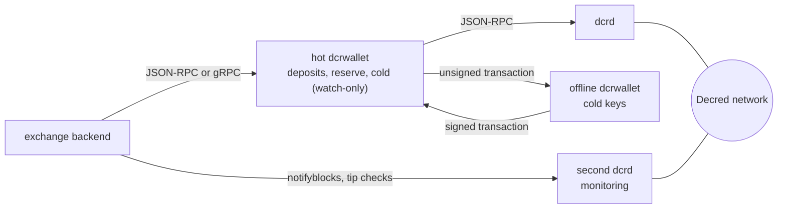
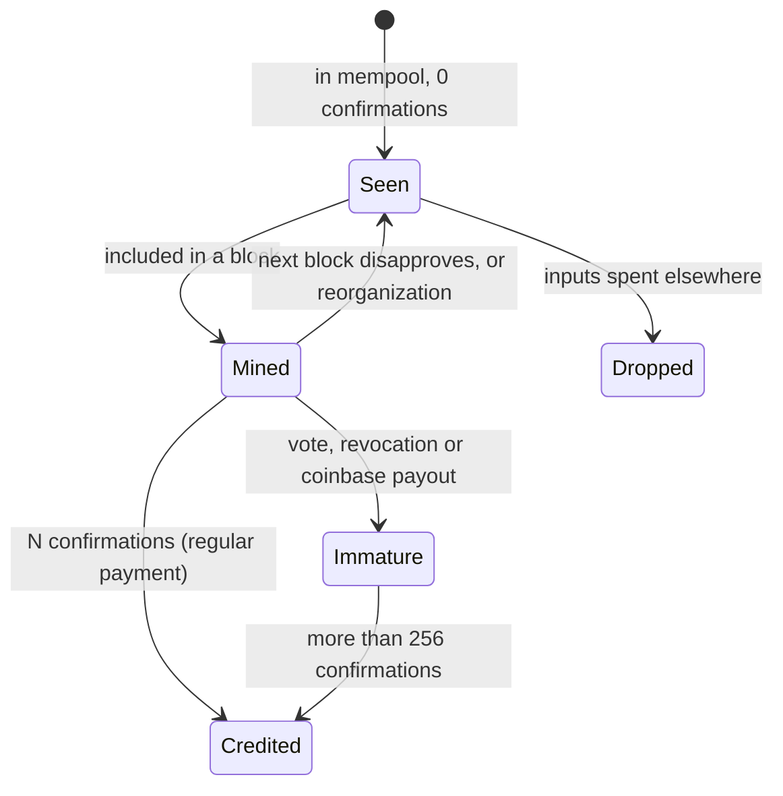

# Integrate DCR into an exchange or service

This guide is for exchanges, custodians and payment services that accept and pay out DCR. It covers the node and wallet setup, deposit addresses at scale, crediting deposits at the right moment, withdrawals, and staying on the network through mandatory upgrades, and it points out each place where a Bitcoin-style integration goes wrong.

!!! info "Applies to"
    `dcrd`, `dcrwallet` and `dcrctl` 2.1.7. Checked November 2026.

## Before you start

- `dcrd`, `dcrwallet` and `dcrctl` 2.1.7 from the [decred-binaries v2.1.7 release](https://github.com/decred/decred-binaries/releases/tag/v2.1.7), [verified](../../user/security/verify-downloads.md) and set up as in [Set up the command-line wallet](../../user/wallets/command-line.md).
- A fully synced `dcrd` of your own, run as in [Run dcrd in production](../operate/production-node.md).
- A client for authenticated JSON remote procedure calls (JSON-RPC) over Transport Layer Security (TLS): see [your first JSON-RPC call](../api/first-rpc-call.md), or [rpcclient from Go](../go/rpc-clients.md).
- A private [simnet](../environment/simnet.md) for rehearsing the failure cases, and a second computer that stays offline for cold storage.

## What differs from a Bitcoin integration

Base58 addresses, unspent transaction outputs (UTXOs) and most RPC names carry over. These do not:

| Topic | Decred behavior | Section |
|---|---|---|
| One confirmation | The next block's votes can **disapprove** a block's regular transactions and send them back to the mempool | [Credit deposits](#4-credit-deposits-safely) |
| Stake payouts | A deposit address can receive vote and revocation outputs, unspendable for 256 blocks | [Stake payouts](#payouts-from-votes-and-revocations) |
| Address history | `dcrd` has no address index; use the wallet or dcrdata | [Deposit addresses](#2-issue-deposit-addresses) |
| Gap limit | `getnewaddress` refuses a 21st unused address in a row unless told otherwise | [Deposit addresses](#2-issue-deposit-addresses) |
| Fees | Per 1,000 bytes, with no replace-by-fee | [Withdrawals](#5-send-withdrawals) |
| Expiry | Optional expiry height, which locks every output for 256 blocks | [Withdrawals](#if-a-withdrawal-does-not-confirm) |
| Upgrades | Some releases are mandatory to stay on the network | [Stay on the network](#7-stay-on-the-network) |

## 1. Set up the node and wallets

Make `dcrwallet`, connected to your own `dcrd`, the source of truth for balances and deposits: it tracks its addresses, follows disapproval and reorganizations, and signs, while `dcrd` checks every consensus rule. Do not run the service wallet as a light wallet (SPV, `--spv`).

In the reference layout below, one hot wallet serves the backend, a second node gives an independent view of the chain, and most funds sit behind keys that never go online.



Give the hot wallet three accounts:

| Account | Purpose | Protected by |
|---|---|---|
| `deposits` | One fresh address per deposit; pays withdrawals | The private passphrase; unlocked while the service runs |
| `reserve` | Float for topping up `deposits` | Its own passphrase; locked except during a top-up |
| `cold` | Watching-only view of the offline wallet's account | No private keys |

`promptsecret`, from the command-line bundle, reads a passphrase without echoing it and passes it to `dcrctl` where `-` appears:

```bash
promptsecret | dcrctl --wallet walletpassphrase - 60
dcrctl --wallet createnewaccount deposits
dcrctl --wallet createnewaccount reserve
promptsecret | dcrctl --wallet setaccountpassphrase reserve -
dcrctl --wallet lockaccount reserve
dcrctl --wallet importxpub cold <XPUB>
dcrctl --wallet walletlock
```

`<XPUB>` is the offline wallet's account extended public key from `getmasterpubkey`, set up as in [Cold storage with an offline wallet](../../user/security/cold-storage.md). `walletpassphrase` never unlocks an account with its own passphrase, so a compromised backend still cannot spend `reserve` ([accounts and passphrases](../../user/wallets/accounts-and-passphrases.md) explains the limits). The `cold` account exposes the offline wallet's addresses and balance, but no keys.

After each start the service unlocks the wallet with no timeout. Anything holding the wallet's RPC credentials can then spend `deposits`, so keep only what withdrawals need there:

```bash
promptsecret | dcrctl --wallet walletpassphrase - 0
```

```ini title="dcrwallet.conf (excerpt, example values)"
; Your own dcrd (mainnet RPC port 9109). Never spv=1.
rpcconnect=127.0.0.1:9109
; Wallet default 20; a larger gap lets a seed restore find more deposit addresses.
gaplimit=200
; Fee rate for transactions the wallet builds, in DCR/kB (default 0.0001).
txfee=0.0001
```

The backend calls `dcrwallet` on its JSON-RPC port (9110 on mainnet) or gRPC port (9111); see the [JSON-RPC](../api/dcrwallet-json-rpc.md) and [gRPC](../api/dcrwallet-grpc.md) references, or `dcrctl --wallet help <METHOD>`.

## 2. Issue deposit addresses

Every deposit should go to an address no one else was given.

**Use the `ignore` gap policy.** A seed restore stops looking after `gaplimit` unused addresses in a row (default 20, a wallet setting, not a consensus rule), so `getnewaddress` applies a policy once that many issued addresses are unused:

| Gap policy | Behavior | For an exchange |
|---|---|---|
| `error` (default) | Fails with "generating next address violates the unused address gap limit policy" | Breaks after 20 unpaid address requests |
| `wrap` | Hands out an earlier unused address again | **Never**: two customers can share an address |
| `ignore` | Keeps issuing and watching new addresses | Use this, and record what you issue |

```bash
dcrctl --wallet getnewaddress deposits ignore
```

Store the `Ds` address under a unique constraint, and ask again if it already exists: after a seed restore the wallet derives from the last *used* address and can repeat ones it issued before. Running `accountsyncaddressindex` with your recorded index, as below, makes new addresses continue after it.

**Record the highest index you issue.** A default restore misses deposits more than `gaplimit` addresses past the last used one. `validateaddress` on an owned address shows its `index`, and `accountaddressindex deposits 0` the next one.

**Rebuild the accounts after a restore.** A restore names the accounts it discovers `account-1`, `account-2` and so on, and brings back neither account passphrases nor imported xpub accounts. It also misses an account whose first `gaplimit` addresses were never used, unless a later account was. Rename discovered accounts in the order the setup created them, or recreate a missing one with `createnewaccount` in that order so it derives the same keys. Then restore the `reserve` passphrase and the `cold` account, and sync the deposit index:

```bash
promptsecret | dcrctl --wallet walletpassphrase - 60
dcrctl --wallet renameaccount account-1 deposits
dcrctl --wallet renameaccount account-2 reserve
promptsecret | dcrctl --wallet setaccountpassphrase reserve -
dcrctl --wallet lockaccount reserve
dcrctl --wallet importxpub cold <XPUB>
dcrctl --wallet accountsyncaddressindex deposits 0 <INDEX>
dcrctl --wallet rescanwallet <HEIGHT>
```

`<INDEX>` is the highest receiving index (branch 0) you issued, and `<HEIGHT>` a block height before your first deposit (the default is the genesis block). `discoverusage` can also rerun discovery with a larger gap.

**Leave `watchlast` unset.** The wallet watches every address of each branch. `--watchlast=<N>` limits this to roughly the last N plus the gap limit, which speeds up large wallets but misses payments to older addresses, and customers reuse old deposit addresses.

**Deposits straight to cold keys.** You can issue addresses from an account added with `importxpub` instead, so deposits land behind offline keys. `importxpub` scans no history: run `rescanwallet` if the account was used before.

**Address history.** `dcrd` has no per-address history: `existsaddress` and `existsaddresses` only say whether an address was ever used, and `searchrawtransactions` went away with the address index in 1.8.0. For support lookups use `listaddresstransactions` and `getreceivedbyaddress` on the wallet, or the [dcrdata API](../api/dcrdata-api.md).

## 3. Detect deposits

### Poll listsinceblock (recommended)

`listsinceblock <BLOCKHASH> <TARGETCONFIRMATIONS>` returns the wallet's unmined transactions and those from that block's height up to the tip, plus a `lastblock` to pass next time. `lastblock` lies `TARGETCONFIRMATIONS − 1` blocks below the tip, so each call relists that many blocks with fresh confirmation counts.

```bash
dcrctl --wallet listsinceblock <BLOCKHASH> 257
```

`<BLOCKHASH>` is `lastblock` from your previous call; omit it the first time to list everything.

```json title="Expected output (example, one entry)"
{
  "transactions": [
    {
      "account": "deposits",
      "address": "<ADDRESS>",
      "amount": 25,
      "blockhash": "<BLOCKHASH>",
      "blocktime": 1795000000,
      "category": "receive",
      "confirmations": 3,
      "time": 1794999950,
      "timereceived": 1794999950,
      "txid": "<TXID>",
      "txtype": "regular",
      "vout": 1,
      "walletconflicts": []
    }
  ],
  "lastblock": "<BLOCKHASH>"
}
```

- Credits have `category` `receive` (the built-in help says `recv`, but 2.1.7 returns `receive`), or `immature` then `generate` for coinbase outputs. `send` entries are your own spends.
- `txtype` is `regular`, `ticket`, `vote` or `revocation`; [stake payouts](#payouts-from-votes-and-revocations) need far more confirmations.
- Key deposits on `(txid, vout)`, and convert DCR amounts to atoms (1 DCR = 100,000,000 atoms) by rounding.
- Entries repeat between calls. After a reorganization deeper than the window, the call still starts at the stored block's height, so keep the window deeper than your policy.

A polling loop, with your own `rpc()` helper and database:

```python
N = 6         # confirmations for ordinary deposits (your policy)
WINDOW = 257  # relist enough blocks for slow-maturing payouts

def required_confirmations(e):
    if e["category"] in ("immature", "generate") or e.get("txtype") in ("vote", "revocation"):
        return 257  # spendable once confirmations exceed 256
    return N

def poll(rpc, db):
    res = rpc("listsinceblock", [db.cursor, WINDOW])  # cursor is None the first time
    pending = []
    for e in res["transactions"]:
        if e["category"] == "send" or e["account"] != "deposits":
            continue
        atoms = round(e["amount"] * 100_000_000)
        key = (e["txid"], e["vout"])
        if e["confirmations"] >= required_confirmations(e):
            db.credit_once(key, e["address"], atoms)  # unique on key
        else:
            pending.append((key, e["address"], atoms, e["confirmations"]))
    db.replace_pending(pending)  # entries that vanished are never credited
    db.cursor = res["lastblock"]
```

Rebuild the pending list on every poll: an entry that disappears was disapproved, reorganized out or double-spent, and returns if it is mined again. Poll only while `walletinfo` shows `"daemonconnected": true` and `syncstatus` shows `"synced": true`. To react fast, subscribe to `notifyblocks` on `dcrd` and poll on each `blockconnected`.

### Push notifications

`dcrwallet`'s JSON-RPC server sends no notifications, but its gRPC API does ([api.proto at release-v2.1.7](https://github.com/decred/dcrwallet/blob/release-v2.1.7/rpc/api.proto)):

`WalletService.TransactionNotifications`
:   Streams `attached_blocks` (with their wallet transactions and an `approves_parent` flag), `detached_blocks` after a reorganization, and new `unmined_transactions`.

`WalletService.ConfirmationNotifications`
:   You stream transaction hashes and a `stop_after` count; it streams back their confirmations, or `-1` once the wallet no longer knows a transaction, for example after a double spend.

If you derive addresses yourself, `dcrd`'s websocket methods (`loadtxfilter`, `notifyblocks`, `rescan`) deliver matching transactions, and disapproval and reorganizations are then yours to handle ([dcrd JSON-RPC API](../api/dcrd-json-rpc.md)).

## 4. Credit deposits safely

### Confirmations and disapproval

A regular transaction in the newest block is not settled. The votes in the next block (at least three of the five tickets selected) decide by majority whether to approve that block's **regular tree**; if they disapprove, all its transactions are undone and return to the mempool, although the block stays in the chain ([consequences of disapproval](../../whitepaper/10-blocks.md#sec:blocks-approval-consequences)). A [reorganization](../../whitepaper/10-blocks.md#sec:blocks-reorg) can also replace recent blocks. `dcrwallet` follows both, removing disapproved credits from its balance, unspent outputs and listings. `dcrd`'s `confirmations` fields, in `getblock` and in `getrawtransaction` with the transaction index, ignore disapproval.

A deposit is credited only from the Mined state after enough confirmations; disapproval or a reorganization sends it back to Seen, and a double spend drops it:



Never credit at 1 confirmation. Use at least 2 for small amounts, 6 for balances a customer can withdraw, and more for very large deposits. [Blocks, confirmations and reorganizations](../protocol/blocks-and-confirmations.md) gives the reasoning and an attacker's odds. A deposit credited too early cannot be clawed back once withdrawn.

### Payouts from votes and revocations

There is no separate stake address format: tickets, votes, revocations and treasury spends pay ordinary `Ds` and `Dc` addresses inside stake-tagged scripts ([stake and treasury scripts](../../whitepaper/05-addresses.md#sec:addresses-stake)). A customer who uses a deposit address as a ticket's reward address makes the vote or revocation pay into your wallet, listed as `category` `receive` with `txtype` `vote` or `revocation`.

These stake-tree outputs cannot be disapproved, but consensus forbids spending them until 256 blocks (about 21 hours) after they are mined ([stake transaction outputs](../../whitepaper/08-staking.md#sec:staking-stake-outputs), [their maturity](../../whitepaper/12-treasury.md#sec:treasury-stake-maturity)). Until then `getbalance` counts them as `immaturestakegeneration` and sends cannot use them, so credit them only then, as the loop does.

A treasury spend (TSPEND) payout matures the same way. 2.1.7 lists it with `txtype` `regular`, but with `category` `immature` and then `generate`, like a coinbase, and counts it as `immaturecoinbaserewards`, so the loop holds it as well. [Transactions for builders](../protocol/transactions.md) lists every maturity rule.

### Mixed coins

Mixed coins need no special handling: a StakeShuffle mix is an ordinary regular transaction paying its participants' own wallets, and customers then send its outputs in normal payments ([Mixing for builders](../protocol/mixing.md)).

## 5. Send withdrawals

### Validate the address first

Decode every withdrawal address yourself with mainnet parameters, and accept only `Ds` (pay-to-pubkey-hash) and `Dc` (pay-to-script-hash), the types wallets use. Reject every other type, testnet addresses, checksum failures and raw hex: the wallet's send methods treat a 66- or 130-character hex string as a public key and pay it. `validateaddress` returns `"isvalid": false` with no reason. [Keys, addresses and seeds](../protocol/keys-and-addresses.md) has a Go validator built on `stdaddr.DecodeAddress`, which follows the whitepaper's [address decoding rules](../../whitepaper/05-addresses.md#sec:addresses-decoding).

### Send

Batch withdrawals with `sendmany`, which pays many addresses from one account in one transaction and returns its hash:

```bash
dcrctl --wallet sendmany deposits '{"<ADDRESS_1>":1.25,"<ADDRESS_2>":0.5}'
```

`<ADDRESS_1>` and `<ADDRESS_2>` are validated addresses; amounts are in DCR.

- The amounts form a JSON object, so two payments to one address collapse into one key. Sum them first.
- One invalid or dust output fails the whole call. The smallest non-dust output to a `Ds` address is 6,030 atoms at the default fee rate; set your minimum far above it.
- `sendtoaddress` always spends from the `default` account; `sendfrom <ACCOUNT> <ADDRESS> <AMOUNT>` names one. Both reject Bitcoin's comment arguments ("transaction comments are unsupported").
- A locked wallet answers "wallet or account locked; use walletpassphrase or unlockaccount first".

**Fees.** The wallet pays its `txfee` rate, default 0.0001 DCR/kB, equal to `dcrd`'s minimum relay fee; that normally confirms in the next block while blocks have room. `settxfee` changes it until restart, `getwalletfee` shows it, and `dcrd`'s `estimatesmartfee` suggests a rate when blocks fill. With no replace-by-fee, the fee is final at broadcast ([fees and size](../protocol/transactions.md)).

**Retries.** If publishing fails, the wallet abandons the transaction it built. A timeout in your client proves nothing, though: the payment may have gone out. Record each withdrawal before sending and store the returned hash. Before retrying, look for a `send` entry to that address in `listsinceblock <BLOCKHASH>`, with `<BLOCKHASH>` a block from before the attempt, or in `listtransactions "*" <COUNT>` with a large enough `<COUNT>` (the default is 10). A double payment cannot be undone.

### If a withdrawal does not confirm

The wallet sets no expiry, so an unconfirmed withdrawal stays valid until mined or until one of its inputs is spent elsewhere. This is rare: usually blocks were full and the fee too low, or a disapproval or reorganization removed one of its inputs.

- **`abandontransaction <TXID>`** makes the wallet forget the transaction and its dependants and frees their inputs. Nodes holding it can still mine it, so abandon only a transaction that can no longer confirm, or replace it with one that spends at least one of the same inputs, so that only one can confirm. Any node whose mempool still holds the original, your own `dcrd` included, refuses the replacement.
- **To make future withdrawals cancel themselves**, build them with an expiry height: the fourth argument of `createrawtransaction`, followed by `fundrawtransaction`, `signrawtransaction` and `sendrawtransaction`. From that height the transaction cannot be mined ([expiry](../../whitepaper/07-transactions.md#sec:transactions-expiry)), and the wallet then drops it. A transaction already sent cannot be given an expiry.

!!! warning "An expiry locks the customer's coins for 256 blocks"
    Every output of a transaction with a nonzero expiry, the customer's included, is unspendable until 256 blocks (about 21 hours) after mining. Do not put an expiry on customer withdrawals unless customers accept that delay.

## 6. Manage unspent outputs

Each input adds about 166 bytes, and mainnet nodes relay transactions of at most 100,000 bytes, so many small deposits make withdrawals large and costly. **Consolidate** in quiet periods:

```bash
dcrctl --wallet consolidate 500 deposits
```

This merges up to 500 confirmed outputs of `deposits` into one output at a new internal address (a third argument names another address), stops at 100,000 bytes (about 600 inputs) and returns the transaction hash.

**Reserve outputs** with `lockunspent` when you build transactions yourself: `fundrawtransaction` does not lock the inputs it picks.

```bash
dcrctl --wallet lockunspent false '[{"txid":"<TXID>","vout":0,"tree":0}]'
```

Locked outputs are skipped by sends and hidden from `listunspent`; `listlockunspent` lists them and `lockunspent true` releases them. Locks live in memory and are cleared on restart.

**Move funds between tiers** with `sendfrom`. To top up `deposits`, pay an internal address so no customer address is used up:

```bash
dcrctl --wallet getrawchangeaddress deposits
promptsecret | dcrctl --wallet unlockaccount reserve -
dcrctl --wallet sendfrom reserve <ADDRESS> <AMOUNT>
dcrctl --wallet lockaccount reserve
```

`<ADDRESS>` is the output of the first command. To sweep excess to cold storage, send from `deposits` to an address from `getnewaddress cold`; spending it later happens offline, as in [Cold storage with an offline wallet](../../user/security/cold-storage.md).

## 7. Stay on the network

A node on old consensus rules follows a different chain from everyone else, and your deposits and withdrawals follow it. [Upgrading and mandatory releases](../../user/run/upgrades.md) is the canonical guide: run 2.1.7, never anything older than the mandatory 2.1.6 on mainnet, and upgrade `dcrd` before `dcrwallet`. For an exchange, add:

- **Watch** the [decred-binaries releases](https://github.com/decred/decred-binaries/releases) and the agendas under `deployments` in `getblockchaininfo`.
- **Treat a stopped `dcrd` as an incident.** A 2.1.7 spend safeguard shuts `dcrd` down on purpose when it detects a spend that should be impossible. Pause crediting and withdrawals, keep the log, and do not downgrade (see [Troubleshooting](#dcrd-stopped-and-walletinfo-shows-daemonconnected-false)).
- **Monitor the tip.** Alert when your two nodes disagree on the best block for more than a block or two, when `getchaintips` shows a `valid-fork` with `branchlen` above 1, or when blocks stop arriving (they target 5 minutes but vary).

## 8. Test on simnet or testnet

Rehearse on a private [simnet](../environment/simnet.md), where coinbase, vote and revocation outputs mature after 16 blocks:

- **Disapproval**: `dcrctl --simnet --wallet setdisapprovepercent 100` on the voting wallets makes every block disapprove its parent; watch a deposit leave and rejoin your pending list. Then run `setdisapprovepercent 0` and check that the deposit is mined again and credited only after N confirmations. [Blocks, confirmations and reorganizations](../protocol/blocks-and-confirmations.md) also shows how to force a reorganization.
- **Stake payouts**: a ticket the deposit wallet buys for itself tests nothing, because `purchaseticket` pays the vote to an internal change address, which `listsinceblock` never lists. Build a ticket whose commitment pays a `getnewaddress deposits` address outside the wallet's purchase flow, for example with `dcrd`'s `createrawsstx`, and have a voting simnet wallet hold its voting address.
- **Gap limit**: with `--gaplimit=5`, issue addresses with `ignore`, pay only the last, restore the seed, rebuild the accounts as in [Issue deposit addresses](#2-issue-deposit-addresses) (unless a later account was used, discovery does not find `deposits`, so recreate it with `createnewaccount`), and recover the deposit with `accountsyncaddressindex` and `rescanwallet`.
- **Withdrawals**: duplicate addresses, dust, testnet and hex-key addresses, a locked wallet.

The public testnet (testnet3) adds realistic timing, but its faucet and explorer were down in November 2026; [Networks](../environment/index.md) lists what works.

## Check that it worked

- [ ] Every deposit address is unique in your database and issued with the `ignore` policy.
- [ ] Regular deposits are credited at your policy, never at 1 confirmation.
- [ ] A disapproved deposit returns to pending and is credited only after it is mined again.
- [ ] Vote, revocation, treasury spend and coinbase payouts wait for more than 256 confirmations.
- [ ] Crediting is idempotent on `(txid, vout)`.
- [ ] Only locally validated `Ds` and `Dc` addresses reach `sendmany`.
- [ ] Withdrawals are recorded before sending and never retried blindly.
- [ ] A seed restore, with the accounts rebuilt and your recorded index synced, finds every deposit.
- [ ] Alerts fire on a locked wallet, a stopped or disconnected `dcrd`, and diverging tips.

## Troubleshooting

### getnewaddress fails with "violates the unused address gap limit policy"

The account has `gaplimit` issued addresses in a row without payments, and the call used the default `error` policy. Use `getnewaddress deposits ignore`.

### A deposit is missing after a restore

The address is beyond the restore's gap limit, or the account itself was not rediscovered. Check that `deposits` exists (rename `account-1` or recreate it), run `accountsyncaddressindex deposits 0 <INDEX>` with your highest issued index, then `rescanwallet <HEIGHT>`, and remove any `watchlast` setting.

### Withdrawals fail for insufficient funds although the balance looks large

Only `spendable` in `getbalance deposits` can be sent. `immaturestakegeneration` holds vote and revocation payouts under 256 blocks old, `immaturecoinbaserewards` holds coinbase and treasury spend payouts, and `unconfirmed` holds unmined credits.

### dcrd stopped and walletinfo shows daemonconnected false

A last `dcrd` log entry marked `[CRT]` means a 2.1.7 spend safeguard stopped it: keep operations paused and follow the spend safeguards section of [Upgrading and mandatory releases](../../user/run/upgrades.md). Otherwise read the log and restart the node.

## Next steps

- [Blocks, confirmations and reorganizations](../protocol/blocks-and-confirmations.md): the reasoning behind the confirmation policy.
- [Run dcrd in production](../operate/production-node.md): sizing, RPC exposure and monitoring for the nodes behind your wallet.
- [dcrwallet JSON-RPC API](../api/dcrwallet-json-rpc.md): every wallet method on this page.
- [Cold storage with an offline wallet](../../user/security/cold-storage.md): the offline tier.
- [Integrating Decred](index.md): the checklist every integrator shares.

*[RPC]: remote procedure call
*[gRPC]: Google remote procedure call
*[UTXO]: unspent transaction output
*[UTXOs]: unspent transaction outputs
*[SPV]: simplified payment verification
*[TSPEND]: treasury spend
*[TLS]: Transport Layer Security
*[JSON]: JavaScript Object Notation
