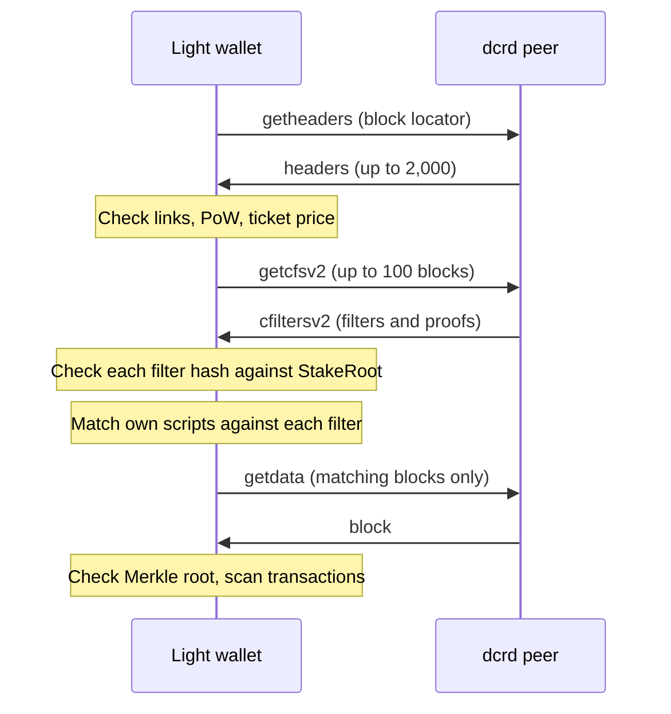

# Add Decred to a wallet

This guide is for teams adding DCR to a software wallet, a multi-coin wallet or a hardware device. It covers the Decred-specific decisions and code in the order you meet them, gives test vectors and simnet checks, and links to the protocol pages that explain each rule in full.

!!! info "Applies to"
    dcrd 2.1.7, dcrwallet 2.1.7, Decrediton 2.1.7, Bison Wallet 1.0.6 and vspd 1.5.0. Checked November 2026.

## Before you start

- Read [Decred for Bitcoin developers](../start/decred-for-bitcoin-developers.md). Most porting bugs come from a Bitcoin assumption it lists.
- Have a private [simnet](../environment/simnet.md) ready for the final checks.
- Decide which features you need. Receiving and sending are the minimum. Staking, mixing and governance votes are optional, and each adds a long-running process to your wallet.
- In Go, use dcrd's modules (`wire`, `txscript/v4`, `hdkeychain/v3`, `gcs/v4`, `blockchain/stake/v5`), not ports of Bitcoin libraries.

## 1. Choose an architecture

The first decision is how much of Decred's wallet logic you reuse:

| Option | Used by | What you write | What you inherit |
|---|---|---|---|
| Drive `dcrwallet` as a separate process over gRPC | Decrediton | A user interface and a gRPC client | Everything: derivation, light or full-node sync, fees, staking through a voting service provider (VSP), mixing, governance votes |
| Embed `dcrwallet` as a Go library | Bison Wallet | Glue code in Go | The same, inside your own process |
| Write your own | Third-party multi-coin wallets and hardware wallets | Keys, transactions, signing, chain tracking | Only what the protocol defines |

**Drive `dcrwallet` over gRPC.** Decrediton starts `dcrwallet` with `grpclisten=127.0.0.1:0`, so the OS assigns the gRPC port, and `dcrwallet` reports it back over an inter-process communication (IPC) pipe. A standalone `dcrwallet` listens on 9111 on mainnet by default. `WalletLoaderService` creates or opens the wallet (`CreateWallet`, `CreateWatchingOnlyWallet`, `OpenWallet`) and starts syncing (`SpvSync` for light mode, `RpcSync` against a `dcrd`). `WalletService` builds, signs and publishes transactions and streams `TransactionNotifications`. See [dcrwallet gRPC API](../api/dcrwallet-grpc.md).

**Embed `dcrwallet` as a library.** Bison Wallet's native Decred wallet ([`client/asset/dcr/spv.go`](https://github.com/decred/dcrdex/blob/v1.0.6/client/asset/dcr/spv.go) at v1.0.6) imports `decred.org/dcrwallet/v5` (v5.0.3). It creates the wallet with `wallet.CreateDB` and `wallet.Create`, opens it with `wallet.Open`, moves it to coin type 42 with `UpgradeToSLIP0044CoinType`, and attaches an `spv.NewSyncer` light-client syncer through `SetNetworkBackend`. The Go API of `dcrwallet` is not documented as stable: pin a release and retest on every upgrade.

**Write your own** when `dcrwallet` cannot run where you do: a hardware device, a wallet not written in Go, or a multi-coin engine with its own key store. You then implement steps 2 to 6 yourself, and usually skip staking and mixing.

## 2. Derive keys and addresses

A Decred wallet is BIP32/BIP44 hierarchical deterministic (HD) at `m/44'/42'/account'/branch/index`, with Decred's own hashes and encodings, as [Keys, addresses and seeds](../protocol/keys-and-addresses.md) explains. To restore Decrediton or `dcrwallet` seeds, match all of these:

- **Seed.** 33 words from the PGP word list or 64 hex characters, encoding 32 bytes that go straight into BIP32's master-key function. It is not BIP-39.
- **Coin type.** 42 on mainnet, 1 on test networks. Early wallets used the legacy coin types 20 (mainnet) and 11 (testnet), so a restore must scan both.
- **Derivation quirk.** dcrd's `hdkeychain` `Child` strips leading zero bytes from a derived private key, which changes the hardened children of about one key in 256. Strict BIP32 code silently derives different addresses below such a key.
- **Branches and gap limit.** Branch 0 receives, branch 1 is change. Discovery stops after 20 unused addresses in a row (the `dcrwallet` default `gaplimit`) and after 10 unused accounts.
- **Addresses.** A pay-to-pubkey-hash (P2PKH) address is Base58 of a 2-byte prefix (`Ds` on mainnet), the RIPEMD-160 of the BLAKE-256 of the compressed public key, and a 4-byte double-BLAKE-256 checksum.

These values were recomputed with dcrd's `hdkeychain` at release-v2.1.7. Anyone can derive their keys, so never fund them.

| Seed | Path | Network | Address |
|---|---|---|---|
| 32 zero bytes | `m/44'/1'/0'/0/0` | testnet | `TsafuqGEomspWBB9vu5ndSDjUEZ1AnKSBLV` |
| 32 zero bytes | `m/44'/1'/0'/1/0` | testnet | `TscW7YSkmZw4nev5wQ11ZpLo1YLBkDNxxEN` |
| `000102030405060708090a0b0c0d0e0f` (BIP32 test vector 1) | `m/44'/42'/0'/0/0` | mainnet | `DsVxTiRYVKtUQogbS6prKdQvFb4dUwy7KyM` |

The whitepaper's [HD key section](../../whitepaper/05-addresses.md#sec:addresses-hd) adds vectors for the leading-zero case, and its [wallet account structure](../../whitepaper/05-addresses.md#sec:addresses-bip44) states the path convention.

!!! danger "Never let a seed or spending key leave the wallet"
    Anyone with the seed controls every key, now and later, and a payment from it cannot be reversed. Never log seeds, never send them to a server, and never ask users to type them anywhere except your restore screen. The only exception is a ticket's voting key, which a VSP needs (step 7). Derive voting keys from a separate account so that this key cannot spend funds.

## 3. Build, serialize and sign transactions

[Transactions for builders](../protocol/transactions.md) covers the format. The points that break ported Bitcoin code:

- Every outpoint carries a **tree byte** (0 regular, 1 stake). Every output of a stake-tree transaction (ticket, vote, revocation, treasury add or treasury spend) is spent with tree 1.
- Every output carries a 2-byte **script version** (0 for all standard scripts).
- Each input's witness carries the spent output's amount, block height and block index (`ValueIn`, `BlockHeight`, `BlockIndex`). They are not signed. Set `ValueIn` to the real amount and leave `BlockHeight` and `BlockIndex` at their null values (0 and 0xffffffff), as `dcrwallet` does. `dcrd` fills in all three from its set of unspent outputs when it accepts the transaction, and consensus checks them in the mined block.
- Leave the prefix's **`Expiry`** field at 0: a nonzero expiry locks every output of the transaction for 256 blocks.
- The transaction ID is BLAKE-256 of the prefix serialization only, so signatures cannot change it. `dcrwallet`'s `txauthor` writes regular transactions as version 1.

### The signature hash

Decred has one signature hash for all output types:

```text
sighash = BLAKE256( le32(hashType) || BLAKE256(prefix part) || BLAKE256(witness part) )
```

The prefix part is the prefix serialization trimmed by the hash type; for `SIGHASH_ALL` its hash equals the txid. The witness part holds only the subscript, at the position of the input being signed, and an empty script for every other input. Two consequences matter for wallets:

- **Input amounts are not signed.** A signer that shows the fee must check each input amount against the full previous transaction, whose hash it can check against the outpoint.
- **Stake-tagged inputs sign the whole script.** When spending a vote or revocation payout, the subscript includes the one-byte stake tag. dcrd's `sign.SignTxOutput` handles this.

The whitepaper's [signature hash](../../whitepaper/06-script.md#sec:script-sighash) gives the exact serialization. Its [script test vectors](../../whitepaper/06-script.md#sec:script-vectors) use a sample transaction with two inputs, one spending from each tree. These results were reproduced with dcrd's `txscript` at release-v2.1.7:

| Input | Value |
|---|---|
| Sample transaction hash (internal byte order) | `f3deadbbf50b1c407d09bc893408432844a0685df21ea15c4a73a9eba6480c5a` |
| Subscript | `76a9140102030405060708090a0b0c0d0e0f101112131488ac` |
| `SIGHASH_ALL`, input 0 | `f4ce6e37ab599bcd9c770d086c79749a77f99e4a50e774caf5ff50a123feff91` |
| `SIGHASH_SINGLE`, input 1 | `4641bb9be1f590a5cae964b188317cf168e158d24cfa27c7280941c684e42dc2` |
| Signed P2PKH spend of input 0 with private key 1: signature hash | `5a5f06a3652928aae830f38a45325564e1973fb10073ef671df0be1e69466331` |
| Same: signature element (DER plus hash type `01`) | `3045022100a944fc7a28deab0b5c3f07b834995b2d2d5f42d708d0d7a04e3bec572c5779b202202d2730e2e9116305e8e731c7de302e11f43c2e9f1d87e19dd21d8c165175bab001` |

??? note "Full serialization of the sample transaction"

    ```text
    0100000002000102030405060708090a0b0c0d0e0f101112131415161718191a1b1c1d1e1f0100000000ffffffff202122232425262728292a2b2c2d2e2f303132333435363738393a3b3c3d3e3f0000000001feffffff02e80300000000000000001976a9140102030405060708090a0b0c0d0e0f101112131488acd0070000000000000000016a04030201080706050200f2052a010000006400000002000000015100e1f50500000000c8000000030000000152
    ```

For the signed spend, the public key script is `76a914e280cb6e66b96679aec288b1fbdbd4db08077a1b88ac`. Nonces are deterministic (RFC 6979), so your signer must produce the same signature byte for byte. [Build and sign transactions in Go](../go/build-and-sign-transactions.md) shows a complete program using `txscript.CalcSignatureHash` and `sign.SignTxOutput`.

## 4. Follow the chain

A wallet must learn about payments to its addresses, spends of its outputs, and blocks that are disconnected or disapproved. There are three sources:

| Source | How it works | Trust and privacy |
|---|---|---|
| Your own `dcrd` | RPC over a websocket: headers and filters (`getheaders`, `getcfilterv2`), plus `loadtxfilter`, `rescan` and `notifyblocks` for mempool and block events | Full validation; the node sees your addresses, but it is yours |
| Peer-to-peer light client (SPV) | Headers and committed compact filters from public `dcrd` peers; full blocks only when a filter matches | Trusts the most-work header chain; peers do not learn your addresses from filters |
| A server, such as dcrdata | Insight-style address queries (`/insight/api/addr/<ADDRESS>/utxo`) and broadcast (`/insight/api/tx/send`) | Trusts the server completely; it sees every address you query |

Mobile and hardware-companion wallets usually choose the light client, which Decred makes stronger than Bitcoin's because every block header commits to its block's filter.

### How a light client syncs

Since the `headercommitments` agenda (Decred Change Proposal DCP-0005) activated at block 431,488, the header's `StakeRoot` field holds a commitment root whose only leaf is the hash of the block's version 2 filter, so a peer cannot serve a filter that hides your transaction. The whitepaper's [header commitments](../../whitepaper/16-filters.md#sec:filters-commitments) section defines the commitment, and its [synchronization](../../whitepaper/15-p2p.md#sec:p2p-sync) section the message flow. The sequence shows one pass of the sync loop.



1. **Sync headers** with `getheaders` and follow the valid chain with the most work. Check the link to the parent, proof of work and the ticket price field; `dcrwallet` uses `ValidateHeaderChainDifficulties` for the two difficulties.
2. **Fetch filters** with `getcfsv2` (batches of up to 100 blocks, protocol version 11) or `getcfilterv2` (one block). Decred's version 2 filters are not BIP158 filters: do not reuse a Bitcoin implementation.
3. **Verify each filter.** The proof index must be 0, and the filter hash (BLAKE-256 of the serialized filter, or 32 zero bytes for an empty filter) must equal the header's `StakeRoot`. Filters before block 431,488 (323,328 on testnet3) are not committed; `dcrwallet`'s `validatepredcp0005cf` RPC checks all stored ones against a hard-coded hash.
4. **Match** the plain P2PKH and pay-to-script-hash (P2SH) scripts of every watched address, with SipHash key = the first 16 bytes of the header's `MerkleRoot`, `B` = 19 and `M` = 784931. Filters hold the scripts a block creates and the scripts its inputs spend, with stake tags removed, so one test finds receipts, spends, ticket commitments and stake payouts. Never put an empty script in the query.
5. **Fetch matching blocks** with `getdata`, check that their transactions hash to the header's `MerkleRoot`, and scan them. False positives occur about once in 785,000 tests per script.
6. **Apply approval.** A regular-tree transaction in block h counts only if the header of block h+1 approves its parent (bit 0 of `VoteBits`). On disapproval, move its credits and debits back to unconfirmed, as `dcrwallet` does in `wallet/udb/txmined.go`. [Blocks, confirmations and reorganizations](../protocol/blocks-and-confirmations.md) covers this and reorganizations.

Check your filter code against the whitepaper's [filter test vectors](../../whitepaper/16-filters.md#sec:filters-vectors), which include a synthetic block with every transaction class. Two of them, reproduced with dcrd's `gcs` and `gcs/blockcf2` at release-v2.1.7:

| Vector | Filter (hex) | Filter hash (internal byte order) |
|---|---|---|
| Items `Alex`, `Bob`, empty, `Charlie`, `Bob`; key `000102...0f` | `03c3cc4d2e39cd4398` | `b9a61f8ba0d6ce4d68a65684405d66aed7aee53a3f2989bc375854d5b1df3236` |
| Mainnet genesis block | `01929fd8` | `47a29cecacd4456da3eafb80e7d8b018a758efcbfe2ae8d4be2aa026c44fa569` |

The [filter contents](../../whitepaper/16-filters.md#sec:filters-contents) and [light client](../../whitepaper/16-filters.md#sec:filters-spv) sections are the specification. The Go reference client is `dcrwallet`'s [`spv` package](https://github.com/decred/dcrwallet/tree/release-v2.1.7/spv); `dcrwallet --spv --spvconnect=<HOST:PORT>` syncs only from the peers you name.

!!! warning "What a light wallet cannot do"
    It cannot check that votes were cast by the right tickets, so it trusts both the majority of miners and the voting stakeholders, as the whitepaper's [security model](../../whitepaper/16-filters.md#sec:filters-spv-security) explains. It cannot vote either: ticket voting-rights outputs are left out of filters, and `dcrwallet` refuses to start with both `--spv` and `--enablevoting`. Light wallets stake through a VSP.

## 5. Choose fees

Fees are relay policy, not consensus. `dcrd` relays transactions that pay at least 0.0001 DCR per 1,000 bytes of full serialized size (`DefaultMinRelayTxFee`), and `dcrwallet`'s `txfee` default is the same. `dcrwallet`'s [`wallet/txsizes`](https://github.com/decred/dcrwallet/tree/release-v2.1.7/wallet/txsizes) estimates the signed size: for *n* P2PKH inputs and *m* P2PKH outputs (fewer than 253 of each) the worst case is `15 + 166n + 36m` bytes, so a one-input payment with change is 253 bytes and pays at least 2,530 atoms. Do not create P2PKH outputs below 6,030 atoms at the default rate. The mempool has no replace-by-fee, so choose the fee before broadcasting. [Transactions for builders](../protocol/transactions.md) has the size table, the dust formula and the high-fee guards.

With a full node, `dcrctl estimatesmartfee 2` returns a rate in DCR/kB for a confirmation target of 2 blocks (targets run from 1 to 32, and the result is never below the minimum relay fee). A node with no fee history (for example, a new data directory) returns an error until it has seen enough transactions confirm. Fall back to the minimum rate, which normally confirms in the next block while blocks have spare room.

A light wallet has no mempool statistics. `dcrwallet` in light mode uses its fixed `txfee`. Bison Wallet's light Decred wallet asks dcrdata's Insight endpoint `/insight/api/utils/estimatefee?nbBlocks=2` when its **External fee rate estimates** setting is on (the default), trading a little privacy for a market rate.

## 6. Classify transactions in history

Decred transactions carry no type field. Classify them from their structure with `stake.DetermineTxType`, or port its predicates from the whitepaper's [classification rules](../../whitepaper/07-transactions.md#sec:transactions-classes). [Transactions for builders](../protocol/transactions.md) shows how each class looks and when its outputs mature, and [Staking and the treasury for builders](../protocol/staking-and-treasury.md) gives the stake layouts. For a history screen:

- **Some outputs mature slowly.** A ticket locks the ticket price until a vote (price plus reward) or a revocation (price only) returns it. Vote, revocation, treasury spend and coinbase outputs need 256 blocks; ticket change and treasury add change need 1 block.
- **VSP fees and StakeShuffle mixes are regular transactions.** Label a VSP fee from your own record of the fee address, and a mix by its many equal-value outputs.
- **Revocations are automatic.** Since the `autorevocations` agenda (DCP-0009), miners create the revocation for every missed or expired ticket.
- **`dcrwallet`'s own labels are incomplete.** In `listtransactions`, `txtype` is only `regular`, `ticket`, `vote` or `revocation`, and `category` is `immature` only for coinbase outputs, so a treasury spend shows as `regular` and an immature vote payout as `receive`. The gRPC `TransactionType` enum has no treasury types either. Apply the maturity rules yourself.

## 7. Optional: stake through a VSP

A VSP votes tickets on its owner's behalf. It holds only the ticket's voting key, never funds, so any wallet that can build tickets can stake this way, light wallets included. [vspd API](../api/vspd-api.md) gives the request sequence (`vspinfo`, `feeaddress`, `payfee`, `ticketstatus`) and every field. The points implementers get wrong with `vspd` 1.5.0 (API v3):

- **Fee units.** The VSP replies to `feeaddress` with `feeaddress`, `feeamount` (an integer number of atoms, despite the DCR example in the upstream API document) and an `expiration` time.
- **Do not broadcast the fee transaction.** Send it with `payfee`. The VSP broadcasts it only after the ticket has 6 confirmations, so do not spend its inputs elsewhere meanwhile. If `ticketstatus` reports `feetxstatus` `error`, send a new fee transaction with `payfee`.
- **Voting keys.** `payfee` carries the ticket's voting private key in Wallet Import Format (WIF). Derive voting addresses from a separate account whose extended public key you never share: that key plus any one private key below it reveals the whole account. Send the reward commitment to an address you keep.
- **Signatures both ways.** Cache the Ed25519 `pubkey` from `vspinfo`; every later response must carry a valid `VSP-Server-Signature` header made with it. Sign every POST body with the ticket's commitment address key, as a Decred signed message in the `VSP-Client-Signature` header, or with an alternate signing address registered through `setaltsignaddr`. In Go, `github.com/decred/vspd/client/v4` (v4.0.2 in `dcrwallet` 2.1.7) does both once you set its `URL`, `PubKey` and `Sign` function.

Tickets cannot be cancelled. The ticket price stays locked until the ticket votes (about 28 days on average, at most about 142 days) or is revoked. Say so in your interface before the user confirms.

## 8. Optional: StakeShuffle mixing

StakeShuffle mixing is peer-to-peer since 2.0: wallets exchange mix messages through `dcrd` peers, with a new mix every 10 minutes on mainnet, and the wallet must stay unlocked and online while it mixes. Do not reimplement the protocol. Import `github.com/decred/dcrd/mixing` (v0.7.5 for 2.1.7) and drive its `mixclient` package, or let `dcrwallet` do it (`--mixing`, `mixaccount`). Clients only mix with peers that speak the same pairing version: Bison Wallet 1.0.6 (pairing version 1) does not mix with `dcrwallet` 2.1.5 or later (version 2 in 2.1.5, 3 from 2.1.6). [Mixing for builders](../protocol/mixing.md) covers the interfaces, epochs and failure handling.

## 9. Hardware wallet considerations

A hardware wallet keeps the keys; the companion app builds transactions and follows the chain. On top of steps 2 and 3, the firmware has to handle these:

- **Hashes and encodings.** BLAKE-256 for the signature hash, HASH160 and address checksums, and exact serialization of tree bytes, script versions and expiry.
- **Input amounts.** The signature does not cover amounts, so the device must receive each previous transaction, check its hash against the outpoint and read the amount from it. Decrediton sends these previous transactions (`refTxs`) to the Trezor with every signing request.
- **Show what is signed.** Display every output address and amount, and the fee, on the device. Decrediton 2.1.7 does not display receive addresses on the device, so users cannot detect a swapped receive address; a wallet that shows them closes that gap.
- **Stake inputs.** Decrediton 2.1.7's receive screen warns that hardware wallets "cannot spend from special/staking inputs". A device that signs inputs tagged `OP_SSGEN`, `OP_SSRTX`, `OP_TGEN` or `OP_SSTXCHANGE` must include the tag in the subscript.
- **Staking.** Voting keys must be exportable (step 7), and the device must be able to spend vote and revocation payouts after 256 blocks.

!!! danger "Do not hand out addresses you cannot spend from"
    If your device or app cannot spend stake-tagged outputs, never offer its addresses as ticket reward addresses or for treasury spends. Funds paid there appear in the balance but stay stuck until the user restores the seed into a wallet that can spend them.

[Use a hardware wallet](../../user/wallets/hardware-wallets.md) shows what Decrediton users can and cannot do with Trezor and Ledger devices today.

## Check that it worked

Run the whole wallet against a private simnet before mainnet. Simnet has every agenda active from block 1, so header commitments are checked from the start. Testnet and simnet relay non-standard transactions that mainnet rejects; start `dcrd` with `--rejectnonstd` to test the mainnet policy.

dcrd's [`contrib/devtools/dcr_tmux_simnet_setup.sh`](https://github.com/decred/dcrd/blob/release-v2.1.7/contrib/devtools/dcr_tmux_simnet_setup.sh) starts two connected `dcrd` nodes and two voting wallets in tmux, and writes helper scripts (`ctl`, `mine`, `tickets`, `xfer`, and `reorg` in the second node's folder). The primary node listens for peers on `127.0.0.1:19555`; point a light client there.

!!! warning "The harness deletes its folder"
    The script removes `~/dcrdsimnetnodes` (or `$DCR_SIMNET_ROOT`) before it starts. Its wallets use a published seed, which is safe only on simnet.

Your wallet is ready when all of these pass:

- [ ] The derivation, signature hash and filter vectors on this page reproduce byte for byte.
- [ ] A payment to the wallet appears, confirms and is spendable. A spend from the wallet relays and confirms with the fee you computed.
- [ ] In the harness's `wallet1` and `wallet2` folders, run `./ctl setdisapprovepercent 100`. Check that the wallet moves the disapproved block's transactions back to unconfirmed, then run `./ctl setdisapprovepercent 0` in both folders.
- [ ] After the harness's `reorg` script, balances and history match the new chain.
- [ ] Vote and revocation payouts, if you stake, show as immature until 256 blocks (16 on simnet) have passed, and then spend.
- [ ] Restoring the seed into a new install, and into Decrediton or `dcrwallet`, finds the same addresses and balance.

## Troubleshooting

### Addresses differ from Decrediton's

Check the coin type (42, not 20, for new mainnet wallets) and the leading-zero stripping of `hdkeychain` `Child`. For accounts 1 and above, `dcrwallet` derives from its stored coin-type key; [Keys, addresses and seeds](../protocol/keys-and-addresses.md) explains how to reproduce it.

### Signatures fail to verify

Compare your prefix and witness serializations with the whitepaper vectors step by step. The usual causes are a missing tree byte or script version, the wrong serialization type in the version word (1 for the prefix, 3 for the witness), or signing a stake-tagged input without its tag.

### Filters do not match the header

Take the key from the first 16 bytes of `MerkleRoot` in internal byte order, hash an empty filter as 32 zero bytes, and expect no commitment below block 431,488 on mainnet.

### A spend of a stake payout is rejected

The output is still immature (step 6), or it comes from a transaction with a nonzero expiry. `dcrd` rejects such spends outright instead of holding them.

### `estimatesmartfee` returns an error

The node does not have enough fee history yet, for example after starting with a new data directory. Use the minimum relay rate, or wait.

## Next steps

- [Blocks, confirmations and reorganizations](../protocol/blocks-and-confirmations.md): the confirmation policy and the block-watching code behind step 4.
- [Build and sign transactions in Go](../go/build-and-sign-transactions.md): steps 2 and 3 as a runnable program.
- [vspd API](../api/vspd-api.md): every request and response of the staking flow.
- [Set up a private simnet](../environment/simnet.md): the network for the final checks.
- [Integrate DCR into an exchange or service](exchange.md): the server-side counterpart to this guide.

*[BIP]: Bitcoin Improvement Proposal
*[DCP]: Decred Change Proposal
*[HD]: hierarchical deterministic
*[IPC]: inter-process communication
*[P2PKH]: pay-to-pubkey-hash
*[P2SH]: pay-to-script-hash
*[PoW]: proof of work
*[RPC]: remote procedure call
*[SPV]: simplified payment verification
*[VSP]: voting service provider
*[WIF]: Wallet Import Format
