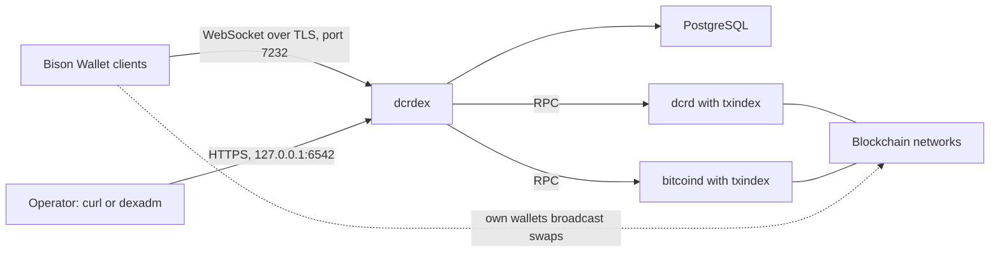
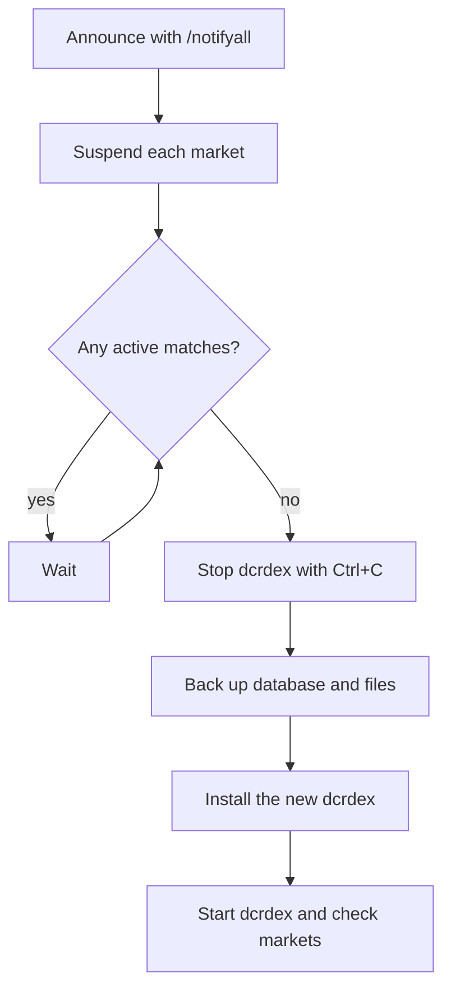

# Run a DCRDEX server

This guide takes you from an empty Linux or macOS machine to a public DCRDEX server that Bison Wallet traders can use, then covers markets, fidelity bonds, the admin application programming interface (API), backups and upgrades. It assumes you run full nodes and PostgreSQL in production.

!!! info "Applies to"
    The DCRDEX server `dcrdex` v1.0.6 (tag `v1.0.6`), serving Bison Wallet 1.0.6 and Decrediton 2.1.7 clients, with `dcrd` 2.1.7. Checked November 2026.

## Should you run a server?

A DCRDEX server matches orders in epochs, relays swap details between the two traders of each match, and watches each listed blockchain to check that both follow the protocol. It never holds traders' coins, and the protocol pays it nothing: there are no trading fees, and bonds return to the traders who posted them. [DCRDEX: Trading without custody](../../user/dex/index.md) explains the trader's side.

Traders depend on you for things the code cannot enforce:

- **Uptime during settlement.** Each swap step waits for the server to relay it; the DCRDEX specification says clients "expect near-perfect uptime". If your server goes away, coins stay in traders' wallets or in refundable contracts, but matches stall and refunds take up to 20 hours.
- **Stable settings.** If you change a market's lot size, `dcrdex` revokes (without penalty) every booked order that no longer fits when it next starts. A new rate step applies only to new orders. Change markets rarely, and announce it.
- **A stable identity.** Bison Wallet derives each trader's account key from the trader's seed *and your server's public key*, and pins your Transport Layer Security (TLS) certificate if it is self-signed. Losing the signing key breaks every account; a new self-signed certificate disconnects every trader.
- **Coordinated upgrades.** Protocol changes, such as the one in Bison Wallet 1.1, cut off clients that have not upgraded.
- **Privacy.** You see every trader's IP address, orders and swap addresses.

Bison Wallet's only built-in mainnet server is `dex.decred.org:7232`; traders reach any other server by typing its address, so you also need a way to attract traders to both sides of each market.

## How the pieces connect

The server talks to PostgreSQL and to one full node or remote procedure call (RPC) endpoint per asset. Traders' wallets broadcast swap transactions themselves, and the operator uses the admin API over Hypertext Transfer Protocol Secure (HTTPS) on the loopback address.



The server needs no wallet. The DCRDEX wiki's `regfeexpub` setting for registration fees predates fidelity bonds; `dcrdex` 1.0.6 has no such option.

## Before you start

- A Linux or macOS server with a public hostname and one open Transmission Control Protocol (TCP) port for traders (7232 here).
- Go 1.24 or later and `git`.
- PostgreSQL 11 or later (the version the DCRDEX wiki gives).
- A synced full node with a transaction index for each unspent transaction output (UTXO) asset: `dcrd` 2.1.7 for Decred, `bitcoind` for Bitcoin, and so on. Ethereum and Polygon need RPC endpoints instead.
- A terminal you can return to: `dcrdex` asks for passwords at every start.

The examples assume a system user `dcrdex` with home `/home/dcrdex`, a DCR/BTC market, and mainnet. Rehearse on simnet or testnet first (see [Rehearse on simnet and testnet](#rehearse-on-simnet-and-testnet)).

## Step 1: Build dcrdex

There are no server binaries; build the release tag:

```bash
git clone --branch v1.0.6 https://github.com/decred/dcrdex
cd dcrdex/server/cmd/dcrdex
go build
./dcrdex --version
```

```text title="Expected output"
dcrdex version 1.0.6+release.local (Go version go1.24.4 linux/amd64)
```

Your Go version and platform will differ. The build includes the BCH, BTC, DASH, DCR, DGB, DOGE, FIRO, LTC, ZEC, ETH and Polygon backends. [Build from source](../environment/build-from-source.md) covers toolchains.

## Step 2: Create the database

`dcrdex` connects as user `dcrdex` to a database named `dcrdex_<network>` (`dcrdex_mainnet`, `dcrdex_testnet` or `dcrdex_simnet`) and creates its tables on first start. In `psql` as the superuser:

```sql
CREATE USER dcrdex WITH PASSWORD '<DB_PASSWORD>';
CREATE DATABASE dcrdex_mainnet OWNER dcrdex;
```

`<DB_PASSWORD>` is a new random password. Alternatively, set `pghost=/run/postgresql` to use a Unix socket with peer authentication. `dcrdex` connects with `sslmode=disable`, so keep PostgreSQL on the same machine or a private network.

## Step 3: Prepare the asset nodes

**Decred.** Add `txindex=1`, `rpcuser=<DCRD_RPC_USER>` and `rpcpass=<DCRD_RPC_PASS>` to `dcrd.conf` and restart `dcrd`. Then give `dcrdex` a file with the connection details, here `/home/dcrdex/.dcrdex/dcrd-rpc.conf`:

```ini
rpcuser=<DCRD_RPC_USER>
rpcpass=<DCRD_RPC_PASS>
rpclisten=127.0.0.1:9109
rpccert=/home/dcrdex/.dcrd/rpc.cert
```

`<DCRD_RPC_USER>` and `<DCRD_RPC_PASS>` are credentials you choose. The backend reads only these four keys, so pointing it at `dcrd.conf` itself also works. It refuses to start if `dcrd` has no transaction index or reports an RPC API major version other than 7 or 8 (`dcrd` 2.1.7 reports 8.3.0). [Run dcrd in production](production-node.md) covers the node.

**Bitcoin and its relatives** (BCH, LTC, DOGE, DASH, DGB, FIRO, ZEC). Run the node with `server=1` and `txindex=1`, and point `dcrdex` at a config file holding `rpcuser`, `rpcpassword` and, if not the defaults, `rpcbind` and `rpcport`.

**Ethereum and Polygon.** The config file lists RPC endpoint URLs, one per line. Tokens such as `usdc.eth` need their parent chain enabled as an asset too.

!!! warning "Use absolute paths"
    `dcrdex` does not expand `~` in `configPath` or in `rpccert`, and it resolves a relative path against the directory it was started from, not the application directory. A `~` path fails with an error such as `no "dcr" config file found at ~/...`.

## Step 4: Write dcrdex.conf

The application directory is `~/.dcrdex` on Linux and `~/Library/Application Support/Dcrdex` on macOS. It holds `dcrdex.conf`, `markets.json`, `sigkey`, `rpc.cert` and `rpc.key`, with logs in `logs/<network>/dcrdex.log`. A minimal mainnet `~/.dcrdex/dcrdex.conf`:

```ini
[Application Options]
; Listen for traders on all interfaces (default 127.0.0.1:7232).
rpclisten=0.0.0.0:7232
; Hostname for the self-signed certificate. Set before the first start.
altdnsnames=<DEX_HOSTNAME>
pgpass=<DB_PASSWORD>
; The admin API listens on 127.0.0.1:6542 by default.
adminsrvon=1
```

`<DEX_HOSTNAME>` is the name traders will type, such as `dex.example.com`. Add `testnet=1` or `simnet=1` for another network. Options this guide relies on:

| Option | Default | What it controls |
|---|---|---|
| `rpclisten` | `127.0.0.1:7232` | Trader-facing address; repeat for several |
| `rpccert`, `rpckey` | `rpc.cert`, `rpc.key` | TLS pair; generated (self-signed, valid 10 years) if both are missing |
| `altdnsnames` | none | Extra hostnames in a generated certificate; changing it later does not regenerate it |
| `pghost`, `pguser`, `pgdbname`, `pgpass` | `127.0.0.1:5432`, `dcrdex`, `dcrdex_{netname}`, none | PostgreSQL connection |
| `adminsrvon`, `adminsrvaddr` | off, `127.0.0.1:6542` | Admin HTTPS API |
| `signingkeypass`, `adminsrvpass` | none (prompt) | Passwords; the program calls these options INSECURE |
| `nodata` | off | Turns off the HTTP API on the trader port: `/api/spots`, `/api/candles`, `/api/orderbook`, and also `/api/config` and `/api/healthy`, which then return 503. Clients still get the configuration over the WebSocket |

`./dcrdex --help` lists every option, including cancellation and penalty rules; defaults are in [`server/cmd/dcrdex/config.go`](https://github.com/decred/dcrdex/blob/v1.0.6/server/cmd/dcrdex/config.go). The bundled `sample-dcrdex.conf` gives older values for some.

### TLS: Self-signed or issued

With no certificate files, `dcrdex` generates a self-signed pair on first start, naming `localhost`, the machine's addresses and any `altdnsnames`. Every trader must then load your `rpc.cert` into Bison Wallet, and load it again if it changes. A certificate from a public certificate authority, set with `rpccert` and `rpckey`, needs no file; restart after renewing it. The admin API uses the same pair.

## Step 5: Define markets and bonds

`markets.json` lists markets and the assets they use. This example offers DCR/BTC and accepts bonds in DCR; every number is an example, not a recommendation:

```json title="~/.dcrdex/markets.json"
{
    "markets": [
        {
            "base": "DCR_mainnet",
            "quote": "BTC_mainnet",
            "lotSize": 4000000000,
            "rateStep": 100,
            "epochDuration": 10000,
            "marketBuyBuffer": 1.25,
            "parcelSize": 4
        }
    ],
    "assets": {
        "DCR_mainnet": {
            "bip44symbol": "dcr",
            "network": "mainnet",
            "maxFeeRate": 10,
            "swapConf": 2,
            "configPath": "/home/dcrdex/.dcrdex/dcrd-rpc.conf",
            "bondAmt": 10000000,
            "bondConfs": 1
        },
        "BTC_mainnet": {
            "bip44symbol": "btc",
            "network": "mainnet",
            "maxFeeRate": 100,
            "swapConf": 1,
            "configPath": "/home/dcrdex/.bitcoin/bitcoin.conf"
        }
    }
}
```

The first five fields belong to each market, the rest to each asset:

| Field | Meaning |
|---|---|
| `lotSize` | Smallest order and step between order sizes, in base-asset atoms. Required |
| `rateStep` | Price increment in message-rate units (quote per whole base unit × 10^8); 100 here is 0.000001 BTC per DCR. Required |
| `epochDuration` | Matching epoch in milliseconds; 0 means 20,000 |
| `marketBuyBuffer` | A market buy must be worth at least this many lots |
| `parcelSize` | Lots per parcel, the unit of trading limits. Must not be 0 |
| `bip44symbol`, `network` | The asset (`dcr`, `btc`, `usdc.eth`, ...) and network. Entries for other networks are ignored |
| `maxFeeRate` | Highest fee rate the server will require (atoms per byte for Decred); traders reserve funds at it. Must not be 0 |
| `swapConf` | Confirmations a counterparty's swap needs before the next step |
| `configPath` | Absolute path to the file from Step 3 |
| `bondAmt`, `bondConfs` | Bond per tier in atoms, and confirmations before it counts; both above 0 to accept bonds |

On Decred, a regular-tree transaction can still be removed if stakeholders disapprove its block in the next block's votes, so a `swapConf` of 2 or more acts only after that vote (see [Blocks, confirmations and reorganizations](../protocol/blocks-and-confirmations.md)). Any entry accepts `"disabled": true`. Every enabled asset must be used by an enabled market, or `dcrdex` stops with `unused assets`.

What the example means for a trader: a lot is 40 DCR and a parcel 160 DCR. Each tier allows 2 parcels, so one 0.1 DCR bond allows 320 DCR of orders and settling matches across all markets, and a perfect score triples that. The server stops counting a bond 30 days (the mainnet bond expiry) before its lock time. Bison Wallet locks bonds for about 60 days and posts a replacement before the old one stops counting, so each tier ties up about twice `bondAmt`. To size lots, the DCRDEX README suggests about 100 times the fees one match costs on both chains, which keeps worst-case fees near 1%. Without a bond asset, traders reach a tier only through pre-paid bonds.

## Step 6: Validate the configuration

```bash
./dcrdex --validate
```

This fetches exchange rates from Coinpaprika (it needs internet access), checks each lot size and bond amount against the dust minimum at your `maxFeeRate`, and exits. Success lines read `Market dcr_btc lot size passes: ...`; problems print as `FAIL: ...`. Add `--testnet` to check testnet entries.

## Step 7: Start the server

```bash
./dcrdex
```

`dcrdex` asks for two passwords at every start. The first becomes the admin API password until the next restart. The second unlocks the signing key; on the first start it creates `sigkey`, encrypted with what you type.

```text title="Expected output (abridged)"
Admin interface password:
[INF] MAIN: dcrdex starting for network: mainnet
[INF] MAIN: Found 2 assets, loaded 1 markets, for network MAINNET
Signing key password:
[INF] MAIN: Creating new DEX signing key file at /home/dcrdex/.dcrdex/sigkey...
[INF] DEX: Bonds accepted using dcr: amount 10000000, confs 1
[INF] COMM: Server listening on 0.0.0.0:7232
[INF] ADMN: admin server listening on 127.0.0.1:6542
[INF] MAIN: The DEX is running. Hit CTRL+C to quit...
```

Press ++ctrl+c++ to stop cleanly. Open the trader port in your firewall and keep the admin port closed. For Tor, add `hiddenservice=127.0.0.1:7252`, an extra listener without TLS, and point the onion service at it (`HiddenServicePort 7232 127.0.0.1:7252` in `torrc`).

!!! warning "Running unattended"
    Without a terminal, startup fails with `cannot use password: inappropriate ioctl for device`. Run `dcrdex` in a terminal multiplexer such as `tmux` and type the passwords after each restart, or put `signingkeypass` and `adminsrvpass` in a `chmod 600` `dcrdex.conf`. The second leaves the key's password on disk next to the key.

## Check that it worked

1. From another machine, fetch the public configuration:

    ```bash
    curl --cacert rpc.cert https://<DEX_HOSTNAME>:7232/api/config
    ```

    You should get a JavaScript Object Notation (JSON) document with your `markets`, `assets`, `bondAssets` and `pubkey`. Both this and `/api/healthy` return 503 if you set `nodata`.

2. In Bison Wallet, choose **Settings** > **Add a DCRDEX Server** > **add a different server**, enter `<DEX_HOSTNAME>:7232` as the **DEX Address**, click **add a file** under **TLS Certificate** to choose your `rpc.cert` if it is self-signed, and click **Submit**. The bond step should offer your bond assets.

3. Post a bond and trade a small amount between two of your own wallets, on testnet first.

## Administer the server

With `adminsrvon`, `dcrdex` serves an HTTPS API on `127.0.0.1:6542` with HTTP basic authentication: any username, and the password typed at startup.

```bash
curl --cacert ~/.dcrdex/rpc.cert -u u https://127.0.0.1:6542/api/markets
```

`curl` prompts for the password. For scripts, put `machine 127.0.0.1 login u password <ADMIN_PASSWORD>` in a file only you can read and pass `--netrc-file <FILE>` instead of `-u u`. With an issued certificate, add `--resolve <DEX_HOSTNAME>:6542:127.0.0.1` and use `https://<DEX_HOSTNAME>:6542`. Markets are named `base_quote` in lowercase (`dcr_btc`). The routes this guide uses:

| Path (prefix `/api`) | Method | What it does |
|---|---|---|
| `/markets` | GET | Running state and epochs of each market |
| `/market/{market}/matches` | GET | Active matches, one JSON object each |
| `/market/{market}/suspend?persist=BOOL` | GET | Stop matching at the end of the epoch; `persist` (default `true`) keeps booked orders |
| `/market/{market}/resume` | GET | Restart a suspended market |
| `/asset/{symbol}` | GET | Backend sync state, fee rate, errors |
| `/notifyall` | POST | Send the `text/plain` body to every connected client |
| `/enabledataapi/{yes}` | GET | Turn the trader-port HTTP API on (`true`) or off (`false`); while off, `/api/healthy` cannot be polled |
| `/prepaybonds?n=N&days=D` | GET | Create pre-paid bond codes |

The full list is in [`server/admin/server.go`](https://github.com/decred/dcrdex/blob/v1.0.6/server/admin/server.go). The `/accounts` route in `spec/admin.mediawiki` does not exist in 1.0.6.

- **Announce maintenance:** `curl --cacert ~/.dcrdex/rpc.cert -u u -H "Content-Type: text/plain" --data-binary "Markets suspend at 14:00 UTC for an upgrade." https://127.0.0.1:6542/api/notifyall`. Offline accounts miss it.
- **Pre-paid bonds** let a trader you invite start without posting a bond. `/prepaybonds?n=5&days=90` returns five single-use codes, each worth one tier for 90 days. The trader chooses **Use a pre-paid bond** in Bison Wallet's bond step and enters the code under **Code**.
- **Change a market:** suspend it with `persist=false`, edit `markets.json`, validate, and restart.

### dexadm: A browser front end

`server/cmd/dexadm` wraps the same API in a local web page with a section for each task (**View Config**, **Assets**, **List Accounts**, **Account**, **Broadcast Message**, **Markets**, **Generate Pre-paid Bonds**). Build it with `go build` in that directory and create `~/.dexadm/dexadm.conf`:

```ini
adminsrvurl=https://127.0.0.1:6542
adminsrvpass=<ADMIN_PASSWORD>
adminsrvcertpath=~/.dcrdex/rpc.cert
```

Run `./dexadm` from `server/cmd/dexadm` (it serves its page files from the current directory) and open `http://127.0.0.1:31043`. It listens only on 127.0.0.1, so on a headless server run it there and reach it with a Secure Shell (SSH) tunnel to 127.0.0.1:31043. **List Accounts** returns an error, because 1.0.6 has no `/accounts` route.

!!! warning "dexadm has no login"
    The page on port 31043 forwards every request, for any path and method, to the admin API with your admin password attached. Anyone who can reach that port on the machine controls your markets. A web page open in the same browser may also be able to make the browser send requests to it, and many admin actions are plain GET requests (suspend, setfeescale, prepaybonds). Run dexadm only on a single-user machine, use a separate browser profile with no other sites open while it runs, and stop it when you are done.

## Rehearse on simnet and testnet

**Simnet** runs everything on your machine. From the repository root, start `dex/testing/dcr/harness.sh` and `dex/testing/btc/harness.sh` in separate terminals, then `dex/testing/dcrdex/harness.sh`. It needs `tmux`, uses short swap lock times, recreates the `dcrdex_simnet_test` database with `sudo -u postgres psql`, and enables the admin API on `127.0.0.1:16542` with password `adminpass`. [Building on DCRDEX](../integrate/dcrdex.md) covers the client side. The wiki's manual simnet steps use retired fields and no `parcelSize`, so 1.0.6 refuses that markets file.

**Testnet** adds real network conditions. Run your nodes on testnet, set `testnet=1`, create `dcrdex_testnet`, and add `DCR_testnet`-style assets. Bonds expire after 3 hours instead of 30 days, so rotation is quick to observe.

## Upgrade without stranding traders

Plan every upgrade so no swap is in flight when `dcrdex` stops:



1. Announce the time with `/notifyall`, well ahead.
2. Suspend each market. Add `persist=false` to clear the books when the upgrade changes the protocol or market settings.
3. Wait until `/api/market/dcr_btc/matches`, and the same route for every other market, prints nothing. Each swap step waits for confirmations, so allow hours.
4. Stop `dcrdex`, back up, install the new build, start it, and check `/api/markets`.

`dcrdex` upgrades its database schema at startup, and the unreleased 1.1 line moves it from version 6 to 8, so keep the pre-upgrade dump. Upgrade `dcrd` and the other nodes on their own schedule, following [Operating Decred infrastructure](index.md).

### Bison Wallet 1.1 breaks the protocol

DCRDEX 1.1 exists only as release candidates (v1.1.0-rc2). [Trading on DCRDEX](../../user/dex/trading-guide.md) covers the effect on traders. For operators, the [1.1 release notes](https://github.com/decred/dcrdex/blob/master/docs/release-notes/release-notes-1.1.0.md) add that 1.0.x clients, Decrediton 2.1.7's DEX tab included, cannot trade on a 1.1 server, and that on upgrade the server revokes every active 1.0.x swap without penalty, leaving traders to refund after the lock time. "Operators must wait for all active swaps to complete before upgrading." Upgrade only once 1.1 is released and your traders have a client that speaks it.

## Back up what cannot be recreated

| What | Why it matters |
|---|---|
| `sigkey` and its password | Your server's identity. Clients check signatures against it and derive their account keys from it, so a new key breaks every account |
| `rpc.cert` and `rpc.key` | If self-signed, traders pinned the certificate; a new one disconnects each until they choose **Update TLS Certificate** |
| PostgreSQL database | Accounts, bonds, scores, orders, matches and active swaps. Run `pg_dump` on a schedule and before every upgrade |
| `dcrdex.conf`, `markets.json`, asset config files | Needed to rebuild |

`dcrdex` writes `sigkey` with mode 0644; it is encrypted, but `chmod 600` it and keep the backup apart from its password.

## Monitor

- **Public health:** `/api/healthy` on the trader port returns `false` when the database reports an error or the Bitcoin backend is not synced. It checks Bitcoin specifically: on a server that lists no BTC asset the handler fails (HTTP 500), so monitor such servers with the admin API's `/api/asset/{symbol}` instead. With the data API off, it returns 503.
- **Backends and markets:** on the admin API, `/api/asset/dcr` (and each other symbol) should show `"synced": true` and no `errors`, and `/api/markets` should show `"running": true` for each market you have not suspended.
- **Logs:** alert on new `[ERR]` and `[CRT]` lines in `logs/mainnet/dcrdex.log`.
- **Nodes and disk:** a market stops progressing when one of its nodes does, including `dcrd`'s deliberate shutdowns in 2.1.7, and the database grows with every order and match.

## Troubleshooting

### missing dcrd credentials

The DCR asset's `configPath` file lacks `rpcuser` or `rpcpass`. Add both, matching `dcrd.conf`.

### dcrd does not have transaction index enabled (specify --txindex)

Set `txindex=1` in `dcrd.conf` and restart `dcrd`. The Bitcoin-family backends give a similar error.

### unused assets

An enabled asset is not used by any enabled market. Remove it, set `"disabled": true`, or add the market.

### has NO lot size specified (was an asset setting)

The markets file uses an old layout. Move `lotSize` and `rateStep` to each market, add a non-zero `parcelSize`, and replace `regFee`, `regConfs` and `regXPub` with `bondAmt` and `bondConfs`.

### Traders see "Disconnected - Invalid Certificate"

Your certificate changed or does not name the hostname they typed. To fix the name, delete `rpc.cert` and `rpc.key`, set `altdnsnames`, restart, and give every trader the new file, or switch to an issued certificate.

## Next steps

- [Building on DCRDEX](../integrate/dcrdex.md): the protocol specification, the simnet harnesses and client scripting.
- [Trading on DCRDEX](../../user/dex/trading-guide.md): what your traders see.
- [Run dcrd in production](production-node.md): harden the node your Decred markets depend on.
- [Operating Decred infrastructure](index.md): release channels and upgrade order.
- [Atomic swaps and DCRDEX](../../whitepaper/19-ecosystem.md#sec:ecosystem-dex): the swap contract and bond script.

*[DEX]: decentralized exchange
*[API]: application programming interface
*[RPC]: remote procedure call
*[TLS]: Transport Layer Security
*[UTXO]: unspent transaction output
*[JSON]: JavaScript Object Notation
*[HTTP]: Hypertext Transfer Protocol
*[HTTPS]: Hypertext Transfer Protocol Secure
*[TCP]: Transmission Control Protocol
*[SSH]: Secure Shell
*[IP]: Internet Protocol
