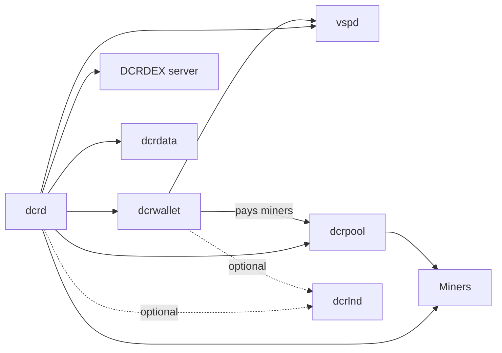

# Operating Decred infrastructure

These guides are for system administrators running Decred services that others depend on: production nodes, voting service providers (VSPs), mining pools, DCRDEX servers and Lightning nodes. This page covers what they all share: releases, upgrade order, the 2.1.7 safety shutdown and health checks.

## In this section

-   **[Run dcrd in production](production-node.md)**

    ---

    Sizing, indexes, safe remote procedure call (RPC) exposure, caches, Tor, running as a service and recovery.

-   **[Run a voting service provider](vsp.md)**

    ---

    `vspd` 1.5.0 deployment, fees, monitoring, upgrades and listing.

-   **[Mining infrastructure](mining.md)**

    ---

    How `dcrd` serves work, `gominer`, and `dcrpool`.

-   **[Run a DCRDEX server](dex-server.md)**

    ---

    Markets, bonds, the admin API and protocol-changing upgrades.

-   **[Run a dcrlnd Lightning node](lightning-node.md)**

    ---

    Channels, backups, watchtowers, and the gRPC and REST APIs.

Self-hosting dcrdata is covered on the [dcrdata API](../api/dcrdata-api.md) page, and voting your own tickets on [Vote without a VSP](../../user/staking/solo-voting.md).

## What runs on what

Almost every service depends on `dcrd`, so the node's health and version limit everything built on it:

Each program is released in its own way:

| Program | Where releases come from | Version these docs cover |
|---|---|---|
| `dcrd`, `dcrwallet`, `dcrctl`, `dcrlnd` | Binaries with a signed manifest on [decred-binaries](https://github.com/decred/decred-binaries/releases) ([verify them](../../user/security/verify-downloads.md)); notes on the [dcrd](https://github.com/decred/dcrd/releases) and [dcrwallet](https://github.com/decred/dcrwallet/releases) release pages | 2.1.7 (`dcrlnd` 0.8.1) |
| `vspd` | Source at the [vspd release](https://github.com/decred/vspd/releases) tag; no binaries | 1.5.0 |
| `dcrpool` | Source at the [dcrpool release](https://github.com/decred/dcrpool/releases) tag; no binaries | 2.0.0 |
| DCRDEX server (`dcrdex`) | Source at the v1.0.6 tag; the [release page](https://github.com/decred/dcrdex/releases) stops at v1.0.5 | v1.0.6 |
| `dcrdata` | Source; no release page since release-v6.0 (2021) | default branch |

## Upgrades

The heading in `dcrd`'s release notes says how urgent a release is: 2.1.6 (August 2026) was **Upgrade Mandatory** and 2.1.7 (October 2026) is **Upgrade Highly Recommended**, so run 2.1.7 and never anything older than 2.1.6 on mainnet (`vspd` 1.5.0 refuses an older `dcrd` or `dcrwallet`). Upgrade `dcrd` first, then `dcrwallet`, then the services that use them, and redundant voting servers one at a time; [Upgrading and mandatory releases](../../user/run/upgrades.md) is the canonical page for release notes and step-by-step upgrades.

## When dcrd stops on purpose

In response to "the previous inflation bug", 2.1.7 checks for transaction spends that should never be possible: when a check fires, `dcrd` logs a critical line marked `[CRT] CHAN:` and shuts down rather than keep running in a possibly unsafe state. [Upgrading and mandatory releases](../../user/run/upgrades.md) says what to keep, how to report it and why not to downgrade. A service also needs to:

- **Alert on every unexpected exit.** `dcrd` stops with a Go panic: a non-zero exit status, with the stack trace on standard error. Capture the process output (journald does under systemd), not only `dcrd.log`, and do not let an automatic restart policy hide a repeated stop.
- **Expect redundancy to fail together.** The checks halt every affected node, so all your servers may stop at once, together with every service that depends on `dcrd` (see the diagram). While they are down, tickets your wallets would have voted miss.

## Health checks

Monitor `dcrd` first; every service inherits its view of the chain. Run these from cron or call the same RPCs from your monitoring system; add `--testnet` to `dcrctl` for a testnet3 node.

| Check | Command | Healthy result |
|---|---|---|
| Synced | `dcrctl getblockchaininfo` | `"initialblockdownload": false`, and `blocks` equals `headers` and the [dcrdata](https://dcrdata.decred.org/) height, give or take a block. It turns `true` again if the newest block is over 24 hours old |
| Connected | `dcrctl getpeerinfo` | Several peers (`dcrd` aims for 8 outbound, plus inbound if port 9108 is reachable), each `subver` naming a version such as `dcrd:2.1.7` |
| Forks | `dcrctl getchaintips` | Exactly one tip is `active` (it always is); `valid-fork`, `valid-headers` and `headers-only` tips are ordinary side chains. Alert on an `invalid` tip higher than the `active` one: other nodes are extending blocks your node rejects, so check your version |
| Version | `dcrctl version` | The `dcrd` entry shows major 2, minor 1, patch 7 |
| Log | `logs/mainnet/dcrd.log` under `~/.dcrd`, `~/Library/Application Support/Dcrd` or `%LOCALAPPDATA%\Dcrd` | No new `[ERR]` or `[CRT]` lines. Set detail with `debuglevel` |
| Wallet | `dcrctl --wallet walletinfo` | `daemonconnected` is `true`; on voting wallets, so are `unlocked` and `voting` |
| Votes | `dcrctl --wallet getstakeinfo` | `missed` does not rise (the field is absent while it is zero, and always absent on light wallets) |

!!! warning "Keep RPC private"
    Of the node and wallet ports, forward only `dcrd`'s peer-to-peer port (9108 on mainnet); each service guide names its own public ports. Keep the RPC ports (9109 for `dcrd`, 9110 and 9111 for `dcrwallet`) on localhost or a private network, as `dcrd` does by default: a leaked or guessed credential controls the program, and the funds in an unlocked wallet.

## Next steps

- [Run dcrd in production](production-node.md): the node every other service depends on.
- [Run a voting service provider](vsp.md): the most demanding service to run.
- [Upgrading and mandatory releases](../../user/run/upgrades.md): before your next upgrade.
- [dcrd JSON-RPC API](../api/dcrd-json-rpc.md): every method the health checks use.
- [Ports, paths and prefixes](../reference/index.md): default ports and data directories for every program.

*[RPC]: remote procedure call
*[VSP]: voting service provider
*[VSPs]: voting service providers
