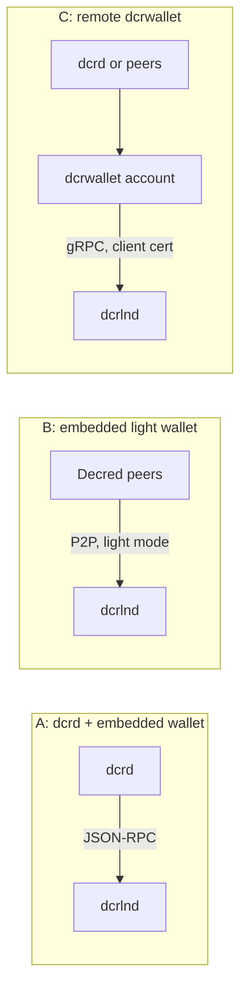

# Run a dcrlnd Lightning node

This guide is for operators who run `dcrlnd`, Decred's Lightning Network node, as a standalone service: a merchant backend, a routing node or a watchtower. Opening, paying and closing channels step by step is in [Use Lightning](../../user/lightning/use-lightning.md), and how channels work is in [Lightning on Decred](../../user/lightning/index.md).

!!! info "Applies to"
    `dcrlnd` and `dcrlncli` 0.8.1, as shipped in the Decred 2.1.7 command-line bundle, with `dcrd` and `dcrwallet` 2.1.7. Checked November 2026.

## Before you start

- **Read the risk.** The `dcrlnd` README calls it beta software and warns that ignoring its safety guidelines can lead to loss of funds. Put in channels only what you can afford to lose.
- **A host that stays on**, with its data on a reliable SSD. SD cards, USB sticks and network drives without `fsync` can corrupt the channel database.
- **The binaries.** `dcrlnd`, `dcrlncli` and `sample-dcrlnd.conf` are in the `decred-<os>-<arch>-v2.1.7` archive and are installed by `dcrinstall` ([Set up the command-line wallet](../../user/wallets/command-line.md)); [verify the download](../../user/security/verify-downloads.md). To build instead: `go install github.com/decred/dcrlnd/cmd/dcrlnd@v0.8.1` and the same for `cmd/dcrlncli` (Go 1.24 or later).
- **A chain backend** for the mode you pick below: a synced `dcrd`, or nothing extra for light mode, or a running `dcrwallet` 2.1.7.
- **The address of at least one peer** (`<NODE_PUBKEY>@<HOST>:<PORT>`). `dcrlnd` has no DNS (Domain Name System) seeds for Decred, so a new node finds nobody on its own.

## 1. Choose an operating mode

`dcrlnd` needs two things: a view of the Decred chain (to see funding, closing and breach transactions) and a wallet that holds its on-chain keys. The `node` option picks where chain data comes from, and the `[dcrwallet]` options pick whose wallet holds the keys. Three combinations are supported; the diagram shows where each gets its chain data and keys.



| Mode | Config | Keys and seed | Daemons | Suits |
|---|---|---|---|---|
| A. `dcrd` + embedded wallet | `node = dcrd` (the default) | `dcrlnd`'s own 24-word seed | `dcrd`, `dcrlnd` | Always-on hubs and routing nodes: full validation, fastest sync. The upstream docs recommend it. |
| B. Embedded light wallet (simplified payment verification, SPV) | `node = dcrw`, `dcrwallet.spv = 1` | `dcrlnd`'s own 24-word seed | `dcrlnd` | Small or trial nodes: simplest, slower on-chain sync |
| C. Remote `dcrwallet` | `node = dcrw`, `dcrwallet.grpchost` set | One account of an existing wallet; no extra seed | `dcrwallet` (+ `dcrd`), `dcrlnd` | Operators who already run an always-on wallet. Hardest to set up. |

!!! warning "The mode is fixed once the wallet exists"
    You cannot move a node between an embedded and a remote wallet, or between remote wallets with different seeds, after its wallet is created. Switching means closing every channel and starting a new node.

## 2. Know the files and ports

The `dcrlnd` home directory is `~/.dcrlnd` on Linux and BSD, `~/Library/Application Support/Dcrlnd` on macOS and `%LOCALAPPDATA%\Dcrlnd` on Windows. Paths below are relative to it, for mainnet; other networks replace `mainnet` with `testnet`, `simnet` or `regnet` (the network selected with `--regtest`).

| File | Path | Notes |
|---|---|---|
| Configuration | `dcrlnd.conf` | Same option names as the command-line flags (`--tor.active`). `dcrlnd --help` shows the real defaults; some comments in `sample-dcrlnd.conf` are inherited from `lnd` and wrong for Decred |
| Channel database | `data/graph/mainnet/channel.db` | Never restore an old copy (step 8) |
| Static channel backup | `data/chain/decred/mainnet/channel.backup` | Rewritten at every start, channel open and close; `backupfilepath` moves it |
| Macaroons | `data/chain/decred/mainnet/admin.macaroon`, `readonly.macaroon`, `invoice.macaroon`, `macaroons.db` | API credentials (step 9) |
| Transport Layer Security (TLS) certificate and key | `tls.cert`, `tls.key` | Self-signed, valid 14 months, for gRPC and REST |
| Log | `logs/decred/mainnet/lnd.log` | Rotated at 10 MB, 3 files kept |
| Watchtower database | `data/watchtower/decred/mainnet/watchtower.db` | Only when the tower server is on |

| Port | Default listener | Purpose |
|---|---|---|
| 9735 | all interfaces | Lightning peer connections |
| 10009 | `localhost` | gRPC API, used by `dcrlncli` |
| 8080 | `localhost` | Representational state transfer (REST) API |
| 9911 | all interfaces | Watchtower server, only when `watchtower.active` is set |

`dcrlnd` uses these ports on every network, unlike `dcrd` and `dcrwallet`. To run a mainnet and a testnet node on one host, give the second its own `--lnddir` and ports. Port 8080 is also `dcrpool`'s default web port.

## 3. Configure the backend

### Mode A: dcrd and an embedded wallet

Give `dcrd` remote procedure call (RPC) credentials and the transaction index. On first start `dcrd` writes a random `rpcuser` and `rpcpass` into `~/.dcrd/dcrd.conf`; add:

```ini title="dcrd.conf"
txindex=1
```

`dcrlnd` finds transactions faster through the index; the `dcrlnd` install notes ask for it, and without it `dcrlnd` falls back to scanning blocks. Let `dcrd` sync fully ([Run dcrd in production](production-node.md)), then write `dcrlnd.conf`:

```ini title="dcrlnd.conf"
[Application Options]
node = dcrd
alias = <ALIAS>

[Dcrd]
dcrd.rpchost = localhost
dcrd.rpcuser = <DCRD_RPCUSER>
dcrd.rpcpass = <DCRD_RPCPASS>
```

`<ALIAS>` is a public name of up to 32 bytes (32 ASCII characters). `<DCRD_RPCUSER>` and `<DCRD_RPCPASS>` are the values in `dcrd.conf`. Set them explicitly: when they are missing, `dcrlnd` 0.8.1 looks for a `dcrd.conf` in the directory it was started from, which usually fails with `unable to load RPC credentials for dcrd`. `dcrinstall` already writes a `dcrlnd.conf` with these two values filled in. Keep the file readable only by the `dcrlnd` user (`chmod 600`), since the password gives full RPC access to `dcrd`. `dcrd.rpccert` defaults to `rpc.cert` in `dcrd`'s home directory, so a local `dcrd` needs no setting for it. For a `dcrd` on another host, point `dcrd.rpchost` at it, copy its `rpc.cert`, and set `dcrd.rpccert` to the full absolute path of the copy: `dcrlnd` does not expand `~` in this option. `dcrd.rpcclientcert` and `dcrd.rpcclientkey` replace the user and password when `dcrd` uses client certificates.

### Mode B: Embedded light wallet

```ini title="dcrlnd.conf"
[Application Options]
node = dcrw
alias = <ALIAS>

[dcrwallet]
dcrwallet.spv = 1
```

`dcrwallet.spvconnect = <HOST>:9108` limits the light wallet to one trusted `dcrd` peer instead of discovering peers.

### Mode C: A remote dcrwallet

`dcrlnd` connects to `dcrwallet`'s gRPC interface, authenticates with a client certificate, and takes over one account. It unlocks that account once at startup, copies the account's extended private key into memory and locks it again.

1. **Create a dedicated account with its own passphrase** on the wallet host. `dcrlnd` controls every coin in the account, and it unlocks the account with `UnlockAccount`, which works only on individually encrypted accounts ([Manage accounts and passphrases](../../user/wallets/accounts-and-passphrases.md) explains them):

    ```bash
    promptsecret | dcrctl --wallet walletpassphrase - 60
    dcrctl --wallet createnewaccount lightning
    promptsecret | dcrctl --wallet setaccountpassphrase lightning -
    promptsecret | dcrctl --wallet unlockaccount lightning -
    dcrctl --wallet lockaccount lightning
    dcrctl --wallet walletlock
    ```

    `promptsecret` asks once, so the `unlockaccount` line checks what you typed: no output means it matches. Use a passphrase that differs from the wallet's.

2. **Find the account number.** Run `dcrctl --wallet getaccountaddress lightning`, then `dcrctl --wallet validateaddress <ADDRESS>` with the address it prints. The `accountn` field is the number.

3. **Create a client certificate.** Make a certificate authority (CA) on the wallet host and a client key on the `dcrlnd` host, then sign the client certificate with the CA:

    ```bash
    # wallet host
    openssl genpkey -algorithm ed25519 -out client-ca.key
    openssl req -x509 -nodes -key client-ca.key -sha256 -days 1024 -out client-ca.cert
    # dcrlnd host
    openssl genpkey -algorithm ed25519 -out client.key
    openssl req -new -key client.key -out client.csr
    # wallet host, after copying client.csr there
    openssl x509 -req -in client.csr -CA client-ca.cert -CAkey client-ca.key -CAcreateserial -out client.cert -days 1024 -sha256
    ```

    Copy `client.cert` back to the `dcrlnd` host. Accept the defaults at the `openssl req` prompts. The LibreSSL that ships with macOS and OpenBSD may not support Ed25519 keys.

4. **Configure `dcrwallet`** to trust the CA, and to listen beyond `localhost` if `dcrlnd` runs elsewhere:

    ```ini title="dcrwallet.conf"
    clientcafile = /path/to/client-ca.cert
    ; only if dcrlnd is on another host:
    grpclisten = <WALLET_LAN_IP>:9111
    ```

    `clientcafile` defaults to `clients.pem` in the `dcrwallet` home directory, and `dcrinstall` already puts politeiavoter's certificate there. To keep existing gRPC clients working, append the new CA to that file (`cat client-ca.cert >> ~/.dcrwallet/clients.pem`) instead of setting `clientcafile`.

    Restart `dcrwallet`. Without a client CA file (the default `clients.pem` or the one `clientcafile` names), it does not start its gRPC server.

5. **Configure `dcrlnd`.** Copy the wallet's `rpc.cert` (in `~/.dcrwallet`) to the `dcrlnd` host:

    ```ini title="dcrlnd.conf"
    [Application Options]
    node = dcrw

    [dcrwallet]
    dcrwallet.grpchost = <WALLET_HOST>:9111
    dcrwallet.certpath = /path/to/rpc.cert
    dcrwallet.accountnumber = <ACCOUNT_NUMBER>
    dcrwallet.clientkeypath = /path/to/client.key
    dcrwallet.clientcertpath = /path/to/client.cert
    ```

    `<WALLET_HOST>` is `127.0.0.1` on the same machine; 9111 is the mainnet gRPC port (19111 on testnet). The client key and certificate are the pair from step 3, not the CA files that `dcrlnd`'s own sample config names. `dcrlnd` checks the wallet's certificate against the name `localhost`, which the certificate `dcrwallet` generates already includes. Never change `dcrwallet.accountnumber` later: `dcrlnd` records the account's first key and refuses any other.

The wallet must stay running and synced: in this mode `dcrlnd` also gets its chain data through it.

## 4. Create or unlock the wallet

Start `dcrlnd` and leave it running. It opens its API but answers only wallet commands until the wallet is unlocked; `dcrlncli state` moves from `NON_EXISTING` (no wallet) or `LOCKED` to `SERVER_ACTIVE`. Until then, other calls fail with `wallet not created, create one to enable full RPC access` or `wallet locked, unlock it to enable full RPC access`, which is expected.

**Modes A and B, first start.** In a second terminal:

```bash
dcrlncli create
```

Enter a wallet password of at least 8 characters, twice. Answer `n` to generate a new seed, optionally set a cipher seed passphrase, and write down the 24 words printed between `BEGIN LND CIPHER SEED` and `END LND CIPHER SEED`. They are shown only this once.

**Mode C.** Skip `create`. Run `dcrlncli unlock` and enter the *account* passphrase set in mode C's first step, on the first start and every later one.

**Every restart** (modes A and B): `dcrlncli unlock` with the wallet password.

The seed you must keep depends on the mode:

| Mode | What restores on-chain funds | Format |
|---|---|---|
| A, B | The 24 words from `dcrlncli create`, plus the cipher seed passphrase if you set one | `lnd`'s aezeed cipher seed: not BIP-39, not a Decred wallet seed; Decrediton and `dcrwallet` cannot restore it |
| C | The `dcrwallet` seed (33 words or 64 hexadecimal characters) plus the account number | Decred wallet seed ([Keys, addresses and seeds](../protocol/keys-and-addresses.md)) |

!!! danger "One seed, one node"
    Never run two `dcrlnd` nodes from the same seed (or, in mode C, the same wallet account), not even at different times. Their channel states would conflict and peers can take the funds. Never use `noseedbackup` on mainnet: it hides the seed and uses a fixed default password.

To unlock without a person, put the password in a file readable only by the `dcrlnd` user and set `wallet-unlock-password-file = /path/to/file` (embedded wallet only). RPC unlocking is then disabled. Anyone who can read the file can unlock the wallet, and with it the funds, so weigh that against restarts that wait for you.

## 5. Run it unattended

Run `dcrlnd` under a service manager as its own user. A minimal systemd unit, as an example:

```ini title="/etc/systemd/system/dcrlnd.service"
[Unit]
Description=dcrlnd
After=network-online.target dcrd.service

[Service]
User=dcrlnd
ExecStart=/usr/local/bin/dcrlnd
Restart=on-failure
TimeoutStopSec=120

[Install]
WantedBy=multi-user.target
```

- **Stop cleanly.** `dcrlnd` shuts down on `SIGINT`, `SIGTERM` or `dcrlncli stop`. Never kill it hard: an unclean stop can corrupt `channel.db`. Do not interrupt `openchannel`, `closechannel`, `closeallchannels`, `abandonchannel`, `updatechanpolicy` or `restorechanbackup` either.
- **Health checks.** By default `dcrlnd` shuts itself down after 3 failed checks of its chain backend (checked every minute, 30-second timeout, 2 minutes between attempts). The disk-space, TLS-expiry and Tor checks are off (`attempts` 0); turn on the disk check with `healthcheck.diskspace.attempts=2`, which stops the node below 10% free space (`healthcheck.diskspace.diskrequired`).
- **Monitoring.** Prometheus metrics (`prometheus.enable`) exist only in builds made with the `monitoring` tag, which the release binaries are not. Poll `dcrlncli getinfo`, `pendingchannels` and `wtclient stats`, and read `lnd.log`.
- **Upgrades.** Take a fresh channel backup, `dcrlncli stop`, replace both binaries, start and unlock. Database migrations run on the first start; `--dry-run-migration` tests one without committing it. Release order and mandatory upgrades are in [Upgrading and mandatory releases](../../user/run/upgrades.md).

## 6. Connect to the network

**Peers.** With no DNS seeds, connect to a known node first; your node then learns the channel graph from it:

```bash
dcrlncli connect <NODE_PUBKEY>@<HOST>:9735
```

**Accepting inbound connections.** Other nodes can reach you, and open channels to you without your connecting first, only if your node accepts inbound connections. Forward TCP 9735 to the host and announce your address with `externalip = <PUBLIC_IP>` (the port defaults to 9735), or set `nat = true` to have `dcrlnd` configure the router through Universal Plug and Play (UPnP) or NAT Port Mapping Protocol (NAT-PMP) and follow a changing IP. Network address translation (NAT) traversal does not work behind more than one NAT. `dcrlncli getinfo` then lists your public address under `uris`. `nolisten = true` turns inbound connections off.

**Tor.** Run a local Tor with a control port, for example in `torrc`:

```text
SOCKSPort 9050
ControlPort 9051
CookieAuthentication 1
```

Then in `dcrlnd.conf`:

```ini
[Tor]
tor.active = true
tor.v3 = true
tor.streamisolation = true
```

`dcrlnd` creates a v3 onion service, keeps its key in `v3_onion_private_key` in the home directory (keep it to keep the address) and advertises the `.onion` address. Use `tor.v3`: Tor no longer supports v2 onion services. With `tor.active` and no `listen` line, `dcrlnd` listens for peers only on `localhost`, where the onion service reaches it. `tor.skip-proxy-for-clearnet-targets` connects to clearnet peers directly, which reveals your IP address. `dcrlnd`'s Tor settings cover only Lightning traffic: configure `dcrd` or `dcrwallet` for Tor separately ([Run a full node](../../user/run/full-node.md)). A node that has already announced a clearnet address stays linked to it; for real separation, close its channels and start a new node with a new seed behind Tor.

## 7. Manage channels and liquidity

Opening, paying and closing are in [Use Lightning](../../user/lightning/use-lightning.md). As an operator you also set what your node accepts and charges. Defaults (units in each row):

| Option | Default | Meaning |
|---|---|---|
| `minchansize` | 20000 atoms | Smallest incoming channel accepted |
| `maxchansize` | 1073741823 atoms (about 10.74 DCR) | Largest; with `protocol.wumbo-channels=true`, up to 50000000000 atoms (500 DCR) |
| `maxpendingchannels` | 1 | Unconfirmed incoming channels per peer |
| `rejectpush` | off | Refuse channels that push funds to you |
| `rejecthtlc` | off | Refuse to forward payments (you can still send and receive) |
| `basefee` / `feerate` | 1000 milliatoms / 1 per million | Forwarding fee: `basefee + amount × feerate / 1000000` |
| `timelockdelta` | 80 blocks (about 7 hours) | Deadline you add when forwarding; minimum 18 |
| `automation.closechanreestablishwait` | 259200 s (3 days) | Force-close a channel whose connected peer never re-establishes it |
| `autopilot.active` | off | Opens channels by itself, up to 5, with 60% of funds (`autopilot.maxchannels`, `autopilot.allocation`) |

`dcrlncli updatechanpolicy` changes the fee policy on existing channels; `dcrlncli feereport` and `dcrlncli fwdinghistory` show what you earn. Leave `protocol.anchors` off: `dcrlnd` marks anchor channels experimental, with features that do not work on Decred mainnet.

**Inbound liquidity.** A node that receives payments needs funds on the far side of its channels. Ask peers to open channels to you, or run [dcrlnlpd](https://github.com/decred/dcrlnlpd), Decred's liquidity provider daemon, to sell inbound channels to others; note its README warns that it closes any of the node's outbound channels that do not meet its policy, including ones it did not open.

**Zombie channels.** A channel whose peer has vanished cannot be recovered from a static channel backup, because recovery needs the peer. Close channels with peers that stay offline while your node still works.

## 8. Back up and recover

| Keep | Why | When |
|---|---|---|
| Seed (and cipher seed passphrase), or wallet seed plus account number | On-chain funds, and decrypting the channel backup | Once, offline |
| `channel.backup` | Channel funds after a loss | After every channel open or close, including channels others open to you |
| Wallet password | Unlocking | Once |
| `v3_onion_private_key` | Keeping your onion address | Once |

The backup file is encrypted with a key from the seed, so copies can go to cloud storage. On an unattended node, keep a current copy off the host automatically:

- set `backupfilepath` to a second disk;
- watch the file and copy it when it changes;
- stream updates from the gRPC call `SubscribeChannelBackups` (REST `GET /v1/channels/backup/subscribe`).

!!! danger "Never restore channel.db or an old data directory"
    A copy of `channel.db`, of the `data` folder or of a whole-disk backup holds revoked channel states. If your node broadcasts one, the peer takes the entire channel balance. Recover only from the seed plus `channel.backup`.

For exporting and verifying a backup by hand, the restore procedure and moving a node, see [Back up and protect Lightning funds](../../user/lightning/backups-and-watchtowers.md). During a recovery, `dcrlncli getrecoveryinfo` shows rescan progress, `dcrlncli unlock --recovery_window=<N>` resumes an interrupted rescan, and `dcrlncli wallet rescanwallet` rescans for missed on-chain funds without touching channels.

## 9. Run watchtowers

A watchtower watches the chain for revoked states on behalf of clients and publishes the justice transaction if one appears, returning the funds less fees and taking no reward. It protects settled balances only, not payments in flight. Put a tower on a different machine and network from the node it protects, so both are unlikely to be down at once.

**Tower server**, on an always-on `dcrlnd`:

```ini title="dcrlnd.conf"
[watchtower]
watchtower.active = true
watchtower.externalip = <PUBLIC_IP>
```

It listens on port 9911 (`watchtower.listen` changes it). `dcrlncli tower info` shows the tower's `pubkey`, `listeners` and, once `externalip` is set or Tor with `tor.v3` is active, the full `uris` (`<TOWER_PUBKEY>@<HOST>:9911`) to give to clients. The tower key differs from the node key and acts as an allowlist: only clients that know it can use the tower, so share it only with them.

**Tower client**, on the node you want protected: set `wtclient.active = true` under `[wtclient]`, restart, then `dcrlncli wtclient add <TOWER_PUBKEY>@<HOST>:9911`. `dcrlncli wtclient towers` and `dcrlncli wtclient stats` show sessions and backups. Leave `wtclient.sweep-fee-rate` at its default: the option is read in atoms per byte, not the satoshis the help text mentions.

## 10. Use the gRPC and REST APIs

Both APIs use TLS with the self-signed `tls.cert` and authenticate every call with a macaroon.

| API | Default address | Definition |
|---|---|---|
| gRPC | `localhost:10009` | `lnrpc/lightning.proto` and the sub-server protos in the [dcrlnd source at v0.8.1](https://github.com/decred/dcrlnd/tree/v0.8.1/lnrpc) |
| REST | `https://localhost:8080` | The same calls through a gateway; paths in `lnrpc/*.yaml` and, for sub-servers, `lnrpc/*/*.yaml`, for example `GET /v1/getinfo` |

The gRPC services are `Lightning`, `WalletUnlocker` and `State`, plus the sub-servers `Router`, `Invoices`, `WalletKit`, `Signer`, `ChainNotifier`, `Autopilot`, `Watchtower`, `WatchtowerClient`, `Versioner` and `InitialChainSync`, all included in the release binaries. Messages and fields follow upstream `lnd` with Decred units (atoms, milliatoms).

A REST call passes the macaroon, hex-encoded, in a header:

```bash
curl --cacert ~/.dcrlnd/tls.cert \
  --header "Grpc-Metadata-macaroon: $(xxd -ps -u -c 1000 ~/.dcrlnd/data/chain/decred/mainnet/readonly.macaroon)" \
  https://localhost:8080/v1/getinfo
```

```text title="Expected output (abridged)"
{"version":"0.8.1+release","identity_pubkey":"02...","num_active_channels":0,"synced_to_chain":true, ...}
```

gRPC clients send the same hex string as `macaroon` metadata. For access from another host:

- add `rpclisten = 0.0.0.0:10009` and/or `restlisten = 0.0.0.0:8080`;
- add the name or address clients use with `tlsextradomain` or `tlsextraip`, then delete `tls.cert` and `tls.key` and restart so they are regenerated (or set `tlsautorefresh = true`), and give clients the new `tls.cert`;
- point `dcrlncli` at it with `--rpcserver`, `--tlscertpath` and `--macaroonpath`.

`dcrlnd` refuses to start with a listener on a non-loopback address if macaroons are disabled (`no-macaroons`) or, for REST, if TLS is disabled (`no-rest-tls`).

### Macaroons and permissions

A macaroon is a bearer token: whoever holds the file has its rights. `dcrlnd` creates three at first unlock:

| File | Rights |
|---|---|
| `admin.macaroon` | Everything |
| `readonly.macaroon` | Read-only calls |
| `invoice.macaroon` | Create and look up invoices and addresses, read on-chain data |

Give each application only what it needs by baking its own. Permissions are `entity:action` pairs, with entities `onchain`, `offchain`, `address`, `message`, `peers`, `info`, `invoices`, `signer` and `macaroon` and actions `read`, `write` and `generate`, or single methods as `uri:<METHOD>`. For a shop backend that only issues and checks invoices:

```bash
dcrlncli bakemacaroon --root_key_id=10 --save_to=shop.macaroon invoices:read invoices:write
```

- `dcrlncli listpermissions` lists every method and the permissions it needs.
- `--timeout` (seconds) and `--ip_address` add restrictions.
- `--root_key_id` groups macaroons: `dcrlncli deletemacaroonid 10` revokes all of that group at once. Deleting a `.macaroon` file does not revoke it.
- `dcrlncli changepassword --new_mac_root_key` (embedded wallet) invalidates every existing macaroon, including the default ones.
- `--stateless_init` on `create`, `unlock` and `changepassword` keeps the admin macaroon off the node's disk, returning it to the caller instead.

`dcrlncli` itself limits each call's macaroon to 60 seconds (`--macaroontimeout`), so clients with clocks more than a minute apart need a larger value.

## 11. Safety checklist

- [ ] Seed (or wallet seed and account number) written down offline; cipher seed passphrase stored separately.
- [ ] A current `channel.backup` copy off the host, refreshed after every open and close, and verified.
- [ ] Never restoring `channel.db` or an old data directory; never running one seed on two nodes.
- [ ] Data on an SSD, clean shutdowns only, disk-space health check on.
- [ ] A watchtower on another machine for when the node is down.
- [ ] RPC and REST on `localhost`, or exposed only with TLS, least-privilege macaroons and a firewall.
- [ ] `noseedbackup` and `protocol.anchors` off on mainnet.
- [ ] Channels with long-offline peers closed.
- [ ] Upgraded promptly, with a fresh backup first.

## Command reference

`dcrlncli help` lists every command by category, and `dcrlncli help <COMMAND>` (or `dcrlncli <COMMAND> --help`) shows its flags; this replaces the per-command pages of the old docs. Add `--testnet` (or `--simnet`) to every call on those networks, or `dcrlncli` looks for the mainnet macaroon. Some help text is inherited from `lnd` and out of date, such as satoshi units and the `addinvoice` expiry default.

| Task | Commands |
|---|---|
| Startup | `create`, `unlock`, `changepassword`, `state`, `stop` |
| Node and network | `getinfo`, `getnetworkinfo`, `describegraph`, `getnodeinfo`, `connect`, `listpeers` |
| On-chain wallet | `newaddress p2pkh`, `walletbalance`, `sendcoins`, `listunspent`, `wallet rescanwallet` |
| Channels | `openchannel`, `listchannels`, `pendingchannels`, `closechannel`, `closeallchannels`, `channelbalance` |
| Payments | `addinvoice`, `lookupinvoice`, `decodepayreq`, `payinvoice`, `listpayments` |
| Routing | `updatechanpolicy`, `feereport`, `fwdinghistory`, `queryroutes` |
| Backups | `exportchanbackup`, `verifychanbackup`, `restorechanbackup`, `getrecoveryinfo` |
| Watchtowers | `tower info`, `wtclient add`, `wtclient towers`, `wtclient stats`, `wtclient remove` |
| Macaroons | `bakemacaroon`, `listpermissions`, `listmacaroonids`, `deletemacaroonid`, `printmacaroon` |

## Check that it worked

- `dcrlncli state` shows `"state": "SERVER_ACTIVE"`.
- `dcrlncli getinfo` shows `"synced_to_chain": true`, and your address under `uris` if you announced one.
- `dcrlncli listpeers` lists at least one peer, and `dcrlncli getnetworkinfo` shows a non-zero node and channel count.
- `channel.backup` exists, and your off-host copy passes `verifychanbackup`.

## Troubleshooting

### unable to load RPC credentials for dcrd

`dcrd.rpcuser` and `dcrd.rpcpass` are missing or only one is set. Copy both from `dcrd.conf` into `dcrlnd.conf` (mode A).

### remote wallet mode only supports 'node=dcrw' config

Mode C needs `node = dcrw` under `[Application Options]`.

### unable to unlock account

In mode C, the account has no passphrase of its own, or you typed the wallet passphrase instead of the account's. Set one with `setaccountpassphrase` (mode C, first step).

### dcrlnd cannot reach the remote wallet

Check the `dcrwallet` log for `gRPC server is configured with listeners, but no trusted client certificates exist`: add the CA to `clients.pem` or set `clientcafile`, and restart it. Also check `grpclisten`, the firewall and that `dcrwallet.certpath` is the wallet's current `rpc.cert`.

### account number N failed to generate previously stored account ID

`dcrwallet.accountnumber` or the wallet differs from the one this node was set up with. Restore the original setting; a different account needs a new node.

### unable to read macaroon path

The macaroon file does not exist where `dcrlncli` looks. Either the wallet has not been created or unlocked yet (run `dcrlncli create` or `unlock` first), or `dcrlncli` is looking in another network's directory: add `--testnet` or `--simnet`, or pass `--macaroonpath`.

## Next steps

- [Use Lightning](../../user/lightning/use-lightning.md): open the first channel, make and receive payments.
- [Back up and protect Lightning funds](../../user/lightning/backups-and-watchtowers.md): the full restore and watchtower walkthroughs.
- [Run dcrd in production](production-node.md): size and harden the `dcrd` behind mode A.
- [Operating Decred infrastructure](index.md): release channels, mandatory upgrades and health checks shared by every service.
- [The whitepaper's Lightning section](../../whitepaper/19-ecosystem.md#sec:ecosystem-lightning): the base-protocol features channels rely on and how `dcrlnd` adapts `lnd`.

*[CA]: certificate authority
*[DNS]: Domain Name System
*[NAT]: network address translation
*[NAT-PMP]: NAT Port Mapping Protocol
*[REST]: representational state transfer
*[RPC]: remote procedure call
*[SPV]: simplified payment verification
*[TLS]: Transport Layer Security
*[UPnP]: Universal Plug and Play
