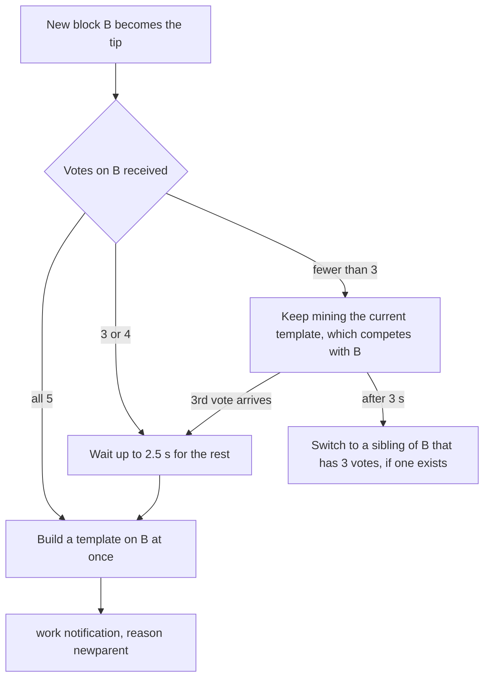
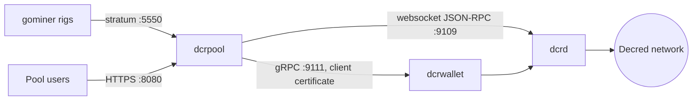

# Mining infrastructure

This guide sets up solo or pool mining infrastructure: how `dcrd` serves work, building and configuring `gominer`, and deploying `dcrpool`.

!!! info "Applies to"
    `dcrd` and `dcrwallet` 2.1.7, `gominer` 2.0.0 (tag `release-v2.0.0`) and its master branch (2.1.0-pre), and `dcrpool` 2.0.0 (tag `release-v2.0.0`). Checked November 2026.

## Before you start

- A fully synced `dcrd` 2.1.7 with peers, on the same network as your miners. [Run dcrd in production](production-node.md) covers sizing, service setup and logs.
- A `dcrwallet` 2.1.7 wallet whose seed is backed up, to provide mining addresses and, for a public pool, to pay miners. [Set up the command-line wallet](../../user/wallets/command-line.md) shows the setup.
- Git, a current Go toolchain (`dcrpool` 2.0.0 asks for Go 1.21 or later, `gominer` for 1.18), and your graphics card (GPU) vendor's driver plus OpenCL headers or the CUDA toolkit.
- The admin `rpcuser` and `rpcpass` from `dcrd.conf`. A limited user (`rpclimituser`) is not enough, because `getwork` and `notifywork` are admin-only.

## How dcrd serves work

`dcrd` builds complete candidate blocks, called **templates**, and gives miners only the header to hash, through these remote procedure calls (RPCs). There is no `getblocktemplate`; the 180-byte header has a 4-byte `Nonce` and 32 bytes of `ExtraData`, so miners never need to rebuild the coinbase.

| RPC | What it does |
|---|---|
| `getwork` | With no argument, returns `data` (the header plus 12 bytes of padding, 192 bytes in hex) and `target` (32 bytes, little-endian). With `data`, submits a solution and returns `true` or `false`. |
| `notifywork` | Websocket only. Sends a `work` notification with the same `data` and `target` for every new template, plus a reason: `newparent`, `newvotes`, `newtxns` or `unknown`. |
| `submitblock` | Submits a whole serialized block. Returns `null` on success or `rejected: <reason>`. |
| `regentemplate` | Asks the template generator to build a new template now. |

Since block 794,368 (agenda `blake3pow`) the proof-of-work hash is BLAKE3 over the 180 header bytes. `Timestamp`, `Nonce` and `ExtraData` sit in the header's last 52 bytes (offsets 128–179), which the 12 padding bytes fill out to a final 64-byte block. A miner therefore hashes the first 128 bytes once per template and iterates only on the final block. `dcrd` matches a submitted header to its template by `MerkleRoot` and `StakeRoot`, and forgets templates more than three blocks below the tip. The byte layout and test vectors are in [the whitepaper's getwork data section](../../whitepaper/17-policy.md#sec:policy-getwork).

`getwork` needs at least one `miningaddr` in `dcrd.conf`. With several, each template pays one chosen at random:

```ini title="dcrd.conf (mining additions)"
miningaddr=<MINING_ADDRESS_1>
miningaddr=<MINING_ADDRESS_2>
```

`<MINING_ADDRESS_1>` and `<MINING_ADDRESS_2>` are fresh receiving addresses (`Ds…` on mainnet) from your wallet, for example from `dcrctl --wallet getnewaddress`. Several addresses make your blocks harder to link; keep the number well below the wallet's gap limit of 20 unused addresses so that a seed restore still finds every reward. Restart `dcrd` after editing the file. Each `gominer` process or pool holds one of `dcrd`'s websocket slots, 25 by default (`rpcmaxwebsockets`).

## Why new work waits for votes

Every block from stake validation height on must carry votes from at least 3 of the 5 tickets drawn for its parent ([the whitepaper's vote rules](../../whitepaper/08-staking.md#sec:staking-block-votes)), and those votes only exist after the parent is published. Fewer votes also pay less: `dcrd` scales the proof-of-work subsidy and the fees it claims by votes ÷ 5, so a block with 3 votes pays its miner 60% of what it would with 5. The template generator therefore waits briefly for votes:



Once a template is built on B, each further vote on B triggers a new template at once (reason `newvotes`), except during the 2.5-second wait, when only the fifth vote does and `regentemplate` is ignored. New transactions are picked up at most every 30 seconds, and only if the mempool changed (reason `newtxns`). Among equally voted siblings `dcrd` stays on the block it saw first, so a miner gains nothing by withholding the votes on a competitor's block.

If a template has to be built while no block at the tip's height has 3 votes (at startup or after a reorganization), `dcrd` by default builds a **replacement for the tip**: a sibling that extends the tip's parent, carries the tip's transactions and claims no fees. It wins only if the original never collects its votes; the `nonaggressive` option turns this off. The full timer table is in [the whitepaper's background template generation section](../../whitepaper/17-policy.md#sec:policy-bg).

Templates also apply policy on top of the consensus rules: selection takes votes, revocations and ticket purchases first and other transactions by fee rate, and treasury spends go only into blocks whose height is a multiple of 288 (the treasury vote interval), inside the spend's voting window and once it has enough yes votes. [Block template construction](../../whitepaper/17-policy.md#sec:policy-template) gives the full algorithm, including the stake tree order.

## Build gominer

`gominer` is the GPU miner for BLAKE3. It has no binary releases, so you build it from the `release-v2.0.0` tag or from master (2.1.0-pre), whose only difference is that its benchmark mode (`gominer -B`) runs without `dcrd` or a pool.

!!! note "The README contradicts itself"
    The README's "Configuring gominer" section says only solo mining against `dcrd` is supported. That is stale: the same README documents stratum pool mining, which works in 2.0.0, and `dcrpool` 2.0.0 lists `gominer` 2.0 and 2.1 as supported clients.

Choose OpenCL (AMD and NVIDIA) or CUDA (NVIDIA only); the README reports that most users get higher hashrates with OpenCL, even on NVIDIA. On Linux, install the GPU driver and the OpenCL headers (or the CUDA toolkit), then:

```bash
git clone https://github.com/decred/gominer
cd gominer
git checkout release-v2.0.0
go build -tags opencl
./gominer -l
```

For CUDA, replace the `go build` line with `go generate -tags cuda .`, which compiles the CUDA kernel with `nvcc` and then builds `gominer`. An OpenCL build's `gominer -l` lists each GPU as `DEV #0: <name>`, and a CUDA build's as `CUDA Capable GPU #0: <name>`. If an OpenCL card is missing, check it with your distribution's `clinfo` first, because `gominer` cannot see what OpenCL cannot. On Windows, build in the MSYS2 MINGW64 shell as [the README's Windows section](https://github.com/decred/gominer/tree/release-v2.0.0#windows) describes.

!!! tip "Keep the OpenCL kernel reachable"
    OpenCL builds read `blake3.cl` from the current directory at startup. Run `gominer` from the source directory, or set `kernel=` in `gominer.conf` to the file's full path.

## Configure gominer

`gominer` reads `gominer.conf` from `~/.gominer` on Linux, `~/Library/Application Support/Gominer` on macOS and `%LOCALAPPDATA%\Gominer` on Windows.

### Solo against dcrd

Copy the `rpcuser` and `rpcpass` lines exactly from `dcrd.conf`:

```ini title="gominer.conf (solo)"
rpcuser=<RPCUSER_FROM_DCRD_CONF>
rpcpass=<RPCPASS_FROM_DCRD_CONF>
```

By default `gominer` connects to `localhost:9109` (`--testnet` 19109, `--simnet` 19556) and validates `dcrd`'s certificate from the default `dcrd` folder (`~/.dcrd/rpc.cert` on Linux). It always uses Transport Layer Security (TLS); the `notls` and `skipverify` options have no effect. To mine against a `dcrd` on another machine:

1. On the node, add `rpclisten=<PRIVATE_IP>:9109` and `altdnsnames=<NODE_HOSTNAME>` to `dcrd.conf`. Setting `rpclisten` replaces `dcrd`'s default localhost listeners, so also add `rpclisten=127.0.0.1:9109` if a wallet, `dcrctl` or `dcrpool` on the node connects to it locally. Keep the private address on a private network or behind a firewall.
2. Delete `rpc.cert` and `rpc.key` in the `dcrd` folder and restart `dcrd`, which then generates a certificate that includes the new names and the machine's addresses. Every client that keeps a copy of the old certificate needs the new one.
3. Copy `rpc.cert` to the mining machine and set `rpcserver=<NODE_HOSTNAME>:9109` and `rpccert=<PATH_TO_RPC_CERT>` in `gominer.conf`.

`<PRIVATE_IP>` is the node's address on your private network, `<NODE_HOSTNAME>` the name miners use to reach it, and `<PATH_TO_RPC_CERT>` the full path of the copied certificate.

Start `gominer` with no arguments. It subscribes to `notifywork`, so new templates reach it without polling, and logs `Started DEV #0: <name>` (CUDA builds: `Started GPU #0: <name>`) for each card. A solved block appears as `Submitted work successfully: block hash …` in `gominer` and `Block submitted via getwork accepted: <hash> (height <N>, pow hash <hash>)` in `dcrd`'s log.

### Pool mining

Point `gominer` at a stratum pool instead. Only `stratum+tcp://` URLs are accepted, without TLS:

```ini title="gominer.conf (pool)"
pool=stratum+tcp://<POOL_HOST>:5550
pooluser=<ADDRESS>.<RIG_NAME>
```

For a `dcrpool` public pool the username is your payout address and a rig name joined by a dot; a solo-mode `dcrpool` wants only the rig name. `dcrpool` ignores `poolpass`, which other stratum pools may require.

### Tuning and monitoring

| Option | Default | Meaning |
|---|---|---|
| `devices` (`-D`) | all | Device IDs from `gominer -l`, comma-separated. |
| `autocalibrate` (`-A`) | 500 | Target milliseconds per kernel run, per device. |
| `intensity` (`-i`) | autocalibrated | OpenCL only. Work size of 2^intensity, from 8 to 31, per device. |
| `worksize` (`-W`) | autocalibrated | OpenCL only. Explicit work size, a multiple of 256; overrides `intensity`. |
| `cudagridsize`, `cudathreadcount` | autocalibrated, 256 | CUDA only. Grid and thread counts. |
| `apilisten` | off | Status API address; port 3333 if none is given. |

The status API has no authentication, so set `apilisten=localhost` (or another private address). It returns JSON with valid, stale and invalid share counts and each device's hashrate, for a monitoring system to scrape with `curl http://localhost:3333/`.

## Deploy dcrpool

`dcrpool` is a stratum pool server for BLAKE3, run as a single instance. Miners connect to it on port 5550, and it gets work from `dcrd` over a websocket. It runs in one of two modes:

- **Solo pool** (`solopool=true`): many rigs you own share one node, and rewards stay at `dcrd`'s `miningaddr` addresses. It needs only `dcrd`.
- **Public pool** (the default): miners you do not control share the rewards, which `dcrpool` divides by shares and pays out through `dcrwallet`'s gRPC API.

This diagram shows a public pool and the ports each link uses:



### 1. Build dcrpool and its web assets

```bash
go install github.com/decred/dcrpool@release-v2.0.0
git clone --branch release-v2.0.0 https://github.com/decred/dcrpool
mkdir -p /opt/dcrpool-gui
cp -r dcrpool/internal/gui/assets /opt/dcrpool-gui/
```

The binary lands in the `bin` folder under `go env GOPATH`. The web interface reads its templates from `<guidir>/assets`, so `guidir` here is `/opt/dcrpool-gui`; any folder works.

### 2. Write dcrpool.conf

`dcrpool` reads `dcrpool.conf` from `~/.dcrpool` on Linux, `~/Library/Application Support/Dcrpool` on macOS and `%LOCALAPPDATA%\Dcrpool` on Windows, and writes a commented default file there on first start if none exists.

!!! warning "Set the network and use absolute paths"
    The default network is **simnet**: set `activenet=mainnet` (or `testnet3`). `dcrpool` does not expand `~` in `dcrdrpccert`, `walletrpccert` or `guidir`, so give full paths.

```ini title="dcrpool.conf (solo pool)"
activenet=mainnet
solopool=true
rpcuser=<RPCUSER_FROM_DCRD_CONF>
rpcpass=<RPCPASS_FROM_DCRD_CONF>
dcrdrpchost=127.0.0.1:9109
dcrdrpccert=/home/<USER>/.dcrd/rpc.cert
adminpass=<ADMIN_PASSWORD>
guidir=/opt/dcrpool-gui
```

`<USER>` is the account `dcrd` runs under, and `<ADMIN_PASSWORD>` protects the pool's admin page at `https://<POOL_HOST>:8080/admin`. A solo pool is complete at this point: start `dcrpool` and point your rigs at port 5550.

### 3. Set up the wallet accounts (public pool)

A public pool keeps block rewards and the operator's fees in separate wallet accounts:

1. Use the default account (number 0) for rewards, and create one for fees. This needs the wallet unlocked; `promptsecret` (in the command-line bundle) reads the private passphrase without echoing it:

    ```bash
    promptsecret | dcrctl --wallet walletpassphrase - 60
    dcrctl --wallet createnewaccount fees
    ```

2. Put a few addresses from the default account in `dcrd.conf` as `miningaddr` lines and restart `dcrd`.
3. Take a few addresses from the fee account (`dcrctl --wallet getnewaddress fees`) for `poolfeeaddrs`. `dcrpool` picks one at random for each payout.

### 4. Configure payments (public pool)

```ini title="dcrpool.conf (public pool additions)"
solopool=false
walletgrpchost=127.0.0.1:9111
walletrpccert=/home/<USER>/.dcrwallet/rpc.cert
walletpass=<WALLET_PRIVATE_PASSPHRASE>
walletaccount=0
poolfeeaddrs=<FEE_ADDRESS_1>,<FEE_ADDRESS_2>
paymentmethod=pplns
poolfee=0.01
```

`<WALLET_PRIVATE_PASSPHRASE>` is the pool wallet's private passphrase, and `<FEE_ADDRESS_1>`, `<FEE_ADDRESS_2>` are the fee addresses from step 3. `walletaccount` is the reward account.

!!! warning "This file holds the wallet's private passphrase"
    Anyone who can read `dcrpool.conf` can spend from the pool wallet. Restrict it to the pool's user (`chmod 600`), run the wallet on the same host or a private network, and keep only pool funds in that wallet.

If `dcrwallet` runs on another machine, add `grpclisten=<PRIVATE_IP>:9111` to `dcrwallet.conf` (by default the gRPC server listens on localhost only), set `walletgrpchost=<PRIVATE_IP>:9111` in `dcrpool.conf`, and copy the wallet's `rpc.cert` to the pool host for `walletrpccert`.

| Option | Default | Meaning |
|---|---|---|
| `paymentmethod` | `pplns` | `pplns` (pay per last N shares) divides each block among the shares of the last `lastnperiod` (default 24h); `pps` (pay per share) among all shares since the previous paid block. |
| `poolfee` | 0.01 | Operator's cut, from 0.002 (0.2%) to 0.05 (5%). |
| `maxgentime` | 15s | Target time between one miner's shares; its help advises staying below 30s. |
| `minerlisten`, `guilisten` | 0.0.0.0:5550, 0.0.0.0:8080 | Stratum and web interface listeners. |
| `uselehttps` + `domain`, `noguitls` | off | Let's Encrypt certificate for the web interface, or plain HTTP behind your own reverse proxy, instead of a self-signed certificate. |

Share difficulty is set per client type, not per device: `dcrpool` assumes about 5 GH/s for `gominer`, so a faster card submits more shares and earns a larger part. Payments are created when the pool finds a block and sent once its coinbase has 257 confirmations (coinbase maturity of 256 blocks plus one). Recipients share each payout's transaction fee in proportion to their amounts, a payment too small to be standard is added to the pool fee, and CPU miners' shares are refused on mainnet.

### 5. Connect dcrpool to dcrwallet (public pool)

`dcrwallet` starts its gRPC server (port 9111) only when it has trusted client certificates, and then accepts only those clients.

1. With the public pool settings above in `dcrpool.conf`, run `dcrpool --gencertsonly` once. It writes the client certificate `wallet.cert` and key `wallet.key` to its folder and exits with `generated needed certificates, terminating`.
2. In `dcrwallet.conf`, set `clientcafile=` to the full path of that `wallet.cert`. If other gRPC clients already use the wallet's `clients.pem`, append the certificate to that file instead.
3. Restart `dcrwallet`.

The wallet does not need to stay unlocked: `dcrpool` sends the private passphrase with each signing request.

### 6. Choose a database

Bolt is the default: one file, `dcrpool.kv`, in the data folder (`~/.dcrpool/data` on Linux), with `backup.kv` written beside it on shutdown and a backup download on the admin page. For PostgreSQL, create a role and a database, then add:

```ini title="dcrpool.conf (PostgreSQL)"
postgres=true
postgreshost=127.0.0.1
postgresport=5432
postgresuser=dcrpooluser
postgrespass=<POSTGRES_PASSWORD>
postgresdbname=dcrpooldb
```

`postgrespass` defaults to the example value `12345`, so always set your own. In PostgreSQL mode `dcrpool` makes no backups; schedule your own. The [dcrpool PostgreSQL notes](https://github.com/decred/dcrpool/blob/release-v2.0.0/docs/postgres.md) list the versions tested. Databases created by `dcrpool` 1.x cannot be used by 2.0.0.

### 7. Start in order

Start `dcrd`, wait until it is synced, then `dcrwallet` (public pool), then `dcrpool`. The startup log names the mode (`Solo pool mode active.` or `Payment method is PPLNS.`) and the listeners (lines such as `listening on 0.0.0.0:5550` and `Starting GUI server on [::]:8080`). Open the web interface and connect one rig before announcing the pool.

## Operational risks

- **Stale work.** A solution for a template that `dcrd` has dropped is wasted (`Block submitted via getwork has no matching template` in its log). Use `notifywork` rather than polling, keep miners close to the node, and give `dcrd` good peers, through which votes and competing blocks arrive.
- **Denial of service.** `dcrd` 2.1.7 fixes several denial-of-service attacks that, its [release notes](https://github.com/decred/dcrd/releases/tag/release-v2.1.7) warn, could stall miners' template generation. Expose only the stratum port and the web interface, never `dcrd`'s or `dcrwallet`'s RPC ports.
- **Upgrades.** Upgrade `dcrd` as soon as a release is out: after a block version upgrade, old-version blocks are rejected once 950 of the last 1,000 blocks use the new one. Restarting `dcrpool` disconnects every miner, so schedule it.
- **Safety shutdowns.** `dcrd` 2.1.7 shuts down when its spend safeguards detect an impossible spend, and the pool stops with it. Alert on unexpected exits, as [Operating Decred infrastructure](index.md) describes.
- **Custody.** A public pool holds miners' rewards until payout. Back up the wallet seed and the database, without which unpaid rewards are lost or cannot be accounted for.

## Test on simnet

Simnet tests the whole chain of programs without real funds, and mining there is allowed without peers or sync. From block 144, however, every block needs 3 votes, so a voting wallet with tickets must be running. [Set up a private simnet](../environment/simnet.md) builds that network.

- **gominer:** with that page's simnet `dcrd`, whose `miningaddr` is a simnet (`Ss…`) address, pass the simnet node's certificate and credentials; `gominer` then connects to port 19556:

    ```bash
    gominer --simnet --rpccert ~/dcrsimnet/dcrd/rpc.cert --rpcuser simnet --rpcpass simnet
    ```

- **dcrpool:** the repository's [`harness.sh`](https://github.com/decred/dcrpool/blob/release-v2.0.0/harness.sh) starts a pool node and wallet, a voting node and wallet, `dcrpool` and CPU mining clients in a tmux session. It needs `tmux`, `dcrd`, `dcrwallet`, `dcrctl`, `dcrpool` and the test miner (`go install github.com/decred/dcrpool/cmd/miner@release-v2.0.0`) on your `PATH`, and deletes `/tmp/dcrpool-harness` each time it starts. The variables at its top switch to solo mode, PPS or PostgreSQL.

On testnet, use `activenet=testnet3` in `dcrpool` and `gominer --testnet`.

## Check that it worked

- `gominer`'s status API shows a hashrate for every device, and `validShares` rises when pool mining.
- In a public pool, the account page for a payout address lists each of its rigs under **Connected Clients**. In either mode, the admin page (`/admin`) lists every rig under **All Connected Miners**, and the home page lists found blocks under **Mined by Pool**.
- After a block, `dcrctl --wallet getbalance` on the reward wallet shows the coinbase under `immaturecoinbaserewards` for 256 blocks.

## Troubleshooting

### gominer stops with "unable to retrieve initial work"

The first `getwork` failed, and the error that follows is `dcrd`'s reply. `no payment addresses specified via --miningaddr` means no `miningaddr` is set, `Decred is not connected` that the node has no peers, and `Decred is downloading blocks...` that it is not synced; `getwork` also refuses work while `dcrd`'s built-in CPU miner runs. If `gominer` fails earlier, while connecting or subscribing, check that `rpcuser` and `rpcpass` are `dcrd`'s admin credentials, copied exactly.

### gominer cannot read or verify the certificate

`failed to read rpc certificate` means `rpccert` points to the wrong file. A certificate error against a remote node means the certificate lacks the name in `rpcserver`: add it with `altdnsnames` and regenerate, as in [Solo against dcrd](#solo-against-dcrd).

### Miners are rejected with "invalid username format"

In public mode the username must be `<ADDRESS>.<RIG_NAME>`, with exactly one dot and an address for the pool's network. A mainnet address is rejected by a pool still on the default simnet.

### dcrpool cannot reach dcrd or the wallet

If `dcrpool` reports that the `dcrd` RPC certificate was not found, `dcrdrpccert` is unset or uses `~`; give the absolute path. For the wallet, check that `dcrwallet`'s `clientcafile` names `dcrpool`'s `wallet.cert`, that `walletrpccert` is `dcrwallet`'s own `rpc.cert`, and that `walletgrpchost` matches its gRPC port (9111 on mainnet). A wallet on another machine also needs a `grpclisten` line for its private address; without one, its gRPC server listens on localhost only.

## Next steps

- [Mining Decred](../../user/run/mining.md): what a miner earns, and how to estimate whether mining pays.
- [Run dcrd in production](production-node.md): harden and monitor the node that every miner and pool depends on.
- [Set up a private simnet](../environment/simnet.md): rehearse a pool deployment with voting wallets before mainnet.
- [dcrd JSON-RPC API](../api/dcrd-json-rpc.md): the mining methods alongside every other `dcrd` call.
- [Upgrading and mandatory releases](../../user/run/upgrades.md): stay on a version that mines valid blocks.

*[RPC]: remote procedure call
*[RPCs]: remote procedure calls
*[TLS]: Transport Layer Security
*[GPU]: graphics processing unit
*[PPS]: pay per share
*[PPLNS]: pay per last N shares
*[CUDA]: Compute Unified Device Architecture
*[API]: application programming interface
