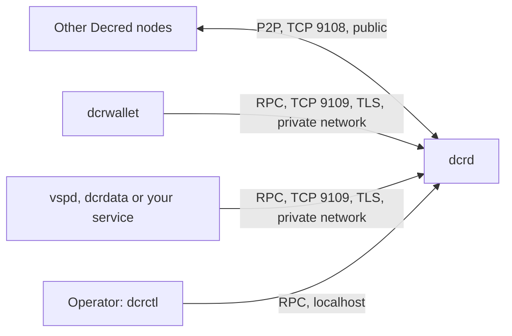

# Run dcrd in production

This guide turns a working `dcrd` into a node that other software depends on: the backend for `dcrwallet`, a voting service provider (VSP), an exchange, an explorer or a pool.

!!! info "Applies to"
    `dcrd`, `dcrctl` and `dcrwallet` 2.1.7 (Decred release v2.1.7). Checked November 2026.

## Before you start

- **A [verified](../../user/security/verify-downloads.md) `dcrd` 2.1.7 that you can already start and sync.** [Run a full node](../../user/run/full-node.md) covers the first sync, port 9108, Tor and the service setup on each operating system; this page builds on it.
- **A machine or virtual machine for the node alone**, with administrator access to its service manager and firewall.
- **A list of the programs that will call the node, and from where.** It decides the indexes, RPC listeners and authentication below.

## The deployment this page builds

The node accepts peer-to-peer (P2P) connections from anywhere, but serves its remote procedure call (RPC) interface only on localhost and a private network, over Transport Layer Security (TLS). Clients dial the node:



These are the `dcrd.conf` settings for such a node, each explained below; `10.0.0.5` stands for the node's private address. [dcrd configuration](../reference/dcrd-config.md) gives every option's default and limits.

```ini
[Application Options]
; RPC: localhost plus the private interface (defaults to port 9109)
rpclisten=127.0.0.1
rpclisten=::1
rpclisten=10.0.0.5
; Client certificates instead of passwords (remove rpcuser and rpcpass,
; and create clients.pem first: see section 3)
authtype=clientcert
; Room for more clients (example values)
rpcmaxclients=50
rpcmaxwebsockets=50

; Indexes: transaction index on; the exists-address index is on by default
txindex=1

; A larger UTXO cache (MiB) for faster block processing
utxocachemaxsize=1024
```

## 1. Size the machine

| Resource | Plan for | How to check |
|---|---|---|
| Disk | The raw chain size on dcrdata's [Blockchain Size chart](https://dcrdata.decred.org/charts?chart=blockchain-size), plus the unspent transaction output (UTXO) database, indexes and room to grow, on a solid-state drive (SSD) | `du -sh ~/.dcrd/data/mainnet` |
| Memory | The soft memory limit (below), plus the operating system and its file cache; dcrd's README recommends at least 2 GB | `Soft memory limit:` at startup; resident memory |
| Bandwidth | About 150 MB a day down and 1.5 GB a day up, per dcrd's README; upload grows with inbound peers | `dcrctl getnettotals` |
| File descriptors | On Unix-like systems, a hard limit of at least 1,024, or `dcrd` refuses to start | `ulimit -Hn` for the service user |

**UTXO cache.** `dcrd` keeps unspent outputs in memory and writes changes to its UTXO database. A larger cache speeds up the initial sync most and still saves disk reads afterward. `utxocachemaxsize` sets it in MiB (default 150); the startup log confirms the value:

```text title="Expected output (after the timestamp)"
[INF] CHAN: UTXO cache initializing (max size: 1024 MiB)...
```

**Soft memory limit.** `dcrd` sets the Go runtime's soft memory limit itself, which keeps the garbage collector from overallocating during bursts of block and transaction processing. Since 2.1.0 the base is 1.8 GiB, plus however much `utxocachemaxsize` exceeds 150 MiB (2.65 GiB with the cache above). The `GOMEMLIMIT` environment variable, for example `GOMEMLIMIT=4GiB`, can raise the limit to trade memory for performance; a lower value is ignored and logged. The limit guides the garbage collector and is not a cap: if the operating system also caps memory (systemd's `MemoryMax=`), set that cap well above it, or the kernel kills `dcrd` under load.

## 2. Choose indexes

`dcrd` has two optional indexes, both stored in the block database.

| Index | Setting | Default | Serves | Needed by |
|---|---|---|---|---|
| Transaction index | `txindex=1` | off | `getrawtransaction` for confirmed transactions | `vspd`, `dcrdata` and the DCRDEX server, per their own docs |
| Exists-address index | `noexistsaddrindex=1` turns it off | on | `existsaddress`, `existsaddresses` | `dcrwallet` in RPC mode, for address discovery after a restore |

When an index is first enabled, `dcrd` builds it at startup, indexing every block (`Catching up from height ... to ...`, then `Caught up to height ...` in the log) before it serves peers or opens its RPC listener. On a synced mainnet node this takes a long time, so plan the downtime and fail over to another node.

To delete the transaction index, remove `txindex=1` from `dcrd.conf` (`dcrd` refuses `--droptxindex` while `txindex` is set), then start `dcrd` once with `--droptxindex`. For the exists-address index, start it once with `--noexistsaddrindex --dropexistsaddrindex`. Either way, `dcrd` drops the index and exits. To rebuild an index, put its setting back and start `dcrd`.

There is no address-to-transactions index; 2.1.7 deletes any leftover copy of the old one at startup. For address history, use [dcrdata](../api/dcrdata-api.md) or a wallet.

## 3. Expose RPC safely

Full RPC access controls the node: a caller can stop it, change its peers, invalidate blocks and submit transactions. Choose the narrowest exposure that serves your clients:

| Where the client runs | Bind RPC to | Authenticate with |
|---|---|---|
| The same machine | The default (localhost only) | The generated `rpcuser` and `rpcpass` |
| Your private network | Localhost plus the private interface, firewalled to the client addresses | Client certificates, or a password pair |
| Anywhere else | A virtual private network (VPN) or tunnel interface, such as WireGuard | Client certificates |
| The public internet | Never | — |

### Bind the listeners

The default listener is localhost on port 9109 (mainnet). Any `rpclisten` line replaces it, so list localhost explicitly if local tools still need it.

- Give IP addresses or interface names (`rpclisten=wg0`), not host names: `rpclisten=localhost` stops startup.
- `rpclisten=` with no value listens on all interfaces. Use it only inside a container whose port mapping does the restricting.

Then allow port 9109 only from the client machines. With ufw, for a client at `10.0.0.6`:

```bash
sudo ufw allow from 10.0.0.6 to any port 9109 proto tcp
```

TLS cannot be turned off for listeners other than localhost.

### Make the certificate match

Clients check that `dcrd`'s certificate names the address they dial. The certificate `dcrd` generates on first start names the host name, `localhost`, `127.0.0.1`, `::1`, every interface address present at that moment, and any `altdnsnames`. For a DNS name, or an address added later, stop `dcrd`, delete `rpc.cert` and `rpc.key` from its home directory, add the names, and start it again:

```ini
altdnsnames=node1.example.internal
```

Copy `rpc.cert` to each client and have the client trust that file alone. `dcrd` reloads a replaced certificate, key or client CA file without a restart.

### Pick the authentication

**Password pairs.** `rpcuser`/`rpcpass` has full access, which `dcrwallet` needs. `rpclimituser`/`rpclimitpass` adds an account limited to chain queries and submissions, but it can still broadcast transactions and run expensive calls such as `rescan`, so it does not make a reachable port safe.

**Client certificates** (`authtype=clientcert`). Each client presents a certificate signed by a certificate authority (CA) listed in `clients.pem` in the `dcrd` home directory, and no password crosses the network. Every valid certificate has full access. Create the CA and put its certificate in `clients.pem` before setting `authtype=clientcert`: `dcrd` refuses to start if that file is missing or contains no certificate, and also while any `rpcuser`, `rpcpass`, `rpclimituser` or `rpclimitpass` is set. [dcrd JSON-RPC API](../api/dcrd-json-rpc.md) shows how to create the certificates with `gencerts`.

To connect a remote `dcrwallet` with a client certificate, copy three files into its home directory (`~/.dcrwallet` on Linux) under the names it looks for by default:

| File from the node side | Name in the `dcrwallet` home directory |
|---|---|
| `dcrd`'s `rpc.cert` | `dcrd.cert` |
| The client certificate | `dcrd-client.cert` |
| The client key | `dcrd-client.key` |

Then add to `dcrwallet.conf`:

```ini
rpcconnect=10.0.0.5:9109
dcrdauthtype=clientcert
```

Local `dcrctl` on the node also needs `authtype=clientcert`, `clientcert=` and `clientkey=` lines in its `dcrctl.conf` once passwords are gone.

!!! warning "Protect the CA key"
    Anyone with the CA's private key can mint certificates with full control of the node. Keep it off the node. To revoke one client, create a new CA, reissue certificates to the others and replace `clients.pem`.

### Size the connection limits

| Setting | Default | At the limit |
|---|---|---|
| `rpcmaxclients` | 10 | Further HTTP clients get `503 Too busy.  Try again later.` |
| `rpcmaxwebsockets` | 25 | Further websocket clients are disconnected |
| `rpcmaxconcurrentreqs` | 20 | Further requests on one websocket wait |

Raise them for busy services. Each HTTP request closes its connection, so clients that send many calls should batch them or keep one websocket open.

## 4. Configure the peer server

By default `dcrd` listens for peers on port 9108 on all interfaces, keeps 8 outbound connections and accepts up to 125 in total (`maxpeers`). [The whitepaper's peer management section](../../whitepaper/15-p2p.md#sec:p2p-peers) gives the full limits.

| Goal | Setting | Trade-off |
|---|---|---|
| Serve the network | Open port 9108; `externalip=<ADDRESS>` advertises a fixed public address at once | Upload bandwidth |
| Keep your nodes linked | `addpeer=<ADDRESS>` for each of your other nodes; `whitelist=<ADDRESS or NETWORK>` exempts them from bans and connection limits | None significant |
| Hide an internal node behind your public nodes | `connect=<ADDRESS>` for each public node | No seeding, and no listening unless `listen` is set; the node sees the network only through those peers |
| Save bandwidth | `blocksonly=1` | Ignores relayed transactions, votes and mixing messages: unsuitable for mining, mixing or watching the mempool |

`<ADDRESS>` is an IP address, with an optional port. For Tor, see [Run a full node](../../user/run/full-node.md); a `proxy` setting does not affect RPC.

## 5. Run under a supervisor

`dcrd` has no daemon mode. Let the service manager start it, and stop it with `SIGINT` or `SIGTERM`, `dcrctl stop`, or a Windows service stop, so it can flush the UTXO cache and close its databases. `SIGHUP` also shuts it down, so never send it for a reload or log rotation.

The dcrd repository ships service definitions in [contrib/services](https://github.com/decred/dcrd/tree/release-v2.1.7/contrib/services) (systemd, OpenBSD rc.d, illumos and Solaris SMF) and a Dockerfile in [contrib/docker](https://github.com/decred/dcrd/tree/release-v2.1.7/contrib/docker). On Windows, `dcrd --service install` creates the service `dcrdsvc`, as [Run a full node](../../user/run/full-node.md) describes.

### systemd adjustments

Install the shipped unit as in [Run a full node](../../user/run/full-node.md), then add a drop-in with `sudo systemctl edit dcrd`:

```ini
[Service]
Environment=GOMEMLIMIT=4GiB
TimeoutStopSec=5min
```

- **Stop timeout.** The shipped unit kills `dcrd` 10 seconds after asking it to stop. After a kill, the next start must repair the databases first.
- **Restart policy.** The shipped `Restart=on-abnormal` restarts `dcrd` after a signal kill, such as the out-of-memory killer, but not after `dcrd` exits on its own with an error, as the 2.1.7 spend safeguards make it do (section 7). Keep it that way.
- **Moved data.** The unit allows writes only under `/home/dcrd/.dcrd`; if you move `datadir` or `logdir`, add a `ReadWritePaths=` line.

### Docker

The Dockerfile builds `master` unless told otherwise, so pass the release tag:

```bash
git clone --branch release-v2.1.7 https://github.com/decred/dcrd
cd dcrd
docker build --build-arg DCRD_BUILD_TAG=release-v2.1.7 -t local/dcrd:2.1.7 -f contrib/docker/Dockerfile .
```

The image runs as UID:GID 10000:10000 and appends `--appdata=/home/decred/.dcrd`, `--rpclisten=` and `--nofilelogging`. Give the volume to that user, publish P2P to the world and RPC only to the host's localhost, and name the container in the certificate:

```bash
docker volume create decred-data
sudo chown -R 10000:10000 "$(docker volume inspect decred-data -f '{{.Mountpoint}}')"
docker run -d --read-only --name dcrd -e GOMEMLIMIT=4GiB \
  -v decred-data:/home/decred -p 9108:9108 -p 127.0.0.1:9109:9109 \
  local/dcrd:2.1.7 --altdnsnames dcrd
docker exec dcrd dcrctl getblockchaininfo
```

Stop it with `docker stop -t 300 dcrd`, since Docker's default grace period is 10 seconds. Docker's restart policies all restart `dcrd` after a safeguard shutdown, so cap retries (`on-failure:3`) or alert on the restart count.

### Inter-process communication (IPC) pipes for supervisors

A program that starts `dcrd` as a child process can manage it over inherited pipes instead of RPC. `<FD>` is the inherited file descriptor (a handle on Windows); `ipc.go` in the dcrd repository documents the messages.

- `--piperx=<FD>`: `dcrd` shuts down cleanly when this pipe closes, so it never outlives its parent. Decrediton starts its `dcrd` this way on Windows.
- `--pipetx=<FD>` with `--lifetimeevents`: `lifetimeevent` messages report database open and close, P2P server start and stop, and startup complete.
- `--pipetx=<FD>` with `--boundaddrevents`: `p2plistenaddr` and `rpclistenaddr` messages carry each bound address, which gives the real port when the parent asked for port 0.

## 6. Logs

`dcrd` writes its log to standard output and to `logs/mainnet/dcrd.log` in its home directory. The stack trace of a Go panic, such as a safeguard shutdown, goes only to standard error, so make sure the supervisor captures it (journald and `docker logs` do).

- **Rotation is built in**: at `logsize` (default `10M`) the file is compressed to `dcrd.log.<N>.gz`, keeping the three newest. Do not add a rotator that sends `SIGHUP`.
- **Central logging**: set `nofilelogging=1` and collect standard output. `LOGFLAGS=nodatetime` in the environment drops `dcrd`'s timestamps; `LOGFLAGS=UTC` prints them in UTC.
- **Detail**: `debuglevel` takes `trace`, `debug`, `info` (default), `warn`, `error` or `critical`, for all subsystems (`debuglevel=debug`) or per subsystem (`debuglevel=PEER=debug,RPCS=debug`); `dcrd --debuglevel=show` lists them. Change levels without a restart:

```bash
dcrctl debuglevel SYNC=debug
```

## 7. Upgrade without surprises

[Upgrading and mandatory releases](../../user/run/upgrades.md) is the canonical procedure. For production nodes, add:

1. **Keep a way back.** A new version may convert the databases on first start, and older versions then refuse them. Copy `data/mainnet` while `dcrd` is stopped before upgrading.
2. **Roll through redundant nodes one at a time**, upgrading `dcrd` before the wallets and services that use it.
3. **Watch the log** until the node is synced, then run the health checks in [Operating Decred infrastructure](index.md).

**Spend safeguards.** 2.1.7 checks for transaction spends that should be impossible. When one fires, `dcrd` logs a `[CRT] CHAN:` line and exits with a non-zero status rather than keep running in a possibly unsafe state. No funds move, but every service above the node stops, possibly on all your nodes at once. Alert on the exit, keep the log and standard error, do not loop restarts and do not downgrade; [Operating Decred infrastructure](index.md) says how to respond.

## 8. Recover from a damaged database

`data/mainnet` holds the block database (`blocks_ffldb`, including the indexes), the UTXO database (`utxodb`), the fee estimator's `feesdb` and the address book `peers.json`.

**After an unclean shutdown** (power loss, a kill), `dcrd` repairs itself on the next start (`Detected unclean shutdown - Repairing...`) and replays the blocks since the UTXO cache's last flush. Let it finish.

**When the database is damaged** (`***Database corruption detected***`, `corrupt utxo entry`, or `dcrd` failing at every start):

1. Stop `dcrd` and keep the log.
2. Check the disk for free space and I/O errors in the system log. A failing disk damages a fresh copy too.
3. If only an index is affected, drop and rebuild it (section 2).
4. Otherwise, move `data/mainnet` aside and sync from scratch. Delete the old copy once the new sync completes.

A resync skips the most expensive checks up to the release's assume-valid block, as [the whitepaper's assume-valid section](../../whitepaper/10-blocks.md#sec:blocks-assumevalid) describes; `assumevalid=0` checks everything. Copying `data/mainnet` from another of your nodes, stopped cleanly and running the same version, skips the download but trusts that node's validation.

`dcrctl verifychain` reads the newest 288 blocks, checks their sanity and prints `true` or `false`. To read every block, pass a depth at least as large as the current height (from `dcrctl getblockcount`), for example `dcrctl verifychain 1 2000000`; this takes a long time. Do not pass a depth of 0: in 2.1.7 that checks no blocks and still returns `true`.

## Check that it worked

On the node, `dcrctl getinfo` shows `"txindex": true`, and the startup log shows `Soft memory limit:` and `UTXO cache initializing (max size: ... MiB)` with your values. From a client machine:

```bash
dcrctl --rpcserver=10.0.0.5:9109 --rpccert=<NODE_CERT> \
  --authtype=clientcert --clientcert=<CLIENT_CERT> --clientkey=<CLIENT_KEY> getblockcount
```

`<NODE_CERT>` is a copy of the node's `rpc.cert`; `<CLIENT_CERT>` and `<CLIENT_KEY>` are the client certificate and key created for this machine. The command prints the current height. From a machine outside the firewall rule, it must fail to connect.

## Troubleshooting

### x509: certificate is valid for ..., not ...

The client dialed a name or address missing from `rpc.cert`. Regenerate the certificate with `altdnsnames` (section 3) and copy it to every client.

### dcrd exits at startup with a configuration error

- `'localhost' is not a valid IP address`: `rpclisten` takes IP addresses or interface names.
- `RPC usernames and passwords are not allowed with --authtype=clientcert`: remove `rpcuser`, `rpcpass`, `rpclimituser` and `rpclimitpass`.
- `Unable to start server:` with a missing-file error or `no certificates found in` for `clients.pem`: create the CA and put its certificate in `clients.pem`.
- `the --txindex and --droptxindex options may  not be activated at the same time`: remove `txindex=1` before dropping the index.
- `need at least 1024 file descriptors`: raise the hard open-files limit (`LimitNOFILE=` in a systemd drop-in).

### Index errors from clients

`the transaction index must be enabled ...` means `txindex` is off. `transaction index: index not synced` means the index is more than five blocks behind the chain tip, usually because the node is still syncing: retry once `dcrctl getblockchaininfo` shows it synced. `exists address index disabled` means `noexistsaddrindex` is set, which breaks `dcrwallet` address discovery.

## Next steps

- [Operating Decred infrastructure](index.md): health checks and the response to a safeguard shutdown.
- [Run a voting service provider](vsp.md): the most demanding service built on this node.
- [Integrate DCR into an exchange or service](../integrate/exchange.md): deposits and withdrawals on top of `dcrd` and `dcrwallet`.
- [dcrd JSON-RPC API](../api/dcrd-json-rpc.md): every method, the limited account and certificate creation.

*[CA]: certificate authority
*[IPC]: inter-process communication
*[P2P]: peer-to-peer
*[RPC]: remote procedure call
*[SSD]: solid-state drive
*[TLS]: Transport Layer Security
*[UTXO]: unspent transaction output
*[VPN]: virtual private network
*[VSP]: voting service provider
