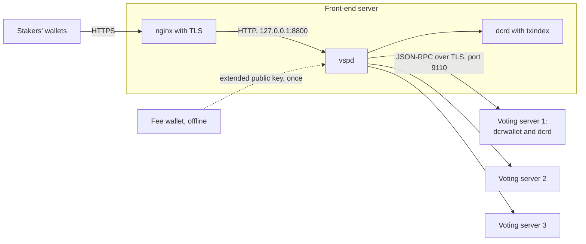

# Run a voting service provider

This guide is for operators who want to run a public voting service provider (VSP) with `vspd`: what the job involves, how to deploy it, and how to administer, monitor, upgrade, recover and close it. It assumes Linux system administration experience and familiarity with `dcrd` and `dcrwallet`.

!!! info "Applies to"
    `vspd` 1.5.0 with `dcrd` and `dcrwallet` 2.1.7 (2.1.6 is the minimum `vspd` accepts). Checked November 2026.

## What running a VSP involves

A VSP votes other people's tickets. Each ticket holder pays a fee per ticket and hands over that ticket's voting key; the VSP's always-online wallets vote the ticket when the lottery draws it. [Voting service providers](../../user/staking/vsps.md) explains the staker's side, and the whitepaper's [VSP section](../../whitepaper/19-ecosystem.md#sec:ecosystem-vsp) gives the protocol and fee formula.

- **You never hold user funds.** A voting key can only sign a vote, and consensus makes every vote and revocation pay the ticket's owner.
- **You hold voting power.** Each ticket votes on consensus rule changes and treasury spends (TSPENDs) as its owner instructed. Requests and responses are signed in both directions, so voting otherwise is a provable breach of trust.
- **Misses cost your users** the reward and the fee they paid you. `vspd` has no refunds.
- **The commitment is long.** A ticket can be drawn up to 41,216 blocks (about 143 days) after it is mined, and the voting wallets must run that long.
- **Upgrades are not optional.** Some releases are mandatory (`dcrd` 2.1.6 carried a critical consensus fix); you must upgrade within days for as long as you hold tickets.
- **Size matters.** decred.org recommends that stakers avoid providers with over 5% of network votes.

## Before you start

- At least four Linux machines: one front-end server and three voting servers in three or more physically separate locations, the front end on an IP address distinct from theirs. Testnet accepts a single voting wallet, for a trial run.
- A domain name and a TLS certificate for it.
- Go 1.26 or later and Git (no `vspd` binaries are published).
- A separate wallet, ideally offline, to receive fees.
- Monitoring that alerts you around the clock, and ideally a second operator: the listing requirements prefer pairs or larger groups.
- About a week on testnet before mainnet, which the [listing requirements](#get-listed-on-decredorg) demand anyway.

## How a deployment fits together

One front-end server answers the public; several voting servers vote. The diagram shows which component talks to which:



The voting servers hold no funds, only imported voting keys. The fee wallet stays apart: `vspd` knows one of its accounts' extended public key and derives a fresh fee address for each ticket.

For each ticket, `vspd` quotes a fee valid for one hour, receives the fee transaction, voting key and voting preferences, and broadcasts the fee once the ticket has 6 confirmations. When the fee has 6 confirmations, it imports the key and ticket into every voting wallet and sets the ticket's consensus agenda choices and its treasury and TSPEND policies. At startup and every 30 minutes it checks that every wallet has every votable ticket with the right consensus agenda choices, and adds any ticket that is missing. This check does not repair treasury or TSPEND policies: `vspd` sets those only when it first adds a ticket after its fee confirms, or when the owner changes a preference. [vspd API](../api/vspd-api.md) has the client side of this flow.

## 1. Build the software

Build `vspd`, `vspadmin` and `vote-validator` from the release tag; the release notes say that neither `vspd` nor its dependencies should be built from `master` for mainnet. [Build from source](../environment/build-from-source.md) covers toolchains.

```bash
git clone --branch release-v1.5.0 https://github.com/decred/vspd $HOME/src/vspd
cd $HOME/src/vspd && go install ./cmd/vspd ./cmd/vspadmin ./cmd/vote-validator
vspd --version
```

```text title="Expected output (example)"
vspd version 1.5.0+bb64e457b (Go version go1.27.4 linux/amd64)
```

!!! warning "vspd reads its web templates from the checkout"
    `vspd` loads `internal/webapi/templates/*.html` and `internal/webapi/public/` relative to its working directory. Always start it from the root of a checkout at the same tag as the binary (here `$HOME/src/vspd`). Started anywhere else, it panics with `pattern matches no files`.

For `dcrd` and `dcrwallet`, install and verify the official 2.1.7 command-line suite as in [Set up the command-line wallet](../../user/wallets/command-line.md).

## 2. Create the fee wallet

The fee wallet receives every fee and nothing else. Keep it off the VSP's machines, ideally as a [cold wallet](../../user/security/cold-storage.md), so a compromised server cannot touch the revenue.

1. Create a dedicated account and export its extended public key. `createnewaccount` needs the wallet unlocked ([Manage accounts and passphrases](../../user/wallets/accounts-and-passphrases.md)):

    ```bash
    promptsecret | dcrctl --wallet walletpassphrase - 60
    dcrctl --wallet createnewaccount vspfees
    dcrctl --wallet getmasterpubkey vspfees
    ```

    The last command prints a key starting with `dpub` (`tpub` on testnet) that lets `vspd` derive addresses but not spend. In a cold-storage setup, run these on the offline wallet and import the key into the online watching-only wallet with `dcrctl --wallet importxpub vspfees <DPUB>`.

2. In the `dcrwallet.conf` of the wallet that watches for payments, set `gaplimit` to a few hundred. `vspd` assigns an address to every fee request, paid or not, and a wallet stops looking after 20 unused addresses by default (a wallet setting, not a rule), so later fees would go unseen until a rescan with a larger limit.

## 3. Set up the voting servers

Repeat on each voting server.

1. Install `dcrd`, let it sync, and run it as a service ([Run a full node](../../user/run/full-node.md)). Light mode (simplified payment verification, SPV) is not an option: `dcrwallet` refuses `--spv` with `--enablevoting`, and `vspd` 1.5.0 refuses SPV wallets.
2. Create an empty wallet with `dcrwallet --create`. Its seed matters little: the imported voting keys are not derived from it, and a lost voting wallet is replaced, not restored.
3. Give it a `~/.dcrwallet/dcrwallet.conf` like this:

    ```ini title="dcrwallet.conf (voting server)"
    [Application Options]
    ; Credentials vspd uses for this wallet's JSON-RPC server
    username=<WALLET RPC USER>
    password=<WALLET RPC PASS>
    ; Credentials of the local dcrd
    dcrdusername=<DCRD RPC USER>
    dcrdpassword=<DCRD RPC PASS>
    ; Listen where the front end can reach it, and on localhost for dcrctl
    rpclisten=<VOTING SERVER IP>:9110
    rpclisten=127.0.0.1:9110
    nogrpc=1
    enablevoting=1
    manualtickets=1
    pass=<PRIVATE PASSPHRASE>
    ```

    `<VOTING SERVER IP>` is the address of an interface on this machine; setting any `rpclisten` replaces the localhost default. Avoid commas in `<WALLET RPC PASS>`: `vspd` separates per-wallet settings with commas. `manualtickets` stops the wallet from picking up tickets on its own, so a reused voting address cannot get several tickets voted for one fee.

4. Run `chmod 600 ~/.dcrwallet/dcrwallet.conf`. The `pass` line unlocks the wallet at every start, but stores the private passphrase in plain text: whoever reads it can vote your users' tickets against their wishes, though not take their funds. The alternative is to omit `pass` and start the wallet with `dcrwallet --promptpass` in `tmux` after each restart.
5. Start `dcrwallet` as a service ([Vote without a VSP](../../user/staking/solo-voting.md) has an example systemd unit) and check it:

    ```bash
    dcrctl --wallet walletinfo
    ```

    ```text title="Expected output (excerpt)"
      "daemonconnected": true,
      "spv": false,
      "unlocked": true,
      ...
      "voting": true,
      ...
      "manualtickets": true,
    ```

6. Check the TLS certificate. `dcrwallet` writes `~/.dcrwallet/rpc.cert` on first start, valid for the host name, `localhost` and the interface addresses, and `vspd` verifies it against the host it dials. If the front end connects through a DNS name or an address not on an interface, stop the wallet, move `rpc.cert` and `rpc.key` aside, and make a new pair with `gencerts` from the command-line suite:

    ```bash
    gencerts -L -H <NAME OR IP VSPD USES> ~/.dcrwallet/rpc.cert ~/.dcrwallet/rpc.key
    ```

    Copy each voting server's `rpc.cert` to the front end, for example as `~/.vspd/certs/voting1.cert`.

7. Firewall: allow port 9110 only from the front end (or over a VPN), plus SSH and optionally the `dcrd` peer port 9108. Never open 9109, 9110 or 9111 to the internet: an unlocked wallet signs whatever its RPC is asked to. `vspd` authenticates with username and password only, so `jsonrpcauthtype=clientcert` cannot be used.

## 4. Set up the front end

1. Add `txindex=1` to `~/.dcrd/dcrd.conf` (with `rpcuser` and `rpcpass` as usual): `vspd` needs the transaction index to look up tickets and fees. A synced node builds it on the next start.

2. Write a config file with every default:

    ```bash
    vspadmin writeconfig
    ```

    ```text title="Expected output"
    Config file with default values written to /home/vspd/.vspd
    Edit the file and fill in values specific to your vspd deployment
    ```

    `vspd` reads its config only from `vspd.conf` in its home directory, `~/.vspd` by default; to move it, pass the same `--homedir` to `vspadmin` and `vspd`.

3. Edit `~/.vspd/vspd.conf`. The defaults are for **testnet with a 3.0% fee**, so set both explicitly for mainnet:

    ```ini title="vspd.conf (mainnet, edited lines)"
    [Application Options]
    listen = 127.0.0.1:8800
    network = mainnet
    vspfee = <FEE PERCENT>
    dcrdhost = 127.0.0.1
    dcrduser = <DCRD RPC USER>
    dcrdpass = <DCRD RPC PASS>
    dcrdcert = ~/.dcrd/rpc.cert
    wallethost = <VOTING 1>:9110,<VOTING 2>:9110,<VOTING 3>:9110
    walletuser = <USER 1>,<USER 2>,<USER 3>
    walletpass = <PASS 1>,<PASS 2>,<PASS 3>
    walletcert = ~/.vspd/certs/voting1.cert,~/.vspd/certs/voting2.cert,~/.vspd/certs/voting3.cert
    supportemail = <SUPPORT EMAIL>
    adminpass = <ADMIN PASSWORD>
    designation = <SHORT NAME>
    ```

    Then `chmod 600 ~/.vspd/vspd.conf`: it holds every password.

    | Option | Default | Notes |
    |---|---|---|
    | `listen` | `:8800` | All interfaces. Bind to `127.0.0.1:8800` so the only way in is the TLS proxy |
    | `vspfee` | `3.0` | Percent of the expected vote reward, truncated to hundredths; 0.01 to 100 |
    | `dcrdhost` | `127.0.0.1` | The network's RPC port (9109 on mainnet) is added if none is given |
    | `wallethost`, `walletuser`, `walletpass`, `walletcert` | `127.0.0.1` for `wallethost` | One comma-separated entry per voting wallet, in the same order. Port 9110 is added on mainnet if omitted. Mainnet requires at least 3 |
    | `supportemail`, `adminpass` | none | Required. The email appears in the site footer as **Support** |
    | `designation` | `Voting Service Provider` | Short name in the site's top bar |
    | `backupinterval` | `3m0s` | How often the database backup is written; minimum 30 seconds |

4. Create the database with the fee wallet's key. `vspadmin` defaults to **mainnet**, unlike `vspd`:

    ```bash
    vspadmin createdatabase <DPUB>
    ```

    ```text title="Expected output"
    New mainnet vspd database created in /home/vspd/.vspd
    ```

    `<DPUB>` is the key exported in [Create the fee wallet](#2-create-the-fee-wallet). This creates `~/.vspd/data/mainnet/vspd.db` and the VSP's signing key, which stakers' wallets use to check every response; it never changes for the life of the database.

5. Start `vspd` from the checkout:

    ```bash
    cd $HOME/src/vspd && vspd
    ```

    ```text title="Expected output (excerpt)"
    [CRT] VSP: Version 1.5.0+bb64e457b (Go version go1.27.4 linux/amd64)
    [INF]  DB: Opened database (version=5, file=/home/vspd/.vspd/data/mainnet/vspd.db)
    [INF] API: Listening on 127.0.0.1:8800
    ```

    Logs also go to `~/.vspd/logs/mainnet/vspd.log`. A systemd unit along these lines runs it as a service; adjust the user and paths:

    ```ini title="/etc/systemd/system/vspd.service"
    [Unit]
    Description=vspd
    After=network-online.target dcrd.service
    Wants=network-online.target

    [Service]
    Type=simple
    User=vspd
    WorkingDirectory=/home/vspd/src/vspd
    ExecStart=/home/vspd/go/bin/vspd
    Restart=on-failure
    RestartSec=10s

    [Install]
    WantedBy=multi-user.target
    ```

!!! note "Testnet"
    Set `network = testnet` (the default) and run `vspadmin --network=testnet createdatabase <TPUB>`. Testnet uses `dcrd` RPC port 19109 and `dcrwallet` port 19110, accepts a single voting wallet, and keeps its files under `data/testnet3` and `logs/testnet3`. See [Networks](../environment/index.md) for the state of public testnet services.

## 5. Put a TLS proxy in front

`vspd` serves plain HTTP, so put a web server with TLS in front of it. The proxy must set `X-Forwarded-For`, which `vspd` uses for logging and for rate limits on the admin login and status endpoint. Set it to `$remote_addr`, which discards any client-supplied value (the `$proxy_add_x_forwarded_for` in the 1.5.0 deployment guide keeps it).

```nginx title="nginx server block (example)"
server {
    listen 443 ssl;
    server_name <VSP DOMAIN>;
    ssl_certificate     <FULL CHAIN FILE>;
    ssl_certificate_key <KEY FILE>;

    location / {
        proxy_pass http://127.0.0.1:8800/;
        proxy_set_header X-Forwarded-For $remote_addr;
        proxy_set_header Host $host;
    }
}
```

Without `Host $host`, the admin login can fail with `CSRF failure` in browsers that do not send `Sec-Fetch-Site`. Serve the site at the bare host name: the decred.org listing polls `https://<VSP DOMAIN>/api/v3/vspinfo`.

## Check that it worked

1. Open `https://<VSP DOMAIN>/`. The homepage shows **Live tickets**, **Voted tickets**, **VSP Fee** and **Network Proportion**, and the footer shows **VSP public key**.
2. Run `curl https://<VSP DOMAIN>/api/v3/vspinfo` and check `network`, `feepercentage`, `vspdversion`, and that `votingwalletsonline` equals `totalvotingwallets`.
3. Ask for the health report, entering the admin password when `curl` prompts:

    ```bash
    curl --fail --user admin https://<VSP DOMAIN>/admin/status
    ```

    HTTP 200 means healthy. HTTP 500 (exit code 22 with `--fail`) means `dcrd` or a voting wallet has a problem; the JSON shows which.

4. Register a ticket of your own: set `vsp.url` to your site and `vsp.pubkey` to the key in its footer ([Stake with dcrwallet](../../user/staking/stake-with-dcrwallet.md)). Within about an hour of purchase it should appear in `dcrctl --wallet gettickets true` on every voting server.

## Fees and revenue

The fee is a share of the reward a ticket is expected to earn, not of the ticket price: roughly `vspfee` percent of one vote's subsidy after the next two subsidy reductions. [vspd API](../api/vspd-api.md) gives the exact formula. To change it, edit `vspfee` and restart `vspd`; quotes already issued stay valid for their hour. Fees are paid on chain to addresses from the fee key, so they appear in the fee wallet when it syncs. The admin page shows **24 Hour Revenue**, **28 Day Revenue** and **Lifetime Revenue**.

## Administer the VSP

Log in at `https://<VSP DOMAIN>/admin` with `adminpass`. The **Admin Panel** has the tabs **VSP Status** (the local `dcrd` and each voting wallet), **Ticket Search** (everything stored for one ticket, including vote choice history), **Missed Tickets**, **Fee X Pubs** (current and retired fee keys) and **Database** (size and **Download Backup**).

### Replace the fee key

To move fees to a new wallet, for example after the old one is compromised, retire the current key. Retired keys can never be used again.

1. Export the new account's key with `getmasterpubkey`, as in [Create the fee wallet](#2-create-the-fee-wallet).
2. Stop `vspd`, which locks the database file.
3. Run `vspadmin retirexpub <NEW DPUB>`. Expected: `Xpub successfully retired, all future tickets will use the new xpub`.
4. Start `vspd` and check **Fee X Pubs**.

Keep the old wallet: tickets already given an address from the old key still pay to it.

### Check that votes followed preferences

`vote-validator` compares the votes recorded on chain with the choices users set. Run it on a copy of the backup file, never on the live database:

```bash
vote-validator -n 1000 -f <COPY OF vspd.db-backup>
```

It checks the `-n` most recently voted tickets against dcrdata.decred.org and reports incorrect votes, older vote versions and tickets with no preferences; details go to `vote-validator.log` in the current directory. `-n` must not exceed the count it prints first (`Database has N voted tickets`), or it crashes, so start smaller on a new VSP. Its testnet mode (`-t`) uses testnet.dcrdata.org, which returned HTTP 503 in November 2026.

## Monitor

Point an alerting monitor at:

- **Front end:** `vspd` and `dcrd` running and current; `/admin/status` returning 200 (it allows three requests per second per address); the website reachable from the internet.
- **Each voting server:** `dcrwallet` and `dcrd` running; `dcrctl --wallet walletinfo` showing `daemonconnected`, `unlocked` and `voting` as `true`.
- **Logs:** investigate every `[ERR]` line at once. `[WRN]` lines, such as bad client requests, usually need no action.
- **Misses:** a rising **Missed Tickets** count compared with other VSPs means a voting server is slow, badly connected or failing.

## Back up and recover

`vspd` writes a consistent copy of its database to `~/.vspd/data/mainnet/vspd.db-backup` every `backupinterval` and at shutdown. Copy it at least hourly to a machine outside the deployment.

!!! warning "The database is sensitive"
    It holds the VSP's signing key, the admin session secret and the voting private key of every registered ticket. Encrypt backups and restrict who can read them. Losing it without a backup loses the VSP's identity: wallets that pinned its public key reject a new one.

- **Lost or added voting server.** Set up an empty wallet as in [Set up the voting servers](#3-set-up-the-voting-servers), update the four wallet options, and restart `vspd`. It imports every votable ticket and its consensus agenda choices, but `vspd` 1.5.0 does not copy treasury or TSPEND policies to a new wallet. Until a ticket's owner next changes a preference, which re-sends all of that ticket's choices to every wallet, the new wallet votes that ticket on treasury spends by its own wallet-wide treasury policy, which abstains unless you set one.
- **Lost front end.** Repeat [Build the software](#1-build-the-software) and [Set up the front end](#4-set-up-the-front-end), but instead of `createdatabase`, copy the backup to `~/.vspd/data/mainnet/vspd.db`, then start `vspd`. It re-adds any ticket a voting wallet lacks, with the same policy gap. Meanwhile the voting wallets keep voting the tickets they hold; only registrations, status checks and preference changes stop.

## Upgrade

Each release's notes (`docs/release-notes/` in the repository) give its dependencies and upgrade procedure; read them first. The 1.5.0 procedure:

1. Build `vspd` from the new tag in the same checkout, and get the required `dcrd` and `dcrwallet`.
2. Stop `vspd` and copy the database: some upgrades change its format irreversibly (1.4.0 did).
3. Upgrade `dcrd` on the front end and start it; database upgrades may run.
4. Upgrade the voting servers one at a time, keeping at least two voting: upgrade and start `dcrd`, check its log, then do the same for `dcrwallet`.
5. Once the front end's `dcrd` log is clean, start the new `vspd` and check its log and **VSP Status**.

While `vspd` is down, voting continues but registrations and preference changes do not; consider announcing the window. Upgrade `dcrd` and `dcrwallet` promptly even when no new `vspd` is released: the `vspd` 1.5.0 version check enforces only the 2.1.6 minimum, not the latest release. A release that adds a consensus vote also needs a `vspd` release built against it, because `vspd` accepts agenda choices only for the agendas it was compiled with. [Upgrading and mandatory releases](../../user/run/upgrades.md) covers announcements.

## Close the VSP

Close gracefully, so that no ticket misses because you left:

1. Announce the closure in advance on your site and in the community channels.
2. Set `vspclosed = true` and a short `vspclosedmsg` in `vspd.conf`, and restart `vspd`. The homepage then shows "This Voting Service Provider is closed" with your message, and `vspinfo` reports `vspclosed`. New fee requests and payments are refused; status checks and preference changes still work, and paid tickets keep voting.
3. Keep every server running and upgraded until **Live tickets** reaches zero, up to 41,216 blocks (about 143 days) after the last registered ticket was mined.
4. Then shut down, and keep an encrypted copy of the final database.

Shutting down early loses nobody's funds, since missed tickets are revoked automatically, but every ticket drawn afterwards loses its reward and the fee its owner paid you.

## Get listed on decred.org

Decrediton and Bison Wallet offer the VSPs listed at [decred.org/vsp](https://decred.org/vsp/), whose data comes from the [dcrwebapi](https://github.com/decred/dcrwebapi) service: it keeps the listed host names in its source and polls each one's `/api/v3/vspinfo`. The requirements for operators, deployment and a proving period (a week on testnet, then a mainnet test with a ticket of your own) are in [listing.md](https://github.com/decred/vspd/blob/release-v1.5.0/docs/listing.md). When you meet them, coordinate with the community through [decred.org/community](https://decred.org/community/), then open a pull request on dcrwebapi that adds your host to the VSP list, as its README asks.

## Troubleshooting

### `vspd` stops at startup

- `config file does not exist at ...`: run `vspadmin writeconfig` with the same `--homedir`.
- `the supportemail option is not set` (or another required option): fill it in.
- `no mainnet database exists in ...`: `vspadmin` defaults to mainnet and `vspd` to testnet; run `createdatabase` with the matching `--network`.
- `minimum required voting wallets has not been met: 2 < 3`: mainnet needs three entries in each wallet option.

### A voting wallet shows as disconnected

Look for the wallet's address in the `vspd` log:

- `Version check failed`: the wallet or its `dcrd` is older than 2.1.6, or the wallet runs in light mode (`version map missing key "dcrd"`).
- A TLS error naming the certificate's hosts: regenerate the certificate as in [Set up the voting servers](#3-set-up-the-voting-servers), or use an address it covers.
- `dcrwallet dial error`: a firewall, a wrong `rpclisten`, or wrong credentials.

### A wallet is misconfigured or the transaction index is missing

- `wallet does not have manual tickets enabled`, `wallet is not voting`, `wallet is not unlocked`: add `manualtickets=1` or `enablevoting=1`, or unlock the wallet.
- `dcrd does not have transaction index enabled (--txindex)`: add `txindex=1` to the front end's `dcrd.conf` and restart `dcrd`.

## Next steps

- [vspd API](../api/vspd-api.md): the client flow, signatures and fee formula your VSP serves.
- [Vote without a VSP (solo voting)](../../user/staking/solo-voting.md): more on running voting wallets unattended.
- [Upgrading and mandatory releases](../../user/run/upgrades.md): where releases are announced and which are mandatory.
- [Operating Decred infrastructure](index.md): what every operator should know about releases and monitoring.
- [dcrwallet configuration](../reference/dcrwallet-config.md): every voting-server option, with defaults.

*[VSP]: voting service provider
*[VSPs]: voting service providers
*[SPV]: simplified payment verification
*[RPC]: remote procedure call
*[TLS]: Transport Layer Security
*[VPN]: virtual private network
*[SSH]: Secure Shell
*[API]: application programming interface
*[TSPEND]: treasury spend
*[TSPENDs]: treasury spends
