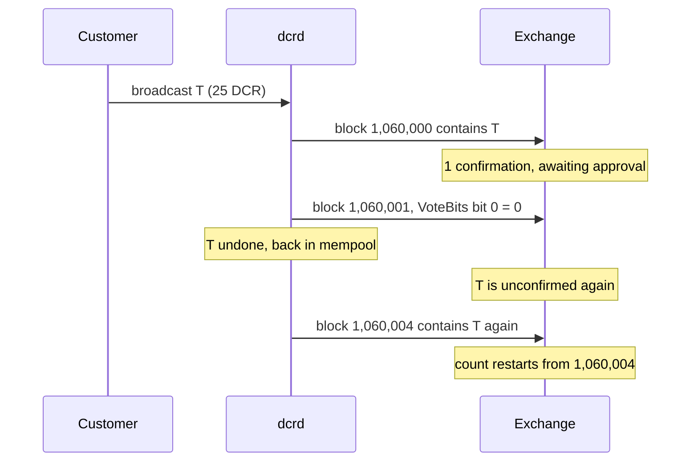

# Blocks, confirmations and reorganizations

This page is for integrators who credit deposits, release goods or track payments on Decred. It explains what a block tells your software, why a transaction in the newest block is not yet settled, how reorganizations show up in `dcrd`, and how to choose a confirmation count from the actual rules.

!!! abstract "In short"
    - A regular transaction in the newest block has `"confirmations": 1` but has not yet been accepted by stakeholders. The votes in the next block can **disapprove** it, which undoes it and sends it back to the mempool.
    - Check bit 0 of the next block's `VoteBits`. `dcrd`'s confirmation counts and its transaction index do not account for disapproval.
    - Never credit at 1 confirmation. Use at least 2 for small amounts and 6 or more for anything a customer can withdraw.

## What a confirmation is

`dcrd` and `dcrwallet` count confirmations the Bitcoin way: a transaction in the best block has 1, and every block on top adds one (`1 + tip height - block height`). Two separate events can still undo a confirmed transaction:

- **Disapproval** (Decred-specific). Every block from stake validation height (4,096 on mainnet) carries at least 3 of the 5 votes cast on its parent. If those votes do not approve, the parent's **regular tree** is treated as if it had never been mined. This can affect only the newest block. The next block decides it, and only a reorganization that replaces that next block can change the decision.
- **Reorganization**. The network switches to a competing branch with more cumulative proof of work, and blocks on the old branch stop counting. Each further block makes this less likely.

So in Decred a transaction passes through one more state than in Bitcoin: mined but awaiting approval.

## Why Decred works this way

Decred combines proof of work (PoW) with proof of stake (PoS). Miners propose blocks, and five tickets drawn by lottery vote on each one. Disapproval lets stakeholders take away a misbehaving miner's reward without discarding the proof of work that secures the chain: the miner loses the subsidy and fees, while the block, its header and its stake tree stay valid. [Miners, voters and the life of a block](../../user/start/life-of-a-block.md) explains the design without code.

The same votes make deep reorganizations harder: from stake validation height a block needs at least 3 votes from tickets drawn on its own branch, so a branch that ticket holders do not vote on cannot be extended, whatever its hash power. The [confirmation policy](#choosing-a-confirmation-policy) builds on this.

## Header fields that matter to apps

A header is exactly 180 bytes and every field has a fixed width ([`wire/blockheader.go`](https://github.com/decred/dcrd/blob/release-v2.1.7/wire/blockheader.go)); the whitepaper's [block header layout](../../whitepaper/04-encoding.md#sec:encoding-header) gives each field's byte offset. Besides the usual chain link, roots, difficulty and nonce, it summarizes the block's stake activity, so an app can follow staking from headers alone. Multi-byte integers are little-endian.

| Field | What it holds | Why an app cares |
|---|---|---|
| `PrevBlock` | Parent's block hash | Chain linking and reorganization detection |
| `MerkleRoot` | Transaction commitment (see [trees](#regular-and-stake-trees)) | Proving a transaction is in the block |
| `StakeRoot` | Header commitment root since block 431,488 | Light-client filter verification |
| `VoteBits` | Bit 0 set: this block's votes approve the parent's regular tree | **Deposit safety** |
| `Voters` | Votes in this block (3 to 5 from stake validation height) | Fewer votes reduce the miner's subsidy |
| `FreshStake`, `Revocations` | Ticket purchases (at most 20) and revocations in this block | Staking statistics |
| `PoolSize` | Live tickets as of the parent | Live pool size without extra RPCs |
| `Bits` | PoW target, compact form | Cumulative work |
| `SBits` | Stake difficulty (ticket price), in atoms | Ticket price history |
| `Height`, `Timestamp` | Block height; Unix seconds | Indexing; see the note below |
| `StakeVersion` | Stake version from recent votes | Consensus upgrade tracking |

The other fields, `Version`, `FinalState` (a digest of the lottery draw), `Size`, `Nonce` and `ExtraData`, matter mainly to validation and mining. Three details catch integrators:

- **Two hashes.** The block hash, which identifies a block and fills the next `PrevBlock`, is BLAKE-256 of the header. Since the `blake3pow` agenda (Decred Change Proposal DCP-0011) activated at block 794,368, the proof-of-work hash is BLAKE3 of the same bytes. Block hashes therefore no longer start with zeros. `getblock` and `getblockheader` return both, as `hash` and `powhash`; use `hash`.
- **Byte order.** RPCs and explorers show hashes byte-reversed relative to the serialized header, as Bitcoin does ([byte order conventions](../../whitepaper/02-conventions.md#conv:bytes)).
- **Timestamps can go backwards.** A block's timestamp only has to exceed the median of its parent and the ten blocks before it, and be at most two hours ahead of the node's adjusted time. For time-based logic, use the `mediantime` field of `getblockheader`.

## Regular and stake trees

A block holds two ordered lists of transactions:

| Tree | Contents | Can be disapproved? |
|---|---|---|
| Regular | The coinbase (first), then ordinary payments | Yes, by the next block's votes |
| Stake | Tickets, votes, revocations, the treasurybase, treasury adds (TADD) and treasury spends (TSPEND) | Never |

Because a regular tree may be undone later, a stake transaction may not spend an output of the regular tree in its own block. The [transaction types and how to recognize them](transactions.md) are covered separately.

**Commitment roots (DCP-0005).** Since the `headercommitments` agenda activated at block 431,488, `MerkleRoot` is BLAKE-256 of the regular tree's Merkle root followed by the stake tree's root, so it commits to both trees. `StakeRoot` holds the **header commitment root**; version 1 has one leaf, so the root equals the hash of the block's version 2 compact filter (32 zero bytes for an empty filter). Before that block, the two fields were the two tree roots. Light clients such as `dcrwallet --spv` check filters against headers with this commitment; `getcfilterv2` returns the filter with `proofindex` and `proofhashes` for that check.

!!! warning "Merkle leaves are full hashes"
    The Merkle leaves are each transaction's *full* hash, which also covers the witness. A transaction ID covers only the prefix. Building a Merkle proof from transaction IDs gives the wrong root.

## Disapproval

Each vote in block N+1 carries vote bits whose bit 0 says whether that ticket holder approves the regular tree of block N. The miner of N+1 summarizes them in the header's `VoteBits`, and consensus forces the honest result: bit 0 must be set exactly when **more votes approve than disapprove**. A 2–2 split, or two disapprovals among three votes, disapproves.

When N+1 disapproves N:

- every output created by N's regular tree disappears, and every output it spent is unspent again;
- N's coinbase is lost, with the miner's subsidy and all fees of the block;
- N's stake tree stands: votes keep their rewards, tickets remain tickets, and treasury transactions and the treasurybase stay in place;
- block N stays in the main chain. Disapproval is a valid outcome, not an invalid block;
- the undone transactions are not invalid. `dcrd` puts them back in its mempool, and they are usually mined again.

The decision belongs to block N+1 alone. A sibling of N+1 on another branch may decide differently, and a reorganization that replaces N+1 can reverse it.

### Worked example: A deposit goes back to the mempool

The heights and amounts below are examples. A customer sends 25 DCR to an exchange in transaction T, and T is mined in block 1,060,000.



What each interface reports after block 1,060,001 disapproves:

| Query | Result | Trap |
|---|---|---|
| `getblockheader` for 1,060,001 | `"votebits"` is even (bit 0 clear) | The direct signal |
| `getblock` for 1,060,000 | still main chain, `"confirmations": 2` | The block count ignores disapproval |
| `getrawtransaction` for T, verbose | the mempool copy, with no `blockhash` or `confirmations` | `dcrd` checks its mempool first |
| `getrawtransaction` with `txindex`, if T could not re-enter the mempool | block 1,060,000 with a growing confirmation count | The index ignores disapproval |
| `dcrwallet` `getbalance`, `listunspent` | T's credits removed | With `minconf` 1 they counted while T sat in the newest block |
| `dcrwallet` `gettransaction` | `confirmations` computed from block heights | Do not rely on the count alone |

Until T is mined again, its inputs are unspent and the customer could get a conflicting transaction mined instead. An exchange that credited at 1 confirmation would have released funds against a payment that no longer existed.

!!! note "How often this happens"
    dcrdata lists nine disapproved mainnet blocks, heights 80,740 to 88,068, all from late 2016 (checked November 2026). In the last, block 88,069 carried two approving and two disapproving votes, so it disapproved block 88,068. `dcrwallet`, which casts the votes inside Decrediton and on voting service provider (VSP) servers, always approves on mainnet; its `setdisapprovepercent` setting refuses to run there. The risk is rare, but handling it costs one check per block.

## Reorganizations and chain tips

`dcrd` follows the valid branch with the **most cumulative proof of work**. Work depends only on each header's `Bits`. On a tie, chain selection keeps the branch whose blocks the node had in full first. The one exception is a mining node, which may force a switch to a sibling of its tip that has collected more votes (below).

A reorganization disconnects blocks back to the fork point, newest first, then connects the new branch, oldest first. Everything derived from the chain rolls back with it: the unspent transaction output (UTXO) set, the ticket pool, agenda states, the treasury balance, and **every disapproval decision**. Disconnecting a block that disapproved its parent reinstates the parent's regular tree. Connecting the new branch may disapprove a different set of parents.

One-block reorganizations are part of normal operation. When two blocks appear at the same height, a miner running `dcrd` builds on whichever sibling has collected more votes, switching to it if necessary ([choosing the parent](../../whitepaper/17-policy.md#sec:policy-parent)), and the rest of the network follows once that branch has more work. Treat the newest block as provisional twice over: its regular tree can be disapproved, and the block itself can be replaced.

`dcrd` keeps no pool of orphan blocks; headers are fetched and checked before block data. To see the branches a node knows about, call `getchaintips`:

```bash
dcrctl getchaintips
```

```text title="Expected output (example)"
[
  {
    "height": 1060004,
    "hash": "<HASH>",
    "branchlen": 0,
    "status": "active"
  },
  {
    "height": 1060002,
    "hash": "<HASH>",
    "branchlen": 1,
    "status": "valid-fork"
  }
]
```

`<HASH>` stands for each tip's block hash. `branchlen` is the number of blocks from the tip back to the main chain. `status` is `active` for the current best tip and `valid-fork` for a fully validated side branch, usually one that was reorganized out. The other values mark branches the node never validated (`valid-headers`), lacks block data for (`headers-only`) or rejected, including by an operator's `invalidateblock` (`invalid`).

A `valid-fork` tip with `branchlen` above 1 on a production node is worth an alert: a reorganization of that depth is unusual.

## Choosing a confirmation policy

No protocol rule says when a payment is final. The numbers below follow from three facts:

1. **One confirmation can be disapproved** or replaced by a sibling block.
2. **Honest nodes stop asking for votes on deep forks.** `dcrd` sends voting wallets the `winningtickets` notification only for blocks on branches that fork off fewer than 6 blocks below its current tip (`maxReorgDepthNotify` in [`server.go`](https://github.com/decred/dcrd/blob/release-v2.1.7/server.go)). This is node policy, not consensus. Once your deposit has 6 confirmations, a branch that drops the deposit's block forks at least 6 blocks below the tip, so honest wallets do not vote on it. A branch that keeps the deposit's block but replaces the block above it with one that disapproves it forks one block higher, 5 below the tip. Honest wallets still vote on that branch, and its first block needs only 2 attacker-owned votes among the 5 tickets drawn for the deposit's block, since 2 disapprovals beside 1 honest approval disapprove. To put that path beyond the voting cut-off as well, wait 7 confirmations.
3. **Without those votes, an attacker needs its own tickets.** A branch mined in secret never gets honest votes. To remove k blocks it needs, for each of k blocks of its own, at least 3 of the 5 winners drawn on that branch, on top of majority hash power. The draw is seeded by each block's header, so the attacker cannot choose its winners in advance.

With a share s of the live tickets, the chance of holding at least 3 of 5 winners in one block is p = 10s³(1−s)² + 5s⁴(1−s) + s⁵, and for k consecutive blocks it is about pᵏ:

| Attacker's share of live tickets | p for one block | Six blocks (p⁶) |
|---|---|---|
| 10% | 0.0086 | 4 × 10⁻¹³ |
| 25% | 0.10 | 1.2 × 10⁻⁶ |
| One third (33.3%) | 0.21 | 8.5 × 10⁻⁵ |
| 50% | 0.50 | 0.016 |

These figures treat the five draws as independent, assume the attacker already out-mines the rest of the network, and ignore grinding (mining extra valid blocks at a height to pick a better draw, which costs more work). They show the shape of the risk, not a guarantee.

Recommended minimums, in `dcrd`'s count:

| Use | Minimum | Reasoning |
|---|---|---|
| Show "payment seen" in a UI | 0 | Informational only; never settle on it |
| Anything of value | never 1 | Disapproval and sibling replacement |
| Small amounts, low-value goods | 2 | The next block has approved; what remains is a reorganization, which could also swap the approving block for one that disapproves |
| Exchange deposits, withdrawable balances | 6 | Beyond the depth where honest wallets vote on branches that drop the block; 7 also covers a replacement of the approving block. `vspd` uses 6 to treat ticket purchases and fee payments as final (`requiredConfs` in vspd 1.5.0) |
| Very large amounts | 7 or more, scaled to the value | Each extra block multiplies an attacker's odds by p; also watch `getchaintips` |

Other software picks its own numbers: the DCRDEX server's sample market configuration asks for 4 confirmations on DCR swaps. Counts also differ by one between interfaces: Decrediton labels a transaction in the newest block "Mined, block awaiting approval" and shows "1 confirmation" once the next block arrives, where the RPCs say 1 and 2.

Spending what you received follows separate consensus rules: outputs of coinbases, votes, revocations, treasury spends and any transaction with a nonzero expiry need 256 blocks (about 21 hours) to mature. Ordinary wallet payments carry no expiry; [transactions for builders](transactions.md) lists every maturity rule.

## Watching the chain

Subscribe to block events on a websocket connection to `dcrd` with `notifyblocks`. `dcrd` then sends:

- `blockconnected` with the serialized header (hex) for each block added to the main chain;
- `blockdisconnected` with the header of each block removed during a reorganization;
- `reorganization` with the old and new tip hash and height, once a switch to a competing branch is complete. It is not listed in the JSON-RPC API document but is sent to the same subscribers; `rpcclient` exposes it as `OnReorganization`.

The notifications carry headers, not block hashes. Read the approval bit and height straight from the header bytes:

```python
import struct

def parse_header(header_hex):
    h = bytes.fromhex(header_hex)
    assert len(h) == 180
    return {
        "prev_block": h[4:36][::-1].hex(),  # display order
        "approves_parent": struct.unpack_from("<H", h, 100)[0] & 1 == 1,
        "voters": struct.unpack_from("<H", h, 108)[0],
        "height": struct.unpack_from("<I", h, 128)[0],
    }
```

For the block's own hash, compute BLAKE-256 of the header (`BlockHash()` on a `wire.BlockHeader` in Go) or take it from the next header's `PrevBlock`. A deposit tracker then needs three rules:

1. On `blockconnected` for height h, if `approves_parent` is false, move every credit from the regular tree at h−1 back to pending.
2. On `blockdisconnected`, roll back everything recorded for that block, including a disapproval it caused.
3. Credit a deposit only when the block holding it has the policy's confirmations **and** the block above it approved it, as seen on the current main chain.

Without websockets, poll `getbestblock` (the tip's `hash` and `height`); when the tip changes, walk back with `getblockheader` until the stored hashes match again, which is the fork point. [Talking to dcrd and dcrwallet from Go](../go/rpc-clients.md) and [your first JSON-RPC call](../api/first-rpc-call.md) show how to connect.

### Test it on simnet

Rehearse both failure modes on a private [simnet](../environment/simnet.md) with voting wallets running. The commands use that page's `nodectl` and `walletctl` shell functions; in its quick-start environment, type `./ctl` instead, in the lower pane of the matching window.

- **Force disapproval.** Run `walletctl setdisapprovepercent 100` (in the quick start, `./ctl setdisapprovepercent 100` in both `wallet1` and `wallet2`). Each vote then disapproves the block it votes on, so every new block disapproves its parent. Set every wallet that can vote the tickets, including wallets restored from the same seed, or their approving votes compete with the disapproving ones. Watch your tracker move deposits back to pending, then set the value back to `0`. The RPC fails on mainnet.
- **Force a reorganization.** Run `nodectl invalidateblock <HASH>` with the tip's hash. The node marks the block invalid, disconnects it and sends `blockdisconnected`. Mine a longer branch with `nodectl generate 2`, then run `nodectl reconsiderblock <HASH>`: the old block becomes eligible again and shows up in `getchaintips` as a side-branch tip.

`<HASH>` is a block hash from `getbestblock` or `getblockhash`.

!!! danger "Never invalidate blocks on a production node"
    `invalidateblock` makes your node treat a valid block as if it broke the rules, until you run `reconsiderblock`. On mainnet the node then follows a different chain from the rest of the network, and your service credits and pays against it. Use these RPCs on simnet only.

## What can go wrong

A deposit credited too early cannot be clawed back once the customer has withdrawn it: Decred transactions are irreversible. The usual causes:

| Mistake | Fix |
|---|---|
| Crediting at 1 confirmation, or querying `dcrwallet` with `minconf` 1 | Require 2 or more, and 6 for withdrawable value |
| Counting confirmations from `getblock` or `txindex` alone | Also check the next block's `VoteBits` |
| Ignoring `blockdisconnected` | Roll back per block, including the disapprovals it caused |
| Using `powhash` as the block ID, or transaction IDs as Merkle leaves | Use `hash` and full transaction hashes |

## Go deeper

- [Stakeholder approval of the previous regular tree](../../whitepaper/10-blocks.md#sec:blocks-approval): the exact approval rule, the UTXO undo algorithm and a worked table.
- [Chain selection](../../whitepaper/10-blocks.md#sec:blocks-selection) and [reorganization](../../whitepaper/10-blocks.md#sec:blocks-reorg): best-chain rule, tie-breaking and what a reorganization rolls back.
- [The block header](../../whitepaper/04-encoding.md#sec:encoding-header) and [transaction trees and Merkle roots](../../whitepaper/04-encoding.md#sec:encoding-roots): byte layout, hashes and both root formats.
- [Header commitments](../../whitepaper/10-blocks.md#sec:blocks-commitments): the commitment root that light clients verify.

## Next steps

- [Integrate DCR into an exchange or service](../integrate/exchange.md): put this policy into a deposit and withdrawal pipeline.
- [dcrd JSON-RPC API](../api/dcrd-json-rpc.md): every method and notification used on this page.
- [Set up a private simnet](../environment/simnet.md): the network for the tests above.
- [Transactions for builders](transactions.md): transaction types, expiry and maturity rules.
- [Staking and the treasury for builders](staking-and-treasury.md): read tickets, votes and treasury spends from the stake tree.

*[PoW]: proof of work
*[PoS]: proof of stake
*[UTXO]: unspent transaction output
*[TADD]: treasury add
*[TSPEND]: treasury spend
*[DCP]: Decred Change Proposal
*[VSP]: voting service provider
*[RPC]: remote procedure call
