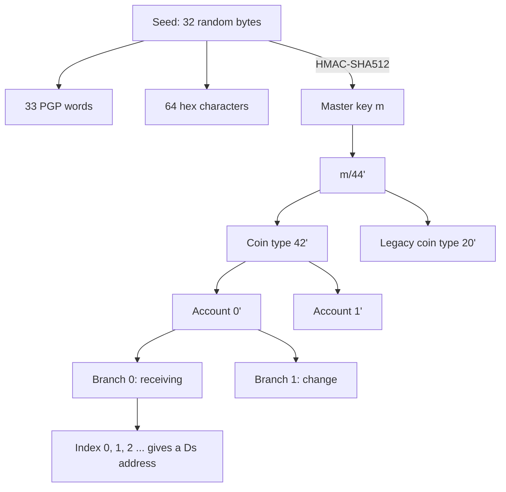

# Keys, addresses and seeds

This page explains how a Decred wallet turns one seed into keys and addresses, and how each is written as text. It is for developers of wallets, exchanges and services whose keys and addresses must match Decrediton and `dcrwallet`.

!!! abstract "The short version"
    - A seed is 32 random bytes, written as 33 words of the Pretty Good Privacy (PGP) word list (the last is a checksum) or 64 hex characters. It is not BIP-39 (Bitcoin Improvement Proposal 39).
    - Keys follow BIP32 and BIP44 at `m/44'/42'/account'/branch/index`, with Decred serialization (`dprv`/`dpub` on mainnet) and one derivation quirk you must reproduce.
    - Early wallets used the legacy coin type 20 instead of 42, so a restore must check both.
    - Wallet addresses start with `Ds` on mainnet. Every text form carries a network prefix and a checksum: decode with the network's parameters and reject anything else.
    - None of this is consensus, since blocks contain scripts, not addresses. Getting it wrong still loses funds.

## What a seed turns into

A Decred wallet is hierarchical deterministic (HD): one seed produces a tree of keys, so one backup covers every key. Steps marked `'` are *hardened* and need the parent's private key. The branch and index steps below an account are normal, so the account's extended public key alone derives all its addresses; watching-only and hardware-backed wallets rely on this.

The diagram shows the path `dcrwallet` follows from the seed to a mainnet receiving address.



Decred took these designs from Bitcoin but changed the hash functions and prefix sizes, so Bitcoin libraries give wrong results unless adapted:

| Item | Bitcoin | Decred |
|---|---|---|
| Mnemonic | BIP-39: 12 to 24 words, stretched with the PBKDF2 key derivation function, optional passphrase | 33 PGP words that encode the raw seed; no passphrase |
| HASH160 | RIPEMD-160 of SHA-256 | RIPEMD-160 of BLAKE-256 |
| Base58Check | 1-byte version, double SHA-256 checksum | 2-byte prefix, double BLAKE-256 checksum |
| Wallet Import Format (WIF) checksum | double SHA-256 | single BLAKE-256 |
| Signed messages | `Bitcoin Signed Message:\n`, double SHA-256 | `Decred Signed Message:\n`, single BLAKE-256 |
| Bech32 addresses | yes | none |

BLAKE-256 is the 14-round hash of the whitepaper's [BLAKE-256 section](../../whitepaper/03-crypto.md#sec:crypto-blake256). [Decred for Bitcoin developers](../start/decred-for-bitcoin-developers.md) covers the other differences.

## Seeds

A new `dcrwallet` wallet gets 32 bytes (`hdkeychain.RecommendedSeedLen`) from a cryptographically secure random source; restores accept 16 to 64 bytes (`MinSeedBytes`, `MaxSeedBytes`). The wallet file never stores the seed. `dcrwallet --create` prints it once, as 33 words in rows of six and a `Hex:` line.

### The 33-word mnemonic

The [`walletseed`](https://github.com/decred/dcrwallet/tree/release-v2.1.7/walletseed) package writes each seed byte as one word of the PGP word list ([`pgpwordlist`](https://github.com/decred/dcrwallet/tree/release-v2.1.7/pgpwordlist)). The list pairs 256 two-syllable "even" words with 256 three-syllable "odd" words: a byte at an even position (counting from 0) uses the even word for its value, a byte at an odd position the odd word. A 33rd word encodes a checksum byte, the first byte of SHA-256(SHA-256(seed)). This checksum is SHA-256, not BLAKE-256.

```python
# WORDS: the 512 words of the alternatingWords constant in pgpwordlist/wordlist.go, in order
# (even and odd words alternate: aardvark, adroitness, absurd, adviser, ...)
from hashlib import sha256

def encode_mnemonic(seed: bytes) -> list[str]:
    data = seed + sha256(sha256(seed).digest()).digest()[:1]   # 32 + 1 bytes
    return [WORDS[2 * b + (i % 2)] for i, b in enumerate(data)]
```

Worked example with the all-zero seed, which is visibly fake and must never hold funds. Bytes 0 to 31 are `0x00`, so even positions read `aardvark` and odd positions `adroitness`. SHA-256(SHA-256(32 zero bytes)) begins with `0x2b` (43), and position 32 is even, so the checksum word is `briefcase`.

```text title="Mnemonic of the all-zero seed (example only)"
aardvark adroitness aardvark adroitness ... (16 pairs in all) ... briefcase
```

Decoding (`walletseed.DecodeUserInput`) treats a single token as hex and anything longer as words, case-insensitively. A word of the wrong parity fails with `word <WORD> is not valid at position <N>, check for missing words` (positions count from 0), so a missing, repeated or swapped adjacent word is caught at, or right after, the position of the mistake. A wrong word of the right parity usually fails the checksum with `checksum mismatch`. The checksum is one byte, though, so about 1 such mistake in 256 passes and restores a different, empty wallet. Decrediton's restore screen expects exactly 33 words.

### The hex form

The hex form is the raw seed with **no checksum**: a mistyped digit restores a different, empty wallet without any error. Decrediton accepts 32 to 128 hex characters and warns when the seed is not 32 bytes. Back up the words; use hex only to move a seed between programs.

### From seed to master key

The seed bytes go straight into BIP32's master key function, HMAC-SHA512 (a hash-based message authentication code over SHA-512) keyed with `Bitcoin seed` ([`hdkeychain.NewMaster`](https://github.com/decred/dcrd/tree/release-v2.1.7/hdkeychain)), with no stretching and no seed passphrase. So:

- **A BIP-39 phrase is not a Decred seed.** Its 64-byte binary seed can be entered as 128 hex characters, but the addresses match the original wallet only if it used the same coin type and the same derivation, including the quirk below.
- **The private passphrase plays no part.** It only encrypts keys in one wallet file.
- **Bison Wallet app seeds and hardware-wallet recovery phrases are other schemes;** see [How a Decred wallet works](../../user/wallets/how-wallets-work.md).

!!! danger "A seed is every key at once"
    Anyone with the words or the hex can spend everything, now and later, and no one can reverse it. Never log seeds or send them to a server. Use fake seeds such as the all-zero seed only on test networks: anyone can derive their keys.

## HD keys and extended keys

Decred uses BIP32 ([`hdkeychain`](https://github.com/decred/dcrd/tree/release-v2.1.7/hdkeychain)) with three differences:

- **Serialization.** The layout is BIP32's, but the parent fingerprint uses Decred's HASH160 and the checksum is the first 4 bytes of a double BLAKE-256. The string is 111 characters (112 on regnet).
- **Leading-zero stripping.** The `Child` method strips leading zero bytes from a derived private key, which changes the input to every hardened child of that key. Below such a key (about 1 in 256) Decred derives different hardened keys from strict BIP32 (`ChildBIP32Std`). Decred wallets use `Child`, and a strict library diverges silently: its addresses look valid but are not the wallet's.
- **Stored keys.** `dcrwallet` derives `m/44'`, both coin-type keys and account 0 in memory with `Child`, but derives account 1 and later (including account discovery candidates) from the stored coin-type key, parsed back with all 32 bytes. To restore `dcrwallet` accounts, reproduce both. The whitepaper's [HD key section](../../whitepaper/05-addresses.md#sec:addresses-hd) gives the algorithm and test vectors.

| Network | Private key prefix | Public key prefix |
|---|---|---|
| mainnet | `dprv` | `dpub` |
| testnet | `tprv` | `tpub` |
| simnet | `sprv` | `spub` |
| regnet | `rprv` | `rpub` |

Decred testnet keys start with the same letters as Bitcoin testnet keys, but the version bytes and checksums differ, so neither accepts the other's.

!!! warning "An account extended public key plus one private key is the whole account"
    Branch and address keys are normal children, so an account's extended public key plus any one private key below it reveals every private key in the account. `dcrwallet` logs a warning whenever `getmasterpubkey` returns one. Never let a party that holds the account's extended public key see a key exported from that account, such as a WIF from `dumpprivkey`.

## Coin types

The second path level is the coin type (`SLIP0044CoinType` and `LegacyCoinType` in `chaincfg`):

| Network | Current coin type | Legacy coin type |
|---|---|---|
| mainnet | 42 | 20 |
| testnet | 1 | 11 |
| simnet | 1 | 115 |
| regnet | 1 | 1 |

42 is Decred's entry in the SatoshiLabs Improvement Proposal [SLIP-0044](https://github.com/satoshilabs/slips/blob/master/slip-0044.md) registry, and 1 is its shared value for test networks. The legacy values come from early `dcrwallet` releases. `dcrwallet` handles them like this:

- A wallet created from a seed stores the keys for both coin types and starts on the legacy one.
- `dcrwallet --create` with a newly generated seed switches to the current coin type at once.
- Every other new wallet (a restored seed, or a wallet created over gRPC, as Decrediton does) decides in its first address discovery. If no legacy account or address is in use, it switches and runs discovery again. Otherwise it stays on the legacy coin type and logs `Wallet contains addresses derived for the legacy BIP0044 coin type and seed restores may not work with some other wallet software`.
- The switch deletes the legacy keys from the wallet file, so it cannot be undone there. If legacy funds turn up later, restore again with `disablecointypeupgrades=1` and a larger `gaplimit` (Decrediton: **Disable coin type upgrades**, **Gap Limit**); see [Back up and restore your wallet](../../user/wallets/back-up-and-restore.md).
- `dcrctl --wallet walletinfo` shows the coin type in use as `cointype`. Watching-only wallets made from an extended public key record none.

Software that restores Decred seeds should scan both coin types; new wallets should use the current one.

## Accounts, branches and gap limits

Below the coin type, `dcrwallet` follows BIP44 (see the whitepaper's [wallet account structure](../../whitepaper/05-addresses.md#sec:addresses-bip44)):

| Level | Range | `dcrwallet` convention |
|---|---|---|
| `account'` | 0 to 2^31 − 2, hardened | Account 0 is `default` (Decrediton: **Primary Account**). 2^31 − 1 is reserved for the `imported` account, whose keys are not HD-derived. |
| `branch` | 0 or 1 | 0 external (receiving), 1 internal (change) |
| `index` | from 0 | Handed out in order |

Each leaf key becomes the pay-to-pubkey-hash (P2PKH) address of its compressed public key, the `Ds` type below. `dcrwallet` derives no other address type.

### Gap limits

Two wallet defaults, not consensus rules, decide how far a restore looks ([`wallet/addresses.go`](https://github.com/decred/dcrwallet/blob/release-v2.1.7/wallet/addresses.go)):

`gaplimit` (default 20, `DefaultGapLimit`)
:   Address discovery stops scanning a branch after 20 unused addresses in a row.

`accountgaplimit` (default 10, `DefaultAccountGapLimit`)
:   Account discovery stops after 10 unused accounts in a row, and `createnewaccount` refuses with `last 10 accounts have no transaction history`.

Payments to addresses more than 20 past the last used one can be missed by a restore, so `getnewaddress <ACCOUNT> <GAPPOLICY>` applies a policy at that point:

- `error`, the default, fails with `generating next address violates the unused address gap limit policy`.
- `ignore` keeps issuing new addresses, which a default restore, or another wallet on the same seed, may not see.
- `wrap` goes back to the first address after the last used one. Decrediton always uses `wrap` for receiving addresses, and change from ordinary sends wraps too, but mixing and ticket purchases ignore the gap limit on the change branch, so a wallet that mixes or stakes may need a larger `gaplimit` when restored.

[Integrate DCR into an exchange or service](../integrate/exchange.md) covers issuing a fresh address per deposit with `ignore` and finding those addresses again after a restore.

### Worked example: the all-zero seed on testnet

Computed from the all-zero seed with `udb.HDKeysFromSeed` from `dcrwallet` 2.1.7 and dcrd's `hdkeychain`, for checking an implementation. Never send funds to them.

```text title="Account 0 extended public key, m/44'/1'/0' (testnet, example only)"
tpubVpQsVcwm1Hc2GTKCxDdj7zSJ5hHLFFBj7WTMS2PUcSTYf8oqKboP7koBC8KSvEAgi9EftUsaLQ8tuC7UhpyRsaeyGrg7JWD2R8BnF2VfLuU
```

| Path | Address |
|---|---|
| `m/44'/1'/0'/0/0` | `TsafuqGEomspWBB9vu5ndSDjUEZ1AnKSBLV` |
| `m/44'/1'/0'/0/1` | `TsRHtdzMRY2nZqUMRZJE2PgrUXZN5X1YJuM` |
| `m/44'/1'/0'/1/0` | `TscW7YSkmZw4nev5wQ11ZpLo1YLBkDNxxEN` |
| `m/44'/11'/0'/0/0` (legacy coin type) | `TsX5za8GdPvhVz9CVLLXMDezNxgh5wc4MEY` |

## Address types and prefixes

An address is Base58Check over a 2-byte prefix, a payload and a 4-byte checksum (the start of a double BLAKE-256). The prefixes fix the first two characters, but decoders go by the bytes. P2PKH and pay-to-script-hash (P2SH) addresses have 35 characters; pay-to-pubkey (P2PK) addresses and WIF keys have 53. Each P2PKH prefix also names a signature suite: ECDSA (Elliptic Curve Digital Signature Algorithm) or Schnorr over secp256k1, or Ed25519.

| Type | mainnet | testnet | simnet | regnet | Use |
|---|---|---|---|---|---|
| P2PKH, ECDSA secp256k1 | `Ds` | `Ts` | `Ss` | `Rs` | Ordinary wallet address; the only type `dcrwallet` derives |
| P2SH | `Dc` | `Tc` | `Sc` | `Rc` | Multisignature and other scripts |
| P2PKH, Schnorr secp256k1 | `DS` | `TS` | `SS` | `RS` | Scripts with Schnorr signatures; not generated by wallets |
| P2PKH, Ed25519 | `De` | `Te` | `Se` | `Re` | Scripts with Ed25519 signatures; not generated by wallets |
| P2PK, all three suites | `Dk` | `Tk` | `Sk` | `Rk` | The public key itself; `validateaddress` shows it as `pubkeyaddr` |
| WIF private key | `Pm` | `Pt` | `Ps` | `Pr` | Not an address: one private key |

Prefix bytes are in [Ports, paths and prefixes](../reference/index.md) and the whitepaper's [network prefixes](../../whitepaper/05-addresses.md#sec:addresses-prefixes). [Scripts for builders](scripts.md) explains the script behind each type.

### Stake-tagged outputs

Ticket voting rights, vote and revocation payments, stake change and treasury payouts use a one-byte stake opcode (`OP_SSTX`, `OP_SSGEN`, `OP_SSRTX`, `OP_SSTXCHANGE`, `OP_TGEN`) followed by an ordinary P2PKH or P2SH script, so only P2PKH-ECDSA and P2SH addresses (`Ds`, `Dc`) can be ticket voting, reward or treasury payout addresses. A ticket's reward commitment is an `OP_RETURN` output with the reward address's 20-byte hash and a P2SH flag; software rebuilds the address from it.

A stake-tagged script maps back to its inner address, so one `Ds` address can appear in regular and stake outputs. Check the script class too: stake outputs have their own maturity rules ([Staking and the treasury for builders](staking-and-treasury.md)). The whitepaper's [stake and treasury scripts](../../whitepaper/05-addresses.md#sec:addresses-stake) gives the encodings.

## Validating addresses

`stdaddr.DecodeAddress` ([`txscript/stdaddr`](https://github.com/decred/dcrd/tree/release-v2.1.7/txscript/stdaddr)) is the reference decoder. It checks, in order:

1. **Shape**: 35 or 53 Base58 characters, else `ErrUnsupportedAddress`.
2. **Checksum**: a mistyped character fails with `ErrBadAddressChecksum`. A random corruption passes about once in 4.3 billion.
3. **Prefix**: one of the five address prefixes of the network passed in. Another network's address fails with `ErrUnsupportedAddress`.
4. **Payload**: a 20-byte hash or a valid public key, else `ErrInvalidHashLen`, `ErrMalformedAddressData` or `ErrInvalidPubKey`.

This Go function, using the modules `github.com/decred/dcrd/txscript/v4` and `github.com/decred/dcrd/chaincfg/v3`, accepts only the two types most services pay to:

```go
package main

import (
	"errors"
	"fmt"

	"github.com/decred/dcrd/chaincfg/v3"
	"github.com/decred/dcrd/txscript/v4/stdaddr"
)

// checkPayoutAddress accepts only the address types this service pays to.
func checkPayoutAddress(s string, params *chaincfg.Params) (stdaddr.Address, error) {
	addr, err := stdaddr.DecodeAddress(s, params)
	switch {
	case errors.Is(err, stdaddr.ErrBadAddressChecksum):
		return nil, fmt.Errorf("mistyped address: %w", err)
	case errors.Is(err, stdaddr.ErrUnsupportedAddress):
		return nil, fmt.Errorf("wrong network or unknown type: %w", err)
	case err != nil:
		return nil, err
	}
	switch addr.(type) {
	case *stdaddr.AddressPubKeyHashEcdsaSecp256k1V0, *stdaddr.AddressScriptHashV0:
		return addr, nil
	default:
		return nil, fmt.Errorf("unsupported address type %T", addr)
	}
}

func main() {
	params := chaincfg.TestNet3Params()
	addr, err := checkPayoutAddress("TsafuqGEomspWBB9vu5ndSDjUEZ1AnKSBLV", params)
	if err != nil {
		fmt.Println(err)
		return
	}
	ver, script := addr.PaymentScript()
	fmt.Printf("script version %d, script %x\n", ver, script)
}
```

```text title="Expected output"
script version 0, script 76a91469de627d3231b14228653dd09cba75eeb872754288ac
```

With a mainnet address such as `DshRCvfb21VQvaXZYhBivFS7VAurvcKi32t` it prints `wrong network or unknown type: ...`. `PaymentScript` returns the script version (0 for every type today) and the output script to pay.

Over remote procedure call (RPC), both `dcrd` and `dcrwallet` answer `validateaddress`:

```bash
dcrctl --wallet validateaddress <ADDRESS>
```

`<ADDRESS>` is the address to check. On testnet, `dcrctl --testnet --wallet validateaddress TsafuqGEomspWBB9vu5ndSDjUEZ1AnKSBLV` from a wallet that does not own the address returns:

```text title="Expected output"
{
  "isvalid": true,
  "address": "TsafuqGEomspWBB9vu5ndSDjUEZ1AnKSBLV",
  "iscompressed": true,
  "script": "pubkeyhash"
}
```

For an address it owns, the wallet adds `ismine`, `account`, `pubkey`, `pubkeyaddr` and the derivation path as `accountn`, `branch` and `index`. Without `--wallet`, `dcrd` returns only `isvalid` and `address`. A mistyped or wrong-network address gives `"isvalid": false` with no reason; decode locally when you need one.

Rules for services:

- Decode with your network's parameters; never infer the network from the first letter.
- Compare addresses in decoded or re-encoded form, not as typed.
- Accept only types you handle; for tickets and treasury payouts, only P2PKH-ECDSA and P2SH.
- Never build an output script from a payload without checking the prefix: a wrong template pays a script nobody can spend.

## WIF private keys

The Wallet Import Format carries one private key in 39 bytes before Base58: the network's 2-byte `PrivateKeyID`, a signature-type byte (0 for ECDSA secp256k1), the 32-byte key and a 4-byte checksum taken from a **single** BLAKE-256 of the first 35 bytes. The whitepaper's [WIF section](../../whitepaper/05-addresses.md#sec:addresses-wif) gives the full layout.

Because of the single hash, WIF is not Base58Check. There is no "compressed" flag: secp256k1 public keys from WIF keys are always compressed. For example, the published test key `01 02 ... 1f 20` is `PtWTYK1qt46UMNqFTchWPWv3QCnDhhtrUsMx48idLCXuW3ZQuqcg9` on testnet and controls `TshURuo6QoYX2wCvN5ot4pTP5GsnVK4bmxd`.

`dcrwallet` has `dumpprivkey <ADDRESS>`, which returns a type 0 WIF and needs an unlocked wallet, and `importprivkey <WIF>`, which adds the key to the `imported` account and by default rescans from the genesis block. Imported keys are not in the seed, so a restore does not bring them back: back them up or sweep them to a seed-derived address. dcrd's decoder accepts an unknown type byte, a zero secp256k1 key and one not below the curve order; the whitepaper says implementations should reject all three.

## Signed messages

A signed message proves control of an address without a transaction. Users sign to prove ownership, and `vspd` checks that ticket requests are signed by the ticket's commitment address (or an alternate signing address the owner registered).

- **Address type.** Only P2PKH-ECDSA addresses can be verified: `verifymessage` in `dcrd` rejects other types with `Address is not a pay-to-pubkey-hash address`, and in `dcrwallet` with `address must be secp256k1 pay-to-pubkey-hash`. Sign with the P2PKH-ECDSA address (`Ds` on mainnet), not its P2PK form.
- **Digest.** One BLAKE-256 over the length-prefixed string `Decred Signed Message:` plus a line feed, then the length-prefixed message. Bitcoin tools cannot verify these signatures.
- **Signature.** A 65-byte compact recoverable ECDSA signature in standard Base64. Nonces are deterministic (RFC 6979), so a key and message always give the same signature. The verifier recovers the public key and compares its address.
- **Exact bytes.** An extra space, another line ending or another Unicode normalization makes verification return `false`.

```bash
dcrctl --wallet signmessage <ADDRESS> "<MESSAGE>"
dcrctl verifymessage <ADDRESS> <SIGNATURE> "<MESSAGE>"
```

`<ADDRESS>` is the signing address, `<MESSAGE>` the exact text and `<SIGNATURE>` the Base64 string from `signmessage`. Signing needs an unlocked wallet that owns the address; verifying needs neither, and without `--wallet` `dcrd` answers. The whitepaper's vector, on testnet:

```bash
dcrctl --testnet verifymessage TshURuo6QoYX2wCvN5ot4pTP5GsnVK4bmxd H0PAias7hpsEvWxwlBjfi+fJ2Ti8XoU5mccZ+GlPwvWiRs1ejdjyPjlCK2I4t9p4S+tpoo4JDPLlI8zKbx+QHMI= Decred
```

```text title="Expected output"
true
```

Ledger-backed wallets in Decrediton cannot sign messages. User steps are in [Send and receive DCR](../../user/wallets/send-and-receive.md).

## What can go wrong

- **Strict BIP32 code** derives different keys for roughly 1 seed in 128 (account 0) or 1 in 256 (later accounts), and the addresses look valid. Test against the whitepaper's leading-zero vectors.
- **Scanning one coin type** misses old wallets' funds under coin type 20.
- **Addresses past the gap limit** stay invisible to a default restore.
- **Hex seed typos** restore an empty wallet, because hex has no checksum.
- **An account extended public key plus one exported key** gives away the whole account.
- **Imported keys** are lost with the wallet file.

## Go deeper

- [Address types](../../whitepaper/05-addresses.md#sec:addresses-types): the seven address types, their scripts and test vectors.
- [Decoding addresses](../../whitepaper/05-addresses.md#sec:addresses-decoding): the exact decoder and its error cases.
- [Hierarchical deterministic keys](../../whitepaper/05-addresses.md#sec:addresses-hd): BIP32 differences, leading-zero stripping and HD test vectors.
- [Signed messages](../../whitepaper/05-addresses.md#sec:addresses-messages): the digest, compact signatures and key recovery.

## Next steps

- [Add Decred to a wallet](../integrate/wallet-support.md): implement derivation, signing and light-client sync.
- [Build and sign transactions in Go](../go/build-and-sign-transactions.md): decode addresses and derive from an extended public key in code.
- [Integrate DCR into an exchange or service](../integrate/exchange.md): deposit addresses and gap limits in production.
- [Scripts for builders](scripts.md): what each address type's script does.
- [Ports, paths and prefixes](../reference/index.md): every prefix and coin type in one table.

*[BIP]: Bitcoin Improvement Proposal
*[ECDSA]: Elliptic Curve Digital Signature Algorithm
*[HD]: hierarchical deterministic
*[HMAC]: hash-based message authentication code
*[P2PK]: pay-to-pubkey
*[PBKDF2]: Password-Based Key Derivation Function 2
*[P2PKH]: pay-to-pubkey-hash
*[P2SH]: pay-to-script-hash
*[PGP]: Pretty Good Privacy
*[RPC]: remote procedure call
*[SLIP]: SatoshiLabs Improvement Proposal
*[WIF]: Wallet Import Format
