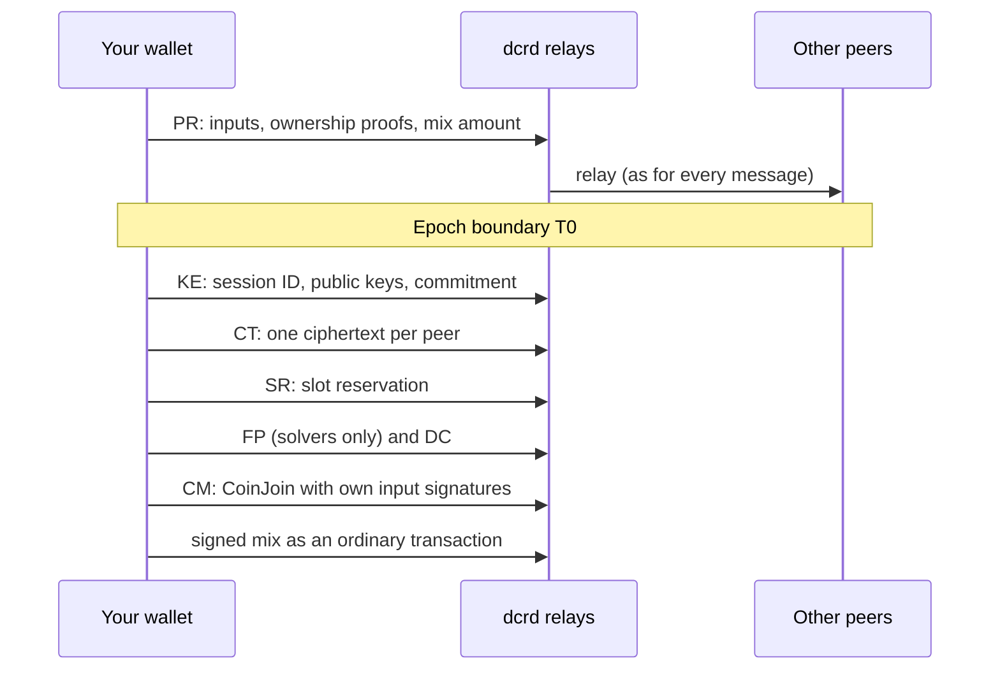

# Mixing for builders

StakeShuffle is Decred's peer-to-peer mixing protocol: wallets that have never met build one CoinJoin transaction, and nobody learns which equal-valued output belongs to whom. This page is for wallet developers joining those mixes, from Go through `dcrd`'s `mixing` module or from any language through the mix-message RPCs. What mixing hides from users is explained in [Privacy and mixing](../../user/privacy/index.md).

!!! abstract "In short"
    - Mixing is **not consensus**, but its message formats are an **interoperability requirement**: get a byte wrong and peers blame and exclude you.
    - Every **epoch** (10 minutes on mainnet) waiting wallets form sessions of **at least 4 peers**, one of which must run `csppsolver`.
    - Use the Go module `github.com/decred/dcrd/mixing` **v0.7.5**, as `dcrd` and `dcrwallet` 2.1.7 do. Wallets with different **pairing versions** never mix together.

## What StakeShuffle is

Each participant (a *peer*) contributes unspent outputs, asks for *m* outputs of a common *mix amount*, and may take one change output. The transaction holds every peer's inputs and change plus all mixed outputs, each a version-0 pay-to-pubkey-hash (P2PKH) output to a fresh key. Only the mixed outputs are anonymized; inputs, change and amounts stay public.

The protocol is DiceMix Light, a variant of CoinShuffle++. An adversary controlling the network and all but two peers of a successful run cannot link honest outputs to honest peers better than by guessing, and since each peer signs only after finding its own outputs, a mix can fail but cannot steal ([threat model](../../whitepaper/18-mixing.md#sec:mixing-threat)).

There is **no server**: since `dcrd` and `dcrwallet` 2.0 (May 2024), mix messages travel as eight peer-to-peer message types that full nodes relay after checking them against a *mixpool* policy. The crowd comes largely from **ticket buyers**, whose wallets mix the output that funds each ticket (see [Denominations in dcrwallet](#denominations-in-dcrwallet)).

## How a mix runs

Peers announce themselves with a pair request (PR) between epoch boundaries. At the boundary each waiting wallet collects the compatible PRs it knows, derives the same session identifier, and runs the stages below.



Every message is signed by an *identity*, a secp256k1 key made fresh for each PR. Each stage has a deadline counted from the run's start T0, in steps of the stage timeout τ (30 seconds on mainnet).

| Abbr. | Wire command | Carries | Due by (2.1.7, mainnet) |
| --- | --- | --- | --- |
| PR | `mixpairreq` | Mix amount, output count, inputs with ownership proofs, change | Before T0 |
| KE | `mixkeyxchg` | Session's PR list, ECDH and post-quantum public keys, commitment to secrets | T0 + 30 s |
| CT | `mixcphrtxt` | A key-encapsulation ciphertext to every peer | T0 + 60 s |
| SR | `mixslotres` | Slot reservation (padded power sums) | T0 + 90 s |
| FP | `mixfactpoly` | Roots of the slot polynomial, from solvers | T0 + 120 s |
| DC | `mixdcnet` | XOR DC-net vectors carrying the 20-byte output key hashes | T0 + 120 s |
| CM | `mixconfirm` | The CoinJoin with the sender's input signatures | T0 + 150 s |
| RS | `mixsecrets` | On failure only: the committed secrets | One τ later |

A clean run must finish by the CM deadline, 2.5 minutes after the boundary. Each stage moves on as soon as every peer's message has arrived, so a run in which all peers respond promptly can end well before that. The whitepaper specifies [every payload](../../whitepaper/18-mixing.md#sec:mixing-wire) and [every stage](../../whitepaper/18-mixing.md#sec:mixing-run) as in `dcrd` master, which adds one more τ for revealed secrets (CMs due at T0 + 180 s); 2.1.7 has the five deadlines above.

## Pair requests and UTXO ownership proofs

A PR binds an identity to the coins it will spend. Two PRs can share a session only if their *pairing descriptions* (mix amount, script class, transaction version, lock time and pairing flags) are byte-identical ([pairing description](../../whitepaper/18-mixing.md#sec:mixing-pairing-desc)).

- **Script class** must be `P2PKH-secp256k1-v0`.
- **Pairing flags** carry the pairing version: 3 in the 2.1.7 client, 4 on testnet. It rose in 2.1.5 and again in 2.1.6, each time splitting upgraded wallets from older ones; track releases ([Upgrading and mandatory releases](../../user/run/upgrades.md)).
- **Inputs** must be version-0 P2PKH outputs, or the P2PKH forms of vote, revocation and treasury-generation outputs, with at least 1 confirmation. Pay-to-script-hash (P2SH) inputs are not supported.
- **Expiry** is a height above the tip `h` and at most `mixing.MaxExpiry` = `h + 60 min / TargetTimePerBlock + 1` (tip + 13 on mainnet); `dcrwallet` uses `MaxExpiry − 2`. A PR spending the same outpoints with a later expiry replaces the earlier one.
- **Fee**: your share, `InputValue − m × MixAmount − change`, must pay 0.0001 DCR/kB on the estimated size of a transaction holding only your inputs and outputs (12 bytes plus varints, 166 bytes per input, 36 per output including change) and not exceed 10,000 times that ([fee and dust policy](../../whitepaper/18-mixing.md#sec:mixing-pr-fee)). The mix amount and change must not be dust (under 6,030 atoms).

Each input carries a *UTXO ownership proof*, a Schnorr signature by the input's key over the PR's expiry and that public key. Full nodes check it; light wallets cannot. `mixclient.CoinJoin.AddInput` creates it ([proof algorithm](../../whitepaper/18-mixing.md#sec:mixing-utxoproof)).

**Worked example.** A wallet mixes one 25 DCR coin while the ticket price is above 10.74 DCR (an example; read the live value with `dcrctl getstakedifficulty`). `dcrwallet` asks for two outputs of 10.73741824 DCR:

| Field | Value (atoms) |
| --- | --- |
| `InputValue` | 2,500,000,000 |
| `MixAmount` × `MessageCount` | 1,073,741,824 × 2 = 2,147,483,648 |
| Estimated size of this share | 12 + 2 + 1 + 166 + 3 × 36 = 289 bytes |
| Fee (0.0001 DCR/kB) | 2,890 |
| Change | 352,513,462 (3.52513462 DCR) |

!!! warning "A PR locks its coins"
    While your PR is in a node's mixpool, that node's mempool rejects any other transaction spending its outpoints (`ErrMixpoolDoubleSpend`). The PR leaves when a block spends the coins, normally in the mix, or one to two epochs after it expires; `dcrwallet` sets the expiry 11 blocks ahead (about 55 minutes), so the lock can last more than an hour. Lock the coins in your coin selection, and do not mix coins the user needs soon.

## Epochs and session formation

An epoch boundary is a Unix time divisible by the epoch length, which is hard-coded in `mixpool.NewPool` rather than a chain parameter.

| | mainnet | testnet3 | simnet and regnet |
| --- | --- | --- | --- |
| Epoch | 600 s | 180 s | 600 s |
| Stage timeout τ | 30 s | 10 s (since 2.1.7) | 30 s |
| Pairing version | 3 | 4 | 3 |
| Latest PR expiry | tip + 13 | tip + 31 | tip + 3601 |

The client picks the testnet timeout and pairing version by checking whether the pool's epoch is 3 minutes. At each boundary it takes the PRs with its pairing description (the latest-expiring one per outpoint, minus any whose coins carry [two strikes](#failures-blame-and-exclusion)), derives the session ID from the sorted PR hashes and the epoch, and orders peers by PR hash XOR session ID, which nobody controls ([session identifier](../../whitepaper/18-mixing.md#sec:mixing-sid)). It always sends its KE, so others can fetch PRs they lack, but continues only with **at least 4 PRs (`MinPeers`)**, one flagged `PRFlagCanSolveRoots`.

- **Agreement.** If KEs are missing at the KE deadline, peers saw different PR sets: each computes an *alternate session* from the PR lists in the KEs it received and retries within the epoch ([session agreement](../../whitepaper/18-mixing.md#sec:mixing-agreement)). Send a KE at every boundary while a PR is pending, or you are dropped as unresponsive.
- **Size.** PRs that would push the estimated CoinJoin to 100,000 bytes or more are dropped.
- **Reruns** are new sessions with the same epoch value and a new session ID; every message carries run number 0, the only value relays accept. Peers left unmixed try again each epoch until their PR expires.
- **Timing.** The client publishes each PR at a random moment before the next boundary and at least τ ahead of it (a request made in the last τ before a boundary waits until τ after it), and delays every message by up to τ/10, so timing does not identify the owner.

### Root solving and csppsolver

Slot reservation yields a polynomial over a 127-bit prime field, of degree equal to the session's output count, that someone must factor. `dcrd` delegates this to an external program, `csppsolver`, through `decred.org/cspp/v2/solverrpc`. Peers whose solver starts set `PRFlagCanSolveRoots` and publish an FP; the others use the first valid FP.

- `mixclient.NewClient` calls `solverrpc.StartSolver()`, which runs once per process: set `solverrpc.SolverProcess` first to use a path other than `csppsolver` on `PATH`.
- `csppsolver` ships with no Decred release. Build `cmd/csppsolver` from [decred/cspp](https://github.com/decred/cspp) with cgo; it links the FLINT, MPFR and GMP C libraries.
- Mainnet mixing works without one if some peer in each session has one. A private network needs at least one.

## Failures, blame and exclusion

A disruptor can make a run fail, but every failure removes someone ([blame and failure handling](../../whitepaper/18-mixing.md#sec:mixing-blame)):

Observable misbehavior and timeouts
:   A malformed key, a CT, SR or DC of the wrong dimensions, a CM signing a different transaction, or a message missing at the CT, SR, DC or CM deadline ([timeouts](../../whitepaper/18-mixing.md#sec:mixing-timeouts)). The sender is excluded and the rest rerun at once, reusing their keys.

Revealed secrets
:   A failure public data cannot attribute, such as a ciphertext that will not decapsulate or a peer's own output missing. Every peer publishes its RS and replays the others' computations; the culprits are excluded and everyone generates fresh secrets.

If fewer than 4 peers would remain, the session is abandoned. Since 2.1.0 nodes and wallets also run a mixpool *observer* that gives a *strike* to the coins of identities that sent a KE and a CT in an epoch but failed to complete ([exact rule](../../whitepaper/18-mixing.md#sec:mixing-observer)). Coins with **two or more strikes** are excluded from new sessions, `dcrd` withholds winning-ticket notifications for a block spending them, and since 2.1.7 its mempool rejects ordinary transactions spending them (`ErrMixingMisbehavior`). Strikes lapse once the latest is 24 hours old.

!!! warning "Honest wallets can be struck"
    A wallet closed, locked or disconnected mid-session looks like a disruptor; its coins can become unmixable, and unspendable through up-to-date nodes, for up to a day. Keep the wallet online and unlocked while PRs are pending, and stop mixing away from epoch boundaries.

## Mixpool relay policy and limits

A full node relays a mix message only after accepting it into its mixpool. This is relay policy, not consensus, but `dcrd` enforces it and bans for some violations ([mixpool relay policy](../../whitepaper/18-mixing.md#sec:mixing-mixpool)).

- **Relay.** Messages are announced with `inv` vectors of type `MSG_MIX` (4) and fetched with `getdata`, only on connections at protocol version 10 or later. `dcrd` does not announce them to peers that disabled transaction relay (a light `dcrwallet` with `spvdisablerelaytx`), and with `--blocksonly` it ignores them and disconnects peers that announce them.
- **Acceptance.** Every message needs run number 0 and a valid signature, and an identity's first message must be its only PR. A message whose PR or KE is not yet known is held as an orphan; `mixpool.MissingOwnPRError` names the PR to fetch.
- **Bans.** `dcrd` bans peers whose message fails to decode or fails a check that `mixpool.IsBannable(err, services)` reports as bannable: a bad signature, dust or a fee out of bounds, and a bad ownership proof only from peers advertising full-node service.
- **Removal.** A block spending a PR's coins removes it and everything its identity sent; expired PRs and sessions are dropped one to two epochs after the block that expires them.

| Limit | Value | Constant |
| --- | --- | --- |
| Peers in CT, SR, DC, CM and RS messages | 64 | `mixing.MaxPeers` |
| Mixed outputs per peer / per session | 16 / 1,024 | `mixing.MaxMcount`, `mixing.MaxMtot` |
| CoinJoin size | 100,000 bytes | `mixing.MaxMixTxSerializeSize` |

The remaining limits (PRs per KE, inputs per PR, the largest mix amount, orphan and message counts) are listed with the whitepaper's [mixing constants](../../whitepaper/18-mixing.md#sec:mixing-constants).

## The dcrd RPCs

`dcrd` exposes its mixpool to clients that do not speak peer-to-peer, such as `dcrwallet` in full-node mode. All four methods are open to limited RPC users; see [dcrd JSON-RPC API](../api/dcrd-json-rpc.md) for authentication and websockets.

| Method | Parameters | Result |
| --- | --- | --- |
| `sendrawmixmessage` | `command` (such as `mixpairreq`), `message` (hex) | `null`; the message is accepted, relayed and notified. A rejection is error −1, "Rejected mix message: …" |
| `getmixmessage` | `hash` | `{"type": "<command>", "message": "<hex>"}`, or error −5 if not in the mixpool |
| `getmixpairrequests` | none | Array of hex PRs. Documented as experimental: it "will very likely be removed in the next version. Do not use!" |
| `notifymixmessages` (websocket) | none | A `mixmessage` notification for each accepted message; `stopnotifymixmessages` ends it, but is not open to limited users, who close the websocket instead |

The hex is the message payload serialized at protocol version 10, signature first, without a message header. The message hash is the BLAKE-256 of those bytes, and the `hash` parameter is written byte-reversed like a transaction ID (`chainhash.Hash.String()`). A notification passes the command and payload positionally:

```json title="Example mixmessage notification (payload shortened)"
{"jsonrpc": "1.0", "method": "mixmessage", "params": ["mixkeyxchg", "7a3f…"], "id": null}
```

`dcrd`'s documentation example shows `mixpairrequest`; the command actually sent is `mixpairreq`. `dcrwallet` in full-node mode subscribes once synced, fetches a missing PR with `getmixmessage` when a KE returns `MissingOwnPRError`, publishes with `sendrawmixmessage`, and never calls `getmixpairrequests`.

## Using mixclient in a Go wallet

Import the module rather than reimplement the protocol: key generation, the DC-nets and blame must match byte for byte. Pin `github.com/decred/dcrd/mixing` to the version the current release uses (v0.7.5 for 2.1.7). It is a v0 module whose source warns that the size limits and `MinPeers` may change without a major API bump.

You supply a chain view (`mixpool.BlockChain`; a full node also implements `mixpool.UtxoFetcher` so PR inputs are checked), a network layer that feeds received messages to `Pool.AcceptMessage(msg, src)` and broadcasts yours, a `mixclient.Wallet`, and a `mixclient.GenFunc` that returns fresh HASH160s for the mixed outputs. The sketch shows how they fit; it is an outline, not a complete program.

```go
package mixer

import (
	"context"

	"github.com/decred/dcrd/chaincfg/chainhash"
	"github.com/decred/dcrd/chaincfg/v3"
	"github.com/decred/dcrd/mixing"
	"github.com/decred/dcrd/mixing/mixclient"
	"github.com/decred/dcrd/mixing/mixpool"
	"github.com/decred/dcrd/wire"
)

// node is your chain state and network layer (P2P peers or a dcrd websocket).
type node interface {
	Tip() (chainhash.Hash, uint32)
	BroadcastMix(ctx context.Context, msg mixing.Message) error
	SendTx(ctx context.Context, tx *wire.MsgTx) error
}

type mixWallet struct {
	params *chaincfg.Params
	node   node
	pool   *mixpool.Pool
	sign   func(tx *wire.MsgTx, idx int, prevScript []byte) error
}

// mixpool.BlockChain
func (w *mixWallet) ChainParams() *chaincfg.Params { return w.params }
func (w *mixWallet) CurrentTip() (chainhash.Hash, int64) {
	hash, height := w.node.Tip()
	return hash, int64(height)
}

// mixclient.Wallet
func (w *mixWallet) BestBlock() (uint32, chainhash.Hash) {
	hash, height := w.node.Tip()
	return height, hash
}
func (w *mixWallet) Mixpool() *mixpool.Pool { return w.pool }
func (w *mixWallet) SubmitMixMessage(ctx context.Context, msg mixing.Message) error {
	_, err := w.pool.AcceptMessage(msg, mixpool.ZeroSource)
	if err == nil {
		err = w.node.BroadcastMix(ctx, msg)
	}
	if err != nil {
		w.pool.RemoveMessage(msg) // as dcrwallet does
	}
	return err
}
func (w *mixWallet) SignInput(tx *wire.MsgTx, idx int, prevScript []byte) error {
	return w.sign(tx, idx, prevScript) // SigHashAll script for a P2PKH input
}
func (w *mixWallet) PublishTransaction(ctx context.Context, tx *wire.MsgTx) error {
	return w.node.SendTx(ctx, tx)
}

func start(ctx context.Context, w *mixWallet) *mixclient.Client {
	w.pool = mixpool.NewPool(w)
	c := mixclient.NewClient(w) // tries to start csppsolver
	go c.Run(ctx)
	return c
}

// On every block connected to the main chain: c.ExpireMessages(height)
```

To mix one output, build a `CoinJoin` and pass it to `Dicemix`:

```go
_, tip := w.node.Tip()
expiry := mixing.MaxExpiry(tip, w.params) - 2
cj := mixclient.NewCoinJoin(gen, change, mixValue, expiry, count)
in := &wire.TxIn{PreviousOutPoint: outpoint, ValueIn: value} // ValueIn is required
if err := cj.AddInput(in, prevPkScript, 0, privKey); err != nil {
	return err
}
// Blocks until the mix is published, the PR expires or ctx is done.
if err := c.Dicemix(ctx, cj); err != nil {
	return err
}
mixTx, myOutputs := cj.Tx(), cj.MixedIndices()
```

Points that catch new integrations:

- **Hash every decoded message.** `Hash()` returns zero until `WriteHash(blake256.NewHasher256())` runs, and decoding does not run it. `dcrd` and `dcrwallet` call it right after decoding; the hasher is not safe for concurrent use.
- **Stay unlocked.** `AddInput` needs the private key for the ownership proof and `SignInput` needs it again at the CM stage.
- **The first `Dicemix` after `Run` waits** for one epoch boundary plus a KE timeout, up to about 10.5 minutes on mainnet.
- **Call `ExpireMessages` on every new block**, or expired PRs never leave the pool and failed local peers are never released.
- **Addresses burn.** Every attempt with fresh secrets calls `GenFunc` again, and `dcrwallet` derives these addresses ignoring the gap limit, so failed mixes leave unused addresses to allow for when restoring from seed ([Keys, addresses and seeds](keys-and-addresses.md)).

The package's own tests (`mixing/mixclient/client_test.go`) run complete sessions in one process, with all peers local to one or two `Client`s over a fake wallet.

## Denominations in dcrwallet

Only equal amounts pair, so `dcrwallet` and the wallets built on it mix ordinary funds into ten fixed values, the powers of four from 2^18 to 2^36 atoms (0.00262144 to 687.19476736 DCR; the full list is in [Privacy and mixing](../../user/privacy/index.md)). This is wallet policy in `wallet/mixing.go`, not a protocol rule.

- `MixOutput` picks the largest denomination strictly below the next ticket price that the coin can pay for, and asks for up to 4 outputs of it.
- Change below the smallest denomination plus the fee to spend it (264,314 atoms at the default fee rate) goes to the fee.
- `MixAccount` mixes the account's coins of at least 0.00262144 DCR with 2 or more confirmations concurrently, at most `--mixsplitlimit` (default 10) at a time per denomination.
- A mixed ticket purchase mixes outputs of the ticket price plus the ticket's transaction fee, one per ticket, so mixing ticket buyers in a window share a pairing description at the default fee rate. [Staking and the treasury for builders](staking-and-treasury.md) covers the ticket itself.

## How dcrwallet and Bison Wallet integrate it

| | `dcrwallet` 2.1.7 (also inside Decrediton) | Bison Wallet 1.0.6 (native Decred wallet) |
| --- | --- | --- |
| Mixing module | v0.7.5: pairing version 3 (4 on testnet) | v0.6.1 through `dcrwallet` module v5.0.3: pairing version 1 |
| Network | Peer-to-peer in light mode; the `dcrd` RPCs in full-node mode | Peer-to-peer (light wallet only) |
| When it mixes | With `--mixing --mixchange`, `MixAccount` on every new main-chain block. Decrediton starts the same loop over gRPC (`AccountMixerService.RunAccountMixer`) | `MixAccount` on every tip change while privacy is on |
| Accounts | `--mixedaccount=<account>/<branch>` and `--changeaccount`; Decrediton uses branch 0 | `mixed` (branch 1) and `dextrading`; the default account is unmixed |
| Solver | With `--mixing`: `--csppsolver=<path>`, else `csppsolver` on `PATH`. A solver that is set or starts must pass a self-test or startup fails; with none, the wallet relies on other peers | `csppsolver` on `PATH` if present |
| Interfaces | JSON-RPC `mixaccount` (no parameters; uses the configured accounts), `mixoutput "<txid>:<index>"`, `getcoinjoinsbyacct` | Privacy toggle in the app |

Because the pairing versions differ, **Bison Wallet 1.0.6 does not mix with `dcrwallet` 2.1.5 or later**, only with other version-1 clients (`dcrwallet` 2.1.4 and earlier). Its mixing code is the one in `dcrwallet` 2.1.3, so it lacks every mixing fix from 2.1.4 onward. (The tagged but unreleased 1.1.0-rc2 still requires module v0.6.1.) On simnet Bison Wallet does not mix at all: it moves the default account's funds to the mixed account in an ordinary transaction. User-facing setup is in [Mix your DCR](../../user/privacy/mix-your-dcr.md); every option is in [dcrwallet configuration](../reference/dcrwallet-config.md).

## What can go wrong

- **Interoperability bugs look like misbehavior.** A wrong layout, hash or ordering gets you blamed, excluded and eventually struck. Test against `dcrd` on a private network first.
- **Undoing the mix.** Spending mixed and unmixed coins together, reusing addresses or exposing the mixed account's extended public key reconnects what the mix separated, permanently. Keep the accounts apart in coin selection.
- **Small crowds and metadata.** An output hides only among the honest peers of its own session, possibly four, and random delays reduce but do not remove what a directly connected node can infer.

## Go deeper

- [StakeShuffle mixing](../../whitepaper/18-mixing.md#ch:mixing): the full specification, with every payload, algorithm and constant.
- [Epochs and session formation](../../whitepaper/18-mixing.md#sec:mixing-sessions): participant selection, the session ID and the alternate-session algorithm.
- [The mixpool: relay policy](../../whitepaper/18-mixing.md#sec:mixing-mixpool): acceptance, orphans, expiry and the observer's strikes.
- [Mixing test vectors](../../whitepaper/18-mixing.md#sec:mixing-vectors): vectors produced by `dcrd` to check an implementation against.
- [Peer-to-peer mixing messages](../../whitepaper/15-p2p.md#sec:p2p-mixmsgs): relay at the wire level.

## Next steps

- [Add Decred to a wallet](../integrate/wallet-support.md): where mixing fits among sync, signing and staking support.
- [Set up a private simnet](../environment/simnet.md): a local network for test sessions, which need at least four PRs and one `csppsolver`.
- [dcrd JSON-RPC API](../api/dcrd-json-rpc.md): the websocket that carries `mixmessage` notifications.
- [Talking to dcrd and dcrwallet from Go](../go/rpc-clients.md): the RPC clients to pair with `mixclient`.
- [Mix your DCR](../../user/privacy/mix-your-dcr.md): what your users see in each wallet.

*[PR]: pair request
*[KE]: key exchange
*[CT]: ciphertexts
*[SR]: slot reservation
*[FP]: factored polynomial
*[DC]: XOR DC-net
*[CM]: confirmation
*[RS]: revealed secrets
*[P2PKH]: pay-to-pubkey-hash
*[P2SH]: pay-to-script-hash
*[ECDH]: elliptic-curve Diffie-Hellman
*[DC-net]: dining cryptographers network
*[UTXO]: unspent transaction output
*[RPC]: remote procedure call
*[HASH160]: RIPEMD-160 of BLAKE-256
