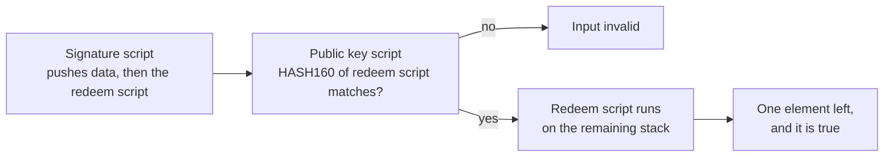

# Scripts for builders

This page is for developers who build multisignature wallets, time-locked or swap contracts, or their own signing code: how dcrd classifies scripts, the forms only Decred has, how to build and sign multisig and time locks with dcrwallet or Go, and which scripts relay. The normative rules are in [the whitepaper's script chapter](../../whitepaper/06-script.md#ch:script); this page says which of them matter when you build.

## What a script is

Every transaction output carries an amount, a 16-bit **script version** and a **public key script** that states how it may be spent. The input that spends it supplies a **signature script**. A node runs the signature script, then the public key script, on one stack machine. The input is valid if both finish without error and leave exactly one element, and that element is true. On Decred this "clean stack" rule is consensus, not only relay policy.

Pay-to-script-hash (P2SH) adds a third program. The public key script commits to the hash of a **redeem script**, which the spender reveals as the last push of the signature script:



The language descends from Bitcoin's but differs in many details; [What can go wrong](#what-can-go-wrong) lists those that break ported code. The engine is the Go module `github.com/decred/dcrd/txscript/v4` (dcrd 2.1.7 requires v4.1.2), with the subpackages `stdscript` (recognize and build standard scripts), `stdaddr` (addresses) and `sign`.

## Script versions

Only script version 0 is defined. The version field lets a future consensus change introduce a new script language for outputs that carry a new number. Until then, consensus does not execute scripts of other versions beyond a few construction checks, so such outputs are spendable by anyone. Since the `explicitverupgrades` agenda (Decred Change Proposal [DCP-0008](https://github.com/decred/dcps/blob/master/dcp-0008/dcp-0008.mediawiki)) activated at mainnet block 657,280, regular transactions can only create version 0 outputs, and relay policy rejects other versions.

So always set `TxOut.Version` to 0 (`ver, script := addr.PaymentScript()` returns it) and pass the version to every API that takes one. `stdscript` reports `STNonStandard` or false for other versions.

## Standard script types

`stdscript.DetermineScriptType` sorts version 0 scripts into 20 standard classes. The `String()` name of the result is what dcrd prints in `"type"` fields (`decodescript`, verbose `getrawtransaction`), except that verbose transaction output labels ticket commitments `sstxcommitment`.

| Class (`String()`) | `stdscript` constant | Public key script | Mainnet address |
|---|---|---|---|
| `pubkeyhash` | `STPubKeyHashEcdsaSecp256k1` | `OP_DUP OP_HASH160 <20-byte hash> OP_EQUALVERIFY OP_CHECKSIG` | `Ds…` |
| `pubkeyhash-ed25519` | `STPubKeyHashEd25519` | the same, ending `OP_1 OP_CHECKSIGALT` instead of `OP_CHECKSIG` | `De…` |
| `pubkeyhash-schnorr-secp256k1` | `STPubKeyHashSchnorrSecp256k1` | the same, ending `OP_2 OP_CHECKSIGALT` | `DS…` |
| `pubkey`, `pubkey-ed25519`, `pubkey-schnorr-secp256k1` | `STPubKeyEcdsaSecp256k1`, `STPubKeyEd25519`, `STPubKeySchnorrSecp256k1` | `<key> OP_CHECKSIG`, or `<key> OP_1`/`OP_2 OP_CHECKSIGALT` | `Dk…` |
| `scripthash` | `STScriptHash` | `OP_HASH160 <20-byte hash> OP_EQUAL`, exactly 23 bytes | `Dc…` |
| `multisig` | `STMultiSig` | `OP_m <n compressed keys> OP_n OP_CHECKMULTISIG`, 1 ≤ m ≤ n ≤ 16 | none |
| `nulldata` | `STNullData` | `OP_RETURN`, alone or with one canonical push of at most 256 bytes | none |
| `stakesubmission-`, `stakegen-`, `stakerevoke-`, `stakechange-` + `pubkeyhash` or `scripthash` | `STStakeSubmissionPubKeyHash` … `STStakeChangeScriptHash` (8 constants) | a stake tag byte, then a `pubkeyhash` or `scripthash` script | that of the inner script |
| `treasuryadd` | `STTreasuryAdd` | the single byte `OP_TADD` | none |
| `treasurygen-pubkeyhash`, `treasurygen-scripthash` | `STTreasuryGenPubKeyHash`, `STTreasuryGenScriptHash` | `OP_TGEN`, then a `pubkeyhash` or `scripthash` script | that of the inner script |

Everything else, including any script that fails to parse, is `nonstandard`. The byte templates are in the whitepaper's [Standard Script Classes](../../whitepaper/06-script.md#sec:script-standard), and other networks' prefixes on [Keys, addresses and seeds](keys-and-addresses.md).

```go
scriptType, addrs := stdscript.ExtractAddrs(txOut.Version, txOut.PkScript, chaincfg.MainNetParams())
switch scriptType {
case stdscript.STPubKeyHashEcdsaSecp256k1, stdscript.STScriptHash:
	// An ordinary payment to addrs[0].
case stdscript.STStakeGenPubKeyHash, stdscript.STStakeGenScriptHash,
	stdscript.STStakeRevocationPubKeyHash, stdscript.STStakeRevocationScriptHash:
	// A vote or revocation payout: same address, different spending rules.
case stdscript.STNonStandard:
	// Unknown form: credit it to no one.
}
```

`stdscript.DetermineRequiredSigs` counts the signatures a standard script needs. `txscript.DisasmString` prints any script's opcodes, and `dcrctl decodescript <HEX>` returns dcrd's view: type, required signatures, addresses and the script's own P2SH address.

## Stake and treasury tags

Stake and treasury outputs start with a one-byte **tag** followed by an ordinary pay-to-pubkey-hash (P2PKH) or P2SH script:

| Tag (byte) | Where it appears |
|---|---|
| `OP_SSTX` (0xba) | Ticket output 0, the voting rights |
| `OP_SSGEN` (0xbb) | Vote payouts |
| `OP_SSRTX` (0xbc) | Revocation payouts |
| `OP_SSTXCHANGE` (0xbd) | Ticket change and treasury add change |
| `OP_TADD` (0xc1) | Treasury add and treasurybase output 0, as the whole script |
| `OP_TGEN` (0xc3) | Treasury spend payouts |
| `OP_TSPEND` (0xc2) | The end of a treasury spend's signature script: `<64-byte Schnorr signature> <33-byte Politeia public key> OP_TSPEND` |

The engine executes a tag as a no-op and checks the rest as plain P2PKH or P2SH, and `ExtractAddrs` returns the inner address, so a wallet must not treat these outputs as ordinary coins. The tag carries rules the engine never sees: an `OP_SSTX` output can be spent only by a vote or a revocation, an `OP_TADD` output never, and the other tagged outputs only after a maturity of up to 256 blocks ([Staking and the treasury for builders](staking-and-treasury.md) has the table). All tagged outputs live in the stake tree, so an input spending one must set its outpoint's tree to 1 (`wire.TxTreeStake`), or it names an output that does not exist.

Regular transaction outputs and P2SH redeem scripts may not contain any tag (`ErrP2SHStakeOpCodes` for the latter); `txscript.ContainsStakeOpCodes(script, true)` makes the check. Tickets also accept only two address types: the `stdaddr.StakeAddress` interface is implemented only by `AddressPubKeyHashEcdsaSecp256k1V0` and `AddressScriptHashV0`.

## Alternative signature suites

`OP_CHECKSIG` and `OP_CHECKMULTISIG` verify Elliptic Curve Digital Signature Algorithm (ECDSA) signatures on secp256k1. Decred adds `OP_CHECKSIGALT` (0xbe) and `OP_CHECKSIGALTVERIFY` (0xbf), which take a signature type from the top of the stack:

| Type | Suite | Public key | Signature element |
|---|---|---|---|
| 1 | Ed25519 | 32 bytes | 64 bytes + 1 hash type byte |
| 2 | EC-Schnorr-DCRv0 on secp256k1 | 33 bytes, compressed | 64 bytes + 1 hash type byte |
| 0 | not allowed (ECDSA has its own opcodes) | | always false |
| other | reserved for future soft forks | | always true, and only the type is popped |

EC-Schnorr-DCRv0 is not BIP 340: its challenge hash (BLAKE-256), sign convention and key encoding differ, so Bitcoin Taproot code cannot produce these signatures. `sign.RawTxInSignature` and `sign.SignTxOutput` sign all three suites (`dcrec.STEcdsaSecp256k1`, `dcrec.STEd25519`, `dcrec.STSchnorrSecp256k1`).

Support elsewhere is thin: dcrwallet signs only with secp256k1 ECDSA keys, its `createrawtransaction` refuses `De…` and `DS…` addresses, and tickets and DCRDEX contracts cannot use them. Within the protocol, EC-Schnorr-DCRv0 signs treasury spends. Use the alternative suites only between parties whose software you control.

!!! warning "Unknown types succeed"
    `3 OP_CHECKSIGALT` is valid on an otherwise empty stack. Never let untrusted data choose the type in a script you build.

## Multisig with P2SH

Bare `multisig` outputs relay only with at most 3 keys and have no address, so use P2SH: the output is a `scripthash` script and the `multisig` script is the redeem script. Relay policy allows 15 signature operations in a redeem script, so 15-of-15 is the practical maximum.

Two differences from Bitcoin matter to signing code:

- `OP_CHECKMULTISIG` pops no extra element. Bitcoin's leading `OP_0` "dummy" fails the clean-stack rule. The signature script is `<sig_1> … <sig_m> <redeem script>`.
- Signatures must appear in key order, and every participant must list the keys in the same order, or the P2SH hash differs.

### With dcrwallet

Decrediton has no multisig screens; all of this is `dcrctl --wallet`.

1. **Collect public keys.** Each participant shares the `"pubkey"` (66 hex characters) that `dcrctl --wallet validateaddress <ADDRESS>` shows for an address in their wallet.

2. **Create the address in every participant's wallet**, with the same keys in the same order:

    ```bash
    dcrctl --wallet addmultisigaddress 2 '["<PUBKEY_1>","<PUBKEY_2>","<PUBKEY_3>"]'
    ```

    It returns the P2SH address (`Dc…` on mainnet), imports the redeem script into the `imported` account and watches the address from then on. `createmultisig` with the same arguments changes nothing and prints the address and redeem script:

    ```text title="Example output of createmultisig (testnet, publicly known keys)"
    {
      "address": "TcvALEAYZsT2PJqowebx2Yedhaza6cV8W5A",
      "redeemScript": "52210279be667ef9dcbbac55a06295ce870b07029bfcdb2dce28d959f2815b16f817982102f9308a019258c31049344f85f89d5229b531c845836f99b08601f113bce036f92103fff97bd5755eeea420453a14355235d382f6472f8568a18b2f057a146029755653ae"
    }
    ```

    The keys are the private keys 1, 3 and 6 of the whitepaper's 2-of-3 test vector.

3. **Fund the address** with an ordinary payment such as `dcrctl --wallet sendtoaddress <P2SH_ADDRESS> <AMOUNT>`. A wallet that ran `addmultisigaddress` after the funds arrived must rescan with `dcrctl --wallet rescanwallet <HEIGHT>`, where `<HEIGHT>` is a block height before the funding transaction (default 0). `importscript` does not help here: for a script the wallet already holds, it returns without rescanning. Avoid `sendtomultisig`, which always spends from the `default` account and defaults to 1 required signature.

4. **Build the spend.** `<TXID>` is the funding transaction and `<VOUT>` the index of its output to the P2SH address: decode the `hex` that `dcrctl --wallet gettransaction <TXID>` prints with `dcrctl decoderawtransaction` and take the `n` of the output whose `addresses` lists it. `dcrctl --wallet getmultisigoutinfo <TXID> <VOUT>` then shows the output's `amount`, `m`, `n` and whether it is spent. Create an unsigned transaction paying the amount minus the fee:

    ```bash
    dcrctl --wallet createrawtransaction '[{"txid":"<TXID>","vout":<VOUT>,"tree":0,"amount":<AMOUNT>}]' '{"<DESTINATION>":<AMOUNT_MINUS_FEE>}'
    ```

    `<AMOUNT>` is the output's value in DCR. The minimum relay fee is 0.0001 DCR per 1,000 bytes (10 atoms per byte). For an m-of-n spend with compressed keys and one P2PKH output, a safe size estimate is:

    | Part | Bytes |
    |---|---|
    | Redeem script | 3 + 34n |
    | Signature script | 74m + redeem script + 1 (2 if the redeem script exceeds 75 bytes, 3 if it exceeds 255 bytes, that is n of 8 or more) |
    | Input | 57 + signature script + 1 (3 if the signature script is 253 bytes or more) |
    | Transaction | 15 + input + 36 |

    For 2-of-3 that is 105, then 255, then 315, then 366 bytes: pay at least 3,660 atoms (0.0000366 DCR). The actual transaction is 360 to 364 bytes: low-S DER (Distinguished Encoding Rules) signatures are at most 71 bytes, at least one under the 72 allowed for, and with two 70-byte signatures the 251-byte signature script needs a 1-byte length prefix instead of 3, giving 360. Overpaying slightly is harmless; underpaying gets the transaction rejected.

5. **Sign in turn.** Each signer unlocks without typing the passphrase on the command line, signs, and passes the returned `"hex"` on:

    ```bash
    promptsecret | dcrctl --wallet walletpassphrase - 300
    dcrctl --wallet signrawtransaction <HEX>
    ```

    A light (SPV) wallet that has not recorded the funding transaction needs a second argument giving the output script: `'[{"txid":"<TXID>","vout":<VOUT>,"tree":0,"scriptPubKey":"<P2SH_SCRIPT>"}]'`, where `<P2SH_SCRIPT>` is that output's `scriptPubKey` `hex` in the decoded funding transaction. A wallet connected to dcrd looks the script up itself. Either way the wallet must already hold the redeem script from step 2; a `redeemScript` field is ignored unless private keys are also passed.

6. **Check, then broadcast.** `signrawtransaction` can report `"complete": true` while signatures are still missing, even from a locked wallet that added none. A wallet connected to dcrd always does this for multisig inputs, and a light wallet does when given the second argument. Never rely on `complete`: run `dcrctl decoderawtransaction <HEX>` and check that the input's `scriptSig` `asm` has m signatures before the redeem script. Then broadcast through dcrd with `dcrctl sendrawtransaction <HEX>`, which states the reason if it refuses; a light wallet only announces a transaction, and records it as unconfirmed even when peers reject it. A broadcast transaction cannot be reversed.

Rehearse on testnet first: add `--testnet` to every `dcrctl` command; addresses then start with `Tc`.

!!! warning "redeemmultisigout underpays at the default fee rate"
    In 2.1.7, `redeemmultisigout` (and `redeemmultisigouts`, which calls it) sizes its fee at the wallet's fee rate for a 110-byte single-key signature script ([`RedeemP2SHSigScriptSize`](https://github.com/decred/dcrwallet/blob/release-v2.1.7/wallet/txsizes/size.go)), an estimate of 219 bytes with one P2PKH output. At the default rate of 0.0001 DCR/kB, the same as `dcrd`'s default `minrelaytxfee`, it pays 2,190 atoms, while any spend from an address with two or more keys is larger (2-of-3: 360 to 364 bytes, at least 3,600 atoms), so `dcrd` rejects it for paying less than the minimum fee, a relay policy rule ([dcrwallet issue 2273](https://github.com/decred/dcrwallet/issues/2273), open). Raising the fee afterwards invalidates the signature it added. Raising the wallet rate first with `settxfee` (0.0002 DCR/kB covers 2-of-3) avoids the rejection, but applies to every transaction the wallet makes until it restarts or the rate is set back, and its `complete` flag misleads as in step 6. Use `createrawtransaction` as above.

!!! danger "Back up the redeem script"
    A seed restores its owner's key, not the multisig address. Without the redeem script, or all public keys in the right order, no one can build a valid spend, and if more than n − m keys are lost the coins are gone. Keep the redeem script with every seed backup and test a spend before depositing large amounts.

### With stdscript and sign

In Go, build the redeem script, derive the address, and let each signer call `sign.SignTxOutput`, which merges its signature with those already in the input. Condensed, without error handling, from a program run against the dcrd 2.1.7 sources:

```go
params := chaincfg.TestNet3Params()

// Redeem script (compressed keys only) and P2SH address.
redeemScript, _ := stdscript.MultiSigScriptV0(2, pubKey1, pubKey3, pubKey6)
p2shAddr, _ := stdaddr.NewAddressScriptHashV0(redeemScript, params)
pkScriptVer, pkScript := p2shAddr.PaymentScript() // 0, a914…87

// Spend fundHash:0 (1 DCR at p2shAddr) to a P2PKH destination.
tx := wire.NewMsgTx()
tx.AddTxIn(wire.NewTxIn(wire.NewOutPoint(&fundHash, 0, wire.TxTreeRegular), 1e8, nil))
tx.AddTxOut(&wire.TxOut{Value: 1e8 - 3660, Version: destVer, PkScript: destScript})

// Each signer: keysOf(priv) is a sign.KeyClosure that returns priv for the
// address of its own public key and an error for every other key.
scripts := sign.ScriptClosure(func(stdaddr.Address) ([]byte, error) { return redeemScript, nil })
for _, priv := range [][]byte{privKey1, privKey6} {
	tx.TxIn[0].SignatureScript, _ = sign.SignTxOutput(params, tx, 0, pkScript,
		txscript.SigHashAll, keysOf(priv), scripts, tx.TxIn[0].SignatureScript, true)
}

// Verify with dcrd's relay flags (see "Testing on simnet").
flags := txscript.ScriptDiscourageUpgradableNops | txscript.ScriptVerifyCleanStack |
	txscript.ScriptVerifyCheckLockTimeVerify | txscript.ScriptVerifyCheckSequenceVerify |
	txscript.ScriptVerifySHA256 | txscript.ScriptVerifyTreasury
vm, err := txscript.NewEngine(pkScript, tx, 0, flags, pkScriptVer, nil)
if err == nil {
	err = vm.Execute()
}
```

With one signature, `Execute` fails with `ErrInvalidStackOperation` (too few signatures for `OP_CHECKMULTISIG`). With two, it returns nil, the signature script is 251 bytes, and `txscript.GetPreciseSigOpCount(sigScript, pkScript, true)` is 3. The last argument of `SignTxOutput` says the treasury agenda is active, as it has been on mainnet since block 552,448.

`SignTxOutput` refuses redeem scripts that `stdscript` does not recognize ("can't sign unknown transactions"), such as the time locks below. For those, `sign.RawTxInSignature(tx, idx, redeemScript, hashType, privKey, dcrec.STEcdsaSecp256k1)` returns a signature with the hash type appended, and you assemble the signature script with `txscript.NewScriptBuilder`. dcrwallet's `createsignature` RPC does the same with a wallet key when you pass the redeem script as `previouspkscript`.

## Time locks: CLTV and CSV

Both of Bitcoin's lock-time opcodes exist. Each compares its operand with a field of the spending transaction and fails the script if the field is too small. Neither pops its operand, so scripts follow them with `OP_DROP`.

| | `OP_CHECKLOCKTIMEVERIFY` (CLTV, 0xb1) | `OP_CHECKSEQUENCEVERIFY` (CSV, 0xb2) |
|---|---|---|
| Lock | absolute: a block height, or a Unix time if 500,000,000 or more | relative to the block that mined the spent output: blocks, or units of 512 seconds |
| Checked against | the transaction's `LockTime` | the input's `Sequence` |
| Spender must set | `LockTime` ≥ the operand, of the same kind, and the input's sequence below 0xffffffff | transaction version 2 or higher; sequence bit 31 clear, the operand's type bit (bit 22, set for time) and a low 16-bit value at least as large |
| Maximum | 2<sup>32</sup> − 1 | 65,535 blocks (about 228 days) or 65,535 × 512 seconds (about 388 days) |
| Active on mainnet | since the genesis block | since block 189,568 (`lnfeatures`, [DCP-0003](https://github.com/decred/dcps/blob/master/dcp-0003/dcp-0003.mediawiki)) |

Consensus enforces the fields themselves. A transaction cannot be mined before its `LockTime` unless every input has sequence 0xffffffff; time-based values are compared with the median timestamp of the previous 11 blocks, which trails the clock by about six blocks (about 30 minutes). In version 2 and later transactions, an input whose sequence has bit 31 clear cannot be mined before its relative lock expires. The whitepaper specifies both in [Lock-Time Opcodes](../../whitepaper/06-script.md#sec:script-op-locktime) and [Relative Lock Times](../../whitepaper/07-transactions.md#sec:transactions-seqlocks).

A relative timeout as a redeem script: key A can spend at any time, key B only 144 blocks (about 12 hours) after the output is mined.

```text
OP_IF
    <pubkey A> OP_CHECKSIG
OP_ELSE
    144 OP_CHECKSEQUENCEVERIFY OP_DROP
    <pubkey B> OP_CHECKSIG
OP_ENDIF
```

A spends with `<sig A> OP_1 <redeem script>`. B spends with `<sig B> OP_0 <redeem script>` in a version 2 transaction with input sequence 144 or more; in the engine, version 1, sequence 143 or sequence 0xffffffff all fail. dcrwallet's `createrawtransaction` builds only version 1 transactions, so CSV spends need your own transaction code.

### Example: The DCRDEX swap contract

DCRDEX atomic swaps use a hash time-locked contract (HTLC) in P2SH, built by `MakeContract` in [`dex/networks/dcr/script.go`](https://github.com/decred/dcrdex/blob/v1.0.6/dex/networks/dcr/script.go) (Bison Wallet 1.0.6). It is always 97 bytes:

```text
OP_IF
    OP_SIZE 32 OP_EQUALVERIFY
    OP_SHA256 <32-byte secret hash> OP_EQUALVERIFY
    OP_DUP OP_HASH160 <recipient's 20-byte pubkey hash>
OP_ELSE
    <4-byte Unix lock time> OP_CHECKLOCKTIMEVERIFY OP_DROP
    OP_DUP OP_HASH160 <sender's 20-byte pubkey hash>
OP_ENDIF
OP_EQUALVERIFY OP_CHECKSIG
```

- **Redeem:** `<sig> <pubkey> <secret> OP_1 <contract>`. Publishing the secret lets the counterparty claim the other side of the swap.
- **Refund:** after the lock time, `<sig> <pubkey> OP_0 <contract>`, in a transaction whose `LockTime` equals the contract's and whose input sequence is 0xfffffffe so that the lock time applies.
- On mainnet the maker's contract locks for 20 hours and the taker's for 8 (`dex/asset.go`).
- The hash lock is `OP_SHA256` (0xc0), so one secret hash serves both chains of a swap.

dcrd recognizes the template (`stdscript.ExtractAtomicSwapDataPushesV0`) but it is not a standard output class, hence the P2SH wrapper. DCRDEX fidelity bonds use the refund branch alone, `<lock time> OP_CHECKLOCKTIMEVERIFY OP_DROP OP_DUP OP_HASH160 <pubkey hash> OP_EQUALVERIFY OP_CHECKSIG`, also in P2SH. [Building on DCRDEX](../integrate/dcrdex.md) covers the protocol.

## Signatures and the signature hash

A signature element is a signature plus one **hash type** byte with Bitcoin's values (`SigHashAll` 0x01, `SigHashNone` 0x02, `SigHashSingle` 0x03, each optionally with `SigHashAnyOneCanPay` 0x80); no other byte is valid. What is signed differs:

- The signature hash is BLAKE-256 over the hash type and two BLAKE-256 hashes: one of the selected prefix (outpoints, sequences, outputs, lock time, expiry), one of the subscript. For `SigHashAll` without `SigHashAnyOneCanPay`, the prefix hash is the transaction ID, which `txscript.CalcSignatureHash` accepts as a cached value.
- **The spent amount is not signed.** Hardware and offline signers must check input values against the previous transactions.
- `SigHashSingle` with no output at the input's index has no hash: `OP_CHECKSIG` returns false and `OP_CHECKMULTISIG` fails. Bitcoin's "sign the number 1" case does not exist.
- `OP_CODESEPARATOR` is disabled, so the subscript is always the whole current script.
- Strict DER, low S and strict public key encodings are consensus rules.

The serialization, with intermediate values for every hash type, is in [Signature Hash](../../whitepaper/06-script.md#sec:script-sighash) and [Test Vectors](../../whitepaper/06-script.md#sec:script-vectors). Check a new signer against those vectors first.

## What can go wrong

Most failures come from porting Bitcoin scripts byte for byte:

- **Hashes differ.** `OP_HASH160` is RIPEMD-160 of BLAKE-256 and `OP_HASH256` is double BLAKE-256, so a key's Bitcoin hash is not its Decred hash.
- **Opcodes differ.** 0xa8 is `OP_BLAKE256` (Bitcoin's `OP_SHA256`); Decred's `OP_SHA256` is 0xc0. `OP_CAT`, `OP_SUBSTR`, the bitwise and multiplication opcodes work; `OP_2MUL` and `OP_2DIV` do nothing. See the [Opcode Reference](../../whitepaper/A-opcodes.md#ch:opcodes).
- **No multisig dummy**, as above.
- **Pushes must be minimal**, numbers included: 144 is `02 90 00`, and 1 to 16 only `OP_1` to `OP_16`. `txscript.ScriptBuilder` handles this.
- **The redeem script is the last push's data.** A P2SH signature script ending in `OP_1` instead of `OP_DATA_1 0x51` fails.

The rest is about keys and time. Nothing can unlock a CLTV or CSV lock early, and a mistyped value can lock funds for years. Lose a redeem script and its outputs are unspendable: nothing on chain reveals it until the first spend.

## Standardness: Which scripts relay

Consensus accepts any script that ends true; dcrd's mainnet relay policy, which its block templates follow, is narrower. Its transaction-level limits (size, fee, dust) are on [Transactions for builders](transactions.md). The limits on scripts:

- Each signature script is at most 1,650 bytes and push-only.
- Each output has script version 0 and a standard class; bare `multisig` only with 1 to 3 keys.
- A null data output carries at most 256 bytes, and a regular transaction has at most 4 of them.
- Each spent output has a standard class; a `scripthash` redeem script has at most 15 signature operations, and a transaction at most 1,000 in all.

The redeem script need not be a standard class: spending a P2SH output is checked only for size, push-only data and signature operations, so custom contracts relay inside those limits. These are policy, not consensus, and can change between releases. The full list is in the whitepaper's [Standard Transactions](../../whitepaper/17-policy.md#sec:policy-standard).

## Testing on simnet

Simnet, testnet and regnet relay non-standard transactions by default, so a script that works there may still be refused on mainnet. Run dcrd with `--rejectnonstd` to apply mainnet policy. [Set up a private simnet](../environment/simnet.md) gives you a network on which every agenda, `lnfeatures` and `treasury` included, is active from the start.

Without a network, run the script through `txscript.NewEngine(pkScript, tx, idx, flags, scriptVersion, nil)` and `Execute`. The flags decide the result:

| Flag | Consensus | dcrd relay |
|---|---|---|
| `ScriptVerifyCleanStack` | always | always |
| `ScriptVerifyCheckLockTimeVerify` | always | always |
| `ScriptVerifyCheckSequenceVerify` | when `lnfeatures` is active | always |
| `ScriptVerifySHA256` | when `lnfeatures` is active | when `lnfeatures` is active |
| `ScriptVerifyTreasury` | when `treasury` is active | when `treasury` is active |
| `ScriptDiscourageUpgradableNops` | never | always: an executed unused NOP or unknown opcode fails |
| `ScriptVerifySigPushOnly` | never | never (push-only is checked separately) |

Both agendas are active on mainnet, so test with every flag except `ScriptVerifySigPushOnly`, as in the Go example. dcrd's `txscript/testdata` (`script_tests.json`, `tx_valid.json`, `tx_invalid.json`, `sighash.json`) is good regression data for an independent implementation.

## Go deeper

- [The Script System](../../whitepaper/06-script.md#ch:script): the normative engine, from parsing to every opcode and error kind.
- [Standard Script Classes](../../whitepaper/06-script.md#sec:script-standard): the exact templates `stdscript` matches.
- [Address Types](../../whitepaper/05-addresses.md#sec:addresses-types): how each script class maps to an address.
- [Relative Lock Times](../../whitepaper/07-transactions.md#sec:transactions-seqlocks): sequence-lock encoding and enforcement, with vectors.

## Next steps

- [Build and sign transactions in Go](../go/build-and-sign-transactions.md): fund, size, sign and broadcast a complete transaction.
- [Transactions for builders](transactions.md): transaction types, serialization, fees and expiry.
- [Keys, addresses and seeds](keys-and-addresses.md): address encodings and prefixes on every network.
- [Set up a private simnet](../environment/simnet.md): a local network for testing contracts.
- [dcrwallet JSON-RPC API](../api/dcrwallet-json-rpc.md): parameters of every wallet method used here.

*[CLTV]: OP_CHECKLOCKTIMEVERIFY
*[CSV]: OP_CHECKSEQUENCEVERIFY
*[DCP]: Decred Change Proposal
*[DER]: Distinguished Encoding Rules
*[ECDSA]: Elliptic Curve Digital Signature Algorithm
*[HTLC]: hash time-locked contract
*[P2PKH]: pay-to-pubkey-hash
*[P2SH]: pay-to-script-hash
*[SPV]: simplified payment verification
