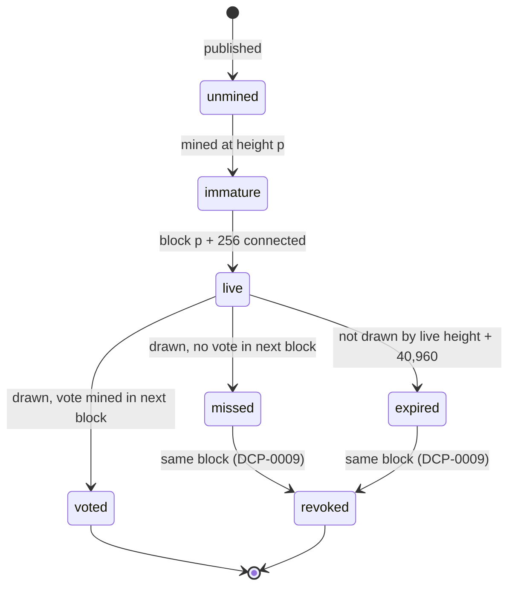
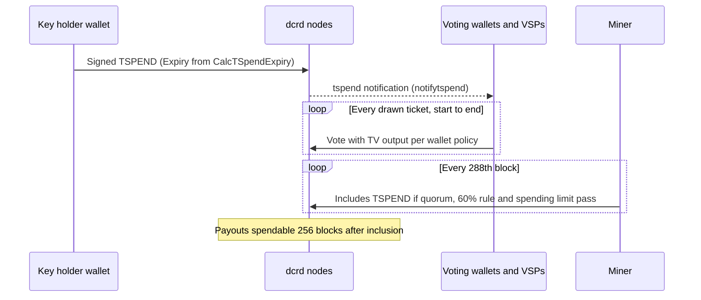

# Staking and the treasury for builders

This page is for developers whose software must recognize, build or follow Decred's stake and treasury transactions: wallets, explorers, voting service provider (VSP) clients, indexers and monitoring tools. It covers the transaction layouts, ticket states, ticket price prediction, the path of a treasury spend from signature to block, and the dcrd and dcrwallet 2.1.7 remote procedure calls (RPCs) for each. The whitepaper holds the normative rules; this page picks out the ones that matter in practice and links to them.

!!! abstract "The short version"
    - Six transaction types live in the **stake tree**, and nothing else may: ticket, vote, revocation, treasurybase, treasury add (TADD) and treasury spend (TSPEND). Classify with `stake.DetermineTxType`, never by guessing from outputs.
    - A ticket's output 0 holds the voting right; its odd outputs are `OP_RETURN` **commitments** that fix, at purchase time, where the price and reward go. Votes and revocations must pay exactly those commitments.
    - Since Decred Change Proposal DCP-0009 (block 657,280) miners revoke every missed or expired ticket in the same block. Wallets never build revocations.
    - A treasury spend is valid only in a block whose height is a multiple of 288, inside the window encoded in its `Expiry`, with enough ticket votes, and within the DCP-0013 spending limit.

## The stake transaction types

The type of a transaction is a pure function of its own bytes: no chain context, agenda state or tree position is involved. The whitepaper's [classification rule](../../whitepaper/08-staking.md#sec:staking-classification) tests ticket, vote and revocation first, then the three treasury types for transactions of version 3. In Go, `DetermineTxType` in `github.com/decred/dcrd/blockchain/stake/v5` implements it.

| Type | dcrd name (`stake.TxType`) | Created by | Version | Per block |
|---|---|---|---|---|
| Ticket purchase | SStx (`TxTypeSStx`) | Anyone | 0 to 3 (dcrwallet writes 1) | at most 20 |
| Vote | SSGen (`TxTypeSSGen`) | Holder of a winning ticket's voting key | 0 to 3; exactly 3 with a treasury vote output (dcrwallet writes 1, or 3 with treasury votes) | 3 to 5 from height 4,096 |
| Revocation | SSRtx (`TxTypeSSRtx`) | The miner, since DCP-0009 | 2 | at most 255 |
| Treasurybase | `TxTypeTreasuryBase` | The miner | 3 | exactly 1, first in the stake tree |
| Treasury add (TADD) | `TxTypeTAdd` | Anyone | 3 | at most 20 |
| Treasury spend (TSPEND) | `TxTypeTSpend` | Holder of a Politeia key | 3 | only at heights that are multiples of 288 |

Every non-`OP_RETURN` output of a ticket, vote, revocation or TSPEND, and the change output of a TADD, is a P2PKH or P2SH script prefixed with a one-byte **stake tag**: `OP_SSTX` (0xba) on ticket output 0, `OP_SSGEN` (0xbb) on vote payments, `OP_SSRTX` (0xbc) on revocation payments, `OP_SSTXCHANGE` (0xbd) on ticket and TADD change, and `OP_TGEN` (0xc3) on treasury spend payouts. The only other non-`OP_RETURN` outputs, output 0 of a treasurybase and of a TADD, are the bare one-byte script `c1` (`OP_TADD`) and pay no address. Address decoders must strip the tag; [Scripts for builders](scripts.md) covers the script forms. Regular transactions may not create tagged outputs.

## Tickets

### Layout

A ticket with *n* inputs (1 to 64) has exactly 2*n* + 1 outputs:

| Position | Content |
|---|---|
| Input *i* | Any P2PKH or P2SH output, or a vote, revocation or ticket-change output. Never a ticket output 0 or a treasury output. |
| Output 0 | The ticket price, `OP_SSTX`-tagged. Whoever can satisfy this script votes with the ticket. |
| Output 2*i* + 1 | Commitment for input *i*: `OP_RETURN` push of at least 30 bytes, value normally 0. |
| Output 2*i* + 2 | Change for input *i*, `OP_SSTXCHANGE`-tagged. The value may be zero. |

The 30-byte commitment payload is a 20-byte hash, an 8-byte little-endian amount whose top bit flags the hash as P2SH, and a 2-byte fee-limit field. For each input, committed amount plus change must equal the input's value exactly. Output 0 must be at least the block header's `SBits` (the stake difficulty) and at least the 2 DCR minimum; a ticket may pay more. The whitepaper's [ticket purchase transactions](../../whitepaper/08-staking.md#sec:staking-ticket) section gives every field and a test vector.

The commitments are what make VSPs non-custodial: the voting key in output 0 can be handed to someone else, but the payout destinations and amounts were fixed when the ticket was mined.

### What dcrwallet builds

`dcrwallet` 2.1.7 always buys through a **split transaction**: a regular transaction (or, with mixing, a StakeShuffle mix) that creates one output per ticket sized to exactly the ticket price plus the ticket's own fee. Each ticket then spends one split output, so every wallet-built ticket has one input and three outputs (`makeTicket` in `wallet/createtx.go`).

Worked example, with an example ticket price of 200 DCR and the default relay fee of 0.0001 DCR/kB:

| Item | Value |
|---|---|
| Estimated ticket size | 298 bytes (one P2PKH input; 26-, 32- and 26-byte output scripts) |
| Ticket fee | 298 × 10,000 / 1,000 = 2,980 atoms |
| Split output, and so input 0 | 20,000,002,980 atoms |
| Output 0 | 20,000,000,000 atoms, `OP_SSTX` P2PKH to a voting address (internal branch of the voting account) |
| Output 1 | `6a 1e <hash> a4d317a804000000 004e`: commitment of 20,000,002,980 atoms to a reward address, fee limits 0x4e00 |
| Output 2 | 0 atoms, `OP_SSTXCHANGE` P2PKH to the all-zero hash |

The fee-limit field 0x4e00 sets the revocation flag (0x4000) with exponent 14, allowing up to 2^14 atoms of revocation fee, and leaves the vote flag clear, so votes must pay the commitment exactly. After DCP-0009 the revocation limit is ignored, because revocations pay no fee.

!!! tip "Pin a ticket to its price window"
    The stake difficulty changes at every height that is a multiple of 144. dcrd's mempool drops tickets priced below the next block's stake difficulty, and `dcrwallet` drops its own unmined tickets whose price no longer matches. Its ticket buyer sets the ticket's `Expiry` to the next retarget height, so a ticket can never be mined in a later window. Do the same in your own purchase code.

## Votes

A vote spends a winning ticket. Its layout is fixed:

| Position | Content |
|---|---|
| Input 0 (stakebase) | Null outpoint; `ValueIn` is the vote subsidy; signature script equals the network's `StakeBaseSigScript` (`0000` on mainnet) |
| Input 1 | Ticket output 0 (index 0, stake tree), signed by the voting key |
| Output 0 | Block reference: `6a 24`, the 32-byte hash of the block voted on (internal byte order), its height as a little-endian `uint32` |
| Output 1 | Vote bits: `6a`, a push of 2 to 75 bytes starting with the little-endian `uint16` vote bits, then optionally the `uint32` vote version |
| Outputs 2 … *n* + 1 | One `OP_SSGEN` payment per commitment, in commitment order, to the committed hash |
| Last output, optional | Treasury votes (below); requires transaction version 3 |

Bit 0 of the vote bits approves (1) or disapproves (0) the regular tree of the block voted on; bits 1 to 15 carry consensus rule choices, interpreted by the [rule-change voting rules](../../whitepaper/13-voting.md#ch:voting). A vote in block *h* must reference block *h* − 1. [Blocks, confirmations and reorganizations](blocks-and-confirmations.md) explains what disapproval does to transactions.

**Payments.** The total returned is the ticket price plus the vote subsidy, split among the commitments in proportion to their committed amounts and rounded down; the remainder of at most *n* − 1 atoms becomes fee. `stake.CalculateRewards` computes it. Each vote's subsidy is 89% of the block subsidy at the height of the block voted on, divided by 5 (DCP-0012); `dcrctl getblocksubsidy <HEIGHT> 5` returns `pos`, the total for the five votes included in block `<HEIGHT>`, in atoms. Continuing the example with an example vote subsidy of 0.5 DCR: one commitment receives 200.5 DCR exactly. The 2,980-atom ticket fee is not refunded.

**Treasury votes.** The optional last output is `6a`, a push, the two ASCII bytes `TV`, then 1 to 7 entries of a 32-byte TSPEND hash (internal byte order) and one byte, `0x01` for yes or `0x02` for no. Abstaining means leaving the spend out. One yes vote is 37 bytes: `6a 23 5456 <hash> 01`. Pitfalls that make the whole transaction a non-vote, and the block containing it invalid: a byte other than 1 or 2, a repeated hash, more than 7 entries, or version other than 3. A ticket with 64 commitments has no room for this output (66 outputs maximum). The whitepaper's [treasury vote output](../../whitepaper/12-treasury.md#sec:treasury-vote-output) section has the parser.

## Revocations

A revocation returns the ticket price to the commitments of a missed or expired ticket: one input (the ticket's output 0) and one `OP_SSRTX` payment per commitment. Since the `autorevocations` agenda ([DCP-0009](https://github.com/decred/dcps/blob/master/dcp-0009/dcp-0009.mediawiki)) activated at block 657,280, a revocation must be version 2, carry an empty signature script and pay exactly zero fee; the rounding remainder is handed out one atom at a time by the lottery's generator, seeded with the parent block's header. Its content is therefore fully determined, and every block must revoke each ticket that becomes missed or expires in it. dcrd's template generator builds them (`stake.CreateRevocationFromTicket`).

For builders this means: do not build or relay revocations. dcrd discards every revocation from its mempool at each new tip, and `dcrwallet` has no revocation RPC. Tickets missed before block 657,280 and never revoked can still be revoked by any later block. See the whitepaper's [revocation transactions](../../whitepaper/08-staking.md#sec:staking-revocation) section.

## When stake outputs can be spent

| Output | Maturity on mainnet | Rule |
|---|---|---|
| Ticket output 0 | Only a vote or revocation may spend it | consensus |
| Ticket change (`OP_SSTXCHANGE`) | 1 block; 256 if the ticket has a nonzero `Expiry` | consensus |
| Vote and revocation payments | 256 blocks (about 21 hours) since the `treasury` agenda | consensus |
| Treasury spend payouts (`OP_TGEN`) | 256 blocks | consensus |

Show stake outputs as immature until then. [Transactions for builders](transactions.md) covers maturity and expiry for all transaction types.

## The lottery and ticket states

After every block *N* from height 4,095, each node draws 5 winners from the live pool using a BLAKE-256 based generator seeded with the 180-byte serialized header of block *N* (not its hash), over the live tickets sorted by hash in internal byte order. The winners may vote on *N* in block *N* + 1. A 6-byte digest of the draw, `FinalState`, and the pool size, `PoolSize`, are committed in the header of block *N* + 1. The whitepaper's [lottery](../../whitepaper/08-staking.md#sec:staking-lottery) section specifies the generator with test vectors.

The diagram shows the states a ticket passes through, with the same names wallets report.



Edge rules that trip up implementations:

- **Stake enabled height (512 on mainnet)** is the first height at which tickets become live; **stake validation height (4,096)** is the first block that must contain at least 3 votes. The first winners are drawn on block 4,095. The [early heights](../../whitepaper/08-staking.md#sec:staking-early) section has the details.
- A ticket's **live height** is *p* + 256, and it expires while block live height + 40,960 is connected unless it was drawn for that block.
- `dcrwallet` reports a revoked ticket as `missed` or `expired`, decided by whether the revocation came at least 40,960 + 256 blocks after the ticket was mined. The status `revoked` is deprecated. In light (SPV) mode the wallet cannot see the lottery and reports mature unspent tickets as `unspent`.
- `dcrwallet` reports a ticket as `live` one block later than dcrd adds it to the pool: from tip height *p* + 257, not *p* + 256.

Stake parameters differ by network, which matters when you test on simnet:

| Parameter (chaincfg) | mainnet | testnet3 | simnet | regnet |
|---|---|---|---|---|
| `TicketPoolSize` | 8192 | 1024 | 64 | 64 |
| `TicketMaturity` (blocks) | 256 | 16 | 16 | 16 |
| `TicketExpiry` (blocks) | 40960 | 6144 | 384 | 384 |
| `CoinbaseMaturity` (blocks) | 256 | 16 | 16 | 16 |
| `StakeDiffWindowSize` (blocks) | 144 | 144 | 8 | 8 |
| `StakeEnabledHeight` | 512 | 32 | 32 | 32 |
| `StakeValidationHeight` | 4096 | 768 | 144 | 144 |
| `MinimumStakeDiff` (atoms) | 200000000 | 20000000 | 20000 | 20000 |
| `TreasuryVoteInterval` (blocks) | 288 | 60 | 48 | 4 |
| `TreasuryVoteIntervalMultiplier` | 12 | 4 | 3 | 3 |
| `TreasuryExpenditureWindow` | 2 | 4 | 4 | 4 |

## Predicting the ticket price

Since `sdiffalgorithm` (DCP-0001), the price is recomputed at every height that is a multiple of 144. It compares the pool size including immature tickets with its value at the previous retarget and with the target of 42,240 (5 × (8192 + 256)), then clamps the result between 2 DCR and an estimate of the supply divided by 8192. [Ticket price, rewards and costs](../../user/staking/ticket-price-and-rewards.md) explains it in plain terms; the whitepaper's [stake difficulty version 2](../../whitepaper/09-difficulty.md#sec:difficulty-sdiff-v2) section is normative.

In dcrd, `getstakedifficulty` returns `current` (the tip's `SBits`) and `next` (what the next block must carry; they differ only before a retarget block). `estimatestakediff [<TICKETS>]` estimates the next retarget, assuming 5 votes per remaining block: `min` with no further purchases this window, `max` with 20 per remaining block, `expected` at the window's purchase rate so far, and `user` with `<TICKETS>` more purchases in total. `ticketvwap` averages header `SBits` over the ticket purchases in a height range. The estimate becomes exact only when the window's last block is mined, so show `min` and `max` as a range rather than a promise.

## Querying stake data

dcrd serves the live pool through `existsliveticket`, `existslivetickets`, `livetickets`, `ticketsforaddress` and `getticketpoolvalue`, and announces each block's winners and newly live tickets through the websocket notifications `notifywinningtickets` and `notifynewtickets`. dcrwallet reports its own tickets through `getstakeinfo`, `gettickets` and `ticketinfo`. The [dcrd JSON-RPC API](../api/dcrd-json-rpc.md) and [dcrwallet JSON-RPC API](../api/dcrwallet-json-rpc.md) pages document them all. Three behaviors are commonly misread:

- `existslivetickets` returns a hex bitset, one bit per hash in request order, not a list.
- `ticketsforaddress` matches only the voting address in output 0 of live tickets, never commitment addresses.
- `gettickets <INCLUDEIMMATURE>` returns the wallet's live tickets, checked against dcrd with `existslivetickets`; `true` adds immature (and unmined) ones. A light wallet cannot tell which mature tickets are live, so it returns no mature tickets at all: only the immature ones, and only with `true`. Its `getstakeinfo` likewise omits `live`, `missed`, `expired`, `allmempooltix` and the proportions.

For history across the whole chain without your own index, [the dcrdata API](../api/dcrdata-api.md) serves ticket pool and treasury data.

## Buying tickets through dcrwallet

`dcrctl --wallet purchaseticket <ACCOUNT> [<MINCONF>] [<NUMTICKETS>] [<EXPIRY>] [<COMMENT>] [<DONTSIGNTX>]` runs the whole purchase. What it does, in order:

1. **Reserve funds.** With `vsp.url` set it first reserves, per ticket, coins for the VSP fee. It estimates the fee with the function `vspd` uses to charge it, `txrules.StakePoolTicketFee`: fee% × S′ × (P + z) / (S′ + P), where P is the ticket price, S′ the current vote subsidy reduced by two subsidy reduction steps, and z a transaction fee (`vspd` uses 0.0001 DCR).
2. **Split.** It publishes the split transaction. With `mixing=1`, the split outputs come from a StakeShuffle mix into `ticketsplitaccount` (default: the mixed account), and the call returns only when the mix completes; tickets are then published at random delays of 20 to 60 seconds. [Mixing for builders](mixing.md) covers the mix itself.
3. **Build tickets** as above. `purchaseticket` takes voting and reward addresses from the purchase account, or from `mixedaccount` when mixing; the ticket buyer takes voting addresses from `ticketbuyer.votingaccount`.
4. **Pay the VSP.** For each ticket the VSP client calls `/api/v3/feeaddress`, refuses a fee above `vsp.maxfee` (wallet default 0.2 DCR), then sends a separate fee transaction, the voting key and the vote choices to `/api/v3/payfee`. The [vspd API](../api/vspd-api.md) page documents the signed request flow.

Passing `true` for `<DONTSIGNTX>` returns the unsigned split transaction and tickets instead, for watching-only setups. The user how-to [Stake with dcrwallet](../../user/staking/stake-with-dcrwallet.md) gives the configuration; [dcrwallet configuration](../reference/dcrwallet-config.md) lists every option.

## Treasury transactions

The treasury is an account, not a set of outputs: every full node computes its balance from the chain, and each block's credits and debits count only 256 blocks later. All three treasury transaction types are version 3 and live in the stake tree, so a disapproval vote never undoes them. [The treasury](../../user/governance/treasury.md) explains the system for users.

**Treasurybase.** One per block, first in the stake tree: a null-outpoint input whose `ValueIn` is the treasury subsidy (10% of the block subsidy, not reduced for missing votes), output 0 with the one-byte script `c1` (`OP_TADD`) and that value, and output 1 `6a 0c` followed by the block height (`uint32` LE) and 8 arbitrary bytes. It creates no spendable outputs.

**Treasury add (TADD).** Ordinary inputs; output 0 is the amount credited, with script exactly `c1`; an optional output 1 is nonzero `OP_SSTXCHANGE` change. Output 0 is never spendable. `dcrctl --wallet sendtotreasury <AMOUNT>` builds one from the default account. It cannot be undone.

**Treasury spend (TSPEND).**

| Field | Content |
|---|---|
| Input 0 | Null outpoint, null fraud proof, `Sequence` with bit 31 set (dcrwallet writes 0xffffffff), `ValueIn` = payouts + fee |
| Signature script | Exactly 100 bytes: `40` + 64-byte Schnorr signature + `21` + 33-byte compressed Politeia key + `c2` (`OP_TSPEND`) |
| Output 0 | `6a 20` + `ValueIn` as 8-byte LE + 24 random bytes |
| Outputs 1 … *n* | `OP_TGEN`-tagged P2PKH or P2SH payouts |
| `Expiry` | Encodes the voting window (next section) |

The key must be one of the two `PiKeys` in chaincfg (mainnet `03f6e704…a946c` and `0319a374…86dd`). The signature covers every output and the expiry, so key holders fix the amount, recipients and window, and voters vote on exactly that. Adding or replacing a key requires a consensus rule change. `sendfromtreasury` and the `cmd/treasurykey` tool in the dcrwallet repository exist for the key holders only. The whitepaper's [treasury spend](../../whitepaper/12-treasury.md#sec:treasury-tspend) section has a signed simnet vector.

## The life of a treasury spend

A treasury spend has no explicit start or end height. Its window is derived from `Expiry`, which must equal a multiple of the treasury vote interval (TVI, 288 on mainnet) plus 2:

- `end = Expiry − 2`, `start = end − 3,456` (TVI × 12).
- Votes in blocks `start` through H − 1 count for inclusion in block H.
- Inclusion is allowed only in blocks H at a multiple of 288 with start ≤ H ≤ end; at H = start no votes have been counted yet, so in practice never there.

The sequence below follows one spend from signing to payout.



**Worked example: the spend mined at block 1,130,112.** Its `Expiry` is 1,130,690, so end = 1,130,688 (288 × 3,926) and start = 1,127,232. `dcrwallet` computes this expiry with `standalone.CalcTSpendExpiry` for any next-block height from 1,126,944 to 1,127,231: the earliest window starting after the next block. At block 1,130,112, 576 blocks before the end, the counted votes were 9,236 yes and 1,788 no:

| Check | Computation | Result |
|---|---|---|
| Quorum: 20% of the window's 17,280 possible votes | 9,236 + 1,788 = 11,024 ≥ 3,456 | pass |
| Votes still possible | (1,130,688 − 1,130,112) × 5 = 2,880 | |
| Yes votes required: 60% of cast plus still possible | ⌊(11,024 + 2,880) × 3 / 5⌋ = 8,342 | |
| Yes votes | 9,236 ≥ 8,342 | pass |

Because remaining votes count as potential no votes, a spend is included early only when its approval is certain; even with every ticket voting yes, the earliest inclusion is start + 2,304 blocks. A spend that never passes cannot be mined after `end`; there is no rejection transaction. The whitepaper's [tallying and approval](../../whitepaper/12-treasury.md#sec:treasury-tally) section is normative.

**Spending limit.** Even an approved spend is included only if the total of all treasury spends in the block passes the expenditure check. Since `maxtreasuryspend` ([DCP-0013](https://github.com/decred/dcps/blob/master/dcp-0013/dcp-0013.mediawiki), block 1,052,416) the allowance is max(4% of (balance + spends in the last 6,912 blocks), 1,078,127,767,296 atoms) − spends in those 6,912 blocks, clamped to the range from zero to the balance. The [DCP-0013 policy](../../whitepaper/12-treasury.md#sec:treasury-policy-dcp13) section has test vectors.

**Computing windows in Go.** Use the helpers in `github.com/decred/dcrd/blockchain/standalone/v2` rather than reimplementing them:

```go
expiry := standalone.CalcTSpendExpiry(nextHeight, 288, 12)
start, end, err := standalone.CalcTSpendWindow(expiry, 288, 12)
ok := standalone.InsideTSpendWindow(height, expiry, 288, 12)
```

`nextHeight` and `height` are `int64`; the interval and multiplier come from `chaincfg.Params.TreasuryVoteInterval` and `TreasuryVoteIntervalMultiplier`.

## Treasury RPCs

dcrd reports the mature balance as of a block with `gettreasurybalance` (with `verbose`, also that block's treasurybase, TADD and TSPEND amounts) and announces each spend entering its mempool with the websocket notification `notifytspend`. Its `gettreasuryspendvotes` returns, per spend, `expiry`, `votestart`, `voteend`, `yesvotes` and `novotes`, by default for the spends in the mempool. Read those counts with care:

- They run through the given block (default the tip), so they apply to inclusion in the next block.
- For a spend mined on the main chain at or before the given block, they run through the block before the one that mined it.
- Otherwise, a spend whose voting window does not contain the given block is returned with `yesvotes` and `novotes` of 0.

When `dcrwallet` votes, it adds a treasury vote for every spend it knows of (from `getrawmempool` at startup and `notifytspend` afterwards) whose window contains the voted block. Policies are `yes`, `no` or `abstain`, set per spend with `settspendpolicy` or per Politeia key with `settreasurypolicy`, each optionally for a single ticket. The wallet applies the first that exists among: per-ticket spend policy, spend policy, per-ticket key policy, key policy. The default is abstain. For tickets at a VSP, the wallet sends policies to `vspd` as `tspendpolicy` and `treasurypolicy` maps. [Vote with your tickets](../../user/governance/vote.md) shows the user side.

!!! warning "Spends must stay in the mempool to be voted on"
    Voting wallets only learn about spends from their node's mempool, and dcrd holds at most 7 at once. Code that broadcasts a spend should check `getrawmempool false tspend` on several nodes and rebroadcast if needed.

## Relay policy for stake and treasury transactions

These are dcrd mempool rules (policy, not consensus); a non-default node may differ. A TADD is handled like a regular transaction and pays the minimum relay fee; a treasurybase is never accepted on its own. The other types differ from regular transactions as follows; the whitepaper's [stake transaction policy](../../whitepaper/17-policy.md#sec:policy-stake) section has the full rules.

| Type | What differs |
|---|---|
| Ticket | Output 0 must be at least the next block's stake difficulty, and the ticket is dropped once it is not. A ticket spending an unconfirmed transaction waits in a stage pool until its parent is mined. |
| Vote | No fee required. Accepted only for a known block (side chains included) at most 256 blocks back, and only from one of that block's winners; dropped 10 blocks after acceptance. |
| Revocation | No fee required; one per ticket; since DCP-0009, discarded at every new tip. |
| TSPEND | Valid `Expiry`, a window starting fewer than 6,912 blocks after the next block, a known Politeia key and a valid signature; at most 7 in the pool. The relay fee is checked against its declared `ValueIn`. |

The mempool does not check a TSPEND's sequence lock, so it accepts a spend whose `Sequence` lacks bit 31 although no block may contain it. Set `Sequence` to 0xffffffff.

## What can go wrong

- **Tickets cannot be cancelled.** Once mined, the price is locked until vote or revocation; at the target pool size about 0.7% (fewer than 1 in 100) of tickets expire.
- **Wrong byte order.** Block references, pool ordering and treasury vote hashes use internal byte order, the reverse of the hex strings RPCs display.
- **Dropping commitment outputs.** Validating a vote or revocation needs every output of the spent ticket. An unspent transaction output (UTXO) set that discards unspendable `OP_RETURN` outputs cannot check stake transactions.
- **Missing a winner.** A vote must be mined in the block right after the draw. A voting wallet that is offline, or a light wallet (SPV), which cannot vote at all, loses the reward; the price still comes back through the automatic revocation.
- **Treasury votes ignored.** A vote naming an unknown hash is valid but never counted, and votes cast before you set a policy abstain.

## Go deeper

- [The stake system](../../whitepaper/08-staking.md#ch:staking): every ticket, vote and revocation rule, the lottery and the ticket database, with test vectors.
- [Stake difficulty](../../whitepaper/09-difficulty.md#sec:difficulty-stake): both price algorithms and the supply estimate.
- [The decentralized treasury](../../whitepaper/12-treasury.md#ch:treasury): formats, balance, voting windows, tallying and all three spending policies.
- [Stake transaction policy](../../whitepaper/17-policy.md#sec:policy-stake): mempool handling of every stake and treasury type.

## Next steps

- [Set up a private simnet](../environment/simnet.md): buy tickets, watch votes and test a treasury spend on a local network.
- [vspd API](../api/vspd-api.md): implement the VSP fee payment and vote-choice flow in your wallet.
- [Add Decred to a wallet](../integrate/wallet-support.md): classify stake transactions in history and decide how much staking to support.
- [Mixing for builders](mixing.md): add mixed ticket purchases.
- [Governance data and the Politeia API](../api/politeia-api.md): follow agendas, proposals and treasury votes in your software.

*[TSPEND]: treasury spend
*[TADD]: treasury add
*[VSP]: voting service provider
*[TVI]: treasury vote interval
*[SPV]: simplified payment verification
*[DCP]: Decred Change Proposal
*[UTXO]: unspent transaction output
*[RPC]: remote procedure call
