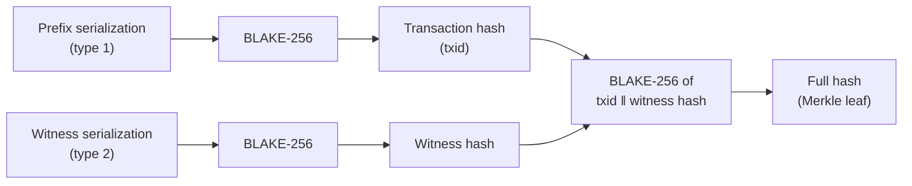

# Transactions for builders

This page covers what an app, wallet or integration developer needs to build, parse and accept Decred transactions correctly. It assumes you know how Bitcoin transactions work and points out each place where Decred differs. The whitepaper's [Transactions](../../whitepaper/07-transactions.md#ch:transactions) chapter is the normative specification. This page explains it and links to it.

!!! abstract "The short version"

    - A transaction has no type field. Its class (regular, coinbase, ticket, vote, revocation, treasurybase, treasury add (TADD), treasury spend (TSPEND)) follows from its structure.
    - An outpoint is `(hash, index, tree)`. The tree byte (0 regular, 1 stake) is part of an output's identity.
    - A transaction is serialized as a *prefix* (what it does) and a *witness* (signature scripts plus facts about each spent output). The transaction ID hashes the prefix only.
    - The `Expiry` field makes a transaction unminable from a given height, at the cost of a 256-block lock on its outputs.
    - Fees are charged per 1,000 bytes of full serialized size. There is no replace-by-fee.
    - Coinbase, vote, revocation and treasury spend outputs mature after 256 blocks on mainnet.

## Transaction classes and how to recognize them

Decred blocks carry two ordered lists of transactions: the **regular tree** and the **stake tree**. Tickets, votes, revocations and the three treasury types live in the stake tree. Everything else, including the coinbase, lives in the regular tree. The split lets stakeholders disapprove a block's regular tree without touching its stake tree (see [Blocks, confirmations and reorganizations](blocks-and-confirmations.md)).

dcrd infers the class with `stake.DetermineTxType` (`blockchain/stake/staketx.go`), which tests, in order: ticket, vote, revocation, then, for version 3 and above only, treasury add, treasury spend and treasurybase. Anything else is regular. The coinbase is a regular transaction that also has the coinbase form, which `standalone.IsCoinBaseTx` tests.

| Class | Tree | Version | How it shows in `decoderawtransaction` output |
|---|---|---|---|
| Regular | regular | ≤ 3 (dcrwallet's `txauthor` uses 1) | `vin` entries with `txid`, `vout` and `tree`; no stake script types in `vout` |
| Coinbase | regular (index 0) | 3 since the `treasury` agenda | `vin[0]` has a `coinbase` key |
| Ticket | stake | ≤ 3 | `vout[0]` type `stakesubmission-pubkeyhash` or `-scripthash`; odd outputs `sstxcommitment` with `commitamt`; even outputs from 2 `stakechange-*` |
| Vote | stake | ≤ 3; exactly 3 when it carries treasury votes | `vin[0]` has a `stakebase` key; `vout[0]` and `vout[1]` are `nulldata`; payouts are `stakegen-*` |
| Revocation | stake | 2 (required since `autorevocations`) | payouts are `stakerevoke-*` |
| Treasurybase | stake (index 0) | 3 | `vin[0]` has `"treasurybase": true`; `vout[0]` type `treasuryadd` |
| Treasury add | stake | 3 | `vout[0]` type `treasuryadd`; optional `vout[1]` `stakechange-*` |
| Treasury spend | stake | 3 | `vin[0]` has a `treasuryspend` key; payouts are `treasurygen-*` |

The coinbase structure is in the whitepaper's [coinbase](../../whitepaper/11-subsidy.md#sec:subsidy-coinbase) section. The stake and treasury types are described in [Staking and the treasury for builders](staking-and-treasury.md). A StakeShuffle mix is not a class of its own: it is a regular transaction with many inputs and equal-value outputs (see [Mixing for builders](mixing.md)).

In Go, classify with the same functions dcrd uses:

```go
import (
	"github.com/decred/dcrd/blockchain/stake/v5"
	"github.com/decred/dcrd/blockchain/standalone/v2"
)

txType := stake.DetermineTxType(tx) // TxTypeRegular, TxTypeSStx, TxTypeSSGen, TxTypeSSRtx,
                                    // TxTypeTAdd, TxTypeTSpend or TxTypeTreasuryBase
isCoinbase := txType == stake.TxTypeRegular && standalone.IsCoinBaseTx(tx, true)
```

The second argument of `IsCoinBaseTx` says whether the `treasury` agenda is active, as it has been on mainnet since block 552,448. A treasurybase also passes the coinbase-form test then, so test for the stake types first. A near-miss of a stake predicate is classified as regular, and consensus then normally rejects it. The exact predicates are in the whitepaper's [classification rules](../../whitepaper/07-transactions.md#sec:transactions-classes).

## Serialization and transaction IDs

A Decred transaction has two halves:

- The **prefix** determines what the transaction does: the outpoints it spends with their sequence numbers, the outputs, `LockTime` and `Expiry`.
- The **witness** holds, for each input, the signature script plus three fraud-proof fields: `ValueIn`, `BlockHeight` and `BlockIndex`.

| Part | Field | Size (bytes) |
|---|---|---|
| Header | Version word: version (low 16 bits) and serialization type (high 16 bits), little-endian | 4 |
| Prefix | Input count (varint) | 1–9 |
| Prefix | Per input: previous hash 32, index 4, tree 1, sequence 4 | 41 |
| Prefix | Output count (varint) | 1–9 |
| Prefix | Per output: value 8 (atoms, `int64`), script version 2, script length varint, script | 10 + script |
| Prefix | `LockTime`, `Expiry` | 4 + 4 |
| Witness | Witness count (varint; equals the input count in a full serialization) | 1–9 |
| Witness | Per input: `ValueIn` 8, `BlockHeight` 4, `BlockIndex` 4, script length varint, signature script | 16 + script |

The serialization type in the version word selects which halves follow:

| Type | dcrd name | Body | Used for |
|---|---|---|---|
| 0 | `TxSerializeFull` | prefix, then witness | blocks, `tx` messages, RPC hex, storage |
| 1 | `TxSerializeNoWitness` | prefix only | input to the transaction hash |
| 2 | `TxSerializeOnlyWitness` | witness only | input to the witness hash |

Three hashes are defined, all BLAKE-256. The diagram shows that the transaction ID depends on the prefix alone, while the block's Merkle tree commits to both halves:



The transaction hash is what outpoints reference, what explorers display and what the ticket lottery uses. Because no signature script is in it, nobody can change a transaction's ID by changing its signatures. Decred has had this property from the start, without SegWit.

!!! warning "Three hashing mistakes that break integrations"

    - The txid is **not** the hash of any part of the bytes you received. The prefix serialization starts with a version word carrying type 1 (`01000100` for a version 1 transaction), while the full serialization you received starts with `01000000`. Re-encode with type 1, then hash.
    - The full hash is BLAKE-256 of the 64-byte concatenation of the transaction hash and the witness hash. It is not the hash of the full serialization.
    - Hashes are displayed byte-reversed, as in Bitcoin. Outpoints and Merkle trees use the internal order.

**Worked example.** The whitepaper's [regular transaction test vector](../../whitepaper/04-encoding.md#sec:encoding-vec-tx) is mainnet transaction `aa4c208c…8dff6684`, mined in block 150,043. It has one input and two pay-to-pubkey-hash (P2PKH) outputs. Decoding it with dcrd's `wire` package at release-v2.1.7 gives:

| Quantity | Value |
|---|---|
| Full serialization | 252 bytes |
| Prefix serialization | 127 bytes |
| Witness serialization | 129 bytes |
| Transaction hash (display) | `aa4c208c85a9576954d11dd566009cdad98b1c65dcd63b4f6ca11c3e8dff6684` |
| Full hash (display) | `d2366794fc9ea2294555d4cb283bbae9fc6bab628fcebd2dd832c4842ee0409a` |
| Fee | 364,257,144 − 2 × 182,115,922 = 25,300 atoms |

The sizes satisfy `full = prefix + witness − 4`, since the version word appears only once. With default mainnet policy, dcrd's mempool accepts only full (type 0) serializations, so always submit those. The whitepaper's [transaction encoding](../../whitepaper/04-encoding.md#sec:encoding-tx) and [transaction identifiers](../../whitepaper/04-encoding.md#sec:encoding-txid) sections give the exact decoding bounds and failure cases.

## Inputs carry amount, block height and index

Each input's witness repeats facts about the output it spends:

`ValueIn`
:   The amount of the spent output in atoms. `-1` means "not given".

`BlockHeight`
:   The height of the block that holds the spent output. The null value is `0`.

`BlockIndex`
:   The position of the creating transaction within its tree. The null value is `0xffffffff`.

For every input that spends an existing output, consensus requires all three to match that output exactly, or the block is invalid (`ErrFraudAmountIn`, `ErrFraudBlockHeight`, `ErrFraudBlockIndex`). The inputs that spend nothing (the coinbase, a vote's stakebase (input 0), the treasurybase and a treasury spend) must carry the null `BlockHeight` and `BlockIndex` (0 and 0xffffffff). Their `ValueIn` is the subsidy or the amount withdrawn.

What this means when you build transactions:

- **Set `ValueIn` to the real amount** of every input. dcrwallet's `sendrawtransaction` refuses a `ValueIn` of `-1` unless `allowhighfees` is set, because it cannot check the fee.
- **You may leave height and index unknown for unconfirmed parents.** dcrd's mempool overwrites mismatched fraud-proof fields with the values it looks up (placeholders for unconfirmed parents), and its block template writes the final ones ([template assembly](../../whitepaper/17-policy.md#sec:policy-assembly)).
- **Signatures do not commit to these fields.** The [signature hash](../../whitepaper/06-script.md#sec:script-sighash) covers the prefix and the signed script, not these three fields. An offline or hardware signer that computes the fee from `ValueIn` can be told a false amount. Such a signer must verify each input amount against the full previous transaction, whose hash it can check against the outpoint.

## Expiry and lock time

`Expiry` is a Decred-only prefix field. With `Expiry = E ≠ 0`, the transaction is valid only in blocks of height `E − 1` or lower. `0` means it never expires. This is a consensus rule ([expiry](../../whitepaper/07-transactions.md#sec:transactions-expiry)). dcrd's mempool applies the same test to the next block: it refuses a transaction once the next block's height is at least `E` (`ErrExpired`), and it drops transactions from its mempool once they expire.

Expiry exists because dcrd's mempool has no time- or fee-based eviction. It gives an unconfirmed transaction a guaranteed end, after which its inputs are safe to spend again. dcrwallet's automatic ticket buyer uses it so that a ticket priced for one ticket price window cannot be mined in the next. `purchaseticket` and dcrwallet's `createrawtransaction` accept an `expiry` argument.

!!! warning "A non-zero expiry locks the outputs for 256 blocks"

    Consensus requires every output of a transaction with a non-zero expiry to be 256 blocks old on mainnet before it can be spent (`ErrExpiryTxSpentEarly`). That is about 21 hours. Such outputs also cannot be spent while the transaction is unconfirmed. Leave `Expiry` at 0 on ordinary payments unless you accept that the change is locked this long.

`LockTime` works as in Bitcoin: a value below 500,000,000 is a block height, a larger one a Unix time compared with the past median time of the block's parent, and setting every input's sequence number to `0xffffffff` disables it ([lock time finality](../../whitepaper/07-transactions.md#sec:transactions-locktime)).

Relative lock times (sequence locks, DCP-0003) apply to transactions of version 2 or higher. In an input's sequence number, bit 31 disables the lock, bit 22 selects units of 512 seconds instead of blocks, and the low 16 bits hold the value. Votes and coinbase-form transactions are exempt. `OP_CHECKLOCKTIMEVERIFY` and `OP_CHECKSEQUENCEVERIFY` are covered in [Scripts for builders](scripts.md).

## Fees and size

The fee is the sum of the inputs minus the sum of the outputs. Consensus only requires inputs ≥ outputs (`ErrSpendTooHigh`). Everything else about fees is relay policy.

**Minimum relay fee.** By default dcrd relays and mines a transaction only if it pays at least 0.0001 DCR per kB (`DefaultMinRelayTxFee` in `internal/mempool/policy.go`). The size is the full serialized size, and a kB is 1,000 bytes:

```text
minimum fee (atoms) = size_in_bytes × 10000 / 1000   (integer division)
```

Paying exactly the minimum is accepted. Operators can change the rate with dcrd's `minrelaytxfee` option (in DCR/kB). dcrwallet's `txfee` option defaults to the same rate. Votes and revocations are exempt, because both must be feeless.

**Estimating size before signing.** The signed size is not known until the signatures exist. dcrwallet's `wallet/txsizes` package estimates the worst case:

| Item | Bytes | Constant |
|---|---|---|
| Version word, `LockTime`, `Expiry` | 12 | in `EstimateSerializeSize` |
| Input count, written twice (prefix and witness) | 2 × varint | same |
| Output count | varint | same |
| P2PKH input (73-byte signature push, 33-byte compressed key) | 166 | `RedeemP2PKHInputSize` |
| P2PKH output | 36 | `P2PKHOutputSize` |
| Pay-to-script-hash (P2SH) output | 34 | 8 + 2 + 1 + `P2SHPkScriptSize` (23) |

For *n* P2PKH inputs and *m* P2PKH outputs (fewer than 253 of each), the estimate is `15 + 166n + 36m` bytes. A payment with change from one input is 253 bytes, with a minimum fee of 2,530 atoms; from two inputs, 419 bytes and 4,190 atoms. The worked example is the first case: its real size is 252 bytes because its signature is one byte shorter than the worst case. It paid 25,300 atoms because it was mined when dcrd's default relay fee was 0.001 DCR/kB, ten times today's.

**Fee estimation.** dcrd's `estimatesmartfee <BLOCKS>` returns a rate in DCR/kB (only the default `conservative` mode is supported). While blocks have spare room, the minimum rate normally confirms in the next block (see [Send and receive DCR](../../user/wallets/send-and-receive.md) for the user-side view).

**No replacement.** The mempool keeps the first transaction it sees and rejects a later one that spends the same input (`ErrMempoolDoubleSpend`). Choose the fee before you broadcast, and set an expiry if you may need to give up on the transaction.

**High-fee guards** protect against typing mistakes:

- dcrd's `sendrawtransaction` rejects a fee above 10,000 times the minimum relay rate (1 DCR/kB by default), unless its second argument `allowhighfees` is `true`. Transactions relayed by peers are not checked.
- dcrwallet refuses fees above 1,000 times its default rate (0.1 DCR/kB). For its own sends the check is off when the wallet runs with `--allowhighfees`. For its `sendrawtransaction` the check is off only when the call's `allowhighfees` argument is `true`.

## Maturity

Some outputs cannot be spent until the block holding them is old enough. An output with required age 256, mined in block *b*, is first spendable in block *b* + 256. All of these rules are consensus ([per-input rules](../../whitepaper/07-transactions.md#sec:transactions-input-rules)).

| Spent output | Required age on mainnet | Notes |
|---|---|---|
| Coinbase output | 256 blocks (`CoinbaseMaturity`) | 16 on testnet, simnet and regnet |
| Any output of a transaction with non-zero `Expiry` | 256 blocks | see the warning above |
| Vote payout (`stakegen-*`) or revocation payout (`stakerevoke-*`) | 256 blocks | raised from 1 by the `treasury` agenda (DCP-0006) |
| Treasury spend payout (`treasurygen-*`) | 256 blocks | |
| Ticket change or treasury add change (`stakechange-*`) | 1 block (`SStxChangeMaturity`) | 1 on every network |
| Ticket output 0 (`stakesubmission-*`) | spendable only by a vote or revocation | ticket rules in [Staking and the treasury for builders](staking-and-treasury.md) |
| Treasurybase and treasury add `treasuryadd` outputs | never | they become part of the treasury balance |

The rules combine: change from a ticket with an expiry needs both 1 and 256 blocks, so effectively 256.

Two practical consequences:

- **No chaining from stake outputs.** dcrd's mempool gives outputs of unconfirmed transactions a placeholder height that is never mature. A transaction spending an unconfirmed stake-tagged output is rejected outright, not held for later.
- **Stake transactions never spend outputs from the same block.** For the reason why, see the whitepaper's [in-block spending rules](../../whitepaper/07-transactions.md#sec:transactions-connect).

## Standardness: relay policy versus consensus

A transaction can be valid by consensus and still not relay. Mainnet dcrd nodes reject non-standard transactions by default, while testnet, simnet and regnet accept them (`AcceptNonStdTxs`). Default dcrd builds block templates only from its mempool, so a non-standard transaction is unlikely to be mined on mainnet. To apply the standardness checks on another network, run dcrd with `--rejectnonstd`. The checks builders most often hit:

| Check | Consensus | dcrd policy (mainnet default) |
|---|---|---|
| Transaction size | ≤ 393,216 bytes (`MaxTxSize`) | ≤ 100,000 bytes (`MaxStandardTxSize`) |
| Minimum fee | none | 0.0001 DCR/kB |
| Signature scripts | any that execute | push-only, ≤ 1,650 bytes |
| Output scripts | any, except that regular transactions may not use stake opcodes (`ErrRegTxCreateStakeOut`); unspendable if malformed | standard types only; bare multisig ≤ 3 keys |
| Null-data (`OP_RETURN`) outputs | any | one push of ≤ 256 bytes; ≤ 4 per regular transaction |
| Dust outputs | allowed | not allowed in regular transactions |

The rest, including transaction and script versions, signature-operation limits and the checks on the outputs being spent, is in the whitepaper's [standard transactions](../../whitepaper/17-policy.md#sec:policy-standard) section.

**Dust.** An output is dust if spending it would cost more than a third of its value at the relay fee rate. A 165-byte P2PKH input is assumed:

```text
dust  ⇔  value × 1000 / (3 × (output_size + 165)) < 10000
```

At the default rate, the smallest non-dust P2PKH output is 6,030 atoms and the smallest non-dust P2SH output is 5,970 atoms. Stake transactions are exempt from the dust check. dcrwallet applies the same formula (`txrules.IsDustAmount`). When change would be dust, `txauthor.NewUnsignedTransaction` leaves the change output out and the amount goes to the fee.

## Decoding tools

`decoderawtransaction` and `decodescript` are dcrd RPCs. Call them through `dcrctl` without `--wallet`. They decode locally and need no index.

```bash
dcrctl decoderawtransaction <HEX>
```

`<HEX>` is a full serialization. To try it on the worked example, use the 504-character hex from the test vector:

??? note "Hex of the example transaction (dcrd test data `dcrutil/txsort/testdata/tx150043-14.hex`)"

    ```text
    010000000164084d5f9b7fcedd3d816b7e1ba154123310dd892c09b53c8bf811804efab9030000000000ffffffff0252deda0a0000000000001976a9146ab21ce59fedbfe724cd979d1409397c68105c0d88ac52deda0a0000000000001976a9145529ab44931e1ad083df53fa97f4922a80f234b688ac000000000000000001781fb615000000000d4a0200040000006b483045022100c6ae9a0587e64b6761a55e81321eee6dd3550e9c9a69c058d7734f0ade1ce00702200650ecc1eacc938bedae55a7f2d0e73bee548dcce77352eff77b090b8087b6de012102d30f38730d4d4feb7f7fec0d2c81b550ff702d03c8191cd6b98e28f9da9e2c9c
    ```

```json title="Expected output (trimmed: script hex shortened, second output, addresses and scriptPubKey version omitted)"
{
  "txid": "aa4c208c85a9576954d11dd566009cdad98b1c65dcd63b4f6ca11c3e8dff6684",
  "version": 1,
  "locktime": 0,
  "expiry": 0,
  "vin": [
    {
      "txid": "03b9fa4e8011f88b3cb5092c89dd10331254a11b7e6b813dddce7f9b5f4d0864",
      "vout": 0,
      "tree": 0,
      "sequence": 4294967295,
      "amountin": 3.64257144,
      "blockheight": 150029,
      "blockindex": 4,
      "scriptSig": { "asm": "3045022100c6ae…01 02d30f…9e2c9c", "hex": "483045…9e2c9c" }
    }
  ],
  "vout": [
    {
      "value": 1.82115922,
      "n": 0,
      "version": 0,
      "scriptPubKey": {
        "asm": "OP_DUP OP_HASH160 6ab21ce59fedbfe724cd979d1409397c68105c0d OP_EQUALVERIFY OP_CHECKSIG",
        "hex": "76a9146ab21ce59fedbfe724cd979d1409397c68105c0d88ac",
        "reqSigs": 1,
        "type": "pubkeyhash"
      }
    }
  ]
}
```

`vin` shows the outpoint's `tree` and the three witness fields (`amountin` is `ValueIn` in DCR), and each output has its own script `version`. The result has no fee and no class field. Compute the fee from `amountin` and `value`, and the class from the input keys and script types in the table at the top of this page.

Related calls:

- `dcrctl decodescript <HEX> [<VERSION>]` disassembles one script and reports its standard type, required signatures, addresses and the P2SH address that would wrap it.
- `dcrctl getrawtransaction <TXID> 1` returns the same fields plus block data. For confirmed transactions it needs dcrd running with `txindex`. Wallet transactions are available from `dcrctl --wallet gettransaction <TXID>`.
- `dcrctl gettxout <TXID> <INDEX> <TREE>` checks whether an output is unspent. Note the required tree argument.
- The [dcrdata decoder](https://dcrdata.decred.org/decodetx) decodes pasted hex. The page sends the hex to the dcrdata server over a websocket, so decode with your own `dcrd` anything you do not want a third party to see. Its **Broadcast** button sends the transaction to the network, and a sent transaction cannot be recalled.

## Test vectors to check your implementation

Check a parser, serializer or fee calculator against these before you trust it with funds:

- **Serialization and hashes**: the genesis coinbase in all three serialization types, the 252-byte transaction above with its three hashes, and decoding edge cases, in the whitepaper's [encoding test vectors](../../whitepaper/04-encoding.md#sec:encoding-vectors).
- **Transaction rules**: vectors for sanity checks, expiry, lock-time finality and sequence locks inside the whitepaper's [Transactions](../../whitepaper/07-transactions.md#ch:transactions) chapter.
- **Policy**: the [dust thresholds](../../whitepaper/17-policy.md#sec:policy-dust) and the [minimum and maximum fee table](../../whitepaper/17-policy.md#sec:policy-minfee).
- **Signature hashes and scripts**: `txscript/testdata/sighash.json`, `tx_valid.json`, `tx_invalid.json` and `script_tests.json` in [dcrd at release-v2.1.7](https://github.com/decred/dcrd/tree/release-v2.1.7/txscript/testdata).
- **Real transactions**: hex files in [`dcrutil/txsort/testdata`](https://github.com/decred/dcrd/tree/release-v2.1.7/dcrutil/txsort/testdata), and the round-trip tests in `wire/msgtx_test.go`.

## Go deeper

- [Transactions](../../whitepaper/07-transactions.md#ch:transactions): every consensus rule about a single transaction, with algorithms and error kinds.
- [Transaction encoding](../../whitepaper/04-encoding.md#sec:encoding-tx): byte layout, decoding bounds and the three hashes.
- [Relay policy and mining](../../whitepaper/17-policy.md#ch:policy): mempool acceptance, standardness, fees, dust and fee estimation.
- [Signature hash](../../whitepaper/06-script.md#sec:script-sighash): exactly what a signature commits to.

## Next steps

- [Build and sign transactions in Go](../go/build-and-sign-transactions.md): put this page into practice with `wire`, `stdaddr` and `txscript/sign`.
- [Scripts for builders](scripts.md): standard script types, stake tags, multisig and time locks.
- [Blocks, confirmations and reorganizations](blocks-and-confirmations.md): when a mined transaction can be considered final.
- [Integrate DCR into an exchange or service](../integrate/exchange.md): deposits and withdrawals with these rules in mind.
- [Staking and the treasury for builders](staking-and-treasury.md): the structure of tickets, votes, revocations and treasury transactions.

*[TADD]: treasury add
*[TSPEND]: treasury spend
*[P2PKH]: pay-to-pubkey-hash
*[P2SH]: pay-to-script-hash
*[RPC]: remote procedure call
*[DCP]: Decred Change Proposal
