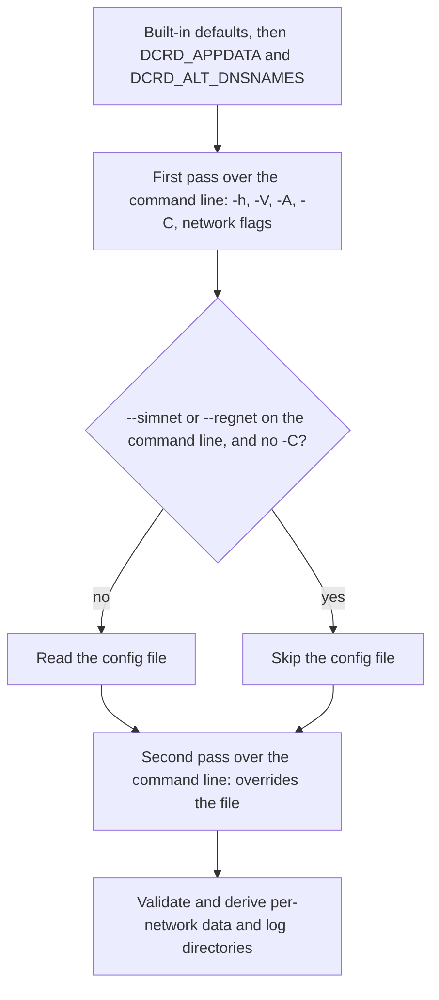

# dcrd configuration

This page lists every option of `dcrd` 2.1.7, the Decred full node, with its default, its command-line flag and its `dcrd.conf` key. It is for operators and developers who need an exact value or rule. The values come from `config.go` at [`release-v2.1.7`](https://github.com/decred/dcrd/blob/release-v2.1.7/config.go) and were checked against `dcrd --help` from a 2.1.7 build. For a guided setup, see [Run a full node](../../user/run/full-node.md) or [Run dcrd in production](../operate/production-node.md).

**Config-file keys.** Every option's config-file key is its long flag name without the dashes: `--txindex` on the command line is `txindex=1` in `dcrd.conf`. The tables below give the key. A short flag, where one exists, follows it in parentheses. `version`, `appdata`, `configfile` and `service` only take effect on the command line (`appdata` also from `DCRD_APPDATA`). `help`, and `service` outside Windows, are not valid config-file keys at all: putting them in `dcrd.conf` stops `dcrd` with an unknown-option error.

## Precedence and file locations

### How dcrd reads its configuration

`dcrd` builds its configuration in layers, and the command line always wins. The diagram shows the order, including the case where the config file is skipped:



The rules that follow from `loadConfig` in `config.go`:

- **The command line overrides the file.** A scalar option given on both uses the command-line value. Boolean options are the exception: the command line can only turn them on. A boolean set in `dcrd.conf` cannot be turned off with a flag (`--txindex=false` is an error), so remove or comment out the line instead. A list option (such as `addpeer` or `whitelist`) given on the command line *replaces* the whole list from the file; it does not add to it.
- **On simnet and regnet the default config file is not read.** When `--simnet` or `--regnet` is on the command line and `--configfile` (`-C`) is not, `dcrd` ignores the default `dcrd.conf`, so a `testnet=1` line in it cannot clash. Give a config file explicitly with `-C` to use one. A `simnet=1` or `regnet=1` line inside a config file works as usual.
- **A default config file is created on first start.** If the default `dcrd.conf` does not exist and neither `--simnet` nor `--regnet` was given, `dcrd` writes it from the built-in sample (`sampleconfig/sample-dcrd.conf`), with a random `rpcuser` and `rpcpass` when `authtype` is `basic`. Every other line of the sample is commented out.
- **A missing file is a warning; a bad file is fatal.** A config file named with `-C` that does not exist only logs a warning. An unknown or removed key stops `dcrd` with `Error parsing config file: <FILE>:<LINE>: unknown option: <KEY>`.
- **Only the command line or the environment can move the home directory.** `appdata` relocates the config file, data, logs and RPC certificate files only when given as `-A`/`--appdata` or as `DCRD_APPDATA`. Set in `dcrd.conf`, it changes the reported home directory but the data stays in the default location.
- **With `--regnet` on the command line, `addpeer` lines from the config file are ignored** (this matters only when a file is given with `-C`). A `regnet=1` line in the file does not trigger this.

### Config-file syntax

`dcrd.conf` is an INI file. The `[Application Options]` header written by the sample is optional. The example below shows each value type (the addresses are documentation examples):

```ini title="dcrd.conf"
[Application Options]
; Lines starting with ; or # are comments.

; Boolean options: 1 or true turns them on, 0 or false leaves them off.
txindex=1

; List options: repeat the key, one value per line.
addpeer=192.0.2.10
addpeer=[2001:db8::10]:9108

; Durations use Go syntax with s, m and h units.
banduration=12h

; Sizes for logsize need a unit: K, M or G (KiB, MiB, GiB also accepted).
logsize=50M

; ~ and $VARIABLE are expanded in datadir and logdir only.
datadir=~/dcrd-data
```

On Windows, environment variables in `datadir` and `logdir` must be written `$LOCALAPPDATA`, not `%LOCALAPPDATA%`. Give every other path in full.

!!! warning "Keep secrets in the config file"
    `rpcpass`, `rpclimitpass`, `proxypass` and `onionpass` given as command-line flags are visible to other users of the computer in the process list. Put them in `dcrd.conf` and keep the file readable only by the account that runs `dcrd` (`dcrd` creates its default file with mode 0600).

### File locations

The home directory (`appdata`) is `dcrutil.AppDataDir("dcrd", false)`:

| Platform | Home directory |
|---|---|
| Linux, BSD and other POSIX | `~/.dcrd` |
| macOS | `~/Library/Application Support/Dcrd` |
| Windows | `%LOCALAPPDATA%\Dcrd` (falls back to `%APPDATA%\Dcrd`) |
| Plan 9 | `$home/dcrd` |

Everything else defaults to a path inside it:

| File or directory | Option | Default |
|---|---|---|
| Config file | `configfile` | `<HOME>/dcrd.conf` |
| Chain data | `datadir` | `<HOME>/data/<NETWORK>` |
| Log file | `logdir` | `<HOME>/logs/<NETWORK>/dcrd.log` |
| RPC certificate and key | `rpccert`, `rpckey` | `<HOME>/rpc.cert`, `<HOME>/rpc.key` |
| Client CA file (`authtype=clientcert`) | `clientcafile` | `<HOME>/clients.pem` |

`<HOME>` is the home directory above. `<NETWORK>` is `mainnet`, `testnet3`, `simnet` or `regnet`: `dcrd` appends it to whatever `datadir` and `logdir` you set, so one data directory can hold several networks. [Ports, paths and prefixes](index.md) has the same paths for every other Decred program.

## Application and data

| Option | Default | Description |
|---|---|---|
| `help` (`-h`) | — | Print every option with its default for this platform, then exit. |
| `version` (`-V`) | — | Print the version and exit. |
| `appdata` (`-A`) | `~/.dcrd` (see [File locations](#file-locations)) | Home directory. Also set by the `DCRD_APPDATA` environment variable. Effective only on the command line or from the environment. |
| `configfile` (`-C`) | `<HOME>/dcrd.conf` | Config file to read. |
| `datadir` (`-b`) | `<HOME>/data` | Directory for the block database, UTXO database and peer addresses. The network name is appended. |
| `dbtype` | `ffldb` | Block database backend. `ffldb` is the only one supported. |
| `sigcachemaxsize` | `100000` | Maximum entries in the signature verification cache. |
| `utxocachemaxsize` | `150` | Maximum size of the unspent-output cache, in MiB. Values below 25 are raised to 25 and values above 32768 lowered to 32768, without an error. Raising it above 150 also raises the soft memory limit (see [GOMEMLIMIT](#environment-variables-gomemlimit)). |

### Chain validation and export

| Option | Default | Description |
|---|---|---|
| `assumevalid` | the release's hard-coded block | Hash of a block assumed valid: blocks that are ancestors of it (and of the best header) skip several expensive checks. `0` disables it, so every block is fully checked. In 2.1.7 the mainnet default is block 1,026,597. The whitepaper's [assume-valid rules](../../whitepaper/10-blocks.md#sec:blocks-assumevalid) list what is skipped. |
| `allowoldforks` | off | Process side chains that fork deeper than the old-fork rejection point (two weeks of blocks, 4,032 on mainnet, before the release's hard-coded assume-valid block). For testing and recovery only: a node with it on can follow a chain other nodes refuse. Always on for simnet and regnet. |
| `dumpblockchain` | none | Write the main chain to the named flat file for use with the `addblock` utility (`cmd/addblock` in the dcrd repository), then exit. |

## Network selection

Mainnet is used when no network option is set. At most one may be given; two or more stop `dcrd` with `the testnet, regnet, and simnet params can't be used together`.

| Option | Default | Description |
|---|---|---|
| `testnet` | off | Use the public test network (testnet3). |
| `simnet` | off | Use the simulation network for private test setups. |
| `regnet` | off | Use the regression test network. |

The network changes these defaults:

| | mainnet | testnet | simnet | regnet |
|---|---|---|---|---|
| P2P port (`listen`) | 9108 | 19108 | 18555 | 18655 |
| RPC port (`rpclisten`) | 9109 | 19109 | 19556 | 18656 |
| Data and log subdirectory | `mainnet` | `testnet3` | `simnet` | `regnet` |
| Default config file read | yes | yes | only with `-C` | only with `-C` |
| HTTPS seeders | yes | yes | none | none |
| Non-standard transactions accepted | no | yes | yes | yes |
| `allowunsyncedmining` | not allowed | off | always on | always on |
| Largest `blockmaxsize` (bytes) | 392216 | 1309720 | 999000 | 999000 |
| `generate` RPC | refused | allowed | allowed | allowed |

[Networks](../environment/index.md) covers each network's rules, address prefixes and public resources.

## Logging and profiling

| Option | Default | Description |
|---|---|---|
| `debuglevel` (`-d`) | `info` | Log level for all subsystems: `trace`, `debug`, `info`, `warn`, `error` or `critical`. Per subsystem: `SUBSYS=level,SUBSYS2=level`, for example `debuglevel=PEER=debug,SYNC=trace`. A bare level and subsystem pairs cannot be combined in one value, and subsystems not listed keep the default `info`. `show` prints the subsystem names and exits. |
| `logdir` | `<HOME>/logs` | Log directory. The network name is appended, and the file is `dcrd.log`. |
| `logsize` | `10M` | Size at which the log file is rotated. A number followed by `K`, `M` or `G` (or `KiB`, `MiB`, `GiB`); a bare number is rejected. Rotated files are gzip-compressed and the newest three are kept. |
| `nofilelogging` | off | Log to standard output only, with no log file. |
| `profile` | none | Serve Go `pprof` profiling over HTTP on `[addr:]port`, at `http://<ADDR>:<PORT>/debug/pprof`. A bare port listens on `127.0.0.1`. The port must be between 1024 and 65535. The `startprofiler` and `stopprofiler` RPCs control the same server at run time. |
| `cpuprofile` | none | Write a CPU profile to this file until shutdown. |
| `memprofile` | none | Write a heap profile to this file at shutdown. |

The subsystems in 2.1.7 are `ADXR`, `AMGR`, `BCDB`, `CHAN`, `CMGR`, `DCRD`, `DISC`, `FEES`, `INDX`, `MINR`, `MIXP`, `PEER`, `RPCS`, `SCRP`, `SRVR`, `STKE`, `SYNC`, `TRSY` and `TXMP`.

!!! warning "The profiler is unauthenticated"
    Anyone who can reach the `profile` address can read the node's profiling data, including heap profiles and goroutine stacks. Keep it on a loopback address.

## RPC server, TLS and authentication

The RPC server serves JSON-RPC over HTTPS and websockets. [dcrd JSON-RPC API](../api/dcrd-json-rpc.md) explains authentication, the limited user's methods and client certificates in full.

| Option | Default | Description |
|---|---|---|
| `rpcuser` (`-u`) | none | Username for full-access RPC (`authtype=basic`). |
| `rpcpass` (`-P`) | none | Password for full-access RPC. |
| `rpclimituser` | none | Username for limited RPC. Must differ from `rpcuser`. |
| `rpclimitpass` | none | Password for limited RPC. Must differ from `rpcpass`. |
| `authtype` | `basic` | `basic` (username and password) or `clientcert` (TLS client certificates). |
| `clientcafile` | `<HOME>/clients.pem` | Certificate authorities that sign accepted client certificates. Used only with `authtype=clientcert`. |
| `rpclisten` | `localhost` on the network's RPC port | Address to listen on for RPC, repeatable. The default resolves `localhost`, normally to `127.0.0.1` and `::1`. A missing port gets the network's RPC port; an interface name expands to all of its addresses. |
| `norpc` | off | Disable the RPC server. |
| `rpccert` | `<HOME>/rpc.cert` | TLS certificate file. |
| `rpckey` | `<HOME>/rpc.key` | TLS private key file. |
| `tlscurve` | `P-256` | Curve for a generated certificate: `P-256` or `P-521`. |
| `altdnsnames` | none | Extra DNS names for a generated certificate. Also set by `DCRD_ALT_DNSNAMES` (comma-separated). |
| `notls` | off | Serve RPC without TLS. |
| `rpcmaxclients` | `10` | Maximum concurrent standard (HTTP) RPC clients. |
| `rpcmaxwebsockets` | `25` | Maximum concurrent websocket clients. |
| `rpcmaxconcurrentreqs` | `20` | Maximum requests from one websocket client processed at the same time; further requests on that connection wait. Must not be negative. |

How these options interact:

- **No credentials, no RPC.** With `authtype=basic`, the server is disabled unless `rpcuser` and `rpcpass`, or `rpclimituser` and `rpclimitpass`, are both set.
- **`clientcert` excludes passwords.** With `authtype=clientcert`, setting any of `rpcuser`, `rpcpass`, `rpclimituser` or `rpclimitpass` stops `dcrd`, and `notls` is refused.
- **`notls` is for loopback only.** It is accepted only when every `rpclisten` address is `localhost`, `127.0.0.1` or `::1`.
- **Certificates are generated once.** When neither `rpc.cert` nor `rpc.key` exists, `dcrd` creates a self-signed pair with `tlscurve` and `altdnsnames`. If either file exists, both options are ignored and `dcrd` warns about `altdnsnames`. To apply a new curve or name, delete both files and restart.

!!! danger "Never expose RPC with weak credentials"
    The full-access RPC user can stop the node (`stop`), connect and disconnect peers (`node`), mark blocks invalid (`invalidateblock`) and start the profiler (`startprofiler`). Bind `rpclisten` to a public address only behind a firewall that admits known clients, with long random credentials or `authtype=clientcert`, and never forward the RPC port from a router.

## Peers and networking

| Option | Default | Description |
|---|---|---|
| `listen` | all interfaces on the network's P2P port | Address to accept peers on, repeatable. A missing port gets the network's P2P port; an interface name expands to all of its addresses. |
| `nolisten` | off | Accept no inbound peers. |
| `addpeer` (`-a`) | none | Peer to stay connected to, in addition to discovered peers. Repeatable. Cannot be combined with `connect`. |
| `connect` | none | Connect only to these peers. Repeatable. Turns off seeding, and turns off listening unless `listen` is set. |
| `maxpeers` | `125` | Maximum inbound plus outbound peers. `dcrd` aims for 8 outbound peers (fewer if `maxpeers` is lower). |
| `maxsameip` | `5` | Maximum connections from one IP address. `0` disables the limit. Loopback and inbound whitelisted peers are exempt. |
| `dialtimeout` | `30s` | Time allowed for an outbound TCP connection. Minimum 1s. |
| `peeridletimeout` | `2m0s` | Inactivity after which a peer is disconnected. Minimum 15s. |
| `noseeders` | off | Do not query the HTTPS seeders for peer addresses. |
| `externalip` | none | Public address to advertise to peers, repeatable. Turns off automatic discovery. |
| `nodiscoverip` | off | Turn off automatic discovery of the node's public address. |
| `upnp` | off | Ask a UPnP router to forward the listen port and report the external address. |
| `nobanning` | off | Never ban misbehaving peers. |
| `banthreshold` | `100` | Ban score at which a peer is disconnected and banned. |
| `banduration` | `24h0m0s` | How long a ban lasts. Minimum 1s. |
| `whitelist` | none | IP address or CIDR network (`192.168.1.0/24`, `::1`) whose peers are never banned and, when inbound, are exempt from `maxsameip` and `maxpeers`. Repeatable. |

Automatic discovery of the public address (from what outbound peers report) is off when any of these is true: `proxy` or `onion` is set, `nodiscoverip` or `upnp` is set, an `externalip` is given, listening is off, or the network is simnet or regnet. The whitepaper describes [connection limits](../../whitepaper/15-p2p.md#sec:p2p-limits), [banning](../../whitepaper/15-p2p.md#sec:p2p-misbehaviour), [external address discovery](../../whitepaper/15-p2p.md#sec:p2p-external) and [seeding](../../whitepaper/15-p2p.md#sec:p2p-seeding).

## Tor and proxy

| Option | Default | Description |
|---|---|---|
| `proxy` | none | SOCKS5 proxy for every outbound peer connection, for example `127.0.0.1:9050`. Turns off listening unless `listen` is set. Unless `noonion` is set, host names are also resolved through the proxy using Tor's resolve extension. |
| `proxyuser` | none | Username for `proxy`. |
| `proxypass` | none | Password for `proxy`. |
| `onion` | none | Separate SOCKS5 proxy used only for `.onion` addresses. |
| `onionuser` | none | Username for `onion`. |
| `onionpass` | none | Password for `onion`. |
| `noonion` | off | Refuse `.onion` addresses, and resolve host names with the system resolver even when `proxy` is set. Use it when `proxy` is not Tor. |
| `torisolation` | off | Use random proxy credentials for each connection, so Tor builds a separate circuit per peer. Requires `proxy` or `onion`, and overrides `proxyuser`/`proxypass` and `onionuser`/`onionpass`. |

!!! note "No onion peers in 2.1.7"
    The 2.1.7 address manager stores only IPv4 and IPv6 addresses (Tor v2 support was removed), so `.onion` peers cannot be learned, advertised or set with `externalip`. A node behind `proxy` therefore connects only to ordinary IP addresses, and accepts no inbound peers unless `listen` is also set (and then only on its clearnet address). [Run a full node](../../user/run/full-node.md) shows a working Tor setup.

## Policy and relay

These are local relay and mempool policy, not consensus rules: changing them changes what your node accepts and forwards, never which blocks are valid. The whitepaper's [relay policy chapter](../../whitepaper/17-policy.md#ch:policy) gives the rules they control.

| Option | Default | Description |
|---|---|---|
| `minrelaytxfee` | `0.0001` | Fee rate in DCR/kB below which a transaction is treated as paying no fee. See the whitepaper's [minimum relay fee](../../whitepaper/17-policy.md#sec:policy-minfee). |
| `maxorphantx` | `100` | Maximum orphan transactions (with unknown inputs) kept in memory. `0` keeps none; negative values are refused. |
| `blocksonly` | off | Ignore transactions and mixing messages from peers, and ask peers not to announce transactions. Blocks, and transactions sent over RPC, are still processed. A node with this set does not relay StakeShuffle mixing messages. |
| `acceptnonstd` | network default | Accept and relay non-standard transactions. The default is off on mainnet and on for testnet, simnet and regnet. |
| `rejectnonstd` | network default | Reject non-standard transactions. Cannot be combined with `acceptnonstd`. |
| `allowoldvotes` | off | Admit votes on blocks older than the maximum vote age (256 blocks on mainnet) to the mempool. |

[Standard transactions](../../whitepaper/17-policy.md#sec:policy-standard) in the whitepaper defines "non-standard".

## Mining (test networks for generate)

`dcrd` builds block templates for external miners through `getwork` and `notifywork`. CPU mining with `generate` only makes sense on test networks; the `generate` RPC refuses on mainnet. [Mining infrastructure](../operate/mining.md) covers the mining setup and [Set up a private simnet](../environment/simnet.md) uses these options.

| Option | Default | Description |
|---|---|---|
| `miningaddr` | none | Address paid by blocks this node builds, repeatable (the background template generator picks one at random for each template). Must be valid on the active network. Required by the `getwork`, `generate` and `setgenerate` RPCs, and the background template generator runs only when at least one is set. |
| `generate` | off | Start the built-in CPU miner at startup. Requires a `miningaddr`. |
| `blockmaxsize` | `375000` | Largest block template to build, in bytes. Must be between 1000 and the network's maximum block size minus 1000 (see the [network table](#network-selection)). |
| `miningtimeoffset` | `0` | Seconds subtracted from a template's timestamp (positive values move it into the past). |
| `nonaggressive` | off | Do not build templates on the tip's parent when the tip has too few votes. See [choosing the parent](../../whitepaper/17-policy.md#sec:policy-parent). |
| `nominingstatesync` | off | Do not ask newly synced peers for their current tip blocks and those blocks' votes (treasury spends are still requested). |
| `allowunsyncedmining` | off | Build templates even when the chain is not synced. Refused on mainnet; always on for simnet and regnet. |

## Indexes

| Option | Default | Description |
|---|---|---|
| `txindex` | off | Keep an index of every transaction by hash, so `getrawtransaction` can return mined transactions. Without it, `getrawtransaction` finds only mempool transactions and fails with `the transaction index must be enabled to query the blockchain (specify --txindex)`. |
| `droptxindex` | off | Delete the transaction index, then exit. Cannot be combined with `txindex`. |
| `noexistsaddrindex` | off | Do not keep the exists-address index, which records whether an address has ever been used. The `existsaddress` and `existsaddresses` RPCs need it, and `dcrwallet` in RPC mode uses `existsaddresses` for address discovery, so keep it on for a node that backs a wallet. |
| `dropexistsaddrindex` | off | Delete the exists-address index, then exit. Requires `noexistsaddrindex`. |

An index turned on for an existing chain is brought up to the chain tip when `dcrd` starts, before the node begins serving, so the first start after enabling one takes longer. On every start, `dcrd` 2.1.7 also deletes the address index and the version 1 compact-filter index left by older versions, if either exists.

## IPC and service options

These options let a parent program supervise `dcrd`. Decrediton, for example, starts its node with `--piperx` on Windows.

| Option | Default | Description |
|---|---|---|
| `piperx` | none | File descriptor of the read end of a pipe from the parent. When the pipe closes, `dcrd` shuts down cleanly, so it never runs unsupervised. |
| `pipetx` | none | File descriptor of the write end of a pipe to the parent, for the messages below. |
| `lifetimeevents` | off | Send `lifetimeevent` messages on `pipetx` as the database and P2P server start and stop. |
| `boundaddrevents` | off | Send `p2plistenaddr` and `rpclistenaddr` messages on `pipetx` with the addresses actually bound. |
| `service` (`-s`) | — | Windows only: `install`, `remove`, `start` or `stop` the `dcrdsvc` service (shown as **Dcrd Service**), then exit. |

Each pipe message is a protocol version byte (1), a one-byte type length, the type string, a 4-byte little-endian payload length and the payload. A `lifetimeevent` payload is two bytes: the event (0 startup step, 1 startup complete, 2 shutdown step) and the subsystem (0 database, 1 P2P server). The format is described in [`ipc.go`](https://github.com/decred/dcrd/blob/release-v2.1.7/ipc.go).

## Environment variables (GOMEMLIMIT)

| Variable | Effect |
|---|---|
| `DCRD_APPDATA` | Default for `appdata`. |
| `DCRD_ALT_DNSNAMES` | Default for `altdnsnames`, comma-separated. |
| `GOMEMLIMIT` | Raises the Go garbage collector's soft memory limit above the one `dcrd` computes (since 2.1.0). |

`dcrd` sets a soft memory limit at startup so the garbage collector does not overshoot during bursts of block processing. It is a target, not a hard cap:

1. The base limit is 1.8 GiB.
2. If `utxocachemaxsize` is above its default of 150 MiB, the excess is added to the limit.
3. If `GOMEMLIMIT` is set to more than that, its value is used instead. A lower value is ignored, with the log line `Ignoring GOMEMLIMIT="…" since it is too low and would lead to extremely poor performance`.

The result is logged at startup. These examples were run against a 2.1.7 build:

| Settings | Logged limit |
|---|---|
| defaults | `Soft memory limit: 1.80 GiB` |
| `utxocachemaxsize=1000` | `Soft memory limit: 2.63 GiB` (1.8 GiB + 850 MiB) |
| `GOMEMLIMIT=4GiB` | `Soft memory limit: 4.00 GiB` |
| `GOMEMLIMIT=1GiB` | ignored, `Soft memory limit: 1.80 GiB` |

`GOMEMLIMIT` takes a number with an optional unit (`B`, `KiB`, `MiB`, `GiB`, `TiB`) and must be in the environment of the `dcrd` process: set it in the shell before starting `dcrd`, or with an `Environment=GOMEMLIMIT=4GiB` line in a systemd unit.

## Removed and changed options since 1.x

A key that no longer exists stops `dcrd` at startup (see [How dcrd reads its configuration](#how-dcrd-reads-its-configuration)), so delete these from old config files. Source: `config.go` at the 1.0.0 to 2.1.0 release tags, compared with `release-v2.1.7`. The option set has not changed since 1.8.0. [What changed](../../user/reference/whats-changed.md) maps the same options for returning users.

### Removed options

| Option | Removed in | What it did | Use instead |
|---|---|---|---|
| `addrindex`, `dropaddrindex` | 1.8.0 | Built or deleted an address index for `searchrawtransactions` | The [dcrdata API](../api/dcrdata-api.md). `txindex` still indexes by transaction hash. |
| `nocheckpoints` | 1.8.0 | Turned off built-in checkpoints | Nothing: checkpoints are gone. `assumevalid` and `allowoldforks` cover the related cases. |
| `nocfilters`, `dropcfindex` | 1.7.0 | Turned off or deleted version 1 compact filters | Nothing: light clients use version 2 filters, which are always available. |
| `getworkkey` | 1.5.0 | Payment address for `getwork` blocks | `miningaddr` |
| `nopeerbloomfilters` | 1.3.0 | Turned off bloom filter support | Nothing: bloom filters were removed. |
| `relaynonstd` | 1.2.0 | Relayed non-standard transactions regardless of the network default | `acceptnonstd` |

### Deprecated options

These are still accepted in 2.1.7 but print a warning at startup, and will be removed.

| Option | Status | Use instead |
|---|---|---|
| `nodnsseed` | Deprecated since 1.6.0; still sets `noseeders` | `noseeders` |
| `limitfreerelay`, `norelaypriority` | No effect since 1.8.0 | Nothing |
| `blockminsize`, `blockprioritysize` | No effect since 1.8.0 | Nothing |

### Added and changed

| Version | Change |
|---|---|
| 1.1.0 | Added `rejectnonstd`, `rpcmaxconcurrentreqs` and `whitelist`. |
| 1.1.2 | Added `nofilelogging`. |
| 1.2.0 | Added `acceptnonstd` (replacing `relaynonstd`). |
| 1.4.0 | Added `altdnsnames`, `maxsameip` and `regnet`. |
| 1.5.0 | Added `nodiscoverip`. |
| 1.6.0 | Added `allowunsyncedmining`, `dialtimeout`, `noseeders`, `peeridletimeout` and `tlscurve` (default `P-256`). The `maxorphantx` default dropped from 1000 to 100. |
| 1.7.0 | Added `assumevalid`, `authtype`, `clientcafile`, `logsize` and `utxocachemaxsize`. |
| 1.8.0 | Added `allowoldforks` and `boundaddrevents`. |
| 2.0.0 | Added the `DCRD_APPDATA` environment variable. |
| 2.1.0 | `GOMEMLIMIT` is honored when it is above the computed limit. |

## Next steps

- [Run dcrd in production](../operate/production-node.md): choose indexes, cache sizes and how to expose RPC to a service without opening it to the internet.
- [dcrd JSON-RPC API](../api/dcrd-json-rpc.md): connect a client once the RPC options are set.
- [dcrwallet configuration](dcrwallet-config.md): the matching reference for the wallet that connects to this node.
- [Set up a private simnet](../environment/simnet.md): try the network and mining options on a local network.
- [Ports, paths and prefixes](index.md): default ports and directories for every Decred program.

*[RPC]: remote procedure call
*[TLS]: Transport Layer Security
*[CA]: certificate authority
*[CIDR]: Classless Inter-Domain Routing
*[UPnP]: Universal Plug and Play
*[UTXO]: unspent transaction output
*[IPC]: interprocess communication
*[DNS]: Domain Name System
*[P2P]: peer-to-peer
*[SOCKS5]: Socket Secure version 5
*[INI]: initialization file format
