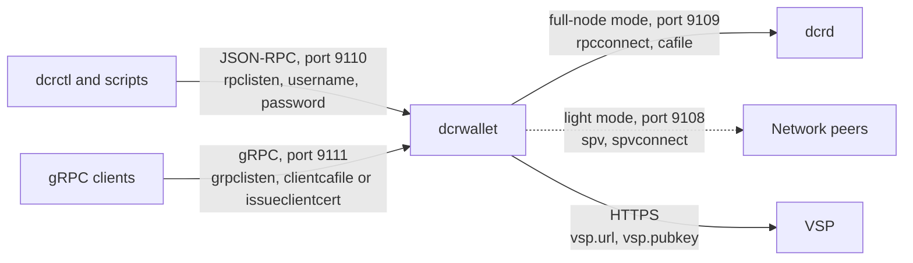

# dcrwallet configuration

This page lists every option of `dcrwallet` 2.1.7 with its default, grouped by purpose, and the checks that stop the wallet at startup. It is for operators and developers who run `dcrwallet` directly; for a guided setup, see [Set up the command-line wallet](../../user/wallets/command-line.md).

Source: `config.go` at tag [`release-v2.1.7`](https://github.com/decred/dcrwallet/blob/release-v2.1.7/config.go) (module `decred.org/dcrwallet/v5` v5.1.2), checked against the `--help` output of a binary built from that tag. Behavior notes come from `dcrwallet.go`, `rpcserver.go`, `walletsetup.go` and the `wallet` and `ticketbuyer` packages at the same tag.

Every option works as a command-line flag (`--spv`) and as a config-file key (`spv=1`). Tables give the key without the leading `--`, with any short flag in parentheses. All defaults are wallet defaults, not consensus rules.

## What the options control

The diagram shows which options govern each connection `dcrwallet` accepts on its remote procedure call (RPC) servers or makes to other programs, with mainnet ports; the sections below follow the same groups.



Both RPC servers and the connection to `dcrd` use Transport Layer Security (TLS) by default. When `proxy` is set, outgoing connections to `dcrd`, to peers and to the voting service provider (VSP) go through that SOCKS5 proxy, except connections to local and private addresses ([Tor and proxy](#tor-and-proxy)).

## Precedence and file locations

### How settings combine

`dcrwallet` builds its configuration in three layers. Each later layer overrides the one before:

1. Built-in defaults (the tables on this page).
2. The config file.
3. The command line.

Which config file is read:

- `--configfile` (`-C`) on the command line names it explicitly. If that file does not exist, `dcrwallet` logs the error and stops.
- Otherwise it reads `dcrwallet.conf` in the application data folder: `--appdata` from the command line, or the default folder below. A missing default file only logs a warning (`open <PATH>: no such file or directory`), and the defaults apply.
- `dcrwallet` never writes a config file itself. dcrinstall writes one, and the release archive ships `sample-dcrwallet.conf` with common options commented out.

Two command-line rules to know:

- A list option given on the command line (`rpclisten`, `grpclisten`, `spvconnect`, `profile`) **replaces** the values from the file instead of adding to them.
- A switch turned on in the file cannot be turned off from the command line. `--offline=false` fails with ``bool flag `--offline' cannot have an argument``. Remove the line from the file, or point `--configfile` at another file.

### Config file syntax

```ini title="dcrwallet.conf"
[Application Options]
; Light wallet with its own JSON-RPC credentials
spv=1
username=<RPCUSER>
password=<RPCPASS>

[Ticket Buyer Options]
ticketbuyer.balancetomaintainabsolute=10

[VSP Options]
vsp.url=https://<VSP_HOST>
vsp.pubkey=<VSP_PUBKEY>
vsp.maxfee=0.2
```

`<RPCUSER>` and `<RPCPASS>` are credentials you choose; `<VSP_HOST>` and `<VSP_PUBKEY>` come from your VSP, as [Stake with dcrwallet](../../user/staking/stake-with-dcrwallet.md) shows.

- **Sections.** `[Application Options]`, `[Ticket Buyer Options]` and `[VSP Options]`, matched without regard to case. Lines before the first section header are also accepted.
- **Keys** are the long option names without `--`, and are case-sensitive. Namespaced keys always keep their prefix: write `ticketbuyer.limit=1`, never `limit=1`. They may also go under `[Application Options]`.
- **Switches** take `1` or `true` to turn on, `0` or `false` to turn off.
- **Amounts** are in DCR, with or without a ` DCR` suffix: `vsp.maxfee=0.2` and `vsp.maxfee=0.2 DCR` are the same.
- **Repeatable options** (`rpclisten`, `grpclisten`, `spvconnect`, `profile`) take one value per line.
- **Comments** are whole lines starting with `;` or `#`. Text after a value is part of the value, so do not put a comment on the same line.
- **Paths** in `appdata`, `configfile`, `logdir`, `cafile`, `clientcafile`, `rpccert`, `rpckey`, `dcrdclientcert` and `dcrdclientkey` expand a leading `~` and `$VARIABLE` references. Windows-style `%VARIABLE%` references are not expanded.

An unknown key stops `dcrwallet` before it opens the wallet. The message names the file, the line and the key, and the full option list follows it:

```text title="Example error"
<CONFIG FILE>:2: unknown option: pooladdress
```

On the command line the message is ``unknown flag `pooladdress'``. Removed options are listed under [Removed options](#removed-options). The commented-out `legacyrpclisten` line in `sample-dcrwallet.conf` is not an option either; use `rpclisten`.

### Files and folders

`<APPDATA>` is the application data folder: `~/.dcrwallet` on Linux and BSD, `~/Library/Application Support/Dcrwallet` on macOS and `%LOCALAPPDATA%\Dcrwallet` on Windows. `<NETWORK>` is `mainnet`, `testnet3` or `simnet`.

| File | Default location | Option |
|---|---|---|
| Config file | `<APPDATA>/dcrwallet.conf` | `configfile` |
| Wallet database | `<APPDATA>/<NETWORK>/wallet.db` | `appdata` |
| Log file | `<APPDATA>/logs/<NETWORK>/dcrwallet.log` | `logdir` (the network folder is always appended) |
| RPC server certificate and key | `<APPDATA>/rpc.cert`, `<APPDATA>/rpc.key` | `rpccert`, `rpckey` |
| Trusted client certificate authorities | `<APPDATA>/clients.pem` | `clientcafile` |
| Certificate that authenticates `dcrd` | `<APPDATA>/dcrd.cert`, else `dcrd`'s own `rpc.cert` | `cafile` |
| Client certificate and key presented to `dcrd` | `<APPDATA>/dcrd-client.cert`, `<APPDATA>/dcrd-client.key` | `dcrdclientcert`, `dcrdclientkey` |

When `appdata` is changed, every default path in this table moves with it unless that path's own option is set.

### General options

| Option | Default | Description |
|---|---|---|
| `configfile` (`-C`) | `<APPDATA>/dcrwallet.conf` | Path to the config file. Must exist when given. |
| `appdata` (`-A`) | see above | Folder for the config file, wallet databases, certificates and logs. |
| `version` (`-V`) | off | Print the version and exit. |
| `help` (`-h`) | off | Print every option with its default and exit. |

## Wallet creation and loading

| Option | Default | Description |
|---|---|---|
| `create` | off | Create a new wallet interactively, or restore one from a seed, then exit. Fails if `<APPDATA>/<NETWORK>/wallet.db` exists. If `pass` or `walletpass` is configured, the prompts offer to use them. |
| `createwatchingonly` | off | Create a watching-only wallet from an account extended public key (`dpub...` on mainnet) entered at the `Enter HD wallet public key:` prompt, then exit. See [Cold storage with an offline wallet](../../user/security/cold-storage.md). |
| `createtemp` | off | Create a simulation wallet and keep running. Simnet only, and `appdata` must be set. The private passphrase is `password`, and the seed is written in plain text to `<APPDATA>/simnet/seed`. Loads the wallet instead if it already exists. Cannot be combined with `create`. |
| `noinitialload` | off | Do not open a wallet at startup. A gRPC client opens or creates it through `WalletLoaderService` and starts sync with `RpcSync` or `SpvSync`. The startup steps that need an open wallet (unlocking, the ticket buyer, `vsp.sync`, sync) are skipped. Used by Decrediton. |
| `offline` | off | Never connect to `dcrd` or peers. For air-gapped signing wallets. |
| `walletpass` | `public` | Public passphrase. Needed only when the wallet was created with its own public passphrase; `public` is the built-in default for wallets without one. |
| `promptpublicpass` | off | Ask for the public passphrase on the terminal at startup. |
| `pass` | none | Unlock with this private passphrase at startup, without a timeout. A wrong value logs `Incorrect passphrase in pass config setting.` and stops the wallet. |
| `promptpass` | off | Ask for the private passphrase on the terminal at startup and stay unlocked without a timeout. |

At startup, an existing wallet is unlocked like this:

- With `pass` set, the wallet unlocks with it and does not prompt.
- Otherwise `dcrwallet` asks `Enter private passphrase` when `promptpass` or `enableticketbuyer` is set, and on the first start after `create` (to find the wallet's accounts). It repeats the prompt until the passphrase is correct.
- A watching-only wallet never asks.

!!! warning "A stored passphrase is readable by anyone who can read the file"
    `pass` keeps the private passphrase in plain text. The sample config advises it only for voting-only wallets or wallets with minimal balances that must start unattended. Never pass it on the command line, where the process list and shell history expose it. An unlocked wallet can be spent from by anyone who reaches its RPC servers with valid credentials.

## Network and dcrd connection

| Option | Default | Description |
|---|---|---|
| `testnet` | off | Use testnet (testnet3). Cannot be combined with `simnet`. |
| `simnet` | off | Use simnet. `dcrwallet` has no regnet option. |
| `rpcconnect` (`-c`) | `localhost` on the network's `dcrd` RPC port | Address of the `dcrd` RPC server. The port is added when omitted. Ignored in light mode. |
| `cafile` | `<APPDATA>/dcrd.cert` | Certificate that `dcrd`'s TLS certificate must chain to. If that file is missing and `rpcconnect` is `localhost`, `127.0.0.1` or `::1`, `dcrd`'s own `rpc.cert` in its default folder (for example `~/.dcrd/rpc.cert`) is used. |
| `noclienttls` | off | Connect to `dcrd` without TLS. Allowed only when `rpcconnect` is `localhost`, `127.0.0.1` or `::1`. |
| `dcrdusername` | value of `username` | Username for `dcrd`'s RPC server. |
| `dcrdpassword` | value of `password` | Password for `dcrd`'s RPC server. |
| `dcrdauthtype` | `basic` | How to authenticate to `dcrd`: `basic` (username and password) or `clientcert` (TLS client certificate; no username or password is sent). `clientcert` cannot be combined with `noclienttls`. |
| `dcrdclientcert` | `<APPDATA>/dcrd-client.cert` | Client certificate for `dcrdauthtype=clientcert`. Must exist when that mode is set. |
| `dcrdclientkey` | `<APPDATA>/dcrd-client.key` | Key for that certificate. Must exist when that mode is set. |

Default ports by network:

| Network | `dcrd` RPC (`rpcconnect`) | Wallet JSON-RPC (`rpclisten`) | Wallet gRPC (`grpclisten`) | Peers (`spvconnect`) |
|---|---|---|---|---|
| mainnet | 9109 | 9110 | 9111 | 9108 |
| testnet | 19109 | 19110 | 19111 | 19108 |
| simnet | 19556 | 19557 | 19558 | 18555 |

Every program's ports are collected on [Ports, paths and prefixes](index.md).

### Example: dcrd on another host

On the node, set `rpclisten` to an address the wallet machine can reach (by default `dcrd` listens for RPC on localhost only) and let only the wallet machine through the firewall; [Run dcrd in production](../operate/production-node.md) covers both.

The wallet checks `dcrd`'s certificate, so the certificate must name the host you connect to. `dcrd` adds extra names with its `altdnsnames` option when it generates the certificate ([dcrd configuration](dcrd-config.md)). Copy that `rpc.cert` to `<APPDATA>/dcrd.cert` on the wallet machine, which is where `cafile` looks by default, and set:

```ini title="dcrwallet.conf"
[Application Options]
rpcconnect=<DCRD_HOST>
dcrdusername=<DCRD_RPCUSER>
dcrdpassword=<DCRD_RPCPASS>
username=<WALLET_RPCUSER>
password=<WALLET_RPCPASS>
```

`<DCRD_HOST>` is the node's host name or IP address (port 9109 is added), `<DCRD_RPCUSER>` and `<DCRD_RPCPASS>` are its `rpcuser` and `rpcpass`, and the last two lines protect the wallet's own JSON-RPC server. If the certificate cannot be read, the wallet logs `Cannot open CA file` and the connection fails its TLS check.

## Light mode

| Option | Default | Description |
|---|---|---|
| `spv` | off | Sync as a light wallet (SPV): download block headers and compact filters from peers instead of using `dcrd`. Cannot be combined with `offline` or `enablevoting`. |
| `spvconnect` | none | Connect only to these peers; disables seeding from the network's HTTPS seeders. Repeatable. The network's peer port is added when omitted. Requires `spv`. |
| `spvdisablerelaytx` | off | Do not receive unconfirmed transactions from peers. Saves bandwidth, but incoming payments then appear only once they are mined. |

A light wallet cannot vote: `dcrwallet` refuses `spv` with `enablevoting` (`SPV voting is not possible: disable --spv or --enablevoting`). Light-wallet stakers use a VSP. The whitepaper's [light client model](../../whitepaper/16-filters.md#sec:filters-spv) explains what a light wallet verifies.

## Tor and proxy

| Option | Default | Description |
|---|---|---|
| `proxy` | none | SOCKS5 proxy for outgoing connections; the proxy also resolves their host names. For example `127.0.0.1:9050` for the `tor` service. |
| `proxyuser` | none | Proxy username. |
| `proxypass` | none | Proxy password. |
| `torisolation` | off | Use random proxy credentials for each connection, so Tor builds a separate circuit for each. Has an effect only with `proxy`. |
| `circuitlimit` | `32` | Most Tor circuits open at once. Used only with `torisolation`. |
| `nodcrdproxy` | off | Connect to the `rpcconnect` node directly, never through the proxy. |

With `proxy` set:

- Connections to `dcrd`, to light-mode peers and to the VSP go through the proxy.
- `localhost` and IP addresses in 127.0.0.0/8, ::1, 10.0.0.0/8, 172.16.0.0/12, 192.168.0.0/16 and fc00::/7 are dialed directly. Any other host name goes through the proxy, so name your own node by IP address or set `nodcrdproxy`.
- Host names are sent to the proxy in the SOCKS5 connect request and the proxy resolves them, so the wallet makes no DNS queries of its own for proxied connections. Any SOCKS5 proxy that accepts host names works; Tor is the usual choice.
- The RPC listeners are unaffected. The sample config's comment that a proxy disables RPC listening does not match 2.1.7.

What each wallet's proxy setting covers is compared in [Privacy beyond mixing](../../user/privacy/privacy-practices.md).

## RPC servers

`dcrwallet` runs a JSON-RPC server (used by `dcrctl --wallet`) and a gRPC server (used by Decrediton). Both share one TLS certificate.

| Option | Default | Description |
|---|---|---|
| `rpclisten` | localhost addresses on the network's port | JSON-RPC listen address. Repeatable. The port is added when omitted; port 0 lets the system choose. |
| `grpclisten` | localhost addresses on the network's port | gRPC listen address. Repeatable, same rules. |
| `nolegacyrpc` | off | Disable the JSON-RPC server. |
| `nogrpc` | off | Disable the gRPC server. |
| `username` (`-u`) | none | JSON-RPC username; also the default `dcrdusername`. |
| `password` (`-P`) | none | JSON-RPC password; also the default `dcrdpassword`. |
| `jsonrpcauthtype` | `basic` | JSON-RPC authentication: `basic` (username and password) or `clientcert` (a client certificate signed by an authority in `clientcafile`). |
| `clientcafile` | `<APPDATA>/clients.pem` | PEM file of certificate authorities that client certificates must chain to. Always used by gRPC; used by JSON-RPC with `jsonrpcauthtype=clientcert`. |
| `rpccert` | `<APPDATA>/rpc.cert` | Server TLS certificate. |
| `rpckey` | `<APPDATA>/rpc.key` | Server TLS key. When the key file is missing, a new pair is generated at startup, valid for 10 years. |
| `tlscurve` | `Ed25519` | Key type for generated certificates: `P-256`, `P-384`, `P-521` or `Ed25519`. |
| `onetimetlskey` | off | Generate a new key pair at each start and write only the certificate. Fails if `rpckey` already exists. |
| `noservertls` | off | Serve without TLS. Allowed only when every listener is `localhost`, `127.0.0.1` or `::1`. The gRPC server then does not run. |
| `rpcmaxclients` | `10` | Most concurrent JSON-RPC HTTP POST clients; more get HTTP 429. |
| `rpcmaxwebsockets` | `25` | Most concurrent JSON-RPC websocket clients; more get HTTP 429. |

The default listeners are every address `localhost` resolves to, usually `127.0.0.1` and `::1`. The two servers cannot share a listen address, except with port 0. Both servers require TLS 1.2 or later.

### Which servers start

- **gRPC** starts only with TLS and trusted client authorities: `clientcafile` must exist, or `issueclientcert` must be set. Every gRPC client must present a certificate. Otherwise the log warns `gRPC server is configured with listeners, but no trusted client certificates exist` and gRPC does not start.
- **JSON-RPC** with `basic` needs both `username` and `password`. Otherwise the log says `JSON-RPC server disabled (basic auth requires username and password, and client cert authentication is not enabled)`. With `clientcert` and TLS on, it needs an existing `clientcafile` (or `issueclientcert`). With `noservertls` it starts without any authentication (see the warning below).
- **If neither starts**, `dcrwallet` logs `Unable to create RPC servers: no suitable RPC services can be started` and stops. A config with no `username`, no `password` and no `clients.pem` therefore does not run.

Setting up client certificates, and the reasons to pick JSON-RPC or gRPC, are covered in [dcrwallet JSON-RPC API](../api/dcrwallet-json-rpc.md) and [dcrwallet gRPC API](../api/dcrwallet-grpc.md).

!!! danger "Do not combine `noservertls` with `jsonrpcauthtype=clientcert`"
    Without TLS there is no client certificate to check, and the JSON-RPC server then answers every request without any authentication. Any local process or user can then call it, and spend from the wallet while it is unlocked. Keep TLS on, or use `basic` with `noservertls`.

A generated certificate uses Ed25519 unless `tlscurve` says otherwise, and some TLS libraries reject Ed25519 certificates. To switch, set `tlscurve=P-256`, stop the wallet, delete `rpc.cert` and `rpc.key`, start it again and give clients the new `rpc.cert`. Never bind `rpclisten` or `grpclisten` to a public address; reach a remote wallet through an SSH tunnel or a VPN.

### Process control (IPC)

These options let a parent program, such as Decrediton, launch `dcrwallet` as a child process and talk to it over pipes. The message format is described in [dcrwallet gRPC API](../api/dcrwallet-grpc.md).

| Option | Default | Description |
|---|---|---|
| `pipetx` | none | File descriptor (handle on Windows) of the write end of a pipe to the parent. |
| `piperx` | none | File descriptor (handle on Windows) of the read end of a pipe from the parent. The wallet shuts down when it closes. |
| `rpclistenerevents` | off | Send each JSON-RPC and gRPC listen address over the `pipetx` pipe. |
| `issueclientcert` | off | Create a one-time certificate authority at startup, trust it for RPC clients, and send a client key and certificate over the `pipetx` pipe. |

## Accounts and gap limits

| Option | Default | Description |
|---|---|---|
| `gaplimit` | `20` | Unused addresses the wallet derives and watches past the last used one, on each branch of each account. Also how far it looks when discovering used addresses. |
| `accountgaplimit` | `10` | Unused accounts that may be created in a row, and how many unused accounts are checked when a seed is restored. |
| `watchlast` | `0` (watch all) | Watch only this many earlier addresses (plus the gap) on each branch, instead of every address since index 0. Saves work on wallets with very many addresses; payments to older addresses are then missed. |
| `disablecointypeupgrades` | off | Keep a restored wallet on the legacy coin type (20 on mainnet, 11 on testnet) even when no addresses were used under it, instead of switching to the SLIP-0044 coin type (42 on mainnet, 1 on testnet). |

A restoring wallet that uses a lower gap limit than the wallet that handed out the addresses can miss funds. Coin types and branches are explained in [Keys, addresses and seeds](../protocol/keys-and-addresses.md) and the whitepaper's [hierarchical deterministic keys](../../whitepaper/05-addresses.md#sec:addresses-hd).

## Staking and voting

| Option | Default | Description |
|---|---|---|
| `enablevoting` | off | Vote with this wallet's tickets when they are drawn. Needs full-node mode and an unlocked wallet; refused with `spv`. |
| `enableticketbuyer` | off | Run the automatic ticket buyer. Implies a passphrase prompt at startup unless `pass` is set. |
| `purchaseaccount` | `default` | Account the ticket buyer spends from. Also pays the VSP fee for tickets it buys. |
| `manualtickets` | off | Do not add tickets found during sync. Tickets must be recorded by hand (`addtransaction`). Prevents voting with tickets bought by others that reuse this wallet's voting addresses. |
| `ticketbuyer.balancetomaintainabsolute` | `0 DCR` | Spendable DCR the ticket buyer leaves in the purchase account. Cannot be negative. Transaction and VSP fees are not counted, so they can dip below it. |
| `ticketbuyer.limit` | `1` | Most tickets bought per block; `0` means no wallet limit. With mixing on, see below. |
| `ticketbuyer.votingaccount` | none (the purchase account) | Account that supplies the addresses holding the tickets' voting rights. Required by the ticket buyer when `mixing` is on. |

At each new block, the ticket buyer works out how many tickets to buy:

1. With `ticketbuyer.balancetomaintainabsolute` at 0, it tries the per-block maximum of 20 new tickets, a consensus limit, and buys as many as the funds allow. Otherwise it buys (spendable − amount kept) ÷ ticket price, rounded down and capped at 20, or nothing if that is 0.
2. `ticketbuyer.limit`, when not 0, caps the count.
3. Coins need 1 confirmation, or 2 with mixing on.

With mixing on, the buyer instead starts `ticketbuyer.limit` separate one-ticket purchases per block, each waiting for its own mix, so `ticketbuyer.limit=0` buys nothing. Purchase steps, log lines and troubleshooting are in [Stake with dcrwallet](../../user/staking/stake-with-dcrwallet.md); always-online voting wallets are covered in [Vote without a VSP (solo voting)](../../user/staking/solo-voting.md).

!!! warning "Tickets cannot be cancelled"
    Once mined, a ticket's price stays locked until it votes, or until it expires 40,960 blocks (about 142 days) after it matures (256 blocks after mining) and is revoked. A ticket buyer with no VSP configured and no solo voter leaves its tickets to miss their votes: the price comes back, the reward is lost.

## VSP

| Option | Default | Description |
|---|---|---|
| `vsp.url` | none | Base URL of the VSP that new tickets are registered with, for example `https://<VSP_HOST>`. One VSP at a time. |
| `vsp.pubkey` | none | The VSP's base64 public key, shown in its website footer and in the `pubkey` field of `/api/v3/vspinfo`. Every VSP response is checked against it. |
| `vsp.sync` | off | At startup, ask the VSP about every unspent, unexpired ticket whose fee is not yet recorded as confirmed, and resume handling the ones it manages. Needs the wallet unlocked at startup. |
| `vsp.maxfee` | `0.2 DCR` | Highest VSP fee the wallet pays for one ticket. Must be greater than 0. |

Rules and effects:

- `vsp.url` and `vsp.pubkey` must be set together.
- They apply to the ticket buyer and to the JSON-RPC calls `purchaseticket` and `processunmanagedticket`. `dcrctl --wallet walletinfo` shows the configured URL in its `vsp` field.
- The fee is paid from the account the tickets are bought from. Its change goes to `changeaccount`, or, when that is unset and mixing is off, back to `purchaseaccount` (the log warns `Change account not set, using purchase account "default"`). With mixing on, `changeaccount` is required as soon as `vsp.url` is set.

How the fee exchange works on the server side is described in [vspd API](../api/vspd-api.md).

## Mixing

| Option | Default | Description |
|---|---|---|
| `mixing` | off | Take part in peer-to-peer StakeShuffle mixing and create mixed transactions. Required by every mixing feature. |
| `csppsolver` | `csppsolver` (from `PATH`) | Path to the solver program. If unset and none is found, the wallet logs `Unable to start csppsolver; must rely on other peers publishing results` and keeps mixing. If set, the solver must work or `dcrwallet` stops. |
| `mixedaccount` | none | `<ACCOUNT>/<BRANCH>` that receives mixed outputs and voting rewards. `<BRANCH>` is `0` (external) or `1` (internal). |
| `ticketsplitaccount` | the `mixedaccount` account | Account for the fresh addresses of mixed ticket split transactions. |
| `changeaccount` | none | Account that receives unmixed change when mixing or buying tickets. Required when mixing. |
| `mixchange` | off | Mix outputs of `changeaccount` into `mixedaccount` at each new block. Does nothing without `mixing`. |
| `mixsplitlimit` | `10` | Most mixes running at once for each mixed output size. |

Which options each feature needs:

| Feature | Options | Wallet unlocked at startup |
|---|---|---|
| Mix change automatically | `mixing`, `mixedaccount`, `changeaccount`, `mixchange` | Yes (`promptpass` or `pass`) |
| Ticket buyer with mixed tickets | `mixing`, `mixedaccount`, `changeaccount`, `enableticketbuyer`, `purchaseaccount` (usually the mixed account), `ticketbuyer.votingaccount` | Yes (prompted automatically) |
| Mixed manual purchases with `purchaseticket` | `mixing`, `mixedaccount`, `changeaccount` | No; unlock before the call |
| `mixaccount` and `mixoutput` RPCs | `mixing`, `mixedaccount`, `changeaccount` | No; unlock before the call |

With `mixing`, `mixedaccount` and `changeaccount` set, the change from a `sendfrom` or `sendmany` that spends from the mixed account goes to `changeaccount`, so unmixed change never lands in the mixed account.

With `enableticketbuyer` or `mixchange`, every account those features use must exist at startup, and with a VSP configured so must `purchaseaccount` and the change account. Other accounts are looked up only when an RPC uses them. Create accounts first with `createnewaccount`.

No separate solver install is needed: a mix succeeds as long as one participant in it runs a solver ([minimum participation](../../whitepaper/18-mixing.md#sec:mixing-minpeers)). Advanced users can build `csppsolver` from [decred/cspp](https://github.com/decred/cspp/tree/master/cmd/csppsolver); it needs the FLINT C libraries. Turning mixing on step by step is covered in [Mix your DCR](../../user/privacy/mix-your-dcr.md), and the protocol in [Mixing for builders](../protocol/mixing.md).

## Fees

| Option | Default | Description |
|---|---|---|
| `txfee` | `0.0001 DCR` per kB | Fee rate for every transaction the wallet creates, tickets included. The `settxfee` RPC changes it until the wallet restarts. |
| `allowhighfees` | off | Skip the check that rejects a transaction paying more than 1,000 times the default rate (0.1 DCR per kB). |

`dcrd`'s default minimum relay fee is also 0.0001 DCR per kB, so a lower `txfee` risks transactions that default nodes do not relay.

## Logging and profiling

| Option | Default | Description |
|---|---|---|
| `debuglevel` (`-d`) | `info` | Log level for all subsystems (`trace`, `debug`, `info`, `warn`, `error`, `critical`), or per subsystem as `<SUBSYSTEM>=<LEVEL>,...`. `show` prints the subsystem list and exits. |
| `logdir` | `<APPDATA>/logs` | Log folder; a subfolder per network is added. |
| `logsize` | `10M` | Size at which the log file is rotated: a number followed by `K`, `M` or `G` (also `k`, `m`, `g`, `KiB`, `MiB`, `GiB`), in binary units. A number with no unit is rejected. |
| `nofilelogging` | off | Log to the terminal only. |
| `profile` | none | Serve Go's profiler over HTTP on this address, at `/debug/pprof`. Repeatable. Bind it to a loopback address such as `127.0.0.1:6062`, never to a public one. |
| `cpuprofile` | none | Write a CPU profile to this file. |
| `memprofile` | none | Write a memory profile to this file at shutdown. |

The subsystems in 2.1.7 are `CMGR`, `DCRW` (main), `GRPC`, `LODR` (wallet loader), `MIXC` and `MIXP` (mixing), `PEER`, `RPCS` (JSON-RPC), `SYNC`, `TKBY` (ticket buyer), `VSPC` (VSP client) and `WLLT` (wallet). `dcrctl --wallet debuglevel TKBY=debug` changes a level while the wallet runs.

## Startup checks

`dcrwallet` stops at startup with messages like these when options conflict or point at something missing. Messages on the left appear on the terminal or in the log.

| Message | Cause |
|---|---|
| `<FILE>:<LINE>: unknown option: <NAME>` | Unknown or removed key in the config file |
| ``unknown flag `<NAME>'`` | Unknown or removed flag on the command line |
| ``bool flag `--<NAME>' cannot have an argument`` | A value given to a switch on the command line |
| `The wallet does not exist.  Run with the --create option to initialize and create it.` | No wallet for this network and `appdata`; check `testnet` and `simnet` |
| ``The wallet database file `<PATH>` already exists.`` | `create` or `createwatchingonly` with an existing wallet |
| `The flags --create and --createtemp can not be specified together. Use --help for more information.` | `create` with `createtemp` |
| `Tried to create a temporary simulation wallet, but failed to specify data directory!` | `createtemp` without `appdata` (exit status 0) |
| `Tried to create a temporary simulation wallet for network other than simnet!` | `createtemp` without `simnet` (exit status 0) |
| `loadConfig: The testnet and simnet params can't be used together -- choose one` | Both networks set |
| `SPV and Offline mode cannot be specified at the same time` | `spv` with `offline` |
| `SPV voting is not possible: disable --spv or --enablevoting` | `spv` with `enablevoting` |
| `--spvconnect requires --spv` | `spvconnect` without `spv` |
| `--mixedaccount must have form 'accountname/branch'` | `mixedaccount` without `/<BRANCH>` |
| `--mixedaccount branch must be 0 or 1` | Another branch number |
| `csppsolver process is not operating properly: <ERROR>` | `csppsolver` set, or found, but not working |
| `vsp pubkey can not be null`, `vsp URL can not be null` | Only one of `vsp.url` and `vsp.pubkey` set |
| `vsp max fee must be greater than zero` | `vsp.maxfee=0` with a VSP configured |
| `loadConfig: the --noclienttls option may not be used when connecting RPC to non localhost addresses: <ADDRESS>` | `noclienttls` with a remote `rpcconnect` |
| `loadConfig: the --noservertls option may not be used when binding RPC to non localhost addresses: <ADDRESS>` | `noservertls` with a non-loopback listener |
| ``Address `<ADDRESS>` may not be used as a listener address for both RPC servers`` | Same address in `rpclisten` and `grpclisten` |
| `dcrdauthtype=clientcert is incompatible with disableclienttls` | `dcrdauthtype=clientcert` with `noclienttls` |
| `dcrdclientcert "<PATH>" is required by dcrdauthtype=clientcert but does not exist` | `dcrdauthtype=clientcert` and the `dcrdclientcert` file is missing |
| `dcrdclientkey "<PATH>" is required by dcrdauthtype=clientcert but does not exist` | `dcrdauthtype=clientcert` and the `dcrdclientkey` file is missing |
| `unknown dcrd authtype "<VALUE>"`, `unknown JSON-RPC authtype "<VALUE>"` | Value other than `basic` or `clientcert` |
| `loadConfig: balancetomaintainabsolute cannot be negative: <AMOUNT>` | Negative amount |
| `loadConfig: Invalid logsize: <VALUE>` | `logsize` without a unit, or with an unknown one |
| `Incorrect passphrase in pass config setting.` | Wrong `pass` |
| `<OPTION>: account "<NAME>" does not exist` | `purchaseaccount`, `ticketbuyer.votingaccount`, `changeaccount`, `mixedaccount` or `ticketsplitaccount` names a missing account (checked only with `enableticketbuyer` or `mixchange`) |
| `cannot run mixed ticketbuyer without --votingaccount` | `enableticketbuyer` and `mixing` without `ticketbuyer.votingaccount` |
| `Failed to get account number for ticket change account "<NAME>"` | VSP configured and the change account is missing, or unset while mixing |
| `Failed to get account number for ticket purchase account "<NAME>"` | VSP configured and `purchaseaccount` names a missing account |
| `Unable to create RPC servers: no suitable RPC services can be started` | Neither RPC server can start ([Which servers start](#which-servers-start)) |
| ``one time TLS keys are enabled, but TLS key `<PATH>` already exists`` | `onetimetlskey` with an existing `rpckey` file |

## Removed options

Options from older releases, such as `csppserver`, `csppserver.ca`, `pooladdress`, `poolfees`, `stakepoolcoldextkey` and `ticketbuyer.votingaddress`, are mapped to their replacements in [What changed: Coming back to Decred](../../user/reference/whats-changed.md).

## Next steps

- [Stake with dcrwallet](../../user/staking/stake-with-dcrwallet.md): put the ticket buyer, VSP and mixing options to work.
- [dcrwallet JSON-RPC API](../api/dcrwallet-json-rpc.md): every wallet method, authentication and the locking model.
- [dcrwallet gRPC API](../api/dcrwallet-grpc.md): client certificates and the services Decrediton uses.
- [dcrd configuration](dcrd-config.md): the options of the node the wallet connects to.
- [Ports, paths and prefixes](index.md): default ports and folders for every program and network.

*[CA]: certificate authority
*[DNS]: Domain Name System
*[IPC]: inter-process communication
*[PEM]: Privacy-Enhanced Mail, a text format for certificates and keys
*[RPC]: remote procedure call
*[SPV]: simplified payment verification
*[TLS]: Transport Layer Security
*[VSP]: voting service provider
