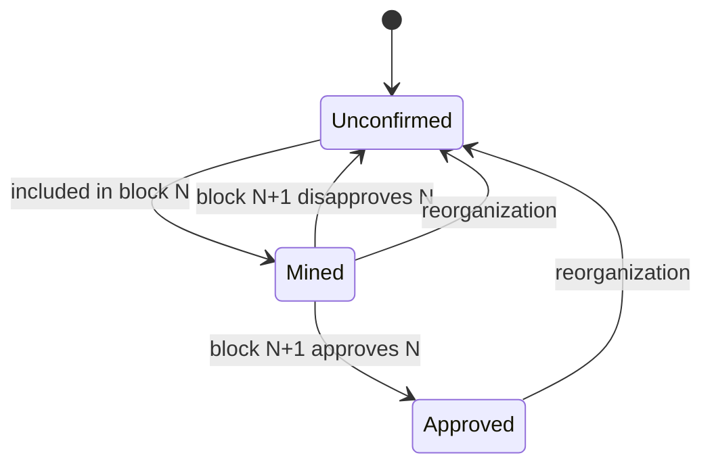

# Decred for Bitcoin developers

Decred's code descends from btcd, so most of it looks familiar. This page lists the differences that most often break ported software, each linked to the rule that defines it. Reviewers of a port can start with the [checklist](#porting-pitfalls-checklist) at the end.

## At a glance

Decred values are for mainnet: block time, size and maturity are consensus parameters from `chaincfg`; ports are program defaults.

| Aspect | Bitcoin | Decred |
|---|---|---|
| Target block time | 10 minutes | 5 minutes |
| Block validity | Proof of work | Proof of work (PoW) plus at least 3 of 5 ticket votes (proof of stake, PoS) |
| Block header | 80 bytes | 180 bytes |
| Block size limit | 4,000,000 weight units | 393,216 bytes, no weight or discount |
| Coinbase maturity | 100 blocks | 256 blocks (also vote, revocation and treasury spend outputs) |
| General hash | double SHA-256 | single BLAKE-256 (14 rounds) |
| PoW hash | double SHA-256 of the header | BLAKE3 since block 794,368 (Decred Change Proposal DCP-0011); separate from the block hash |
| Amount unit | 1 BTC = 100,000,000 satoshis | 1 DCR = 100,000,000 atoms |
| Default peer-to-peer (P2P) / remote procedure call (RPC) port | 8333 / 8332 | 9108 / 9109 (dcrd), 9110 (dcrwallet JSON-RPC) |

## Two trees and block approval

A Decred block carries two ordered lists of transactions: the **regular tree** (the coinbase and ordinary transfers) and the **stake tree** (tickets, votes, revocations and treasury transactions).

Every vote in block N+1 says whether its ticket holder approves the regular tree of block N. Unless strictly more votes in N+1 approve than disapprove (a two-to-two split disapproves, and so do two disapprovals out of three votes), every effect of block N's regular tree on the unspent transaction output (UTXO) set is undone: its coinbase is destroyed and its transactions become unconfirmed again, free to be mined later if still valid. Block N stays in the chain, its stake tree stands, and both blocks are valid ([stakeholder approval](../../whitepaper/10-blocks.md#sec:blocks-approval)).

So **a transaction with one confirmation has not yet been accepted by stakeholders**, and the outputs it created exist only tentatively until the next block approves it.



dcrwallet reports `"confirmations": 1` for the "mined, awaiting approval" state and `2` once the next block approves. Decrediton displays one less: "Mined, block awaiting approval", then "1 confirmation". Disapproval is rare on mainnet, but crediting deposits at one confirmation exposes an integration to it in every block. The stake tree is never disapproved, so stake transactions may not spend regular-tree outputs of their own block. [Blocks, confirmations and reorganizations](../protocol/blocks-and-confirmations.md) turns this into a confirmation policy; [Miners, voters and the life of a block](../../user/start/life-of-a-block.md) explains it without code.

## Transactions

A Decred transaction is split into a **prefix** (outpoints, sequence numbers, outputs, lock time, expiry) and a **witness** (one entry per input: the signature script and three fraud-proof fields). This separation predates SegWit and is unrelated to it: there are no witness programs, no weight, and no marker or flag bytes.

| Field | Bitcoin | Decred |
|---|---|---|
| Version | 32-bit version | 16-bit version and 16-bit serialization type in one little-endian word |
| Outpoint | txid, index | txid, index, **tree** byte (0 regular, 1 stake) |
| Input | outpoint, scriptSig, sequence | prefix: outpoint, sequence. Witness: `ValueIn`, `BlockHeight`, `BlockIndex`, signature script |
| Output | value, script | value, **16-bit script version**, script |
| Trailer | lock time | lock time and **expiry** |

### Serialization types and the txid

The version word's low 16 bits are the transaction version (1; 2 enables sequence locks; 3 is for treasury transactions and treasury votes). Its high 16 bits are the serialization type: 0 full (prefix then witness), 1 prefix only, 2 witness only. dcrd puts only full serializations in blocks and its mempool.

The **txid is the BLAKE-256 hash of the prefix-only serialization**, version word included. Because that word carries serialization type 1, the hashed bytes are not a slice of the raw transaction. For a version 1 transaction:

```text
full serialization (what you receive)   01000000 <prefix body> <witness body>
prefix serialization (what is hashed)   01000100 <prefix body>
```

Merkle trees use the *full hash* `BLAKE256(txid || witness_hash)`, so headers commit to witnesses too. Signature malleability cannot change a txid. See the whitepaper's [transaction encoding](../../whitepaper/04-encoding.md#sec:encoding-tx) and [transaction identifiers](../../whitepaper/04-encoding.md#sec:encoding-txid).

### Fraud-proof fields

Each input's witness repeats the amount (`ValueIn`), block height and in-tree index of the output it spends ([input witness fields](../../whitepaper/07-transactions.md#sec:transactions-witness)). Blocks must carry the exact values, but a builder does not have to: dcrd's mempool rewrites all three from its UTXO set when it accepts a transaction, and miners fill them again when they build a template. dcrwallet sets only `ValueIn` and leaves `BlockHeight` 0 and `BlockIndex` 0xffffffff. `ValueIn` may also be -1, which means "fill in later"; dcrd's `createrawtransaction` writes the optional per-input `amount` into `ValueIn`, or -1 when it is omitted.

### Expiry

A non-zero `Expiry` makes a transaction invalid in any block at height `Expiry` or above. Less obviously, **the outputs of a transaction with an expiry cannot be spent until 256 blocks after it is mined** (`ErrExpiryTxSpentEarly`), change included. Ordinary payments from the official wallets carry no expiry. See [expiry](../../whitepaper/07-transactions.md#sec:transactions-expiry).

### Size and fee of a payment

A one-input, two-output pay-to-public-key-hash (P2PKH) payment is 253 bytes as dcrwallet estimates it: the input is 166 bytes, larger than a Bitcoin legacy input mainly because of the tree byte and 16 bytes of fraud-proof data, and each output is 36 bytes including its 2-byte script version. At the default relay rate of 10,000 atoms/kB the minimum fee is 2,530 atoms (0.0000253 DCR).

## Hashes

| Use | Decred |
|---|---|
| txid, block hash, Merkle tree | BLAKE-256 (single) |
| `HASH160`, `OP_HASH160` | RIPEMD-160(BLAKE-256(x)) |
| `OP_HASH256` | double BLAKE-256 |
| Base58Check address and extended-key checksum | first 4 bytes of double BLAKE-256 |
| Wallet import format (WIF) private key checksum | first 4 bytes of **single** BLAKE-256 |
| Signed messages | single BLAKE-256 over the prefix `Decred Signed Message:\n` |
| P2P message checksum | first 4 bytes of single BLAKE-256 |

Proof of work has used BLAKE3 since DCP-0011, but the block hash stays BLAKE-256, so it no longer shows the leading zeros of the proof of work. A port that reuses a SHA-256 `Hash160` helper produces addresses the intended key cannot spend from. See the whitepaper's [BLAKE-256](../../whitepaper/03-crypto.md#sec:crypto-blake256) and [BLAKE3](../../whitepaper/03-crypto.md#sec:crypto-blake3).

## Script

The script machine has Bitcoin's shape, but its details differ in ways that pass casual testing and fail on chain. The whitepaper's [script chapter](../../whitepaper/06-script.md#ch:script) advises assuming nothing matches Bitcoin unless it says so.

**Versions.** Every output carries a 16-bit script version. Only version 0 is defined, and since DCP-0008 regular transaction outputs must use it ([script versions](../../whitepaper/06-script.md#sec:script-versions)). There is no SegWit, Taproot, Tapscript or Bitcoin Improvement Proposal (BIP) 340: upgrades go through script versions and stakeholder votes.

**Signature suites.** `OP_CHECKSIG` and `OP_CHECKMULTISIG` verify the Elliptic Curve Digital Signature Algorithm (ECDSA) over secp256k1. `OP_CHECKSIGALT` (`0xbe`) and `OP_CHECKSIGALTVERIFY` (`0xbf`) take a signature type on top of the stack: 1 is Ed25519 (32-byte key), 2 is EC-Schnorr-DCRv0 over secp256k1 (33-byte key), with a 64-byte signature plus hash-type byte. EC-Schnorr-DCRv0 is Decred's own scheme, not compatible with BIP 340. A P2PKH-Schnorr output script is `OP_DUP OP_HASH160 <20 bytes> OP_EQUALVERIFY OP_2 OP_CHECKSIGALT` ([OP_CHECKSIGALT](../../whitepaper/06-script.md#sec:script-checksigalt)).

**Stake and treasury tags.** `OP_SSTX` (`0xba`), `OP_SSGEN` (`0xbb`), `OP_SSRTX` (`0xbc`) and `OP_SSTXCHANGE` (`0xbd`) prefix the outputs of tickets, votes, revocations and ticket change; `OP_TADD` (`0xc1`) and `OP_TGEN` (`0xc3`) mark treasury add and treasury spend outputs, and `OP_TSPEND` (`0xc2`) ends a treasury spend's signature script. A tag does nothing when executed, so a tagged script runs as its untagged P2PKH or pay-to-script-hash (P2SH) form. Regular transactions may not create tagged outputs, and P2SH redeem scripts may not contain tags ([stake and treasury tags](../../whitepaper/06-script.md#sec:script-stake)).

**Differences that bite ported code:**

| Rule | Decred behavior |
|---|---|
| `OP_CHECKMULTISIG` | Pops no extra element. Bitcoin's leading `OP_0` is left on the stack and fails the clean-stack rule. |
| Clean stack | Consensus: exactly one true element must remain. |
| Signature encoding | Strict Distinguished Encoding Rules (DER), low S and compressed or uncompressed public keys only are consensus. |
| Hash type byte | Must be `0x01`-`0x03` or `0x81`-`0x83`, by consensus. |
| `OP_CODESEPARATOR` | Disabled: a script that reaches it fails, even in an unexecuted branch. |
| Opcode `0xa8` | `OP_BLAKE256`. `OP_SHA256` is `0xc0` (enabled by the `lnfeatures` vote). |
| Limits | Script 16,384 bytes; element 2,048 bytes; 255 counted opcodes; stack depth 1,024. |
| Lock times | `OP_CHECKLOCKTIMEVERIFY` (CLTV) since launch; `OP_CHECKSEQUENCEVERIFY` (CSV) and sequence locks (version 2 transactions) since DCP-0003, with Decred encodings. |

## Signature hash

Decred has one [signature hash](../../whitepaper/06-script.md#sec:script-sighash) algorithm for every output type. It hashes a prefix part and a witness part separately, then combines them:

```text
sighash = BLAKE256( le32(hashType) || BLAKE256(prefixPart) || BLAKE256(witnessPart) )
```

- `prefixPart` is the prefix serialization, trimmed according to the hash type. For `SIGHASH_ALL` without `ANYONECANPAY` it is exactly the txid preimage, so the prefix digest equals the txid. (`txscript.CalcSignatureHash` has a `cachedPrefix` parameter for this, but dcrd 2.1.7 ignores it because `optimizeSigVerification` is false.)
- `witnessPart` holds only the subscript, at the position of the input being signed, and an empty script for every other input.
- It commits to the outpoint tree bytes, output script versions and the expiry.
- **It does not commit to the amounts being spent.** Unlike BIP 143 and BIP 341, nothing signed covers `ValueIn`. An offline or hardware signer that must show a correct fee has to verify input amounts against the previous transactions.
- `SIGHASH_SINGLE` with no matching output does not sign the constant 1 as Bitcoin does: `OP_CHECKSIG` pushes false and `OP_CHECKMULTISIG` fails the script.

## Addresses and keys

A P2PKH or P2SH address is Base58Check of a **two-byte network prefix** and a 20-byte `HASH160`, with a double BLAKE-256 checksum. The prefix fixes the first two characters:

| Type | mainnet | testnet | simnet |
|---|---|---|---|
| P2PKH (ECDSA) | `Ds` | `Ts` | `Ss` |
| P2SH | `Dc` | `Tc` | `Sc` |
| P2PKH Schnorr / Ed25519 | `DS` / `De` | `TS` / `Te` | `SS` / `Se` |
| Pay-to-public-key (P2PK) | `Dk` | `Tk` | `Sk` |
| WIF private key | `Pm` | `Pt` | `Ps` |
| Extended private / public key | `dprv` / `dpub` | `tprv` / `tpub` | `sprv` / `spub` |

No Decred address uses Bech32. Prefer P2PKH-ECDSA for payments: only it and P2SH work with the staking system. A WIF string carries a signature-type byte, no "compressed" flag, and a single-BLAKE-256 checksum, so it is not Base58Check.

**Hierarchical deterministic (HD) keys** follow BIP 32 with Decred version bytes, BLAKE-256-based fingerprints and checksums, and one quirk dcrwallet-compatible wallets must copy: a derived private key with leading zero bytes is stripped before deriving its hardened children. The path is `m/44'/42'/account'/branch/index` (test networks use coin type 1). Older wallets used the legacy coin type 20, so a restore should scan both. **Seeds** in dcrwallet and Decrediton are 32 bytes shown as 33 words from the PGP word list or 64 hex characters, not BIP 39 mnemonics.

The rules are in the whitepaper's [network prefixes](../../whitepaper/05-addresses.md#sec:addresses-prefixes), [WIF](../../whitepaper/05-addresses.md#sec:addresses-wif) and [hierarchical deterministic keys](../../whitepaper/05-addresses.md#sec:addresses-hd); [Keys, addresses and seeds](../protocol/keys-and-addresses.md) is the builder's guide.

## Fees and relay policy

None of this is consensus; it is dcrd's default policy.

- **Fee rate is per kB of full serialized size**; there are no virtual bytes. The default minimum is 10,000 atoms/kB (0.0001 DCR/kB, `minrelaytxfee`), and dcrwallet's default `txfee` is the same.
- **No replace-by-fee.** The mempool is first-seen: a transaction spending an input already spent by a pool transaction is rejected whatever its fee. Pay enough the first time.

The standardness rules (size, script version, signature script form, null-data outputs, dust) are in the whitepaper's [relay policy](../../whitepaper/17-policy.md#ch:policy) chapter, with its [minimum relay fee](../../whitepaper/17-policy.md#sec:policy-minfee) and [double spends and replacement](../../whitepaper/17-policy.md#sec:policy-doublespend).

## Stake and treasury transactions

Decred has seven transaction classes and **no type field**: dcrd's `stake.DetermineTxType` infers the class from the transaction's structure. Regular transactions (`TxTypeRegular`, including the coinbase) go in the regular tree. Ticket purchases (`TxTypeSStx`), votes (`TxTypeSSGen`), revocations (`TxTypeSSRtx`), treasury adds (TADD, `TxTypeTAdd`), treasury spends (TSPEND, `TxTypeTSpend`) and the treasurybase (`TxTypeTreasuryBase`) go in the stake tree.

What this means for a port:

- Index and deposit code must look at both trees: an ordinary address can be paid from the stake tree, for example by a treasury spend, and those tagged outputs need 256 blocks to mature.
- A ticket's `OP_SSTX` output can be spent only by a vote or a revocation.
- The treasury is not a UTXO but a balance tracked by consensus; treasury spends draw on it only after a stakeholder vote.

Their structure, formats and RPCs are in [Staking and the treasury for builders](../protocol/staking-and-treasury.md); the rules are in the whitepaper's [classification of stake transactions](../../whitepaper/08-staking.md#sec:staking-classification) and [of treasury transactions](../../whitepaper/12-treasury.md#sec:treasury-classify).

## Libraries: dcrd modules instead of btcsuite

Decred's Go libraries are separate modules in the dcrd repository, each with its own major version. The dcrd paths below are the major versions dcrd 2.1.7's `go.mod` requires; the dcrwallet row is dcrwallet 2.1.7's own module. [dcrd Go modules](../go/index.md) gives the module map, the versions and the versioning policy.

| btcsuite | Decred |
|---|---|
| `btcd/wire` | `github.com/decred/dcrd/wire` |
| `btcd/chaincfg`, `chainhash` | `github.com/decred/dcrd/chaincfg/v3`, `.../chaincfg/chainhash` |
| `btcd/txscript` | `github.com/decred/dcrd/txscript/v4`, with `stdscript` (script classes) and `sign` (signing) subpackages |
| `btcutil` addresses | `github.com/decred/dcrd/txscript/v4/stdaddr` |
| `btcutil` (`Amount`, `Tx`, WIF) | `github.com/decred/dcrd/dcrutil/v4` |
| `btcd/blockchain` | Not importable (dcrd's `internal/blockchain`); `blockchain/standalone/v2` and `blockchain/stake/v5` are public. |
| `btcwallet`, `neutrino` | `decred.org/dcrwallet/v5` (light mode in its `spv` package) |

One habit changes: an address's `PaymentScript()` method in `stdaddr` returns a script version along with the script, because every output needs both.

## Node and RPC differences

- `dcrd` has no wallet: `dcrwallet` serves wallet RPCs on its own port ([The Decred software stack](software-stack.md)).
- Calls that name an outpoint take the tree: `gettxout "txid" vout tree`, and each `createrawtransaction` input is `{"txid", "vout", "tree", "amount"}`. Verbose `getblock` lists the stake tree separately in `stx` and `rawstx`.
- Light clients use version 2 compact filters committed in every block header since DCP-0005, not unauthenticated BIP 157/158 filters ([compact filters](../../whitepaper/16-filters.md#ch:filters)).

## Porting pitfalls checklist

Before shipping code ported from Bitcoin, check that it:

- [ ] treats a transaction in the tip block as provisional until the next block approves it, and handles disapproval and reorganizations;
- [ ] reads and writes the tree byte in every outpoint, and scans both trees;
- [ ] computes the txid from the prefix serialization with serialization type 1, and Merkle leaves from full hashes;
- [ ] sets `ValueIn` when it knows the amount (or leaves the -1 sentinel), lets dcrd fill `BlockHeight` and `BlockIndex`, and does not rely on the signature to protect input amounts;
- [ ] uses BLAKE-256 for `HASH160`, checksums and message signing, and a single BLAKE-256 for WIF;
- [ ] builds multisig signature scripts without the leading `OP_0`, with low-S DER signatures;
- [ ] writes script version 0 on every output and uses the Decred signature hash;
- [ ] uses two-byte address prefixes, `dprv`/`dpub` keys, coin type 42 (and 20 on restore), and reproduces the hardened-derivation quirk;
- [ ] calculates fees per kB of full size, without replace-by-fee;
- [ ] leaves expiry at 0 unless 256-block output maturity is acceptable, and respects the 256-block maturity of coinbase, vote, revocation and treasury spend outputs;
- [ ] is tested against the whitepaper's test vectors and on [simnet](../environment/simnet.md).

## Go deeper

- [Differences from Bitcoin](../../whitepaper/C-bitcoin-differences.md#ch:bitcoin-differences): the full comparison, including consensus, issuance and P2P details.
- [The version word and serialization types](../../whitepaper/04-encoding.md#sec:encoding-txversion): the byte-level format.
- [Signature hash](../../whitepaper/06-script.md#sec:script-sighash): the algorithm and vectors for every hash type.
- [Stakeholder approval of the previous regular tree](../../whitepaper/10-blocks.md#sec:blocks-approval): what disapproval undoes, in order.

## Next steps

- [Transactions for builders](../protocol/transactions.md): build, parse and classify Decred transactions.
- [Build and sign transactions in Go](../go/build-and-sign-transactions.md): the same steps with `wire`, `stdaddr` and `txscript/v4/sign`.
- [Set up a private simnet](../environment/simnet.md): test ported code with tickets and votes.
- [Integrate DCR into an exchange or service](../integrate/exchange.md): deposits and withdrawals.
- [Add Decred to a wallet](../integrate/wallet-support.md): support for wallet teams.

*[PoW]: proof of work
*[PoS]: proof of stake
*[UTXO]: unspent transaction output
*[TADD]: treasury add
*[TSPEND]: treasury spend
*[HD]: hierarchical deterministic
*[WIF]: wallet import format
*[DCP]: Decred Change Proposal
*[P2P]: peer-to-peer
*[P2PKH]: pay to public key hash
*[P2SH]: pay to script hash
*[P2PK]: pay to public key
*[CLTV]: OP_CHECKLOCKTIMEVERIFY
*[CSV]: OP_CHECKSEQUENCEVERIFY
*[RPC]: remote procedure call
*[BIP]: Bitcoin Improvement Proposal
*[ECDSA]: Elliptic Curve Digital Signature Algorithm
*[DER]: Distinguished Encoding Rules
