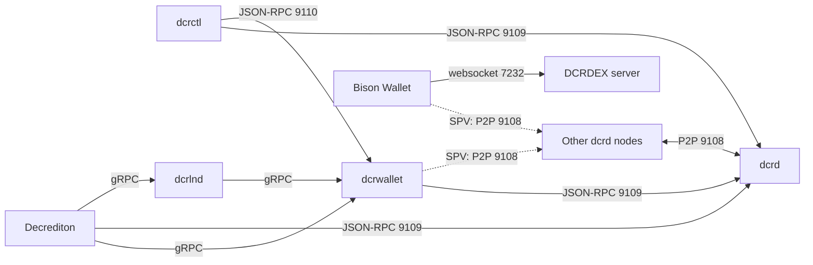
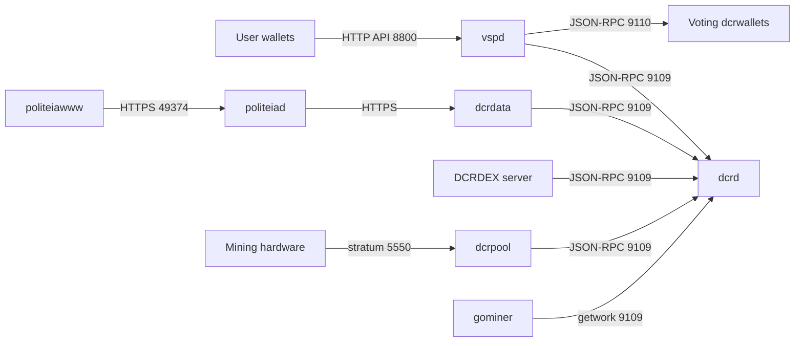

# The Decred software stack

This page maps every maintained Decred program: what it does, what it talks to over which protocol and port, and how the repositories, Go modules and release bundles are organized. Read it before you choose what to run, what to build against, or where to send a change.

!!! abstract "In short"
    - `dcrd` is the only full node and defines the protocol. Everything else reaches the chain through it, over JSON-RPC or as a peer on the peer-to-peer network.
    - `dcrwallet` is the wallet engine. Decrediton drives it over gRPC, Bison Wallet's built-in wallet compiles its packages in, and `dcrctl` controls it from the command line.
    - Services (`vspd`, `dcrdata`, Politeia, the DCRDEX server, `dcrlnd`, `dcrpool`) are separate programs with their own release cycles. None adds consensus rules.
    - Version numbers differ by layer: dcrd 2.1.7 is the Go module `github.com/decred/dcrd` v1.10.9.

## Why the software is split this way

Decred has no protocol specification separate from its code: the rules are whatever [`dcrd`, the reference implementation](../../whitepaper/02-conventions.md#conv:reference), enforces, and the whitepaper documents that behavior. Any program that needs to know which blocks are valid runs `dcrd` or trusts something that does. Keeping the wallet out of the node has three benefits:

- **One node serves many clients.** A single `dcrd` can back a wallet, an explorer, a voting service provider (VSP) and a miner at once.
- **Keys stay out of the network-facing process.** `dcrd` holds no keys, so a bug in peer handling cannot leak them.
- **Light wallets need no node.** In light (SPV, simplified payment verification) mode, `dcrwallet` talks to `dcrd` peers over the peer-to-peer (P2P) protocol and checks the compact filters committed in block headers, so it can run without a local node.

The services on top rely on consensus guarantees (ticket commitments, treasury votes, committed filters, stable transaction hashes) without changing them. The whitepaper lists which guarantee each one depends on in [Dependence on the consensus protocol](../../whitepaper/19-ecosystem.md#sec:ecosystem-dependence).

## How the programs connect

Ports in the diagrams are mainnet defaults. The first shows that every wallet reaches the chain either through `dcrd`'s JSON-RPC or as a light client on the P2P network, and that Decrediton and Bison Wallet are front ends to the same wallet code:

The second shows that each service is a separate program that needs its own connection to `dcrd`, and some also to wallets:

Every connection in one table, with the side that listens on the right:

| Client | Server | Protocol | Default listen address (mainnet) |
|---|---|---|---|
| Other nodes, light wallets | `dcrd` | Decred P2P over TCP | port 9108, all interfaces |
| `dcrctl`, `dcrwallet`, `vspd`, `dcrdata`, DCRDEX server, `dcrpool`, `gominer`, `dcrlnd` | `dcrd` | JSON-RPC over HTTPS POST or websocket (`/ws`) | localhost:9109 |
| `dcrctl --wallet`, `vspd`, Bison Wallet (**External**), Decrediton's DEX | `dcrwallet` | JSON-RPC over HTTPS or websocket | localhost:9110 |
| Decrediton, `politeiavoter`, `dcrpool`, `dcrlnd` (remote-wallet mode) | `dcrwallet` | gRPC over TLS, client certificate required | localhost:9111 |
| Wallets buying tickets | `vspd` | HTTP JSON API v3 | :8800 |
| Bison Wallet | DCRDEX server | websocket over TLS | 127.0.0.1:7232 (public: `dex.decred.org:7232`) |
| `bwctl`, a web browser | Bison Wallet | RPC (off unless `--rpc`), web UI | 127.0.0.1:5757, 127.0.0.1:5758 |
| Browsers, API clients | `dcrdata` | HTTP, REST, Insight, websocket | localhost:7777 |
| Browsers, Decrediton, `politeiavoter` | `politeiawww` | HTTPS | :4443 (public: `proposals.decred.org`) |
| `politeiawww` | `politeiad` | HTTPS | :49374 |
| Mining hardware | `dcrpool` | stratum | :5550; web UI over HTTPS on :8080 |
| Lightning peers; API clients | `dcrlnd` | Lightning P2P; gRPC; REST | :9735; localhost:10009; localhost:8080 |

On testnet the `dcrd` and `dcrwallet` ports are the mainnet ports plus 10,000 (19108 to 19111); simnet and regnet follow no such pattern. [Ports, paths and prefixes](../reference/index.md) lists every network, and [Choosing an API](../api/index.md) covers the certificate and credential setup that the RPC servers have in common.

!!! warning "Expose only the P2P port"
    Forward only 9108 to the internet. Anyone who can authenticate to `dcrwallet`'s RPC can spend from it while it is unlocked, and `dcrd`'s RPC includes methods that change node state. The RPC servers listen on localhost by default for this reason.

## The node: dcrd

`dcrd` is the full node. It validates every block and transaction, keeps the chain and the UTXO set, and relays blocks, transactions and votes. It holds no keys. What it serves to the rest of the stack:

- **P2P** on 9108: blocks, transactions, headers, and the version 2 compact filters that light wallets use ([the P2P protocol](../../whitepaper/15-p2p.md#ch:p2p)).
- **Mixpool**: it validates and relays StakeShuffle mix messages, which is what made mixing peer-to-peer in 2.0 ([mixing for builders](../protocol/mixing.md)).
- **JSON-RPC** on 9109: 77 HTTP methods plus websocket notifications for blocks, transactions, tickets, treasury spends, mix messages and mining work. The RPC server stays off unless credentials are set. See [dcrd JSON-RPC API](../api/dcrd-json-rpc.md).
- **Mining work** through `getwork` and `notifywork`. There is no `getblocktemplate`.
- **Indexes**: `txindex` (off by default) finds any transaction by hash, which `dcrdata` and DCRDEX servers need; the exists-address index is on unless `noexistsaddrindex` is set.

The same repository holds about 30 Go modules (`wire`, `chaincfg/v3`, `txscript/v4`, `rpcclient/v8` and others) that most other Decred programs import. [dcrd Go modules](../go/index.md) maps them; [A tour of the dcrd and dcrwallet code](../contributing/codebase-tour.md) explains the internals.

## Wallets

### dcrwallet

`dcrwallet` is the wallet daemon, with no user interface of its own. It holds an HD (hierarchical deterministic) wallet whose private keys are never written to disk unencrypted, builds and signs transactions, and adds the Decred-specific machinery:

- **Two sync modes**: RPC to a trusted `dcrd` (the default), or light mode with `--spv`. A light wallet [cannot vote](../../whitepaper/19-ecosystem.md#sec:ecosystem-wallets), so `dcrwallet` refuses `--spv` together with `--enablevoting`.
- **Ticket buyer**: automatic ticket purchases with `--enableticketbuyer` and the `ticketbuyer.*` options.
- **VSP client**: the `vsp.*` options; the code imports `vspd`'s own client module.
- **Mixing client**: `--mixing`, using `dcrd`'s `mixing/mixclient` package and relaying through the node's mixpool.
- **Two RPC servers**: JSON-RPC on 9110, enabled only when a username and password are set (or client-certificate auth is chosen), and gRPC on 9111, which starts only when a trusted client certificate exists.

See [dcrwallet JSON-RPC API](../api/dcrwallet-json-rpc.md), [dcrwallet gRPC API](../api/dcrwallet-grpc.md), [dcrwallet configuration](../reference/dcrwallet-config.md), and [Set up the command-line wallet](../../user/wallets/command-line.md) for the everyday setup.

### Decrediton

Decrediton is the desktop wallet: a Node.js and Electron app that ships with its own `dcrd`, `dcrwallet` and `dcrlnd` and starts them as child processes. How it wires them together, from `app/main_dev/launch.js` and `app/config.js` (which writes the `dcrwallet.conf` it uses) at release-v2.1.7:

- **`dcrwallet` over gRPC.** It starts the wallet with `--issueclientcert`, and the `dcrwallet.conf` it writes sets `grpclisten=127.0.0.1:0`; the wallet picks a free port and reports it, and the client certificate, over an inherited pipe. The JSON-RPC server is disabled (`nolegacyrpc`) unless the DEX feature needs it.
- **`dcrd` in full-node mode.** It starts `dcrd` with `--nolisten`, so Decrediton's node makes outbound connections only, and queries it over JSON-RPC.
- **`dcrlnd` in remote-wallet mode** (`--node=dcrw` with `--dcrwallet.grpchost`), using `dcrwallet`'s gRPC as its wallet and chain source.
- **DEX**: the dcrdex v1.0.6 client compiled into a shared library (`libdexc`) and loaded in-process. It uses the running `dcrwallet` through JSON-RPC, so Decrediton's **DEX** speaks the same protocol as Bison Wallet 1.0.6.
- **External services**: Politeia (`proposals.decred.org/api`), the VSP list from `api.decred.org`, and dcrdata, each subject to the app's privacy settings.

Building Decrediton needs Node.js 18.20 or later (its `engines` field), Yarn 1.22, and Go for the DEX library. See [Install and use Decrediton](../../user/wallets/decrediton.md) for the user view.

### Bison Wallet

Bison Wallet (`bisonw`, with the control CLI `bwctl`) is the DCRDEX client and a multi-asset wallet, from the `decred/dcrdex` repository. For DCR it offers two wallet types:

- **Native**: a built-in light wallet that links `dcrwallet`'s `wallet`, `spv` and `p2p` packages into the `bisonw` binary. Version 1.0.6 uses `decred.org/dcrwallet/v5` v5.0.3, the dcrwallet 2.1.3 code. It stakes through VSPs and mixes, and syncs from `dcrd` peers.
- **External**: connects to a separate `dcrwallet` over JSON-RPC.

`bisonw` serves its web UI on 127.0.0.1:5758 (127.0.0.2 on testnet, 127.0.0.3 on simnet) and connects to DCRDEX servers over websocket. See [Install and set up Bison Wallet](../../user/wallets/bison-wallet.md) and [Building on DCRDEX](../integrate/dcrdex.md).

### Cryptopower

Cryptopower, from an independent team, is a multi-coin light wallet for desktop and mobile, listed on [decred.org/wallets](https://decred.org/wallets/) but not part of the Decred release. Its v2.1.1 (August 2025) imports `decred.org/dcrwallet/v4` v4.3.1, the dcrwallet 2.0.6 code. Checked November 2026.

## Command-line tools

All of these ship in the command-line bundle.

| Tool | Repository | What it does |
|---|---|---|
| `dcrctl` | decred/dcrctl | Sends one JSON-RPC request to `dcrd`, or to `dcrwallet` with `--wallet`, prints the result and exits. On its first run without a `dcrctl.conf`, it creates one with the `rpcuser` and `rpcpass` from `dcrd.conf` at its default location. |
| `gencerts` | decred/dcrd | Writes TLS certificate and key pairs (P-256 by default; also P-384, P-521, Ed25519, RSA4096) for RPC servers and client-certificate auth. |
| `promptsecret` | decred/dcrd | Reads a secret from the terminal without echo and writes it to standard output, for piping into another program. |
| `politeiavoter` | decred/politeia | Votes your tickets on Politeia proposals: signs ballots through `dcrwallet`'s gRPC and submits them to `proposals.decred.org`. |
| `politeiaverify` | decred/politeia | Checks Politeia censorship records, receipts, signatures and timestamps without trusting the server. |
| `dcrlncli` | decred/dcrlnd | The command-line client for `dcrlnd`. |

`bwctl` (Bison Wallet) and `pictl` (a command-line client for the Politeia API, not bundled) do the same job for their services.

## Services

Each service below runs as its own daemon, normally on a server, and is built from source, except `dcrlnd`, which ships in the command-line bundle.

### vspd

`vspd` runs a voting service provider: it votes other people's tickets for a fee without holding their funds. It talks JSON-RPC over websocket to a local `dcrd` and to the voting `dcrwallet` instances, and serves the v3 API and a stats page on :8800. See [Run a voting service provider](../operate/vsp.md) for the deployment layout and [vspd API](../api/vspd-api.md).

### dcrdata

`dcrdata` is the block explorer and indexer behind `dcrdata.decred.org`. It needs a synced `dcrd` with `txindex` and PostgreSQL, and serves web pages, its REST API, an Insight-compatible API and websocket push on localhost:7777. See [dcrdata API](../api/dcrdata-api.md).

### Politeia

Politeia is the off-chain proposal system behind `proposals.decred.org`. `politeiawww` is the user-facing web backend; `politeiad` is the data layer, which stores records in Trillian-based logs, takes ticket data from dcrdata and anchors its log roots in the chain through a `dcrtime` server. The web front end is decred/politeiagui. Votes are cast from Decrediton or `politeiavoter`. See [Governance data and the Politeia API](../api/politeia-api.md).

### DCRDEX server

The DCRDEX server (binary `dcrdex`, in decred/dcrdex) hosts order books and matches orders in epochs, but never holds funds: trades settle by atomic swaps between the traders' wallets. It needs PostgreSQL and a full node or RPC endpoint for every asset it lists, connecting to `dcrd` over websocket JSON-RPC. Clients connect on port 7232; the admin API listens on 127.0.0.1:6542. See [Run a DCRDEX server](../operate/dex-server.md).

### dcrlnd

`dcrlnd` is a port of `lnd`, the Lightning Network daemon, adapted to Decred's transaction format and signatures. It runs either with an embedded wallet built from `dcrwallet`'s packages or against a separate `dcrwallet` over gRPC, which is how Decrediton runs it. It listens for Lightning peers on 9735 and serves gRPC on 10009 and REST on 8080. [Run a dcrlnd Lightning node](../operate/lightning-node.md) covers the back-end options.

### dcrpool and gominer

`dcrpool` is a stratum mining pool for BLAKE3 hardware, in solo-pool mode or public mode with PPS (pay per share) or PPLNS (pay per last N shares) payouts. It gets work from `dcrd` over JSON-RPC (`getwork`, `notifywork`) and in public mode pays miners through `dcrwallet`'s gRPC.

`gominer` is a GPU miner (OpenCL and CUDA) for BLAKE3. It mines solo against `dcrd`'s RPC. The code has a `--pool` stratum option, but its README states that solo mining is the only supported method and that `dcrpool` support is planned. Master is 2.1.0-pre and was last changed in January 2024.

See [Mining infrastructure](../operate/mining.md).

!!! tip "Two daemons default to port 8080"
    `dcrpool`'s web UI and `dcrlnd`'s REST server both default to port 8080. On one host, move one of them (`guilisten` in `dcrpool`, `restlisten` in `dcrlnd`) or turn off `dcrlnd`'s REST server with `norest`.

## Repositories and Go modules

Each program lives in its own repository under github.com/decred. The software version a user sees, the Git tag a release is cut from, and the Go module version you import are three different numbers:

| Program | Software version | Release tag | Go module and version |
|---|---|---|---|
| `dcrd` | 2.1.7 | `release-v2.1.7` | `github.com/decred/dcrd` v1.10.9 (same commit) |
| `dcrwallet` | 2.1.7 | `release-v2.1.7` | `decred.org/dcrwallet/v5` v5.1.2 (same commit) |
| `dcrctl` | 2.1.7 | `release-v2.1.7` | `decred.org/dcrctl`, pseudo-version (no semver tag) |
| Bison Wallet | 1.0.6 | `v1.0.6` | `decred.org/dcrdex` v1.0.6 |

So `go get github.com/decred/dcrd@v2.1.7` fails: there is no such module version. Import the library modules you need (`chaincfg/v3`, `wire`, `rpcclient/v8`) at their own versions, as [dcrd Go modules](../go/index.md) explains.

The maintained repositories, with the version these docs describe and the Go version their `go.mod` requires at that tag. Dates are release-page dates where a release page exists and tag dates otherwise:

| Repository | Programs | Module path | Version (date) | Go |
|---|---|---|---|---|
| [decred/dcrd](https://github.com/decred/dcrd) | `dcrd`, `gencerts`, `promptsecret` | `github.com/decred/dcrd` + 29 library modules | release-v2.1.7 (2026-10-14) | 1.24 |
| [decred/dcrwallet](https://github.com/decred/dcrwallet) | `dcrwallet` | `decred.org/dcrwallet/v5` | release-v2.1.7 (2026-10-14) | 1.26 |
| [decred/dcrctl](https://github.com/decred/dcrctl) | `dcrctl` | `decred.org/dcrctl` | tag release-v2.1.7 (2026-10-13), no release page | 1.24 |
| [decred/decrediton](https://github.com/decred/decrediton) | Decrediton | Node.js app; `go.mod` for the DEX library | release-v2.1.7 (2026-10-14) | 1.25 |
| [decred/dcrdex](https://github.com/decred/dcrdex) | `bisonw`, `bwctl`, `dcrdex` server | `decred.org/dcrdex` | tag v1.0.6 (2026-01-06); newest release page v1.0.5 (2025-12-15) | 1.24 |
| [decred/vspd](https://github.com/decred/vspd) | `vspd`, `vspadmin` | `github.com/decred/vspd`, `client/v4`, `types/v3` | release-v1.5.0 (2026-08-24) | 1.25 (release notes: build with 1.26+) |
| [decred/dcrlnd](https://github.com/decred/dcrlnd) | `dcrlnd`, `dcrlncli` | `github.com/decred/dcrlnd` | tag v0.8.1 (2025-12-08); newest release page v0.4.0 (2023-09-20) | 1.24 |
| [decred/politeia](https://github.com/decred/politeia) | `politeiad`, `politeiawww`, `politeiavoter`, `politeiaverify`, `pictl` | `github.com/decred/politeia` | tag v1.5.0 (2024-06-29); newest release page v1.4.0 (2022-08-22) | 1.19 |
| [decred/dcrdata](https://github.com/decred/dcrdata) | `dcrdata` | `github.com/decred/dcrdata/v8` (master) | last tag release-v6.1.0 (2022-06-22); newest release page release-v6.0 (2021-09-03) | 1.21 (master) |
| [decred/dcrpool](https://github.com/decred/dcrpool) | `dcrpool` | `github.com/decred/dcrpool` | release-v2.0.0 (2024-08-12) | 1.21 |
| [decred/gominer](https://github.com/decred/gominer) | `gominer` | `github.com/decred/gominer` | no release page; master 2.1.0-pre | 1.18 (master) |
| [decred/decred-release](https://github.com/decred/decred-release) | `dcrinstall` | `github.com/decred/decred-release` | v2.1.7 (2026-10-14) | 1.17 |

Release pages lag the tags: dcrlnd v0.8.1 and politeia v1.5.0 have no release pages, yet they are what the 2.1.7 command-line bundle builds, so check the tags and the bundle rather than the newest release page. The Go column is the `go` directive at that tag; the dcrwallet README asks for Go 1.26 or 1.27.

!!! note "Master is not the release"
    The default branches of `dcrd` and `dcrwallet` are 2.2.0-pre, with changes that no release contains yet, and dcrdex master is the 1.1 line. Check behavior at the release tag. `dcrwallet` also checks the RPC API version of the `dcrd` it connects to and refuses one that is too old, so a master wallet may not run against a release node.

## Release bundles and where binaries come from

Releases ship as four signed bundles. The `decred/release` repository's builder cross-compiles the command-line and Bison Wallet bundles with `CGO_ENABLED=0` and `-trimpath`, so anyone can rebuild them and compare hashes ([Releases and reproducible builds](../contributing/releases.md)).

| Bundle | Contents | Published at | Manifest |
|---|---|---|---|
| Command-line suite (`decred`) | `dcrd`, `dcrwallet`, `dcrctl`, `gencerts`, `promptsecret`, `dcrlnd`, `dcrlncli`, `politeiavoter`, `politeiaverify`, plus sample configs for `dcrd`, `dcrwallet`, `dcrctl`, `dcrlnd` and `politeiavoter` | [decred-binaries v2.1.7](https://github.com/decred/decred-binaries/releases/tag/v2.1.7) | `decred-v2.1.7-manifest.txt` |
| Decrediton | Installers (`.exe`, `.dmg`, `.AppImage`, `.tar.gz`) | decred-binaries v2.1.7 | `decrediton-v2.1.7-manifest.txt` |
| Bison Wallet (`bisonwallet`) | `bisonw`, `bwctl` | decred-binaries v2.1.7 | `bisonwallet-v1.0.6-manifest.txt` |
| `dcrinstall` | One installer binary that downloads, verifies and sets up the command-line and Bison Wallet bundles | [decred-release v2.1.7](https://github.com/decred/decred-release/releases/tag/v2.1.7) | `dcrinstall-v2.1.7-manifest.txt` |

Each manifest has an `.asc` signature from the Decred release key. The command-line, Bison Wallet and `dcrinstall` bundles cover 13 targets: macOS (amd64, arm64), FreeBSD (amd64), Linux (386, amd64, arm, arm64, riscv64), OpenBSD (amd64, arm64) and Windows (386, amd64, arm64). Decrediton is built for Windows amd64, macOS amd64 and arm64, and Linux amd64. [Verify your download](../../user/security/verify-downloads.md) shows the checks.

Elsewhere:

- The `dcrd` and `dcrwallet` release pages carry release notes but no files; the decred-binaries release repeats those two sets of notes next to the downloads.
- dcrdex release pages carry `bisonw` archives and `bisonw-desktop` installers, but stop at v1.0.5; Bison Wallet 1.0.6 is only in decred-binaries.
- `vspd`, `dcrdata`, Politeia's servers, the DCRDEX server, `dcrpool` and `gominer` are source only. See [Build from source](../environment/build-from-source.md).

## Retired and replaced projects

Old guides still point at these. None of the repositories is marked archived on GitHub, so check this list before you build on one.

| Project | Status | Use instead |
|---|---|---|
| `dcrstakepool` | Deprecated since 2020; last commit 2021 | `vspd` |
| CoinShuffle++ server (`csppserver` in decred/cspp) | Unused since 2.0 (2024), when mixing became peer-to-peer through `dcrd` | `dcrd`'s mixpool. The cspp repository still provides `csppsolver` and the `solverrpc` package that `dcrd` and `dcrwallet` import. |
| `atomicswap` command-line tools | Manual swap utilities; last functional change 2020 | DCRDEX and Bison Wallet |
| Decred mobile wallets (`dcrandroid`, `dcrios`) | Last updated 2022 | Cryptopower lists Android and iOS; the Decred release has no mobile app |
| `godcr` desktop wallet | Discontinued; its README points to Cryptopower | Cryptopower |
| `dcrdocs`, `dcrdevdocs` | The old documentation sites | This site |

[What changed](../../user/reference/whats-changed.md) maps retired options, flags and terms to their replacements.

## What can go wrong

- **Running behind a mandatory release.** Version 2.1.6 fixed a critical consensus bug, and its notes say everyone had to upgrade or risk being forked off the network. A node on the wrong chain takes every wallet and service connected to it along. Upgrade `dcrd` first, then the programs that depend on it, as [Upgrading and mandatory releases](../../user/run/upgrades.md) describes.
- **Mismatched versions across components.** `vspd` 1.5.0 refuses `dcrd` and `dcrwallet` older than 2.1.6, so upgrade `dcrd` and `dcrwallet` on every server before you upgrade `vspd` itself.
- **Building against unstable APIs.** The `dcrwallet` README calls its gRPC API "not stabilized", and the `dcrlnd` README describes its APIs as not yet stable. Pin versions and test on simnet before you upgrade.
- **DEX protocol changes.** 1.0.x clients cannot trade on a 1.1 server, nor 1.1 clients on a 1.0.x server. A server that upgrades revokes active 1.0.x swaps, whose on-chain funds then wait for their lock time to refund. See [Trading on DCRDEX](../../user/dex/trading-guide.md).

## Go deeper

- [The reference implementation](../../whitepaper/02-conventions.md#conv:reference): why `dcrd`'s behavior defines the protocol.
- [Dependence on the consensus protocol](../../whitepaper/19-ecosystem.md#sec:ecosystem-dependence): which consensus guarantee each service relies on.
- [Wallets and light clients](../../whitepaper/19-ecosystem.md#sec:ecosystem-wallets): how `dcrwallet` follows the chain in each mode, and why light wallets cannot vote.
- [The peer-to-peer protocol](../../whitepaper/15-p2p.md#ch:p2p): the messages `dcrd` exchanges on port 9108.

## Next steps

- [Decred for Bitcoin developers](decred-for-bitcoin-developers.md): the protocol differences to absorb before you touch this code.
- [Networks](../environment/index.md): pick mainnet, testnet, simnet or regnet and configure the stack for it.
- [Choosing an API](../api/index.md): which interface in the tables above fits your job.
- [Build from source](../environment/build-from-source.md): toolchains for each repository and multi-module workspaces.
- [dcrd Go modules](../go/index.md): the libraries you import instead of the application module.

*[API]: application programming interface
*[CLI]: command-line interface
*[DEX]: decentralized exchange
*[DCRDEX]: Decred's decentralized exchange protocol and servers
*[gRPC]: a remote procedure call framework from Google, using Protocol Buffers over HTTP/2
*[HD]: hierarchical deterministic
*[P2P]: peer-to-peer
*[PPLNS]: pay per last N shares
*[PPS]: pay per share
*[REST]: representational state transfer
*[RPC]: remote procedure call
*[SPV]: simplified payment verification
*[TLS]: Transport Layer Security
*[UTXO]: unspent transaction output
*[VSP]: voting service provider
