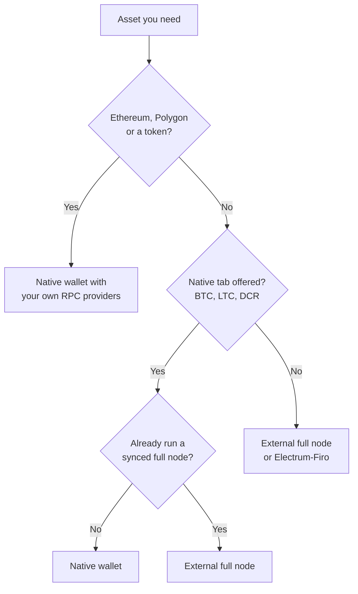

# Wallets for other assets in Bison Wallet

Every DCRDEX market pairs two assets, and Bison Wallet can only trade it once it has a working wallet for each. This page helps you choose and set up the second one (Bitcoin, Litecoin, Ethereum, a Polygon token or another asset) and covers RPC providers, gas and token approvals for Ethereum and Polygon.

!!! info "Applies to"
    Bison Wallet 1.0.6, standalone or in the DEX window of Decrediton 2.1.7. Checked November 2026.

## Before you start

- Bison Wallet set up, with your app seed written down: see [Install and set up Bison Wallet](../wallets/bison-wallet.md).
- The market you want: in **Wallet**, each asset's markets section (for example **Bitcoin Markets**) lists what your servers offer.
- For a full node or Electrum: that software installed and fully synced.
- For Ethereum, Polygon or a token: an RPC endpoint, ideally with your own API key, and some ETH or POL for gas.
- In Decrediton: open **DEX**, log in and click **Launch DEX Window**, which opens Bison Wallet.

## Why every market needs two wallets

DCRDEX settles a trade with an atomic swap: each trader locks coins in a contract on their own asset's blockchain, then claims ("redeems") the other side's contract. No server holds the coins ([DCRDEX: Trading without custody](index.md) explains the model). So you need a wallet for the asset you sell, to fund your contract, and one for the asset you buy, to redeem the counterparty's. Each pays its own chain's network fees.

Both wallets must stay connected and unlocked until the swap completes; otherwise Bison Wallet warns "Your wallets must be connected and unlocked before trades can be processed." An offline wallet makes the swap fail and hurts your account's standing. In the worst case, the counterparty redeems your contract and their contract's lock time passes before your wallet redeems it. They can then take a refund, and you lose the coins you sold.

**Native** wallets are built into Bison Wallet, and their keys come from your app seed. **External** wallets (a full node or Electrum) keep their own keys; Bison Wallet only connects to them.

## Choose a wallet type

| Type | Whom you rely on | Sync | Keys and backup | Suited to |
|---|---|---|---|---|
| Native | Network peers, as a light wallet (SPV); RPC providers for Ethereum and Polygon | Headers and filters only: quick | Inside Bison Wallet; restored by the app seed | Most traders |
| Full node | Only your own node | The whole chain; must stay running | In the node; back it up yourself | Node operators; assets with no native wallet |
| Electrum | Electrum servers, which learn your addresses | Quick | In Electrum; back up its seed | Existing Electrum users |

The native Bitcoin and Litecoin wallets use Neutrino, a light-client protocol based on compact block filters. The Bison Wallet guide calls the Electrum option "less mature" and less private than the others.

What Bison Wallet 1.0.6 offers for each asset, with the minimum external-software version it checks for:

| Asset | Native | Full node | Electrum |
|---|---|---|---|
| Bitcoin (BTC) | Yes | Bitcoin Core 27.0 | Electrum 4.5.5 (4.x) |
| Litecoin (LTC) | Yes | Litecoin Core 0.21.2.1 | Electrum-LTC 4.2.2 (4.x) |
| Decred (DCR) | Yes | `dcrwallet`, see [Install and set up Bison Wallet](../wallets/bison-wallet.md) | No |
| Ethereum (ETH); tokens USDC, Tether, MATIC | Yes, through RPC providers | Your own node, added as a provider | No |
| Polygon (POL); tokens USDC, Tether, Wrapped Ether, Wrapped Bitcoin | Yes, through RPC providers | Your own node, added as a provider | No |
| Bitcoin Cash (BCH) | No | Bitcoin Cash Node 27.0.0 | No |
| Dash | No | Dash Core 20.1.1 | No |
| DigiByte (DGB) | No | DigiByte Core 8.22 (7.17 also passes the version check) | No |
| Dogecoin (DOGE) | No | Dogecoin Core 1.14.7.0 | No |
| Firo | No | Firo Core 0.14.14.1 | Electrum-Firo 4.1.5 (4.x) |
| Zcash (ZEC) | No | `zcashd` 5.9.1 | No |

A wallet only matters if your server lists a market for it. Bison Wallet 1.1 (tagged, not released when this page was checked) adds Monero and Base. The choice usually comes down to this:



## Create a native wallet

Use this for Bitcoin and Litecoin. Quick Configuration may already have created them, together with Decred, Ethereum and Polygon.

1. Open **Wallet** and select the asset in the list on the left.
2. Click **Create a Bitcoin Wallet** (the button names the asset). The **Add a Bitcoin Wallet** dialog opens with tabs: **Native**, **External** and **Electrum (external)**.
3. Stay on **Native** and click **Create!**. To review fee options first, click **show additional settings**; the defaults suit most people.
4. Wait while **Block Sync** rises to 100% and **Balance Discovery** finishes.

You should see **Wallet Type** **Native** and **Status** **Ready**. Click **Receive** to get a deposit address.

## Connect a full node or Electrum

External software must be running and synced **before** you start Bison Wallet, and must keep running until **after** you stop it. While Bison Wallet runs, do not lock or unlock the external wallet, change its settings, freeze coins or send from it directly. Giving Bison Wallet a wallet of its own avoids conflicts.

### A full node

The steps use Bitcoin Core; the other full nodes follow the same pattern, with the differences noted in the steps.

1. Enable the node's RPC server in its configuration file (`bitcoin.conf`, `litecoin.conf` and so on), then restart the node:

    ```ini title="bitcoin.conf"
    server=1
    rpcuser=<USERNAME>
    rpcpassword=<PASSWORD>
    ```

    `<USERNAME>` and `<PASSWORD>` are credentials you make up for this connection. The node also needs a wallet loaded at startup (in Bitcoin Core, `wallet=<WALLET_NAME>`).

2. Let the node sync fully, then start Bison Wallet.
3. In **Wallet**, select the asset, click its **Create a ... Wallet** button and choose the **External** tab (**Litecoin Core (external)** or **Firo Core (external)** for those assets). Assets with one wallet type (Bitcoin Cash, Dash, DigiByte, Dogecoin, Zcash) show no tabs.
4. If the node's configuration file is in its default location, Bison Wallet fills in the values and marks them **loaded from file**. Otherwise click **load from file**, or type them after clicking **show additional settings**:
    - **Wallet Name**: the wallet's name in the node.
    - **JSON-RPC Username** and **JSON-RPC Password**: your `rpcuser` and `rpcpassword`.
    - **JSON-RPC Address**: default `127.0.0.1`.
    - **JSON-RPC Port**: prefilled with the usual port, for example 8332 for Bitcoin and 9332 for Litecoin.

    Dogecoin and Zcash have no **Wallet Name** field, and their **JSON-RPC Address** starts empty, which means `127.0.0.1`. For Bitcoin Cash, Dogecoin and Zcash the port field starts empty (leave it empty to use the node's default port, or enter the `rpcport` you set).

5. Under **Wallet Password**, enter the node wallet's passphrase, or leave it empty if the wallet is not encrypted. Zcash shows no password field. Click **Add**.

You should see **Wallet Type** with the tab's name (for example **External**) and **Status** **Ready**. For Zcash, `zcashd` must first have its seed backup confirmed with `zcashd-wallet-tool`, or Bison Wallet cannot create its account.

### Electrum

1. In Electrum (minimum versions in the table above), open **View** > **Show Console** and give its RPC server a username, password and fixed port:

    ```python
    setconfig('rpcuser', '<USERNAME>')
    setconfig('rpcpassword', '<PASSWORD>')
    setconfig('rpcport', '<PORT>')
    ```

    `<PORT>` is any free port, such as 7777. Restart Electrum and leave it open with the wallet loaded.

2. In Bison Wallet, choose the **Electrum (external)** tab (**Electrum-LTC (external)**, **Electrum-Firo (external)**).
3. Click **show additional settings** and enter **JSON-RPC Username**, **JSON-RPC Password** and **JSON-RPC Port** (Bison Wallet has no default port for Electrum). **JSON-RPC Address** defaults to `127.0.0.1`, and an empty **Wallet File** means Electrum's `default_wallet`.
4. Enter the Electrum wallet's password under **Wallet Password** and click **Add**.

The [Bison Wallet wallet guide](https://github.com/decred/dcrdex/wiki/Wallet) walks through both options for Litecoin.

## Ethereum, Polygon and tokens

Ethereum and Polygon wallets are native: the app seed creates one account per network, and Bison Wallet signs every transaction. They read the chain through **RPC providers**: servers, or your own node, that answer queries and relay transactions.

### RPC providers

A provider sees your IP address, your account (and so your balances and history) and every transaction you send. It cannot spend for you, but it can fall behind or go offline; Bison Wallet sets aside a failing provider, so list several.

If you enter no provider, Bison Wallet uses a built-in list of public endpoints and the wallet panel says "You are using the default set of public RPC providers", with an **Add a custom RPC provider** button. The [Bison Wallet guide](https://github.com/decred/dcrdex/wiki/Wallet) recommends endpoints with your own API key (shared ones hit rate limits quickly), `wss://` addresses and your own node if you run one, and lists providers it has tested. It warns against the Flashbots Protect RPC, which drops transactions not mined within 6 minutes.

### Create the wallet and a token wallet

1. In **Wallet**, select **Ethereum**, **Polygon** or a token. Tokens show their network's small icon next to their own, and the dialog says **Token on Ethereum** or **Token on Polygon**.
2. Click the **Create a ... Wallet** button, then **show additional settings**.
3. Enter an endpoint in **RPC Provider**. Two boxes are shown; **+** adds more. Accepted forms are `wss://` (preferred), `https://` and, for a local node, the path to its IPC file.
4. Check **Gas Fee Limit**: 200 gwei per gas for Ethereum and 1000 for Polygon by default.
5. Click **Create!**.

Bison Wallet tests each provider it does not already know. At creation, it is enough that one of them connects and passes the checks. When you change providers later (click **Settings**, edit **RPC Provider** and click **Submit**), every new provider must connect and pass, or the change is refused.

Creating a token wallet also creates its network's wallet if needed: the dialog shows **Synchronizing** and adds the token wallet when the sync completes. **Wallet Type** reads **RPC** for Ethereum and **External** for Polygon, but both keep their keys inside Bison Wallet.

!!! warning "Use the account only in Bison Wallet"
    Do not use the same Ethereum or Polygon account in another wallet app or a second Bison Wallet install. Sending, cancelling or "speeding up" a transaction elsewhere can make trades fail and lose funds. **Settings** > **Export Wallet** shows the account's private key for emergency recovery only.

### Gas

Each transaction uses gas, priced in gwei (a billionth of an ETH or POL) and always paid in ETH or POL, also for tokens. Bison Wallet reserves it when you place an order: for the swap and a possible refund when you sell, and for the redeem when you buy. You therefore need some ETH or POL in the network's wallet before you approve, buy or sell, even to buy a token. If **Gas Fee Limit** is below a market's maximum fee rate, Bison Wallet refuses orders on that market.

### Approve a token before its first swap

To send a token in a swap, the swap contract needs your permission to move it: a one-time approval transaction per token.

1. Open **Trade** and select the market. Without approval you see "Token approval is required before selling" (or "before buying", or "before trading").
2. Click **Approve** followed by the token symbol, for example **Approve USDC.POLYGON**.
3. Check the estimated fee against the **Available fee balance**; if it is too low, the form shows the address to fund.
4. Click **Approve**. The market shows **Approval change pending** until the transaction is mined.

The approval has no limit: the swap contract may move any amount of that token from your account. To withdraw it, click **Remove Token Allowances** in the token wallet's **Settings**; this costs gas, and you must approve again to trade.

## Fee status and transaction history

- **Fee status.** When exchange rates are available, the wallet panel shows **Network Fee Rate**, **Exchange Rate**, **Send Fees**, **Sell Fees** (your swap) and **Buy Fees** (the redeem). Token fees are shown in ETH or POL.
- **Transaction history.** The list (for example **Bitcoin Transaction History**) types each transaction: **Send**, **Receive**, **Swap**, **Redeem**, **Refund**, **Split**, **Create bond**, **Approve token** and others. Click a row for **Transaction Details** and a block explorer link. Some external wallets show "Transaction history not available for this wallet".

## Decred-specific features

Privacy (StakeShuffle mixing) is available only in the native Decred wallet. Staking through a VSP and vote preferences (**Set Votes**) appear in the Decred wallet panel for the native wallet and for an external `dcrwallet` connected to its own `dcrd` (not one running in SPV mode). Mix an external `dcrwallet` through its own settings. See [Mix your DCR](../privacy/mix-your-dcr.md) and [Stake with Decrediton or Bison Wallet](../staking/stake.md).

## Back up: What the app seed restores

| Wallet | Restored by the app seed | Also keep |
|---|---|---|
| Native Bitcoin, Litecoin, Decred | Yes | Nothing |
| Ethereum, Polygon and their tokens | Yes, the same accounts | Your RPC provider list, which you re-enter |
| External full node | No | The node wallet's own backup |
| Electrum | No | Electrum's seed |
| External `dcrwallet` | No | Its 33-word seed |

After restoring the app seed, create each wallet again and wait for **Balance Discovery** to finish. Token approvals are recorded on chain, so they survive a restore. Back up your DCRDEX accounts separately; the [trading guide](trading-guide.md) shows how.

!!! danger "Never share the app seed"
    The 15 words control every native wallet listed above, on every network. Enter them only in Bison Wallet's **Restoration Seed** box.

## Check that it worked

- The wallet panel shows **Status** **Ready**, and **Block Sync** has reached 100%.
- A small deposit to the **Receive** address appears in the wallet's transaction history.
- On **Trade**, the market's order form opens without an approval message.

## Troubleshooting

### An external wallet shows Status Off

Bison Wallet could not reach it; its log says "Unable to connect to btc wallet (start and sync wallets BEFORE starting dex!)" (with that asset's symbol). Start and sync the node or Electrum, check the credentials and port under **Settings**, then click **Connect** or restart Bison Wallet.

### "reported node version ... is less than minimum"

The full node is older than the version in the table above. Upgrade it. Electrum gives "wanted electrum wallet version 4.5.5 but got ..." for the same reason.

### Ethereum or Polygon provider errors

At creation, "expected to successfully connect to at least 1 of these unfamiliar providers" or "no compliant providers found among" means no endpoint you entered worked. When changing providers in **Settings**, "expected to successfully connect to all of these unfamiliar providers" or "... has a non-compliant API" means one of them failed. Check each URL, including its API key, try the provider's `wss://` address, or remove the failing one.

### "server's max fee rate ... higher than configured fee rate limit"

Your **Highest acceptable fee rate** (or **Gas Fee Limit**) is below what the market requires. Raise it under **Settings** if you accept paying up to the market's maximum rate. Bitcoin-family wallets log it with the misspelling "configued".

## Next steps

- [Your first trade on DCRDEX](first-trade.md): post a bond and place a small order with your new wallet.
- [Trading on DCRDEX](trading-guide.md): order types, swap timings, refunds and account backups.
- [DEX troubleshooting](troubleshooting.md): what to do when a swap is stuck.
- [Privacy beyond mixing](../privacy/privacy-practices.md): the privacy trade-offs of light wallets, RPC providers and DEX servers.
- [Back up and restore your wallet](../wallets/back-up-and-restore.md): test your backups.

The whitepaper's [atomic swaps and DCRDEX section](../../whitepaper/19-ecosystem.md#sec:ecosystem-dex) describes the swap contracts in detail.

*[DEX]: decentralized exchange
*[RPC]: remote procedure call
*[IPC]: inter-process communication
*[VSP]: voting service provider
*[SPV]: simplified payment verification
