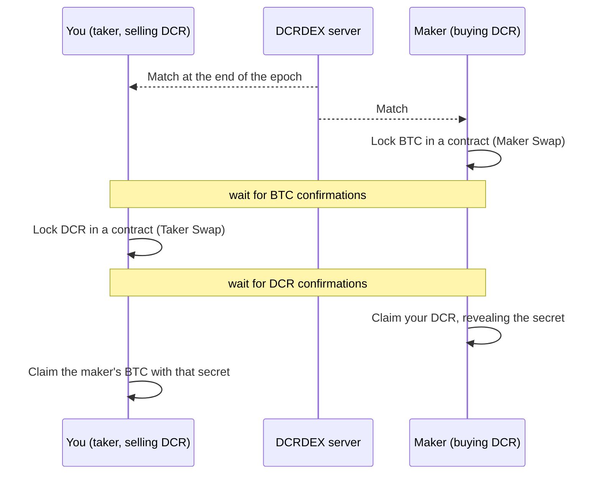

# Your first trade on DCRDEX

This tutorial walks you through one small, complete trade on DCRDEX, Decred's non-custodial exchange: you connect to a server, post a fidelity bond, place a one-lot order and watch it settle by atomic swap. It is for anyone who has some DCR and has never traded on DCRDEX. [DCRDEX: Trading without custody](index.md) explains the model behind each step.

!!! info "Applies to"
    Bison Wallet 1.0.6 and Decrediton 2.1.7 (whose built-in DEX client is the same DCRDEX 1.0.6 code). Checked November 2026.

## What you will need

- **Bison Wallet or Decrediton,** installed from the official release and verified: see [Install and set up Bison Wallet](../wallets/bison-wallet.md) or [Install and use Decrediton](../wallets/decrediton.md). Decrediton's **DEX** page is not available for Trezor or Ledger wallets.
- **DCR to cover the bond and the trade.** This tutorial sells one lot of DCR for bitcoin (BTC) on a DCR-BTC market, so DCR is the only coin you need; the BTC you receive pays its own network fee. The app shows the server's bond size and lot size before you commit anything. [Get DCR](../start/get-dcr.md) lists ways to obtain some.
- **A wallet for the other asset.** You create a BTC wallet in Step 3; it can start empty.
- **Time and a computer that stays online.** Expect about an hour of hands-on work spread over an afternoon, with waits for wallet sync, the bond's confirmations and settlement, which the app says can take "as long as a few hours". The app must keep running until the trade has settled.

!!! note "Other markets and testnet"
    The steps work for any market the server lists. To buy DCR instead, fund the other coin's wallet and click **Buy** where this page says **Sell**. To rehearse on testnet, start `bisonw --testnet` (its page is at `http://127.0.0.2:5758`). Its built-in testnet server is `bison.exchange:17232`; check that it is online before relying on it, because it did not resolve in November 2026. Testnet coins for both assets can also be hard to obtain.

## Step 1: Back up the app seed

Your DCRDEX accounts and Bison Wallet's own wallets are derived from one **app seed**. If your computer fails and you have no copy, you cannot reclaim a bond or the coins in those wallets.

=== "Bison Wallet"

    If you wrote down the 15-word app seed when you set up Bison Wallet, skip to Step 2. Otherwise:

    1. Open the menu (the three-line icon at the top right) and click **Settings**.
    2. Click **View Application Seed**, enter your app password and click **Show Me**.
    3. Write the words on paper, in order, and read them back against the screen.

=== "Decrediton"

    Decrediton's DEX client has its own seed and passphrase, separate from your wallet's seed. You set them up when you switch the DEX on:

    1. In the sidebar, click **DEX**, then click **Enable DEX**. Accept the **Wallet restart required** prompt; Decrediton restarts the wallet. Decrediton suggests using a separate wallet for trading and moving funds to your main wallet afterwards.
    2. Click **DEX** again. On **Set DEX Password**, click **Set DEX Passphrase** and choose a passphrase. This is the DEX client's equivalent of Bison Wallet's app password.
    3. On **Confirm DEX Account Seed**, click **Click to reveal DEX Account Seed**. Write it on paper, check it, and click **I have copied the DEX Account Seed**.

!!! danger "The seed is the key to your bonds and DEX wallets"
    Keep it on paper, offline. Never type it into a website or chat, and never give it to anyone claiming to be support. [Back up and restore your wallet](../wallets/back-up-and-restore.md) explains how to store it.

## Step 2: Connect to a DCRDEX server

A DCRDEX server matches orders but never holds your coins. Bison Wallet 1.0.6 has one mainnet server built in, `dex.decred.org:7232`, with its TLS certificate included. You connect in view-only mode now and create the account in Step 4. Clicking a listed server connects at once, so tick the view-only box first.

=== "Bison Wallet"

    If you left `dex.decred.org:7232` ticked in **Quick Configuration**, you are already connected in view-only mode: click **Trade** in the header and the server's markets appear on the left. Otherwise:

    1. Open the menu, click **Settings**, then **Add a DCRDEX Server**.
    2. Tick **No account (view-only mode)**.
    3. Under **Pick a server**, click `dex.decred.org:7232`. The app connects straight away and opens the **Trade** view.

=== "Decrediton"

    First connect your Decrediton wallet to the DEX client, then open the exchange window:

    1. On the **Create DEX Account** page, click **Create DEX Account** and name a new wallet account (for example `dex`), or pick an existing account and click **Select an existing account**. This is an ordinary account in your Decrediton wallet that holds the DCR you trade, not an account on a DCRDEX server.
    2. On **Connect DCR Wallet to DEX**, click **Connect DCR Wallet** and enter your DEX passphrase and your wallet's private passphrase.
    3. Click **Launch DEX Window**. A window opens with the DCRDEX client, the same interface as Bison Wallet.
    4. In that window, open the menu (three-line icon), click **Settings**, then **Add a DCRDEX Server**, tick **No account (view-only mode)**, and then click `dex.decred.org:7232`.

    From here on, every step happens in the DEX window. Return to the **DEX** page and click **Launch DEX Window** whenever you need it again.

## Step 3: Create wallets for both assets

A trade settles on two blockchains, so you need a wallet on each.

=== "Bison Wallet"

    1. Click **Wallet** in the header. If **Quick Configuration** created **Decred** and **Bitcoin** wallets, both are listed.
    2. If **Bitcoin** shows no wallet, select it and create its native (built-in light) wallet. [Wallets for other assets in Bison Wallet](asset-wallets.md) explains the alternatives.
    3. Wait until **Block Sync** is complete for both. Bitcoin can take longer.
    4. Select **Decred**, click **Receive**, and send the DCR for this tutorial to that address.

=== "Decrediton"

    1. Your DCR wallet is the account you connected in Step 2. In the main Decrediton window, open **On-chain Transactions** > **Receive**, set **This address is for** to that account, and send DCR to the address (or move it there from another account).
    2. In the DEX window, click **Wallet**, select **Bitcoin** and create its native wallet. [Wallets for other assets in Bison Wallet](asset-wallets.md) covers the options; they are the same here.
    3. Wait for the Bitcoin wallet's **Block Sync** to complete.

## Step 4: Create an account and post a fidelity bond

A **fidelity bond** is DCR (or another accepted coin) that your wallet locks in a time-locked contract on the blockchain. Only your wallet can spend it, and only after the lock time. The bond shows the server you have something at stake, and it replaces trading fees: DCRDEX charges none.

The bond's size sets your **trading tier**, and the tier sets how much you can trade at once; tier 1 is enough for a one-lot trade. At tier 1 the form's **Bond Lock** is twice the server's bond size, plus **Fee Reserves** for transaction fees: one bond's worth goes into the contract now, and the other stays in your wallet as a reserve for a replacement bond.

1. Click **Trade** and select the DCR-BTC market in the list on the left.
2. In the order panel, under "Create an account to trade", click **Create Account**.
3. Under **Select your bond asset**, click **Decred**. The amount next to it is the bond size per tier.
4. Under **Choose your trading tier**, leave the tier at **1** and click **Submit**. The form shows the **Bond Lock** and the "Tier 1 Trading Limits" for each market.
5. If your DCR wallet is still syncing or holds too little, the form shows **1: Sync the Blockchain** and **2: Fund your Wallet**, with **Your Wallet's Deposit Address** and the amount to deposit. Send it, and wait for it to confirm.
6. On **Confirm Bond Options**, check **Host**, **Trading Tier**, **Bond Lock** and **Fee Reserves**, then click **Submit**.

The order panel now shows **Waiting for confirmations...** with a count of confirmations. The server sets the required number (`dex.decred.org` required 1 for DCR bonds when checked on 18 November 2026), and Decred blocks arrive about every 5 minutes. When the bond is accepted you get the notifications "Bond confirmed" and "Account registered", and the order form appears.

The server can never take the bond: the coins return to your wallet after the lock time, about two months away on mainnet. While **Auto Renew** is on, the app posts replacement bonds so your tier stays active.

Now save a copy of the account: open the menu, click **Settings**, click `dex.decred.org:7232` under **Registered Dexes**, then click **Export Account**. The app saves the account as a file. Store it offline like a seed: it contains your account's private key, so anyone who has it can act as your account.

## Step 5: Place a small limit order

A **limit order** trades at your price or better. Orders are counted in **lots**: the market's **Lot Size** is both the smallest order and the step between order sizes.

1. In the order panel, keep **Limit Order** selected and click **Sell DCR**.
2. Read **Lot Size** and **Rate Step** at the top of the form.
3. Find the highest buy order (the best bid) in the order book. To be matched when the current epoch closes, enter that rate as your **Price** (in BTC per DCR, a multiple of the **Rate Step**). A match happens at the price of the order already on the book, never at a price worse than yours. A higher price puts your order on the book to wait for a buyer.
4. Under **Quantity**, enter `1` in the lots box. The DCR amount fills in.
5. Leave **Immediate or cancel** unticked, and check the line "lots remaining in tier 1 trading limit" below the button.
6. Click **Place order to sell DCR**.
7. Review the **Selling DCR** form: **Price**, **Quantity**, **Total** in BTC and the **Fee Projection** range (click **details** for the **Maximum Possible Swap Fees**). Read the notice that begins "IMPORTANT: Trades take time to settle".
8. Click **Sell DCR**.

You get an "Order placed" notification, and the DCR backing the order shows as locked in your balance.

## Step 6: Watch the match and the swap

Orders are collected in short rounds called **epochs** (the length is set per market) and matched when each round closes, in a shuffled order, so nobody gains by being a few milliseconds faster. Under **Your Orders**, your order's status moves from **epoch** to either **booked** (on the book, waiting for a buyer) or **settling** (matched).

Once matched, the two wallets swap coins without trusting each other or the server. The trader whose order was already on the book is the **maker**; your order arrived and took it, so you are the **taker**. The maker goes first, and each side waits for the other's contract to confirm before acting:

The server only relays messages and checks the contracts; your wallet does every step automatically. To follow it, click your order under **Your Orders** to expand it, then click the **order details** icon. Under **Matches**, each match's **Status** moves from **Newly Matched** through the swap steps to **Redemption Confirmed**, with links to each transaction; [Trading on DCRDEX](trading-guide.md) explains every status. The "Match complete" notification means your BTC has been claimed, and the order then shows **executed**.

!!! warning "Keep the app and your computer running until settlement finishes"
    Each contract refunds its owner after a lock time counted from the match: 8 hours for the taker's contract and 20 hours for the maker's. If your wallet is offline when it is your turn to act, the server revokes the match after its broadcast timeout (22 minutes on `dex.decred.org` when checked in November 2026; 12 minutes in the server software's default configuration), your reputation score drops, and any coins already in a contract come back only after its lock time. If the maker claims your DCR while you are offline and you stay away past the maker's lock time, the maker can refund their BTC and you lose your side. If you must restart, unlock the app straight away so it can resume. Decrediton warns with **DEX Open Orders** if you try to close it during a trade.

## Step 7: Check your balances and the bond

1. Click **Wallet** and select **Bitcoin**. The BTC you received shows under **Available** once its transaction confirms; the network fee was taken from it.
2. Select **Decred**. Your DCR balance fell by one lot plus the swap's transaction fee. **Locked** includes the bond (**Bonded**) and its reserve (**Bond Reserves**).
3. Open the menu, click **Order History**, and open the order. **Fees** shows the network fees you paid.
4. Open **Settings** and click `dex.decred.org:7232`. **Actual Tier** should be 1 and **Penalties** 0. **Score** rises with each completed match.

When you stop trading, turn off **Auto Renew** on that page; [Trading on DCRDEX](trading-guide.md) explains how the bond is then refunded.

## If something goes wrong

- **The order stays "booked".** Nobody has taken it yet. Wait, or cancel it: expand the order and click the **cancel order** icon. Cancelling is allowed; it counts against your score only if cancellations make up almost all of your recent orders (by default, more than 95% of your last 100).
- **The order shows "no match".** It was an **Immediate or cancel** order that found no counterparty. Nothing was traded; place it again without that box ticked.
- **A match shows "Revoked - Refund PENDING".** One side did not act in time. Keep the app running; it refunds your contract automatically after the lock time.

For stuck swaps, missing balances and other problems, see [DEX troubleshooting](troubleshooting.md).

## What you learned

- A DCRDEX account is backed by a fidelity bond that stays yours; the tier sets your trading limit.
- Orders are sized in lots, matched in epochs, and filled at the price of the order already on the book.
- Settlement is an atomic swap performed by your own wallets on two blockchains; the server only coordinates.
- The app must stay running until settlement completes, because each contract can be refunded by its owner after its lock time.
- The app seed and an exported account file are what restore your DCRDEX setup.

## Next steps

- [Trading on DCRDEX](trading-guide.md): order types, managing orders, reputation, bots and safe upgrades.
- [Wallets for other assets in Bison Wallet](asset-wallets.md): full-node, Electrum or Ethereum-based wallets for other markets.
- [DCRDEX: Trading without custody](index.md): the reasoning behind bonds, epochs and swaps.
- [Privacy beyond mixing](../privacy/privacy-practices.md): what a DEX server and the blockchains can learn about your trades.
- The whitepaper's [atomic swaps and DCRDEX section](../../whitepaper/19-ecosystem.md#sec:ecosystem-dex): the swap contract and the bond script.

*[BTC]: bitcoin
*[DCR]: the Decred currency
*[DCRDEX]: Decred's decentralized exchange protocol and server network
*[DEX]: decentralized exchange
*[TLS]: Transport Layer Security
