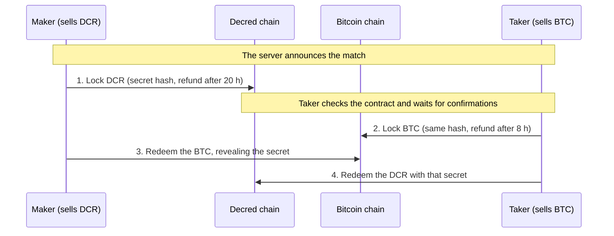

# DCRDEX: Trading without custody

DCRDEX is Decred's decentralized exchange (DEX) network: a server matches buy and sell orders, and the two traders then swap coins directly between their own wallets, so the server never holds anyone's funds. This page explains how a trade works, what it costs, how long it takes and what can go wrong.

!!! abstract "DCRDEX in one minute"

    - **Bison Wallet** is the app you trade with. **Decrediton**, the Decred desktop wallet, has the same trading client built in under its **DEX** tab.
    - A server matches orders in short rounds called **epochs** and relays messages between traders. It never holds the coins.
    - Each trade settles as an **atomic swap**: four on-chain transactions, two on each blockchain. Either both sides get paid or both get their coins back.
    - There are **no trading fees**. You pay only the normal network transaction fees on both chains.
    - To trade you lock a **fidelity bond**, a deposit that only you can ever spend. It returns to you after about 2 months. Failing to finish trades costs you trading privileges, not the bond.
    - Settlement takes minutes to hours, and **your app must keep running until every swap has finished**.

## In this section

-   **[Your first trade on DCRDEX](first-trade.md)**

    ---

    Connect to a server, post a bond, place a small limit order and watch it settle.

-   **[Wallets for other assets in Bison Wallet](asset-wallets.md)**

    ---

    Set up the other side of a trading pair: Bitcoin, Litecoin, Ethereum, Polygon tokens and more.

-   **[Trading on DCRDEX](trading-guide.md)**

    ---

    Order types, swap stages, refunds, bonds and reputation, account backup and safe upgrades.

-   **[DEX troubleshooting](troubleshooting.md)**

    ---

    What to do when a swap seems stuck, and where your funds are.

## What DCRDEX is

DCRDEX has two parts:

- **Servers** keep the order books, match orders, relay swap details between traders and watch the blockchains to check that both sides follow the rules. Anyone can run one; Bison Wallet comes set up for `dex.decred.org`.
- **Clients** hold your keys, place your orders and carry out the swaps. Bison Wallet 1.0.6, which ships with the Decred 2.1.7 release, is the client, and also a full multi-asset wallet. Decrediton 2.1.7 embeds the same client code (DCRDEX v1.0.6), so both speak the same protocol to the same servers.

The server introduces a buyer and a seller and records what they agreed, but the coins change hands directly between them: there is no exchange balance to hack or freeze, and no withdrawal queue. A server account is a key pair plus a bond, not a name, email address or identity documents.

### Two apps for one client

=== "Bison Wallet"

    The standalone app, recommended by the DCRDEX project. It runs in the background and shows its interface in your web browser at `http://127.0.0.1:5758`. Its built-in Decred light wallet can also stake and mix. Start with [Install and set up Bison Wallet](../wallets/bison-wallet.md).

=== "Decrediton"

    Open **DEX** in Decrediton's sidebar. The tab walks you through **Enable DEX**, **Set DEX Passphrase**, the **DEX Account Seed**, **Create DEX Account** and **Connect DCR Wallet**; **Launch DEX Window** then opens the same trading interface Bison Wallet shows.

    - Your trading DCR sits in the Decrediton account you connected. Decrediton suggests trading from a separate wallet and moving funds to your normal wallet afterwards.
    - The **DEX** tab is not available in Trezor or Ledger wallets.

## How a swap works

An **atomic swap** exchanges coins on two different blockchains without either trader trusting the other. "Atomic" means it cannot half-happen: either both traders receive the other's coins, or both get their own coins back. Each trader locks coins in a contract on their own chain, and both contracts open with the same key.

That contract is a **hash time-locked contract** (HTLC). It has two ways out:

Redeem
:   The counterparty can take the coins by revealing a **secret**: 32 random bytes whose SHA-256 hash is written into the contract.

Refund
:   The trader who funded the contract can take the coins back once its **lock time** has passed.

The trader whose order was already on the book is the **maker**; the trader whose order matched it is the **taker**. The maker creates the secret and goes first. In this example the maker sells DCR for BTC.

1. **The maker locks.** The maker's wallet creates the secret and sends the DCR to a contract that pays the taker in exchange for the secret, or refunds the maker 20 hours after the match.
2. **The taker locks.** The taker's wallet checks the maker's contract (amount, secret hash, lock time), waits for the confirmations the server requires, then sends the BTC to a contract with the same secret hash, refundable to the taker 8 hours after the match.
3. **The maker redeems.** Once the taker's contract has its confirmations, the maker claims the BTC, which publishes the secret on the Bitcoin chain.
4. **The taker redeems.** The taker's wallet reads the secret there and uses it to claim the DCR.

Your wallet takes all four steps itself, as long as the app is running. The maker's lock time is longer on purpose: if the maker redeems before the taker's 8-hour lock time, as the protocol expects, the taker still has at least 12 hours to redeem before the maker's contract can be refunded. On Decred the contract is a pay-to-script-hash output, using the script described in the whitepaper's [atomic swaps and DCRDEX section](../../whitepaper/19-ecosystem.md#sec:ecosystem-dex). On Ethereum and Polygon the same rules live in a swap smart contract.

### When a trader stops halfway

If either trader fails to act in time, the server **revokes** the match, and the refund branch protects whoever has already locked coins. The lock times are fixed in the DCRDEX code for mainnet and count from the match.

| What happens | Result for the other trader |
|---|---|
| The maker never locks | Nothing was locked. The match is cancelled. |
| The taker never locks | The maker's coins wait in the contract, then are refunded 20 hours after the match. |
| The maker locks but never redeems | The taker is refunded 8 hours after the match, and the maker 20 hours after it. Nobody loses coins. |
| The maker redeems, but the taker does not | The maker has been paid. The taker **can lose its coins** if it does not redeem before the maker's contract becomes refundable, 20 hours after the match. |

The last row is the only case where a trader can lose funds, and it is always the trader who stopped acting. Bison Wallet redeems automatically, so this happens only if the taker's app stays offline, or cut off from that blockchain, from the maker's redeem until 20 hours after the match. That window is normally at least 12 hours.

## Orders and matching in epochs

Like a normal exchange, DCRDEX has an order book and offers a **Limit Order** and a **Market Order**; it differs in how orders are processed. On most exchanges, orders are matched one by one as they arrive, so a fast trading bot that sees your order can place its own ahead of it and profit from your trade. This is **front-running**. DCRDEX removes that advantage by matching in **epochs**, fixed rounds a few seconds long that each market sets:

1. **Commit.** Orders arriving during the epoch are collected, not matched. Each carries a commitment: the hash of a secret random value (the **preimage**) chosen by the client.
2. **Reveal.** When the epoch ends, every client with an order in it reveals its preimage. Bison Wallet does this automatically while connected.
3. **Shuffle.** The server combines all the preimages into a random seed, shuffles the epoch's orders with it, and only then matches them against the book one at a time.
4. **Publish.** The server publishes the preimages, the seed and a checksum of the commitments, so every client can check that no order was dropped or reordered.

Since nobody knows the seed until every preimage is in, neither the fastest trader nor the server can choose who is matched first. A trade always executes at the maker's price.

A limit order can **stand** on the book until it fills or you cancel it, or match only in its own epoch with **Immediate or cancel**. Any unmatched part of a market order is cancelled at once.

### Lot sizes

Orders are sized in whole **lots**. The **Lot Size** is set by the server operator for each market, in the market's base asset (DCR on a DCR/BTC market). Each match costs on-chain fees on both chains, and a minimum lot size keeps those fees small next to the amount traded.

## What it costs

DCRDEX collects **no trading fees**. You pay only the network fees on the transactions your own wallet makes:

- **Per match:** a swap transaction on the chain of the asset you sell, and a redeem transaction on the chain of the asset you buy. Several matches from one epoch can share a transaction.
- **If a swap fails:** a refund transaction to get your coins back.
- **For bonds:** a transaction to post each bond, and one to reclaim it when it unlocks.
- **For tokens on Ethereum or Polygon:** a one-time approval transaction per token, which lets the swap contract handle that token.

An order filled by a single match costs two transactions; one filled a lot at a time can need as many swaps as it has lots. Your wallet reserves funds for the server's maximum fee rate, but actual fees are usually lower. Bison Wallet shows a fee estimate when you place an order, and the realized fees on the order's details page.

A bond is not a fee: it comes back to you, though it keeps your funds locked for months.

## Fidelity bonds, tiers and reputation

To stop people from flooding the book with fake orders or backing out of swaps, without ever holding user funds, DCRDEX uses **fidelity bonds**. A fidelity bond is an amount of coins sent to a time-locked output that **only your own key can spend, and only after its lock time**, so the server cannot take it. On Decred the bond is the standard pay-to-pubkey-hash script with a lock-time check in front of it.

How bonds work on mainnet (constants from the DCRDEX 1.0.6 code):

- **Tier.** The server sets a bond amount per tier and the assets it accepts for bonds. Your **Trading Tier** is the number of bond amounts you have posted. You pick a **Target Tier**; higher tiers allow larger orders.
- **Lifetime.** A new bond's lock time is about 60 days out. It counts toward your tier until 30 days before that lock time (the 30-day bond expiry).
- **Rotation.** About 1.5 hours before a bond stops counting, Bison Wallet posts a replacement automatically, and it reclaims the old bond once its lock time passes. Keeping a tier therefore locks about twice the bond amount, which Bison Wallet reserves.
- **Stopping.** Set the target tier to 0 to stop posting bonds. Your existing bonds return to your wallet as they unlock.

**Reputation** works alongside bonds. The server keeps a **Score** for your account from your last 60 matches and recent orders:

| Event | Score change |
|---|---|
| Swap completed | +1 |
| Missed preimage reveal (the order is dropped) | −2 |
| Maker did not lock | −4 |
| Maker locked but did not redeem | −7 |
| Taker did not lock (the maker's coins stay stuck for 20 hours) | −11 |
| Taker did not redeem | −1 |
| Cancelled too large a share of orders | −5 |

A higher score raises your trading limit, up to three times the starting limit for your tier. Every full 20 points below zero (the default threshold, which `dex.decred.org` uses) counts as one **penalty** and removes one tier. At tier 0 you cannot place orders. To recover, post more bonds to cover the penalties, and let successful trades raise your score. Bison Wallet shows your **Actual Tier**, **Penalties**, **Score** and **Limit Bonus** on the server's settings page.

Bonds and reputation belong to one account on one server, so each server you trade on needs its own bond.

!!! note "Formerly a registration fee"
    Before bonds, DCRDEX charged a one-time registration fee, which parts of the DCRDEX README and specification still describe. Bison Wallet 1.0.6 uses bonds instead.

## Settlement takes time

A trade is finished only when all four transactions are on chain, and each contract must reach the confirmation count the server sets for its chain before the next step can start. When this page was checked, `dex.decred.org` required 2 confirmations on Decred and 1 on Bitcoin. At about 5 minutes per Decred block, the maker's DCR contract needs about 10 minutes; the taker's BTC contract then waits for one Bitcoin block, 10 minutes on average but sometimes much longer. A smooth trade on that market takes roughly 20 to 30 minutes. A slow block, a low fee or a counterparty who stops can stretch it to hours.

!!! warning "Keep the app running until every swap has finished"
    Bison Wallet or Decrediton must stay running and online for the whole settlement. Closing Bison Wallet's browser tab is fine; quitting the program is not. A few minutes offline does no harm. If your wallet misses its turn for longer than the server's broadcast timeout (22 minutes on `dex.decred.org` when this page was checked), the match is revoked and your score drops. A taker whose maker has already redeemed can lose the coins after a longer outage (see the table in [When a trader stops halfway](#when-a-trader-stops-halfway)). If you have to restart, log in again straight away. Losing the connection to the DEX server alone does not put funds at risk.

## Risks and limits

- **External wallets.** If Bison Wallet trades through wallet software you run yourself, such as `bitcoind` or `dcrwallet`, start that wallet first and stop it last. While trades are active, do not spend from it, lock it or move its funds outside Bison Wallet.
- **Linked coins.** Both contracts in a swap carry the same secret hash, so anyone watching both blockchains can link the coins you sold to the coins you received. The server also sees your orders, the addresses you swap with and your IP address. An atomic swap is not mixing. See [Privacy beyond mixing](../privacy/privacy-practices.md).
- **Server availability.** If a server goes offline, you cannot trade there, but your coins stay in your wallet or in contracts your wallet can refund.
- **Backups.** The 15-word app seed restores Bison Wallet's built-in wallets and your server accounts with their bonds. Some older accounts cannot be restored from the seed, and Bison Wallet advises backing up each account's keys separately, old or new; the [trading guide](trading-guide.md) shows how. Never delete the app's data folder while swaps are active.
- **Thin markets and large lots.** Check a market's lot size and order book before you fund a wallet for a pair.
- **Upgrades.** Release candidates of Bison Wallet 1.1 (v1.1.0-rc2) are tagged, but 1.1 had not been released when this page was checked. Version 1.1 cannot trade with 1.0.x servers, and 1.0.x clients cannot trade with 1.1 servers. Upgrade only when no swaps are active; see [Upgrading and mandatory releases](../run/upgrades.md).
- **No undo.** A completed swap cannot be reversed.

## Assets and servers

Bison Wallet 1.0.6 can trade these assets, if a server lists a market for them:

- Decred (DCR), Bitcoin (BTC), Litecoin (LTC), Bitcoin Cash (BCH), Dogecoin (DOGE), Dash (DASH), DigiByte (DGB), Firo (FIRO) and Zcash (ZEC);
- Ethereum (ETH) and Polygon (POL), plus tokens on those networks such as USDC and Tether (USDT).

**The markets you can trade depend on the server.** Each operator chooses its markets, lot sizes, epoch length, confirmation counts and bond terms, and Bison Wallet shows them when you connect. The only mainnet server built into Bison Wallet 1.0.6 is `dex.decred.org:7232`; you can add others under **Settings** > **Add a DCRDEX Server**.

!!! note "dex.decred.org, as checked on 18 November 2026"
    The server listed one market, DCR/BTC, with a lot size of 40 DCR and 10-second epochs. It accepted bonds only in DCR, at 0.1 DCR per tier, so you need some DCR to trade there even if you came to buy it. These are operator settings and can change at any time.

## How it compares

| | Centralized exchange | Instant swap service | DCRDEX |
|---|---|---|---|
| Who holds your coins | The exchange | The service, until it pays out | Only you |
| Identity checks | Usually required | Varies | None |
| Speed | Instant trades; deposits and withdrawals wait for confirmations | Confirmations on both chains | Matching in seconds; settlement minutes to hours |
| Fees | Trading and withdrawal fees | Built into the rate | Network fees only |
| Main risk | Hacks, frozen accounts, insolvency | No payout | Staying online during settlement; small markets |

[Get DCR](../start/get-dcr.md) compares all the ways to acquire DCR.

## Go deeper

- [Atomic swaps and DCRDEX](../../whitepaper/19-ecosystem.md#sec:ecosystem-dex): the swap contract DCRDEX builds on Decred, epoch matching and the bond script.
- [Standard script classes](../../whitepaper/06-script.md#sec:script-standard): Decred's standard outputs, and why the swap contract is spent through pay-to-script-hash.
- [Lock-time opcodes](../../whitepaper/06-script.md#sec:script-op-locktime): how `OP_CHECKLOCKTIMEVERIFY` enforces the refund delay and bond lock.

## Next steps

- [Install and set up Bison Wallet](../wallets/bison-wallet.md): get the trading client and its Decred wallet ready.
- [Your first trade on DCRDEX](first-trade.md): post a bond and place a small order, step by step.
- [Wallets for other assets in Bison Wallet](asset-wallets.md): set up the other side of your trading pair.
- [Trading on DCRDEX](trading-guide.md): manage orders, follow swap stages, back up your account.
- [Building on DCRDEX](../../dev/integrate/dcrdex.md) and [Run a DCRDEX server](../../dev/operate/dex-server.md): for developers and prospective operators.

*[DEX]: decentralized exchange
*[HTLC]: hash time-locked contract
*[DCR]: Decred's currency
*[BTC]: Bitcoin
*[IP]: Internet Protocol
