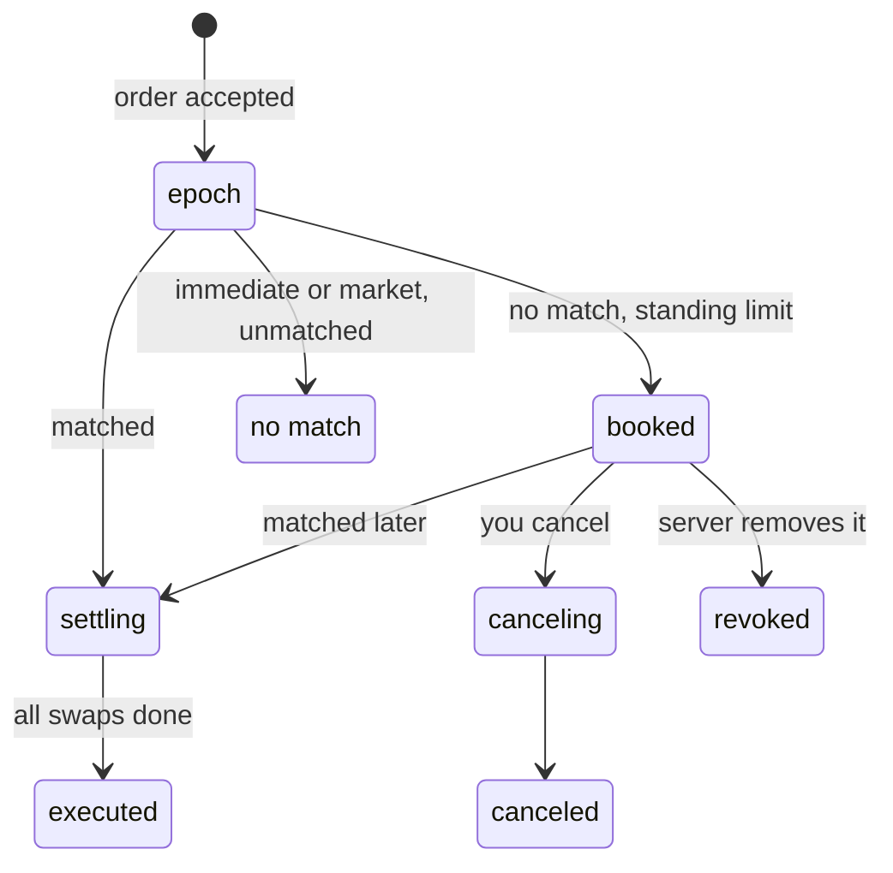

# Trading on DCRDEX

This guide covers everyday trading on DCRDEX, from the trading screen and orders to swaps, bonds, backups and upgrades. It assumes you have made a [first trade](first-trade.md) and know the ideas in [DCRDEX: Trading without custody](index.md).

!!! info "Applies to"
    Bison Wallet 1.0.6 and Decrediton 2.1.7, which embeds the same DCRDEX 1.0.6 client. Checked November 2026.

## Before you start

- A DCRDEX account on the server with a confirmed fidelity bond (a time-locked deposit only you can reclaim). [Your first trade](first-trade.md) shows how to post one.
- Synced, funded wallets for both assets of the market. See [Wallets for other assets in Bison Wallet](asset-wallets.md).
- Your app seed written down (in Decrediton, the **DEX Account Seed**).
- Time: settlement takes minutes to hours, and the app and every wallet involved must stay running, online and unlocked until it finishes.

## Open the trading screen

Decrediton's **DEX** tab runs the same client code as Bison Wallet 1.0.6, so everything after this step is the same in both.

=== "Bison Wallet"

    Click **Trade** in the header. **Order History**, **Market Making** and **Settings** are in the menu behind the three-line icon at the top right.

=== "Decrediton"

    Click **DEX** in the sidebar. The first visit walks you through **Enable DEX**, **Set DEX Passphrase**, the **DEX Account Seed**, **Create DEX Account** (or **Select an existing account**) and **Connect DCR Wallet**; later visits ask for the DEX passphrase. Then click **Launch DEX Window**; everything below happens in that window.

    Decrediton trades DCR from the account you connected, and itself suggests "using a separate DEX wallet". Each Decrediton wallet keeps its own DEX accounts, and Trezor and Ledger wallets have no **DEX** tab.

## Read the markets view

| Area | What it shows |
|---|---|
| Market list (left) | Markets on every connected server, with last price and 24-hour change. |
| Order book | Sells above the **Order Book** line, buys below. A check mark marks orders waiting in the current epoch, the matching round of a few seconds. |
| Candle chart | Price history. Hover a candle for start (S), end (E), low (L), high (H) and volume (V). |
| Depth chart | The book drawn cumulatively: how far the price would move to fill a given amount. |
| Order panel (right) | The order form, balances, **Show trading tier info**, **Show reputation**, **Your Orders** and **Recent Matches**. |

On the DCR-BTC market, DCR is the **base** asset and BTC the **quote** asset: quantities are in DCR, rates in BTC per DCR.

## Place an order

### Lots, rates and your trading limit

The server operator sets these for each market:

**Lot Size**
:   The smallest order and the step between sizes, in the base asset. **Quantity** can be typed in lots or as an amount.

**Rate Step**
:   The smallest price increment. **Price** must be a multiple of it.

**Parcel Size**
:   A *parcel* is a fixed number of lots; your trading limit is counted in parcels.

The line under the order button reads "*N* lots remaining in tier *T* trading limit", and **Show trading tier info** breaks it down. Each tier allows 2 parcels, and a good **Score** raises that up to three times: with a parcel size of 4 lots, a tier-1 account starts at 8 lots and can reach 24. Orders likely to match immediately count double, and usage is added up across all markets on the server.

### Choose the order type

**Limit Order**
:   Trade at your price or better. By default the order *stands*: the unmatched part rests on the book until filled or cancelled. Tick **Immediate or cancel** to drop it after the first epoch instead.

**Market Order**
:   Trade at the best prices on the book now. A market buy is an amount of the quote asset, with a minimum shown as "min trade is about". The unmatched part is dropped, and the order cannot be cancelled.

An order resting on the book makes you the **maker** when it matches; an order that matches one already there makes you the **taker**. The roles have different lock times and penalties.

### Check the fees, then submit

1. Choose **Buy DCR** or **Sell DCR**, enter **Price** and **Quantity**, and click **Place order to buy DCR** (or **sell**).
2. The confirmation form shows a **Fee Projection**. Click **details** for **Fee Details**:
    - **Best Case Fees**: one match fills the whole order, so you pay for one swap and one redemption.
    - **Worst Case Fees**: the order fills one lot at a time over many epochs.
    - **Maximum Possible Swap Fees**: the most you can pay in fees on your swap transactions (redemption fees are separate), fixed once the order is placed.
3. Check the **Options** section. Some options show at once, such as **Pre-size Funds** for Decred. Others, such as a higher redemption fee (**Faster Redemption** for DCR), appear after you click **show advanced options**.
4. Read the warning that the software and wallets must run until settlement is complete, then click **Buy DCR** or **Sell DCR** at the top of the form.

DCRDEX charges no trading fee; all the fees shown are network transaction fees.

### What happens next

The order reserves coins in the paying wallet, shown as **locked**, sometimes more than the order because whole coins stay reserved until the swap is sent. The Decred wallet's **Pre-size funding inputs** setting, on by default, avoids this with an extra "split" transaction that costs its own fee.

The order's **Status** then moves through these states:

A partly filled order can read `booked/settling`. `revoked` means the server removed the order, for example after a failed swap or because your tier fell below 1.

## Manage and cancel orders

Under **Your Orders**, click an order to expand it. Up to three icons, named by their tooltips, act on it:

- **cancel order** (a cross): click **Submit** to cancel the remaining amount. A match can still land first.
- **order details**: every match, its status and block explorer links for each transaction.
- **accelerate order** (a rocket): on stuck swaps for assets that support it, such as Bitcoin, resends your swap's change to yourself at a higher fee rate. It helps when the fee was too low, not when blocks are slow.

**Order History** lists past orders on every server, and its **Other Actions** box has **Export Trades** (a comma-separated values, CSV, file).

### Cancellation limits

Servers limit cancelling so that nobody can fill the book with orders they never mean to trade. These are the server defaults, which each operator can change:

- Only standing limit orders can be cancelled, at most 2 per epoch on a market.
- A cancel sent in the same epoch as the order, or the next one, counts toward your *cancellation rate*. From the second epoch after the order onward, cancelling is free.
- If early cancels exceed 95% of your last 100 completed orders, your score drops by 5. Accounts with 19 or fewer completed orders are exempt.

## Follow a swap to settlement

Each match settles by an atomic swap: two contracts and two redemptions that your wallet makes without any clicks ([how a swap works](index.md)). The order details page shows each match's progress:

| Status | What is happening | Next to act |
|---|---|---|
| **Newly Matched** | The server announced the match. | Maker sends its contract. |
| **Maker Swap Sent** | The maker's contract is gathering the confirmations the server requires. | Taker, after those confirmations. |
| **Taker Swap Sent** | The taker's contract is gathering confirmations. | Maker redeems. |
| **Maker Redeemed** or **Redemption Sent** | The maker claimed its coins, revealing the secret. **Redemption Sent** is your own redemption. | Taker redeems. |
| **Redemption Confirmed** | Your redemption is mined. | Nobody. |

Each trader has a fixed time to act on their turn, the **broadcast timeout**. The server sets it: 12 minutes in the server software's default configuration, 22 minutes on `dex.decred.org` when checked in November 2026. Settlement as a whole takes from a few minutes to a few hours.

### When a swap fails

A trader who misses the broadcast timeout gets the match **revoked** and is the only one penalized ([score changes](index.md)). The status then starts with **Revoked -**, for example **Revoked - Refund PENDING**, and the order page shows when the refund will happen. On mainnet:

- If the maker never sends its contract, nothing was locked.
- A maker's locked coins are refunded 20 hours after the match, a taker's 8 hours after it.
- A taker who has not redeemed 20 hours after the match, when the maker's contract becomes refundable, can lose its coins.

Refunds are automatic, but only while the app runs and the paying wallet is unlocked. Keep everything running until every match shows **Refunded**, **Redemption Confirmed** or **Complete**.

## Bonds, tiers and reputation

Your tier is the number of bond amounts you have posted on a server, minus penalties ([how bonds work](index.md)). To manage it, open **Settings** > **Registered Dexes** and click the server:

| Field | Meaning |
|---|---|
| **Target Tier** | The tier Bison Wallet maintains by posting bonds. **Change Tier** raises it now or lowers it as current bonds expire. |
| **Actual Tier** | Active bonds minus penalties. Below 1, your booked orders are revoked and you cannot trade. |
| **Bonds Pending Refund** | Expired bonds that return to your wallet after their lock time. |
| **Auto Renew** | Posts replacement bonds. Turning it off sets **Target Tier** to 0. |
| **Penalty Comps** | How many extra tiers Bison Wallet may bond to offset **Penalties**. |
| **Score**, **Limit Bonus** | Your reputation and the multiplier it gives your trading limit. |

With **Auto Renew** on, replacement bonds overlap the old ones, so budget about twice the bond amount per tier, plus fees. Bison Wallet holds this reserve back from your available balance.

### Rebuilding reputation

Failed swaps, missed preimages and early cancels lower your **Score**, and a score far enough below zero costs you tiers.

1. Fix the cause: an app shut down mid-swap, a wallet left locked or offline, an unreliable connection.
2. If the trading screen shows **ACTION REQUIRED TO TRADE**, raise **Penalty Comps** or **Target Tier** so that your **Actual Tier** is at least 1 again.
3. Trade normally. Each completed swap adds a point, and old failures stop counting once they fall out of your last 60 matches.

## Back up and restore DEX accounts

| Backup | What it restores |
|---|---|
| App seed (Decrediton: **DEX Account Seed**) | Bison Wallet's built-in wallets, and the server accounts and active bonds derived from the seed. |
| Exported account file, one per server | That account and its bonds, including older accounts the seed cannot restore. |
| Seeds of external wallets | Funds in wallets you run yourself, such as `bitcoind` or `dcrwallet`, and Decrediton's own DCR wallet. |

**Export:** in **Settings** > **Registered Dexes**, click the server, then **Export Account**. The app downloads a `.json` file named `dcrAccount-` followed by the server address. Store it privately, and export again from time to time: it holds only the bonds that existed when you saved it.

!!! warning "The exported file holds a private key"
    It contains your account's private key unencrypted, plus your bond records and their backup refund transactions. Anyone with the file can act as your account on that server. Guard it like a seed backup.

**Restore on a new computer:**

1. Restore from the app seed: **Restoration Seed** when setting up Bison Wallet, or **I already have a DEX seed to recover.** in Decrediton.
2. Create the same asset wallets as before, then add the same server. The app finds the account derived from the seed and the active bonds the server reports.
3. For any account it did not find, go to **Settings** > **Import Account**, pick the file with **load from file** and click **Authorize Import**.

Never run the old and the restored installation at the same time. **Settings** > **View Application Seed** shows the app seed again later.

## Keep wallets and the app running

- **Start external wallets first and stop them last.** They must be connected and unlocked before trades can be processed.
- **Leave wallets alone during trades.** Do not spend from, lock or rescan an external wallet, or switch Bison Wallet to another wallet, while orders are active; switching "might cause funds to be lost."
- **Keep outages short.** After more than the broadcast timeout offline (22 minutes on `dex.decred.org` when checked), the server takes your standing orders off the book, and you risk missing a swap step. Log in again as soon as you restart.
- **Heed the shutdown warnings.** Bison Wallet will not sign out with active orders, stopping `bisonw` with ++ctrl+c++ asks you to type `yes` first, and Decrediton shows **DEX Open Orders**.

## Market-making and arbitrage bots

Bison Wallet can run bots that keep orders on both sides of a market: **Market Making** in the menu, then **Create a New Bot**. Version 1.0.6 offers **Basic Market Maker**, **Market Maker + Arbitrage** and **Basic Arbitrage**. The arbitrage bots also trade on a centralized exchange (Binance or Binance US in 1.0.6) and need an application programming interface (API) key for it. The [Bison Wallet market-making guide](https://github.com/decred/dcrdex/wiki/Market-Making) explains every setting, though it describes a newer version.

Before allocating funds:

- **Bots can lose money.** They trade even when the market moves against them, and fees on thin markets can exceed the spread.
- **Exchange keys are stored in plain text**, in `mm_cfg.json` in the Bison Wallet data folder. Anyone who copies a key allowed to withdraw can move your exchange funds, and funds on an exchange are in its custody.
- **Bots follow your account's rules.** They need Bison Wallet running, use your trading limit and reputation, and block manual orders on their market. Matches a bot made must still settle after it stops.

## Upgrade without breaking a trade

1. Stop bots, cancel standing orders, and wait until no orders are active and every match is finished or refunded.
2. Back up the app seed and export your accounts.
3. Quit Bison Wallet or Decrediton, then any external wallets. Install the new version and start in the reverse order.

!!! note "Bison Wallet 1.1 (tagged, not released when checked)"
    Version 1.1 changes the swap protocol, so 1.0.x clients (Decrediton 2.1.7 included) cannot trade on 1.1 servers, and 1.1 clients cannot trade on 1.0.x servers. A server that upgrades revokes active 1.0.x swaps without penalty, and their funds return only after the lock time, so finish trades before a server's announced upgrade.

[Upgrading and mandatory releases](../run/upgrades.md) has the procedure for every Decred app.

## Troubleshooting

### The order button is greyed out

Hover over the disabled button to see a tooltip that names the problem. "Insufficient balance to buy." (or "...to sell.") means the paying wallet lacks available funds; locked coins and bond reserves do not count. "Order quantity must be specified." means the quantity is empty, zero or less than one lot. "Order quantity and price must be specified." means a limit order has no price.

### A match has been stuck for hours

Open **order details**. If your own swap is unconfirmed because of a low fee, use **accelerate order** where offered. If the status starts with **Revoked -**, keep the app and wallet running until the time shown. [DEX troubleshooting](troubleshooting.md) covers more cases.

### My tier dropped

On the server's settings page, check **Penalties**, **Bonds Pending Refund** and **Auto Renew**, then follow [Rebuilding reputation](#rebuilding-reputation).

## Next steps

- [DEX troubleshooting](troubleshooting.md): stuck swaps, missing funds and where to get support.
- [Wallets for other assets in Bison Wallet](asset-wallets.md): add or change the wallets behind your markets.
- [Privacy beyond mixing](../privacy/privacy-practices.md): what a swap reveals about you, and how to limit it.
- [Upgrading and mandatory releases](../run/upgrades.md): keep Bison Wallet and Decrediton current.

*[DEX]: decentralized exchange
*[CSV]: comma-separated values
*[API]: application programming interface
