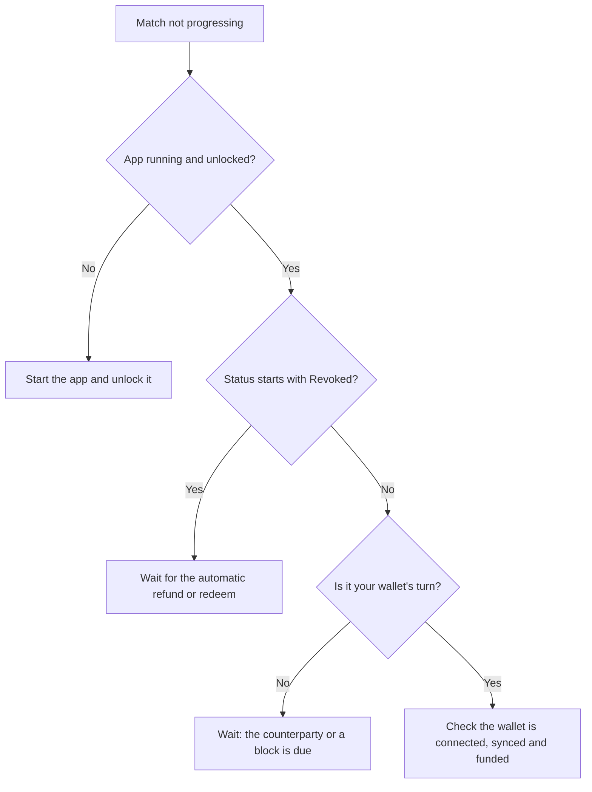

# DEX troubleshooting

This page answers the questions DCRDEX traders ask when something does not go to plan: a swap that will not finish, a refund that has not arrived, a bond problem, a lost connection, a restore that looks incomplete, or an external wallet error. Each answer says where your funds are, what Bison Wallet is waiting for and what, if anything, you need to do.

!!! info "Applies to"
    Bison Wallet 1.0.6 and the DEX client built into Decrediton 2.1.7, which runs the same DCRDEX 1.0.6 code. Checked November 2026.

!!! warning "Before you change anything"
    Most DEX problems fix themselves if the app keeps running, and many "fixes" make them worse. While any swap is unfinished:

    - keep Bison Wallet (or Decrediton) running and unlocked, with its wallets connected (to unlock Bison Wallet, click **Unlock**; in Decrediton, open **DEX**, enter your **DEX Passphrase** and click **Login**);
    - do not delete, move or replace the app's data folder, and do not restore your app seed on another computer to "start fresh";
    - do not spend from, lock or reconfigure an external wallet that Bison Wallet trades through.

    Trades in progress are recorded only in the app's own database. A seed restore brings back wallets and accounts, but not the details of swaps that were in progress.

## Swaps and refunds

### My swap seems stuck. What is happening?

A swap moves through fixed steps, and at each step one trader's wallet must act, then wait for confirmations. The maker is the trader whose order was already on the book and who locks coins first; the taker is the trader whose order matched it. To see which step a match is on, open the menu (three-line icon) > **Order History**, click the order, and look at **Status** under **Matches**. The order details page also links each transaction: **Maker Swap**, **Taker Swap**, **Maker Redemption**, **Taker Redemption** and, if needed, **Refund**.

| Status | What the swap is waiting for | What you do |
|---|---|---|
| **Newly Matched** | The maker to lock coins in a contract. | Nothing, unless you are the maker. Then your wallet must be connected, unlocked, synced and funded. |
| **Maker Swap Sent** | Confirmations on the maker's contract (the server sets how many), then the taker's contract. | Wait. A slow block on that chain is the usual cause. |
| **Taker Swap Sent** | Confirmations on the taker's contract, then the maker's redemption. | Wait. |
| **Maker Redeemed** | The taker to redeem, using the secret the maker revealed. | If you are the taker, keep the app running: your wallet redeems on its own. |
| **Redemption Sent** | Your redemption transaction to confirm. | Wait. The coins are already yours. |
| **Redemption Confirmed** | Nothing. The match is finished. | Nothing. |

A status that starts with **Revoked** means one trader did not act in time and the server ended the match. The part after the dash says what happens next:

- **Revoked - Refund PENDING**: your wallet will take your coins back from your contract after its lock time, the moment from which the contract can be refunded to the trader who funded it. See [My refund has not arrived](#my-refund-has-not-arrived-when-will-it-come).
- **Revoked - Redeem PENDING**: the counterparty redeemed after all, so your wallet is claiming their coins.
- **Revoked - Redemption Sent**: your wallet has already claimed the counterparty's coins; wait for that transaction to confirm.
- **Revoked - Refunded** or **Revoked - Redemption Confirmed**: finished, either way.
- **Revoked - Complete**: you never locked anything in this match, so nothing of yours moved.

The flowchart sums up the first checks for a match that is not progressing.

You cannot cancel a match. Cancelling an order only removes the part that has not matched yet. A matched swap always ends in a redemption or a refund. [DCRDEX: Trading without custody](index.md) explains the full sequence and every way a swap can stop halfway.

### Where are my funds while a swap is unfinished?

At every moment your coins are in one of four places, and none of them is the server:

1. **Your wallet, locked.** On the **Wallet** page, select the asset: **Locked** includes **Swapping** ("Funds currently locked in settling matches") and **Order** (funds backing unmatched orders).
2. **Your swap contract on the blockchain.** Only two things can happen to it: the counterparty redeems it by revealing the secret, which lets your wallet claim their coins, or you take it back after the lock time.
3. **The counterparty's contract, claimed by you.** Your redemption shows under **Maker Redemption** or **Taker Redemption**, and the coins appear under **Available** once it confirms.
4. **A fidelity bond.** Shown as **Bonded** under **Locked**. It returns to you after its lock time; see [My bond expired, or my tier dropped](#my-bond-expired-or-my-tier-dropped).

Click a transaction link on the order details page to check it on a block explorer. [Use the block explorer](../wallets/block-explorer.md) explains how to read a Decred transaction.

### My refund has not arrived. When will it come?

A refund cannot happen early. Your coins sit in a contract that only opens back to you once its lock time has passed, counted from the moment of the match:

| Your role in the match | Your contract can be refunded |
|---|---|
| Taker | 8 hours after the match |
| Maker | 20 hours after the match |

These lock times are fixed in the DCRDEX 1.0.6 code for mainnet. On a revoked match, the **Refund** line on the order details page shows "Refund will happen after", followed by the date and time. When that time has passed, it changes to "Will happen in the next few blocks".

If it is late:

- **The refund comes a little after the time shown.** The blockchain checks the lock time against the median time of recent blocks, which runs behind the clock. On Bitcoin, which uses the median of the last 11 blocks, that delay is roughly an hour.
- **The app must be running and unlocked.** Bison Wallet only refunds while it runs and the wallet for the asset you sold is unlocked. If you closed it, start it and unlock it. The refund goes out within a few minutes if the lock time has passed.
- **The wallet needs network fees.** The refund is an ordinary transaction. On Ethereum and Polygon it needs gas, which Bison Wallet reserves when you place the order. Do not empty that wallet while matches are active.
- **The refund is not yet confirmed.** Once broadcast, its link appears on the **Refund** line. It counts as available after it confirms. On Decred, Bitcoin and similar coins, the amount is your contract value minus the refund transaction's fee. On Ethereum and Polygon the fee is paid from the gas reserve, so the full contract value comes back.

[Trading on DCRDEX](trading-guide.md) covers revoked matches and refunds in day-to-day trading.

### A swap transaction has stayed unconfirmed for a long time

The usual cause is a fee rate that has become too low for the blocks being mined. On Decred this is rare. For Bitcoin wallets that support it, the order details page shows an **Accelerate** button under **Actions**; on the **Trade** page, the same action is a rocket icon (tooltip "accelerate order") next to the order under **Your Orders**. Either one adds a transaction that spends the change from your swap with a higher fee, raising the effective fee rate of the swap so miners pick it up.

Acceleration only helps when the fee is too low. If blocks are only slow, wait. Bison Wallet warns you if your oldest unconfirmed swap transaction is recent. Check the transaction on a block explorer first, and choose a rate high enough for the next block. [Wallets for other assets in Bison Wallet](asset-wallets.md) shows each wallet's fee status and fee settings.

### Can I lose coins because my app was offline?

Usually not. Being offline costs time and reputation: if it was your turn to act, the server revokes the match. Your coins then come back after your lock time, and your score drops.

There is one exception, and it affects only the taker. Suppose the maker redeems your contract while your app is offline. Your wallet now has until the maker's contract becomes refundable (20 hours after the match) to claim the maker's coins. If your app stays offline past that point, the maker can refund their own contract as well, and your side of the trade is lost. If you were offline during a trade, start the app and unlock it as soon as you can.

[Trading on DCRDEX](trading-guide.md) explains how to keep wallets and the app running through a trade.

## Bonds and account tier

### My bond is not confirming

After you post a fidelity bond, the order panel shows **Waiting for confirmations...** with a count, and a "Confirming bond" notification names the number of confirmations required. Each server sets that number per asset; `dex.decred.org` required 1 confirmation for DCR bonds when checked on 18 November 2026. Decred blocks arrive about every 5 minutes, so the wait is usually short.

If it takes much longer:

- **Check that the bond transaction exists.** On the **Wallet** page, open the asset's transaction history and click the bond to see its **Bond ID**, then look it up on a block explorer.
- **If the explorer does not know the transaction,** restart Bison Wallet and unlock it. On login it rebroadcasts any bond that is still pending.
- **"Bond wallet not connected"** means the wallet for your bond asset is disconnected or disabled. Connect or enable it on the **Wallet** page.
- **"Bond post error ... (will retry)"** means the transaction confirmed but the server could not be told yet, usually because of a connection problem. The app retries on its own.

When the server accepts the bond, you get "Bond confirmed" and "Account registered" notifications. [Trading on DCRDEX](trading-guide.md) explains bonds and tiers.

### My bond expired, or my tier dropped

Each bond counts toward your tier only for a limited time: about the first 30 days of a lock time that is about 60 days long. Bison Wallet posts a replacement about 1.5 hours before a bond stops counting, as long as all of these are true:

- **Auto Renew** is on and the **Target Tier** is above 0. Check under menu > **Settings** > the server's name under **Registered Dexes**.
- The bond asset's wallet holds enough. The wallet's balance details list **Bond Reserves** under **Locked**: funds set aside to cover bond maintenance, such as the replacement bond and its fees. Keep enough **Available** beyond your trading funds. If the wallet cannot cover the reserve, the replacement may not be posted, and the reason appears in the log; deposit more.
- The app is running and unlocked when the replacement is due. If not, it posts the replacement at the next login, and your tier stays low until that bond confirms.

A "Bond expired" notification shows your new tier against your target. Your tier can also fall because of **Penalties** for missed swap steps. Raise it again by posting more bonds (**Change Tier**, or **Penalty Comps** to cover penalties) and by completing trades, which raises your **Score**.

If you see "Unknown bond found", the server reported a bond your app did not know about (common after a restore) while your target tier is 0. Set your target tier so that Bison Wallet keeps renewing.

An expired bond comes back to you when its lock time passes, about 60 days after the bond was posted. Until then it is listed under **Bonds Pending Refund** on the server's settings page. Nobody can spend it before then, the server included. Bison Wallet reclaims it automatically while the app is running and the bond asset's wallet is unlocked, and a "Bond refunded" notification shows the amount reclaimed after fees. As with swap refunds, the median-time rule can add a short delay after the nominal lock time.

[Trading on DCRDEX](trading-guide.md) explains how tiers, penalties and scores interact, and how to rebuild reputation.

## Connection problems

### I was disconnected from the server. What happens to my orders and swaps?

Losing the server connection alone does not put coins at risk: the contracts on the blockchains do not depend on it. Bison Wallet reconnects on its own, retrying every few seconds and then at least once a minute. You see "Server disconnect" and, when the link returns, "Server connected". Repeated drops trigger "Your internet connection to ... is unstable". While disconnected:

- **Swaps in progress continue as far as they safely can.** Your wallet still redeems and refunds, but it does not start a new swap step until the server confirms the match still stands.
- **Booked orders are removed after a while.** If your client stays away longer than the server's broadcast timeout, the server unbooks your standing orders. The server software defaults to 12 minutes; `dex.decred.org` used 22 minutes when checked on 18 November 2026.
- **Missed steps are penalized.** If an epoch closes while you are offline, your client cannot reveal your order's preimage (a secret it committed to when it submitted the order and must reveal when the epoch closes), so that order is dropped. If a swap step falls due, the match can be revoked. Both lower your score.

After reconnecting, the app compares its records with the server ("Orders reconciled with DEX"). [DCRDEX: Trading without custody](index.md) explains epochs and why the server never holds your coins.

### Bison Wallet cannot connect to a server at all

Look at the server's settings page (menu > **Settings** > the server under **Registered Dexes**) and at the notifications:

- **Disconnected - Invalid Certificate**: the server changed its TLS certificate. Get the new certificate from the operator and click **Update TLS Certificate**. `dex.decred.org:7232` ships with Bison Wallet, certificate included.
- **"Upgrade needed"**: the server runs a protocol version your client does not support. Bison Wallet 1.1 (tagged as a release candidate, not yet released) is protocol-incompatible with 1.0.x, and servers that upgrade to it revoke active 1.0.x swaps. Upgrade only when no swaps are active.
- **The address changed**: use **Update DEX Host**.
- **"Market suspended"**: the operator paused that market. If the notice says orders are purged, your booked orders are gone, but matches already made still settle.

[Upgrading and mandatory releases](../run/upgrades.md) explains how to upgrade Bison Wallet without breaking a trade.

## Restoring from the app seed

### I restored my app seed and wallets or accounts are missing

The app seed (15 words, or a long hexadecimal string on installations set up with older versions) restores Bison Wallet's built-in wallets and your server accounts. It does not restore everything:

| Item | Restored from the app seed? | What to do |
|---|---|---|
| Native (built-in) wallets | Yes, once you create the same native wallet again | **Wallet** > select the asset > create its native wallet, then wait for **Block Sync**. |
| External wallets (`dcrwallet`, Bitcoin Core, Electrum) | No: they have their own seeds | Restore them in their own software, then connect them again. |
| Your account on a server | Yes, for accounts created by recent versions | Add the same server again; the account is found from the seed. |
| Active bonds | Yes, if the server still counts them | Create and sync the bond asset's wallet before adding the server, so the app can find the bond on chain. |
| Expired bonds awaiting refund | No: the server no longer reports them | Use **Import Account** with an exported account file. |
| Swaps that were in progress | No | Recover the old data folder if at all possible, and ask for help. |

The app seed alone may also miss accounts made by older versions, which is why Bison Wallet advises exporting accounts. An exported account file carries the account key and its bonds. To import one, open menu > **Settings** > **Import Account**, load the file and click **Authorize Import**. [Trading on DCRDEX](trading-guide.md) shows how to export accounts in the first place.

You can only enter a seed when the app is set up for the first time:

=== "Decrediton"

    When you set the DEX passphrase, tick **I already have a DEX seed to recover.** and enter the seed. Decrediton keeps its DEX data separately for each wallet, so open the same Decrediton wallet you used before, or restore it first.

=== "Bison Wallet"

    On the first-run password form, click **Restoration Seed**, type the seed into the box that opens, set a new app password and click **Submit**. If Bison Wallet is already set up on this computer, quit it and rename its data folder (for example to `Dexc-old`) so that it starts fresh, and keep the old folder. Do not do this while any swap is unfinished: the old folder holds the only record of it. Let every match reach **Redemption Confirmed** or **Refunded** first, or ask for help before moving anything.

If a restored native wallet shows a zero or wrong balance, first let **Block Sync** finish on the **Wallet** page; a light wallet finds its history only as it syncs. If funds are still missing, open the asset, click **Settings** and, under **Other Actions**, click **Rescan**. A rescan can take hours on a busy wallet.

The Bitcoin, Litecoin and Bitcoin Cash native wallets also offer **Recover**. It moves the wallet's files to a backup folder and rebuilds the wallet from the seed. Use it when the log reports a corrupted or missing wallet. It does not appear for the native Decred wallet in 1.0.6, which offers **Rescan** only.

If the app warns "Wallet actively used!", the wallet is managing orders. Rescanning or recovering it then can make those trades fail. Wait until they settle unless the problem is urgent.

[Back up and restore your wallet](../wallets/back-up-and-restore.md) covers seeds for all Decred wallets.

## External wallet errors

### Bison Wallet says it cannot communicate with my wallet

An external wallet is wallet software you run yourself, such as `dcrwallet`, Bitcoin Core or Electrum. It must be started and synced before Bison Wallet, and keep running for as long as Bison Wallet runs. Messages such as "Wallet connection issue: Unable to communicate with ... wallet!", "Failed to connect ... wallet" or, on the trading page, "Your wallets must be connected and unlocked before trades can be processed" mean Bison Wallet lost it.

1. Make sure the external wallet is running and fully synced.
2. On the **Wallet** page, select the asset, click **Settings** and check the connection details on the **Reconfigure** form.
3. Do not lock or unlock the external wallet, change its passphrase, lock coins by hand, or send from it with its own controls while Bison Wallet runs. Send through Bison Wallet instead.

Requirements in Bison Wallet 1.0.6:

| Wallet | Requirement |
|---|---|
| `dcrwallet` | JSON-RPC API version 11, as in `dcrwallet` 2.1.x. Bison Wallet asks for **RPC Username** and **RPC Password** (`dcrwallet`'s `username` and `password` settings), **RPC Address** (default `127.0.0.1:9110`), **TLS Certificate** (`dcrwallet`'s `rpc.cert`, for example `~/.dcrwallet/rpc.cert`) and **Account Name**. An older version fails with "advertised dcrwallet JSON-RPC version ... incompatible". |
| Bitcoin Core | Version 27.0 or later. Older nodes fail with "reported node version ... is less than minimum 270000". |
| Electrum (Bitcoin) | Version 4.5.5 or later, with its RPC server configured. Electrum-LTC and other Electrum forks have their own minimums; see [Wallets for other assets in Bison Wallet](asset-wallets.md). |

"... wallet has no network peers!" points to the wallet's own network connection; for the Bitcoin, Litecoin and Bitcoin Cash native wallets, **Manage Peers** lets you add peers. "Your ... wallet type is no longer supported" means you need to create a new wallet of a supported type. Ethereum and Polygon depend on RPC providers instead; [Wallets for other assets in Bison Wallet](asset-wallets.md) covers them and every other wallet type.

### My order is refused because of a fee rate limit

An error such as "server's max fee rate ... higher than configured fee rate limit ..." means your wallet's fee limit is below the maximum fee rate the server sets for that market. The wallet refuses to trade on markets that might need more than you allow. To trade there, open the wallet's **Settings** and raise **Highest acceptable fee rate** (on Ethereum and Polygon wallets, **Gas Fee Limit**) to at least the server's maximum. Actual fees are normally far lower than this maximum. [Wallets for other assets in Bison Wallet](asset-wallets.md) covers each wallet's settings.

## Logs and help

### Where are the log files?

Bison Wallet logs at debug level by default, which is usually what a helper needs. Replace `<WALLET>` in the Decrediton paths with the name of your Decrediton wallet.

| Log | Linux | macOS | Windows |
|---|---|---|---|
| Bison Wallet | `~/.dexc/mainnet/logs/dexc.log` | `~/Library/Application Support/Dexc/mainnet/logs/dexc.log` | `%LOCALAPPDATA%\Dexc\mainnet\logs\dexc.log` |
| Decrediton's DEX client | `~/.config/decrediton/wallets/mainnet/<WALLET>/dexc/logs/dexc.log` | `~/Library/Application Support/decrediton/wallets/mainnet/<WALLET>/dexc/logs/dexc.log` | `%USERPROFILE%\AppData\Local\Decrediton\wallets\mainnet\<WALLET>\dexc\logs\dexc.log` |

Bison Wallet's native wallets keep their own logs below the same `mainnet` folder: `assetdb/dcr/mainnet/spvlogs/neutrino.log` for Decred and `assetdb/btc/mainnet/logs/neutrino.log` for Bitcoin. For Bitcoin, Litecoin and Bitcoin Cash, the **Wallet Logs** button under the wallet's **Settings** saves them for you.

Search the log for `ERR` and `WRN` lines around the time of the problem. Logs do not hold your seed, but they do show addresses, amounts, transaction IDs and your trades, so share them only privately with someone you trust; [Where can I get help?](#where-can-i-get-help) lists where to ask.

### Where can I get help?

- **The Bison Wallet wiki** at [github.com/decred/dcrdex/wiki](https://github.com/decred/dcrdex/wiki) has walkthroughs; its [Troubleshooting Problems](https://github.com/decred/dcrdex/wiki/Troubleshooting-Problems) page covers native wallet repair in depth. Pages updated for 1.0.6 say "Last updated for Bison Wallet v1.0.6" at the top. Some wiki pages describe the unreleased 1.1.
- **Community chat**: [decred.org/community](https://decred.org/community/) lists the official Matrix, Discord and Telegram channels, and a support channel on Matrix. Ask in public. The page states that admins never offer support by direct message.
- **Bugs**: report reproducible software faults as [dcrdex GitHub issues](https://github.com/decred/dcrdex/issues), with your version and the relevant log lines.

When asking, give your app (Bison Wallet or Decrediton) and version, the market, your role (maker or taker), the match **Status**, and the transaction IDs from the order details page. Never share your app seed, app password or an exported account file: the file contains your account's private key. Anyone who asks for them is a scammer. [Keep your DCR safe](../security/index.md) describes the common fake-support tricks.

## Next steps

- [Trading on DCRDEX](trading-guide.md): swap stages, refunds, bonds and account backup in day-to-day trading.
- [DCRDEX: Trading without custody](index.md): why lock times, bonds and revocations work the way they do.
- [Wallets for other assets in Bison Wallet](asset-wallets.md): set up and fix native, full-node, Electrum and Ethereum-based wallets.
- [Upgrading and mandatory releases](../run/upgrades.md): upgrade Bison Wallet safely, with no swaps active.
- [Get help and join the community](../reference/index.md): official channels and how to ask for help safely.

*[DEX]: decentralized exchange
*[DCRDEX]: Decred's decentralized exchange protocol and server network
*[DCR]: the Decred currency
*[TLS]: Transport Layer Security
*[RPC]: remote procedure call
*[ERR]: error
*[WRN]: warning
