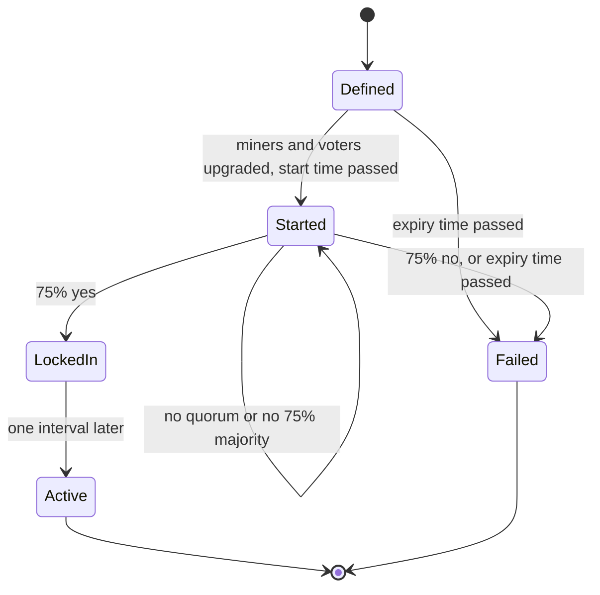

# Consensus rule votes

Decred changes the rules that every node enforces only after ticket holders vote for the change on chain. This page explains the process from proposal to activation, what ticket holders, miners, voting service provider (VSP) operators, exchanges and node operators must do, and how to follow a vote. It ends with a plain-language record of every agenda voted on mainnet.

!!! abstract "In short"
    - A rule change ships in new software switched off, together with an **agenda**: the item that ticket holders vote yes, no or abstain on.
    - Voting starts only after 95% of recent blocks and 75% of recent votes come from upgraded software.
    - A vote lasts 8,064 blocks (about 4 weeks). It passes when at least 4,032 votes are not abstentions and at least 75% of those say yes.
    - The new rules take effect one more interval of 8,064 blocks later. Software that has not been upgraded by then is left behind.
    - Upgrading does not mean voting yes. If you set no choice, your tickets abstain.

## Why coordinated upgrades matter

The **consensus rules** decide which blocks and transactions are valid: how large a block may be, which proof-of-work hash counts, how the block reward is split, how much the treasury may spend. Every full node checks every block against them, and two nodes that run different rules eventually follow different chains. So a rule change has to reach the whole network at a known moment. Decred does this with an on-chain vote:

- **Stakeholders decide, not miners.** In Bitcoin's version-bits mechanism (BIP 9), from which Decred's design descends, the miners' signal decides. In Decred, miners only signal that their software is ready. The decision belongs to the holders of tickets, the stake you lock to vote (see [How staking works](../staking/index.md)).
- **The result is written in the chain.** Every node counts the same votes in the same blocks, so all upgraded nodes switch to the new rules at the same block.
- **Everyone gets warning.** The software ships weeks or months ahead of activation, and a passed vote waits a further four weeks before it takes effect.

Decred also prefers **hard forks**: changes that old software cannot silently accept. Since block 657,280 the `explicitverupgrades` agenda ([DCP-0008](https://github.com/decred/dcps/blob/master/dcp-0008/dcp-0008.mediawiki)) makes this a rule: nodes reject any transaction or script version that no vote has defined yet, where they once accepted an unknown version unchecked. A wallet, hardware signer or exchange can now trust that a given version always follows the same rules.

## How a rule change happens

The process has five steps. Every step from the upgrade onward is computed from data in the chain, so every node reaches the same result and no single person or server can override it.

### Step 1: a Decred Change Proposal (DCP)

A consensus change usually begins as a [Politeia proposal](politeia.md) that asks whether the work should be done at all. If it is approved, developers write a **Decred Change Proposal (DCP)**: a design document that specifies the change exactly, explains why it is needed and comes with a tested implementation. DCPs are numbered (DCP-0001 to DCP-0013 so far) and published in the [decred/dcps repository](https://github.com/decred/dcps), where [DCP-0000](https://github.com/decred/dcps/blob/master/dcp-0000/dcp-0000.mediawiki) describes the process itself.

### Step 2: node software ships the change dormant

A new release of `dcrd` (the node) and the wallets contains the new rules switched off, plus a **deployment**: the agenda's id (such as `maxtreasuryspend`), its choices (`abstain`, `no`, `yes`), and a start and expiry time. The software also raises two version numbers:

- the **block version** that `dcrd` puts in the blocks it mines;
- the **vote version** that wallets attach to every vote they cast.

These numbers are how the chain shows that people have upgraded. The current mainnet value of both is 11.

### Step 3: miners and voters upgrade

Voting cannot begin until both groups have moved to the new software:

| Group | Upgrade counted as complete when | Measured over |
|---|---|---|
| Miners (proof of work) | 950 of the last 1,000 blocks carry the new block version | A rolling window of 1,000 blocks (about 3.5 days) |
| Voters (proof of stake) | 75% of all votes in one **stake version interval** carry the new vote version | 2,016 blocks (about 1 week) |

Two side effects matter to anyone who has not upgraded:

- In every upgrade so far, once 950 of the last 1,000 blocks carried the newer version, nodes rejected new blocks with an older version, so a miner still running old software loses every block it finds.
- Votes from old wallets still count as votes on each block, but they carry the old vote version, so they do not count toward the new agenda at all.

The whitepaper's [upgrade cycle](../../whitepaper/13-voting.md#sec:voting-cycle) gives the exact conditions.

### Step 4: the vote

Voting runs in **rule change intervals** of 8,064 blocks (about 4 weeks). An agenda starts voting at the first interval boundary after both upgrades are complete and its start time has passed.

During the interval, every ticket drawn to vote on a block also casts its owner's choice on the agenda: **yes**, **no** or **abstain**. A ticket whose owner set nothing abstains.

At the end of the interval, the votes are counted:

- **Quorum.** At least 4,032 votes must be yes or no. That is 10% of the most votes an interval can hold (8,064 blocks × 5 votes = 40,320).
- **Majority.** A choice wins if it has at least 75% of the votes that are not abstentions.
- **Abstentions count for nothing.** They count toward neither the quorum nor the majority, so a voter who is unsure does not push the result either way.

| What happens at the end of the interval | Result |
|---|---|
| Quorum met and yes has at least 75% | The agenda is **locked in** |
| Quorum met and no has at least 75% | The agenda has **failed**; the rules never activate |
| Quorum missed, or neither side reached 75% | Voting starts again from zero in the next interval |
| The expiry time passed before a decision | The agenda has **failed** |

Two points about your own tickets:

- Each ticket votes once, when it is drawn, with the choice your wallet or VSP has set at that moment. A choice set after the ticket has voted is not added to it.
- Not every ticket is drawn in a given interval. At the target pool size of 40,960 tickets, a ticket that stays live through a whole interval has roughly a 6 in 10 chance of voting during it.

### Step 5: lock-in, then activation

A locked-in agenda waits one more full interval, 8,064 blocks (about 4 weeks), with no further voting. This **lock-in** interval is the last call for anyone who has not upgraded. At the first block after it, the agenda becomes **active**, and every upgraded node enforces the new rules from then on.

A successful vote therefore takes at least 16,128 blocks (about 8 weeks) from the start of voting to activation.

Software that was not upgraded does not know the new rules. It rejects the first block that is valid only under them, which for `blake3pow` was the very first active block, and from then on shows a chain the rest of the network has left.

The diagram shows the states an agenda moves through. The names are the ones `dcrd` reports, and a state can change only at the boundary between two intervals.



### Worked example: `maxtreasuryspend`

The most recent agenda, `maxtreasuryspend` ([DCP-0013](https://github.com/decred/dcps/blob/master/dcp-0013/dcp-0013.mediawiki)), replaced the treasury's spending limit after the work was approved in a [Politeia proposal](https://proposals.decred.org/record/16a93c7751722954). From release to activation it took about ten and a half weeks:

| Stage | Blocks | Date |
|---|---|---|
| Deployment start time (earliest possible start) | — | 13 November 2025 |
| `dcrd` 2.1.0 released with the dormant rules and vote version 11 | — | 26 November 2025 |
| Voter upgrade reached 75% in the stake version interval | 1,032,256 to 1,034,271 | Late November to early December 2025 |
| Voting interval (state **started**) | 1,036,288 to 1,044,351 | From 14 December 2025, about 4 weeks |
| Lock-in interval (state **locked in**) | 1,044,352 to 1,052,415 | About 4 weeks |
| New rules active | From 1,052,416 | 8 February 2026 |

In the voting interval, 24,451 tickets voted yes, 3 voted no and 14,188 abstained, so yes had about 99.99% of the 24,454 yes and no votes, far above the 4,032 quorum.[^tally]

## What each participant must do

Everyone should **upgrade when a release that carries a vote comes out, and in any case before activation.** Upgrading only installs the rules switched off; how you vote is a separate choice. [Upgrading and mandatory releases](../run/upgrades.md) has the safe upgrade order and the steps for each app. What matters for the vote itself:

- **Ticket holders.** Upgrade your wallet, or your votes do not count toward the new agenda; `dcrwallet` logs "Old vote version detected" when the chain has moved past the version it votes with. Read the DCP and the discussion, then set your choice before your tickets are drawn. [Vote with your tickets](vote.md) shows how in each wallet, including for tickets at a VSP.
- **Miners and pool operators.** Upgrade `dcrd` and any pool software as soon as the release is out: voting cannot start until 95% of recent blocks signal the new version. For the `maxtreasuryspend` release, `dcrd` 2.1.0 also stopped telling voting wallets to vote on old-version mainnet blocks from height 1,035,288. A block needs at least 3 votes to be built on, so old-version blocks lost their rewards from then on. Some changes, such as `blake3pow`, need new mining hardware or firmware support; [Mining Decred](../run/mining.md) covers the miner's side.
- **VSP operators.** Upgrade `vspd` and the `dcrd` and `dcrwallet` instances that vote for your customers, whose tickets vote with your wallets' vote version. An outdated `vspd` rejects customers' choices on a new agenda as an agenda "not found for vote version", and Decrediton warns customers whose VSP is below the minimum version that their vote preferences will not be used.
- **Exchanges, services and other node operators.** Upgrade every `dcrd` and `dcrwallet` you run, including light wallets (SPV), before activation; the release notes ask everyone to upgrade, even those who intend to vote no. An outdated node can credit deposits or show confirmations that the network does not accept.

## Following a vote

A vote's progress is public: follow it in your wallet, from your own node, or on two websites.

=== "Decrediton"

    Open **Governance** > **Consensus Changes**. Each agenda card shows **Preference:**, the choice your wallet will vote with. Cards are tagged **Finished** once the agenda's rules are active and **In Progress** before that, including during the lock-in interval. The **Go to Voting Dashboard** button opens voting.decred.org, which has the vote counts.

    Decrediton reads the list of past agendas and their status from dcrdata. If the **Decred Block Explorer** privacy setting is off, it lists only the agendas your wallet itself knows, and the cards lose their status: every agenda, including an active one, is tagged **In Progress**.

=== "Bison Wallet"

    Bison Wallet lists the agendas your wallet can vote on under **Set Votes** in the DCR staking panel, where you choose a preference. It does not show vote counts; use one of the websites below for those.

=== "Command line"

    With `dcrd` running, ask your own node. The number is the vote version: 11 on mainnet.

    ```bash
    dcrctl getvoteinfo 11
    ```

    The answer covers the current rule change interval:

    - `startheight` and `endheight` mark the interval; `quorum` is 4032.
    - For each agenda, `status` is `defined`, `started`, `lockedin`, `active` or `failed`.
    - While an agenda is `started`, each choice has a `count` so far, and `progress` is that count as a share of all votes, abstentions included. `quorumprogress` is the share of the 4,032-vote quorum reached, up to 1.
    - To see whether yes is on track, divide the yes count by the yes and no counts together.

    Two related commands:

    - `dcrctl getblockchaininfo` lists every agenda under `deployments`, with its `status` and the height `since` which it has been in that state.
    - `dcrctl getstakeversioninfo` shows how many votes in each recent stake version interval used each vote version. Use it to watch the voter upgrade.

    On testnet, add `--testnet` and use vote version 12; there a voting interval is 5,040 blocks and the quorum 2,520 votes.

On the web:

- The [Decred Voting Dashboard](https://voting.decred.org) shows the miner and voter upgrade progress against their 95% and 75% thresholds, the current phase, and each agenda's quorum, vote counts, approval rating, lock-in height and activation height.
- The [dcrdata agenda list](https://dcrdata.decred.org/agendas) shows every agenda's status, vote version, start and expiry time; each agenda's page gives its voting blocks and the count for each choice. [Use the block explorer](../wallets/block-explorer.md) explains the rest of dcrdata.

## What can go wrong

- **Not upgrading.** Your coins are not at risk on chain, but outdated software follows a chain the network has abandoned and shows balances and confirmations from it. Download releases only from the official sources and [verify your download](../security/verify-downloads.md) before you run it.
- **Missing your say.** Tickets left on the default abstain. If your VSP has not upgraded, your choice on a new agenda is not recorded: check before voting starts and contact the operator, or move future tickets to another VSP.
- **No undo.** A vote cast is permanent. A failed agenda never activates; trying again needs a new deployment and a new release.

## Every mainnet agenda

Thirteen agendas have been voted on mainnet, and every one passed in its first voting interval. Agendas that share an activation block were voted on together, under the same vote version. The percentage under **Result** is yes votes divided by yes and no votes together, the figure the 75% test uses.[^history]

| Agenda | DCP | What changed, in plain words | Active from block | Result |
|---|---|---|---|---|
| `sdiffalgorithm` | DCP-0001 | New way of setting the ticket price, which reacts to how the ticket pool size changes ([Ticket price, rewards and costs](../staking/ticket-price-and-rewards.md)) | 149,248 | Passed, 97.93% yes |
| `lnsupport` | — | A non-binding poll: should developers start work on Lightning Network support? No rule changed | 149,248 | Passed, 98.62% yes |
| `lnfeatures` | DCP-0002, DCP-0003 | Added the SHA-256 script opcode and relative lock times, which Lightning payment channels need ([Lightning on Decred](../lightning/index.md)) | 189,568 | Passed, 99.51% yes |
| `fixlnseqlocks` | DCP-0004 | Corrected how relative lock times are checked, completing Lightning support | 342,784 | Passed, 99.98% yes |
| `headercommitments` | DCP-0005 | Block headers commit to compact block filters, so light wallets can verify the data they download | 431,488 | Passed, 99.94% yes |
| `treasury` | DCP-0006 | Created the decentralized treasury: ticket holders approve or reject every treasury spend on chain ([The treasury](treasury.md)) | 552,448 | Passed, 99.90% yes |
| `reverttreasurypolicy` | DCP-0007 | Changed the treasury spending limit to 150% of the treasury's income over the same period, the policy stakeholders had originally approved | 657,280 | Passed, 99.95% yes |
| `explicitverupgrades` | DCP-0008 | Transaction and script versions not yet defined by a vote are rejected, so every future such change is a voted hard fork | 657,280 | Passed, 99.95% yes |
| `autorevocations` | DCP-0009 | Missed and expired tickets are revoked automatically in the block where that happens; owners no longer revoke them by hand | 657,280 | Passed, 99.95% yes |
| `changesubsidysplit` | DCP-0010 | Block subsidy split changed from 60% miners / 30% voters / 10% treasury to 10 / 80 / 10 ([DCR supply and issuance](../start/supply-and-issuance.md)) | 657,280 | Passed, 99.74% yes |
| `blake3pow` | DCP-0011 | Proof-of-work hash changed from BLAKE-256 to BLAKE3, and the difficulty algorithm to ASERT (absolutely scheduled exponentially rising targets) | 794,368 | Passed, 99.47% yes |
| `changesubsidysplitr2` | DCP-0012 | Block subsidy split changed to 1% miners / 89% voters / 10% treasury, the split in force today | 794,368 | Passed, 99.28% yes |
| `maxtreasuryspend` | DCP-0013 | New treasury spending limit based on a percentage of the treasury balance, with a minimum floor ([The treasury](treasury.md)) | 1,052,416 | Passed, 99.99% yes |

One more agenda, `maxblocksize`, exists in the software but has never been deployed on mainnet.

## Go deeper

- [The upgrade cycle](../../whitepaper/13-voting.md#sec:voting-cycle): the five steps, with the exact upgrade thresholds.
- [Quorum and majority](../../whitepaper/13-voting.md#sec:voting-majority): how votes are counted, including rounding.
- [Explicit version upgrades](../../whitepaper/13-voting.md#sec:voting-dcp8): what DCP-0008 enforces on transactions and scripts.
- [Main-network history](../../whitepaper/13-voting.md#sec:voting-history): the start, lock-in and activation block of every vote.

## Next steps

- [Vote with your tickets](vote.md): set your choice on an agenda and check that it counted.
- [Upgrading and mandatory releases](../run/upgrades.md): keep your software current before the next activation.
- [The treasury](treasury.md): what the `treasury`, `reverttreasurypolicy` and `maxtreasuryspend` agendas govern today.
- [Politeia proposals](politeia.md): where a consensus change starts.
- [Consensus changes: DCPs and agenda deployments](../../dev/contributing/consensus-changes.md): for developers who want to write a DCP or implement an agenda.

[^tally]: Vote counts from the dcrdata page for `maxtreasuryspend` and the Decred Voting Dashboard, checked November 2026. Block dates from the block headers on dcrdata. The stake version interval in which voters reached 75% is the one the Voting Dashboard reports. The `dcrd` 2.1.0 release notes and the mainnet parameters give the release contents and the start time.

[^history]: Activation blocks from the whitepaper's main-network history and the historical activation points hard-coded in `dcrd` 2.1.7. Yes shares are computed from the vote counts published on the Decred Voting Dashboard (voting.decred.org), checked November 2026; they agree with the percentages in the whitepaper.

*[DCP]: Decred Change Proposal
*[VSP]: voting service provider
*[ASERT]: Absolutely Scheduled Exponentially Rising Targets
*[SHA-256]: Secure Hash Algorithm, 256-bit
