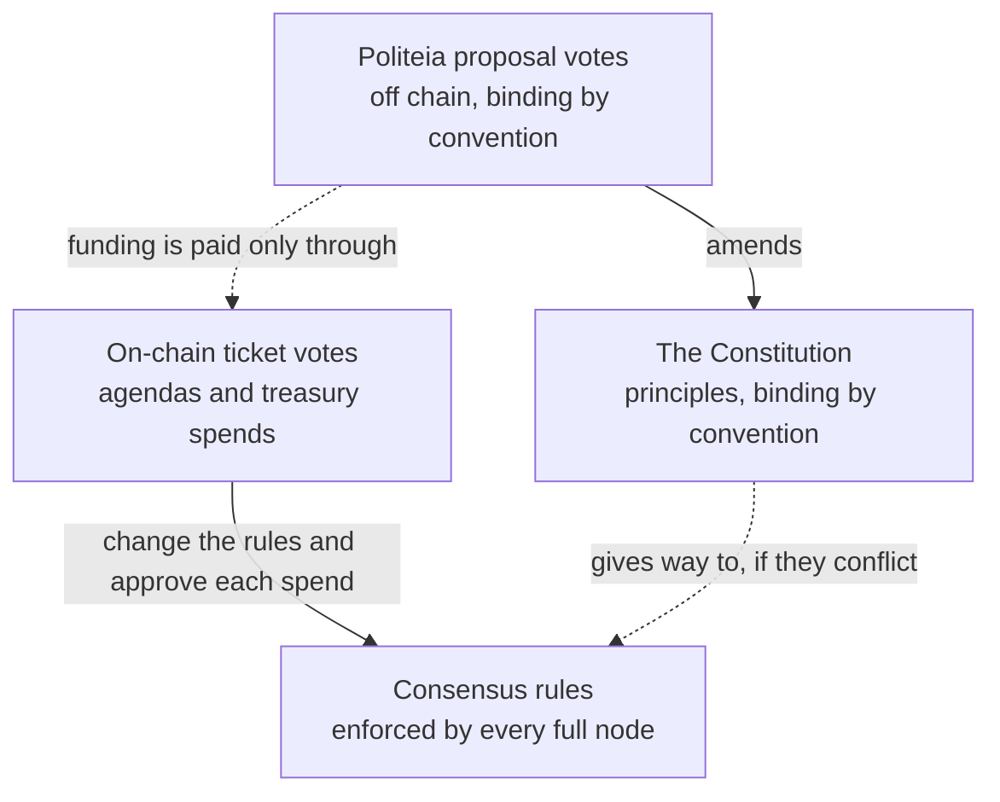

# The Decred Constitution

The Decred Constitution sets out the project's guiding principles and summarizes how the blockchain and the treasury are governed. This page gives its current text in full, explains what kind of document it is and how it came to read as it does, and lists the statements that today's network no longer matches.

| | |
|---|---|
| Current text | Ratified by a Politeia ticket vote in May 2019; numbers last updated in 2023 |
| Force | By convention only. No software enforces it, and by its own text it does not override the consensus rules |
| How it changes | By an approved Politeia proposal |
| Copy in Decrediton | **Settings** > **Sources** > **Constitution**. It still shows the reward split from before Decred Change Proposal DCP-0010 |

## Status and history

### What kind of document it is

The Constitution is a statement of principles and expectations, not a set of rules that software checks. Three points from its own text define its status:

- It "is not intended to take precedence over the Decred network's consensus rules, should any conflict arise". If the two disagree, the consensus rules describe what actually happens.
- It can be amended by approved [Politeia](politeia.md) proposals. Politeia votes are off chain and change no consensus state, so a policy decision such as an amendment binds only because people act on it.
- It names the will of the stakeholders (ticket holders), expressed through on-chain and Politeia votes, as the ultimate decision-making force for the project.

The diagram shows what enforces each layer: only the consensus rules are enforced by software, while the Constitution is changed by Politeia votes and gives way to the consensus rules.

[How Decred is governed](index.md) describes the four decisions that tickets make and which of them the network enforces.

### How the text came to read as it does

| When | What happened |
|---|---|
| Before February 2016 | Written before mainnet launched (the genesis block is dated 8 February 2016), according to the September 2018 note below; by 2017 it was kept on the Decred wiki. This first version set up a *Decred Assembly* with Admission, Creation, Attrition and Funding Councils, and fixed a budget and reporting schedule for Decred Holdings Group (DHG), which received the treasury share of each block. |
| March 2017 | Copied into the Decred documentation. |
| September 2018 | A note was added saying that parts of the text were no longer relevant, others not yet realized, and that Politeia would be used to amend it. |
| February to April 2019 | An amendment was drafted in public: a documentation pull request, a tracking issue and two community discussion threads. |
| April and May 2019 | The amendment was published on Politeia as "Amendment to Decred Constitution - 001" on 5 April 2019 and put to a ticket vote of 2,016 blocks with a 20% quorum and 60% pass threshold. The vote ended at block 341,909 (6 May 2019) with 12,008 yes and 102 no (99.2% yes), cast by about 30% of the 40,809 eligible tickets.[^ratify] The amended text replaced the old one in the documentation in May 2019. |
| June 2019 | "Decentralized Autonomous Entity" was renamed "Decentralized Autonomous Organization (DAO)". |
| August and October 2023 | The vote reward, proof-of-work share and supply figures were updated, after the subsidy split had changed twice by consensus vote (DCP-0010, in May 2022, and then [DCP-0012](https://github.com/decred/dcps/blob/master/dcp-0012/dcp-0012.mediawiki)). Until then the text still gave the original split. |

The 2019 amendment removed the Assembly and the councils, DHG's budget timetable and its request-for-proposals rules. It added Politeia as the way stakeholders approve policy and work, a description of consensus rule voting, the aim of moving treasury control to a decentralized autonomous entity, DHG's interim veto, the autonomy of contractors and the non-precedence clause quoted above.

The 2019 proposal said that later edits would follow the same Politeia process. The June 2019 rename and the 2023 updates were editorial changes in the documentation repository, not separate amendment proposals; the 2023 figures follow consensus votes that stakeholders approved on chain. No later Politeia proposal to amend the Constitution has been held.[^nolater]

## The text

The text below is reproduced word for word, including its original spelling and wording, from the Decred documentation repository as last edited in October 2023.[^source] Section headings are in sentence case. Links in the original pointed to pages of the retired documentation and, for the Contractor Clearance proposal, to its old Politeia address; here they point to the matching pages on this site and to the proposal's page on dcrdata. [Where the text and the network differ](#where-the-text-and-the-network-differ) lists the statements that are out of date.

Decred (/ˈdi:ˈkred/, /dɪˈkred/, dee-cred) is a secure, adaptable and self-funding cryptocurrency with a system of community-based governance integrated into its blockchain. The project mission is to develop technology for the public benefit, with a primary focus on cryptocurrency technology. This constitution defines a set of principles which guide the decision-making of the project's stakeholders, and describes the processes through which the blockchain and Treasury are governed. This document is meant to manage the expectations of prospective and actual Decred users, so that they more clearly understand the social contract between themselves and the project. This document is not intended to take precedence over the Decred network's consensus rules, should any conflict arise.

### Principles

- *Free and Open-Source Software* - All software developed as part of Decred shall be free and open source-software.
- *Free Speech and Consideration* - Everyone has the right to communicate opinions and ideas without fear of censorship. Consideration shall be given to all constructive speech that is based in fact and reason.
- *Multi-Stakeholder Inclusivity* - Inclusivity represents a multi-stakeholder system and an active effort shall be maintained to include a diverse set of views and users.
- *Incremental Privacy and Security* - Privacy and security are priorities and shall be balanced with the complexity of their implementations. Additional privacy and security technology shall be implemented on a continuing and incremental basis, both proactively and on-demand in response to attacks.
- *Fixed Finite Supply* - Issuance is finite and the total issuance shall not exceed 20,999,999.98387408 DCR, with a per-block subsidy that adjusts every 6,144 blocks (approximately 21.33 days) by reducing by a factor of 100/101. The genesis block subsidy starts at 31.19582664 DCR.
- *Universal Fungibility* - Universal fungibility is fundamental to Decred being a store of value and attacks against it shall be actively monitored and countermeasures pursued as necessary.

### Blockchain governance

- [Governance](index.md) of the network occurs directly through the blockchain via hybridization of a block's proof-of-work ("PoW") with its proof-of-stake ("PoS"). PoS voters, also known as stakeholders, can effectively override PoW contributors, known as miners, if 50% or more of the stakeholders vote against a particular block created by a miner.
- Stakeholders are people who purchase one or more tickets, which entails locking a specific amount of DCR. The amount of DCR that must be locked, also known as the ticket price, fluctuates as the system targets 40,960 tickets in the live pool.
- In each block, 5 tickets are called to vote, determined by a lottery [system](../staking/index.md). When a ticket is called, a nominated wallet must actively respond with a vote. For a block to be accepted by the network, it must include votes from at least 3 of the 5 tickets called. The blockchain cannot be extended without the active participation of stakeholders.
- Stakeholders must wait an average of 28 days (8,192 blocks) to vote their tickets, and during this time the DCR used to purchase the ticket remain locked. The wait may be much longer or shorter than the average of 28 days because the ticket selection process is pseudorandom. Tickets expire after 40,960 blocks (~142 days) if they have not been called to vote.
- Stakeholder votes recorded in the blockchain are rewarded with 17.8% of each block subsidy, and each block can have up to 5 votes for a total of 89% of each block subsidy.
- PoW receives 1% of each block subsidy, subject to the constraint that their subsidy scales linearly with the number of PoS votes included, e.g. including 3 of 5 votes reduces PoW subsidy to 60% of the maximum.
- The votes themselves decide by majority decision whether the regular transaction tree of the previous block, including the PoW subsidy, is valid. Thus, if PoS voters vote against a particular PoW block, it invalidates the PoW reward (and Treasury reward) and invalidates any regular transactions within that block.
- Decred's process for [amending the consensus rules](consensus-upgrades.md) is also driven by stakeholder voting. The process begins when at least 95% of PoW miners and 75% of PoS voters have upgraded their software to a new version with latent changes to the rules. Once these conditions are met, a voting period of 8,064 blocks (~4 weeks) begins, to decide whether the latent rule changes should be activated.
- For a rule change proposal to be approved, at least 75% of the tickets not set to Abstain must vote Yes. If this requirement is met, and a quorum of 10% tickets voting Yes or No is achieved, then the rule change will be activated 8,064 blocks (~4 weeks) later.

### Project governance and funding

- Sustainability and longevity require that 10% of all block rewards be given to a project Treasury fund, administered by a development organization.
- The initial development organization is *Decred Holdings Group* LLC ("DHG"), a Nevis LLC that is responsible for funding work related to the development of the project, such as software development, infrastructure, and awareness. DHG shall comply with all relevant bodies of law in the jurisdictions where applicable, such as embargoes and other trade sanctions.
- The project aims to transition to a Decentralized Autonomous Organization (DAO) which controls the disbursement of Treasury funds.
- For as long as DHG has responsibility for managing the Treasury (i.e. until control is fully decentralized), it holds a veto that can be exercised if it is felt that following through with a decision would put the project, the DHG corporate entity or DHG's managers in jeopardy.
- [Politeia](politeia.md) proposals are the mechanism through which stakeholders make policy decisions and approve programs of work. Politeia proposals must be approved by at least 60% of the tickets that vote, and at least 20% of the eligible tickets must participate in the vote. The default voting period is 2,016 blocks (~1 week).
- Decred [contractors](../reference/index.md) are individuals and corporations who work on the project, under an agreement that they are compensated for their work. Decred contractors are autonomous, they cannot be managed directly by stakeholders. Through Politeia, stakeholders can approve or reject programs of work as performed by specific contractors, but they cannot mandate that workers take certain actions.
- The Decred contractor collective is a self-regulating entity, wherein cells working on specific aspects resolve disputes and add new members independently. As described in the approved [Decred Contractor Clearance proposal](https://dcrdata.decred.org/proposal/091ab0f5bf247073), disputes that cannot be satisfactorily resolved within a team can be escalated to an all contractor vote - once the contractor management system which will facilitate this is operational. If necessary, unresolved matters could be further escalated to a stakeholder vote as the ultimate decision-making authority.
- The will of the stakeholders, as expressed through their on-chain and Politeia ticket voting, is the ultimate decision-making force for the project.
- This constitution will be ratified by a Politeia vote before it takes effect, and can be further amended by approval of subsequent Politeia proposals.

## Where the text and the network differ

Most of the text still matches the network. These statements hold as written for mainnet today: five tickets are drawn per block and a block needs at least three votes; tickets wait 8,192 blocks (about 28 days) on average and expire after 40,960 blocks (about 142 days); votes earn 17.8% of the subsidy each and proof of work 1%, scaled by the number of votes; a rule change vote starts after 95% of miners and 75% of voters have upgraded, needs 75% yes among non-abstaining votes, and activates one 8,064-block interval after it passes. The 20% quorum and 60% approval for Politeia votes are the values the form for starting a vote offers by default; each vote records its own parameters.

The statements below are out of date or need a qualification. Each entry quotes the text, then says what is true now.

"total issuance shall not exceed 20,999,999.98387408 DCR"
:   This figure comes from a unit test in dcrd.[^supplytest] The test uses an *estimated* activation height for DCP-0012 (block 782,208; the actual height was 794,368) and pays each vote at the rate of the block that contains it, not, as consensus does, at the rate of the block it votes on. No consensus rule caps the total. The whitepaper applies the actual heights and the consensus vote rule, and puts the most that can ever be issued at about 21,000,015.55 DCR, a total reached only if every block from block 4,096 on had five votes and none was disapproved. Every missed vote forfeits its subsidy, so the actual supply is lower. The last subsidy is paid in block 10,979,328. See [the whitepaper's total supply section](../../whitepaper/11-subsidy.md#sec:subsidy-supply) and [DCR supply and issuance](../start/supply-and-issuance.md).

"The genesis block subsidy starts at 31.19582664 DCR"
:   The genesis block (block 0) pays nothing. Block 1 created the 1,680,000 DCR block-one ledger, which is included in the supply totals. 31.19582664 DCR is the base subsidy, paid from block 2 and reduced by a factor of 100/101 every 6,144 blocks.

"if 50% or more of the stakeholders vote against a particular block"
:   The count is over the three to five votes included in the next block, not over all stakeholders. The previous block's regular transaction tree stands only if a strict majority of those votes approve it, so a tie disapproves it.

"it invalidates the PoW reward (and Treasury reward)"
:   True only before block 552,448. Since the `treasury` agenda ([DCP-0006](https://github.com/decred/dcps/blob/master/dcp-0006/dcp-0006.mediawiki)) activated there, the treasury's share is paid by a separate treasurybase transaction in the stake tree. A disapproval does not affect it, and it is not reduced when votes are missing.

"a quorum of 10% tickets voting Yes or No"
:   Exactly: at least 4,032 votes that are not abstentions within one 8,064-block interval, which is 10% of the 40,320 votes possible in that interval (8,064 blocks × 5 votes).

"10% of all block rewards be given to a project Treasury fund, administered by a development organization" and the clauses on DHG
:   Out of date since block 552,448. The treasury now receives 10% of each block's subsidy (not of transaction fees) into an on-chain account that no organization controls. Funds leave it only through a treasury spend (TSPEND): a transaction signed with one of the Politeia keys built into the node software, which is valid only after ticket holders approve it by on-chain vote and only within a spending limit ([DCP-0013](https://github.com/decred/dcps/blob/master/dcp-0013/dcp-0013.mediawiki) since block 1,052,416). Before that block, the treasury share went to an address held by DHG. The veto clause applies "for as long as DHG has responsibility for managing the Treasury"; DHG no longer receives or holds new treasury funds. See [The treasury](treasury.md) and [the whitepaper's account of the legacy arrangement](../../whitepaper/12-treasury.md#sec:treasury-legacy).

"The project aims to transition to a Decentralized Autonomous Organization (DAO)"
:   The text has not been amended to say how far the on-chain treasury goes toward this aim. What changed in fact: since DCP-0006, ticket holders vote on every treasury spend, and no spend is valid without their approval.

"The default voting period is 2,016 blocks (~1 week)"
:   Still the mainnet minimum, and the value the form for starting a Politeia vote offers first. A vote can be set to last up to 4,032 blocks (about 14 days).

"once the contractor management system which will facilitate this is operational"
:   The Contractor Management System (CMS) was built and used for contractor invoices from April 2019. It also implemented votes by contractors on Decred Contractor Clearance (DCC) issuances and revocations; whether it was ever used to settle a dispute as the clause describes could not be confirmed. Its public site, cms.decred.org, did not resolve when this page was checked in November 2026.

"This constitution will be ratified by a Politeia vote before it takes effect"
:   Done: the amended text was ratified in May 2019 (see the history table above).

The copy in Decrediton
:   The Constitution in Decrediton 2.1.7 (**Settings**, the icon with the tooltip "Settings" at the bottom of the sidebar, then the **Sources** tab and **Constitution**) is the 2019 text before the 2023 updates. It gives votes 6% each (30% in total), proof of work 60%, and a supply limit of 20,999,999.99800912 DCR. Those figures describe the original split, which changed at block 657,280 ([DCP-0010](https://github.com/decred/dcps/blob/master/dcp-0010/dcp-0010.mediawiki), 10/80/10) and again at block 794,368 (DCP-0012, 1/89/10). Its links also point to the retired documentation site.

## How the principles are applied today

The six principles are not enforced by code, but each has a visible counterpart in the software and processes that exist in 2026.

| Principle | Where it shows today | Read more |
|---|---|---|
| Free and open-source software | The software the Decred project maintains is published on GitHub under open-source licenses: ISC for dcrd, dcrwallet, dcrctl, Decrediton, vspd, Politeia and dcrdata; the Blue Oak Model License 1.0.0 for DCRDEX and Bison Wallet; MIT for dcrlnd. | [Contributing to Decred software](../../dev/contributing/index.md) |
| Free speech and consideration | Politeia gives every submitted proposal a signed censorship record, so an author can prove that a proposal was received if it is later censored. Anyone can verify the results of a proposal vote. | [Politeia proposals](politeia.md) |
| Multi-stakeholder inclusivity | Anyone who locks DCR at the ticket price gets a ticket that votes on blocks, agendas, treasury spends and proposals. Voting service providers (VSPs) let ticket holders vote without running an always-online wallet. | [How staking works](../staking/index.md) |
| Incremental privacy and security | Mixing arrived in 2019 with a central server and has been fully peer-to-peer, as StakeShuffle, since v2.0.0 (2024). Releases 2.1.6 and 2.1.7 (2026) fixed a critical consensus issue, a potential mixing deanonymization attack and denial-of-service problems. A [bug bounty program](https://bounty.decred.org/) covers the main software. | [Privacy and mixing](../privacy/index.md) |
| Fixed finite supply | The subsidy schedule (base subsidy and the 100/101 reduction every 6,144 blocks) has not changed since launch. The two consensus votes that changed the split (DCP-0010 and DCP-0012) changed how each block's subsidy is divided. That shifted the maximum total slightly, and because a missed vote now forfeits a larger share, it also affects how much is actually issued; no vote has raised the base schedule. | [DCR supply and issuance](../start/supply-and-issuance.md) |
| Universal fungibility | Mixing breaks the on-chain link between coins, and wallets can buy tickets with mixed funds so that staking does not undo it. | [Mix your DCR](../privacy/mix-your-dcr.md) |

## Next steps

- [How Decred is governed](index.md): see the four decisions tickets make and which ones the network enforces.
- [Politeia proposals](politeia.md): learn how the proposals that amend the Constitution are submitted and voted on.
- [Write a Politeia proposal](write-a-proposal.md): put an amendment, or any other proposal, to a stakeholder vote.
- [Vote with your tickets](vote.md): cast your vote on proposals, agendas and treasury spends.
- [DCR supply and issuance](../start/supply-and-issuance.md): read the current supply figures behind the "fixed finite supply" principle.

[^ratify]: Tally and eligible tickets from [the proposal's page on dcrdata](https://dcrdata.decred.org/proposal/a3c832ee2b981f38), checked November 2026. The proposal text and its vote parameters (duration 2,016 blocks, quorum 20%, pass 60%) are in [the archived Politeia record](https://github.com/decred-proposals/mainnet/tree/master/fd56bb79e0383f40fc2d92f4473634c59f1aa0abda7aabe29079216202c83114). The drafting history is in [the tracking issue](https://github.com/xaur/decred-issues/issues/107) and [the documentation pull request](https://github.com/decred/dcrdocs/pull/860).

[^nolater]: As listed in [dcrdata's Politeia proposal index](https://dcrdata.decred.org/proposals), checked November 2026: of 231 proposals, only the 2019 amendment concerns the Constitution.

[^source]: [docs/governance/decred-constitution.md in decred/dcrdocs](https://github.com/decred/dcrdocs/blob/master/docs/governance/decred-constitution.md), commit 6fcc56d. Its history shows every change since 2017.

[^supplytest]: `TestTotalSubsidyDCP0012`, which checks `expectedTotalSubsidy = 2099999998387408`, in [blockchain/standalone/subsidy_test.go at release-v2.1.7](https://github.com/decred/dcrd/blob/release-v2.1.7/blockchain/standalone/subsidy_test.go), and sets `estimatedDCP0012ActivationHeight = 782208`.

*[PoW]: proof of work
*[PoS]: proof of stake
*[DHG]: Decred Holdings Group
*[DAO]: decentralized autonomous organization
*[DCP]: Decred Change Proposal
*[TSPEND]: treasury spend
*[VSPs]: voting service providers
*[CMS]: Contractor Management System
*[DCC]: Decred Contractor Clearance
*[LLC]: limited liability company
