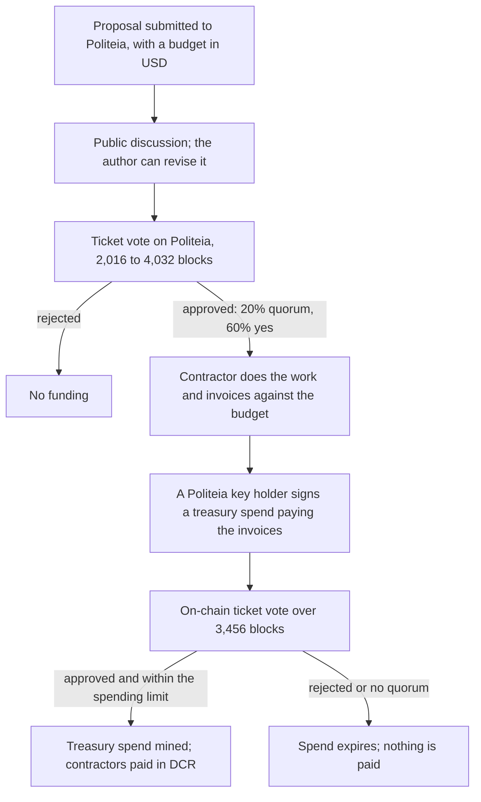
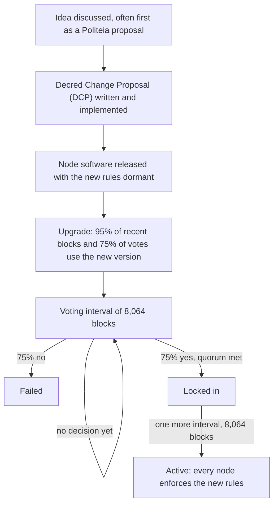

# How Decred is governed

Decred has no company or foundation that decides its rules or its budget. Those decisions belong to the people who lock DCR in tickets. This page maps what tickets decide, where each decision is made, which ones the network enforces on its own, and how an idea turns into either a funded project or a change to the consensus rules.

## In this section

-   **[Consensus rule votes](consensus-upgrades.md)**

    ---

    How the rules change without splitting the network, and every mainnet vote so far.

-   **[The treasury](treasury.md)**

    ---

    How 10% of each block's subsidy funds the project, how every spend is voted on, and the spending limit.

-   **[Politeia proposals](politeia.md)**

    ---

    How proposals are submitted, discussed and voted on, and how censorship is made visible.

-   **[Vote with your tickets](vote.md)**

    ---

    Set your choices on agendas, treasury spends and proposals, and check that they counted.

-   **[Write a Politeia proposal](write-a-proposal.md)**

    ---

    Take an idea for work or policy from groundwork to a ticket vote.

-   **[The Decred Constitution](constitution.md)**

    ---

    The project's founding principles and how they relate to the rules.

!!! abstract "Governance in one minute"

    - One credential: the **ticket**. Each ticket votes on chain once, when it is drawn: on that block's approval and on any agendas and treasury spends open at the time. It can also vote on each Politeia proposal for which it was live when the vote's ticket snapshot was taken.
    - Four decisions: **block approval**, **consensus rule votes**, **treasury spends** and **Politeia proposals**.
    - The first three are on chain and enforced by every full node. Politeia votes are off chain and bind only because people act on them.
    - Money leaves the treasury only through a treasury spend that ticket holders approve on chain. Funding is therefore voted on twice: once on the proposal, once on the payment.
    - Rule changes ship dormant in the node software and switch on by themselves only if tickets vote for them.

## One credential: The ticket

A **ticket** is bought by locking DCR at the current ticket price (also called stake difficulty). The locked DCR comes back when the ticket votes, or when it is revoked after missing its vote or expiring. [How staking works](../staking/index.md) covers the details.

The same ticket is the voting credential everywhere in Decred governance. There are no separate governance tokens, delegates or councils. Two facts follow:

- **Voting power grows with DCR at stake.** Every ticket gives one vote, and all tickets bought in the same 144-block price window (about 12 hours) cost the same, so holders who lock more DCR have more tickets and more votes. In exchange, every voter has funds locked for an unpredictable time, typically weeks, and so has something to lose from bad decisions.
- **Anyone can take part.** No permission is needed to buy a ticket. A **voting service provider (VSP)** can cast your on-chain votes if you do not want to run an always-online wallet; it gets the right to vote, never your funds. See [Voting service providers](../staking/vsps.md).

Why vote with locked coins rather than by miners' hash power or developers' judgment? The design gives the final say over rules and funds to people who have committed funds to the network. Miners and developers keep their roles but cannot overrule them.

## Four decisions

Tickets vote in four places. They differ in what is decided, how long a vote lasts and, most importantly, whether the outcome is enforced by the consensus rules or only by convention. All values are mainnet values.

| Decision | What is decided | Where | Length | To pass | Binding |
|---|---|---|---|---|---|
| Block approval | Whether the previous block's ordinary transactions and the miner's reward stand | In each vote, on chain | One block | At least 3 of the 5 drawn tickets must vote; a strict majority of those votes must approve | Consensus |
| Consensus rule votes | Whether a proposed rule change, called an **agenda**, activates | In votes cast during a voting interval, on chain | 8,064 blocks (about 4 weeks) per interval | Quorum of 4,032 votes that are not abstentions, and at least 75% of those votes yes | Consensus |
| Treasury spends | Whether one **treasury spend (TSPEND)**, a payment out of the treasury, may be mined | In votes cast during the spend's window, on chain | 3,456 blocks (about 12 days) | Quorum of 20% of the votes possible in the window; yes votes at least 60% of all votes cast plus all votes still possible | Consensus |
| Politeia proposals | Whether stakeholders support a program of work, a budget or a policy | Signed votes sent to proposals.decred.org, off chain | 2,016 to 4,032 blocks (about 7 to 14 days) | 20% of eligible tickets vote, and 60% of the votes cast are yes | Convention |

What each row means in practice:

**Block approval.** Every block draws 5 tickets from the pool of live tickets, and their votes go into the next block. Each vote approves or disapproves the block it was drawn in. Unless a strict majority of the votes approve (a 2-2 split of four votes counts as disapproval), that block's ordinary transactions are undone (they can be mined again later) and the miner loses the reward; votes, tickets and the treasury's share are not affected. Wallets set this vote automatically; there is no user choice. It is the check stakeholders hold over miners, explained in [Miners, voters and the life of a block](../start/life-of-a-block.md).

**Consensus rule votes.** While an agenda is open, each vote also carries your choice on it: yes, no or abstain. Only tickets drawn during the interval vote, and with 5 votes per block an interval holds at most 40,320 votes, close to a full pool of 40,960 tickets. Abstentions count toward neither side nor the quorum. If you set no choice, your ticket abstains. [Consensus rule votes](consensus-upgrades.md) has the full process and history.

**Treasury spends.** Since 2021 the treasury is an on-chain account that only a treasury spend can draw from. A treasury spend can be created only with one of two **Politeia keys** written into the consensus rules, and it can be mined only if ticket votes approve it and it stays within a spending limit, also set by the consensus rules. Votes still to come are counted as potential no votes, so a spend can pass early only once its approval is certain. You can vote on each spend or set a standing choice for everything signed by a given key. [The treasury](treasury.md) explains the window, the limit and how to audit spending.

**Politeia proposals.** Politeia is the proposal system at proposals.decred.org. Tickets that were live 256 blocks (about 21 hours) before the vote started can vote for its whole duration, even if they are drawn to vote on chain in the meantime. The vote is signed by your own wallet, even when a VSP holds the ticket's on-chain voting rights. The 20% and 60% figures are the minimums the Politeia site requires on mainnet when an administrator starts a vote; they are not consensus rules. [Politeia proposals](politeia.md) covers the system.

## How a funding decision flows

Most treasury money pays contractors: people and companies who do agreed work for the project, such as software development, infrastructure and outreach. A funding decision passes two votes, first off chain and then on chain, and only the second one moves money.

The diagram follows one proposal from submission to payment. The last two steps are enforced by the consensus rules; the earlier ones are social processes.

Three points are worth knowing:

1. **Approval of a proposal is a promise, not a payment.** The contractor is paid as work is delivered and invoiced, not up front. An approved proposal whose author fails to deliver can be closed.
2. **One treasury spend can pay many recipients.** A spend can have many outputs, so one spend can pay several contractors, and ticket holders vote on it as a whole.
3. **Each side can stop the other.** The Politeia key holders cannot take money without the stakeholder vote, and stakeholders cannot force a payment: only a key holder can create a treasury spend.

!!! note "Before 2021"
    Until the decentralized treasury activated at block 552,448 (Decred Change Proposal [DCP-0006](https://github.com/decred/dcps/blob/master/dcp-0006/dcp-0006.mediawiki)), the treasury's share went to an address controlled by Decred Holdings Group, which paid invoices by hand, with no on-chain stakeholder vote on payments. Older guides that describe this arrangement are out of date.

## How a rule change flows

A change to the consensus rules, the rules every full node checks for every block and transaction, must reach all nodes at the same moment, or the network splits in two. Decred solves this by shipping the change in advance, switched off, and letting the chain itself record when it switches on.

The diagram shows the path from an idea to rules that every node enforces. Every step from the upgrade onward is decided by data in the chain.

Step by step:

1. **Proposal and DCP.** The DCP process expects a consensus change to start as a Politeia proposal that gauges support. The change is then specified in a **Decred Change Proposal (DCP)**, numbered like DCP-0013, and implemented and tested in the node software.
2. **Dormant code.** A release of `dcrd` and the wallets contains the new rules, switched off, together with an agenda that defines the vote.
3. **Upgrade.** Voting cannot start until miners and voters have upgraded: 950 of the last 1,000 blocks must carry the new block version, and 75% of the votes in a 2,016-block stake version interval must carry the new vote version. Voting then begins at the next 8,064-block interval boundary, once the agenda's start time set in the release has passed.
4. **Vote.** Voting runs in intervals of 8,064 blocks. If an interval ends without a decision, the next interval votes again, until the agenda's expiry time passes.
5. **Lock-in.** When at least 4,032 votes are not abstentions and 75% of them say yes, the agenda locks in. If 75% say no, it fails.
6. **Activation.** One more interval later, the new rules apply to every block. The lock-in interval gives everyone who has not yet upgraded about four weeks to do so; [Upgrading and mandatory releases](../run/upgrades.md) explains what happens to software that does not.

A successful vote therefore takes at least 16,128 blocks (about eight weeks) from the start of voting to activation.

### Worked example: The maxtreasuryspend vote

The latest mainnet agenda as of 2026, `maxtreasuryspend` ([DCP-0013](https://github.com/decred/dcps/blob/master/dcp-0013/dcp-0013.mediawiki)), set a new limit on treasury spending. Its voting interval ran from block 1,036,288 to block 1,044,351.[^tally]

| Votes in the interval | Count |
|---|---|
| Yes | 24,451 |
| No | 3 |
| Abstain | 14,188 |
| **Total** | **38,642** |

- **Quorum.** 24,454 votes were not abstentions, well above the 4,032 required.
- **Threshold.** Yes votes were 24,451 of 24,454, about 99.99%, far above 75%. Only about 63% of all votes were yes, but abstentions count for neither side.
- **Result.** The agenda locked in at the end of the interval and became active at block 1,052,416, one interval of 8,064 blocks later. Every mainnet agenda so far has passed in its first voting interval.

## Who does what

Governance spreads power across several groups, and each one's power is limited by the others. The table lists what each can and cannot do.

| Who | What they do | What they cannot do |
|---|---|---|
| Stakeholders (ticket holders) | Approve or disapprove blocks; vote on agendas, treasury spends and proposals | Direct individual contractors; create a treasury spend themselves |
| VSPs | Cast on-chain votes for their clients' tickets, following the choices each client sets | Touch the ticket's funds or reward; vote on Politeia for a client |
| Politeia administrators | Review new proposals, remove spam, start votes that authors have authorized | Censor without leaving proof the author can publish; change a vote's result |
| Politeia key holders | Sign treasury spends that pay approved work | Move treasury funds without an approving on-chain vote, or beyond the spending limit |
| Contractors | Propose and carry out paid work; invoice against approved budgets | Get paid for work stakeholders have not approved |
| Developers | Write DCPs and the software that implements them; publish releases | Activate a rule change; only an agenda vote can |
| Miners | Produce blocks with proof of work (PoW); signal readiness for upgrades through the block version | Decide a vote; keep a reward for a block that tickets disapprove |

Many people hold several roles at once. A contractor who also holds tickets votes like any other stakeholder.

## The Decred Constitution

The Decred Constitution is a short document that sets out the project's principles: free and open-source software, free speech, inclusivity, incremental privacy and security, a fixed finite supply and fungibility. It also summarizes how the blockchain and treasury are governed and states that contractors are autonomous: stakeholders approve or reject programs of work but cannot direct individual contractors.

Its status is limited by its own text:

- It says it is not intended to take precedence over the consensus rules if the two conflict.
- It says it can be amended by approved Politeia proposals, so it binds by convention, not by code.
- Parts of it predate later votes. It describes a treasury administered by Decred Holdings Group, which [DCP-0006](https://github.com/decred/dcps/blob/master/dcp-0006/dcp-0006.mediawiki) replaced with the on-chain treasury, and the copy built into Decrediton (**Settings** > **Sources** > **Constitution**) still gives the original reward split, which has since changed twice by vote.

Where the Constitution and the chain disagree, the consensus rules describe what actually happens. [The Decred Constitution](constitution.md) has the full text and notes on each outdated point.

## Limits and trade-offs

- **Only drawn tickets vote on chain.** Your ticket's choices count only for the agendas and treasury spends open when it is drawn. Set your choices early, because they cannot be added after the vote is cast. [Vote with your tickets](vote.md) shows how.
- **Silence is abstention.** A ticket with no choice set abstains on agendas and treasury spends. That keeps uninformed votes from tilting results, but it also means that outcomes reflect only the stakeholders who chose.
- **A VSP casts your on-chain vote.** It has no access to your funds, but you rely on it to follow your choices. Votes are public on chain, so you can check them on [the block explorer](../wallets/block-explorer.md).
- **Politeia depends on its servers and people.** The vote itself can be verified by anyone, but proposals are hosted by Politeia's operators, and its results bind only because key holders and stakeholders act on them.
- **More DCR, more votes.** Ticket voting weighs stakeholders by the DCR they lock, not one vote per person.

## Go deeper

- [Governance](../../whitepaper/01-intro.md#sec:intro-governance): the whitepaper's short introduction to agendas and treasury voting, with the list of every rule change adopted by vote.
- [The governance model](../../whitepaper/19-ecosystem.md#sec:ecosystem-model): the four uses of a ticket vote side by side, and how proposals and rule changes take effect.
- [Consensus rule changes: overview](../../whitepaper/13-voting.md#sec:voting-overview): the upgrade cycle, terms and parameters behind agenda votes.
- [The decentralized treasury: background](../../whitepaper/12-treasury.md#sec:treasury-overview): why the treasury moved from a company-held address to an account that only stakeholder-approved spends can debit.

## Next steps

- [Vote with your tickets](vote.md): set your choices in Decrediton, Bison Wallet or the command line before your tickets are drawn.
- [The treasury](treasury.md): see how treasury spends are voted on and how to audit the balance.
- [Politeia proposals](politeia.md): follow a proposal from submission to vote.
- [Consensus rule votes](consensus-upgrades.md): read the record of every mainnet agenda.
- [How staking works](../staking/index.md): get the tickets that give you a vote.

[^tally]: Final tally from [dcrdata's maxtreasuryspend agenda page](https://dcrdata.decred.org/agenda/maxtreasuryspend), checked November 2026. The activation height is in the whitepaper's [main-network voting history](../../whitepaper/13-voting.md#sec:voting-history). The voting parameters come from [chaincfg/mainnetparams.go at release-v2.1.7](https://github.com/decred/dcrd/blob/release-v2.1.7/chaincfg/mainnetparams.go): `RuleChangeActivationInterval`, `RuleChangeActivationQuorum`, `RuleChangeActivationMultiplier` and `RuleChangeActivationDivisor`.

*[VSP]: voting service provider
*[VSPs]: voting service providers
*[TSPEND]: treasury spend
*[DCP]: Decred Change Proposal
*[PoW]: proof of work
*[USD]: United States dollars
