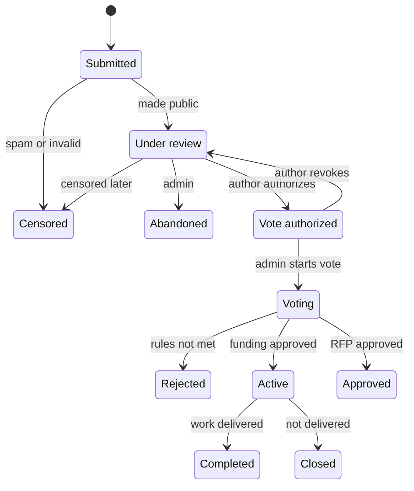

# Politeia proposals

Politeia is Decred's proposal system, where anyone can ask stakeholders to fund work or back a policy, and ticket holders decide by vote. This page is for ticket holders who want to vote knowingly and for anyone thinking of submitting a proposal.

!!! abstract "Politeia in one minute"

    - **Where:** [proposals.decred.org](https://proposals.decred.org/). Proposals live off chain; their fingerprints are anchored in the Decred blockchain every hour.
    - **Who votes:** tickets live at a snapshot taken 256 blocks before the vote starts. One ticket, one vote, cast once.
    - **How long:** 2,016 to 4,032 blocks (about 7 to 14 days).
    - **What passes:** at least 20% of eligible tickets vote, and at least 60% of votes cast are yes. These are the minimums and defaults in the Politeia web app's start-vote form on mainnet, not consensus rules.
    - **What it binds:** nothing on chain. Treasury money moves only through treasury spends that ticket holders approve again, on chain.

## What Politeia is for

Decred has no company or foundation that decides what gets built. The project's treasury receives 10% of every block's subsidy, and stakeholders decide what that money pays for. Politeia is where those decisions are made in public.

Proposals come in two broad kinds:

Funding proposals
:   Ask the treasury to pay for a program of work: software, research, design, outreach and so on. The proposal states a budget in US dollars, a start and end date, and a domain (the software's defaults are development, marketing, research and design). The author bills against the budget as the work is delivered, not up front.

Policy proposals
:   Ask stakeholders to back a course of action or a rule for how the project works, such as a change of direction or an amendment to the [Decred Constitution](constitution.md).

A third form, the **request for proposals (RFP)**, asks for no money itself. It describes work stakeholders want done and sets a deadline by which others can submit proposals that answer it (between 2 weeks and 90 days by default). Those submissions then compete in a **runoff vote**: each is voted on normally, and of those that meet the quorum and approval rules, the one with the most net yes votes (yes minus no) wins.

Politeia does not decide **consensus rules**, the rules every node enforces. Those change only through [consensus rule votes](consensus-upgrades.md) recorded in the blockchain, although a Politeia proposal is often used first to gauge support for a change.

### Why it is off chain

A proposal is a document with discussion, edits and images, too bulky to put in the blockchain. Politeia keeps the content on its servers but makes it tamper-evident: every submission is signed, and fingerprints of all the data are written into the chain, so anyone can later prove what was submitted, when, and whether it was changed or hidden.

## A proposal's life

The diagram shows the states a proposal can pass through, from submission to its final result.

1. **Submission.** The author needs a Politeia account. The site asks for a payment in DCR to register and to submit proposals, to deter spam. Check the current amounts on the site itself, because they can change.
2. **Review.** A Politeia administrator either makes the proposal public or censors it as spam or content the site cannot host. Censorship leaves proof, as [Transparent censorship](#transparent-censorship) explains.
3. **Discussion.** The proposal is public under review. Anyone can read it; account holders can comment and up- or downvote comments. Comment votes are public and only change display order; they decide nothing. The author can publish new versions in response to feedback. An administrator can mark a public proposal **abandoned**, which locks it against further changes.
4. **Authorization.** When the author is ready, they authorize the vote. From that moment the proposal can no longer be edited. The author can revoke the authorization to make further changes, then authorize again.
5. **Vote start.** An administrator starts the vote, setting its length, quorum and approval percentage. An administrator cannot start a vote the author has not authorized.
6. **Voting.** Eligible tickets vote yes or no from their owners' wallets until the end block. Comments stay open during the vote.
7. **Result.** At the end block the proposal is approved or rejected. An approved funding proposal becomes **active** and can be billed against. An administrator later marks it **completed**, or **closed** if the author fails to deliver, after which nothing more can be billed. An approved RFP is marked **approved**, since it requests no money.

[Write a Politeia proposal](write-a-proposal.md) covers what a good proposal contains and what to do before submitting one.

## Who can vote

Only tickets can vote, and only those that were **live** (mature and waiting in the ticket pool) at the vote's **snapshot**. When an administrator starts a vote, Politeia takes the list of live tickets at the block 256 blocks (about 21 hours) below the current tip. Going back 256 blocks puts the snapshot deep enough in the chain that it will not be undone by a chain reorganization.

Worked example, from a vote held in 2026:

- The administrator started the vote when the chain was at block 1,093,047.
- The snapshot is block 1,092,791, 256 blocks earlier. The 40,858 tickets live at that block are the eligible set.
- Voting closes at block 1,095,063: 2,016 blocks after the vote started, about one week.

Explorers such as dcrdata list the snapshot block as the vote's start block, so a 2,016-block vote shows start and end blocks 2,272 blocks apart.

What follows from the snapshot:

- **Buy early to vote.** A ticket bought after the snapshot cannot vote on that proposal. Since a new ticket needs 256 blocks to mature, it must have been mined roughly 512 blocks (about 43 hours) before the vote starts.
- **Your eligible tickets keep their vote for the whole window.** A ticket that is drawn to vote on chain, or that expires, during the vote can still vote on the proposal until the end.
- **One ticket, one vote, final.** Each eligible ticket can vote once. Politeia rejects a second vote from the same ticket, so a vote cannot be changed.

### Your wallet votes, not your voting service provider

Each vote is a message signed with the key of the ticket's **commitment address**: the address the ticket's funds and reward return to (if a ticket has several, the one that committed the largest amount). That key belongs to the owner of the funds, so:

- If you stake through a [voting service provider](../staking/vsps.md) (VSP), the VSP casts your on-chain votes but cannot vote on Politeia for you. You must vote yourself, from your own wallet.
- Politeia votes are not set in advance like agenda or treasury choices. You cast them during each vote's window.
- If your tickets' funds come from a separate wallet, for example a cold wallet with a hot voting wallet, the vote must be signed by the wallet that holds the commitment address keys.

You can vote from Decrediton 2.1.7 (**Governance** > **Proposals**) or with the command-line tool `politeiavoter`. Bison Wallet 1.0.6 cannot vote on Politeia proposals. [Vote with your tickets](vote.md) walks through each method.

## How long a vote runs and what it takes to pass

Each vote carries its own settings, chosen by the administrator who starts it. The proposal page and dcrdata show the settings of every vote.

| Setting | Mainnet value | Where it comes from |
|---|---|---|
| Length | 2,016 to 4,032 blocks (about 7 to 14 days) | limits in the Politeia server's ticket-vote plugin |
| Quorum | at least 20% of eligible tickets must vote (yes or no) | minimum and default in the Politeia web app |
| Approval | at least 60% of the votes cast must be yes | minimum and default in the Politeia web app |

Both conditions must hold. If too few tickets vote, the proposal fails however lopsided the result. The 20% and 60% figures are conventions of the Politeia web app and the Decred Constitution, not consensus rules: the Politeia server itself accepts any value up to 100%, and no node checks them.

Three 2026 votes show how the rules work; each ran for the minimum, 2,016 blocks. Figures are from dcrdata, checked November 2026.[^votes]

| Proposal | Eligible tickets | Votes cast (turnout) | 20% quorum | Yes votes (60% of cast needed) | Result |
|---|---|---|---|---|---|
| Bug Bounty Program 2026 H2 | 40,865 | 15,498 (38%) | about 8,170: met | 14,632 (about 9,300 needed) | Approved |
| DCRDEX mobile apps rollout | 40,858 | 9,153 (22%) | about 8,170: met | 4,587 (about 5,490 needed) | Rejected |
| Integrate Decred into OneKey… | 40,546 | 7,692 (19%) | about 8,110: not met | 235 | Rejected, no quorum |

The second proposal won a narrow majority, 50.1% yes, and still failed, because a simple majority is not enough. The third failed on quorum alone.

## Transparent censorship

Administrators must be able to remove spam and content the site cannot host, but they could also quietly hide proposals they dislike. Politeia allows censorship but makes it provable.

How it works:

- **Every user signs.** At registration the browser creates a personal signing key (an identity) for the account. Every proposal, edit, comment, comment vote and vote authorization is signed with it. Keep a backup: the site lets you download the identity and import it again. This personal key is not one of the **Politeia keys** that sign treasury spends.
- **The server signs back.** For each submission, the server returns a signed receipt. For a proposal, it returns a **censorship record**: a random token that identifies the proposal, a fingerprint (Merkle root) of its files, and the server's signature over both. Each side can prove what the other said.
- **Everything is timestamped in the chain.** Politeia stores each proposal in an append-only, tamper-evident log. At minute 56 of every hour it sends fingerprints of every changed log to **dcrtime**, Decred's timestamping service. dcrtime combines all fingerprints into one Merkle root and writes it into a Decred transaction. From then on, anyone can prove that a piece of Politeia data existed, in exactly that form, no later than the block containing that transaction.

A proposal can be censored before it is made public, or later if an edit adds content that has to be removed. Either way it disappears from public view, its author sees it marked as censored with the reason given, and the server deletes its files, so keep your own copy of anything you submit. With that copy and the censorship record, an author can show anyone that the server received exactly this content and chose not to publish it, then let the community judge, resubmit or take the case elsewhere.

### Checking it yourself

The proposal page offers downloads of the proposal, its comments and its votes, each with its timestamps. The `politeiaverify` tool, included in the Decred command-line bundle, checks censorship records, receipts, user signatures and chain timestamps in those files. Votes can be audited the same way: the eligible ticket list, each signed vote and each ticket's commitment address are public, so anyone can recount the result. dcrtime itself is open source ([decred/dcrtime](https://github.com/decred/dcrtime)).

## What a yes vote binds

A Politeia vote changes nothing on chain. It binds only because people act on it.

For a funding proposal, approval is a promise to pay for work as it is delivered. The money itself can leave the treasury only through a **treasury spend (TSPEND)**:

1. The contractor does the work and bills against the approved budget, written in US dollars.
2. A holder of one of the two Politeia keys written into the consensus rules signs a treasury spend paying those bills in DCR.
3. Ticket holders vote on that spend on chain over 3,456 blocks (about 12 days). It is mined only if enough of them approve and it fits the treasury's spending limit.

Stakeholders therefore vote on funding twice: once on the proposal and again on each spend, and only the second vote is enforced by the consensus rules. Neither side can act alone: the key holders cannot pay without an approving on-chain vote, and stakeholders cannot force a payment. [The treasury](treasury.md) explains the spend vote and the spending limit.

Policy proposals, including amendments to the Decred Constitution, bind only by convention: contributors and stakeholders choose to follow them.

## Where to follow proposals

- **[proposals.decred.org](https://proposals.decred.org/)** is the system itself: full proposal text, discussion, every version, vote settings and downloads for verification.
- **[dcrdata's proposals page](https://dcrdata.decred.org/proposals)** lists every proposal with its vote status, approval percentage and turnout. Each proposal's page shows the eligible tickets, the yes and no counts and the start and end blocks. [Use the block explorer](../wallets/block-explorer.md) explains how to read it.
- **Decrediton** shows proposals under **Governance** > **Proposals**, with the number of your tickets that are eligible for each. The home screen notes new active proposals. Politeia access can be switched off in Decrediton's privacy settings; the **Proposals** tab then offers **Enable Politeia Integration**.

## What can go wrong

The main risks are covered above: you must vote by hand in each window, a VSP cannot do it for you, a cast vote is final ([Who can vote](#who-can-vote)), and approval is not payment ([What a yes vote binds](#what-a-yes-vote-binds)). Two more:

- **Votes are public.** Each vote names the ticket and the choice, and anyone can see how every ticket voted. Votes sent together can link your tickets to one another. `politeiavoter` can spread votes over the voting period with its `--trickle` option, which requires a SOCKS proxy such as Tor. [Privacy beyond mixing](../privacy/privacy-practices.md) covers related habits.
- **The servers are run by people.** Politeia's operators host the proposals and start the votes. Signatures and chain timestamps make tampering and censorship detectable, but not impossible.

## Go deeper

- [Politeia](../../whitepaper/19-ecosystem.md#sec:ecosystem-politeia): identities, censorship records, anchoring, the vote snapshot and ballot signatures.
- [Timestamping with dcrtime](../../whitepaper/19-ecosystem.md#sec:ecosystem-dcrtime): how fingerprints are aggregated, and what a timestamp does and does not prove.
- [The governance model](../../whitepaper/19-ecosystem.md#sec:ecosystem-model): the four uses of a ticket vote, and how a proposal travels to a treasury payout.
- [Treasury spend](../../whitepaper/12-treasury.md#sec:treasury-tspend): the transaction that pays approved work, and its rules.

## Next steps

- [Vote with your tickets](vote.md): cast your vote on a proposal in Decrediton or with `politeiavoter`, and check that it counted.
- [The treasury](treasury.md): follow approved budgets through to the on-chain spend votes that pay them.
- [Write a Politeia proposal](write-a-proposal.md): take your own idea from groundwork to a vote.
- [How staking works](../staking/index.md): get a ticket, so you are in the snapshot for the next vote.
- [How Decred is governed](index.md): see how Politeia fits with the other decisions tickets make.

[^votes]: From the dcrdata pages for [Bug Bounty Program 2026 H2](https://dcrdata.decred.org/proposal/8b1a640753852e17), [DCRDEX mobile apps rollout](https://dcrdata.decred.org/proposal/e04c9b11d88f6320) and [Integrate Decred into OneKey Hardware and Software Wallet with Ticket Purchasing](https://dcrdata.decred.org/proposal/43b4d7b6dcedea18), checked November 2026. Quorum and approval follow `voteIsApproved`, and the snapshot and end block `voteChainParams`, in politeia's ticket-vote plugin.

*[VSP]: voting service provider
*[RFP]: request for proposals
*[TSPEND]: treasury spend
