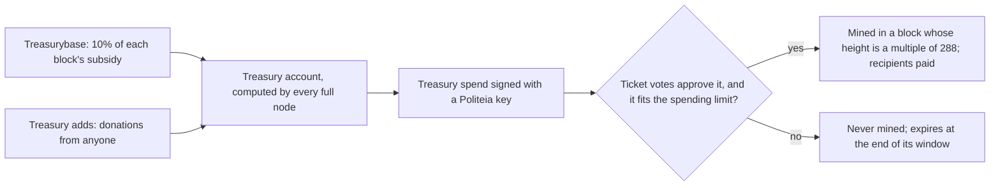

# The treasury

Decred pays for its own development from a treasury that the consensus rules hold, not a company. This page covers where the money comes from, how ticket holders approve each payment on chain, how much can be spent, and how anyone can check every step. It is for stakeholders who want to vote on spending knowingly, and for anyone who wants to know who controls the project's funds.

!!! abstract "The treasury in one minute"

    - **Income:** 10% of every block's subsidy, plus anything people choose to donate.
    - **Custody:** since block 552,448 (2021) the treasury is a balance in the chain itself. No private key can spend it.
    - **Spending:** only a **treasury spend (TSPEND)** can take money out. It must be signed with one of two **Politeia keys** written into the consensus rules, **and** approved by ticket votes over a window of 3,456 blocks (about 12 days).
    - **Approval:** 20% of the possible votes must be cast, and yes votes must reach 60% of all votes cast plus all votes still possible in the window.
    - **Limit:** about 4% of the balance per 6,912 blocks (about 24 days), never less than about 10,781 DCR, never more than the balance.

## What the treasury is

The treasury is an **account**: a balance that every full node computes from the blockchain. Coins that enter it stop existing as ordinary coins, and coins that leave it are created fresh for the recipients. No wallet holds them, so there is no key that can be stolen to empty it.

Think of a joint account that needs two signatures. The Politeia key holders write a payment, and it is worthless until stakeholders countersign it with their ticket votes. Neither side can move money alone:

- the key holders cannot pay anyone without an approving vote, nor beyond the spending limit;
- stakeholders cannot force a payment, because only a key holder can create a treasury spend.

## Why it works this way

From launch until 2021, the treasury's share of each block went to an ordinary address, `Dcur2mcGjmENx4DhNqDctW5wJCVyT3Qeqkx`, a 2-of-3 multisignature address held by Decred Holdings Group LLC (DHG), which paid contractors' invoices by hand. [DCP-0006](https://github.com/decred/dcps/blob/master/dcp-0006/dcp-0006.mediawiki), the Decred Change Proposal (DCP) that created today's treasury, names the problems: stakeholders had no direct say over spending, the funds could be stolen, key project members could abandon the project or be coerced, and the process was not transparent enough.

Stakeholders voted DCP-0006 in as the `treasury` agenda, and it became active at block 552,448 in 2021. [Consensus rule votes](consensus-upgrades.md) explains how such a vote works.

## Where the money comes from

Two kinds of transaction add to the treasury:

**Treasurybase.** Every block contains exactly one **treasurybase** transaction, created by the miner, that credits 10% of the block subsidy to the treasury. The amount follows the subsidy schedule: about 0.50 DCR per block in November 2026, shrinking by about 1% every 6,144 blocks (about 21 days). [DCR supply and issuance](../start/supply-and-issuance.md) covers the schedule. Two details differ from the old address:

- The treasury's share is no longer cut when a block has fewer than five votes.
- It is not lost when voters disapprove a block. Treasury transactions live in the block's stake tree, which disapproval never removes ([Miners, voters and the life of a block](../start/life-of-a-block.md) explains disapproval).

**Treasury add (TADD).** Anyone can send their own coins to the treasury with a **treasury add**. The coins are destroyed and the treasury balance rises by the same amount. In dcrwallet this is the `sendtotreasury` RPC. A treasury add cannot be undone: the coins can only ever leave again through an approved treasury spend.

Both kinds of credit count in the balance only after 256 blocks (about 21 hours), the same maturity that applies to mining rewards. Explorers show the not-yet-counted amount as immature.

!!! note "The legacy address still exists"
    Activating the new treasury moved no coins from the old address, which dcrdata labels **Legacy Decred Treasury**. Its balance is not part of the on-chain account, its spending is not voted on, and its funds can reach the account only through treasury adds.

## How money leaves: Treasury spends

The diagram shows the whole flow: two sources fill the account, and one gated path, the treasury spend, empties it.



What makes a treasury spend valid:

- **It is signed with a Politeia key.** The consensus rules contain exactly two public keys, listed in dcrd's mainnet parameters. A spend signed by any other key is invalid. Replacing or adding a key is itself a consensus rule change that needs an agenda vote.
- **The signature fixes everything.** It covers the total amount, every recipient address and amount, and the voting window, so ticket holders vote on exactly what they see, and on the spend as a whole.
- **Payments mature.** Recipients can spend what they receive only after 256 blocks.

## How stakeholders approve a spend

A signed treasury spend is broadcast and waits in the nodes' memory pools. Voting wallets see it and, if their owner has chosen yes or no, add that choice to the block votes their tickets cast.

### The window

Treasury spends can be mined only in a block whose height is a multiple of the **treasury vote interval**, 288 blocks (about one day). Each spend names its own **voting window** of 12 such intervals:

| Rule | Mainnet value |
|---|---|
| Treasury vote interval | 288 blocks (about 1 day) |
| Voting window | 3,456 blocks (about 12 days) |
| Most votes possible in a window | 17,280 (3,456 blocks × 5 votes) |
| Quorum | 3,456 yes or no votes (20% of 17,280); abstentions do not count |
| Approval | yes votes ≥ 60% of (yes + no + every vote still possible in the window) |

At each 288th block, every node checks each open spend against the votes cast so far. Because remaining votes count as potential no votes, a spend is mined early only when no later votes could change the result. A spend that has not passed by the end of its window can never be mined; there is no separate rejection step.

### Worked example: A spend from November 2026

The latest treasury spend at the time of writing was mined at block 1,130,112 on 6 November 2026.[^example]

| Step | Value |
|---|---|
| Window | blocks 1,127,232 to 1,130,688 |
| Mined at | block 1,130,112: 2,880 blocks (about 10 days) into the window, 576 blocks before its end |
| Votes counted | 9,236 yes, 1,788 no: 11,024 cast |
| Quorum | 11,024 ≥ 3,456: met |
| Votes still possible | 576 blocks × 5 = 2,880 |
| Yes votes needed | 60% × (11,024 + 2,880) = 8,342.4, rounded down to 8,342 |
| Result | 9,236 ≥ 8,342: approved and mined |
| Payment | 13,556.15 DCR to 34 recipient addresses in one transaction |

Even if all 2,880 remaining votes had been no, yes would still have exceeded 60%, so the spend was mined two intervals early.

## The spending limit

Even an approved spend is mined only if it fits a spending limit set by the consensus rules. The limit caps the damage from a stolen Politeia key or a software bug, and it works as a basic fiscal rule against rapid spending.

### The rule today (DCP-0013)

Since block 1,052,416 the limit comes from [DCP-0013](https://github.com/decred/dcps/blob/master/dcp-0013/dcp-0013.mediawiki) (agenda `maxtreasuryspend`). At each 288th block, nodes look back over the last 6,912 blocks (about 24 days):

1. Add back everything spent in those 6,912 blocks to the current balance.
2. Take 4% of that total.
3. If the result is below the **floor** of 10,781.27767296 DCR, use the floor instead.
4. Subtract what was already spent in those 6,912 blocks. The rest is what new spends in this block may total.
5. Never allow more than the treasury balance itself.

The floor is what the treasury would earn in one 3,456-block voting window at the original, unreduced block subsidy. It keeps the limit from shrinking toward zero as issuance falls. It decides the limit only when the balance plus recent spending is below about 269,532 DCR.

**Example, with made-up round numbers.** Suppose the balance is 861,444 DCR, and a spend of 13,556 DCR was mined ten days ago:

- 4% of (861,444 + 13,556) = 4% of 875,000 = 35,000 DCR;
- 35,000 is above the floor, so it stands;
- 35,000 − 13,556 = 21,444 DCR is the most that further spends can total until the earlier spend falls out of the 24-day window.

DCP-0013 explains why 4%: a consensus change to replace compromised keys takes about four months to deploy, which is five 24-day windows, so a thief could take at most about 20% of the treasury in that time.

### How the limit has changed

Stakeholders have voted on the limit three times. Each rule caps what spends may total within a 6,912-block window.

| Rule | Agenda | Mainnet blocks | Limit |
|---|---|---|---|
| DCP-0006 | `treasury` | 552,448 to 657,279 | 150% of the average spent per window over the six preceding windows, counting only those with spending (16,000 DCR assumed if none of the six had any) |
| [DCP-0007](https://github.com/decred/dcps/blob/master/dcp-0007/dcp-0007.mediawiki) | `reverttreasurypolicy` | 657,280 to 1,052,415 | 150% of the treasury's income in the same window |
| DCP-0013 | `maxtreasuryspend` | 1,052,416 onward | 4% of the balance (plus recent spends), with the floor, capped at the balance |

The first rule based the limit on past spending, unlike the original Politeia proposal, and in practice blocked payments. DCP-0007's income-based rule shrank with the block subsidy and would eventually have left most of the balance unspendable, so DCP-0013 tied the limit to the balance.

## From an approved proposal to a payment

A treasury spend does not say on chain what it pays for. That link is made off chain, through Politeia, Decred's proposal system:

1. **A proposal is approved.** Ticket holders vote on a proposal with a budget in US dollars. Approval is a promise to fund the work, not a payment ([Politeia proposals](politeia.md)).
2. **The work is done and invoiced** against the budget, in US dollars converted to DCR.
3. **A key holder signs a treasury spend** paying the approved invoices, usually many at once.
4. **Ticket holders vote again**, on chain, on that exact spend.
5. **The spend is mined** if it passes and fits the limit.

Funding is therefore voted on twice, and only the second vote is enforced by the consensus rules.

## Your say: Treasury voting choices

Your wallet abstains on every treasury spend unless you tell it otherwise. You can set two kinds of choice:

- **Per Politeia key:** a standing choice for every spend signed by that key, including spends that do not exist yet.
- **Per treasury spend:** a choice for one spend, identified by its transaction hash. It overrides your key choice for that spend.

Decrediton and dcrwallet support both kinds and offer yes, no or abstain. Bison Wallet 1.0.6 sets per-spend choices with only **Yes** and **No**, with no abstain option, and cannot add a choice for a key that has none yet. If a voting service provider (VSP) votes for your tickets, all three wallets send your updated choices to the VSP. [Vote with your tickets](vote.md) shows where to set the choices in each wallet and how to check that your votes counted.

Two things to weigh:

- **A yes on a key is a blank check, within the limit.** It approves every future spend that key signs, without your seeing them. Setting choices per spend keeps control, but you must come back for each one.
- **Choices count only when a ticket is drawn.** Set them before the window opens. A ticket that votes before you set a choice abstains on the spends open at that time.

## Audit it yourself

Everything that changes the treasury is a public transaction.

**On the block explorer.** The [dcrdata treasury page](https://dcrdata.decred.org/treasury) shows the balance (with its immature part), **Unconfirmed Treasury Spends** waiting in the memory pool, and every treasury transaction with a **Type** filter (**Spend**, **Add**, **Treasurybase**). Opening a spend shows its yes and no votes, quorum, turnout, voting period and each recipient address. [Use the block explorer](../wallets/block-explorer.md) explains how to read these pages.

=== "Decrediton"

    1. Open **Governance**. The header shows **Available Treasury Balance**.
    2. Open the **Treasury Spending** tab to see both Politeia keys, any spends waiting for votes (each **Tx hash** links to the explorer), and your current choices.

    Decrediton reads this figure from dcrdata and shows it only if **Decred Block Explorer** is enabled under **Settings** > **Privacy and Security**. The figure adds the coins still held at the legacy address to the on-chain account, so it can be higher than the account balance alone.

=== "Command line"

    These calls go to your own full node, `dcrd`, so the answer does not depend on any website. Show the treasury account's mature balance at the chain tip:

    ```bash
    dcrctl gettreasurybalance
    ```

    ```text title="Example output"
    {
      "hash": "<BLOCK_HASH>",
      "height": 1130500,
      "balance": 87454474468115
    }
    ```

    `balance` is in atoms; divide by 100,000,000 for DCR (874,544.74468115 DCR in this example). `<BLOCK_HASH>` stands for the hash of the tip block.

    Show the current yes and no counts, with window start and end, for every treasury spend waiting in the memory pool:

    ```bash
    dcrctl gettreasuryspendvotes
    ```

    For a spend that has already been mined, name it. The empty first argument means "count up to the chain tip":

    ```bash
    dcrctl gettreasuryspendvotes "" '["<TSPEND_HASH>"]'
    ```

    `<TSPEND_HASH>` is the transaction hash of the treasury spend. For a mined spend, the counts stop at the block that mined it.

Bison Wallet lists the spends open for voting but does not show the treasury balance.

## What can go wrong

- **A Politeia key is stolen.** A thief could sign spends, but each one still needs an approving vote and must fit the spending limit. Stakeholders can vote them down, per spend or by setting no on that key, until a consensus rule change replaces the key.
- **The key holders stop signing.** No one else can create a treasury spend, so payments would stop until a consensus rule change named new keys. The balance itself stays in the account.
- **Low participation.** If fewer than 3,456 yes or no votes are cast in a window, even an uncontested spend fails and has to be signed again with a new window.
- **The limit can delay legitimate payments.** A large payment that does not fit the current window must wait for earlier spends to leave the 24-day window, or be split.
- **The chain cannot check the work.** It checks signatures, votes and limits. Whether invoiced work was done is judged by people: the key holders before signing, and stakeholders when they vote.
- **Your votes are public.** Treasury votes are part of your tickets' vote transactions, so anyone can see how each ticket voted.

## Go deeper

- [The decentralized treasury: background](../../whitepaper/12-treasury.md#sec:treasury-overview): the legacy address, the account model and the three treasury transaction types.
- [Treasury spend](../../whitepaper/12-treasury.md#sec:treasury-tspend): the exact format, the Politeia keys and every rule a spend must pass.
- [Tallying and approval](../../whitepaper/12-treasury.md#sec:treasury-tally): how votes are counted and why remaining votes count as no.
- [The balance-based policy (DCP-0013)](../../whitepaper/12-treasury.md#sec:treasury-policy-dcp13): the spending limit's formula, its floor and test vectors.

## Next steps

- [Vote with your tickets](vote.md): set your choices on treasury spends and Politeia keys before your tickets are drawn.
- [Politeia proposals](politeia.md): follow the proposals that treasury spends pay for.
- [Use the block explorer](../wallets/block-explorer.md): read treasury pages and spend votes on dcrdata.
- [Write a Politeia proposal](write-a-proposal.md): ask the treasury to fund your work.
- [Staking and the treasury for builders](../../dev/protocol/staking-and-treasury.md): treasury transaction formats and RPCs, for developers.

[^example]: Figures from [the transaction's dcrdata page](https://dcrdata.decred.org/tx/2996f597632ee9634baf61c23dfc6eb449c2bc75f95fc4a3d7077a2c92cbfa35), checked November 2026. The window end is the window start plus 3,456 blocks. All treasury parameters come from [chaincfg/mainnetparams.go at release-v2.1.7](https://github.com/decred/dcrd/blob/release-v2.1.7/chaincfg/mainnetparams.go).

*[TSPEND]: treasury spend
*[TADD]: treasury add
*[DCP]: Decred Change Proposal
*[DHG]: Decred Holdings Group
*[VSP]: voting service provider
*[RPC]: remote procedure call
