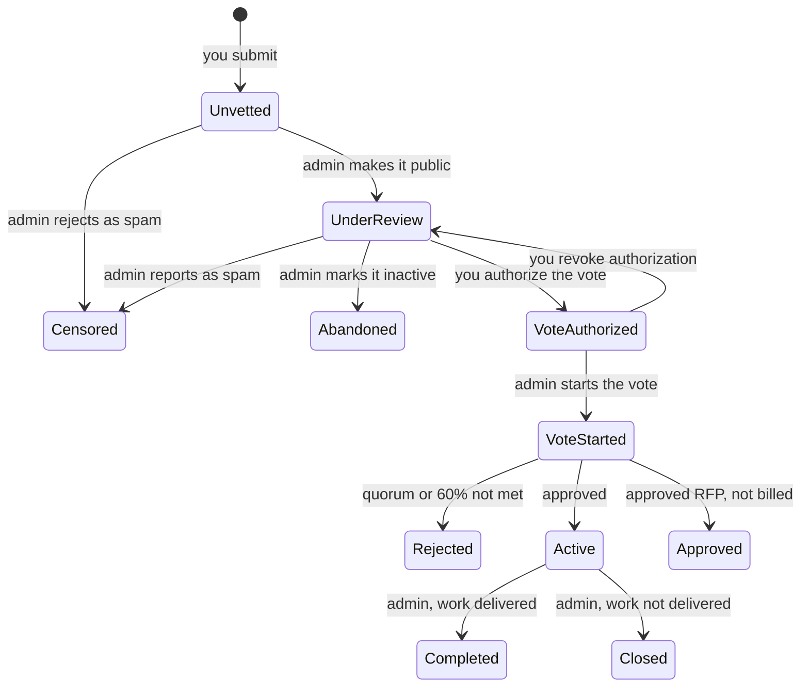

# Write a Politeia proposal

This guide takes you from an idea for paid work or a policy to a stakeholder vote on Politeia, Decred's proposal system at proposals.decred.org, and on to payment if it passes. It is for anyone who wants to work for Decred or shape how the project spends its money.

!!! info "Applies to"
    The proposals.decred.org web interface (UI labels from the politeiagui source as of September 2025, not checked against the deployed site, which may differ; Politeia server build 1.4.0-pre, as the site reports it) and `politeiaverify` from the Decred 2.1.7 command-line bundle. Checked November 2026.

## Before you start

- **An idea that has been discussed in public.** Step 1 explains why this comes first.
- **A proposal text in Markdown**, saved on your own computer. Drafts saved on the site live only in your browser and cannot be recovered.
- **An email address** and a desktop browser you will keep using. Your signing key lives in that browser.
- **A little DCR in your own wallet** for the registration fee and one proposal credit. See [Send and receive DCR](../wallets/send-and-receive.md).
- **Time.** Allow roughly four to six weeks from a first public draft to the end of the vote. Each month's work is paid during the following month at the earliest.

## How a proposal moves

A proposal passes through fixed statuses on Politeia. You control the early steps; administrators and ticket holders control the rest. An approved funding proposal becomes Active; an approved request for proposals (RFP), which asks for no funding itself, ends as Approved.



Approval does not move money by itself. Each payment is a separate **treasury spend (TSPEND)** that [ticket](../staking/index.md) holders approve on chain. [How Decred is governed](index.md) explains this two-vote design.

## 1. Decide whether it should be a proposal

Politeia votes on concrete plans, not ideas. A proposal fits when:

- the work needs treasury funding, or a decision stakeholders should own (a policy, an amendment to the [Decred Constitution](constitution.md), or support for an idea before someone writes a consensus change);
- it clearly benefits Decred, not mainly a personal venture;
- you can say who will do the work, by when, for how much.

Changes to the consensus rules themselves are decided by [consensus rule votes](consensus-upgrades.md); a proposal can only gauge support first.

**Get feedback before you spend weeks writing.** Describe the idea in the community chats listed on [decred.org/community](https://decred.org/community/) (Matrix, Discord, Bison Relay and others), then share a full draft there. Study past proposals and their results on [dcrdata's proposals page](https://dcrdata.decred.org/proposals). If your work depends on existing contractors, agree it with them first. The community's [proposal guidelines](https://github.com/decredcommunity/guidelines/blob/master/proposals.md) (last updated 2020) suggest about two weeks of feedback, longer for large proposals.

If nobody in the community knows you, start small. A short proposal delivered well builds the credibility a larger one needs.

## 2. Write the proposal

Answer five questions, in this order; voters expect this structure.

| Section | What it answers |
|---|---|
| **What** | The problem or goal, in two or three sentences. |
| **Why** | Why Decred needs it now, and what happens without it. |
| **How** | The steps, the deliverables and how voters can check them. |
| **Who** | Who does the work and bills against the budget, with verifiable past work (repositories, earlier proposals, published results). |
| **When** | Milestones with dates, and how much is billed for each. |

Also state:

- **Budget in USD.** Budgets are written in US dollars and paid in DCR. Itemize it; large lump sums draw questions. Give the maximum total, and the expected total if it differs.
- **Duration.** A start and an end date. Ongoing services need an end date too.
- **Deliverables and licensing.** Who owns the results and under which license. Decred's own software uses the ISC license. Say who maintains the work afterwards.
- **Reporting.** What you report, how often and where.
- **Risks.** What could delay the work, and what happens if a team member leaves.

Write for non-experts as well as experts, and avoid hype: many voters are experienced and skeptical.

### A condensed example

This example is fictional and its figures are examples only. A real proposal explains each section at greater length.

!!! note "Example: Accessibility review and fixes for Decrediton"

    **What.** Audit Decrediton against common accessibility guidelines and fix what blocks keyboard and screen-reader users.

    **Why.** Several core screens cannot be used without a mouse, which excludes some users from staking and voting.

    **How.** (1) Publish an audit report listing every issue found. (2) Fix the issues on the wallet, staking and governance screens. (3) Fix the remaining screens and add automated checks. All code is submitted to the decred/decrediton repository under its ISC license, and reviewed by its maintainers.

    **Who.** @example-dev on Matrix and GitHub, with links to three previous accessibility projects.

    **When.**

    | Milestone | Done by | Work | Cost (USD) |
    |---|---|---|---:|
    | 1. Audit report | Week 3 | 40 hours | 1,600 |
    | 2. Core screen fixes | Week 9 | 120 hours | 4,800 |
    | 3. Remaining fixes and automated checks | Week 14 | 100 hours | 4,000 |
    | **Total (maximum)** | | **260 hours at 40 USD/hour** | **10,400** |

    Unspent budget is not billed. A progress update is posted on Politeia at the end of each month.

## 3. Create your Politeia account

1. On proposals.decred.org, click **Sign up**. Enter **Email**, **Username**, **Password** (at least 8 characters) and **Verify Password**.
2. Open the verification link from the email in the **same browser**. Registration creates your **identity**: an Ed25519 key pair generated in the browser. The private key signs everything you submit.
3. Open the menu under your username > **Account** > **Identity** and click **Download Identity**. Store the file, `politeia-pki.json`, somewhere safe. It contains your private key; anyone who has it can sign as you.
4. On the **Credits** tab, click **Pay registration fee**. Send the amount shown to the address shown, in one payment from your own wallet. The dialog's status changes from **Waiting for payment** to **Waiting for confirmations**, and to **Confirmed** after 2 confirmations; the **Registration fee** status on the **Credits** tab then reads **Paid**.
5. Still on **Credits**, click **Purchase more** and buy one proposal credit. Each submission uses one credit.

Politeia's documentation gives both fees as 0.1 DCR. The operators can change them, so the amount in the payment dialog is the one that counts.

!!! warning "Your key lives in your browser"
    Clearing site data, or switching browser or computer, leaves the site unable to sign for you. Import the downloaded file with **Import identity**, or click **Create new identity**, which needs email verification again. Without the key you cannot edit your proposal or authorize its vote.

## 4. Submit the proposal

1. Click **New Proposal**. It stays disabled until the registration fee is paid.
2. Choose the type: **Regular proposal** for most work. **RFP proposal** asks others to bid, with a submission **Deadline** that, with Politeia's default settings, is between two weeks and 90 days away. **RFP submission** answers an RFP and needs its **RFP token**.
3. Fill in **Proposal name** and, except for an RFP proposal, **Amount (USD)**, **Start Date** and **End Date**; then choose a **Domain**. With Politeia's default settings the name is 8 to 80 characters and the domains are **Development**, **Research**, **Marketing** and **Design**.
4. Paste your text into **Write your proposal**. With Politeia's default settings, the site accepts one Markdown file of up to 512 KiB and up to 5 PNG images of up to 512 KiB each.
5. Click **Submit**. The site signs the proposal with your key and charges one credit.

The form rejects amounts and dates outside the server's limits and shows the allowed range. With Politeia's default settings, the amount must be between 1,000 and 1,000,000 USD, the start date at least a week away and the end date within a year.

You should see your proposal under the menu under your username > **My Proposals**, not yet public. Open it and, under **Available Downloads**, click **Proposal Bundle**. Keep that file with your Markdown original: it is your proof of submission (see [If your proposal is censored](#if-your-proposal-is-censored)).

## 5. Discuss, revise, then authorize the vote

An administrator reviews new proposals and makes valid ones public, which can take a few days. Then:

- **Answer every question** in the comments, promptly and specifically. Voters read the thread.
- **Revise the text** with the edit icon on the proposal page. Each edit is a new version, and every version stays visible. Summarize the changes at the end, since many voters read only the final text.
- **Authorize when the questions stop.** Click **Authorize voting**. From then on you cannot edit; to change something, click **Revoke voting authorization** first.

An administrator starts the vote after you authorize it, sometimes batching several proposals. RFP submissions are not authorized by their authors: an administrator starts a runoff vote among them after the RFP deadline.

## 6. During the vote

- **Nothing can change.** The text is frozen; comments stay open.
- **Keep answering.** Questions during the vote still decide votes.
- **Tell people it is open.** Ticket holders vote from their own wallets, not on the website. [Vote with your tickets](vote.md) shows them how.

The vote lasts 2,016 to 4,032 blocks (about 7 to 14 days), as set by the administrator. Only tickets that were live at a snapshot block 256 blocks (about 21 hours) before the vote starts can vote, so tickets that go live within those last 256 blocks cannot vote on it. A proposal passes if at least 20% of those tickets vote and at least 60% of the votes are yes. These are the Politeia site's settings, not consensus rules.

If it is rejected, its comments lock. A large yes share suggests a revised proposal could pass; a resubmission is a new proposal and uses a new credit.

## 7. After approval: deliver, report, get paid

An approved funding proposal becomes **Active**. An administrator later marks it **Completed** when the work is done, or **Closed** if the author stops delivering. Either one ends billing.

**Report progress.** On an active proposal, only you can start a new comment thread: a **Proposal Update** with an **Update title**. Others can reply only to your latest update thread, so post one at least as often as your proposal promised.

**Invoice and get paid.** Payment works like this:

1. You bill in USD for work actually delivered, within the approved budget. The submission form states that work is paid the month after the month it was done.
2. Invoices are converted to DCR at the previous month's average rate.
3. A holder of one of the two **Politeia keys** written into the consensus rules signs a treasury spend that pays the approved invoices, usually together with other contractors' payments.
4. Ticket holders vote on that spend on chain. It cannot be mined until at least 2,304 blocks (about 8 days) into its 3,456-block voting window, and only within the treasury's spending limit. [The treasury](treasury.md) explains both.

Ask in the community channels how invoices are submitted today before your vote ends. The Contractor Management System described in older guides (cms.decred.org) no longer operates.

!!! warning "You carry the timing risk"
    You are paid in arrears, and the DCR amount is fixed at conversion. Its value in USD can change before the payment reaches you. If ticket holders reject a treasury spend, that spend pays nobody.

## If your proposal is censored

Administrators can censor a submission, for spam or for content Politeia cannot host, but not silently. When you submit, the server returns a **censorship record**: a token, a Merkle root of your files and the server's signature over both. A censored proposal stays visible to you with the reason given, but its files are deleted from the server, so your own copies are the evidence. The whitepaper's [Politeia section](../../whitepaper/19-ecosystem.md#sec:ecosystem-politeia) describes censorship records and how Politeia anchors them in the chain.

To prove what you submitted, publish your Markdown file and Proposal Bundle in the community channels. Anyone can check that the server signed exactly that content:

=== "Command line"

    ```bash
    politeiaverify <BUNDLE_FILE>
    ```

    `<BUNDLE_FILE>` is the Proposal Bundle you downloaded, named like `<TOKEN>-v<VERSION>.json`. Keep the file name exactly as downloaded: `politeiaverify` recognizes the bundle by its name and rejects a renamed file, such as `proposal.json` or a browser's `<TOKEN>-v1 (1).json`, with `ERR COULD NOT VERIFY: file not recognized`.

    ```text title="Expected output (excerpt)"
    Censorship record verified!
    Author signature verified!
    ```

No graphical app verifies bundles. `politeiaverify` ships in the Decred command-line bundle; [Set up the command-line wallet](../wallets/command-line.md) covers installing it. You can resubmit at any time.

## Troubleshooting

### New Proposal is grayed out

The registration fee has not been detected. Open **Account** > **Credits** and check the status. Payments need 2 confirmations, about 10 minutes.

### "Your key is invalid or inexistent"

The browser no longer holds your private key. Go to **Account** > **Identity** and use **Import identity** with your saved file, or **Create new identity** and verify it by email in the same browser.

### The edit icon is disabled

You have authorized the vote. Click **Revoke voting authorization**, edit, then authorize again. Once the vote has started, no edits are possible.

## Next steps

- [Politeia proposals](politeia.md): how review, censorship and voting work behind the steps above.
- [The treasury](treasury.md): how treasury spends that pay contractors are voted on and limited.
- [Vote with your tickets](vote.md): the page to send supporters when your vote opens.
- [Get help and join the community](../reference/index.md): where to share a draft and ask about invoicing.
- [Governance data and the Politeia API](../../dev/api/politeia-api.md): script submissions with `pictl` or verify records independently.

*[TSPEND]: treasury spend
*[RFP]: request for proposals
*[USD]: United States dollars
*[PNG]: Portable Network Graphics
*[KiB]: kibibyte (1,024 bytes)
