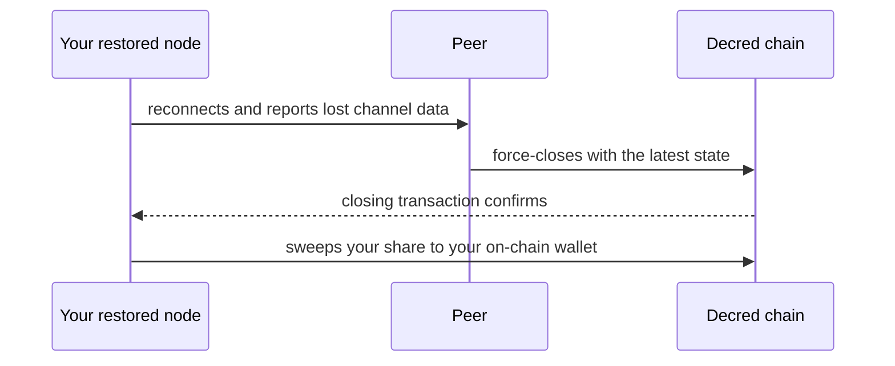

# Back up and protect Lightning funds

Your wallet seed does not protect money held in Lightning channels. This guide covers the backup that does, the restore mistake that forfeits a channel, recovery after losing a computer, and watchtowers.

!!! info "Applies to"
    Decrediton 2.1.7, and `dcrlnd` and `dcrlncli` 0.8.1 as shipped in the Decred 2.1.7 command-line bundle. Checked November 2026.

## Before you start

- **A Lightning wallet that is already set up.** See [Use Lightning](use-lightning.md). Bison Wallet has no Lightning wallet, so this guide covers Decrediton and the command line only.
- **Your seed written down.** Which seed depends on your setup (see the list under "What the seed alone recovers" below). See [Back up and restore your wallet](../wallets/back-up-and-restore.md).
- **A place off this computer for a small file**: a USB drive, another computer or cloud storage.

## What the seed alone recovers

A channel's current balance exists only in the two nodes' databases, not on the chain, so a restore needs more than the seed.

| What you have after losing your computer | On-chain funds | Funds in channels |
|---|---|---|
| Seed only | Recovered | Not recovered |
| Seed and a static channel backup | Recovered | Recovered once each peer is online and force-closes the channel, except payments in flight |
| Static channel backup only | Not recovered | Not recovered: the backup is encrypted with a key from your seed |

Which seed you need depends on how you run Lightning:

- **Decrediton**: the Lightning wallet uses one account of your Decrediton wallet, so your Decrediton seed covers it. Also note that account's **Account number** (under **Accounts**): after a restore from seed, accounts are named `account-1`, `account-2` and so on, and you must pick the same one again.
- **`dcrlnd` with its built-in wallet**: a separate 24-word seed shown by `dcrlncli create`, plus the optional cipher seed passphrase if you set one. It is not a Decred wallet seed and cannot be restored in Decrediton.
- **`dcrlnd` connected to your own `dcrwallet`**: that wallet's seed, plus the account number set in `dcrwallet.accountnumber`.

## Never restore an old channel database

!!! danger "Using an old copy of the channel database can hand all your channel funds to your peers"
    Never start a Lightning node from an older copy of its data: not from a system backup such as Time Machine or File History, a disk image, a copy of the Decrediton wallet folder (its Lightning data is the `dcrlnd` folder inside it), or the file `channel.db` itself. Never run the same Lightning wallet (same seed and, in Decrediton, same account) on two computers, and after a restore never start the old installation again.

An old database holds revoked states: channel states that later payments replaced, which are punished if published ([Lightning on Decred](index.md) explains how). If your node publishes one, your peer can claim the whole channel, including your share. A copy taken while the node runs can never be known to hold the latest state. In practice:

- For `dcrlnd`, the database is `data/graph/mainnet/channel.db` inside its home folder (`~/.dcrlnd` on Linux, `~/Library/Application Support/Dcrlnd` on macOS, `%LOCALAPPDATA%\Dcrlnd` on Windows).
- To move a node to a new computer, close all channels on the old one, wait until none are pending, then restore the seed on the new one and open new channels.

The static channel backup in the next section is the alternative: restoring it can never publish a revoked state.

## Back up your channels

A static channel backup (SCB) is a small file, encrypted with a key derived from your seed, that records for each open channel where it is on the chain, which of your keys it uses and how to reach the peer. It holds no balances, so it changes only when a channel opens or closes and can be copied at any time, including to cloud storage.

`dcrlnd` keeps an up-to-date copy named `channel.backup` next to its other data, but that copy dies with the computer. Keep your own copy elsewhere and refresh it after **every** channel open or close, including channels that other nodes open to you.

### Make a copy

=== "Decrediton"

    1. Open **Lightning Transactions** in the sidebar. If the Lightning wallet is not running, click **Start and Unlock LN Wallet** and enter your private passphrase.
    2. Open the **Advanced** tab. Under **Backup**, the panel shows **SCB backup file location** and **Last Updated** for the automatic copy.
    3. Click **Backup Now**, choose where to save the file and confirm.

    A notification reads **Exported SCB backup file to** followed by the path. Copy the file to your USB drive, other computer or cloud storage.

=== "Command line"

    Write a backup of all channels to a file:

    ```bash
    dcrlncli exportchanbackup --all --output_file=<BACKUP_FILE>
    ```

    `<BACKUP_FILE>` is the path of the file to create, for example on a USB drive. The automatic copy is at `data/chain/decred/mainnet/channel.backup` in the `dcrlnd` home folder. To have `dcrlnd` keep that copy on a second disk instead, set `backupfilepath` in `dcrlnd.conf`.

### Verify a backup

=== "Decrediton"

    On the **Advanced** tab, click **Verify Backup** and select the file. **SCB backup file is valid for this wallet!** means it can be used. **SCB backup file is invalid for this wallet** means it is damaged or belongs to another wallet or account.

=== "Command line"

    ```bash
    dcrlncli verifychanbackup --multi_file=<BACKUP_FILE>
    ```

    A valid file prints `{}`. A damaged or foreign file prints an error.

## Restore from seed plus channel backup

A static channel backup cannot bring channels back to life: it lets your node ask each peer to force-close the channel and pay you your share on chain. That costs on-chain fees for every channel in the file, so treat a restore as an emergency measure, not a way to move a working node. For each channel, your node and the peer go through these steps:



Because the peer publishes the close, your share is not held by the long time lock that applies to whoever force-closes.

=== "Decrediton"

    1. Restore your Decrediton wallet from its seed and let it finish syncing. See [Back up and restore your wallet](../wallets/back-up-and-restore.md).
    2. Open **Lightning Transactions**. Read the warnings and click **I understand and accept the risks**.
    3. Choose **Use Existing Wallet Account** and select the account your Lightning wallet used before (by number, for example `account-1`). Do not choose **Create New Wallet account**.
    4. Under **Restore SCB backup**, select your backup file.
    5. Click **Start and Unlock LN Wallet** and enter your private passphrase.

    The progress line shows **Syncing LN wallet to network**, then **Restoring backup**. The restored channels then appear on the **Channels** tab under the **Pending** filter until each closing transaction confirms and the funds are swept, then under **Closed**. If you picked the wrong account, see Troubleshooting below.

=== "Command line"

    For `dcrlnd` with its built-in wallet, start `dcrlnd` with your usual configuration and an empty `data` folder in its home folder, then:

    ```bash
    dcrlncli create --multi_file=<BACKUP_FILE>
    ```

    1. Answer `y` to the warning that restoring will close all channels and cost on-chain fees.
    2. Set a new wallet password.
    3. Answer `y` when asked whether you have an existing cipher seed mnemonic, enter the 24 words, then the cipher seed passphrase (or press ++enter++ if you set none).
    4. Press ++enter++ to accept the default address look-ahead.

    Follow the on-chain rescan with `dcrlncli getrecoveryinfo` and the channels with `dcrlncli pendingchannels`: each restored channel stays under `waiting_close_channels` or `pending_force_closing_channels` until its funds are swept.

    If the node is already running with the right seed (for example `dcrlnd` connected to a restored `dcrwallet` and unlocked with `dcrlncli unlock`), apply the backup with `dcrlncli restorechanbackup --multi_file=<BACKUP_FILE>`.

A restore cannot recover payments in flight at the moment of the failure, channels opened after your last backup, or channels whose peer never comes back online to force-close. Close channels with peers that have been offline for a long time while your node still works.

## Watchtowers

If a peer publishes a revoked state, your node can answer with a justice transaction that takes the whole channel, but only within a time limit and only while it is online and synced. A watchtower watches the chain for you. After each channel update your node sends it an encrypted package that it can open only if the matching revoked state appears on the chain, so it learns nothing about your channels unless a peer cheats.

The time limit is how long the peer's own share stays locked after its close is mined. By default `dcrlnd` requires the peer to wait between 288 and 4,032 blocks, scaled with the channel's capacity:

| Channel capacity (DCR) | Time to respond to a breach |
|---|---|
| up to about 0.77 | 288 blocks (about 1 day) |
| 1 | 375 blocks (about 31 hours) |
| 5 | 1,877 blocks (about 6.5 days) |
| 10.73741823 (largest standard channel) | 4,032 blocks (about 14 days) |

Without a working watchtower, start your Lightning wallet and let it sync well within the shortest of these times for your channels.

Limits of watchtowers:

- A tower recovers channel balances, not payments in flight, and cannot help while it is offline itself. You can register more than one tower, but each state is sent to only one of them; the others are used for later sessions, not as copies.
- `dcrlnd` towers take no fee and serve only clients that know their tower ID. You need an operator who gives you the ID and address, or your own tower on another always-on `dcrlnd` node: [Run a dcrlnd Lightning node](../../dev/operate/lightning-node.md) shows how.

### Add a watchtower

You need the tower's ID (its public key, which differs from its operator's Lightning node ID) and its address. The tower port defaults to 9911.

=== "Decrediton"

    1. Open **Lightning Transactions** > **Advanced**.
    2. Under **Add Watchtower**, enter the tower ID in **Tower ID:** and the host and port in **Address:**.
    3. Click **Add**.

    **Successfully added watchtower!** confirms it, and the tower appears under **Watchtowers connected** with a **Sessions** count. To stop using it, click **Remove tower** (the × beside it).

    !!! warning "Decrediton 2.1.7 watchtower backups do not cover standard channels"
        Decrediton 2.1.7 starts its Lightning node with `--wtclient.sweep-fee-rate=10000000`, which `dcrlnd` reads as atoms per byte: 100 DCR per kB, so even the smallest justice transaction would have to pay about 26.6 DCR in fees. A standard channel holds at most 10.73741823 DCR, so `dcrlnd` skips every channel state. Adding a tower succeeds, and Decrediton may even show a **Sessions** count, but no channel state is ever backed up to it. This follows from the Decrediton and `dcrlnd` source code; it has not been observed on a running node. Until this changes, start the Lightning wallet regularly, within the times in the table above.

=== "Command line"

    1. Turn on the watchtower client in `dcrlnd.conf` and restart `dcrlnd`:

        ```ini
        [wtclient]
        wtclient.active=true
        ```

    2. Add the tower:

        ```bash
        dcrlncli wtclient add <TOWER_ID>@<HOST>:9911
        ```

        `<TOWER_ID>` is the tower's public key in hex and `<HOST>` its IP address, host name or onion address.

    3. Check it with `dcrlncli wtclient towers` and `dcrlncli wtclient stats`. Once channels update, `num_backups` should rise while `num_failed_backups` stays at 0; a rising `num_failed_backups` means states are being skipped.

    Leave `wtclient.sweep-fee-rate` unset: the default and minimum is 10 atoms per byte (0.0001 DCR/kB). `dcrlncli wtclient remove <TOWER_ID>` stops using a tower.

## Check that it worked

- A copy of the backup sits off the computer, newer than your last channel open or close (compare with **Last Updated**), and **Verify Backup** or `dcrlncli verifychanbackup` accepts it.
- Your seed, and in Decrediton the Lightning account number, are written down.
- On the command line, `dcrlncli wtclient stats` shows backups accepted by your tower.

## Troubleshooting

### Restore fails: Backup is for a different wallet or account

Decrediton reports "SCB restore failed due to backup file being for a different wallet, account or the file being damaged" and removes the half-created Lightning wallet. Start again and choose another account under **Use Existing Wallet Account**. On the command line, `restorechanbackup` prints `unable to unpack chan backup`; after `create --multi_file` the same error appears in the `dcrlnd` log and `dcrlnd` stops. Check that you restored the right seed.

### A restored channel stays pending

The peer has not come online to force-close it, and nothing on your side can close it without the peer. Wait, or contact the peer's operator if you know them.

### Adding a watchtower fails

**Failed to add watchtower**, or an error from `wtclient add`, usually means a wrong ID or an unreachable address. Use the tower ID, not the operator's node ID, and check that the host and port are reachable.

## Next steps

- [Use Lightning](use-lightning.md): open, use and close channels, including what a force close costs.
- [Lightning on Decred](index.md): how channels, routing and liquidity work.
- [Back up and restore your wallet](../wallets/back-up-and-restore.md): protect the seed that every Lightning restore depends on.
- [The whitepaper's Lightning section](../../whitepaper/19-ecosystem.md#sec:ecosystem-lightning): commitment transactions, breaches and the base-protocol features Lightning relies on.

*[SCB]: static channel backup
