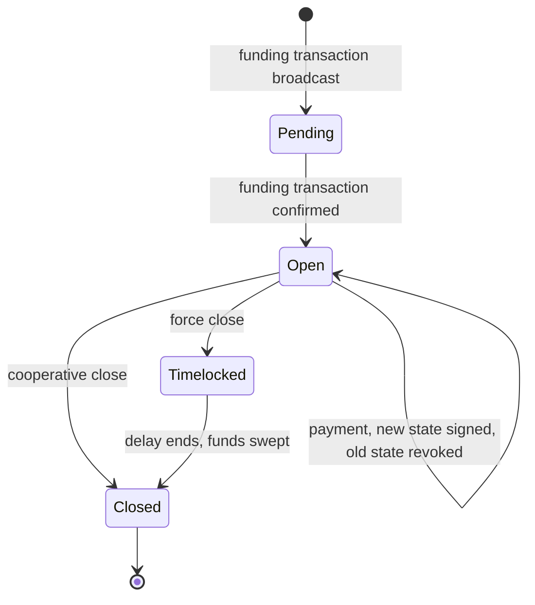
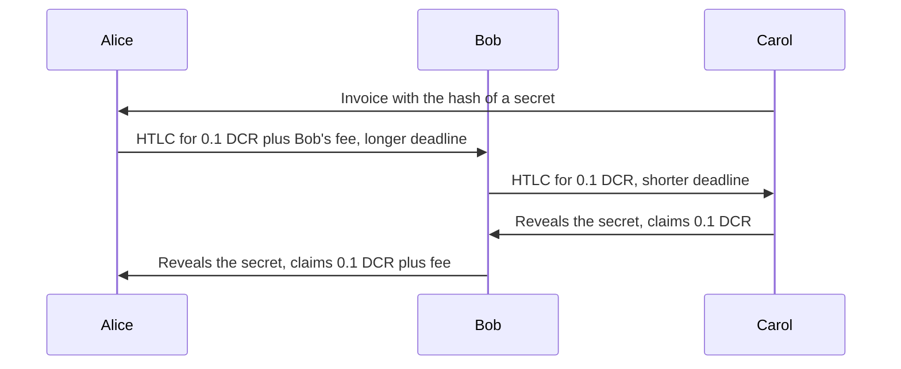

# Lightning on Decred

The Lightning Network lets two people lock DCR in a shared **payment channel** and then pay each other, or anyone their channels connect to, almost instantly without waiting for blocks. This page explains how channels, routing and liquidity work, what can go wrong, and where Lightning stands in Decred software today, so you can decide whether to use it before you fund a channel.

## In this section

-   **[Use Lightning](use-lightning.md)**

    ---

    Create a Lightning wallet, open a channel, receive and pay invoices, and close channels, in Decrediton or with `dcrlncli`.

-   **[Back up and protect Lightning funds](backups-and-watchtowers.md)**

    ---

    Keep a static channel backup, recover from seed plus backup, and set up a watchtower.

!!! abstract "Lightning in one minute"

    - You lock DCR in a channel with one other node. Only opening and closing go on chain; each payment in between is a new balance both sides sign.
    - Payments can hop across channels, but you can send only what is on your side and receive only what is on the other side.
    - Your node, or a **watchtower**, must watch the chain for a peer closing with an old balance.
    - The seed alone does not recover channel funds: you also need a **static channel backup**, and must never restore an old channel database.
    - `dcrlnd`, Decred's Lightning node, is labeled beta. Use amounts you can afford to lose.

## What Lightning gives you

An ordinary Decred payment waits for a block, about every 5 minutes, and pays a transaction fee. That suits most payments, but not a stream of small ones or one that must settle on the spot.

Lightning is a **layer 2** network: it runs on top of the Decred blockchain and uses it only to open and settle channels. A channel works a little like a bar tab: rounds go on the tab and only the final bill reaches the bank. The difference is that both sides hold a signed, up-to-date statement of the tab at every moment. Either side can take that statement to the blockchain and be paid, so neither has to trust the other.

Compared with on-chain payments:

| | On chain | Lightning |
|---|---|---|
| Settles | In a block (one about every 5 minutes); more confirmations for more certainty | As soon as the payment completes, usually in moments |
| Fees | A transaction fee per payment | Routing fees set by each node on the route; on-chain fees only to open and close channels |
| Largest payment | Your balance | What your channels can carry: by default a `dcrlnd` channel holds at most 1,073,741,823 atoms (about 10.7 DCR) |
| Online to receive | No | Yes |
| What you must back up | The seed | The seed and a static channel backup |
| Visible on the blockchain | Every payment | Only channel openings and closings |

Lightning suits frequent small payments between parties who both run it. For saving, staking or a single large payment, an on-chain transaction is simpler and safer.

## How a channel works

A channel is an on-chain output that needs both parties' signatures to spend (a 2-of-2 multisignature output). What each party owns lives off chain, in a **commitment transaction**: a fully signed transaction that spends the channel output and pays each side its current share. Either party could broadcast it at any time, but normally neither does.

A channel's states, named as Decrediton shows them:

### Open

Alice wants to pay Bob often. Her node sends 2 DCR to a new 2-of-2 output: the **funding transaction**. Before it is broadcast, Bob's node signs a commitment transaction that returns the 2 DCR to Alice, so she can recover her funds on her own if Bob disappears.

The channel is usable after a few confirmations, a number the accepting node sets: `dcrlnd` asks for 3 to 6 depending on channel size, about 15 to 30 minutes.

### Update

Alice pays Bob 0.5 DCR. Both nodes sign a new commitment transaction paying 1.5 DCR to Alice and 0.5 DCR to Bob. They then exchange the keys that **revoke** the previous state. From now on, if Alice ever broadcasts the old "2 DCR to Alice" transaction, Bob can use those keys to take the entire channel. None of this touches the blockchain, but that penalty is why your node must keep watching it (see [below](#why-your-node-must-watch-the-chain)).

### Close

There are two ways out:

- **Cooperative close.** Both nodes are online and agree. They sign one closing transaction that pays each side its latest balance. The funds are spendable once it confirms.
- **Force close.** One side broadcasts its latest commitment transaction alone, for example because the peer has disappeared. That side must then wait out a delay, counted in blocks from when the commitment transaction is mined, before it can spend its own share. A peer running `dcrlnd` requires a delay of 288 to 4,032 blocks (about 1 to 14 days), longer for bigger channels.[^defaults] Decrediton shows each channel's value as **CSV Delay** in the channel details.

Payments that are still in flight when a channel force-closes are also settled on chain, which can take longer. The node that opened the channel pays the on-chain fees for the commitment transaction.

!!! warning "A force close locks your funds"

    After you force-close a channel, your share stays locked for the channel's delay, up to about 14 days, and cannot be sped up. Use a cooperative close whenever the peer is reachable.

## Routing payments across the network

You do not need a channel with everyone you pay. If Alice has a channel with Bob, and Bob has one with Carol, Alice can pay Carol through Bob. Bob cannot keep the money for himself, thanks to a **hash time-locked contract (HTLC)**: a payment promise that the recipient can claim only by revealing a secret, and that refunds itself after a deadline.

Carol creates the secret and puts its hash in her **invoice** (a payment request; Decred mainnet invoices start with `lndcr`). The secret then travels back along the route, and each node claims its incoming payment with it:

Each hop's deadline is shorter than the one before it, so a node that forwards a payment always has time to claim its own incoming payment after it learns the secret. If anything fails along the way, every HTLC expires and the funds return to their owners. Until then they are held, which is why a stuck payment can tie up funds for hours: `dcrlnd`'s default extra deadline per hop is 80 blocks, about 7 hours.

Forwarding nodes charge a fee made of a fixed part and a part proportional to the amount. With `dcrlnd`'s default policy, 1 atom plus one millionth of the amount, Bob would charge 11 atoms to forward 0.1 DCR (10,000,000 atoms; 1 DCR is 100,000,000 atoms). Every node sets its own fees, and a payment to your direct channel peer pays no routing fee at all.

Payments are onion-routed: a forwarding node learns the amount and its neighbors on the route, not where the payment starts or ends.

## Liquidity: what you can send and receive

Each channel's capacity is split between the two sides, and the split moves with every payment. The part on your side is your **outbound liquidity**: what you can send. The part on the other side is your **inbound liquidity**: what you can receive. A channel you fund yourself starts with everything on your side, so at first you can send but not receive.

Continuing the example, with Alice's 2 DCR channel to Bob:

| Moment | Alice can send | Alice can receive |
|---|---|---|
| Channel opened by Alice | About 2 DCR | Nothing |
| After Alice pays 0.5 DCR | About 1.5 DCR | About 0.5 DCR |

The amounts are "about" because each side must keep a small **reserve** in the channel (`dcrlnd` asks for 1% of the capacity), and the opener's share also covers the fee of the commitment transaction.

A payment fails if no route has enough liquidity. To receive more than you have spent, you need funds on the far side of a channel to you:

- spend through the channel first, which moves balance to the other side;
- push part of the amount to the peer when you open the channel (Decrediton's **Push Amount (optional)** field), which is a payment to them, not a loan;
- ask another node to open a channel to you.

Decrediton shows your totals at the top of the Lightning screen as "You can Send total … and Receive total …", and will not create an invoice for more than your Receive total (it shows "Cannot request more than total Receive capacity").

## Why your node must watch the chain

Every old commitment transaction is still a valid, signed transaction. A dishonest peer could broadcast one that pays them more than they now own: a **breach**. The defense is the revocation key: once your node sees the old state mined, it publishes a **justice transaction** that takes the whole channel balance.

The cheater's own share is locked by the delay your node required of them, so there is a window to react, but only a window. If Alice broadcasts the old "2 DCR to Alice" state and nobody on Bob's side notices before her delay ends, she keeps 2 DCR and Bob loses his 0.5 DCR.

Your node can react only while it is running, connected and unlocked; Decrediton's Lightning guidance is to keep the wallet online most of the time. If you cannot, use a watchtower.

### Watchtowers

A **watchtower** is a Lightning node that watches the chain for you. After each payment, your node sends it an encrypted package for the revoked state. The tower can decrypt a package only if that exact revoked transaction appears on chain. When it does, the tower publishes the justice transaction and your funds go to you, less the on-chain fee. The towers in `dcrlnd` are altruist: they take no reward.

Limits to know:

- A tower protects only settled balances, not payments in flight at the moment of the breach.
- A tower protects only states it was given, so add one before you start making payments, and pick one you expect to stay online.
- Decrediton turns on `dcrlnd`'s watchtower client but adds no tower for you. You add one with its **Tower ID:** and **Address:** under **Lightning Transactions** > **Advanced** > **Add Watchtower**. In Decrediton 2.1.7, though, the client's fee setting is so high that no standard-size channel state is ever sent to the tower, so start the Lightning wallet regularly instead: see [Add a watchtower](backups-and-watchtowers.md#add-a-watchtower).

## What backups can and cannot recover

Channel balances are not stored on the blockchain, so restoring a wallet from its seed brings back on-chain funds only. For channel funds you also need the **static channel backup (SCB)**, a file named `channel.backup` that `dcrlnd` rewrites every time a channel opens or closes.

| What you have | What you get back |
|---|---|
| Seed only | On-chain funds, including Lightning-account funds outside channels. Not balances inside open channels. |
| Seed plus an up-to-date static channel backup | Channel funds, in most cases. Your node asks each peer to force-close its side of the channel, and your share is swept back to your wallet once that closing transaction confirms. Payments in flight are not recovered. |
| Seed plus a backup older than your newest channel | Funds in the channels the backup lists. Channels opened later are not covered. |

What a static channel backup does and does not do:

- It recovers funds, not channels: every channel it lists is closed.
- It depends on each peer coming online to close the channel. Funds in a channel whose peer has vanished for good cannot be recovered this way, so close channels with peers that stay offline.
- It is encrypted with a key from your wallet seed, so copies can be kept off the computer, for example in cloud storage. It works only with the wallet and, in Decrediton, the account that created it.

!!! danger "Never restore an old channel database"

    Do not copy back an old `dcrlnd` data directory, an old copy of Decrediton's wallet folder, or any backup of the channel database to recover channels. If it holds anything but the very latest state, your node will broadcast a revoked commitment transaction and your peers will take **all** the funds in those channels. Use the static channel backup instead.

## Built into Decred by stakeholder vote

Lightning needs four properties from the base blockchain. Decred had two from launch, stable transaction IDs and absolute time locks (`OP_CHECKLOCKTIMEVERIFY`, used for HTLC deadlines). Ticket holders voted in the other two through [consensus rule votes](../governance/consensus-upgrades.md), after a non-binding poll; each change is specified in a Decred Change Proposal (DCP):

| Change | What it provides | Mainnet status |
|---|---|---|
| Transaction IDs that signatures cannot alter | Commitment transactions can be signed before the funding transaction is broadcast, and no third party can invalidate them | Present since launch |
| Absolute time locks (`OP_CHECKLOCKTIMEVERIFY`) | HTLC deadlines | Present since launch |
| `lnsupport` vote | A non-binding poll on developing Lightning support | Passed; agenda active from block 149,248 |
| `lnfeatures`: [DCP-0002](https://github.com/decred/dcps/blob/master/dcp-0002/dcp-0002.mediawiki) and [DCP-0003](https://github.com/decred/dcps/blob/master/dcp-0003/dcp-0003.mediawiki) | The `OP_SHA256` opcode, so payment hashes match other chains; relative time locks and `OP_CHECKSEQUENCEVERIFY`, which make the force-close delay possible | Active from block 189,568 |
| `fixlnseqlocks`: [DCP-0004](https://github.com/decred/dcps/blob/master/dcp-0004/dcp-0004.mediawiki) | A correction to how relative time locks are checked, so Lightning can use them fully | Active from block 342,784 |

The same building blocks, hash locks and time locks, also power the atomic swaps behind [DCRDEX](../dex/index.md).

## Lightning in Decred software today

**`dcrlnd`** is Decred's Lightning node, a port of `lnd` adapted to Decred's transaction format and signatures. Version 0.8.1 ships in the Decred 2.1.7 command-line bundle with its control tool `dcrlncli`. A Decred Lightning node talks only to other Decred Lightning nodes: it cannot pay Bitcoin Lightning invoices, which start with `lnbc`.

**Decrediton** runs `dcrlnd` for you under **Lightning Transactions** in the sidebar, in either light wallet (SPV) or full-node mode. What to know before you start it:

- It is not available for watch-only, Trezor or Ledger wallets.
- The Lightning wallet uses one account of your Decrediton wallet, covered by your existing seed; no extra seed is created. Decrediton recommends a dedicated account, or better a separate wallet, holding only a small amount you intend to use on Lightning: while Lightning runs, that account stays unlocked, its keys sit unencrypted in memory, and anyone with remote or physical access to the computer could spend its funds.
- Decrediton will not unlock the Lightning wallet while the mixer, the automatic ticket buyer or a ticket purchase is running.
- Its node makes outgoing connections only: fine for paying and receiving, not for a public routing node.
- Channels you open from Decrediton are public: the network learns your node ID and each channel's capacity.
- Optional **Automatic Channel Creation** (autopilot) opens channels for you, using up to 60% of the account's spendable funds.

**Bison Wallet** 1.0.6 has no Lightning support. For an always-on node, run `dcrlnd` directly; with its embedded wallet it has its own 24-word seed, separate from any Decred wallet seed. See [Run a dcrlnd Lightning node](../../dev/operate/lightning-node.md).

### The state of the network

Treat Decred's Lightning network as experimental:

- `dcrlnd`'s README calls it beta software and warns that ignoring its safety guidelines can lead to loss of funds. Decrediton asks you to accept the risks before it creates a Lightning wallet.
- `dcrlnd` has no built-in way to find Decred Lightning nodes: its list of bootstrap servers (DNS seeds) for Decred is empty. Your node learns about the network only after you connect to a node whose address (`NodePubKey@ip:port`) you know.
- **Lightning Transactions** > **Overview** > **Network Stats** counts the **Nodes**, **Channels** and total **Capacity** your node knows about.
- Before funding channels, check that whoever you want to pay accepts DCR over Lightning.

## Go deeper

- [Payment channels and the Lightning Network](../../whitepaper/19-ecosystem.md#sec:ecosystem-lightning): Lightning's base-protocol needs, and how `dcrlnd` adapts `lnd`.
- [Relative lock times (sequence locks)](../../whitepaper/07-transactions.md#sec:transactions-seqlocks): the consensus rules behind the force-close delay.
- [Transaction identifiers](../../whitepaper/04-encoding.md#sec:encoding-txid): why signatures cannot change a Decred transaction's ID.
- [Main-network voting history](../../whitepaper/13-voting.md#sec:voting-history): when `lnfeatures` and `fixlnseqlocks` activated.

## Next steps

- [Use Lightning](use-lightning.md): open your first channel and make a payment.
- [Back up and protect Lightning funds](backups-and-watchtowers.md): set up a backup and a watchtower before you hold real funds.
- [Install and use Decrediton](../wallets/decrediton.md): get the wallet that runs Lightning for you.
- [Privacy beyond mixing](../privacy/privacy-practices.md): what Lightning peers and the public channel graph reveal about you.
- [Run a dcrlnd Lightning node](../../dev/operate/lightning-node.md): operate an always-on node from the command line.

[^defaults]: The `dcrlnd` figures on this page (channel delays and size limit, reserve, confirmations, forwarding fees, per-hop deadline, DNS seeds) are defaults of version 0.8.1 that node operators can change. They are set in `funding/manager.go`, `server.go` and `chainreg/chainregistry.go` of the [dcrlnd source at v0.8.1](https://github.com/decred/dcrlnd/tree/v0.8.1).

*[HTLC]: hash time-locked contract
*[SCB]: static channel backup
*[DCP]: Decred Change Proposal
*[CSV]: CheckSequenceVerify, a relative time lock
